<nav class=toc aria-label="On this page">

On this page

<ol>
<li><a href="#pinecone">Pick up a pinecone</a></li>
<li><a href="#garden">The same numbers all over the garden</a></li>
<li><a href="#heavens">The heavens keep time</a></li>
<li><a href="#atom">Inside the atom: a solar system that isn't</a></li>
<li><a href="#predict">When math sees what eyes can't</a></li>
<li><a href="#riemann">The primes, the zeros and the atoms</a></li>
<li><a href="#news">This week: has the Riemann Hypothesis fallen?</a></li>
<li><a href="#tuned">A universe on a knife's edge</a></li>
<li><a href="#beautiful">The most beautiful equation</a></li>
<li><a href="#reflection">The heavens declare</a></li>
<li><a href="#sources">Sources</a></li>
</ol>
</nav>

Here is a strange fact about the world. Mathematicians sit at desks and invent patterns for the pure joy of it: spirals, ratios, waves, strange imaginary numbers. Then, again and again, decades or centuries later, someone looks through a telescope, or a microscope, or into the heart of an atom, and finds the very same patterns already there, waiting.

Why should the universe speak the language of mathematics at all? Why should a pinecone in your hand, the moons of Jupiter and the electron in a hydrogen atom answer to the same kind of equations? This page is a short tour, from things you can touch to things nobody has ever seen. It goes from easy to wild. Hold on.

**A word on the title.** "Intelligent Design" here is meant in the oldest, simplest sense: the conviction, shared by Kepler, Newton, Maxwell and many working scientists today, that the order we find in nature points to a Mind behind it. Science describes *how* the patterns arise, often through beautifully simple laws. Faith asks *why* there are such elegant laws at all. The two questions are friends, not rivals. Where the science is settled we say so, and where a popular claim goes too far we say that too.

<h2 id=pinecone>1 · Pick up a pinecone</h2>

Next time you are on a walk, pick up a pinecone and turn it over. Look at the bottom. The scales are not scattered at random. They run in spirals: one set curving clockwise, another set curving counter-clockwise.

Now count them. On a great many cones you will find **8** spirals one way and **13** the other. On some it is 5 and 8. On big cones it can be 13 and 21.

Those are not just any numbers. They come from the most famous sequence in mathematics, the **Fibonacci sequence**, where each number is the sum of the two before it:

<b>1, 1, 2, 3, 5, 8, 13, 21, 34, 55, 89, 144…</b>

Leonardo of Pisa, called Fibonacci, wrote about it in 1202 as a puzzle about breeding rabbits. As far as we know, he had no idea it was hiding in every pine forest in Europe.

<figure class=photo>
<picture><source srcset="/static/art/id-pinecone-600.webp 600w,/static/art/id-pinecone.webp 1023w" sizes="(max-width:760px) 100vw,760px" type="image/webp"></picture>
<figcaption>A young pine cone. Follow the scales diagonally and you can see the spiral rows wind around the cone in both directions. Image: The Marmot, <a href="https://creativecommons.org/licenses/by/2.0/">CC BY 2.0</a>, via <a href="https://commons.wikimedia.org/wiki/File%3AMath_in_Nature_%283285831878%29.jpg">Flickr and Wikimedia Commons</a>.</figcaption>
</figure>

### The golden ratio and the golden angle

Divide any Fibonacci number by the one before it: 8 ÷ 5 = 1.6, 13 ÷ 8 = 1.625, 21 ÷ 13 = 1.615, 89 ÷ 55 = 1.6182… The answers close in on one special number, the **golden ratio**, written φ (phi):

<b>φ = 1.6180339887…</b>

It never ends and never repeats. Now here is the secret of the pinecone. A growing tip makes new scales (or seeds, or leaves) one at a time, and each new one appears a fixed turn around from the last. If that turn is **137.5°**, the **golden angle** (360° ÷ φ², more precisely 137.508°), the buds pack together with no gaps and no wasted space, and the Fibonacci spirals appear all by themselves.

<figure class=photo>
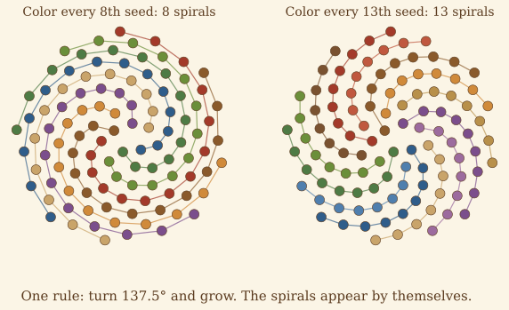
<figcaption>One rule makes both sets of spirals. Each dot is placed 137.5° around from the one before, a little further out. Color every 8th dot and 8 spirals jump out; color every 13th and you get 13 running the other way. <i>Original illustration for The Daily Word, computed from the golden-angle rule.</i></figcaption>
</figure>

<figure class=photo>
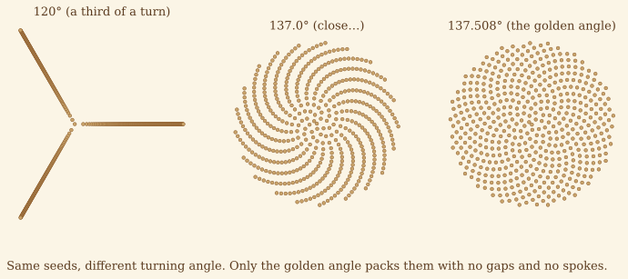
<figcaption>Why 137.5° matters. Turn by a simple fraction of a circle and the seeds line up in spokes with gaps between. Miss the golden angle by even half a degree and gaps open. Only the golden angle, the "most irrational" turn, fills the space evenly. <i>Original illustration for The Daily Word, computed.</i></figcaption>
</figure>

Why does a plant "choose" this angle? Botanists have found that each new bud forms where a growth hormone (auxin) is most concentrated, which happens to be where there is the most room, as far as possible from the buds already there. In 1992 two French physicists, Stéphane Douady and Yves Couder, dripped tiny magnetized droplets into a dish of oil, each one pushed away by the ones before. Out came Fibonacci spirals, with no plant in sight. The pattern is written into the mathematics of "find the most room."

To a believer that does not make the pinecone less wonderful. It makes it more so. The Designer did not need to paint every scale by hand. He wrote one quiet rule, and the rule paints the pinecones, the sunflowers and the pineapples forever.

**Careful, now.** Not every plant is Fibonacci. In 2016 a citizen-science study counted the spirals on 657 sunflowers from around the world. About three counts in four were exact Fibonacci numbers, and most of the rest were close relatives (for example the Lucas numbers 4, 7, 11, 18, 29…), but some heads broke the pattern. Nature is not a machine stamping out copies. The rule is strong; life is a little wild.

<h2 id=garden>2 · The same numbers all over the garden</h2>

Once you know to look, you see it everywhere: the seeds of a sunflower, the bumps of a pineapple, the florets of a cauliflower, the way leaves are arranged around a stem so that each one catches sunlight without shading the one below.

<figure class=photo>
<picture><source srcset="/static/art/id-sunflower-600.webp 600w,/static/art/id-sunflower.webp 640w" sizes="(max-width:760px) 100vw,760px" type="image/webp"></picture>
<figcaption>The heart of a sunflower. The florets form crossing spirals; on large heads, counts of 34 and 55, or 55 and 89, are common. Image: L. Shyamal, <a href="https://creativecommons.org/licenses/by-sa/2.5/">CC BY-SA 2.5</a>, via <a href="https://commons.wikimedia.org/wiki/File%3AHelianthus_whorl.jpg">Wikimedia Commons</a>.</figcaption>
</figure>

<figure class=photo>
<picture><source srcset="/static/art/id-romanesco-600.webp 600w,/static/art/id-romanesco.webp 1280w" sizes="(max-width:760px) 100vw,760px" type="image/webp"></picture>
<figcaption>Romanesco: a spiral of cones, each made of a spiral of smaller cones, each made of smaller ones again. Mathematicians call this a fractal. In 2021 a team in France showed the shape comes from buds that keep "trying" to become flowers and becoming new shoots instead. Image: Jon Sullivan, public domain, via <a href="https://commons.wikimedia.org/wiki/File%3ARomanesco_broccoli_fractals.jpg">Wikimedia Commons</a>.</figcaption>
</figure>

### Spirals that grow without changing shape

A nautilus lives in a shell that it builds one chamber at a time, each chamber a little bigger than the last. The result is a **logarithmic spiral**, a curve that looks exactly the same whether you zoom in or out. The swirl of a hurricane, the arms of many galaxies and the path of a falcon diving on its prey all come close to this same family of curve. It is the natural shape of anything that grows while keeping its proportions.

<figure class=photo>
<picture><source srcset="/static/art/id-nautilus-600.webp 600w,/static/art/id-nautilus.webp 1280w" sizes="(max-width:760px) 100vw,760px" type="image/webp">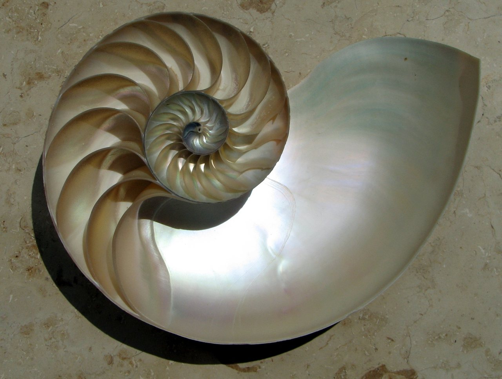</picture>
<figcaption>A nautilus shell cut in half. Each chamber is a slightly larger copy of the one before. Image: Chris 73, <a href="https://creativecommons.org/licenses/by-sa/3.0/">CC BY-SA 3.0</a>, via <a href="https://commons.wikimedia.org/wiki/File%3ANautilusCutawayLogarithmicSpiral.jpg">Wikimedia Commons</a>.</figcaption>
</figure>

**A popular myth.** You will often read that the nautilus is a "golden spiral" built on 1.618. Careful measurements say no: its spiral is real and logarithmic, but it grows by a different ratio. (Mathematician Clement Falbo measured shells in 2005 and found ratios mostly between about 1.24 and 1.43.) The truth is still lovely, and we don't need to dress it up.

### The bee's perfect answer

Bees build their combs out of wax, which costs them a great deal of honey to make. So what shape of cell holds the most honey for the least wax? People suspected the answer was the hexagon for two thousand years. The Roman scholar Varro wrote about it in the first century BC. But nobody could *prove* it until 1999, when the mathematician Thomas Hales finally showed that, of all ways to divide a flat surface into equal areas, hexagons use the least total wall. The bees had the answer first.

<figure class=photo>
<picture><source srcset="/static/art/id-honeycomb-600.webp 600w,/static/art/id-honeycomb.webp 1280w" sizes="(max-width:760px) 100vw,760px" type="image/webp"></picture>
<figcaption>Honeycomb. Equal hexagons divide space with the least wall, a fact proved only in 1999. Image: Richard Bartz, <a href="https://creativecommons.org/licenses/by-sa/2.5/">CC BY-SA 2.5</a>, via <a href="https://commons.wikimedia.org/wiki/File%3AApis_mellifera_carnica_comb.jpg">Wikimedia Commons</a>.</figcaption>
</figure>

### Six arms, every time

Wilson Bentley was a Vermont farmer who in 1885 became the first person to photograph a single snowflake. He went on to photograph more than five thousand. No two looked the same, yet every one had **six** arms. The reason goes all the way down to the water molecule itself: its bent shape (an angle of about 104.5°) makes frozen water lock into a six-sided crystal lattice. The geometry of one tiny molecule is written large on every snowflake that falls.

<figure class=photo style="max-width:420px;margin-left:auto;margin-right:auto">
<picture><source srcset="/static/art/id-snowflakes-600.webp 600w,/static/art/id-snowflakes.webp 1000w" sizes="(max-width:760px) 100vw,760px" type="image/webp">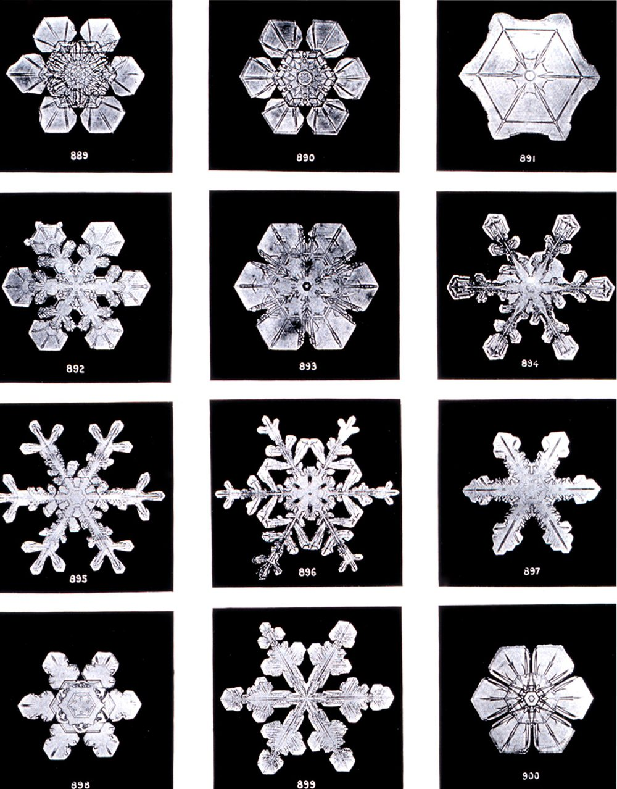</picture>
<figcaption>Snowflakes photographed by Wilson "Snowflake" Bentley in the late 1800s and early 1900s. Endless variety, one six-sided law. Image: Wilson Bentley, public domain (NOAA Photo Library), via <a href="https://commons.wikimedia.org/wiki/File%3ASnowflakesWilsonBentley.jpg">Wikimedia Commons</a>.</figcaption>
</figure>

<h2 id=heavens>3 · The heavens keep time</h2>

Now lift your eyes from the pinecone to the night sky. In the early 1600s the astronomer **Johannes Kepler**, a devout Lutheran who believed the universe was built by a geometer God, spent years wrestling with careful measurements of the planets. In 1619 he found something astonishing. Take any planet's distance from the Sun (call it *a*) and the length of its year (call it *T*). Then:

<b>T² ∝ a³</b>

The square of the year is proportional to the cube of the distance. Measure in Earth years and Earth distances and it becomes simply T² = a³. For Jupiter, 5.2 times farther out than Earth: 5.2³ ≈ 140.6, and the square root of that is about 11.9. Jupiter's year is 11.86 Earth years. The same law, with a different constant for each central body, works for every planet, every moon, every exoplanet, and every star circling the black hole at the center of our galaxy. Kepler published it in a book he titled ***The Harmony of the World***.

<figure class=photo>
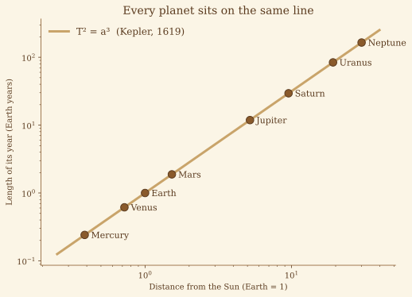
<figcaption>Mercury to Neptune, plotted on scales that grow by multiples. Every planet lands on the same straight line, Kepler's law T² = a³. <i>Original illustration for The Daily Word, from NASA planetary fact-sheet values.</i></figcaption>
</figure>

Seventy years later Isaac Newton showed *why*: one law of gravity, the same force that drops an apple, bends the Moon into its orbit and produces Kepler's harmony exactly.

### Moons that dance in rhythm

Jupiter's three big inner moons are locked in a cosmic rhythm. For every **1** orbit of Ganymede, Europa makes exactly **2** and Io makes exactly **4**. Astronomers call it a **1 : 2 : 4 resonance** (or the Laplace resonance). The moons tug each other into step like dancers keeping time, and the steady flexing heats Io so much that it is the most volcanic world in the solar system.

<figure class=photo>
<picture><source srcset="/static/art/id-jupiter-moons-600.webp 600w,/static/art/id-jupiter-moons.webp 1280w" sizes="(max-width:760px) 100vw,760px" type="image/webp">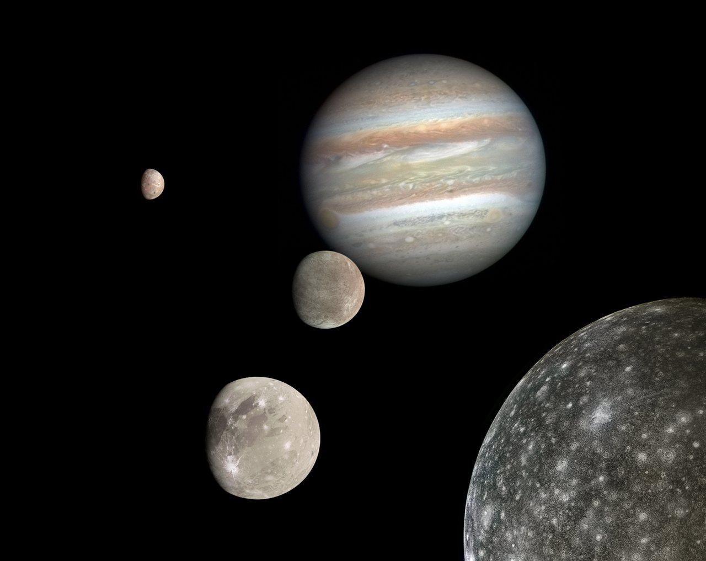</picture>
<figcaption>Jupiter and its four great moons (a montage, not to scale), discovered by Galileo in 1610. Image: NASA/JPL-Caltech/SwRI/MSSS, processed by Kevin M. Gill, public domain, via <a href="https://commons.wikimedia.org/wiki/File%3AJupiter_Family_of_Moons_by_Juno.png">Wikimedia Commons</a>.</figcaption>
</figure>

<figure class=photo>
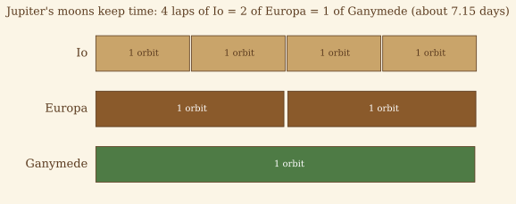
<figcaption>Io (1.77 days), Europa (3.55 days) and Ganymede (7.15 days) keep a 4 : 2 : 1 beat. <i>Original illustration for The Daily Word, from NASA orbital periods.</i></figcaption>
</figure>

The same music sounds farther out. A gap in Saturn's rings, the **Cassini Division**, sits where a ring particle would circle Saturn exactly twice for every once around of the moon Mimas; Mimas's repeated tugs help keep the gap clear. And forty light-years away, the seven Earth-sized planets of the star **TRAPPIST-1** form the longest resonant chain known: neighboring planets complete orbits in ratios of 8:5, 5:3, 3:2, 3:2, 4:3 and 3:2. Astronomers have even turned its rhythm into music.

<figure class=photo>
<picture><source srcset="/static/art/id-saturn-600.webp 600w,/static/art/id-saturn.webp 1280w" sizes="(max-width:760px) 100vw,760px" type="image/webp">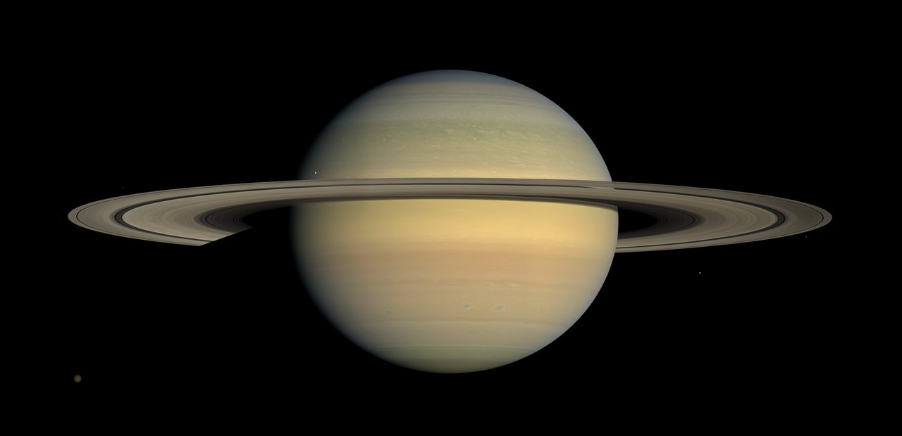</picture>
<figcaption>Saturn near equinox, photographed by the Cassini spacecraft. The Cassini Division is the dark band within the rings. Image: NASA/JPL/Space Science Institute, public domain, via <a href="https://commons.wikimedia.org/wiki/File%3ASaturn_during_Equinox.jpg">Wikimedia Commons</a>.</figcaption>
</figure>

<figure class=photo>
<picture><source srcset="/static/art/id-trappist-600.webp 600w,/static/art/id-trappist.webp 1280w" sizes="(max-width:760px) 100vw,760px" type="image/webp">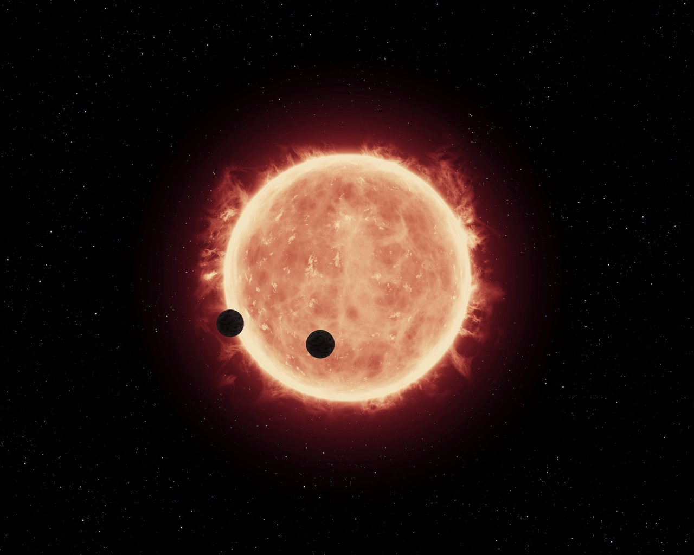</picture>
<figcaption>An artist's impression of TRAPPIST-1 planets crossing their red-dwarf star. Their orbits are locked in simple whole-number ratios. Image: NASA, ESA and G. Bacon (STScI), <a href="https://creativecommons.org/licenses/by/4.0/">CC BY 4.0</a>, via <a href="https://commons.wikimedia.org/wiki/File%3AArtist%27s_view_of_planets_transiting_red_dwarf_star_in_TRAPPIST-1_system.jpg">Wikimedia Commons</a>.</figcaption>
</figure>

### Galaxies with spiral arms

Look at the image at the top of this page. The **Whirlpool Galaxy** is a city of perhaps a hundred billion stars, about 30 million light-years away, and its arms wind out in close to a **logarithmic spiral**, the same family of curve as the nautilus shell in your hand. The arms are not solid; they are slow waves of crowding, like a traffic jam that stars pass through. But the shape is the same mathematics, written across tens of thousands of light-years.

<h2 id=atom>4 · Inside the atom: a solar system that isn't</h2>

Now we go smaller than anyone can see, and it gets wild.

In 1913 the Danish physicist **Niels Bohr** pictured the atom as a tiny solar system: a heavy nucleus in the middle like the Sun, with electrons circling it like planets. It is the picture most of us learned in school. And it explained a mystery. Heat hydrogen gas and it does not glow in all colors. It glows in a few sharp lines: one red, one blue-green, a couple of violets. In 1885 a Swiss schoolteacher, Johann Balmer, had found a simple formula that predicted those colors, using nothing but whole numbers, without the faintest idea why it worked. Bohr's model explained it: electrons may only live in certain "allowed" orbits, and when one drops from a higher orbit to a lower one, it gives off light of one exact color.

<figure class=photo>
<picture><source srcset="/static/art/id-hydrogen-spectrum-600.webp 600w,/static/art/id-hydrogen-spectrum.webp 1280w" sizes="(max-width:760px) 100vw,760px" type="image/webp"></picture>
<figcaption>The visible fingerprint of hydrogen: four sharp lines at about 410, 434, 486 and 656 nanometers. Every element has its own barcode, which is how we know what distant stars are made of. Image: McZusatz, <a href="https://creativecommons.org/publicdomain/zero/1.0/">CC0</a>, via <a href="https://commons.wikimedia.org/wiki/File%3AHydrogen_spectrum_visible.png">Wikimedia Commons</a>.</figcaption>
</figure>

But the little solar system had deep flaws. Bohr simply declared that only certain orbits were allowed, without saying why. By ordinary physics a circling electron should radiate away its energy and spiral into the nucleus in a tiny fraction of a second, so atoms should not exist at all. And the model failed for every atom more complicated than hydrogen. In the 1920s, **Erwin Schrödinger**, Werner Heisenberg and others replaced it with something stranger and more beautiful: **quantum mechanics**. The electron is not a little planet on a track. It behaves like a **wave**, spread out around the nucleus as a cloud of possibility.

<figure class=photo>
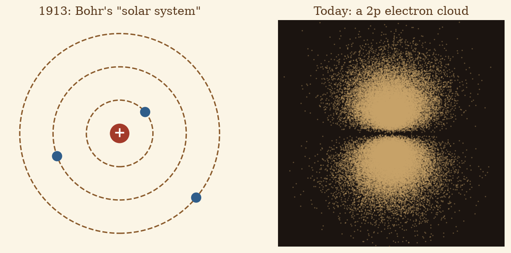
<figcaption>Left: Bohr's 1913 "solar system". Right: what quantum mechanics says instead, a cloud showing where a 2p electron is likely to be found, computed from its wave equation. <i>Original illustration for The Daily Word, computed from the hydrogen 2p wavefunction.</i></figcaption>
</figure>

### Why only certain "power levels"?

Here is the key idea, and it is easier than it sounds. Pluck a guitar string. It can only vibrate in whole numbers of half-waves: one big hump, or two, or three. Never two and a half. Now wrap a wave around a nucleus. It has to meet itself smoothly, so again only whole numbers of waves fit. **Those whole numbers are the energy levels.** The "planets" of the atom are really standing waves, like notes on an instrument. The atom is, quite literally, a kind of music.

<figure class=photo>
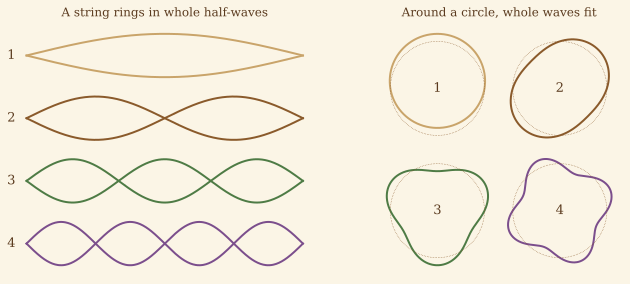
<figcaption>A string rings only in whole numbers of half-waves, and a wave wrapped around a circle must fit a whole number of times. This simple picture (Louis de Broglie, 1924) is the doorway to the real quantum atom. <i>Original illustration for The Daily Word.</i></figcaption>
</figure>

### s, p, d, f: the shapes you half-remember

If you took chemistry, you may remember "1s², 2s², 2p⁶…" Here is what it means, gently:

- The **number** (1, 2, 3, 4) is the shell, the main energy level, roughly how far out the electron lives.
- The **letter** is the *shape* of the cloud. **s** clouds are round, like a ball. **p** clouds are dumbbells, pointing three ways (x, y and z). **d** clouds are mostly four-leaf clovers, five of them. **f** clouds are stranger still, seven of them.
- Each cloud holds at most **two** electrons, spinning opposite ways.

So shell 1 holds 2 electrons, shell 2 holds 8, shell 3 holds 18, and shell 4 holds 32. That simple counting, 2, 8, 18, 32, is the reason the periodic table has the shape it does, and the reason sodium reacts violently with water while neon sits quietly in a sign. All of chemistry, and so all of life, hangs on it. (The letters, by the way, come from old names for spectral lines: **s**harp, **p**rincipal, **d**iffuse and **f**undamental.)

<figure class=photo>
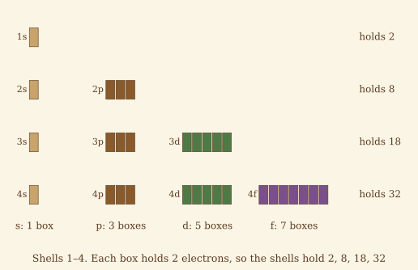
<figcaption>The shells and their "rooms." Shell 1 has only an s; shell 2 adds three p's; shell 3 adds five d's; shell 4 adds seven f's. <i>Original illustration for The Daily Word.</i></figcaption>
</figure>

<figure class=photo>
<picture><source srcset="/static/art/id-hydrogen-orbitals-600.webp 600w,/static/art/id-hydrogen-orbitals.webp 1280w" sizes="(max-width:760px) 100vw,760px" type="image/webp">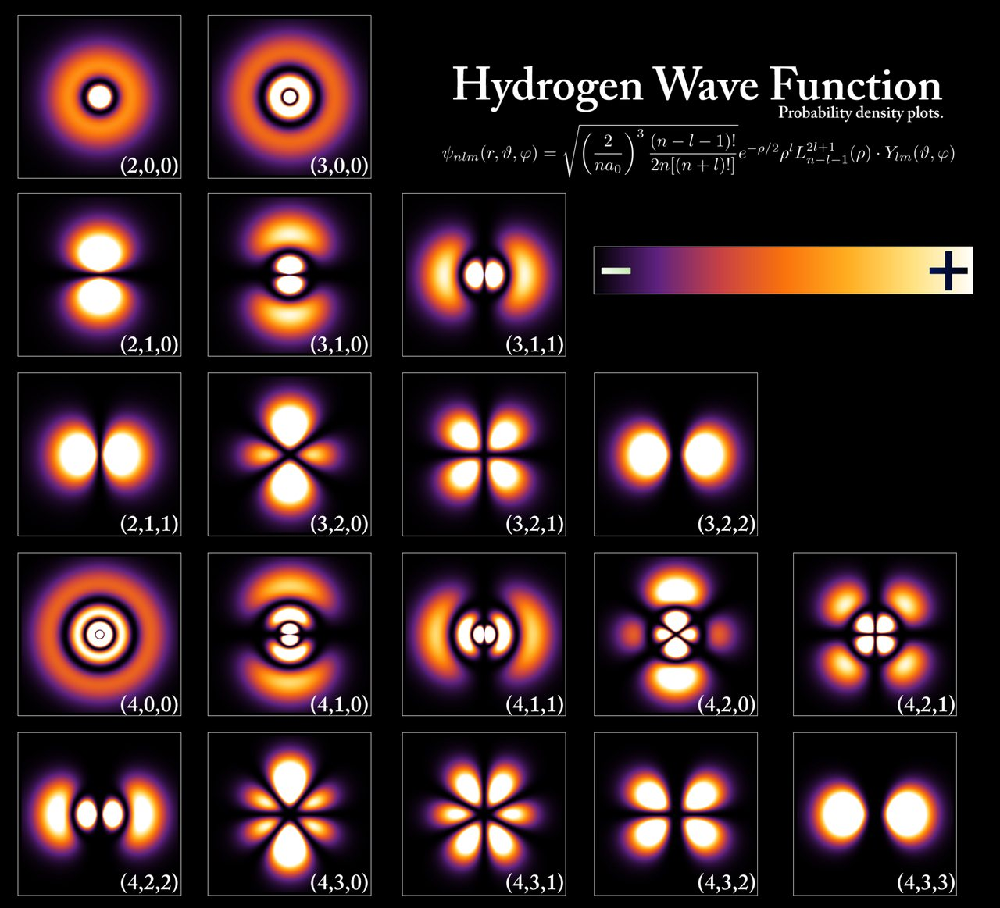</picture>
<figcaption>The real thing: computed electron clouds of a hydrogen atom, from the round 1s at top left to the intricate 4f shapes at bottom. Brighter means the electron is more likely to be there. Image: PoorLeno, public domain, via <a href="https://commons.wikimedia.org/wiki/File%3AHydrogen_Density_Plots.png">Wikimedia Commons</a>.</figcaption>
</figure>

### The same shapes in the sky

Here is the mind-blower. The mathematics that gives the s, p, d and f clouds their shapes is a family of patterns called **spherical harmonics**: the natural ways that anything can vibrate on the surface of a ball. And cosmologists use *the very same functions* to read the oldest light in the universe, the faint glow left over from the Big Bang, mapped across the whole sky. The patterns that shape a hydrogen atom are the patterns we use to read the infant universe. Geophysicists use them for Earth's gravity and magnetic field, too.

<figure class=photo>
<picture><source srcset="/static/art/id-cmb-600.webp 600w,/static/art/id-cmb.webp 1280w" sizes="(max-width:760px) 100vw,760px" type="image/webp">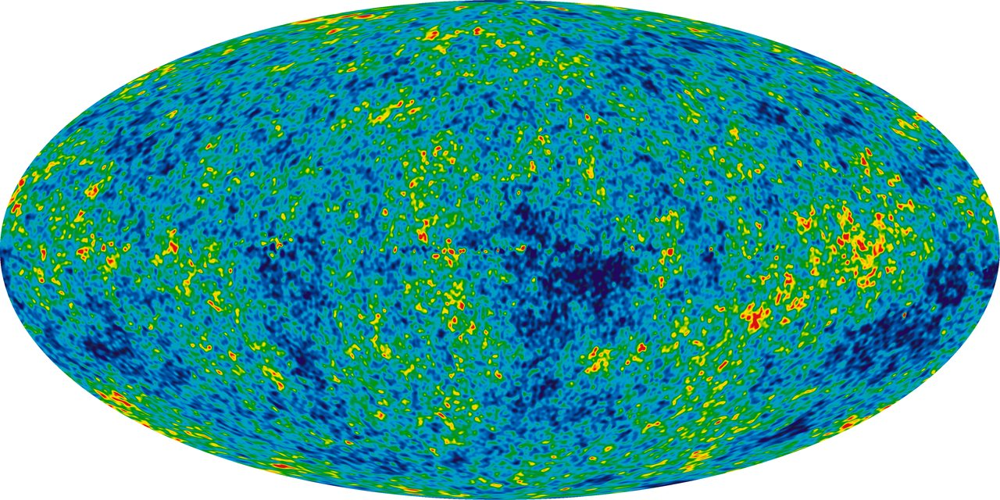</picture>
<figcaption>The cosmic microwave background, the afterglow of the Big Bang, as mapped by NASA's WMAP satellite. Its ripples are measured using the same spherical harmonics that shape atomic orbitals. Image: NASA / WMAP Science Team, public domain, via <a href="https://commons.wikimedia.org/wiki/File%3AWMAP_2012.png">Wikimedia Commons</a>.</figcaption>
</figure>

<h2 id=predict>5 · When math sees what eyes can't</h2>

It is one thing for mathematics to *describe* what we already see. It is something else entirely when it tells us about things nobody has ever seen, and then we go and look, and there they are.

**A planet found with a pen.** In the 1840s, Uranus was drifting slightly off its predicted path. The French mathematician **Urbain Le Verrier** worked out, on paper, that an unseen planet must be pulling it, and calculated where. On the night of 23 September 1846, the astronomer Johann Galle in Berlin pointed his telescope where Le Verrier said, and found **Neptune** within about one degree of the predicted spot, the first night he looked.

<figure class=photo>
<picture><source srcset="/static/art/id-neptune-600.webp 600w,/static/art/id-neptune.webp 1000w" sizes="(max-width:760px) 100vw,760px" type="image/webp">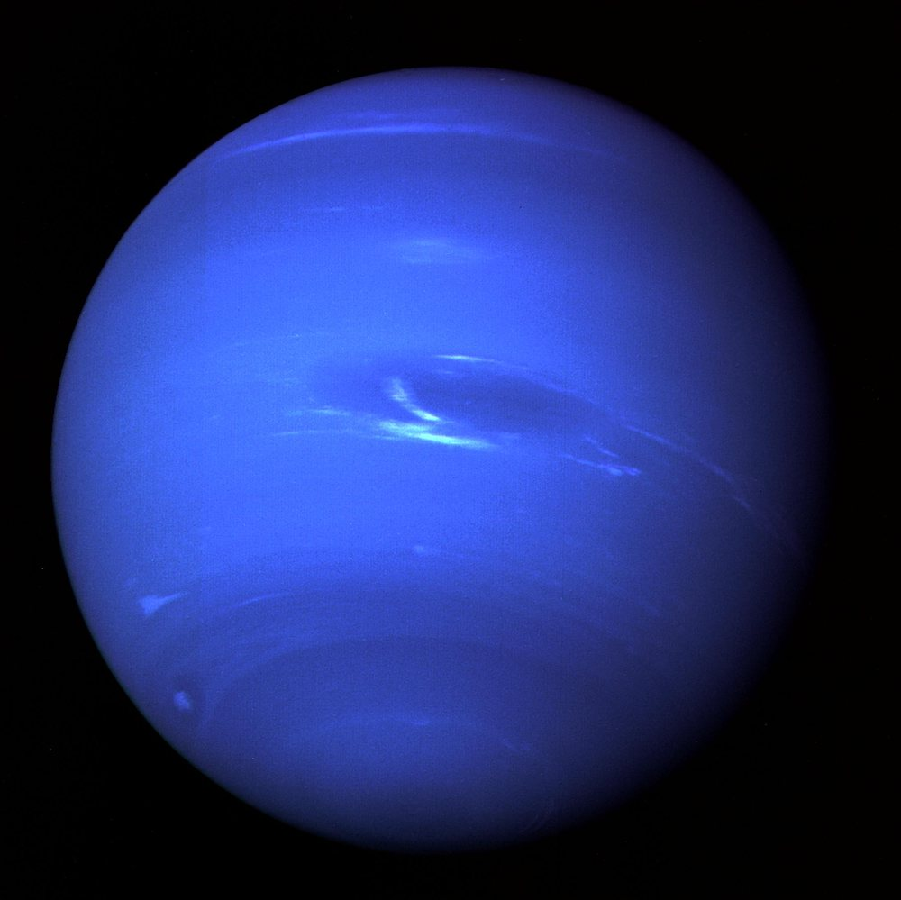</picture>
<figcaption>Neptune, photographed by Voyager 2 in 1989. It was found in 1846 because mathematics said it had to be there. Image: NASA/JPL, public domain, via <a href="https://commons.wikimedia.org/wiki/File%3ANeptune_Full_%28original%29.jpg">Wikimedia Commons</a>.</figcaption>
</figure>

**Light, hiding in equations.** In the 1860s James Clerk Maxwell, a devout Scottish Christian, wrote a set of equations describing electricity and magnetism (today usually written as four). When he solved them, they predicted waves traveling at a speed he could calculate, and the number came out as the speed of light. Light *is* an electromagnetic wave. And the equations predicted other waves, invisible ones, which Heinrich Hertz produced in his laboratory in 1887. Today we call them radio waves. Every phone call you make rides on an equation.

**Antimatter from a square root.** In 1928 the English physicist **Paul Dirac** wrote an equation combining quantum mechanics with Einstein's relativity. It had an awkward extra set of solutions that seemed to describe an electron with positive charge. Rather than throw them away, Dirac trusted the math. In 1932 Carl Anderson found that particle, the **positron**, in cosmic rays. Dirac later wrote: "It is more important to have beauty in one's equations than to have them fit experiment."

<figure class=photo style="max-width:420px;margin-left:auto;margin-right:auto">
<picture><source srcset="/static/art/id-dirac-600.webp 600w,/static/art/id-dirac.webp 700w" sizes="(max-width:760px) 100vw,760px" type="image/webp">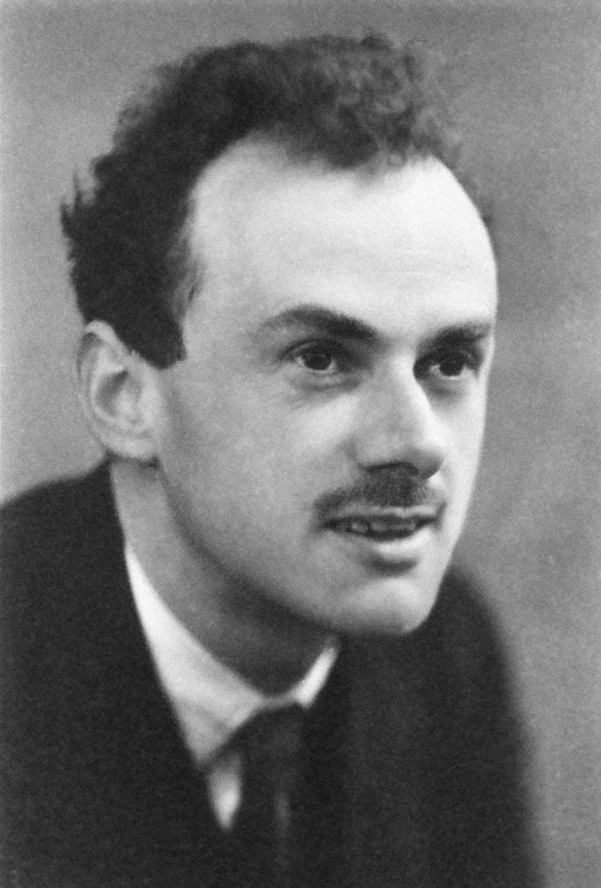</picture>
<figcaption>Paul Dirac in 1933, the year he shared the Nobel Prize in Physics. Image: Nobel Foundation, public domain, via <a href="https://commons.wikimedia.org/wiki/File%3APaul_Dirac%2C_1933.jpg">Wikimedia Commons</a>.</figcaption>
</figure>

In 1960 the physicist **Eugene Wigner** wrote a famous essay about all this called *The Unreasonable Effectiveness of Mathematics in the Natural Sciences*. He ended it with a sentence that sounds almost like a prayer:

> "The miracle of the appropriateness of the language of mathematics for the formulation of the laws of physics is a wonderful gift which we neither understand nor deserve."

A gift implies a Giver.

<h2 id=riemann>6 · The primes, the zeros and the atoms</h2>

Now for the strangest connection of all.

**Prime numbers** are the whole numbers that can't be divided evenly by anything except 1 and themselves: 2, 3, 5, 7, 11, 13, 17, 19, 23… They are the atoms of arithmetic: every whole number is built by multiplying primes together, in exactly one way. And they look random. There are twin primes side by side (11 and 13, 17 and 19), and then long empty stretches. Nobody can write down a simple formula that spits out the next one.

Yet on the whole they follow a smooth path. Count the primes up to any number *x* and the count hugs a gentle curve, as if the primes were a jagged staircase built alongside a smooth ramp.

<figure class=photo>
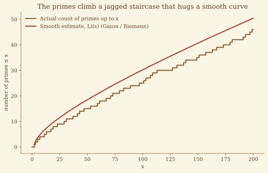
<figcaption>Counting primes up to 200: a jagged staircase that stays close to a smooth curve. The Riemann Hypothesis is about exactly how close, forever. <i>Original illustration for The Daily Word, computed.</i></figcaption>
</figure>

In 1859 a shy German mathematician, **Bernhard Riemann**, wrote a short paper of about eight pages, the only one he ever published on prime numbers. In it he found that the primes' wobbles around the smooth curve are controlled, precisely, by a list of special points called the **zeros of the zeta function**, ζ(s). Think of each zero as one pure musical note; add the notes together and you get the exact rhythm of the primes.

Riemann noticed that every zero he could compute sat on one straight line (mathematicians call it the *critical line*, where the real part is exactly ½). He guessed that **all** of them do. That guess is the **Riemann Hypothesis**. If it is true, the primes stray from the smooth curve by as little as they possibly could: random-looking, but random under perfect discipline. Computers have checked more than ten trillion zeros, and every one sits on the line. But checking is not proving: there are infinitely many.

<figure class=photo style="max-width:420px;margin-left:auto;margin-right:auto">
<picture><source srcset="/static/art/id-riemann-600.webp 600w,/static/art/id-riemann.webp 800w" sizes="(max-width:760px) 100vw,760px" type="image/webp">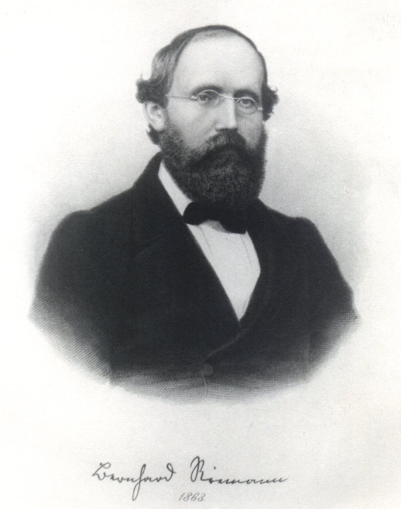</picture>
<figcaption>Bernhard Riemann (1826–1866), from a portrait of 1863. He was a pastor's son and remained a devout Lutheran all his life. He died of tuberculosis at 39. Image: Smithsonian Institution, no known copyright restrictions, via <a href="https://commons.wikimedia.org/wiki/File%3APortrait_of_Bernhard_Riemann_%281826-1866%29%2C_Mathematician_%282551069295%29.jpg">Wikimedia Commons</a>.</figcaption>
</figure>

<figure class=photo>
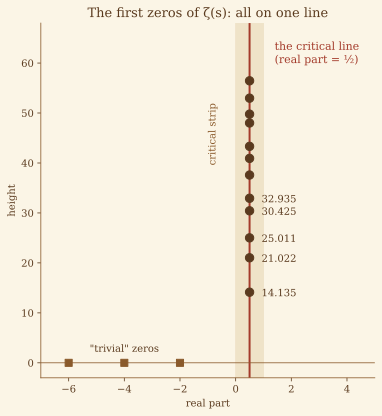
<figcaption>The first zeros of the zeta function. The "trivial" zeros at −2, −4, −6… are easy; the interesting ones all lie on the red line, at heights 14.13, 21.02, 25.01, 30.42, 32.94… <i>Original illustration for The Daily Word, from A. M. Odlyzko's published tables of zeta zeros.</i></figcaption>
</figure>

### Tea at Princeton, 1972

Here is where it gets eerie. In 1972 a young number theorist, **Hugh Montgomery**, was visiting the Institute for Advanced Study in Princeton. He had worked out a formula for how the zeta zeros are spaced: they seemed to *avoid* each other, rarely bunching close together. At afternoon tea he was introduced to the physicist **Freeman Dyson**. When Montgomery described his formula, Dyson recognized it at once. It was the same formula physicists had found for the spacing between **energy levels in heavy atomic nuclei**, using a tool called random-matrix theory.

Think about that. A list of numbers that controls the prime numbers, which belong to pure arithmetic and would be the same in any universe, behaves like the energy levels inside a uranium nucleus. In the 1980s Andrew Odlyzko computed millions of zeros and the match held beautifully. Nobody fully knows why. Many mathematicians suspect that somewhere there is a hidden "quantum system" whose energy levels *are* the Riemann zeros.

<figure class=photo>
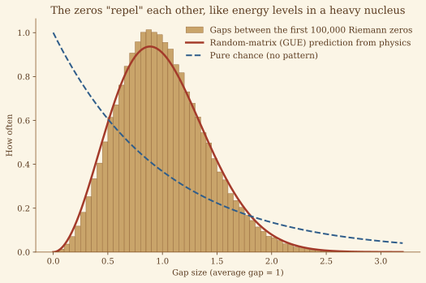
<figcaption>The gaps between the first 100,000 Riemann zeros (gold bars) follow the random-matrix curve from physics (red), the theory first built to describe energy levels in heavy nuclei, not pure chance (blue dashes). Notice almost no tiny gaps: the zeros repel each other, like energy levels do. <i>Original illustration for The Daily Word, computed from A. M. Odlyzko's table of the first 100,000 zeros.</i></figcaption>
</figure>

<h2 id=news>7 · This week: has the Riemann Hypothesis fallen?</h2>

**Breaking, and still unfolding (last checked November 23, 2026).** Details may change as mathematicians study the claims.

If you have seen "Riemann" trending on X this weekend, here is what actually happened, as carefully as we can put it.

- **Friday, November 20.** Levent Alpöge, a number theorist at the AI company Anthropic (on leave from Harvard), posted a four-page note on his website: "I believe I have, working with Claude, discovered a proof of the Riemann Hypothesis." He says the method also proves the much broader **Generalized** Riemann Hypothesis. Instead of a traditional paper, he released the proof as computer code in **Lean**, a "proof assistant" language in which a computer checks every single logical step. The proof is enormous: about 17 million lines of code.
- **Saturday, November 21.** The Lean and Mathlib communities, endorsed by the Lean FRO and the Mathlib Initiative, issued a joint statement: "We have full confidence that Alpöge's proof of the Riemann Hypothesis is correct." They report that the code proves exactly the standard, carefully vetted statement of the hypothesis, and that several independent proof-checking programs accepted it. MIT mathematician Andrew Sutherland ran his own independent checks and called it "an historic moment."
- **The same day,** Ravi Vakil of Stanford, president of the American Mathematical Society, posted a separate, entirely human-written draft proof of the Generalized Riemann Hypothesis by Alessandro Masullo, a Stanford-trained mathematician who says he worked on it for about twelve years without using AI. It is a 940-page manuscript titled *The Music of the Primes*. It was released before checking was finished, and potential problems were reported within hours; it remains to be seen whether they can be fixed.
- **Since then (through Monday, November 23),** more independent teams, including one using a supercomputer at Japan's RIKEN institute, have rebuilt the Lean code and run further checks, with no errors reported so far (some of those checks are still running). The Clay Mathematics Institute still lists the problem as open, as its rules require for now.

So is it solved? Here is the honest picture. A machine-checked proof is a very strong kind of evidence, and many experts now believe the result is true and proved. Mathematician Daniel Litt summed up the odd situation: the Lean proof "is exceedingly likely to be correct," and "no human understands it yet." Most mathematicians agree that a computer formalization alone is not the same as a proof people have read and understood. Fields Medalist James Maynard said that "if this fully checks out, it is clearly a historic milestone." But no human yet *understands* the proof. Terence Tao said the "digestion process will take some time," and others have called the current write-up "garbled" and criticized its timing, a day after Anthropic's stock-market debut. The Clay Mathematics Institute's $1 million prize, by its rules, requires publication and two years of acceptance by the mathematical community. Mathematicians will now spend months, perhaps years, turning 17 million lines of code into ideas a human mind can hold.

What would it mean? Hundreds of theorems written as "*if* the Riemann Hypothesis is true, then…" would become simply true. Our picture of the primes, perfectly balanced between chaos and order, would be confirmed. (It does not break internet encryption, which depends on how hard it is to factor huge numbers, not on this.)

And there is something fitting in the timing. Riemann was born 200 years ago this September, in 1826. A pastor's son who prayed, he left behind a riddle that took the whole human family, and now our machines too, 167 years to answer. The order he glimpsed in the primes was really there all along.

<h2 id=tuned>8 · A universe on a knife's edge</h2>

One more family of wonders, and these have kept physicists up at night.

**The carbon in your body.** Every atom of carbon in you was forged inside a star, where three helium nuclei must slam together almost at once. In 1953 the astronomer **Fred Hoyle**, then an atheist, reasoned that this could only happen fast enough if carbon had a special energy level, a "resonance," at one particular energy. Nobody had seen it. He persuaded a team at Caltech to look, and they found it almost exactly where he predicted, at about 7.65 MeV. Without it, there would be very little carbon in the universe, and no life as we know it. Hoyle later wrote that "a commonsense interpretation of the facts suggests that a superintellect has monkeyed with physics, as well as with chemistry and biology."

**The dials of the universe.** Physicists have found that many of nature's basic numbers, such as the strength of gravity, the strength of the force that holds nuclei together, and the energy of empty space, seem to sit in narrow ranges that allow stars, chemistry and life. Nudge some of them by a few percent, by many estimates, and you get a universe with no stable atoms, or no stars, or nothing but hydrogen.

**Careful, now.** Scientists honestly disagree about what this "fine-tuning" means. Some propose a vast multiverse of universes with different settings; some expect a deeper theory will explain the values; many believers, including many physicists, see it as a pointer to a Creator. The measurements themselves are not in dispute. What they *mean* is a question science alone can't settle.

<figure class=photo>
<picture><source srcset="/static/art/id-deep-field-600.webp 600w,/static/art/id-deep-field.webp 1100w" sizes="(max-width:760px) 100vw,760px" type="image/webp">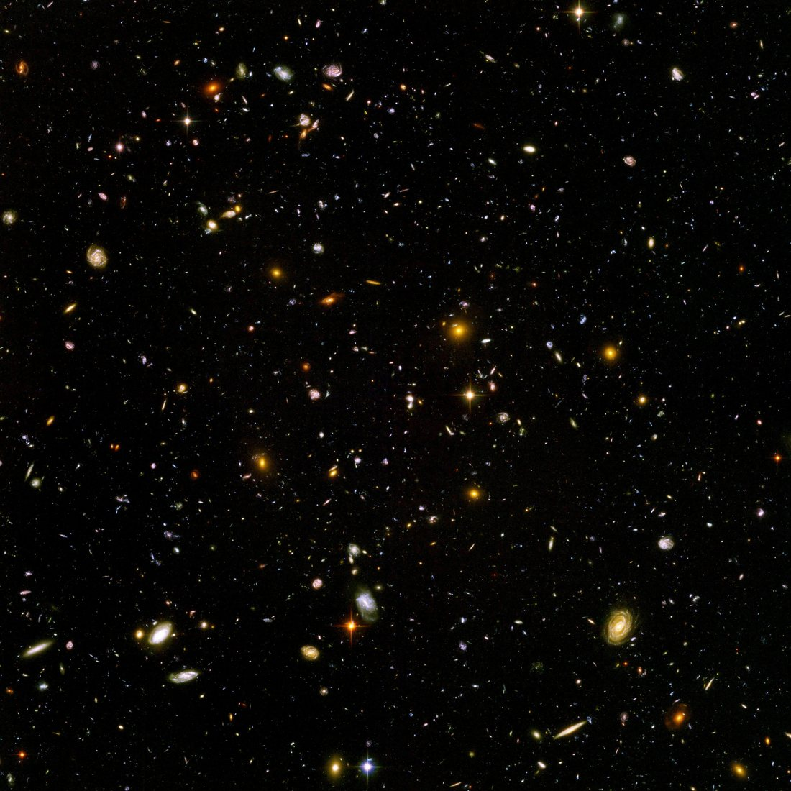</picture>
<figcaption>The Hubble Ultra Deep Field: almost every speck here is a galaxy, each with billions of stars, in a patch of sky smaller than a grain of sand held at arm's length. Image: NASA and the European Space Agency, public domain, via <a href="https://commons.wikimedia.org/wiki/File%3AHubble_ultra_deep_field.jpg">Wikimedia Commons</a>.</figcaption>
</figure>

<h2 id=beautiful>9 · The most beautiful equation</h2>

Let us end the mathematics with one line. It regularly tops polls as the most beautiful equation ever written:

<b>eiπ + 1 = 0</b>

It follows from a formula Leonhard Euler published in 1748, and it ties together the five most important numbers in mathematics, each discovered for a completely different reason:

- **0**, nothing, the number that took humanity thousands of years to accept;
- **1**, the beginning of counting;
- **π** (3.14159…), from circles and geometry;
- **e** (2.71828…), from growth and compound interest;
- **i**, the "imaginary" square root of −1, once thought absurd, now essential to every electrical engineer and to quantum mechanics itself.

Five numbers from five different corners of thought, joined in one perfect sentence with nothing left over. Euler, a devout Christian who led family prayers every evening, would not have been surprised.

<figure class=photo>
<picture><source srcset="/static/art/id-mandelbrot-600.webp 600w,/static/art/id-mandelbrot.webp 1280w" sizes="(max-width:760px) 100vw,760px" type="image/webp">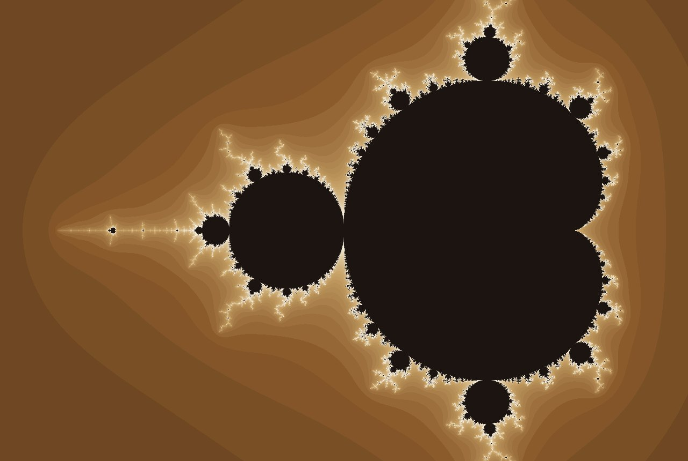</picture>
<figcaption>The Mandelbrot set, drawn from one tiny rule, z → z² + c, repeated. Zoom in anywhere on its edge and new detail appears forever. Infinite richness from a rule a child could write. <i>Original illustration for The Daily Word, computed.</i></figcaption>
</figure>

<h2 id=reflection>10 · The heavens declare</h2>

We began with a pinecone in your hand and ended at the edge of infinity. Along the way the same handful of patterns kept appearing: spirals in sunflowers and galaxies, whole-number rhythms in moons and atoms, a hidden order in the primes that echoes inside the nucleus. Science can show us *how* each pattern unfolds, and that is a glorious work. But it cannot tell us why the universe should be so orderly, so understandable, so *beautiful* to the minds that study it.

The ancient believers were not surprised. They said this is exactly what you would expect from a world made by a wise Creator who also made us in his image, able to think his thoughts after him.

> "The heavens declare the glory of God, and the sky above proclaims his handiwork." *Psalm 19:1 (ESV)*

> "Thou hast ordered all things in measure, and number, and weight." *Wisdom 11:21 (Douay-Rheims)*

> "For his invisible attributes, namely, his eternal power and divine nature, have been clearly perceived, ever since the creation of the world, in the things that have been made." *Romans 1:20 (ESV)*

> "And he is before all things, and in him all things hold together." *Colossians 1:17 (ESV)*

The next time you pick up a pinecone, count the spirals. Eight one way, thirteen the other. It is a small thing. It is also a signature.

<h2 id=sources>Sources and further reading</h2>

**Plants and patterns**

- [Swinton, Ochu et al., "Novel Fibonacci and non-Fibonacci structure in the sunflower," *Royal Society Open Science* (2016)](https://pmc.ncbi.nlm.nih.gov/articles/PMC4892450/)
- [CNRS: Where does the shape of the Romanesco cauliflower come from? (2021)](https://www.cnrs.fr/en/press/where-does-shape-romanesco-cauliflower-come)
- [Plus Magazine (University of Cambridge): The life and numbers of Fibonacci](https://plus.maths.org/content/os/issue3/fibonacci/index)
- [Falbo, "The Golden Ratio: A Contrary Viewpoint," *College Mathematics Journal* (2005), ERIC record](https://eric.ed.gov/?id=EJ938137)
- [Hales, "The Honeycomb Conjecture" (1999), arXiv](https://arxiv.org/abs/math/9906042)
- [The Snowflake Bentley museum, Jericho Historical Society](https://snowflakebentley.com/)

**Planets and stars**

- [NASA: Io, and its resonance with Europa and Ganymede](https://science.nasa.gov/jupiter/moons/io/)
- [NASA: Saturn](https://science.nasa.gov/saturn/)
- [NASA: TRAPPIST-1](https://science.nasa.gov/exoplanets/trappist1/)
- [Luger et al., "A seven-planet resonant chain in TRAPPIST-1," *Nature Astronomy* (2017)](https://www.nature.com/articles/s41550-017-0129)
- [NASA: Neptune](https://science.nasa.gov/neptune/)
- [NASA: Hubble Deep Fields](https://science.nasa.gov/mission/hubble/science/universe-uncovered/hubble-deep-fields/)
- [NASA WMAP: Nine-year microwave sky](https://map.gsfc.nasa.gov/media/121238/index.html)

**Atoms and physics**

- [Nobel Prize: Niels Bohr, Physics 1922](https://www.nobelprize.org/prizes/physics/1922/bohr/facts/)
- [Nobel Prize: Paul Dirac, Physics 1933](https://www.nobelprize.org/prizes/physics/1933/dirac/facts/)
- [Nobel Prize: Carl Anderson, Physics 1936 (discovery of the positron)](https://www.nobelprize.org/prizes/physics/1936/anderson/facts/)
- [Wigner, "The Unreasonable Effectiveness of Mathematics in the Natural Sciences" (1960), PDF](https://www.maths.ed.ac.uk/~v1ranick/papers/wigner.pdf)
- [The Hoyle state of carbon-12 (Wikipedia overview with references)](https://en.wikipedia.org/wiki/Hoyle_state)

**Riemann and the news**

- [Riemann's 1859 paper, "On the Number of Primes Less Than a Given Magnitude" (English translation by D. R. Wilkins, Clay Mathematics Institute, PDF)](https://www.claymath.org/wp-content/uploads/2023/04/Wilkins-translation.pdf)
- [Clay Mathematics Institute: The Riemann Hypothesis](https://www.claymath.org/millennium/riemann-hypothesis/) and [the Millennium Prize rules](https://www.claymath.org/millennium-problems/rules/)
- [A. M. Odlyzko: Tables of zeros of the Riemann zeta function](https://www-users.cse.umn.edu/~odlyzko/zeta_tables/)
- [Levent Alpöge, "Remark" (announcement, November 20, 2026), PDF](https://alpo.ge/remark.pdf)
- [Lean and Mathlib communities: Lean verification of the Riemann Hypothesis (November 21, 2026)](https://leanprover-community.github.io/blog/posts/riemann-hypothesis/)
- [Andrew Sutherland (MIT): verification files and checks](https://math.mit.edu/~drew/grh/)
- [*Nature*: Mathematicians astounded by AI and human-written proofs of iconic Riemann hypothesis](https://www.nature.com/articles/d41586-026-03812-7)
- [*Scientific American*: Anthropic mathematician proves Riemann hypothesis](https://www.scientificamerican.com/article/anthropic-mathematician-claims-to-prove-riemann-hypothesis-most-famous-problem-in-all-of-math/)
- [*The Guardian*: Two groups verify mathematician's claim](https://www.theguardian.com/technology/2026/nov/21/anthropic-riemann-hypothesis-solved-claude-ai)
- [BBC News: An Anthropic worker says he may have cracked the biggest maths problem](https://www.bbc.com/news/articles/c6pqr2g7w059o)
- [*The Conversation*: The Riemann hypothesis, AI and a proof no human can read (November 22, 2026)](https://theconversation.com/the-sacred-object-in-mathematics-the-riemann-hypothesis-ai-and-a-proof-no-human-can-read-297276)
- [Independent build and check of the Lean project on RIKEN's RIKYU system](https://shosonoda.github.io/lean-rh-alpoge/)
- [X: trending story on the Riemann Hypothesis proof](https://x.com/i/trending/2123789463809835447)

**Scripture**

- [Psalm 19 (ESV)](https://www.esv.org/Psalm+19/) · [Romans 1 (ESV)](https://www.esv.org/Romans+1/) · [Colossians 1 (ESV)](https://www.esv.org/Colossians+1/) · [Wisdom 11 (Douay-Rheims)](https://www.drbo.org/chapter/27011.htm)

Original diagrams were drawn for The Daily Word from the data and sources listed above. Photographs are credited under each image. Douay-Rheims: public domain.

