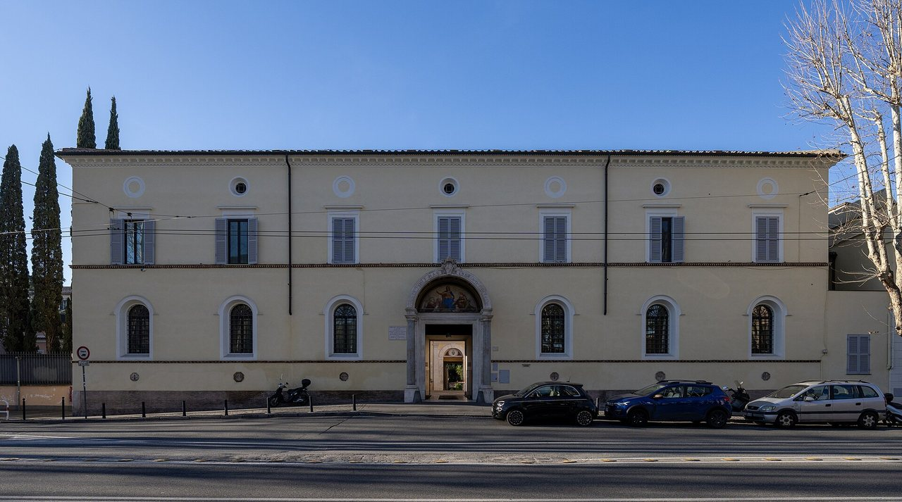

## The story
Agnes was a young girl of about 12 or 13 who was martyred in Rome, probably in the persecution of Diocletian, for refusing marriage and the worship of the gods. She is named in the Roman Canon. **St Ambrose**, **Pope Damasus** and the poet **Prudentius** all wrote about her within a century of her death.

## The full story

### Her story
The tradition says she was sent to a brothel, but her hair grew miraculously to cover her, and a man who tried to touch her was struck blind (she prayed and he was healed). She was condemned to burn, but the flames parted, and she was killed with a sword to the throat. Ambrose wrote: "a new kind of martyrdom: too young to be punished, yet old enough for a crown."

### The lambs
Her name is like the Latin *agnus*, "lamb". Every year on her feast, two **lambs** are blessed in the Basilica of Sant'Agnese fuori le Mura. Their wool is woven by nuns into the **pallia**, the woollen bands given by the Pope to new archbishops on 29 June. Ambrose, Damasus and Prudentius already wrote of her martyrdom and her youth. The brothel and the hair are the later telling.

<figure class=photo>
<picture><source srcset="/static/art/agnes-rome-600.webp 600w,/static/art/agnes-rome.webp 1280w" sizes="(max-width:760px) 100vw,760px" type="image/webp"></picture>
<figcaption>Sant'Agnese fuori le mura in Rome, where the lambs are blessed on her feast. Photo: <a href="https://commons.wikimedia.org/wiki/File:Sant%27Agnese_fuori_le_mura_%28Rome%29_-_Exterior.jpg">Sant'Agnese fuori le mura</a>, <a href="https://creativecommons.org/licenses/by/4.0">CC BY 4.0</a>, via Wikimedia Commons.</figcaption>
</figure>

## Path to sainthood
Pre-Congregation saint.

## Patronages
Girls, chastity, engaged couples, victims of sexual abuse.

## Trivia
- Keats's poem *The Eve of St Agnes* comes from the folk belief that girls would dream of their future husband on the night of 20 January.
- Her skull is kept in Sant'Agnese in Agone on Piazza Navona.

## Sources
- [Vatican News: St Agnes](https://www.vaticannews.va/en/saints/01/21/st--agnes--virgin-and-martyr.html)
- [Catholic Encyclopedia: St Agnes of Rome](https://www.newadvent.org/cathen/01214a.htm)

Written October 16, 2026 from the sources above. The Rome photograph was added November 6, 2026. Feast days follow the General Roman Calendar unless noted.

