<nav class=toc aria-label="On this page">

On this page

<ol>
<li><a href="#why">Why the Church honours him</a></li>
<li><a href="#bethsaida">The fishermen of Bethsaida</a></li>
<li><a href="#lamb">"Behold, the Lamb of God"</a></li>
<li><a href="#fishers">"I will make you fishers of men"</a></li>
<li><a href="#loaves">The boy with five loaves</a></li>
<li><a href="#greeks">"Sir, we wish to see Jesus"</a></li>
<li><a href="#pentecost">The Mount of Olives, the Upper Room and Pentecost</a></li>
<li><a href="#scythia">Scythia, the Black Sea and the hills of Kyiv</a></li>
<li><a href="#byzantium">Byzantium and Stachys</a></li>
<li><a href="#patras">"Hail, O Cross": the martyrdom at Patras</a></li>
<li><a href="#saltire">The X-shaped cross</a></li>
<li><a href="#relics">His relics: Constantinople, Amalfi and home to Patras</a></li>
<li><a href="#scotland">Scotland: St Rule, the saltire and Arbroath</a></li>
<li><a href="#brothers">Peter's brother: Rome and Constantinople</a></li>
<li><a href="#advent">St Andrew's Day, Advent and the Christmas Novena</a></li>
<li><a href="#places">His places and churches</a></li>
<li><a href="#art">Andrew in art</a></li>
</ol>
</nav>

## His story

He was a fisherman on a lake in Galilee, the brother of a big, impetuous man called Simon. He was already looking for God when he heard John the Baptist point to a stranger and say, "Behold, the Lamb of God." **St Andrew** followed, spent one afternoon with Jesus, and ran to tell his brother: "We have found the Messiah." So the first apostle to be called became the first to bring someone else to Christ, and the man he brought was St Peter. The Churches of the East have called him ever since the *Protoklētos*, the **First-called**.

In the Gospels he is quieter than his brother, but whenever he appears he is bringing someone to Jesus: Peter, a boy with five loaves and two fish, a group of Greek pilgrims. After Pentecost, the early Church remembered him as the apostle who carried the Gospel north and east, to the Black Sea and the Greek world, and who died on a cross at **Patras** in Greece, preaching from it to the very end. Scotland, Greece, Russia, Ukraine, Romania and many more claim him as their patron, and on his feast, 30 November, the Church begins to turn toward Advent.

What we know for certain comes from the four Gospels. What happened after Pentecost comes to us from the early Fathers, such as **Origen** and **Eusebius**, and from the *Acts of Andrew* and the later *Passion of Andrew*, which Pope Benedict XVI called "an ancient story." The stories of Kyiv, the Romanian cave and the saltire in the Scottish sky are later traditions and legends. Where a story comes from tradition rather than history, we say so, gently, and tell it anyway, because the Church has treasured these stories for centuries.

### Early 1st century · A fisherman of Bethsaida
Andrew, son of **John** (or Jonah), grows up in **Bethsaida** on the north shore of the Sea of Galilee. With his brother **Simon** he fishes the lake, and later shares a house with him in **Capernaum**.

### c. AD 28 · "Behold, the Lamb of God"
A disciple of **John the Baptist** at the Jordan, he hears John point to Jesus. He follows him, stays with him that day, and brings his brother: "We have found the Messiah" (John 1:35–42).

### Soon after · "Fishers of men"
Beside the lake, Jesus calls Simon and Andrew from their nets. "Immediately they left their nets and followed him" (Mark 1:16–18).

### The years with Jesus · Loaves, Greeks and the Mount of Olives
He finds the boy with five barley loaves and two fish (John 6:8–9), brings Greek pilgrims to Jesus (John 12:20–22), and with Peter, James and John asks about the end of the age (Mark 13:3).

### c. AD 30 · Pentecost
He is named with the apostles in the Upper Room (Acts 1:13), praying with Mary until the Holy Spirit comes.

### After Pentecost · The mission (tradition)
**Origen**, as quoted by Eusebius, says Andrew's mission field was **Scythia**, around the Black Sea. Later writers add Asia Minor, **Byzantium**, Thrace and Greece.

### c. AD 60 (tradition) · Patras
Under the Roman governor **Aegeas**, he is bound to a cross by the sea at **Patras**. According to his *Passion*, he preaches from it for two days before he dies, on **30 November**.

### 357 · Constantinople
His relics are carried to the new imperial capital and laid in the **Church of the Holy Apostles**.

### 1208 · Amalfi
After the sack of Constantinople, **Cardinal Peter of Capua** brings the relics home to **Amalfi** in southern Italy, where they rest in the crypt to this day.

### 1320 · The Declaration of Arbroath
The barons of Scotland write to the Pope, naming Andrew as the patron who has kept them "under his protection."

### 1964 and 1980 · Home to Patras
**St Paul VI** returns Andrew's head to Patras in 1964; in 1980 the relic of his cross comes home from Marseille.

<figure class=photo>
<picture><source srcset="/static/art/andrew-ravenna-600.webp 600w,/static/art/andrew-ravenna.webp 1280w" sizes="(max-width:760px) 100vw,760px" type="image/webp">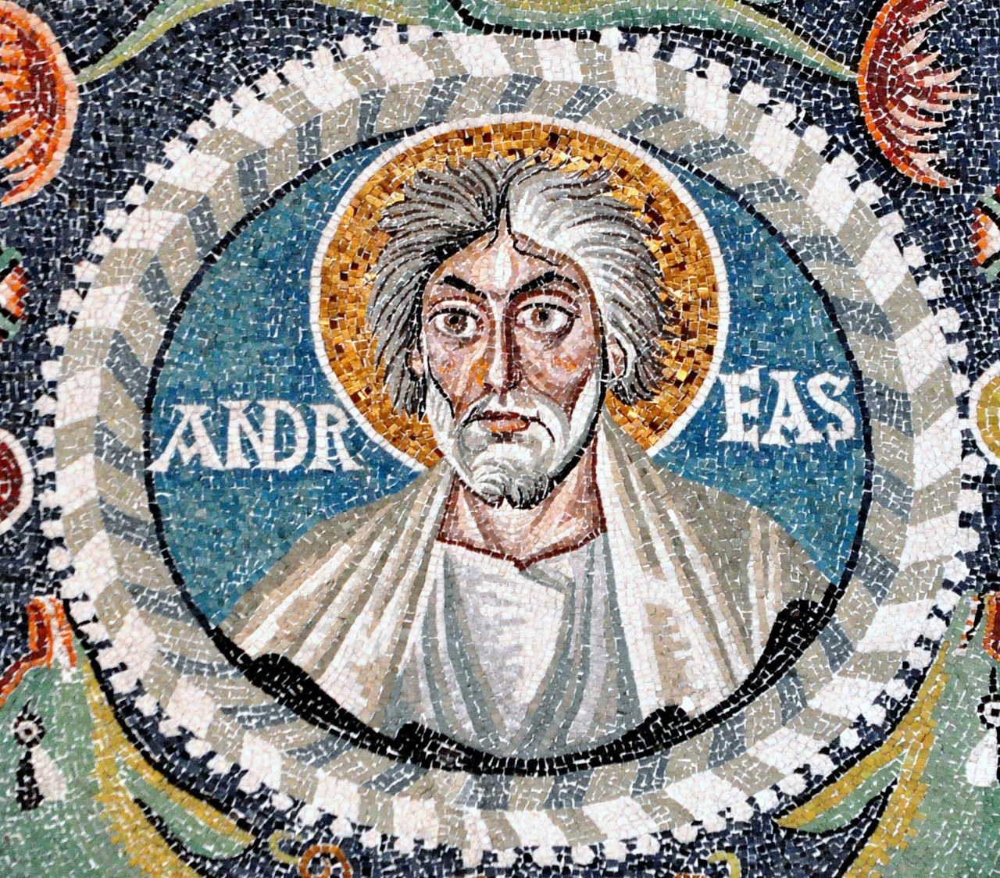</picture>
<figcaption>St Andrew in a mosaic medallion in the <b>Basilica of San Vitale, Ravenna</b>, from the 6th century, one of the oldest surviving portraits of him. From very early on, Christian artists gave Andrew the same face: older than Peter, with a tumble of white hair and a forked beard, the look of a man who has spent his life outdoors and has seen something he cannot stop thinking about. Photo: <a href="https://commons.wikimedia.org/wiki/File:Andrew_the_Apostle._Detail_of_the_mosaic_in_the_Basilica_of_San_Vitale._Ravena,_Italy.jpg">Andrew the Apostle. Detail of the mosaic in the Basilica of San Vitale. Ravena, Italy</a> by Richard Mortel, <a href="https://creativecommons.org/licenses/by/2.0">CC BY 2.0</a>, via Wikimedia Commons.</figcaption>
</figure>

<h2 id=why>Why the Church honours him</h2>

- **He was the first to follow.** When John the Baptist pointed to Jesus, Andrew did not wait. He went after him and asked where he was staying, and Jesus said, "Come and see."
- **He brought others to Christ.** His first act as a disciple was to find his brother. Every time Andrew appears in the Gospels, he is bringing someone to Jesus: Peter, a boy with loaves and fish, the Greeks who "wished to see Jesus."
- **He trusted Jesus with very little.** Five barley loaves and two fish were not enough for five thousand people, and Andrew said so. But he brought them anyway, and the Lord did the rest.
- **He carried the Gospel to the ends of the earth.** The early Church remembered him as the apostle of Scythia and of the Greeks, travelling the shores of the Black Sea and the roads of Greece.
- **He embraced the Cross.** According to his *Passion*, he greeted the cross on which he would die as a friend, and preached from it to the people until the end.
- **He is a bond between East and West.** The brother of Peter, whom Rome honours as its founder, Andrew is honoured as the founder of the Church of Constantinople. Their two feasts are kept each year with delegations between the Pope and the Ecumenical Patriarch.

<h2 id=bethsaida>The fishermen of Bethsaida</h2>

The Sea of Galilee is not really a sea. It is a freshwater lake about 20 kilometres long, more than 200 metres below sea level, ringed by hills, and in Andrew's day it was full of fish and fishing boats. Andrew and his brother Simon came from **Bethsaida**, whose name means "house of fishing," near the place where the Jordan flows into the lake from the north. "Philip was from Bethsaida," says St John, "the city of Andrew and Peter" (John 1:44).

The two brothers were working men. They fished at night with nets, mended them in the morning, and sold their catch in the towns around the lake. By the time Jesus began to preach they had a house together in **Capernaum**, a few kilometres along the shore. St Mark tells how Jesus came straight from the synagogue there to "the house of Simon and Andrew," where Simon's mother-in-law lay sick with a fever. He took her by the hand and lifted her up, and the fever left her (Mark 1:29–31).

Andrew is a Greek name. It means "manly" or "brave." Pope Benedict XVI pointed out that it is a sign that his family, like many in Galilee, lived in a world where Jewish faith and Greek language met. It may help explain why, later, the Greeks came to him.

<figure class=photo>
<picture><source srcset="/static/art/andrew-galilee-600.webp 600w,/static/art/andrew-galilee.webp 1280w" sizes="(max-width:760px) 100vw,760px" type="image/webp">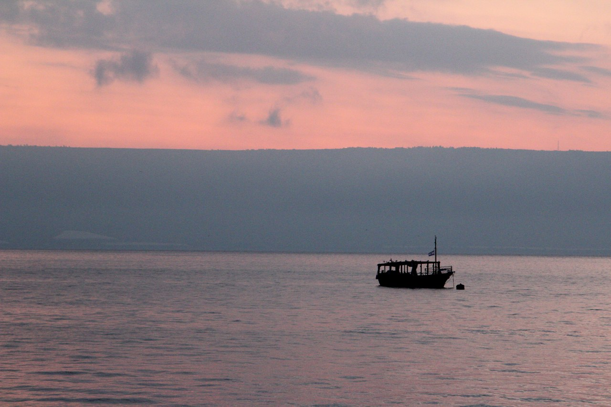</picture>
<figcaption>Sunrise over the <b>Sea of Galilee</b>. Andrew and Peter would have known this light well: Gospel fishermen worked the lake at night and came in at dawn, as they did on the morning when the risen Lord called to them from the shore (John 21:4). Photo: <a href="https://commons.wikimedia.org/wiki/File:Israel_Sunrise_and_ship,_Sea_of_Galilee_(15602213684).jpg">Israel Sunrise and ship, Sea of Galilee (15602213684)</a> by Grant Barclay, <a href="https://creativecommons.org/licenses/by/2.0">CC BY 2.0</a>, via Wikimedia Commons.</figcaption>
</figure>

<h2 id=lamb>"Behold, the Lamb of God"</h2>

Before he met Jesus, Andrew was already searching. He had gone south to the Jordan, where **John the Baptist** was preaching repentance and baptising, and he had become one of John's disciples. St John the Evangelist, who was very probably the unnamed second disciple in the story, tells what happened next with the detail of a man who was there:

> The next day again John was standing with two of his disciples; and he looked at Jesus as he walked, and said, "Behold, the Lamb of God!" The two disciples heard him say this, and they followed Jesus. Jesus turned, and saw them following, and said to them, "What do you seek?" And they said to him, "Rabbi, where are you staying?" He said to them, "Come and see." They came and saw where he was staying; and they stayed with him that day, for it was about the tenth hour. (John 1:35–39)

The tenth hour was about four in the afternoon. We are not told a word of what Jesus said to them in those hours. We only know what Andrew did as soon as he left:

> One of the two who heard John speak, and followed him, was Andrew, Simon Peter's brother. He first found his brother Simon, and said to him, "We have found the Messiah" (which means Christ). He brought him to Jesus. (John 1:40–42)

Jesus looked at Simon and gave him a new name, **Cephas**, Peter, "the Rock." It was Andrew who brought him. That is why the Eastern Churches call him the *Protoklētos*, the First-called, and why preachers have often said that if Andrew had done nothing else in his life, he gave the Church St Peter.

<h2 id=fishers>"I will make you fishers of men"</h2>

For a while the brothers seem to have gone home to their boats. Then, one day by the lake, Jesus came walking along the shore:

> And passing along by the Sea of Galilee, he saw Simon and Andrew the brother of Simon casting a net in the sea; for they were fishermen. And Jesus said to them, "Follow me and I will make you become fishers of men." And immediately they left their nets and followed him. (Mark 1:16–18)

A little further on he called another pair of brothers, **James and John**, the sons of Zebedee, who were mending their nets in their father's boat. These four, the first called, are always named first whenever the Gospels list the Twelve. Peter is always first of all. Andrew is sometimes second, beside his brother, and sometimes fourth, after James and John.

<figure class=photo>
<picture><source srcset="/static/art/andrew-duccio-600.webp 600w,/static/art/andrew-duccio.webp 1280w" sizes="(max-width:760px) 100vw,760px" type="image/webp">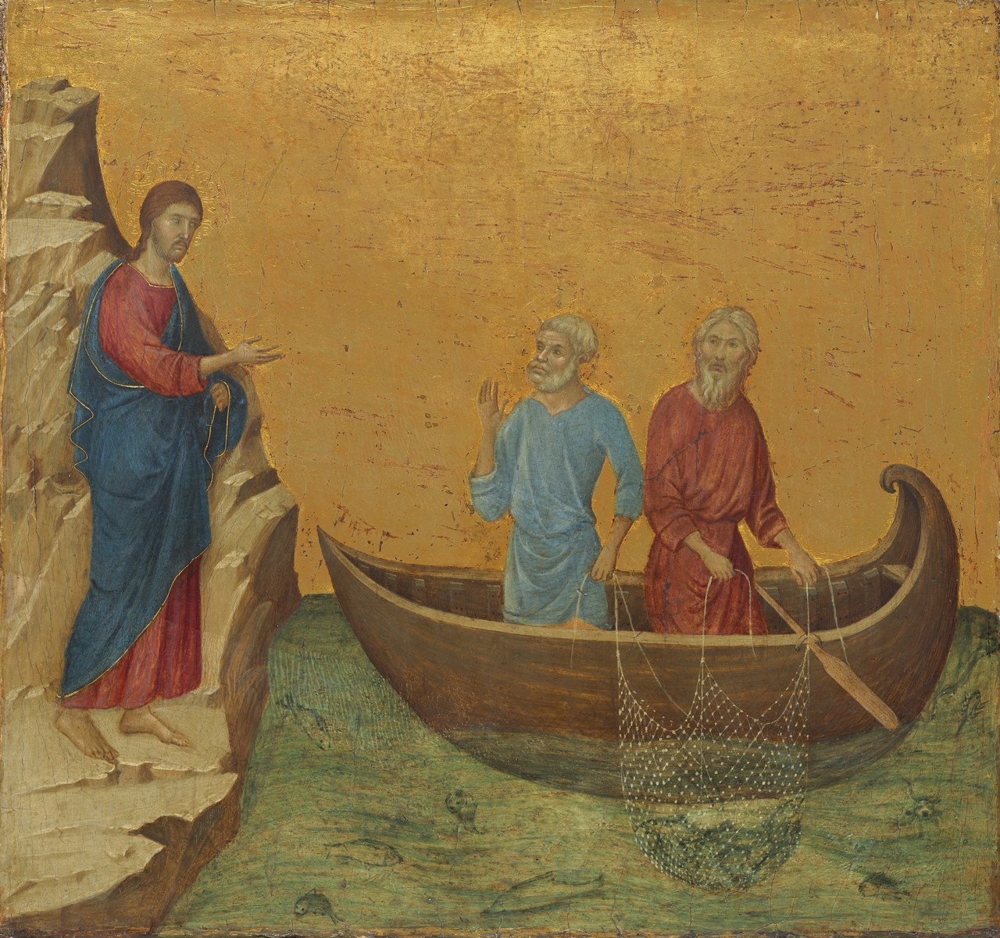</picture>
<figcaption><i>The Calling of the Apostles Peter and Andrew</i>, by <b>Duccio di Buoninsegna</b>, 1308–1311. It once formed part of the back of his great <i>Maestà</i> altarpiece for Siena Cathedral. Andrew, younger-looking here than in most images, is the fisherman beside Peter; Christ stands on the shore with his hand raised to call them. National Gallery of Art, Washington, Samuel H. Kress Collection. Image: <a href="https://commons.wikimedia.org/wiki/File:Duccio_di_Buoninsegna,_The_Calling_of_the_Apostles_Peter_and_Andrew,_1308-1311,_NGA_282.jpg">Duccio di Buoninsegna, The Calling of the Apostles Peter and Andrew, 1308-1311, NGA 282</a>, <a href="https://creativecommons.org/publicdomain/zero/1.0/">CC0</a>, via Wikimedia Commons.</figcaption>
</figure>

<h2 id=loaves>The boy with five loaves</h2>

One spring, near Passover, a great crowd followed Jesus to the hills above the lake. There were five thousand men, not counting women and children, and there was nothing to eat. Jesus asked Philip, to test him, where they could buy bread. Philip said that two hundred denarii, most of a year's wages, would not be enough to give everyone a little.

Then Andrew spoke:

> One of his disciples, Andrew, Simon Peter's brother, said to him, "There is a lad here who has five barley loaves and two fish; but what are they among so many?" (John 6:8–9)

It is a very human moment. Andrew had found the boy, and found out what was in his basket, and then could not quite believe it would help. But he brought the boy to Jesus anyway. Jesus told the people to sit down on the grass, took the loaves, gave thanks and fed them all, and the disciples gathered twelve baskets of what was left over. A church at **Tabgha**, on the shore near Capernaum, has marked the place of the miracle since the 4th century.

<h2 id=greeks>"Sir, we wish to see Jesus"</h2>

During the last week of Jesus' life, in Jerusalem for the Passover, some Greeks who had come to worship at the feast came to Philip with a request: "Sir, we wish to see Jesus." Philip did not go straight to Jesus. He went to Andrew, and together they told the Lord (John 12:20–22).

The answer they received was one of the most mysterious in the Gospel: "The hour has come for the Son of man to be glorified. Truly, truly, I say to you, unless a grain of wheat falls into the earth and dies, it remains alone; but if it dies, it bears much fruit" (John 12:23–24). Pope Benedict XVI saw in this a prophecy of the Church of the Greeks and of all the nations, which would grow from the Cross like a harvest from a buried seed. He noted that ancient traditions remember Andrew, who brought those first Greeks to Jesus, as the apostle to the Greek world for the rest of his life. "In life and in death," the Pope said, Peter and Andrew "appear as true brothers."

<h2 id=pentecost>The Mount of Olives, the Upper Room and Pentecost</h2>

A few days earlier, as Jesus sat on the **Mount of Olives** looking across at the Temple, four disciples came to him privately: "Peter and James and John and Andrew asked him privately, 'Tell us, when will this be, and what will be the sign when these things are all to be accomplished?'" (Mark 13:3–4). His answer, about wars and earthquakes, persecution and the coming of the Son of Man, ends with a single word for all of them: "Watch."

Andrew was with the Lord at the Last Supper, and fled with the others when he was arrested. He was among the disciples who saw him risen. After the Ascension, St Luke names him in the Upper Room with the other apostles, who "with one accord devoted themselves to prayer, together with the women and Mary the mother of Jesus" (Acts 1:13–14). There, at **Pentecost**, the Holy Spirit came upon them all like tongues of fire, and the fisherman of Bethsaida began to preach in Jerusalem with his brother.

<h2 id=scythia>Scythia, the Black Sea and the hills of Kyiv</h2>

After this the New Testament falls silent about Andrew. The early Church did not. Around the year 300, the historian **Eusebius** of Caesarea recorded, quoting the great scholar **Origen** of a century before, how the apostles divided the world among them: Thomas received Parthia, John received Asia, and "Andrew, Scythia." Scythia was the Greek name for the wide lands north and west of the Black Sea, the coasts of what are now Ukraine, Romania and southern Russia.

Other Fathers remembered him in other places. St Gregory Nazianzen speaks of Epirus, St Jerome of Achaia in southern Greece, Theodoret of Hellas. Later Byzantine writers joined these together into one long journey: through Cappadocia, Galatia and Bithynia in Asia Minor, along the Black Sea coast by **Sinope**, to the Scythian steppes and the Greek cities of the Crimea such as **Chersonesus**, and then back by Byzantium, Thrace and Macedonia to Greece. We cannot trace his road with certainty, but the memory that he preached around the Black Sea is very old indeed.

From that memory grew a beautiful legend. The *Russian Primary Chronicle*, written in Kyiv in the early 12th century, says that when Andrew was teaching at Sinope he learned that the mouth of the Dnieper was close by, and sailed up the river. One morning he woke beneath some hills on the riverbank and said to his disciples:

> "See ye these hills? So shall the favour of God shine upon them that on this spot a great city shall arise, and God shall erect many churches therein."

The chronicle says he climbed the hills, blessed them, set up a cross and prayed, and that later the city of **Kyiv** was built there. (It also has him travel on to the far north and report, with some astonishment, on the steam baths of the Slavs.) Historians regard the journey as legend, but it gave the Christians of Kyiv and later of all the Rus' their own apostle, and the church of **St Andrew** still stands on the hill where tradition says he raised his cross.

In Romania, too, a cave in the forests of **Dobrogea**, near the Black Sea coast, is honoured by local tradition as a place where Andrew lived and prayed among the people of Scythia Minor.

<h2 id=byzantium>Byzantium and Stachys</h2>

On the Bosporus, where Europe meets Asia, stood the small Greek city of **Byzantium**, which would one day become Constantinople, the capital of the Christian Roman Empire, and is now Istanbul. A tradition of the Church of Constantinople, written down in the Middle Ages, says that Andrew preached there and ordained a disciple named **Stachys** as its first bishop. A Stachys is greeted by St Paul at the end of his Letter to the Romans as "my beloved Stachys" (Romans 16:9), and tradition takes them to be the same man.

Historians treat the story with caution. But it explains why the Ecumenical Patriarchate of Constantinople, the first see of the Orthodox world, honours Andrew as its founder and patron, just as the Church of Rome honours his brother Peter. The Patriarch keeps Andrew's feast, 30 November, as the feast of his throne.

<h2 id=patras>"Hail, O Cross": the martyrdom at Patras</h2>

The story of Andrew's death is told in the *Acts of Andrew*, written perhaps in the 2nd or 3rd century, and in the later *Passion of Andrew*, which Pope Benedict XVI dated to the beginning of the 6th century. They are not history in the modern sense, but they carry the memory of the Church of Patras, a port on the Gulf of Corinth in western Greece, which has honoured Andrew's tomb since ancient times.

According to these accounts, Andrew preached in Patras and many believed. Among them was **Maximilla**, the wife of the Roman proconsul **Aegeas** (or Aegeates), whom he healed, and the proconsul's own brother **Stratocles**. Aegeas was furious. He had Andrew scourged and condemned him to be crucified, and to make his death last longer he ordered that he be tied to the cross with ropes, not nailed.

When Andrew saw the cross, the *Passion* says, he greeted it like a friend he had been waiting for all his life:

> "Hail, O Cross, inaugurated by the Body of Christ and adorned with his limbs as though they were precious pearls. Before the Lord mounted you, you inspired an earthly fear. Now, instead, endowed with heavenly love, you are accepted as a gift. Believers know of the great joy that you possess, and of the multitude of gifts you have prepared. I come to you, therefore, confident and joyful, so that you too may receive me exultant as a disciple of the One who was hung upon you... Take me, carry me far from men, and restore me to my Teacher."

For **two days**, the story goes, he hung on the cross by the sea and did not stop preaching to the crowd. The people were so moved that they demanded his release, and Aegeas came to take him down. But Andrew prayed that he would not be taken from the cross, and when the soldiers reached for the ropes their hands would not move. A great light shone around him, and in that light he gave up his spirit. Maximilla buried his body with love. Tradition gives the date as **30 November**, in about the year 60, and places the cross at the water's edge, where the old church of St Andrew in Patras now stands beside a holy spring.

"Here," said Pope Benedict, "is a very profound Christian spirituality. It does not view the Cross as an instrument of torture but rather as the incomparable means for perfect configuration to the Redeemer, to the grain of wheat that fell into the earth."

<figure class=photo>
<picture><source srcset="/static/art/andrew-patras-mosaic-600.webp 600w,/static/art/andrew-patras-mosaic.webp 1280w" sizes="(max-width:760px) 100vw,760px" type="image/webp">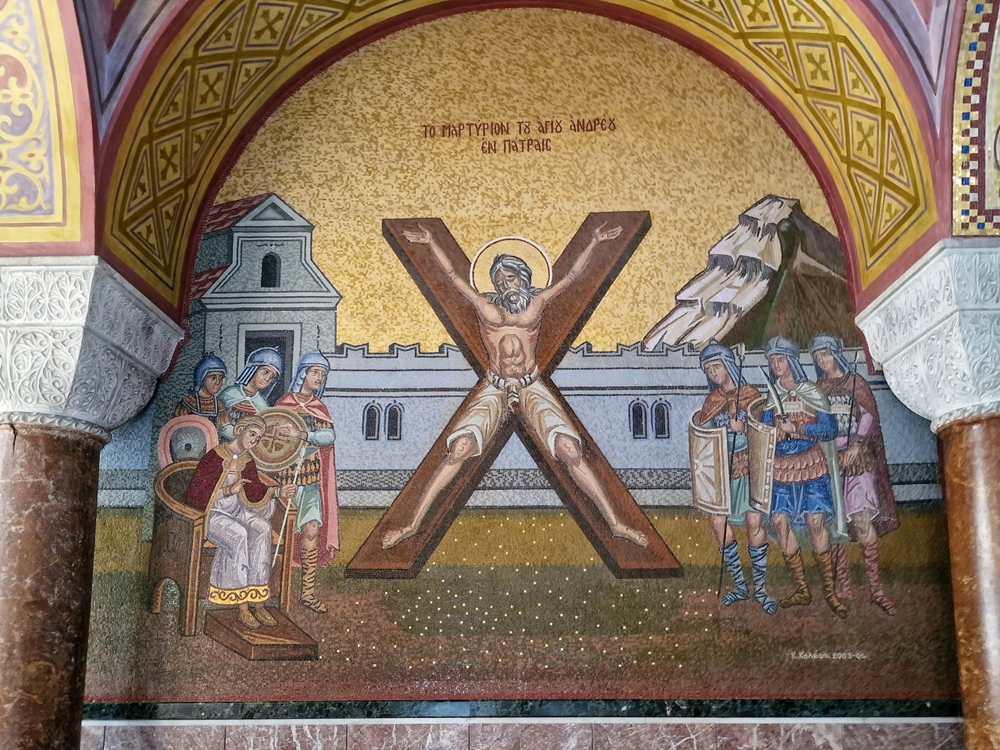</picture>
<figcaption>The crucifixion of St Andrew in mosaic, in the <b>Basilica of St Andrew at Patras</b>, the great church built over the traditional place of his martyrdom. Greek iconographers show him, as the West does, on the X-shaped cross that became his emblem. Photo: <a href="https://commons.wikimedia.org/wiki/File:Patras_Cathedral-Saint-Andrew_20230922_155839.jpg">Patras Cathedral-Saint-Andrew 20230922 155839</a> by Rigorius, <a href="https://creativecommons.org/licenses/by-sa/4.0">CC BY-SA 4.0</a>, via Wikimedia Commons.</figcaption>
</figure>

<h2 id=saltire>The X-shaped cross</h2>

Almost everyone knows St Andrew's cross: the diagonal cross, shaped like an X, that flies on the flag of Scotland. It is a lovely emblem, but it seems to be a medieval one. The earliest accounts of his death say only that he was tied to a cross, and the oldest images show him with an ordinary cross, or with none at all. The X-shaped cross begins to appear only in the later Middle Ages, around the 11th to 13th centuries, and becomes common in art from the 14th; scholars, including the writers of the Catholic Encyclopedia, regard it as a later tradition. Later tradition explained it by saying that Andrew, like Peter, did not think himself worthy to die on a cross like his Lord's.

Some great painters kept to the older tradition. **Caravaggio**, painting in Naples in 1606–07, shows Andrew on an upright cross, as you can see below in the [art section](#art). The X, the Latin cross and the plain beam all tell the same truth: that the fisherman went to his death for Christ with joy.

<h2 id=relics>His relics: Constantinople, Amalfi and home to Patras</h2>

Andrew's tomb at Patras was honoured for nearly three centuries. Then, in **357**, the emperor Constantius II had his relics brought to Constantinople, with those of St Luke and St Timothy, and laid in the new **Church of the Holy Apostles**, built to be the resting place of the emperors beside the apostles. The Church of Patras kept some relics, among them his head, and its own memory of the place.

Constantinople guarded Andrew for almost nine hundred years, until the disaster of **1204**, when the armies of the Fourth Crusade turned aside from the Holy Land and sacked the Christian city. In the looting that followed, many holy relics were carried to the West. **Cardinal Peter of Capua**, the papal legate, who was a son of Amalfi, obtained Andrew's relics and brought them home. On **8 May 1208** they were laid in the crypt of the cathedral of **Amalfi**, on the cliffs of the Italian coast south of Naples, where they rest beneath the altar today. The people of Amalfi have long kept a tradition of the *manna* of St Andrew, a clear liquid gathered from his tomb.

In 1460 the last Byzantine ruler of the Peloponnese, **Thomas Palaiologos**, fleeing the Ottoman conquest, carried Andrew's head from Patras to Italy. He gave it to **Pope Pius II**, who received it in Rome in 1462 with great ceremony, and for five hundred years it was kept in St Peter's Basilica, near the tomb of Andrew's brother.

Then came a gesture of love between the Churches. In **1964**, in the spirit of the Second Vatican Council, **St Paul VI** decided to return the head to Patras. On 24 September Cardinal Augustin Bea handed it over, and on 26 September 1964 the city welcomed its apostle home. In **1980** another treasure followed: fragments of the cross of St Andrew, which had been kept since the Middle Ages at the Abbey of Saint-Victor in **Marseille**, were given back to Patras on 19 January 1980. Today both rest in the new basilica, the head in a silver reliquary and the cross in a great gilded X-shaped case.

<figure class=photo>
<picture><source srcset="/static/art/andrew-patras-head-600.webp 600w,/static/art/andrew-patras-head.webp 1280w" sizes="(max-width:760px) 100vw,760px" type="image/webp">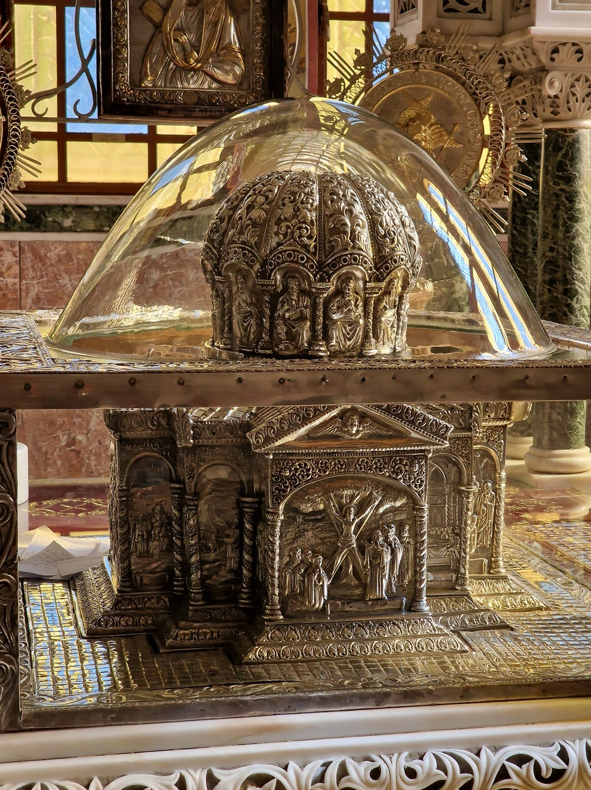</picture>
<figcaption>The reliquary holding the <b>head of St Andrew</b> in the Basilica of St Andrew at Patras. It was carried to Rome in 1462 and kept at St Peter's for five centuries, until St Paul VI returned it to Patras in 1964 as a gift of the Church of Rome to the Orthodox Church of Greece. Photo: <a href="https://commons.wikimedia.org/wiki/File:Patras_Cathedral-Saint-Andrew_20230922_155331.jpg">Patras Cathedral-Saint-Andrew 20230922 155331</a> by Rigorius, <a href="https://creativecommons.org/licenses/by-sa/4.0">CC BY-SA 4.0</a>, via Wikimedia Commons.</figcaption>
</figure>

<figure class=photo>
<picture><source srcset="/static/art/andrew-patras-cross-600.webp 600w,/static/art/andrew-patras-cross.webp 1280w" sizes="(max-width:760px) 100vw,760px" type="image/webp">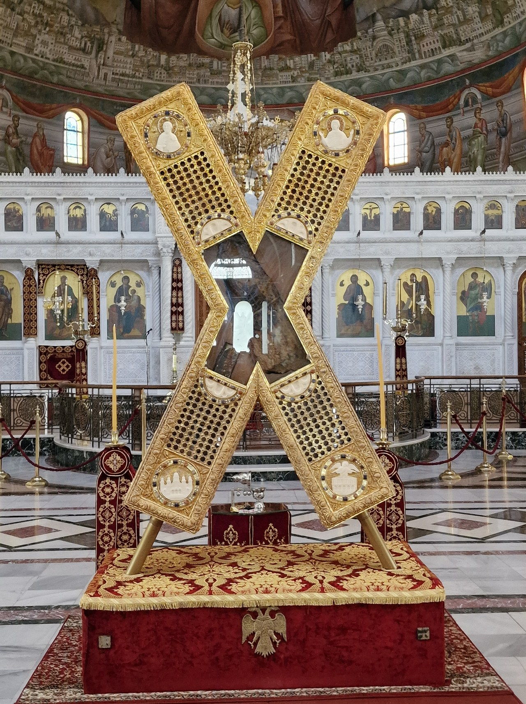</picture>
<figcaption>The reliquary of <b>St Andrew's cross</b> at Patras. Fragments of the cross on which, by tradition, he died were kept for centuries in the Abbey of Saint-Victor in Marseille, and were returned to Patras in 1980. Photo: <a href="https://commons.wikimedia.org/wiki/File:Patras_Cathedral-Saint-Andrew_20230922_154654.jpg">Patras Cathedral-Saint-Andrew 20230922 154654</a> by Rigorius, <a href="https://creativecommons.org/licenses/by-sa/4.0">CC BY-SA 4.0</a>, via Wikimedia Commons.</figcaption>
</figure>

<figure class=photo>
<picture><source srcset="/static/art/andrew-amalfi-crypt-600.webp 600w,/static/art/andrew-amalfi-crypt.webp 1280w" sizes="(max-width:760px) 100vw,760px" type="image/webp">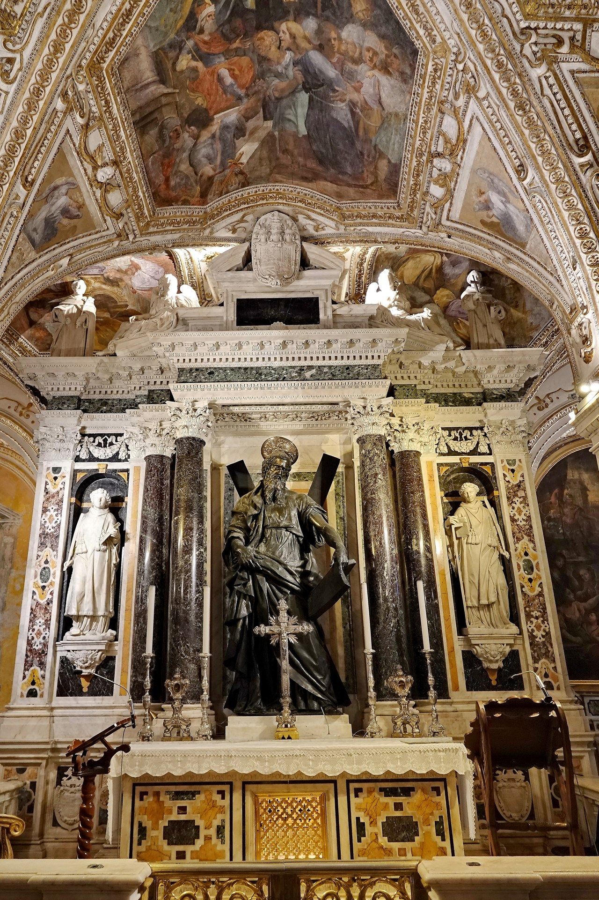</picture>
<figcaption>The crypt of <b>Amalfi Cathedral</b>, where the relics of St Andrew have rested since 8 May 1208. The great bronze statue over the altar is by <b>Michelangelo Naccherino</b>, from the early 17th century. Pilgrims come especially on his two feasts here, 30 November and 27 June, when Amalfi remembers the day he saved the town from a pirate fleet in 1544. Photo: <a href="https://commons.wikimedia.org/wiki/File:Duomo_di_Amalfi,_Cripta_03.jpg">Duomo di Amalfi, Cripta 03</a> by Luciano Tronati, <a href="https://creativecommons.org/licenses/by-sa/4.0">CC BY-SA 4.0</a>, via Wikimedia Commons.</figcaption>
</figure>

<h2 id=scotland>Scotland: St Rule, the saltire and Arbroath</h2>

How did an apostle from Galilee become the patron of Scotland, at the far edge of the known world? The Scots themselves tell it as a story.

According to a legend written down in the Middle Ages, a monk of Patras named **St Rule**, or Regulus, was warned by an angel to take some of Andrew's bones and carry them "to the ends of the earth." He sailed west until he was shipwrecked on the coast of Fife, at a place called Kilrymont, and there he built a church for the relics. The town became **St Andrews**. Historians think the relics more probably came in the 8th century, perhaps with **Bishop Acca of Hexham**, a great lover of St Andrew, but the name of St Rule has stayed with the place, on the tall square tower of the 12th-century church built for the relics, which still stands.

A second legend tells how Andrew became Scotland's own. In **832**, it says, **Óengus II**, king of the Picts, with the help of the Scots, was facing a larger army of Angles near the place now called **Athelstaneford**, in East Lothian. Óengus prayed to St Andrew and vowed that if he won, Andrew would be the patron of his kingdom. The next morning, white clouds formed an X-shaped cross against the blue sky. The Picts and Scots took heart and won the battle, and the white saltire on a blue field became the flag of Scotland. There is no record of the battle from the time, and the story was told centuries later, but the saltire is one of the oldest national flags in the world.

<figure class=photo>
<picture><source srcset="/static/art/andrew-athelstaneford-600.webp 600w,/static/art/andrew-athelstaneford.webp 1280w" sizes="(max-width:760px) 100vw,760px" type="image/webp">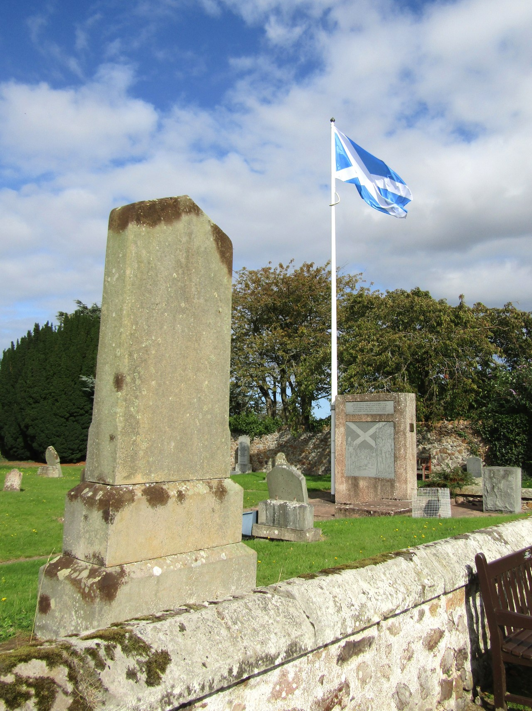</picture>
<figcaption>The <b>Saltire Memorial</b> at Athelstaneford, East Lothian, beside the parish church, near the traditional field of the battle where, according to legend, a white cross appeared in the blue sky. A Saltire flies here day and night. Photo: <a href="https://commons.wikimedia.org/wiki/File:Athelstaneford_-_Saltire_Memorial_-_geograph.org.uk_-_8427784.jpg">Athelstaneford - Saltire Memorial - geograph.org.uk - 8427784</a> by Colin Smith, <a href="https://creativecommons.org/licenses/by-sa/2.0">CC BY-SA 2.0</a>, via Wikimedia Commons.</figcaption>
</figure>

By the 12th century St Andrews was the religious capital of Scotland, and work began on a great cathedral to house the relics, which became the largest church in the land. When the barons of Scotland wrote to Pope John XXII in **1320** to defend their country's freedom, in the letter we call the **Declaration of Arbroath**, they told how Christ had called the Scots to the faith through:

> "...the first of His Apostles by calling, though second or third in rank, the most gentle Saint Andrew, the Blessed Peter's brother, and desired him to keep them under his protection as their patron forever."

The cathedral's shrine was destroyed in the Reformation, and its relics lost. But the bond was renewed in modern times. In 1879 the Archbishop of Amalfi sent a relic of Andrew's shoulder to the Catholic Church in Scotland, and in 1969 St Paul VI gave further relics to Cardinal Gordon Gray of St Andrews and Edinburgh with the words, "Saint Peter gives you his brother." Both are venerated today in St Mary's Cathedral, Edinburgh.

<figure class=photo>
<picture><source srcset="/static/art/andrew-arbroath-600.webp 600w,/static/art/andrew-arbroath.webp 1280w" sizes="(max-width:760px) 100vw,760px" type="image/webp">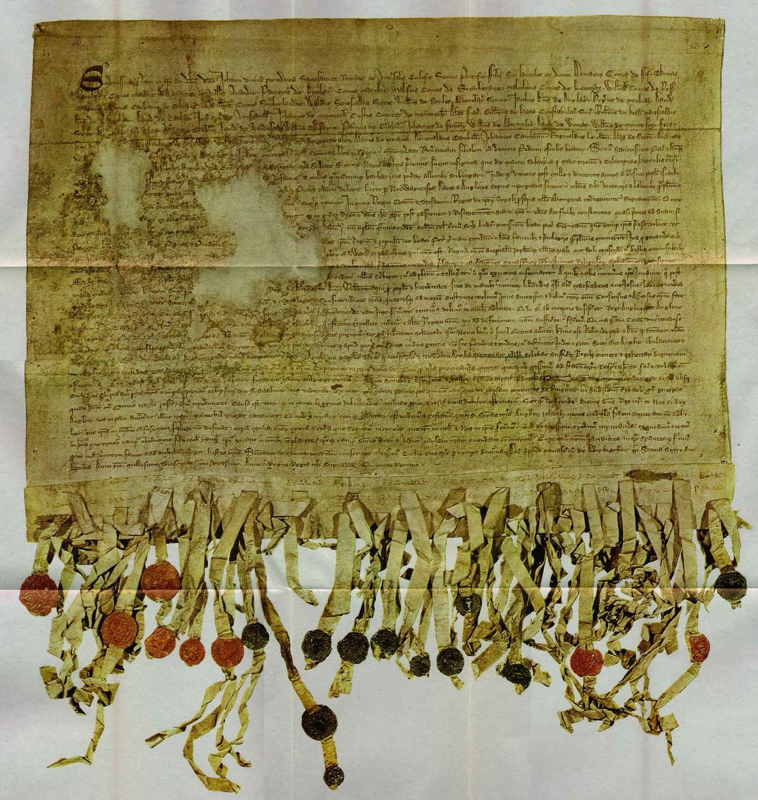</picture>
<figcaption>The <b>Declaration of Arbroath</b>, 6 April 1320, in the surviving copy kept in the National Records of Scotland. The barons commend Scotland to the Pope under the protection of "the most gentle Saint Andrew, the Blessed Peter's brother." Image: <a href="https://commons.wikimedia.org/wiki/File:Declaration_of_arbroath.jpg">Declaration of arbroath</a>, public domain, via Wikimedia Commons.</figcaption>
</figure>

<h2 id=brothers>Peter's brother: Rome and Constantinople</h2>

In 1054, and in the centuries after, the Churches of East and West grew apart. But they never stopped honouring the two brothers of Bethsaida. Rome celebrates Peter, its first bishop; Constantinople celebrates Andrew, the First-called, as the founder of its Church. Pope Benedict XVI saw in this brotherhood a sign of the "special reciprocal relations of the See of Rome and of Constantinople, which are truly Sister Churches."

Since the 1960s, the two Churches have exchanged visits on each other's feast. Every year on 29 June a delegation of the Ecumenical Patriarch comes to Rome for the feast of Sts Peter and Paul, and every 30 November a delegation of the Pope goes to the Phanar in Istanbul for the feast of St Andrew. St John Paul II, Benedict XVI and Francis each went in person. On **30 November 2025**, in the year of the 1700th anniversary of the Council of Nicaea, **Pope Leo XIV** prayed beside Patriarch **Bartholomew** at the Divine Liturgy for St Andrew's Day in the Patriarchal Church of St George, and asked that both Churches "continue to strive towards Christian unity."

<h2 id=advent>St Andrew's Day, Advent and the Christmas Novena</h2>

Andrew's feast falls on the threshold of the Church's year. The **First Sunday of Advent** is always the Sunday closest to 30 November, so St Andrew's Day is sometimes the last feast of the old liturgical year and sometimes one of the first of the new. For centuries it has been a reminder that Christmas is coming.

Out of that has grown a simple, much-loved devotion, the **St Andrew Christmas Novena**. From St Andrew's Day until Christmas Eve, many families say this short prayer fifteen times a day:

> Hail and blessed be the hour and moment in which the Son of God was born of the most pure Virgin Mary, at midnight, in Bethlehem, in piercing cold. In that hour vouchsafe, O my God, to hear my prayer and grant my desires, through the merits of Our Saviour Jesus Christ, and of His Blessed Mother. Amen.

The prayer is not by Andrew himself, and is usually dated to the late 19th century, but it is a fitting way to keep his feast: the apostle who first said "We have found the Messiah" leading us, day by day, to the manger.

<h2 id=places>His places and churches</h2>

Andrew's places stretch from a lake in Galilee to the coast of Fife. Some are sites of history, some of tradition, and all of them are places of prayer.

<figure class=map><figcaption>St Andrew's world: his home on the Sea of Galilee, Jerusalem, the Black Sea lands of his mission by tradition, Byzantium, Patras where he died, and Amalfi and Rome, with the journeys of his relics. The insets show Scotland, where he is patron, and the towns around the Sea of Galilee. Map by The Daily Word; borders from Natural Earth (public domain); the Dnieper, the Sea of Galilee and the relic routes are drawn approximately. Tap to enlarge.</figcaption></figure>

### Bethsaida and the Sea of Galilee, Israel

The site of Andrew's hometown is not certain. Most archaeologists identify it with **et-Tell**, a mound just north of the lake now called Tel Bethsaida, excavated since 1987, where houses, a fishing quarter and city gates have been found; others prefer a site called el-Araj nearer the shore. Either way, the pilgrim stands where Andrew and Peter grew up, within sight of the water. Along the shore are **Capernaum**, with the remains of its synagogue and of the house venerated as Peter's, and **Tabgha**, with its churches of the multiplication of the loaves and of the Primacy of Peter.

<figure class=photo>
<picture><source srcset="/static/art/andrew-bethsaida-600.webp 600w,/static/art/andrew-bethsaida.webp 1280w" sizes="(max-width:760px) 100vw,760px" type="image/webp">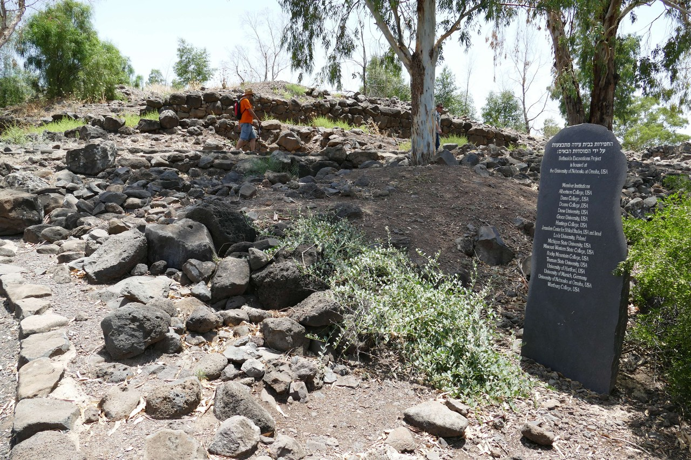</picture>
<figcaption>The excavations at <b>Tel Bethsaida</b> (et-Tell), north of the Sea of Galilee, which many archaeologists identify as Bethsaida, "the city of Andrew and Peter." The houses here were built, like those of Capernaum, from the black basalt stone of the region. Photo: <a href="https://commons.wikimedia.org/wiki/File:Tel-Beit-Tsaida-201.jpg">Tel-Beit-Tsaida-201</a> by Bukvoed, <a href="https://creativecommons.org/licenses/by/4.0">CC BY 4.0</a>, via Wikimedia Commons.</figcaption>
</figure>

<figure class=photo>
<picture><source srcset="/static/art/andrew-galilee-boat-600.webp 600w,/static/art/andrew-galilee-boat.webp 1280w" sizes="(max-width:760px) 100vw,760px" type="image/webp">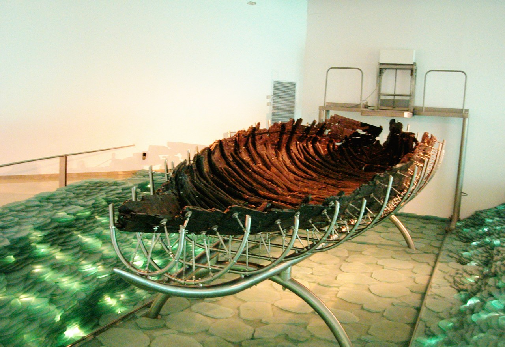</picture>
<figcaption>The <b>Ancient Galilee Boat</b>, found in the mud of the lakeshore near Ginosar during a drought in 1986, and now displayed at the Yigal Allon Centre. It dates from around the 1st century BC to the 1st century AD, and gives a vivid idea of the kind of fishing boat Andrew and Peter worked from and left behind. Photo: <a href="https://commons.wikimedia.org/wiki/File:Ancient_Sea_of_Galilee_Boat_1st_Century_AD_at_Yigal_Allon_Centre_Ginosar_Israel.jpg">Ancient Sea of Galilee Boat 1st Century AD at Yigal Allon Centre Ginosar Israel</a> by Ywpark2003 (Prof. Yong Woo Park), <a href="https://creativecommons.org/publicdomain/zero/1.0/">CC0</a>, via Wikimedia Commons.</figcaption>
</figure>

### The Basilica of St Andrew, Patras, Greece

Patras has two churches of St Andrew side by side, near the sea at the south-west of the city. The **old church**, a gracious 19th-century building on the site of earlier churches, stands over the traditional place of his martyrdom; beside it is a spring which, tradition says, flowed there in his day. It keeps a small relic of his finger, a gift from Mount Athos in 1847. Next to it rises the vast **new basilica**, begun in 1908 and consecrated in 1974, one of the largest churches in the Balkans, with its central dome crowned by a gilded cross. Inside are the two treasures returned from the West: the reliquary of his head, given back in 1964, and the reliquary of his cross, returned in 1980. Every 30 November, the city carries his relics in procession through its streets.

<figure class=photo>
<picture><source srcset="/static/art/andrew-patras-new-600.webp 600w,/static/art/andrew-patras-new.webp 1280w" sizes="(max-width:760px) 100vw,760px" type="image/webp">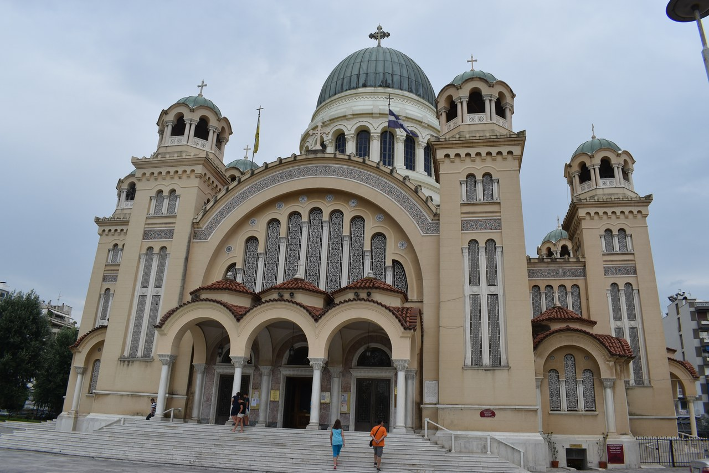</picture>
<figcaption>The <b>new Basilica of St Andrew</b> at Patras, begun in 1908 and consecrated in 1974, which houses the relics of the saint's head and cross. Photo: <a href="https://commons.wikimedia.org/wiki/File:Cathedral_Agios_Andreas,_Patra_-_1.jpg">Cathedral Agios Andreas, Patra - 1</a> by Annatsach, <a href="https://creativecommons.org/licenses/by-sa/4.0">CC BY-SA 4.0</a>, via Wikimedia Commons.</figcaption>
</figure>

<figure class=photo>
<picture><source srcset="/static/art/andrew-patras-old-600.webp 600w,/static/art/andrew-patras-old.webp 1280w" sizes="(max-width:760px) 100vw,760px" type="image/webp">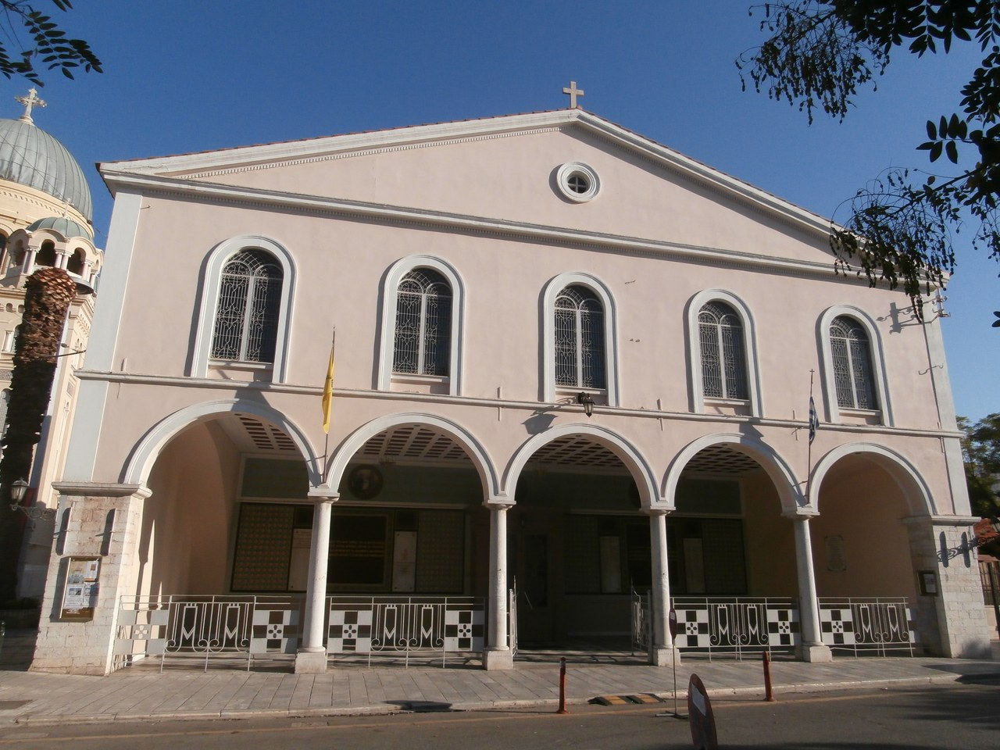</picture>
<figcaption>The <b>old church of St Andrew</b> at Patras, built in the 19th century over the traditional place of his crucifixion by the sea. Photo: <a href="https://commons.wikimedia.org/wiki/File:Old_Saint_Andrew_church,_Patra_9281555.jpg">Old Saint Andrew church, Patra 9281555</a> by C messier, <a href="https://creativecommons.org/licenses/by-sa/4.0">CC BY-SA 4.0</a>, via Wikimedia Commons.</figcaption>
</figure>

### Amalfi Cathedral, Italy

The **Cathedral of Sant'Andrea** rises above Amalfi's small piazza at the top of a long, steep flight of steps. Its striped façade, rebuilt in the 19th century in the old Arab-Norman style, has a gold mosaic of Christ with the apostles in its gable, with Andrew close to him. Below the cathedral is the crypt built by Cardinal Peter of Capua for the relics he brought from Constantinople in 1208. The whole town keeps St Andrew's two feasts, carrying his silver statue through the streets and down to the sea.

<figure class=photo>
<picture><source srcset="/static/art/andrew-amalfi-600.webp 600w,/static/art/andrew-amalfi.webp 1280w" sizes="(max-width:760px) 100vw,760px" type="image/webp">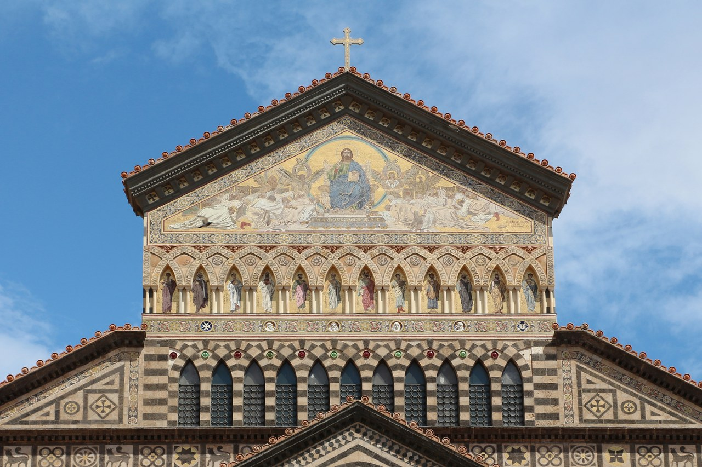</picture>
<figcaption>The mosaic in the gable of <b>Amalfi Cathedral</b>, the Duomo di Sant'Andrea, where the apostle's relics have been honoured for more than eight hundred years. Photo: <a href="https://commons.wikimedia.org/wiki/File:Duomo_(Amalfi)_02.jpg">Duomo (Amalfi) 02</a> by Bernard Gagnon, <a href="https://creativecommons.org/licenses/by/4.0">CC BY 4.0</a>, via Wikimedia Commons.</figcaption>
</figure>

### St Andrews Cathedral and St Rule's Tower, Scotland

St Andrews, on the coast of Fife, grew up around the relics of the apostle and was for centuries the spiritual heart of Scotland. The tall, narrow **St Rule's Tower**, 33 metres high, is the oldest building standing there; it belonged to the church built around 1130 to house the relics, and pilgrims could see it from far out at sea. Beside it are the ruins of **St Andrews Cathedral**, begun around 1160 and consecrated in 1318 in the presence of King Robert the Bruce. It was the largest church ever built in Scotland. Stripped at the Reformation, it was abandoned in 1561, but its great east and west gables still stand against the sea wind.

<figure class=photo>
<picture><source srcset="/static/art/andrew-st-andrews-600.webp 600w,/static/art/andrew-st-andrews.webp 1280w" sizes="(max-width:760px) 100vw,760px" type="image/webp">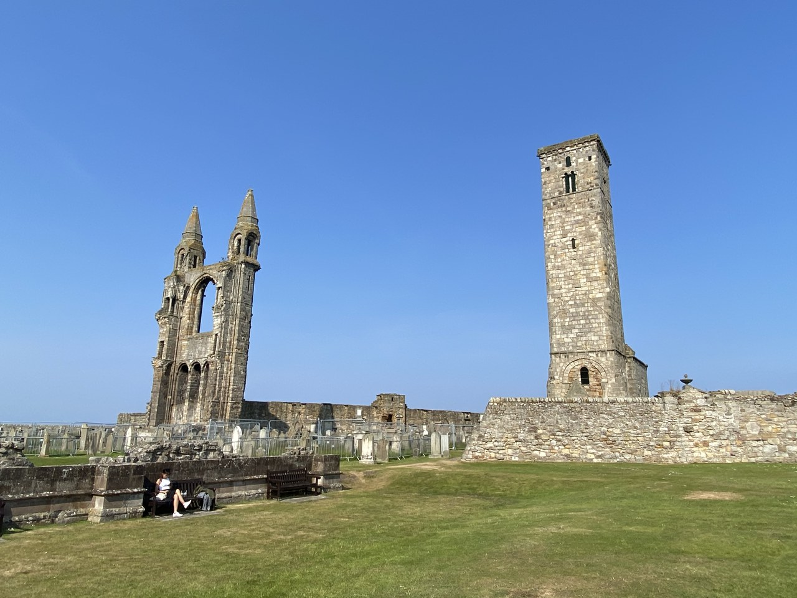</picture>
<figcaption>The ruins of <b>St Andrews Cathedral</b>, with the turrets of its west front on the left and <b>St Rule's Tower</b> on the right, built around 1130 for the relics of St Andrew. Photo: <a href="https://commons.wikimedia.org/wiki/File:St_Rule%27s_Tower_%26_Western_Turrets_from_St_Andrews_Cathedral%27s_Former_Courtyard.jpg">St Rule's Tower & Western Turrets from St Andrews Cathedral's Former Courtyard</a> by Steven1991, <a href="https://creativecommons.org/licenses/by-sa/4.0">CC BY-SA 4.0</a>, via Wikimedia Commons.</figcaption>
</figure>

<figure class=photo>
<picture><source srcset="/static/art/andrew-st-rule-600.webp 600w,/static/art/andrew-st-rule.webp 1280w" sizes="(max-width:760px) 100vw,760px" type="image/webp">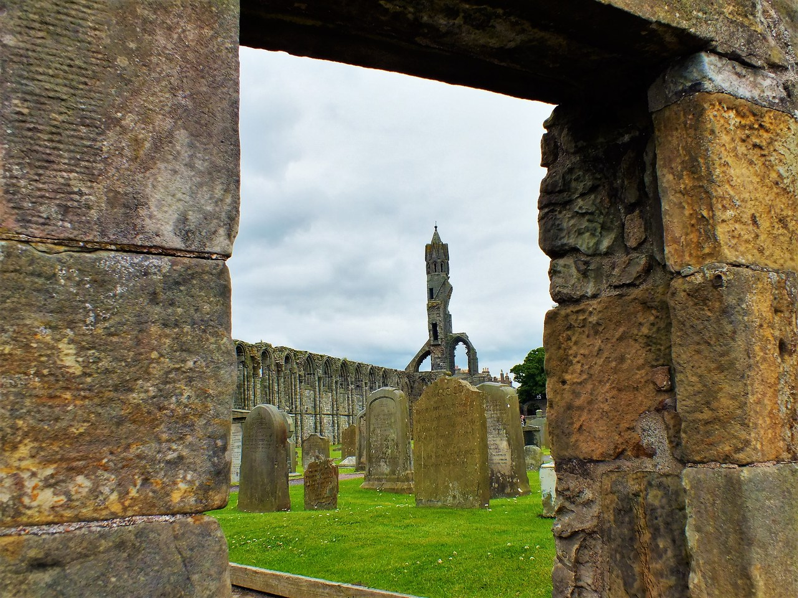</picture>
<figcaption><b>St Rule's Tower</b>, named after the monk who, in the legend, brought Andrew's relics from Patras to Scotland, seen through a doorway in the cathedral precinct. Photo: <a href="https://commons.wikimedia.org/wiki/File:St_Andrews_Cathedral_Tower.jpg">St Andrews Cathedral Tower</a> by Tom Rayner, <a href="https://creativecommons.org/licenses/by-sa/4.0">CC BY-SA 4.0</a>, via Wikimedia Commons.</figcaption>
</figure>

### St Andrew's Church, Kyiv, Ukraine

On the hill above Kyiv's old lower town of Podil, where the *Russian Primary Chronicle* says Andrew set up his cross, stands one of the most beautiful churches in Ukraine. **St Andrew's Church** was designed by the Italian architect **Bartolomeo Rastrelli** for Empress Elizabeth of Russia, built from 1747 to 1754, and consecrated in 1767. With its turquoise walls, white columns and green and gold domes, it seems to float above the steep, winding street of **Andriivskyi Descent** below.

<figure class=photo>
<picture><source srcset="/static/art/andrew-kyiv-600.webp 600w,/static/art/andrew-kyiv.webp 1280w" sizes="(max-width:760px) 100vw,760px" type="image/webp">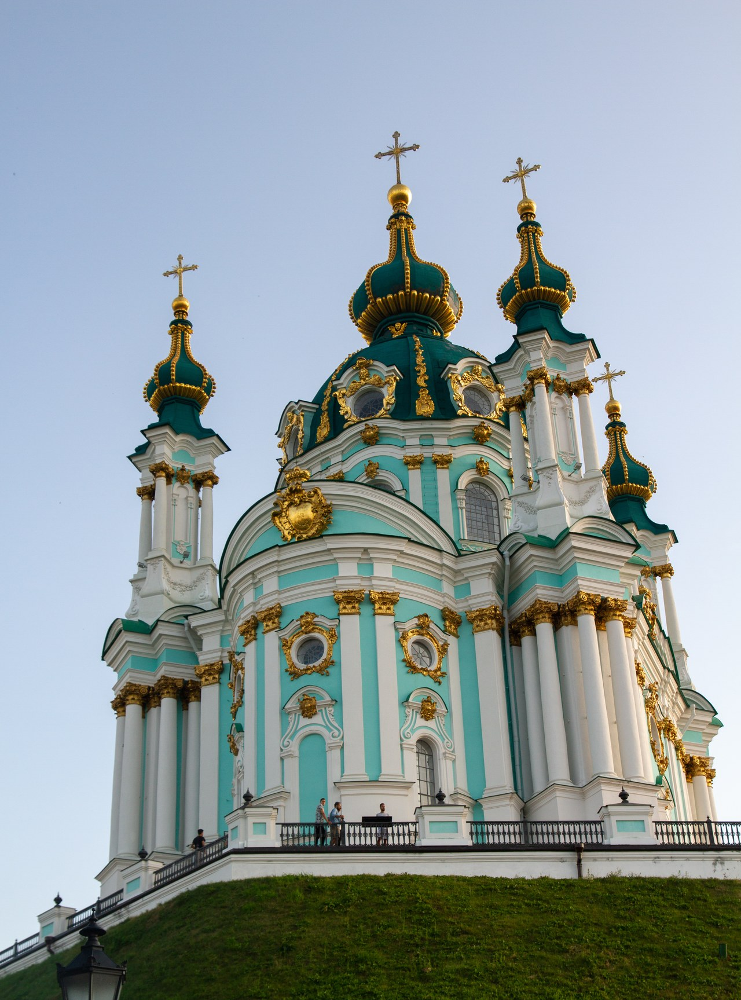</picture>
<figcaption><b>St Andrew's Church in Kyiv</b>, by Bartolomeo Rastrelli, on the hill where, according to the <i>Primary Chronicle</i>, the apostle blessed the place where the city would rise. Photo: <a href="https://commons.wikimedia.org/wiki/File:2019-07-13_St._Andrew%27s_Church,_Kyiv,_Ukraine_2.jpg">2019-07-13 St. Andrew's Church, Kyiv, Ukraine 2</a> by Maksym Kozlenko, <a href="https://creativecommons.org/licenses/by-sa/4.0">CC BY-SA 4.0</a>, via Wikimedia Commons.</figcaption>
</figure>

### St Andrew's Cave, Dobrogea, Romania

In the forest near the village of **Ion Corvin**, in Constanța County, is a small cave that Romanian tradition honours as a place where Andrew lived and prayed during his mission to Scythia Minor. There is no early record of it, and historians date the story to modern times; the cave was rediscovered in 1943, and a monastery has grown up around it since 1990. But it has become one of the best-loved places of pilgrimage in Romania, especially around his feast. Inside the cave, pilgrims are shown a stone niche said to be his bed, and nearby is a spring that bears his name. Since 1997 the Romanian Orthodox Church has honoured Andrew as the protector of Romania, and since 2012 his day has been a public holiday.

<figure class=photo>
<picture><source srcset="/static/art/andrew-romania-cave-600.webp 600w,/static/art/andrew-romania-cave.webp 1280w" sizes="(max-width:760px) 100vw,760px" type="image/webp">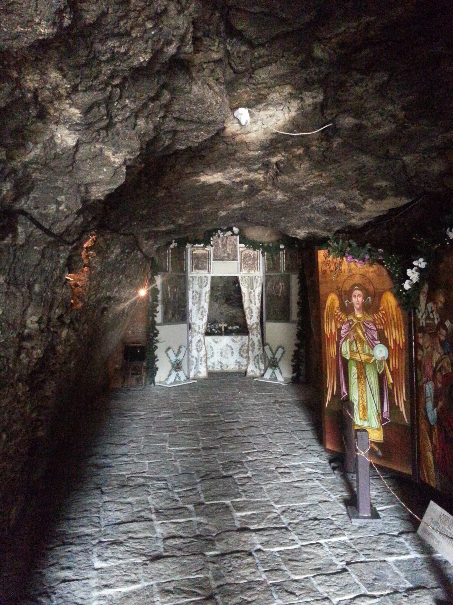</picture>
<figcaption>Inside <b>St Andrew's Cave</b> near Ion Corvin, Dobrogea, now a chapel in the monastery that has grown up around it. Local tradition remembers it as a place where the apostle prayed. Photo: <a href="https://commons.wikimedia.org/wiki/File:Pestera_Sf._Apostol_Andrei_1.jpg">Pestera Sf. Apostol Andrei 1</a> by Statache Marian, <a href="https://creativecommons.org/licenses/by-sa/3.0/ro/deed.en">CC BY-SA 3.0 RO</a>, via Wikimedia Commons.</figcaption>
</figure>

### Two churches of St Andrew in Rome

**Sant'Andrea al Quirinale** is a small oval church built for the Jesuits by **Gian Lorenzo Bernini** from 1658 to 1670. Bernini thought it one of his best works, and his son remembered finding him sitting quietly in it in his old age. Above the high altar, with its painting of Andrew's crucifixion by Guillaume Courtois, a white marble figure of the saint by Antonio Raggi rises on a cloud through a broken pediment toward the golden dome, as if being taken up to heaven straight from his cross.

<figure class=photo>
<picture><source srcset="/static/art/andrew-quirinale-600.webp 600w,/static/art/andrew-quirinale.webp 1280w" sizes="(max-width:760px) 100vw,760px" type="image/webp">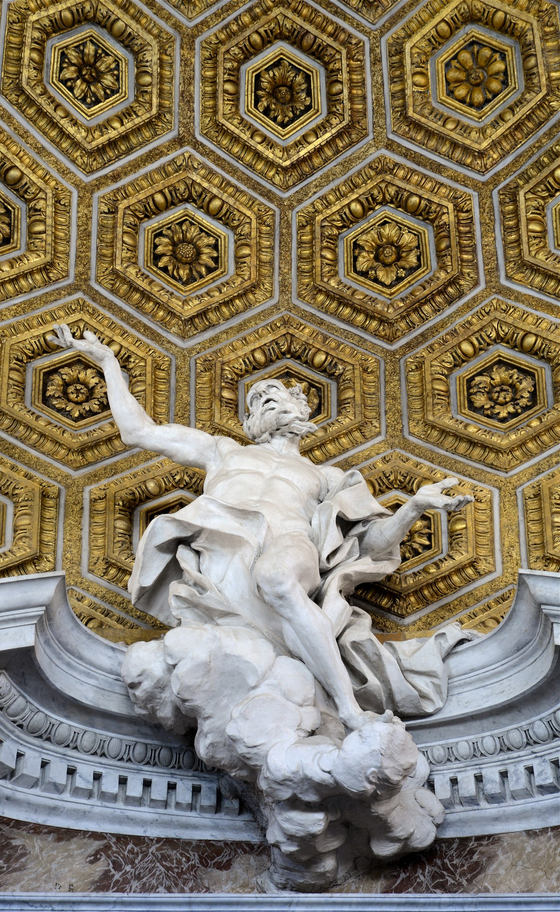</picture>
<figcaption><b>St Andrew rising to heaven</b>, by Antonio Raggi, in Bernini's church of <b>Sant'Andrea al Quirinale</b>, Rome. Bernini designed the whole church so that the eye travels from the martyrdom painted over the altar, up through the statue, to the light of the dome. Photo: <a href="https://commons.wikimedia.org/wiki/File:St_Andrew_(Sant%27Andrea_al_Quirinale)_September_2015-1.jpg">St Andrew (Sant'Andrea al Quirinale) September 2015-1</a> by Alvesgaspar, <a href="https://creativecommons.org/licenses/by-sa/4.0">CC BY-SA 4.0</a>, via Wikimedia Commons.</figcaption>
</figure>

**Sant'Andrea della Valle**, the great church of the Theatine fathers, was begun in 1590. Its dome, by Carlo Maderno, is the second largest in Rome after St Peter's. Domenichino painted the story of Andrew's life in the apse and dome in the 1620s, and Mattia Preti added three great scenes of his martyrdom below them in 1650–51. Opera lovers know the church as the setting of the first act of Puccini's *Tosca*.

<figure class=photo>
<picture><source srcset="/static/art/andrew-della-valle-600.webp 600w,/static/art/andrew-della-valle.webp 1280w" sizes="(max-width:760px) 100vw,760px" type="image/webp">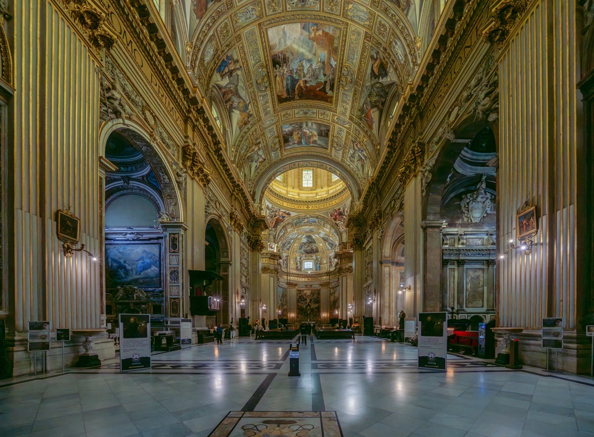</picture>
<figcaption>The nave of <b>Sant'Andrea della Valle</b>, Rome, looking toward the apse, where Domenichino and Mattia Preti painted the life and death of St Andrew. Photo: <a href="https://commons.wikimedia.org/wiki/File:Sant%27Andrea_della_Valle_(Rome)_-_Interno.jpg">Sant'Andrea della Valle (Rome) - Interno</a> by Fiat 500e, <a href="https://creativecommons.org/licenses/by/4.0">CC BY 4.0</a>, via Wikimedia Commons.</figcaption>
</figure>

<h2 id=art>Andrew in art</h2>

Andrew is one of the easiest saints to recognise. From the earliest centuries he has an old man's face, with white, tousled hair and a long beard. In the East he often holds a scroll or a small cross, and in the West, from the late Middle Ages, he carries or leans on the X-shaped cross. Sometimes a fishing net or a fish reminds us of Galilee.

### The Byzantine icon

Iconographers of the Orthodox world have painted the First-called for over a thousand years, usually beside Peter or among the apostles who stand on either side of Christ on the icon screen of a church.

<figure class=photo>
<picture><source srcset="/static/art/andrew-icon-walters-600.webp 600w,/static/art/andrew-icon-walters.webp 1280w" sizes="(max-width:760px) 100vw,760px" type="image/webp">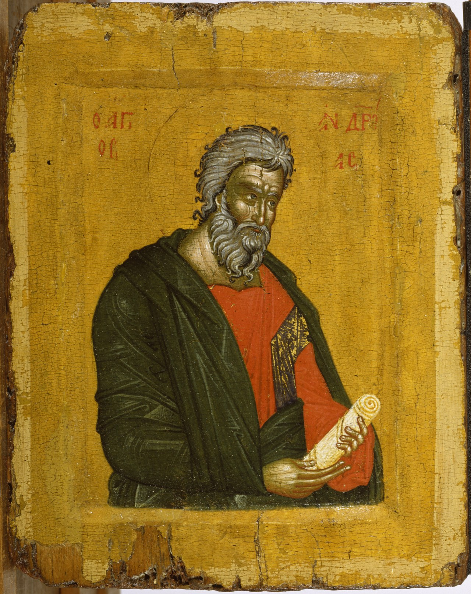</picture>
<figcaption><i>Saint Andrew</i>, a Greek icon of the <b>14th century</b>, tempera and gold on wood. He looks and turns to his left, which suggests that the panel once belonged to a row of icons on either side of Christ on a church's icon screen. Walters Art Museum, Baltimore. Image: <a href="https://commons.wikimedia.org/wiki/File:Greek_-_Saint_Andrew_-_Walters_37559.jpg">Greek - Saint Andrew - Walters 37559</a>, public domain, via Wikimedia Commons.</figcaption>
</figure>

<figure class=photo>
<picture><source srcset="/static/art/andrew-hosios-loukas-600.webp 600w,/static/art/andrew-hosios-loukas.webp 1280w" sizes="(max-width:760px) 100vw,760px" type="image/webp">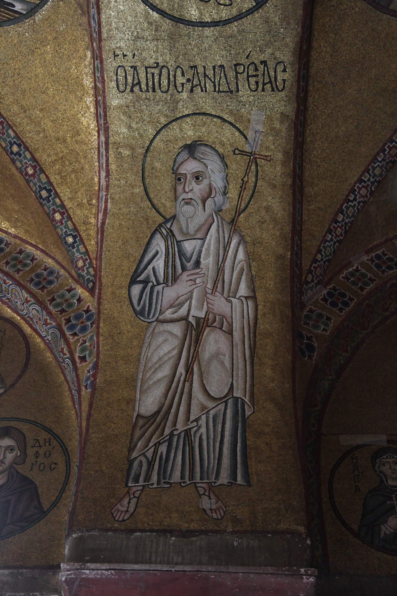</picture>
<figcaption>St Andrew in an <b>11th-century mosaic</b> in the narthex of the monastery of <b>Hosios Loukas</b>, in central Greece, one of the masterpieces of Byzantine art. The great Greek monasteries kept Andrew's image before the people as the apostle of their own land. Photo: <a href="https://commons.wikimedia.org/wiki/File:Hosios_Loukas_(narthex)_-_West_wall,_2nd_arch_(S.Andrew)_02.jpg">Hosios Loukas (narthex) - West wall, 2nd arch (S.Andrew) 02</a> by Hans A. Rosbach, <a href="https://creativecommons.org/licenses/by-sa/3.0">CC BY-SA 3.0</a>, via Wikimedia Commons.</figcaption>
</figure>

### Duccio, Siena

Duccio's *Calling of the Apostles Peter and Andrew*, which you can see [above](#fishers), is one of the most tender pictures ever made of the call by the lake: two fishermen in a little boat, nets full of fish, turning to look at the Lord on the shore.

### Caravaggio, Naples

In 1606–07, in Naples, **Caravaggio** painted *The Crucifixion of Saint Andrew*, now in the **Cleveland Museum of Art**. It is a picture of a single moment from the *Passion*: after two days of preaching from the cross, the old apostle is near death, and the executioner on the ladder is trying to untie him, but his hands are paralysed. Andrew's face is lit by the light that the story says surrounded him at the end. Caravaggio, true to the early accounts, shows an upright cross, not an X. It is the only altarpiece by Caravaggio in America.

<figure class=photo>
<picture><source srcset="/static/art/andrew-caravaggio-600.webp 600w,/static/art/andrew-caravaggio.webp 1280w" sizes="(max-width:760px) 100vw,760px" type="image/webp">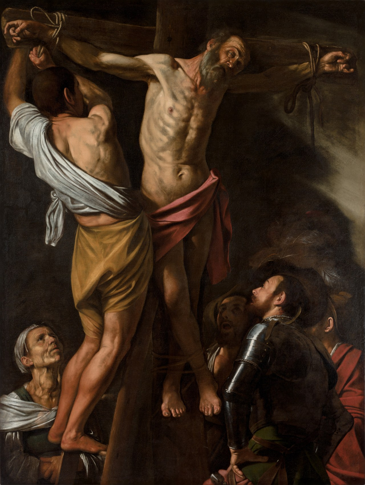</picture>
<figcaption><i>The Crucifixion of Saint Andrew</i>, by <b>Caravaggio</b>, 1606–07, painted in Naples. The executioner reaching for the ropes cannot untie him: the moment from the <i>Passion</i> when the saint's prayer to stay on his cross was answered. The Cleveland Museum of Art, Leonard C. Hanna Jr. Fund. Image: <a href="https://commons.wikimedia.org/wiki/File:Caravaggio_-_The_Crucifixion_of_Saint_Andrew_-_Post-Restoration.jpg">Caravaggio - The Crucifixion of Saint Andrew - Post-Restoration</a>, <a href="https://creativecommons.org/publicdomain/zero/1.0/">CC0</a>, via Wikimedia Commons.</figcaption>
</figure>

### Rubens, Madrid

Near the end of his life, about 1638–39, **Peter Paul Rubens** painted *The Martyrdom of St Andrew* for the hospital and church of St Andrew of the Flemings in Madrid, founded for his fellow countrymen living in Spain. It is still owned by their successor, the **Fundación Carlos de Amberes** in Madrid, and in 2025–26 it was lent to the Prado. Rubens fills the canvas with movement: horsemen, soldiers and weeping women swirl around the X-shaped cross, while Andrew looks up toward an angel bringing him the crown and palm of martyrdom.

<figure class=photo>
<picture><source srcset="/static/art/andrew-rubens-600.webp 600w,/static/art/andrew-rubens.webp 1280w" sizes="(max-width:760px) 100vw,760px" type="image/webp">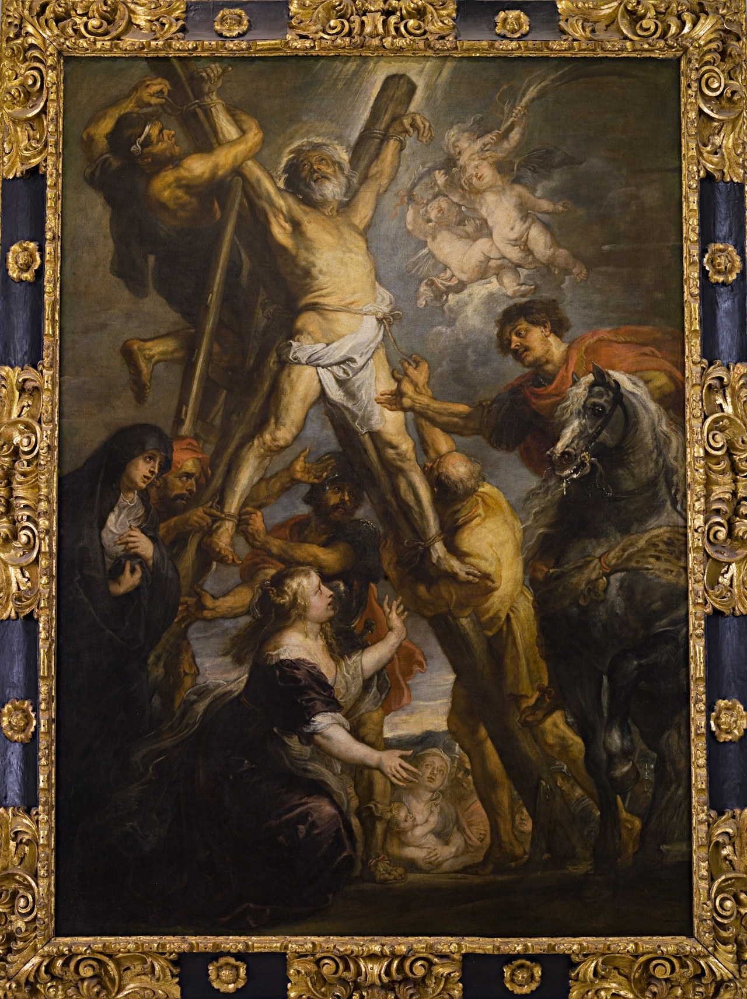</picture>
<figcaption><i>The Martyrdom of St Andrew</i>, by <b>Peter Paul Rubens</b>, about 1638–39. Fundación Carlos de Amberes, Madrid. Image: <a href="https://commons.wikimedia.org/wiki/File:El_Martirio_del_ap%C3%B3stol_San_Andr%C3%A9s,_PPRubens,_Fundaci%C3%B3n_Carlos_de_Amberes.jpg">El Martirio del apóstol San Andrés, PPRubens, Fundación Carlos de Amberes</a>, public domain, via Wikimedia Commons.</figcaption>
</figure>

### Murillo, Seville

The painting at the top of this page is *The Martyrdom of St Andrew* by **Bartolomé Esteban Murillo**, painted in Seville between 1675 and 1682 and now in the **Museo del Prado**, Madrid. Its central figure follows Rubens's painting for the Flemish hospital in Madrid, which Murillo could have seen on a visit to the court or in prints. Murillo sets the scene in a soft, golden haze. Andrew, bound to his X-shaped cross, gazes up into a burst of light where angels come down to him with the palm and crown, and the cruelty of the crowd below seems already far away.

### Domenichino and Guido Reni, San Gregorio al Celio

On the Caelian Hill in Rome stands the church of San Gregorio Magno, built on the family estate of **Pope St Gregory the Great**, who turned his house into a monastery dedicated to St Andrew in the 6th century. It was from this monastery that St Augustine and his monks set out in 597 to bring the Gospel to England. Beside the church is the little **Oratory of St Andrew**, where in 1608–09 Cardinal Scipione Borghese set two of the best young painters in Rome to work facing each other across the same room. **Domenichino** painted the scourging of St Andrew; **Guido Reni** painted the saint being led to his martyrdom. Visitors have argued about which is finer ever since.

<figure class=photo>
<picture><source srcset="/static/art/andrew-domenichino-600.webp 600w,/static/art/andrew-domenichino.webp 1280w" sizes="(max-width:760px) 100vw,760px" type="image/webp">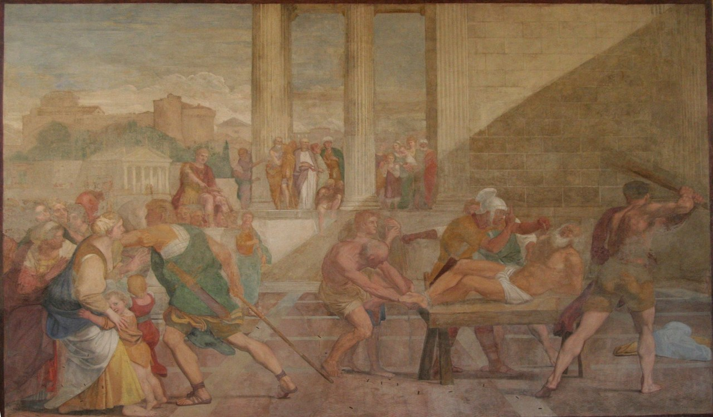</picture>
<figcaption><i>The Flagellation of St Andrew</i>, by <b>Domenichino</b>, 1608, in the Oratory of St Andrew at San Gregorio al Celio, Rome. Domenichino paints the scene as calmly as a Roman relief, with the proconsul watching from his tribunal. Image: <a href="https://commons.wikimedia.org/wiki/File:Domenichino,_Flagellazione_di_Sant%27Andrea,_1608,_San_Gregorio_al_Celio.jpg">Domenichino, Flagellazione di Sant'Andrea, 1608, San Gregorio al Celio</a>, <a href="https://creativecommons.org/publicdomain/zero/1.0/">CC0</a>, via Wikimedia Commons.</figcaption>
</figure>

<figure class=photo>
<picture><source srcset="/static/art/andrew-reni-600.webp 600w,/static/art/andrew-reni.webp 1280w" sizes="(max-width:760px) 100vw,760px" type="image/webp">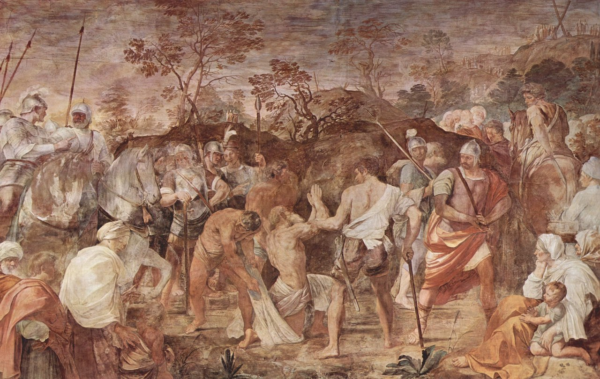</picture>
<figcaption><i>St Andrew led to his martyrdom</i>, by <b>Guido Reni</b>, about 1608–09, facing Domenichino's fresco in the same oratory. Seeing the cross in the distance, Andrew kneels to greet it, the moment of "Hail, O Cross." Image: <a href="https://commons.wikimedia.org/wiki/File:Guido_Reni_051.jpg">Guido Reni 051</a>, public domain, via Wikimedia Commons.</figcaption>
</figure>

### Mattia Preti

The Calabrian painter **Mattia Preti**, who later became a Knight of Malta, painted the death of St Andrew again and again. Besides his great canvases in Sant'Andrea della Valle, he painted this smaller, powerful *Crucifixion of St Andrew* in Rome about 1651. It is now in the **Art Gallery of South Australia**, in Adelaide.

<figure class=photo>
<picture><source srcset="/static/art/andrew-preti-600.webp 600w,/static/art/andrew-preti.webp 1280w" sizes="(max-width:760px) 100vw,760px" type="image/webp">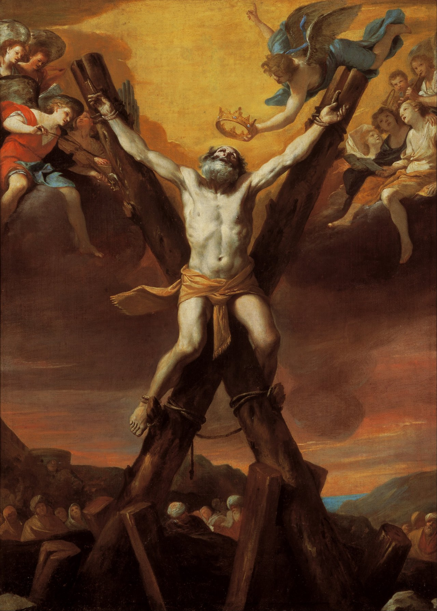</picture>
<figcaption><i>The Crucifixion of St Andrew</i>, by <b>Mattia Preti</b>, about 1651, painted in Rome. Art Gallery of South Australia, Adelaide, Mrs Mary Overton Gift Fund 1998. Image: <a href="https://commons.wikimedia.org/wiki/File:Mattia_Preti_-_The_crucifixion_of_St_Andrew_-_Google_Art_Project.jpg">Mattia Preti - The crucifixion of St Andrew - Google Art Project</a>, public domain, via Wikimedia Commons.</figcaption>
</figure>

## Path to sainthood
An apostle, venerated as a saint and martyr from the earliest days of the Church, long before formal canonisation existed. His name is in the Roman Canon of the Mass, among the apostles named after Peter and Paul. His feast is **30 November** in both the Catholic and Orthodox Churches.

## Patronages
Scotland, Greece, Russia, Ukraine, Romania and Barbados; the Ecumenical Patriarchate of Constantinople; Patras and Amalfi; and fishermen and fishmongers.

## Trivia
- The X-shaped **saltire** cross associated with him is a medieval tradition; earlier depictions show an ordinary cross.
- The saltire on Scotland's flag, and the town of **St Andrews**, come from the tradition that some of his relics were brought there.
- Most of his relics are venerated in the Cathedral of **Amalfi**, Italy, where they were brought from Constantinople in 1208.
- St Andrew's Day is Scotland's national day, and an official bank holiday there since 2007.
- **Barbados** became independent on St Andrew's Day, 30 November 1966, and became a republic on the same day in 2021.
- The white flag with a blue saltire is the ensign of the Russian Navy, and the **Order of St Andrew the First-Called**, founded by Peter the Great in 1698, was Russia's highest honour.
- The first Sunday of Advent is always the Sunday nearest to St Andrew's Day.
- The **St Andrew Christmas Novena** is said fifteen times a day from his feast until Christmas.
- Andrew is named in every list of the Twelve, always among the first four.

## Sources
- [Benedict XVI, General Audience on Andrew, the "Protoclete" (14 Jun 2006), vatican.va](https://www.vatican.va/content/benedict-xvi/en/audiences/2006/documents/hf_ben-xvi_aud_20060614.html)
- [Vatican News: St Andrew](https://www.vaticannews.va/en/saints/11/30/st--andrew--apostle.html)
- [Vatican News: Pope Leo at the Phanar, "May we continue to strive towards Christian unity" (30 Nov 2025)](https://www.vaticannews.va/en/pope/news/2025-11/pope-leo-may-we-continue-to-strive-towards-christian-unity.html)
- [Holy See Press Office bulletin, 30 November 2025](https://press.vatican.va/content/salastampa/en/bollettino/pubblico/2025/11/30/251130c.html)
- [Catholic Encyclopedia: St Andrew](https://www.newadvent.org/cathen/01471a.htm)
- [Holy Metropolis of Patras: the Basilica of St Andrew and the return of his relics](https://www.agiosandreas.gr/)
- [*The Russian Primary Chronicle*, tr. S. H. Cross and O. P. Sherbowitz-Wetzor (University of Toronto)](https://tarnawsky.artsci.utoronto.ca/rescentre/slavic/ukr/Sla-Civil/PVL-Sla-Civ.pdf)
- [Kyiv City Guide: St Andrew's Church](https://guide.kyivcity.gov.ua/en/places/andriyivska-tserkva)
- [Historic Environment Scotland: St Andrews Cathedral, history](https://www.historicenvironment.scot/visit/all/st-andrews-cathedral/history-and-stories/)
- [Scottish Flag Trust: The legend of the Saltire](https://scottishflagtrust.com/the-flag-heritage-centre/the-legend-of-the-saltire/)
- [The Declaration of Arbroath, English translation (Avalon Project, Yale Law School)](https://avalon.law.yale.edu/medieval/arbroath_1320.asp)
- [National Gallery of Art: Duccio, *The Calling of the Apostles Peter and Andrew*](https://www.nga.gov/artworks/282-calling-apostles-peter-and-andrew)
- [The Cleveland Museum of Art: Caravaggio, *The Crucifixion of Saint Andrew*](https://www.clevelandart.org/art/1976.2)
- [Fundación Carlos de Amberes: Rubens, *El martirio de San Andrés*](https://www.fcamberes.org/es/el-martirio-de-san-andres-rubens)
- [Museo del Prado: Murillo, *The Martyrdom of Saint Andrew*](https://www.museodelprado.es/en/the-collection/art-work/the-martyrdom-of-saint-andrew/4e16dcf0-f952-45f6-ae7d-b9cab4748cdd)
- [Walters Art Museum: *Saint Andrew*, Greek icon, 14th century](https://art.thewalters.org/object/37.559/)
- [Art Gallery of South Australia: Mattia Preti, *The crucifixion of St Andrew*](https://www.agsa.sa.gov.au/collection-publications/collection/works/the-crucifixion-of-st-andrew/27539/)

Fact-checked on October 15, 2026 against Vatican documents, Vatican News and New Advent (Catholic Encyclopedia). Expanded November 25, 2026 with the story of his life told from the Gospels and the Acts of the Apostles, with the traditions of the early Fathers (Origen and Eusebius), the <i>Acts</i> and <i>Passion of Andrew</i>, the <i>Russian Primary Chronicle</i> and the Scottish legends labelled as such; the history of his relics from the Church of Patras and Historic Environment Scotland; the places and churches connected with him; and his portrayal in art, using museum records and Wikimedia Commons. Scripture quotations follow the Revised Standard Version; the "Hail, O Cross" prayer follows the translation in Benedict XVI's audience. The map was drawn for this page from Natural Earth data (public domain). Feast days follow the General Roman Calendar.

