<nav class=toc aria-label="On this page">

On this page

<ol>
<li><a href="#why">Why the Church honours him</a></li>
<li><a href="#lisbon">A boy named Fernando</a></li>
<li><a href="#martyrs">The martyrs of Morocco</a></li>
<li><a href="#shipwreck">A shipwreck and a hidden life</a></li>
<li><a href="#forli">The sermon no one expected</a></li>
<li><a href="#letter">Francis's letter</a></li>
<li><a href="#preacher">On the roads of Italy and France</a></li>
<li><a href="#padua">Padua, the poor, and the Sermons</a></li>
<li><a href="#lord">"I see my Lord"</a></li>
<li><a href="#canonized">From death to the altar in a year</a></li>
<li><a href="#places">His places and churches</a></li>
<li><a href="#art">Anthony in art</a></li>
</ol>
</nav>

## His story

Most of us first meet him when something has gone missing — a ring, a set of keys, peace of mind we cannot find. We say a little prayer to **St Anthony**, and often enough the lost thing turns up. The Church knows a much larger man than that little prayer suggests. He was a preacher whose words could still a marketplace, a teacher to whom **[St Francis of Assisi](/saints/francis-of-assisi/)** himself entrusted the friars, a friend of the poor, and a mystic who died whispering, "I see my Lord." Portugal calls him Anthony of Lisbon. Italy, and the rest of the world, call him Anthony of Padua. In Padua they simply call him *il Santo*, the Saint.

He lived only about thirty-six years. In that short life God took a gifted, bookish young canon, hid him for a time in a cave, and then set him loose to preach Christ across two countries. His story is good news for anyone who has ever felt overlooked, or who has asked God for a second beginning.

### c. 1195 · Born in Lisbon
Baptized **Fernando**. Tradition keeps 15 August as his birthday.

### c. 1210 · São Vicente de Fora
He enters the Canons Regular of St Augustine, just outside the city walls.

### 1212 · Santa Cruz, Coimbra
He transfers to the great house of studies in the then capital of Portugal.

### 1220 · The Franciscan martyrs
The relics of the first Franciscan missionaries, killed in Morocco, arrive at Santa Cruz. Fernando joins the Friars Minor and takes the name **Anthony**.

### 1221 · Sicily and Assisi
Illness cuts short his own mission to Morocco. A storm drives his ship to Sicily. He reaches Assisi for the Chapter of the Mats and meets St Francis.

### 1222 · The sermon at Forlì
Called on unexpectedly to preach at an ordination, he astonishes everyone.

### c. 1224 · "Teach the brothers theology"
Francis writes to give him permission to teach, provided that prayer is not extinguished.

### 1227–1230 · Provincial, then Padua
He leads the friars of northern Italy, settles at Padua, and writes his *Sermons*.

### 1231 · Camposampiero and Arcella
After a great Lent in Padua he withdraws to a cell in a walnut tree, then dies at Arcella on **13 June**, saying, "I see my Lord."

### 1232 · Canonised
**Pope Gregory IX** canonises him on **30 May**, less than a year after his death.

### 1263 · The incorrupt tongue
When the tomb is opened, St Bonaventure and the friars find his tongue still intact.

### 1946 · Doctor of the Church
**Pope Pius XII** names him *Doctor Evangelicus*, the Evangelical Doctor.

<h2 id=why>Why the Church honours him</h2>

- **He was one of the great preachers of the Gospel.** Pope Gregory IX, who had heard him, called him the "**Ark of the Testament**", as if the whole of Scripture were carried in him. In **1946** Pope Pius XII declared him a **Doctor of the Church** and gave him the title *Doctor Evangelicus*, the Evangelical Doctor, because, as Benedict XVI later said, "the freshness and beauty of the Gospel emerge from these writings."
- **He was the first great teacher of the Franciscans.** Francis, who feared that study might quench a friar's prayer, trusted Anthony enough to put the brothers' theology into his care.
- **He defended the faith with both learning and love**, especially the Real Presence of Christ in the Eucharist, in an age confused by heresy. Later generations called him the Hammer of Heretics; the older, truer title is the one Gregory gave him.
- **He was a friend of the poor and a hammer of injustice.** In Padua he preached against usury, pleaded for debtors, and told the rich to make friends of the poor.
- **The Church has never stopped asking his prayers.** He was canonised in under a year, one of the fastest canonisations in history. He is invoked as the finder of lost things, the patron of the poor, and a wonder-worker whose compassion, the faithful have always believed, did not end at his death.

<h2 id=lisbon>A boy named Fernando</h2>

He was born in **Lisbon**, about **1195**, and baptised **Fernando**. Later writers gave him a long and glittering family tree; the sure thing is simpler, and better. He came from a well-to-do, God-fearing household that lived in the shadow of the city's cathedral, the **Sé**. There he went to school. The twin-towered church he would have known is still there, one of the oldest in Portugal, standing above the Alfama like a fortress of stone.

<figure class=photo>
<picture><source srcset="/static/art/anthony-lisbon-se-600.webp 600w,/static/art/anthony-lisbon-se.webp 1280w" sizes="(max-width:760px) 100vw,760px" type="image/webp">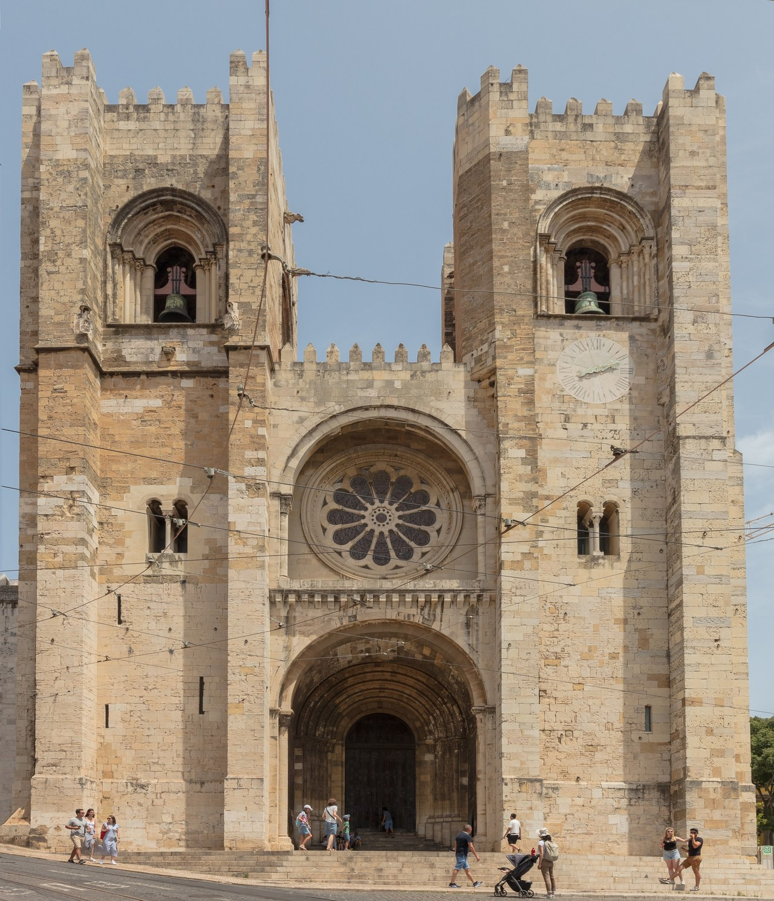</picture>
<figcaption>Lisbon Cathedral, the Sé, near the house where Anthony was born. He was baptised here and went to the cathedral school as a boy. Photo: <a href="https://commons.wikimedia.org/wiki/File:Catedral,_Lisboa,_Portugal,_2022-07-24,_DD_24.jpg">Catedral, Lisboa, Portugal, 2022-07-24, DD 24</a> by Diego Delso, <a href="https://creativecommons.org/licenses/by-sa/4.0">CC BY-SA 4.0</a>, via Wikimedia Commons.</figcaption>
</figure>

At about fifteen, around **1210**, Fernando did something that surprised no one who knew his seriousness: he entered the **Canons Regular of St Augustine** at the monastery of **São Vicente de Fora**, just outside the walls. The present church, with its great white towers, is a later building on that same hill; the community he joined was already old, and it offered a life of liturgy, study and vowed dedication. He wanted that life. What he did not want, after a year or two, was the stream of family and friends who kept coming to the parlour. With his superior's leave he asked to be sent away, to the mother-house of the congregation, far enough that the visits would stop.

<figure class=photo>
<picture><source srcset="/static/art/anthony-sao-vicente-600.webp 600w,/static/art/anthony-sao-vicente.webp 1280w" sizes="(max-width:760px) 100vw,760px" type="image/webp">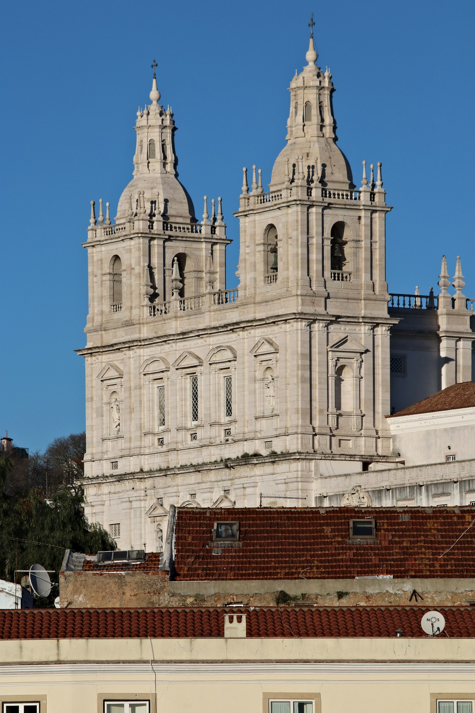</picture>
<figcaption>The Monastery of São Vicente de Fora, Lisbon, seen from the Miradouro de Santa Luzia. Anthony entered the Canons Regular here around 1210. The present church is a later rebuilding, on the site of the house he knew. Photo: <a href="https://commons.wikimedia.org/wiki/File:Lissabon_-_Santa_Luzia_-_Igreja_de_Sao_Vicente_-_4.jpg">Lissabon - Santa Luzia - Igreja de Sao Vicente - 4</a> by Ingo Mehling, <a href="https://creativecommons.org/licenses/by-sa/4.0">CC BY-SA 4.0</a>, via Wikimedia Commons.</figcaption>
</figure>

<h2 id=martyrs>The martyrs of Morocco</h2>

That house was the **Monastery of the Holy Cross** — **Santa Cruz** — in **Coimbra**, then the capital of Portugal. He arrived in **1212**, still a very young man, and stayed for eight years. Here the serious student became a theologian. He read the Scriptures and the Fathers until they lived in his memory. He was ordained, still in his early twenties, and was made guest-master, the canon who met whoever knocked at the abbey door.

<figure class=photo>
<picture><source srcset="/static/art/anthony-santa-cruz-600.webp 600w,/static/art/anthony-santa-cruz.webp 1280w" sizes="(max-width:760px) 100vw,760px" type="image/webp">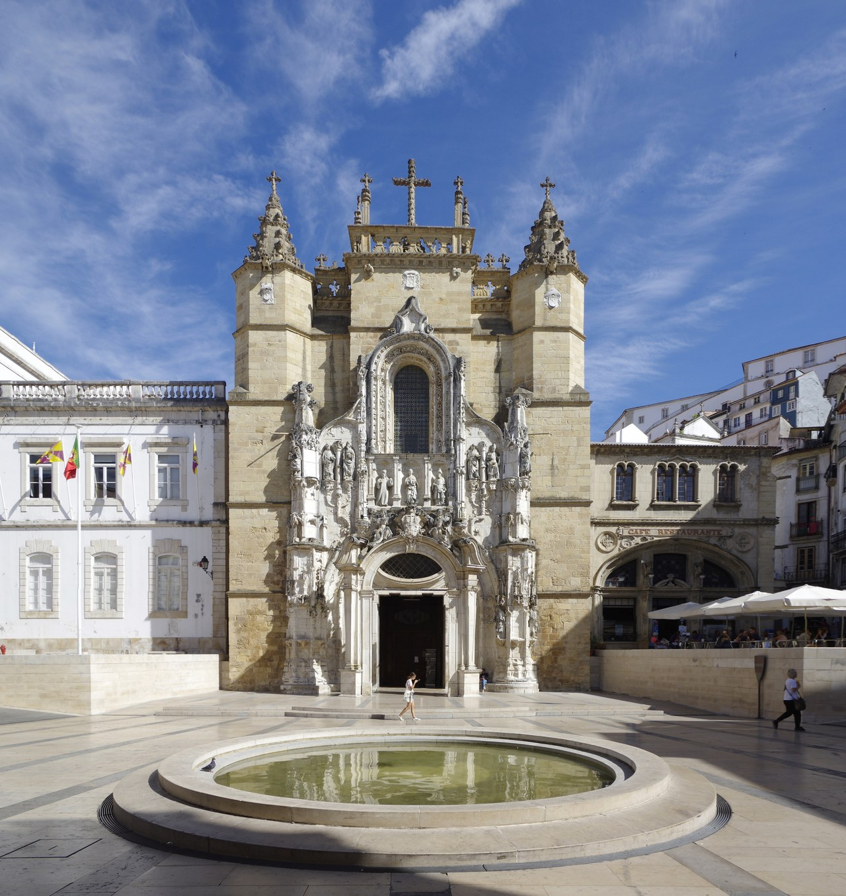</picture>
<figcaption>The Monastery of Santa Cruz, Coimbra, where Anthony spent eight years as an Augustinian canon, was ordained, and saw the relics of the Franciscan martyrs. The present facade is later than his day; the community and the church were already here. Photo: <a href="https://commons.wikimedia.org/wiki/File:Coimbra_Igreja_de_Santa_Cruz_BW_2018-10-06_14-18-04_stitch.jpg">Coimbra Igreja de Santa Cruz BW 2018-10-06 14-18-04 stitch</a> by Berthold Werner, <a href="https://creativecommons.org/licenses/by-sa/4.0">CC BY-SA 4.0</a>, via Wikimedia Commons.</figcaption>
</figure>

Among the visitors, in those years, were a few poor men in rough habits, **Friars Minor**, followers of the little poor man of Assisi. Their order was barely a decade old. They had a small hermitage outside Coimbra, at **Olivais**, dedicated to **[St Anthony the Abbot](/saints/anthony-the-abbot/)**, the father of monks. Fernando watched them, and something in their poverty tugged at him.

Then, in **1220**, the tug became a vocation. News came, and then the bodies themselves, that five Franciscan missionaries — **Berard, Peter, Accursius, Adjutus and Otho** — had been killed for preaching Christ in Morocco, at Marrakesh, on **16 January**. They were the first martyrs of the new order. King Afonso II of Portugal ransomed their relics and had them brought to Santa Cruz. Fernando, the guest-master, would have seen them carried in. He looked at those poor, broken bodies, and the comfortable, learned life he had chosen suddenly felt too small. He wanted to preach Christ where it might cost him everything, as it had cost them.

He asked permission to leave the Canons and join the Friars Minor. It was granted. In the church of Santa Cruz he received the Franciscan habit, and he took a new name from the little hermitage at Olivais: **Anthony**. Fernando of Lisbon was gone. Anthony, the friar, set out for Morocco, to follow the martyrs.

<h2 id=shipwreck>A shipwreck and a hidden life</h2>

God had another road for him. In Morocco he fell so ill that he could not preach at all. He was sent home to Portugal to recover, but the ship never got there. A storm seized it in the Mediterranean and drove it, badly damaged, onto the coast of **Sicily**, most likely near **Messina**, in the spring of **1221**. There the friars took him in and nursed him back to a thinner kind of health.

He heard that a great chapter of the whole order was about to meet at **Assisi**, the **Chapter of the Mats**, called for **30 May 1221**. He went. It was his first sight of the man whose habit he wore. **[Francis](/saints/francis-of-assisi/)** was there, already marked by illness of his own, still burning. Anthony's earliest biographer is careful to say what Anthony did *not* do. "He said not a word of his studies, nor of the services he had performed; his only desire was to follow Jesus Christ and Him crucified." So the chapter ended, and the gifted young priest from Portugal was left, as far as anyone could tell, with nothing particular to offer. He asked only for a place where he could live in penance and learn to be a friar. The provincial sent him to a poor hermitage at **Montepaolo**, in the hills near **Forlì**, to say Mass for a handful of lay brothers.

There, for some months, Anthony disappeared. He washed dishes. He prayed. He found a cave in the rock and made it his cell. No one in the order, except perhaps Francis, who had a way of seeing into people, knew what was hidden in the quiet priest from Lisbon.

<figure class=photo>
<picture><source srcset="/static/art/anthony-montepaolo-600.webp 600w,/static/art/anthony-montepaolo.webp 1280w" sizes="(max-width:760px) 100vw,760px" type="image/webp">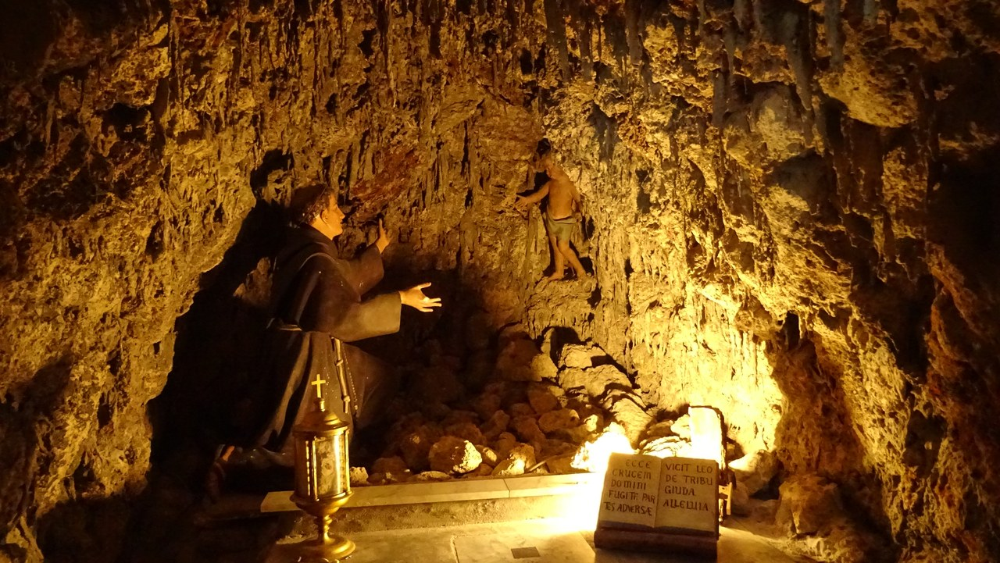</picture>
<figcaption>A memorial grotto at the Sanctuary of Montepaolo, near Forlì, recalling the natural cave where Anthony withdrew in prayer in 1221–22, before the sermon that revealed him to the Church. Photo: <a href="https://commons.wikimedia.org/wiki/File:Santuario_di_Montepaolo_01.jpg">Santuario di Montepaolo 01</a> by Aggrucar, <a href="https://creativecommons.org/licenses/by/4.0">CC BY 4.0</a>, via Wikimedia Commons.</figcaption>
</figure>

<h2 id=forli>The sermon no one expected</h2>

The day that changed everything came in **1222**, at an ordination in **Forlì**. Franciscans and Dominicans were both in town for the occasion, and a muddle arose over who was to preach. The Dominicans, already famous as preachers, had assumed one of the Franciscans would do it. The Franciscans had assumed the opposite. The head of the hermitage, who did not imagine that any of his humble brothers could stand up in such company, turned in some desperation to Anthony, and told him to speak whatever the Holy Spirit put in his mouth.

Anthony tried to excuse himself. Then he obeyed. What came out of him was Scripture, held so deeply and spoken so simply that the room was transfixed. "His tongue, moved by the Holy Spirit," his first biographer wrote, "began to unfold many arguments, carefully, clearly and briefly." The kitchen friar was a preacher. From that hour the hidden life was over. The order sent him out on the roads of **Romagna**, and then of Italy and southern France, and it never really brought him in again.

<h2 id=letter>Francis's letter</h2>

Francis had always been wary of learning. He had seen how a man can fall in love with his own cleverness and forget the poor Christ. But in Anthony he recognised a brother who could teach without ceasing to pray. He did something he had not done for anyone else. He wrote a short letter, around **1224**, that the Franciscans have treasured ever since:

> To Brother Anthony, my bishop, Brother Francis sends greetings. It is my pleasure that you teach theology to the brothers, provided, however, that as the Rule prescribes, the spirit of prayer and devotion is not extinguished.

"My bishop" was Francis's affectionate name for a teacher of the sacred sciences. Anthony began to teach at **Bologna**, and laid foundations that later Franciscan masters would build on. He never let the classroom put out the flame. The letter was not a permission to become a professor instead of a friar. It was a charge to be both.

<h2 id=preacher>On the roads of Italy and France</h2>

For the next years Anthony was almost always on the move: the cities of northern Italy, then the roads of **Provence** and **Languedoc**, where the Cathar heresy had torn at the faith of ordinary people. He preached in the open air, because no church would hold the crowds. He had a voice that carried, a memory that seemed to hold the whole Bible, and a way of speaking that a labourer and a scholar could both understand. He was not gentle with sin, in the clergy or in the marketplace, and he was endlessly gentle with sinners who wanted to come home. People waited for hours to confess to him.

Two stories from those years have been especially loved, and they are told here as the Church and the artists have long told them — as cherished tradition, not as scenes from the first biography.

At **Rimini**, the story goes, a crowd would not listen, so Anthony walked down to the shore and preached to the **fish**. The fish came to the surface and arranged themselves, the larger ones at the back, as if to hear the Word of God. The people who had turned their backs in the square came running to the water, and many were converted.

In the same city — some tellings say another town — a man who denied that Christ is truly present in the Eucharist challenged Anthony to a test. He would starve his mule for days, then set a pile of fodder on one side and Anthony, holding the Blessed Sacrament, on the other. The mule, the man said, would prove which was real. When the moment came, the starving animal turned away from the food, went down on its knees before the Host, and would not get up until it had adored. The man believed. Donatello would later cast the scene in bronze for the high altar in Padua.

<figure class=map><a href="/static/maps/map-anthony-life.svg">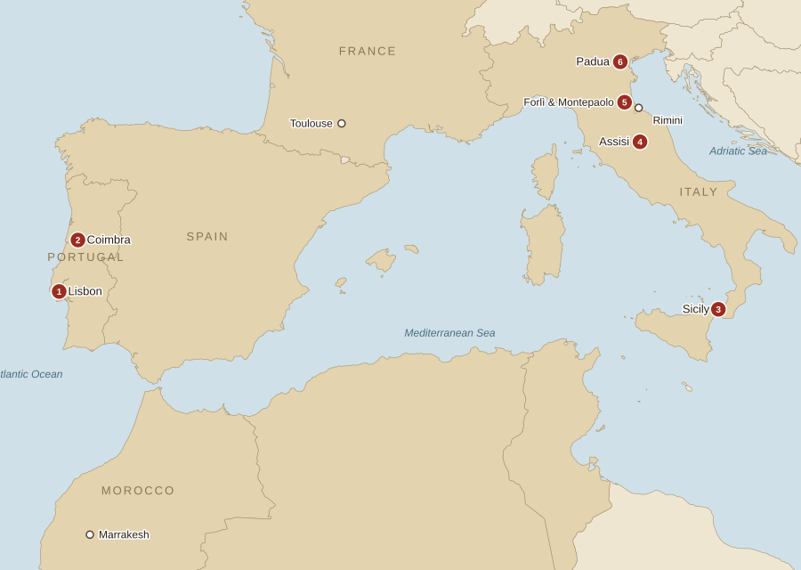</a><figcaption>The road of St Anthony's short life, from Lisbon and Coimbra to a shipwreck in Sicily, the meeting with Francis at Assisi, the hidden cave at Montepaolo, the great sermon at Forlì, the preaching roads of Italy and southern France, and Padua, where he died. Marrakesh marks the martyrdom that first called him to the Franciscans. Map by The Daily Word; borders from Natural Earth (public domain). Tap to enlarge.</figcaption></figure>

<h2 id=padua>Padua, the poor, and the Sermons</h2>

Around **1227**, still only in his early thirties, Anthony was made provincial of the Franciscans in northern Italy. He visited the houses, founded new ones, and went on preaching. He chose to make his home in **Padua**, in the little friary at the church of **Mater Domini**, and the city took him to its heart.

Padua in those years was rich, busy and often cruel. Merchants made fortunes, and debtors were thrown into prison. Anthony preached a Lent that shook the place. He spoke against usury, pleaded for prisoners, and told the well-fed to look at Christ in the poor. "O rich people," he said, "befriend the poor, welcome them into your homes: it will subsequently be they who receive you in the eternal tabernacles." He would spend hours in the confessional after he left the pulpit. The city never forgot him.

In these Paduan years he also wrote the work that would one day earn him the title of Doctor: two great cycles of *Sermons*, for Sundays and for the feasts of the saints, meant to form other friars as preachers. They are not dry notes. They walk through Scripture the way the Fathers did, and they keep coming back to two centres, the Child in the manger and the man on the Cross. "Christ who is your life is hanging before you," he wrote, "so that you may look at the Cross as in a mirror. There you will be able to know how mortal were your wounds, that no medicine other than the Blood of the Son of God could heal. If you look closely, you will be able to realize how great your human dignity and your value are. Nowhere other than looking at himself in the mirror of the Cross can man better understand how much he is worth."

He taught that prayer is a loving conversation with God, and that it needs a silence which is not an escape from noise but a quieting of the anxious heart. "Charity is the soul of faith," he wrote; "it gives it life; without love, faith dies."

<h2 id=lord>"I see my Lord"</h2>

After Easter **1231**, worn out by the Lent he had just preached and already ill, Anthony accepted an invitation to rest at **Camposampiero**, in the countryside a few miles north of Padua. He asked for a little shelter to be built in a great **walnut tree**, so that he could pray in the branches by day and come down to the hermitage only at night. There, a much-loved tradition says, the **Child Jesus** appeared to him. Count Tiso, who had given the friars the land, is said to have seen a light, come through the trees, and found Anthony holding the Child in his arms. Whether or not we can recover every detail, the Church has never tired of this image, and it is how most of the world now recognises him: the friar and the Child, God who made himself small enough to be held.

On **13 June** he knew he was dying. He wanted to be taken back to Padua. They lifted him into a cart, but he got only as far as **Arcella**, a Poor Clares' convent just outside the city walls. There, in a small cell, he received the last sacraments. The brothers heard him singing a hymn to Our Lady. Then he looked up, and when they asked him what he saw, he said, "**I see my Lord.**" He died that same day, Friday, 13 June **1231**. He was about thirty-six.

The people of Padua would not hear of burying him quietly. Crowds filled the roads. The funeral had to be put off until the following **Tuesday**, and so many graces were reported that day that Tuesday has been St Anthony's day in the devotion of the Church ever since.

<h2 id=canonized>From death to the altar in a year</h2>

Miracles were already being told on the day he died. Gregory IX, who had known him and had called him the Ark of the Testament, did not wait. On **30 May 1232**, at **Spoleto**, less than a year after Anthony's death, the Pope inscribed him in the calendar of the saints — one of the swiftest canonisations in the history of the Church.

The great **Basilica of St Anthony** in Padua, *il Santo*, was begun almost at once over the place of his burial. In **1263**, when the building had grown enough for his body to be moved to a new tomb, the Minister General of the Franciscans, **St Bonaventure**, was there for the translation. The friars opened the coffin, and they found that the saint's **tongue** was still intact, red and living in appearance, as if it had never stopped preaching. Bonaventure, the story goes, took it in his hands and cried, "O blessed tongue, that always blessed the Lord and made others bless him, now it is clear how great were your merits before God." The tongue, with the jaw and the vocal apparatus, is still honoured in the basilica's **Chapel of the Relics**.

The devotion did not fade. On **16 January 1946** Pope Pius XII declared him a **Doctor of the Church**. He is the saint of lost things because, a much-told story says, a novice once took his book of Psalms, and Anthony prayed, and the book came back — and because, ever since, people who have lost something more important than a book have found in him a brother who understands. He is the saint of the poor because he was poor, and because the bread offered in his name still feeds people. He is *il Santo* because Padua, and the whole Church, never found a better word.

<h2 id=places>His places and churches</h2>

### Lisbon: the Sé, the birthplace, and São Vicente

Anthony is still Lisbon's own. On 13 June the Alfama fills with thyme, paper lanterns and weddings, and the city keeps his feast as its favourite holiday. The **cathedral**, where he was baptised and went to school, stands a few steps from the house of his childhood. After the terrible earthquake of **1755** that house was gone; the **Igreja de Santo António de Lisboa** was raised on the site, a pale Baroque church completed in the 1760s, and in its crypt a quiet chapel marks the place of his birth. Pilgrims still leave flowers and little notes there, as if knocking at the same door the boy Fernando once ran through.

<figure class=photo>
<picture><source srcset="/static/art/anthony-lisbon-church-600.webp 600w,/static/art/anthony-lisbon-church.webp 1280w" sizes="(max-width:760px) 100vw,760px" type="image/webp">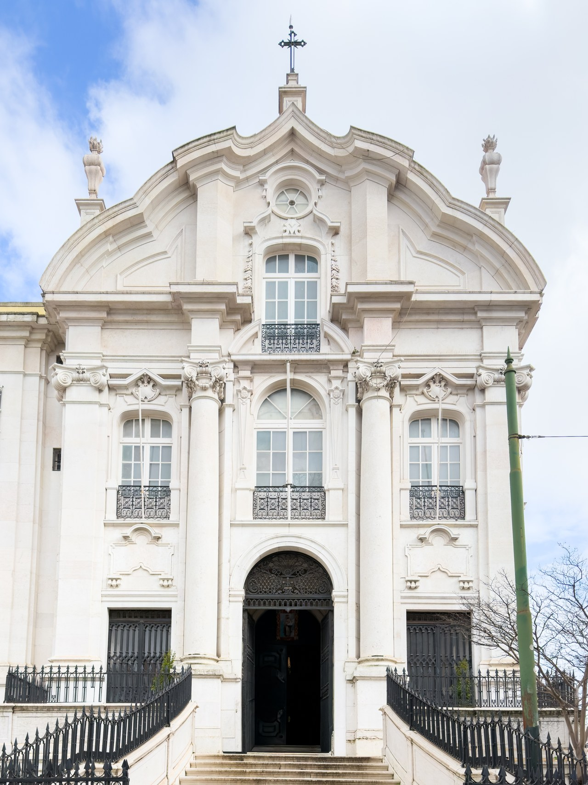</picture>
<figcaption>The Igreja de Santo António de Lisboa, built in the 1760s on the site of the house where he was born, just below the cathedral. Photo: <a href="https://commons.wikimedia.org/wiki/File:West_facade_of_Igreja_de_Santo_Ant%C3%B3nio_de_Lisboa_35.jpg">West facade of Igreja de Santo António de Lisboa 35</a> by Kent Wang, <a href="https://creativecommons.org/licenses/by/4.0">CC BY 4.0</a>, via Wikimedia Commons.</figcaption>
</figure>

<figure class=photo>
<picture><source srcset="/static/art/anthony-lisbon-crypt-600.webp 600w,/static/art/anthony-lisbon-crypt.webp 1280w" sizes="(max-width:760px) 100vw,760px" type="image/webp">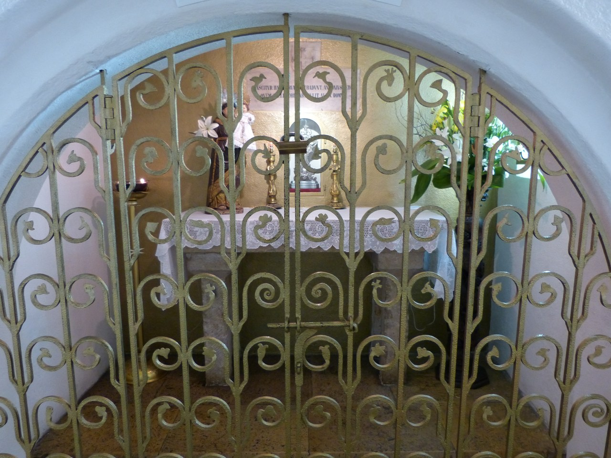</picture>
<figcaption>The crypt chapel of the Igreja de Santo António, traditionally honoured as the place of his birth. Photo: <a href="https://commons.wikimedia.org/wiki/File:Igreja_de_Santo_Ant%C3%B3nio_de_Lisboa_03.JPG">Igreja de Santo António de Lisboa 03</a> by Mogadir, <a href="https://creativecommons.org/licenses/by-sa/3.0">CC BY-SA 3.0</a>, via Wikimedia Commons.</figcaption>
</figure>

The monastery of **São Vicente de Fora**, where he first put on the habit of a canon, still looks down on the city from its hill (pictured above).

### Coimbra: Santa Cruz

The monastery of the Holy Cross, where he studied, was ordained, and saw the relics of the martyrs, remains one of the great churches of Portugal. Later kings are buried here, and the present doorway is a masterpiece of Manueline carving, later than Anthony, but the stones of the house that formed him are still in this square.

### Montepaolo, near Forlì

In the quiet hills of Romagna, the **Sanctuary of Montepaolo** keeps the memory of the hidden year: the cave, the kitchen, the obedience that prepared the sermon at Forlì. A later memorial grotto (pictured earlier) helps pilgrims imagine the place of that prayer.

### Camposampiero: the Sanctuary of the Walnut

A few miles north of Padua, the little **Santuario del Noce** — the Sanctuary of the Walnut — stands where Anthony's tree-cell is remembered, and where tradition places the vision of the Child Jesus. The present chapel, among trees, is a peaceful stop on the way to the great basilica.

<figure class=photo>
<picture><source srcset="/static/art/anthony-camposampiero-600.webp 600w,/static/art/anthony-camposampiero.webp 1280w" sizes="(max-width:760px) 100vw,760px" type="image/webp">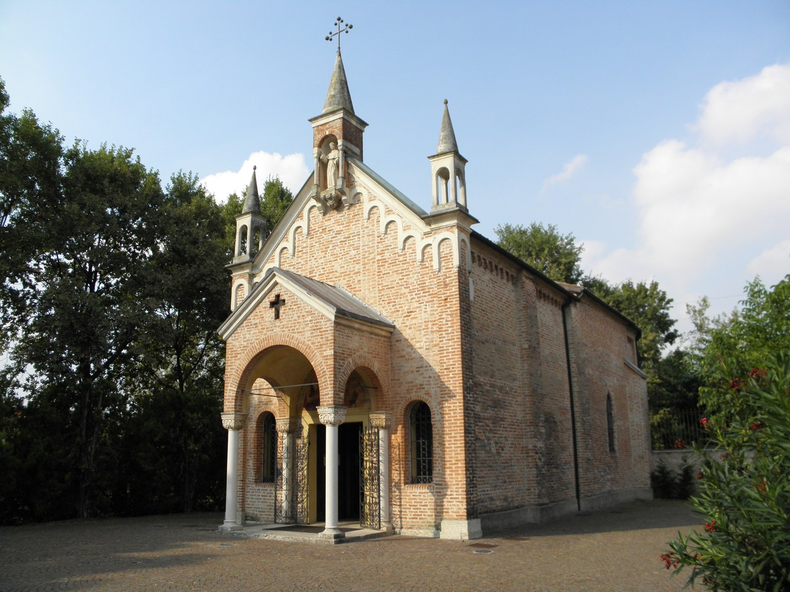</picture>
<figcaption>The Santuario del Noce at Camposampiero, marking the place of Anthony's walnut-tree cell and, by tradition, of the vision of the Child Jesus. Photo: <a href="https://commons.wikimedia.org/wiki/File:Santuario_del_noce_(Camposampiero)_03.jpg">Santuario del noce (Camposampiero) 03</a> by Threecharlie, <a href="https://creativecommons.org/licenses/by-sa/4.0">CC BY-SA 4.0</a>, via Wikimedia Commons.</figcaption>
</figure>

### Arcella: the place of his death

Just north of Padua's old walls, the red-brick **Santuario dell'Arcella**, also called Sant'Antonino, stands on the site of the Poor Clares' convent where he died. Inside, the cell of his last hours is preserved and honoured.

<figure class=photo>
<picture><source srcset="/static/art/anthony-arcella-600.webp 600w,/static/art/anthony-arcella.webp 1280w" sizes="(max-width:760px) 100vw,760px" type="image/webp">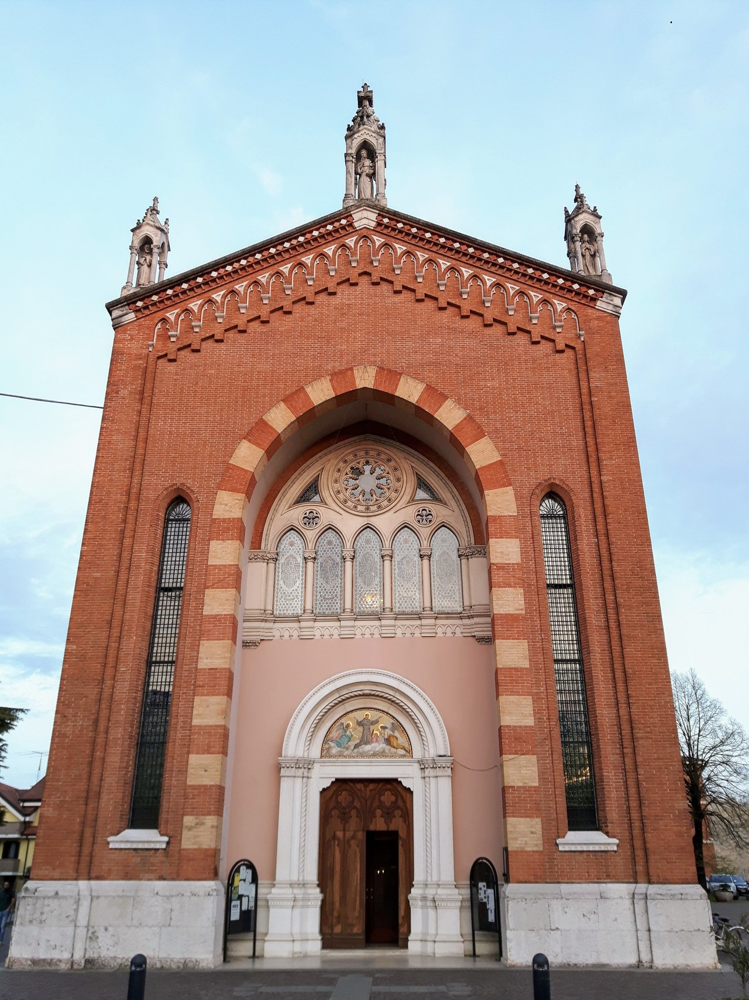</picture>
<figcaption>The Santuario dell'Arcella, Padua, on the site of the convent where Anthony died on 13 June 1231, saying, "I see my Lord." Photo: <a href="https://commons.wikimedia.org/wiki/File:Santuario_dell%27Arcella_(Padova)_2.jpg">Santuario dell'Arcella (Padova) 2</a> by luciobocchi, <a href="https://creativecommons.org/licenses/by-sa/4.0">CC BY-SA 4.0</a>, via Wikimedia Commons.</figcaption>
</figure>

### Padua: the Basilica of St Anthony, *il Santo*

The basilica is one of the great pilgrimage churches of the world. Building began soon after the canonisation of 1232, and the church that rose — Romanesque and Byzantine at once, with a cluster of domes and two slender towers — has drawn pilgrims for eight centuries. They still come, in ordinary clothes, to touch the tomb and ask for what they have lost, or for someone they love.

<figure class=photo>
<picture><source srcset="/static/art/anthony-basilica-facade-600.webp 600w,/static/art/anthony-basilica-facade.webp 1280w" sizes="(max-width:760px) 100vw,760px" type="image/webp">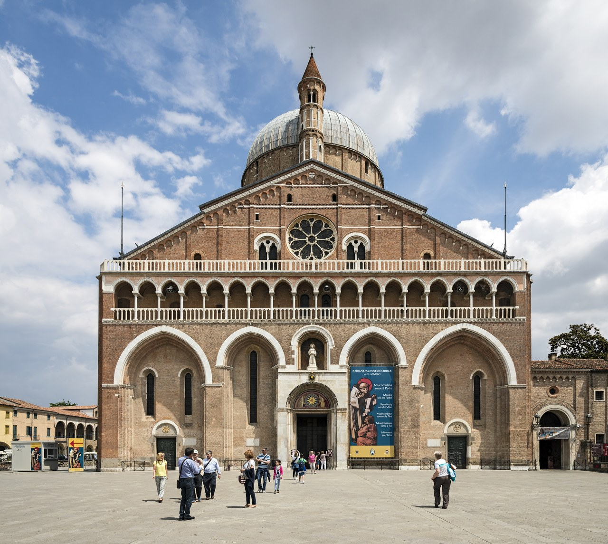</picture>
<figcaption>The Basilica of St Anthony, Padua — <i>il Santo</i> — begun soon after his canonisation in 1232. Photo: <a href="https://commons.wikimedia.org/wiki/File:Sant%27Antonio_(Padua)_-_Facade.jpg">Sant'Antonio (Padua) - Facade</a> by Didier Descouens, <a href="https://creativecommons.org/licenses/by-sa/4.0">CC BY-SA 4.0</a>, via Wikimedia Commons.</figcaption>
</figure>

Inside, the eye is drawn to the **high altar**, rebuilt in later centuries around the bronzes that **Donatello** made for it between **1446 and 1450**: a Crucifix, a Virgin and Child, statues of Franciscan and Paduan saints, and reliefs of Anthony's miracles. Behind and to the side, the **Chapel of the Ark** (the Cappella di Sant'Antonio) holds his tomb, a marble chest that millions of hands have worn smooth, set in a chapel whose walls are covered with sixteenth-century reliefs of his wonders. Beyond it, the **Chapel of the Relics** — the Treasure Chapel — keeps the reliquary of his incorrupt tongue, his jaw, and other precious remains, in a burst of gold and carved white stucco.

<figure class=photo>
<picture><source srcset="/static/art/anthony-basilica-altar-600.webp 600w,/static/art/anthony-basilica-altar.webp 1280w" sizes="(max-width:760px) 100vw,760px" type="image/webp">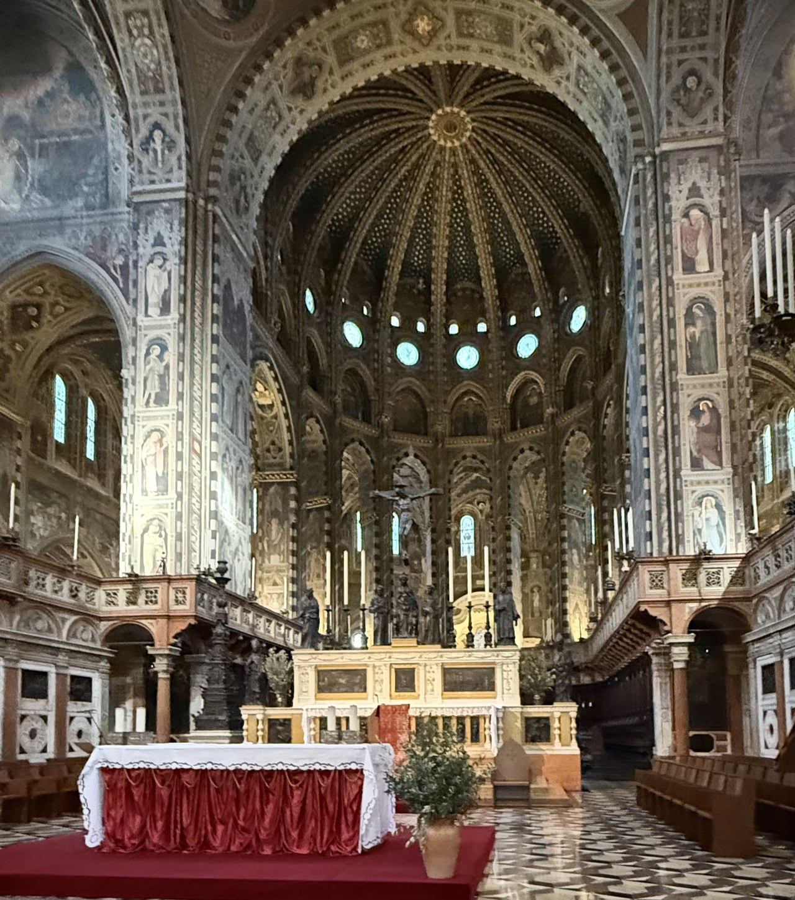</picture>
<figcaption>The high altar of the basilica, with Donatello's fifteenth-century bronzes at its heart. Photo: <a href="https://commons.wikimedia.org/wiki/File:Altare_maggiore,_basilica_di_Sant%27Antonio_da_Padova.jpg">Altare maggiore, basilica di Sant'Antonio da Padova</a> by Nicola Quirico, <a href="https://creativecommons.org/licenses/by-sa/4.0">CC BY-SA 4.0</a>, via Wikimedia Commons.</figcaption>
</figure>

<figure class=photo>
<picture><source srcset="/static/art/anthony-tomb-600.webp 600w,/static/art/anthony-tomb.webp 1280w" sizes="(max-width:760px) 100vw,760px" type="image/webp">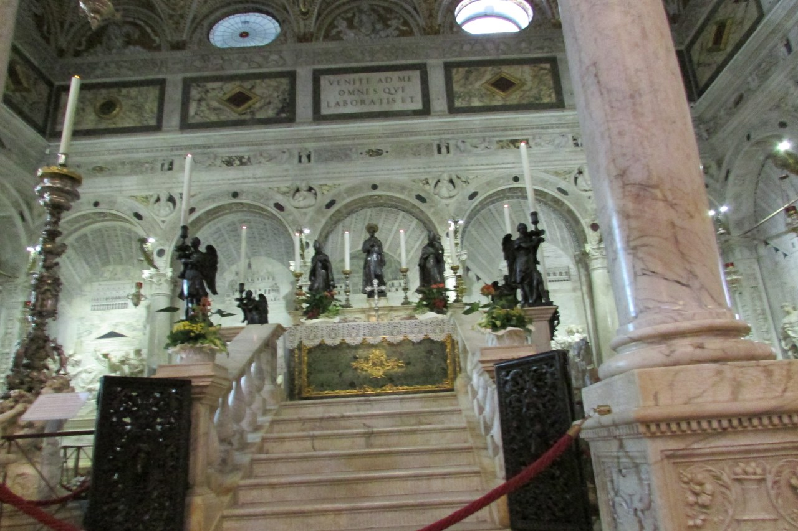</picture>
<figcaption>The Chapel of the Ark, the tomb of St Anthony, in the basilica at Padua. Pilgrims still lay their hands on the green marble of the chest and pray. Photo: <a href="https://commons.wikimedia.org/wiki/File:Tomb_of_Sant%27Antony_10-21_2377.jpg">Tomb of Sant'Antony 10-21 2377</a> by Chris Light, <a href="https://creativecommons.org/licenses/by-sa/4.0">CC BY-SA 4.0</a>, via Wikimedia Commons.</figcaption>
</figure>

<figure class=photo>
<picture><source srcset="/static/art/anthony-relics-600.webp 600w,/static/art/anthony-relics.webp 1280w" sizes="(max-width:760px) 100vw,760px" type="image/webp">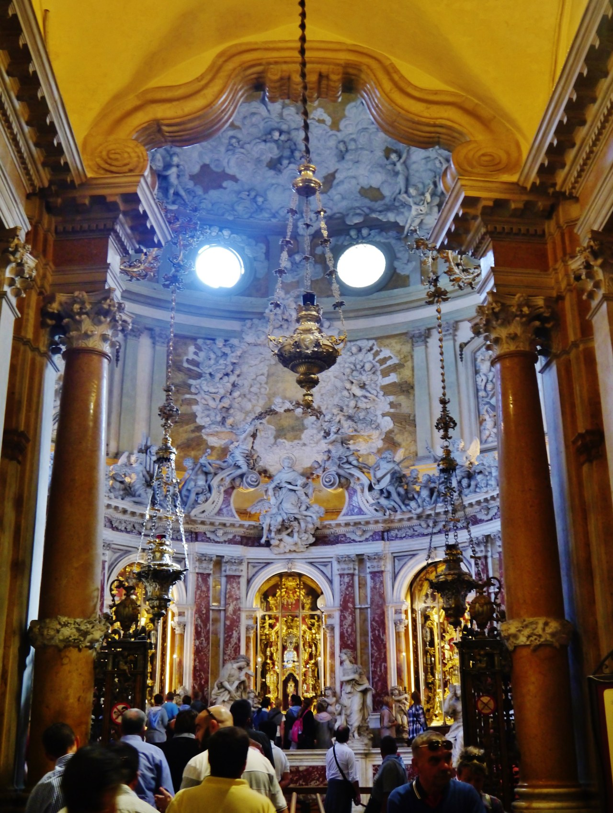</picture>
<figcaption>The Chapel of the Relics (the Treasure Chapel) in the basilica, where Anthony's tongue and other relics are honoured. Photo: <a href="https://commons.wikimedia.org/wiki/File:Padova_Basilica_di_Sant%27Antonio_Innen_Cappella_delle_Reliquie_1.jpg">Padova Basilica di Sant'Antonio Innen Cappella delle Reliquie 1</a> by Zairon, <a href="https://creativecommons.org/licenses/by-sa/4.0">CC BY-SA 4.0</a>, via Wikimedia Commons.</figcaption>
</figure>

<figure class=photo>
<picture><source srcset="/static/art/anthony-tongue-600.webp 600w,/static/art/anthony-tongue.webp 960w" sizes="(max-width:760px) 100vw,760px" type="image/webp">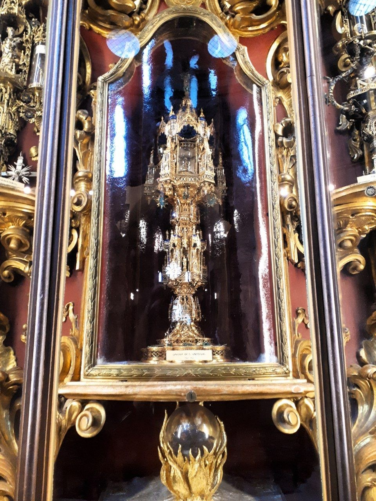</picture>
<figcaption>The reliquary of St Anthony's tongue, found incorrupt when his tomb was opened in 1263 in the presence of St Bonaventure, and still venerated in the Chapel of the Relics. Photo: <a href="https://commons.wikimedia.org/wiki/File:La-lingua-di-sant-antonio.jpg">La-lingua-di-sant-antonio</a> by Elmiralaleh, <a href="https://creativecommons.org/licenses/by-sa/4.0">CC BY-SA 4.0</a>, via Wikimedia Commons.</figcaption>
</figure>

<h2 id=art>Anthony in art</h2>

Artists have loved him almost as much as the poor have. Two images above all have become his: the friar with a lily, and the friar holding the Child Jesus. Around them, sculptors and painters have told the miracles, and one artist, Donatello, gave Padua an altar that is itself a kind of sermon.

### Donatello at the Santo (1446–1450)

In the 1440s the basilica called the greatest sculptor in Italy to make a new high altar. **Donatello** answered with a set of bronzes that still stop people in the nave: a suffering Christ, a tender Madonna, saints in the round, and narrative reliefs of Anthony's miracles. One of the finest is the **Miracle of the Mule**. In a crowded, almost theatrical space of arches and onlookers, the animal kneels before the Host in Anthony's hands, and the man who bet against the Eucharist has nothing left to say. Another relief, the **Imago Pietatis**, shows Christ in the tomb, held up by angels, his wounds still open — the "mirror of the Cross" that Anthony had preached.

<figure class=photo>
<picture><source srcset="/static/art/anthony-donatello-mule-600.webp 600w,/static/art/anthony-donatello-mule.webp 1280w" sizes="(max-width:760px) 100vw,760px" type="image/webp">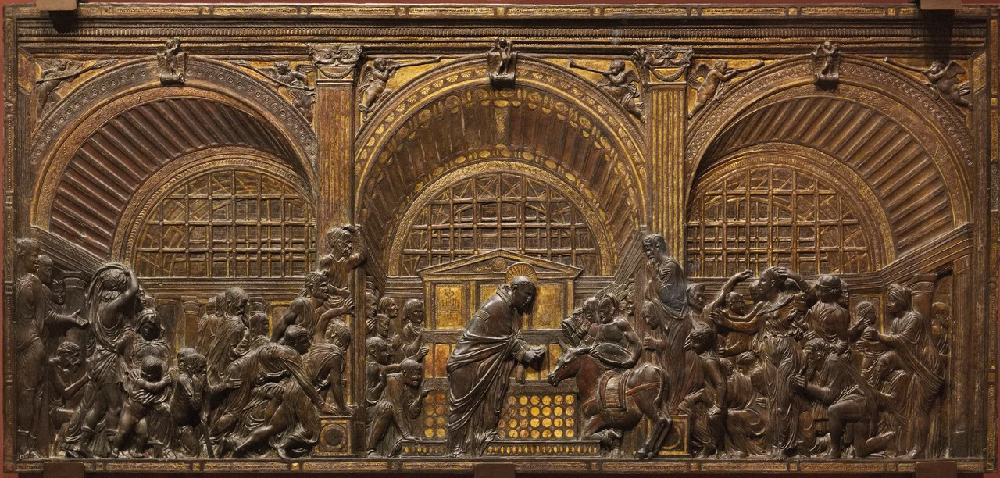</picture>
<figcaption>Donatello, The Miracle of the Mule, 1446–49, a bronze relief made for the high altar of the Basilica of St Anthony, Padua. Photo: <a href="https://commons.wikimedia.org/wiki/File:Donatello,_Miracle_of_the_Mule,_c1446-9,_Padua,_Sant%27Antonio,_High_Altar_(Museo_Antoniano).jpg">Donatello, Miracle of the Mule, c1446-9, Padua, Sant'Antonio, High Altar (Museo Antoniano)</a> by MenkinAlRire, <a href="https://creativecommons.org/licenses/by-sa/4.0">CC BY-SA 4.0</a>, via Wikimedia Commons.</figcaption>
</figure>

<figure class=photo>
<picture><source srcset="/static/art/anthony-donatello-pieta-600.webp 600w,/static/art/anthony-donatello-pieta.webp 1280w" sizes="(max-width:760px) 100vw,760px" type="image/webp">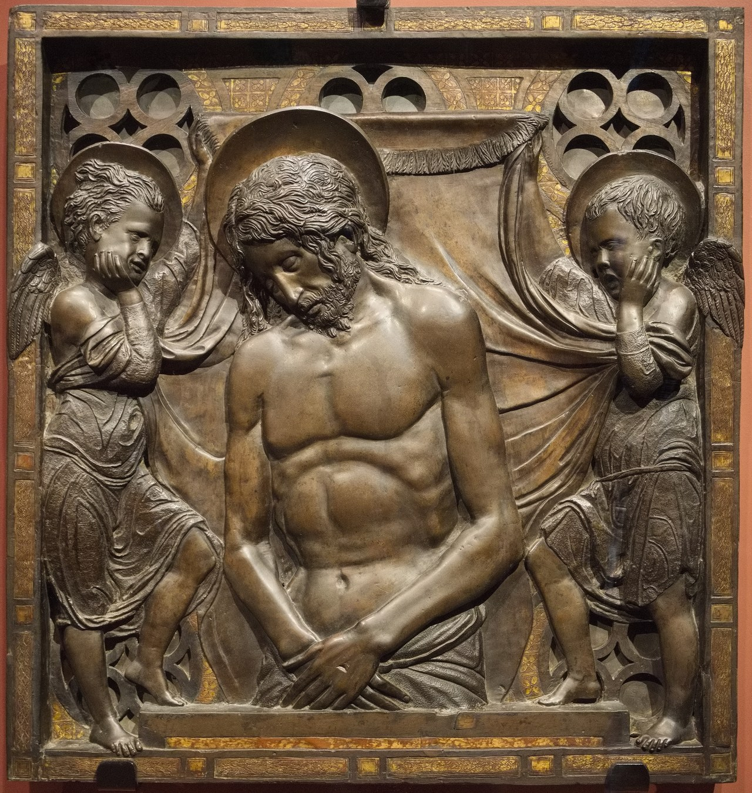</picture>
<figcaption>Donatello, Imago Pietatis (Christ in the tomb), 1449–50, from the high altar of the basilica in Padua. Photo: <a href="https://commons.wikimedia.org/wiki/File:Donatello,_Imago_Pietatis,_1449-50,_Sant%27Antonio,_Padua.jpg">Donatello, Imago Pietatis, 1449-50, Sant'Antonio, Padua</a> by MenkinAlRire, <a href="https://creativecommons.org/licenses/by-sa/4.0">CC BY-SA 4.0</a>, via Wikimedia Commons.</figcaption>
</figure>

### Titian at the Scuola del Santo (1511)

Just beside the basilica, in the hall of the confraternity called the **Scuola del Santo**, the young **Titian** painted some of his first great frescoes, in **1511**, of Anthony's miracles. In the **Miracle of the Newborn Child**, a baby is given speech so that he can defend his mother's innocence before a watching crowd. In the **Miracle of the Jealous Husband**, a man in a rage has struck down his wife; the story, as it is told, ends in her restoration through Anthony's prayers, and in the husband's repentance. Even here, at the start of his career, Titian paints the Gospel as something that happens in the street, among real bodies and real grief, and then is healed.

<figure class=photo>
<picture><source srcset="/static/art/anthony-titian-newborn-600.webp 600w,/static/art/anthony-titian-newborn.webp 1280w" sizes="(max-width:760px) 100vw,760px" type="image/webp">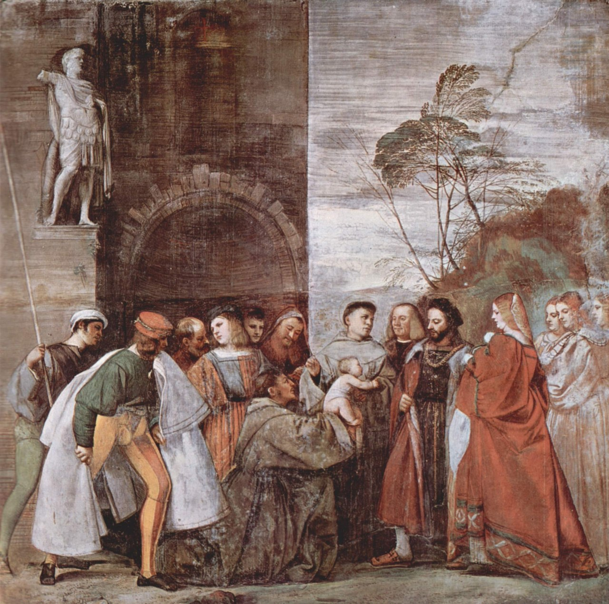</picture>
<figcaption>Titian, The Miracle of the Newborn Child, 1511. Scuola del Santo, Padua. Image: <a href="https://commons.wikimedia.org/wiki/File:Tizian_-_Wunder_des_sprechenden_Neugeborenen_-_1511.jpg">Tizian - Wunder des sprechenden Neugeborenen - 1511</a>, public domain, via Wikimedia Commons.</figcaption>
</figure>

<figure class=photo>
<picture><source srcset="/static/art/anthony-titian-jealous-600.webp 600w,/static/art/anthony-titian-jealous.webp 900w" sizes="(max-width:760px) 100vw,760px" type="image/webp">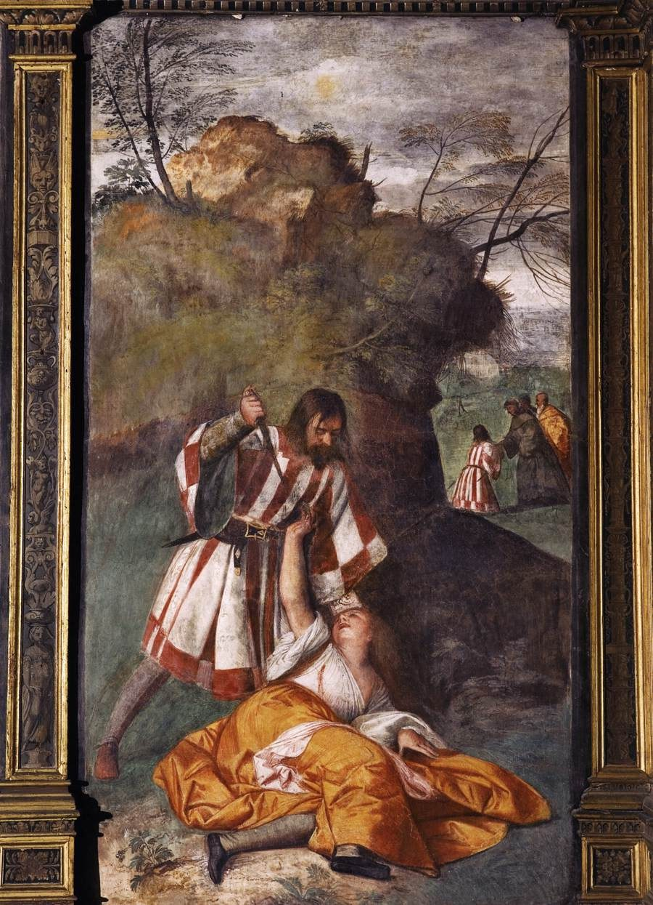</picture>
<figcaption>Titian, The Miracle of the Jealous Husband, 1511. Scuola del Santo, Padua. The story, as the confraternity told it, does not end in the blow: Anthony's prayer restored the woman, and the husband was converted. Image: <a href="https://commons.wikimedia.org/wiki/File:Tiziano,_The_Miracle_of_the_Jealous_Husband.jpg">Tiziano, The Miracle of the Jealous Husband</a>, public domain, via Wikimedia Commons.</figcaption>
</figure>

### Murillo: *The Vision of St Anthony* (Seville Cathedral, 1656)

The most famous painted vision of Anthony is in **Seville Cathedral**, in the chapel that bears his name. **Bartolomé Esteban Murillo** painted it in **1656** on a vast canvas: Anthony, in his brown habit, kneels in a simple room, his book forgotten on the table, and the Child comes down to him in a swirl of angels and golden light. In 1874 a thief cut out the kneeling saint; the fragment was recovered in New York and returned, and the painting was restored to its wall. It is still one of the glories of the cathedral, and one of the tenderest images of the vision at Camposampiero.

<figure class=photo>
<picture><source srcset="/static/art/anthony-murillo-600.webp 600w,/static/art/anthony-murillo.webp 1280w" sizes="(max-width:760px) 100vw,760px" type="image/webp">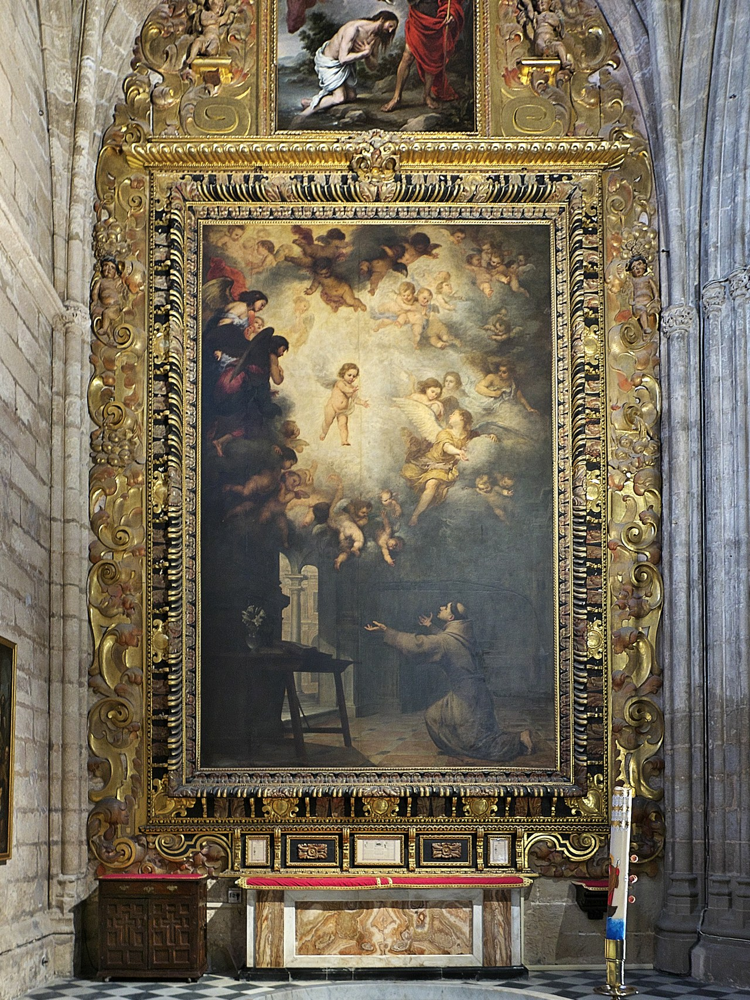</picture>
<figcaption>Bartolomé Esteban Murillo, The Vision of St Anthony of Padua, 1656, in its altarpiece in the Chapel of St Anthony, Seville Cathedral. Photo: <a href="https://commons.wikimedia.org/wiki/File:Visi%C3%B3n_de_San_Antonio,_Bartolom%C3%A9_Esteban_Murillo.jpg">Visión de San Antonio, Bartolomé Esteban Murillo</a> by José Luis Filpo Cabana, <a href="https://creativecommons.org/licenses/by-sa/4.0">CC BY-SA 4.0</a>, via Wikimedia Commons.</figcaption>
</figure>

### Zurbarán and Ribera: the friar and the Child

Two other Spanish masters, a little earlier, painted the same mystery in a quieter key. **Francisco de Zurbarán**, in a canvas of about **1635–1650** now in the **Prado**, shows Anthony on his knees in a bare landscape, receiving the Child into his arms with a look of almost startled love. **Jusepe de Ribera**, in a painting of **1629** in the **Real Academia de Bellas Artes de San Fernando** in Madrid, has the Child come to him in mid-air, small and radiant, while the saint kneels and holds out both hands, as if he cannot quite believe that God would come so close.

<figure class=photo>
<picture><source srcset="/static/art/anthony-zurbaran-600.webp 600w,/static/art/anthony-zurbaran.webp 1280w" sizes="(max-width:760px) 100vw,760px" type="image/webp">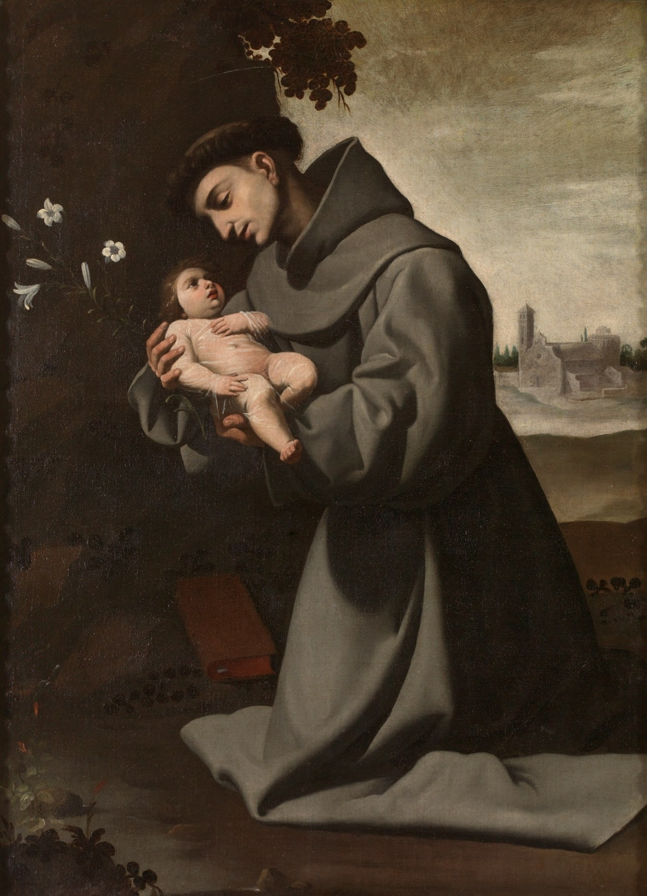</picture>
<figcaption>Francisco de Zurbarán, St Anthony of Padua with the Infant Christ, about 1635–1650. Museo Nacional del Prado, Madrid. Image: <a href="https://commons.wikimedia.org/wiki/File:San_Antonio_de_Padua_con_el_Ni%C3%B1o_Jes%C3%BAs,_por_Francisco_de_Zurbar%C3%A1n.jpg">San Antonio de Padua con el Niño Jesús, por Francisco de Zurbarán</a>, public domain, via Wikimedia Commons.</figcaption>
</figure>

<figure class=photo>
<picture><source srcset="/static/art/anthony-ribera-600.webp 600w,/static/art/anthony-ribera.webp 1280w" sizes="(max-width:760px) 100vw,760px" type="image/webp">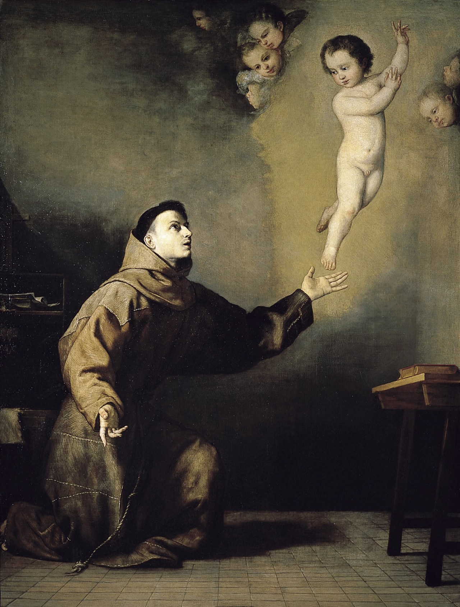</picture>
<figcaption>Jusepe de Ribera, St Anthony of Padua, 1629. Real Academia de Bellas Artes de San Fernando, Madrid. Image: <a href="https://commons.wikimedia.org/wiki/File:Ribera_-_San_Antonio_de_Padua,_1636,_0637.jpg">Ribera - San Antonio de Padua, 1636, 0637</a>, public domain, via Wikimedia Commons.</figcaption>
</figure>

## Path to sainthood
Canonised by **Pope Gregory IX** on **30 May 1232**, at Spoleto, less than a year after his death — one of the fastest canonisations in history. On **16 January 1946**, **Pope Pius XII** declared him a **Doctor of the Church**, with the title *Doctor Evangelicus*. His feast is **13 June**.

## Patronages
Lost things, the poor, Portugal, Padua, travellers, and people in need of grace. In Portugal he is Anthony of Lisbon, and the patron of the city of his birth; in Italy, and in the devotion of the whole Church, he is Anthony of Padua.

## Trivia
- He died on a **Friday**; his funeral, delayed by the crowds, was held on the following **Tuesday**. Tuesday has been his day ever since, and many people still keep a novena of nine or thirteen Tuesdays in his honour.
- **St Anthony's Bread** is the custom of giving bread or alms to the poor in thanksgiving for a grace received through his prayers. A Paduan tradition ties it to a mother in 1263 who promised corn to the poor if her drowned child were restored. The modern charity of that name was given new life in Toulon around **1888**, when a shopkeeper, **Louise Bouffier**, promised bread to the poor if a jammed lock would open; it did, and the practice spread. The basilica in Padua still feeds people in his name.
- The oldest prayer to him is the responsory *Si quaeris miracula*, "If you seek miracles," written about 1233 by the Franciscan **Julian of Speyer**, and still sung at the Santo on Tuesdays. It already asks him for the recovery of "things lost."
- In Portugal no one calls him "of Padua." He is *Santo António de Lisboa*, and 13 June is Lisbon's great popular feast.
- The little English rhyme "Tony, Tony, look around, something's lost and must be found" is a folk prayer, not a text of the Church. The older words are the ones in *Si quaeris*.
- He is usually shown with a **lily** for purity, a **book** for his preaching, or the **Child Jesus** in his arms.

## Sources
- [Benedict XVI, General Audience on St Anthony of Padua (10 Feb 2010), vatican.va](https://www.vatican.va/content/benedict-xvi/en/audiences/2010/documents/hf_ben-xvi_aud_20110210.html)
- [Vatican News: St Anthony of Padua](https://www.vaticannews.va/en/saints/06/13/saint-anthony-of-padua.html)
- [Catholic Encyclopedia: St Anthony of Padua](https://www.newadvent.org/cathen/01556a.htm)
- [Pontifical Basilica of St Anthony of Padua (official site)](https://www.santantonio.org/en)
- [Museo Nacional del Prado: Zurbarán, *St Anthony of Padua with the Infant Christ*](https://www.museodelprado.es/en/the-collection/art-work/saint-anthony-of-padua-with-the-infant-christ/1577b83d-5aa9-4fd4-80da-c3fd1f6d03e0)
- [Real Academia de Bellas Artes de San Fernando: Ribera, *St Anthony of Padua*](https://www.academiacolecciones.com/pinturas/inventario.php?id=0637)

Fact-checked on October 15, 2026 against Vatican documents, Vatican News and New Advent (Catholic Encyclopedia). Expanded November 24, 2026 with the story of his life told from the early sources and from Benedict XVI's audience, his preaching and writings, his death and relics, the places and churches connected with him, and his portrayal in art, using Vatican documents, the Basilica of St Anthony, museum records and Wikimedia Commons. Stories marked as tradition are told as the Church and the Franciscans have handed them down. The map was drawn for this page from Natural Earth data (public domain). Feast days follow the General Roman Calendar.

