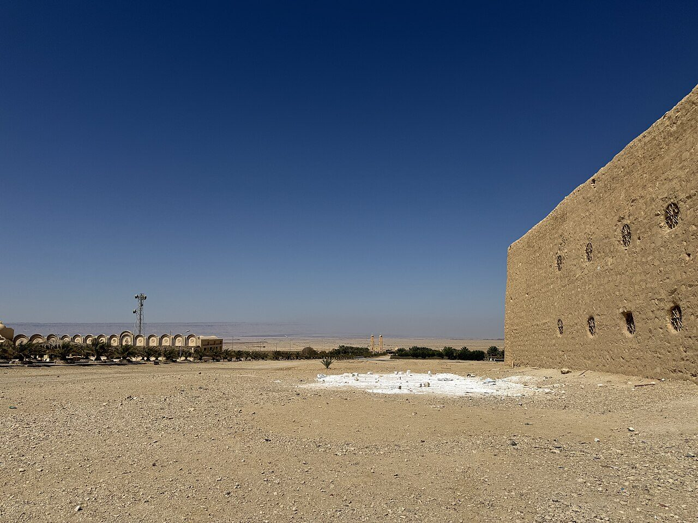

## The story
Anthony was born to a wealthy Christian family in Upper Egypt. At about 20 he heard in church the words "If you would be perfect, go, sell what you possess and give to the poor" (Matthew 19:21). He did exactly that and went into the desert. He lived for many years in an abandoned fort and later on a mountain near the Red Sea, where the **Monastery of St Anthony** still stands. He died aged about 105.

<figure class=photo>
<picture><source srcset="/static/art/anthony-monastery-600.webp 600w,/static/art/anthony-monastery.webp 1280w" sizes="(max-width:760px) 100vw,760px" type="image/webp"></picture>
<figcaption>The outer wall of the Monastery of St Anthony in Egypt's Eastern Desert, the house that still stands where he lived. Photo: <a href="https://commons.wikimedia.org/wiki/File:Monastery_of_Saint_Anthony_-_Outer_wall.jpg">Alena Belova for Exhibo</a>, <a href="https://creativecommons.org/licenses/by-sa/4.0">CC BY-SA 4.0</a>, via Wikimedia Commons.</figcaption>
</figure>

## The full story

### The temptations
His *Life* by **St Athanasius**, written just after his death, was a bestseller of the ancient world and helped spread monasticism everywhere. It tells how demons attacked Anthony with visions of wealth and lust, beat him and appeared as wild beasts, while he answered with prayer. St Augustine wrote that reading this Life helped bring about his own conversion. These temptations inspired painters from **Bosch** and **Grünewald** to Dalí.

### The pig and the fire
In the Middle Ages the Hospitallers of St Anthony cared for victims of "St Anthony's fire" (ergotism, a poisoning from mouldy rye). Their pigs were allowed to roam the streets with bells, which is why Anthony is shown with a pig and a bell, and why animals are blessed on his feast. Athanasius knew him. The demons in the Life are the spiritual combat his monks have prayed with ever since.

## Path to sainthood
Pre-Congregation saint.

## Patronages
Monks, animals, farmers, butchers, gravediggers, skin diseases.

## Trivia
- On 17 January in Italy and Spain, pets and farm animals are blessed outside churches.
- He is called the "Father of Monks".

## Sources
- [Vatican News: St Antony, abbot](https://www.vaticannews.va/en/saints/01/17/st--antony--abbot.html)
- [Catholic Encyclopedia: St Anthony](https://www.newadvent.org/cathen/01553d.htm)

Written October 16, 2026 from the sources above. The monastery photograph was added November 6, 2026. Feast days follow the General Roman Calendar unless noted.

