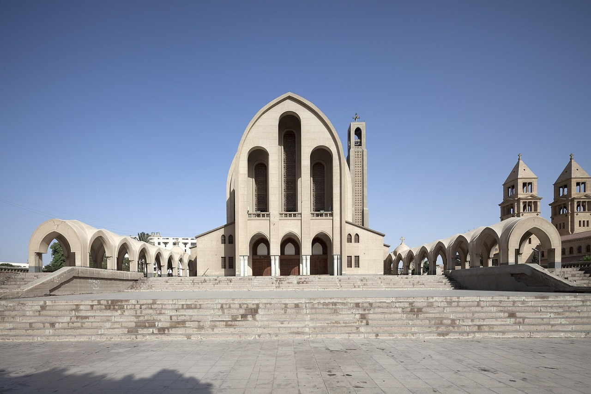
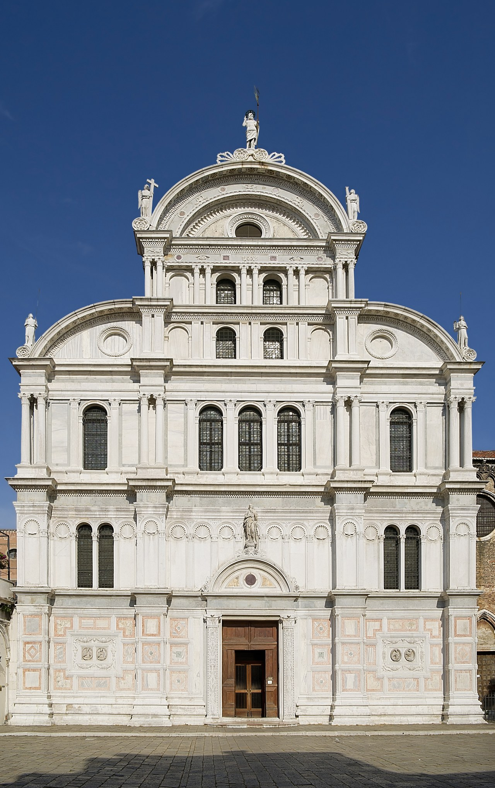
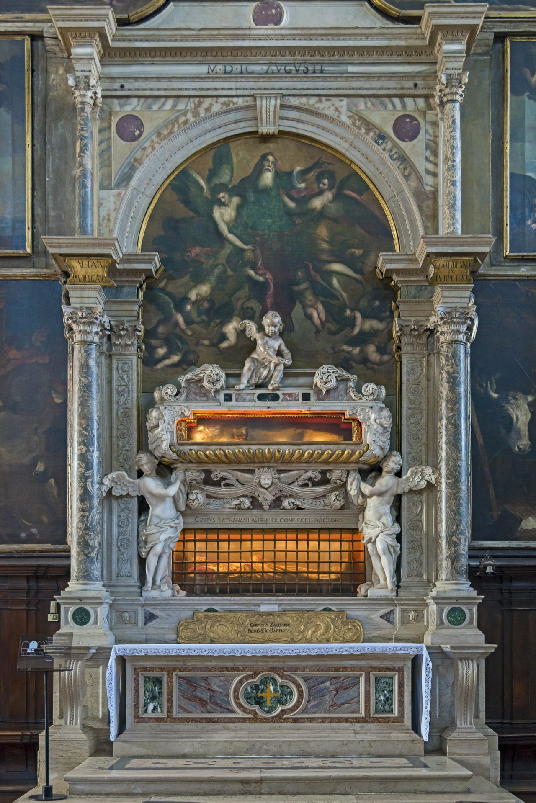
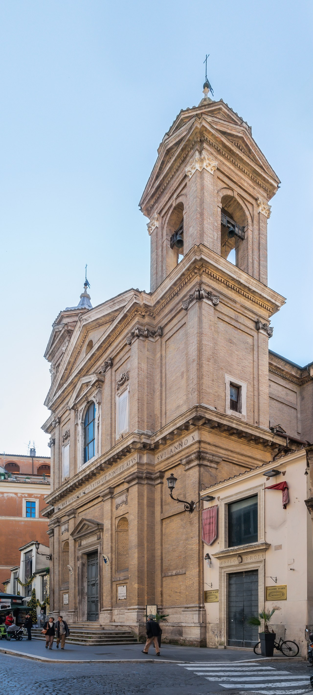
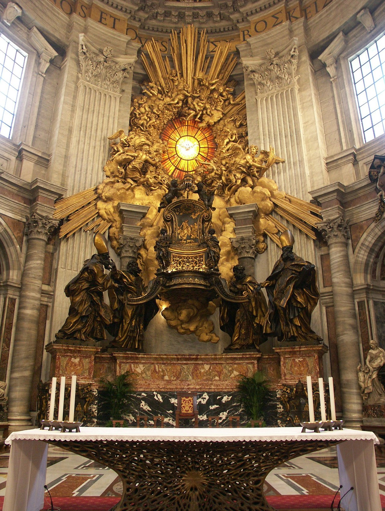
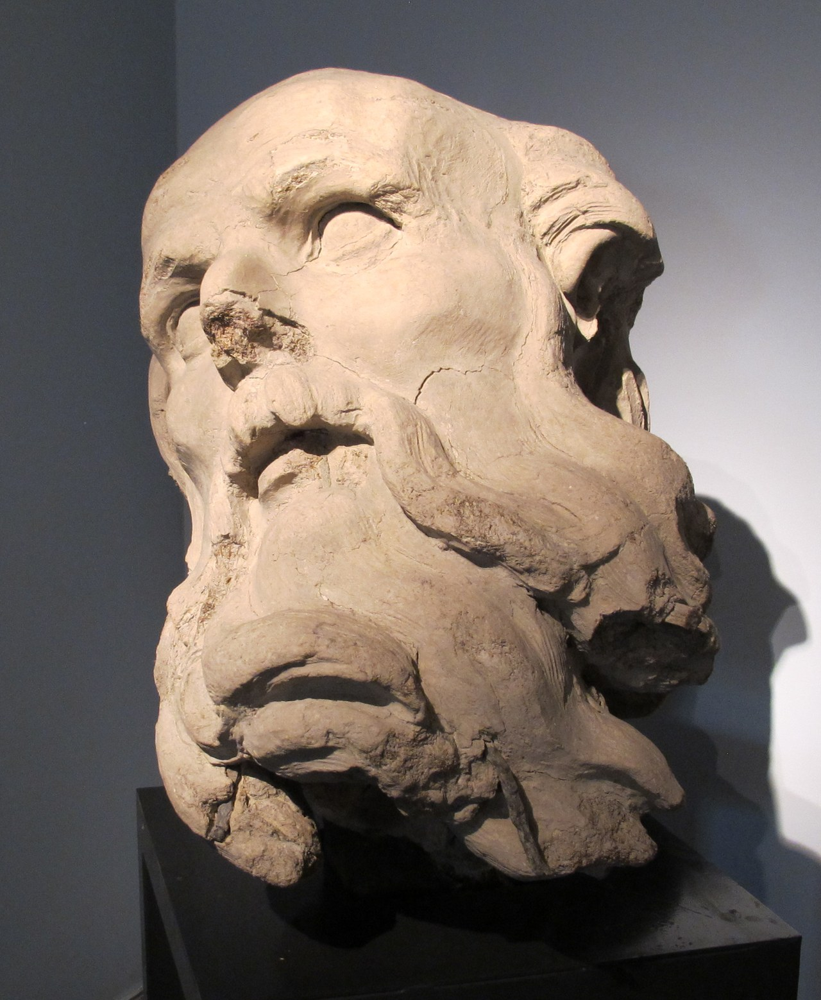

<nav class=toc aria-label="On this page">

On this page

<ol>
<li><a href="#tyre">The hand in the box</a></li>
<li><a href="#exiles">Five times into exile</a></li>
<li><a href="#nicaea">The Council of Nicaea</a></li>
<li><a href="#canon">The 39th Festal Letter</a></li>
<li><a href="#churches">Churches and relics</a></li>
<li><a href="#cathedra">The Chair of Peter</a></li>
</ol>
</nav>

## His story

Athanasius (ath-uh-NAY-shus) was an Alexandrian, born about **296**, in the greatest city of the Greek East. He was still a young deacon when he sailed to **Nicaea** in **325** as secretary to his bishop, Alexander — and walked into a fight that would decide, for the whole Church, who Christians were actually worshipping.

A priest of Alexandria named **Arius** had been preaching a sharp, memorable slogan: *there was when he was not*. The Son, Arius said, was the first and finest of creatures, but a creature all the same. He was not eternal. If that were true, then the child in Mary's arms was not God. The man on the Cross was not God. The empty tomb was the rising of a creature, however exalted, and not the victory of the Word through whom all things were made. The docks and lecture halls of Alexandria caught fire with the argument. It did not stay in Alexandria. It threatened to split the Christian world just as the empire had, at last, given the Church peace.

Nicaea answered with a word Arius would not say. The Son is *homoousios*, of one being, one substance, with the Father. Athanasius spent the rest of his life refusing to let that word be bargained away. The council itself — the scarred bishops, the emperor in his chair, the vote, and the creed still said in churches today — is told more fully [below](#nicaea).

He became bishop of Alexandria in **328**, still a young man, chosen by the people of his city when Alexander died. He would hold that see for some forty-five years, and be driven from it five times. Emperors would send him north to Trier and west to Rome, soldiers would surround his church at night, and for years he would live as a hunted man among the monks of the Egyptian desert. When a visitor told him the world was against him, later tradition put a Latin sentence on the answer he had already lived: *Athanasius contra mundum* — Athanasius against the world. He did not coin the slogan. He lived the fact.

In those same years the desert beyond the city already had a father. A generation earlier, around **270**, a young Egyptian named **[Anthony](/saints/anthony-the-abbot/)** had heard in church the words of the Gospel: "If you would be perfect, go, sell what you possess and give to the poor" (Matthew 19:21). He did exactly that. He gave away his inheritance and went into the wilderness, and the monks who gathered around him would come to call him the father of monasticism. Athanasius knew him, and honoured him. The bond would matter more than either man could yet see. In about **338**, when the faith of Nicaea was under pressure, Anthony himself came into Alexandria to stand with it.

<h2 id=tyre>The hand in the box</h2>

He was not a comfortable man, and he made enemies who were not comfortable either. The **Melitians**, a hard party that had split from the Alexandrian church over how to treat Christians who had lapsed in the Great Persecution, would not accept his election. They found allies at court in the **Eusebian** party — men around Eusebius of Nicomedia who wanted a softer creed, and a quieter bishop in Egypt. The charges came in a drumbeat: violence, the breaking of a chalice (a priest of Athanasius named Macarius was said to have smashed the cup of a Melitian named Ischyras), even magic.

The most poisonous charge was murder.

His enemies said he had killed a Melitian bishop named **Arsenius**, and had cut off the man's hand for sorcery. They produced a wooden box, and in the box a human hand. The story, as the church historians tell it, turns at the Council of **Tyre** in **335**. Athanasius's friends had already found Arsenius alive, hidden away. When the severed hand was brought out before the bishops as proof, Athanasius had Arsenius led in, and drew back the cloak from both his living hands. Let no one, the later accounts have him say in so many words, look for a third.

The hand in the box could not make a dead man of a man who stood there breathing. So they tried a charge that would move an emperor. They said Athanasius had threatened to hold back the grain fleet from Egypt — the ships that fed Constantinople. **[Constantine](/saints/constantine/)**, who had given the Church peace and had sat among the bishops at Nicaea, sent the bishop of Alexandria into exile at Trier, in **335** or **336**. It was the first of five.

<h2 id=exiles>Five times into exile</h2>

**Trier**, the northern capital on the Moselle, was the first: **335/336–337**. Athanasius was still there when Constantine died.

When Constantine died in **337**, the empire was divided among his three sons. **Constantine II** held the far West, and it was he who sent Athanasius home from Trier. **Constans** soon held Italy and the rest of the West; he favoured the faith of Nicaea, and would prove the bishop's shield. **Constantius II** held the East. He favoured the Arian and Homoian parties, who wanted a softer word than *homoousios*, and a quieter man in Alexandria. The five exiles of Athanasius would turn on that family quarrel.

### 335/336–337 · First exile, to Trier
Under **[Constantine](/saints/constantine/)**. Recalled by Constantine II after his father's death.

### 339–346 · Second exile, in Rome
Under Constantius II. Constans, in the West, pressed for his return.

### 356–362 · Third exile, in the desert
Under Constantius II, now sole emperor.

### 362–363 · Fourth exile
**Julian** recalled the exiles, then banished him again.

### 365–366 · Fifth exile
**Jovian** had restored him in 363. **Valens**, who favoured the Arians, drove him out once more. He was home for good in 366.

He was not home for long. In **339**, under Constantius, a rival bishop, Gregory, was installed in Alexandria. Athanasius fled to **Rome**, where **Pope Julius I** received him as a brother. For years the West stood with him — and Constans made that stand felt. He came back in **346**, after Constans's pressure on his brother, to a jubilant city, and had a golden decade of preaching and writing in his own church.

The shield did not last. In **350** Constans was killed, and a usurper named **Magnentius** seized the West. Constantius defeated him in **353**, and was at last sole emperor. The court that had been held in check now moved against the bishop of Alexandria. Synods at **Arles** in **353** and **Milan** in **355** were pressed to condemn him. In the years of those synods, bishops who would not join the condemnation — among them **Liberius of Rome**, the aged **Hosius of Cordoba** who had sat at Nicaea, **Hilary of Poitiers**, **Eusebius of Vercelli**, and **Lucifer of Cagliari** — were exiled or held under imperial pressure. The charges brought against Athanasius were the kind that move an emperor: that he had set Constans against Constantius; that he had written to the usurper Magnentius; that he had used the new church in the Caesareum before it was dedicated; that he had again interfered with the grain. Some of this he denied in writing, and the worst of it was never proved. It did not matter. Constantius wanted him gone, and a man named **George of Cappadocia** was waiting for the chair. (George would be installed in **357**.)

Then the night of **8 February 356**. Soldiers under the general Syrianus surrounded the church of Theonas in Alexandria, where Athanasius was keeping a vigil with his people. The general had come with an imperial order to seize him. Athanasius waited until his people could get out, then slipped away in the confusion and the dark. For six years he lived as a hunted man among the monks of the Egyptian desert — the friends he had from his bond with **[St Anthony the Abbot](/saints/anthony-the-abbot/)**. George of Cappadocia sat in his chair.

The pagan emperor **Julian**, who had briefly allowed exiles home in **362**, soon ordered him out again. Later writers say Julian called him "hardly a man, only a little fellow," and still could not break him. Athanasius went back into hiding; Julian was dead within the year.

After Julian's death, the emperor **Jovian** (**363–364**) restored him. The last expulsion came in **365**, under the emperor **Valens**, who favoured the Arians. Tradition holds that Athanasius hid for some months in his father's tomb. The city would not accept his absence. He was restored in **366**, and the last seven years of his life were spent, at last, in peace, in his own see.

The friendship with Anthony outlasted emperors. Anthony died in **356**, the same year the soldiers came. While Athanasius himself was in hiding among Anthony's monks, he wrote the *Life of Antony*. The book did what no imperial edict could do. It carried the monastic life out of Egypt and into the Latin world. A generation later, in a garden in Milan, **[St Augustine](/saints/augustine/)** would hear of men who had read that Life and given up everything — and it helped to turn him too.

He died in Alexandria, in peace, on **2 May 373**. Gregory Nazianzen, preaching not long after, called him the pillar of the Church.

He would not sign, through all five exiles, any creed that made the Son a creature. The reason was not stubbornness for its own sake. If the Son is a creature, however splendid, then the Cross is not God saving us, and the manger is not God with us. "He was made man that we might be made God," Athanasius wrote in *On the Incarnation*. The word *homoousios* was not a philosopher's toy. It was the confession that the one who hung on the Cross is of one being with the Father — and that our hope is as large as that.

<h2 id=nicaea>The Council of Nicaea</h2>

In the summer of **325**, bishops came in from across the empire to the lakeside city of Nicaea in Bithynia. Some still bore the scars of the Great Persecution: missing eyes, maimed hands, the marks of men who had already refused to deny Christ, and had lived to see a Christian emperor. **[Constantine](/saints/constantine/)**, not yet baptized, took his seat among them. At Alexander of Alexandria's side stood his young deacon, Athanasius, taking notes, already sharper than his years.

Arius's slogan was on the table: "there was when he was not." Against it the council set down lines that Christians still stand to say:

> God from God, Light from Light, true God from true God, begotten, not made, of one substance with the Father.

The decisive word was *homoousios* — of one substance, one being, with the Father. In the decades that followed, when the pressure came to compromise, some would offer *homoiousios*, of *similar* substance. One letter, the Greek iota, and a different faith. Athanasius would spend his life refusing that letter. Almost all the bishops signed. Arius and two Libyan bishops who would not were sent into exile.

The council also settled a quarrel that had long divided the churches: the date of Easter. It ruled that the feast should be kept on a common Sunday after the spring full moon, so that the whole Church would rise with Christ on the same day. That decision still shapes the [Church Year](/church-year/easter/).

The creed most congregations recite today is not, word for word, the short text of **325**. It is the form associated with the Council of Constantinople in **381**, which kept Nicaea's confession of the Son and said more about the Holy Spirit. Catholics, Orthodox and many Protestants still say it, Sunday after Sunday, often without knowing they are standing in a fight a young deacon of Alexandria would not let go. The full text of the **[325 creed](https://earlychurchtexts.com/public/creed_of_nicaea_325.htm)** and the acts of the **[Councils of Nicaea](https://www.newadvent.org/fathers/3801.htm)** and **[Constantinople](https://www.newadvent.org/fathers/3808.htm)** are online; a clear account of how the two forms relate is in the **[Catholic Encyclopedia's article on the Nicene Creed](https://www.newadvent.org/cathen/11049a.htm)**.

<h2 id=canon>The 39th Festal Letter</h2>

Every Easter the bishop of Alexandria wrote to his churches to announce the date of the feast — and often much more. Those letters also helped to spread the keeping of Lent, as our [Church Year](/church-year/lent/) page notes. In the **39th Festal Letter**, for Easter **367**, Athanasius set down a list of the books the Church in Egypt was to receive as Scripture.

For the New Testament he named exactly the **twenty-seven books** Christians still read. It is the first known list that matches the New Testament as the Church has it. He also listed the Old Testament books, following a twenty-two-book count in the Hebrew manner, and named other books "to be read" for instruction, among them Wisdom and Sirach. He spoke of books that are "canonized" (*kanonizomena*) — from *kanon*, a rule or measuring-line. The word would become our "canon."

The letter can be read in English among Athanasius's **[Festal Letters](https://www.newadvent.org/fathers/2806039.htm)**.

<h2 id=churches>Churches and relics</h2>

Athanasius was first buried in Alexandria. In later centuries his relics were taken north, and the greater part of them is still honoured in Venice. In the twentieth century a portion came home.

### St Mark's Coptic Orthodox Cathedral, Cairo

The patriarchal cathedral of the Coptic Orthodox Church stands in Abbassia, Cairo: a great modern church, consecrated in **1968**, with a soaring pointed arch and wide steps under the Egyptian sun. It is the church of [St Mark](/saints/mark/), Alexandria's first bishop, and a portion of Mark's relics, returned from Venice and Rome, was laid here when the cathedral was opened.

Five years later came another homecoming. In **May 1973**, during a historic visit to Rome, **Pope Shenouda III** received from **Pope Paul VI** a relic of St Athanasius. Shenouda brought it back to Egypt on 15 May, and it is kept under this cathedral. The greater part of Athanasius's relics remains in Venice, but a portion of the bishop who would not yield now rests again in the land of his see.

<figure class=photo>
<picture><source srcset="/static/art/mark-cairo-600.webp 600w,/static/art/mark-cairo.webp 1280w" sizes="(max-width:760px) 100vw,760px" type="image/webp"></picture>
<figcaption>St Mark's Coptic Orthodox Cathedral, Abbassia, Cairo, consecrated in 1968. A relic of Athanasius, given by Pope Paul VI to Pope Shenouda III in 1973, is kept here. Photo: <a href="https://commons.wikimedia.org/wiki/File:CairoAbbasiyaMarkEntrance.jpg">Roland Unger</a>, <a href="https://creativecommons.org/licenses/by-sa/3.0">CC BY-SA 3.0</a>, via Wikimedia Commons.</figcaption>
</figure>

### San Zaccaria, Venice

The church of **San Zaccaria**, a short walk from St Mark's Basilica, is one of the beautiful quiet squares of Venice. Its white facade — a Renaissance upper church, by Mauro Codussi, rising over an earlier lower storey — looks onto the campo as if it had always been there. Inside, a richly carved monument holds the relics of **St Zechariah**, the father of John the Baptist, by tradition, and of **St Athanasius**. Venetian church history holds that Athanasius's body, first buried in Alexandria and later in the East, was brought here; the greater part of his relics is still honoured in this tomb.

<figure class=photo>
<picture><source srcset="/static/art/athanasius-zaccaria-facade-600.webp 600w,/static/art/athanasius-zaccaria-facade.webp 1280w" sizes="(max-width:760px) 100vw,760px" type="image/webp"></picture>
<figcaption>The facade of San Zaccaria, Venice, looking onto the campo. Photo: <a href="https://commons.wikimedia.org/wiki/File:Chiesa_di_San_Zaccaria_Venezia.jpg">Chiesa di San Zaccaria Venezia</a> by Didier Descouens, <a href="https://creativecommons.org/licenses/by-sa/4.0">CC BY-SA 4.0</a>, via Wikimedia Commons.</figcaption>
</figure>

<figure class=photo>
<picture><source srcset="/static/art/athanasius-zaccaria-tomb-600.webp 600w,/static/art/athanasius-zaccaria-tomb.webp 1280w" sizes="(max-width:760px) 100vw,760px" type="image/webp"></picture>
<figcaption>The monument in San Zaccaria that holds the relics of St Zechariah and of St Athanasius. Photo: <a href="https://commons.wikimedia.org/wiki/File:Tomb_of_Zaccaria_and_Saint_Athanasius.jpg">Tomb of Zaccaria and Saint Athanasius</a> by Didier Descouens, <a href="https://creativecommons.org/licenses/by-sa/4.0">CC BY-SA 4.0</a>, via Wikimedia Commons.</figcaption>
</figure>

### Sant'Atanasio dei Greci, Rome

In [Rome](/pilgrimage/rome/), on Via del Babuino near the Spanish Steps, a tall brick church with a single bell-tower carries Athanasius's name in the city that once gave him refuge. **Sant'Atanasio dei Greci** was founded by **Pope Gregory XIII** in the 1570s for the Pontifical Greek College, a house to train clergy of the Byzantine rite. The church, whose facade is often attributed to Giacomo della Porta, was built in the early 1580s. It remains a Greek Catholic church, and a living sign that the East and the West both claim this Alexandrian as their own.

<figure class=photo>
<picture><source srcset="/static/art/athanasius-sant-atanasio-600.webp 600w,/static/art/athanasius-sant-atanasio.webp 1280w" sizes="(max-width:760px) 100vw,760px" type="image/webp"></picture>
<figcaption>Sant'Atanasio dei Greci, on Via del Babuino in Rome, the church of the Pontifical Greek College. Photo: <a href="https://commons.wikimedia.org/wiki/File:Saint_Athanasius_church_in_Rome_(1).jpg">Saint Athanasius church in Rome (1)</a> by Krzysztof Golik, <a href="https://creativecommons.org/licenses/by-sa/4.0">CC BY-SA 4.0</a>, via Wikimedia Commons.</figcaption>
</figure>

<h2 id=cathedra>The Chair of Peter</h2>

In the apse of **[St Peter's](/pilgrimage/rome/st-peters/)** in Rome, Gian Lorenzo Bernini raised, in **1657–66**, one of the most astonishing works in the basilica: the **Cathedra Petri**, a gilded bronze throne in a glory of angels and light, under the alabaster window of the Holy Spirit as a dove. Four Doctors of the Church hold up the Chair — **[Ambrose](/saints/ambrose/)** and **[Augustine](/saints/augustine/)** of the West, **Athanasius** and **[John Chrysostom](/saints/john-chrysostom/)** of the East. The little fellow Julian could not break now stands in bronze, helping to bear the chair of Peter, in the church that had once taken him in.

Bernini first modelled Athanasius's head in terracotta. That model, intense and close, is kept in the Vatican Pinacoteca: the face of a man who had looked at emperors and had not moved.

<figure class=photo>
<picture><source srcset="/static/art/athanasius-cathedra-600.webp 600w,/static/art/athanasius-cathedra.webp 1280w" sizes="(max-width:760px) 100vw,760px" type="image/webp"></picture>
<figcaption>Bernini's Cathedra Petri in the apse of St Peter's. Athanasius is one of the four Doctors who hold up the Chair. Photo: <a href="https://commons.wikimedia.org/wiki/File:Rom,_Vatikan,_Petersdom,_Cathedra_Petri_(Bernini)_4.jpg">Rom, Vatikan, Petersdom, Cathedra Petri (Bernini) 4</a> by Dnalor 01, <a href="https://creativecommons.org/licenses/by-sa/3.0">CC BY-SA 3.0</a>, via Wikimedia Commons.</figcaption>
</figure>

<figure class=photo>
<picture><source srcset="/static/art/athanasius-bernini-model-600.webp 600w,/static/art/athanasius-bernini-model.webp 1280w" sizes="(max-width:760px) 100vw,760px" type="image/webp"></picture>
<figcaption>Gian Lorenzo Bernini, terracotta model for the head of St Athanasius on the Cathedra Petri, 1661–65. Vatican Pinacoteca. Photo: <a href="https://commons.wikimedia.org/wiki/File:Gian_lorenzo_bernini,_modello_testa_s._atanasio_per_altare_della_cattedra_in_s.pietro,_1661-65,_0.JPG">Gian lorenzo bernini, modello testa s. atanasio…</a> by Sailko, <a href="https://creativecommons.org/licenses/by/3.0">CC BY 3.0</a>, via Wikimedia Commons.</figcaption>
</figure>

## Path to sainthood
Pre-Congregation. Honoured as a Doctor of the Church in East and West. His memorial on **2 May** is on the General Roman Calendar. The Coptic Church also keeps his feast, and remembers the return of his relic in 1973.

## Patronages
Theologians, and people who have to hold a true thing when the room disagrees. Relics are honoured at the Coptic cathedral of St Mark in Cairo, at San Zaccaria in Venice, and in the dedication of Sant'Atanasio dei Greci in Rome.

## Trivia
- Five exiles in about forty-five years as bishop. The count is the usual one; the exact itinerary is argued.
- The phrase "Athanasius contra mundum" became English shorthand, used by Newman and others, for a person who will not move with the majority.
- He was small. Julian the Apostate, who hated him, is said to have called him "hardly a man, only a little fellow". The stories of his size are later, and fond.
- The *Life of Antony* was a bestseller of the ancient world. Augustine, in the *Confessions*, tells how the story of men who had read it helped to bring about his own conversion.

## Sources
- [Benedict XVI, General Audience on St Athanasius (20 June 2007), vatican.va](https://www.vatican.va/content/benedict-xvi/en/audiences/2007/documents/hf_ben-xvi_aud_20070620.html)
- [Vatican News: St Athanasius](https://www.vaticannews.va/en/saints/05/02/st-athanasius--bishop-of--alexandria--in-egypt-and-doctor-of-the.html)
- [Catholic Encyclopedia: St Athanasius](https://www.newadvent.org/cathen/02035a.htm)
- [Athanasius, *On the Incarnation* (New Advent)](https://www.newadvent.org/fathers/2802.htm)
- [Athanasius, 39th Festal Letter (New Advent)](https://www.newadvent.org/fathers/2806039.htm)
- [The Creed of Nicaea, 325 (Early Church Texts)](https://earlychurchtexts.com/public/creed_of_nicaea_325.htm)
- [First Council of Nicaea (New Advent)](https://www.newadvent.org/fathers/3801.htm) and [First Council of Constantinople (New Advent)](https://www.newadvent.org/fathers/3808.htm)
- [Catholic Encyclopedia: Nicene Creed](https://www.newadvent.org/cathen/11049a.htm)
- [Address of Pope Shenouda III to Pope Paul VI, 5 May 1973 (Dicastery for Promoting Christian Unity)](https://www.christianunity.va/content/unitacristiani/en/dialoghi/sezione-orientale/chiese-ortodosse-orientali/relazioni-bilaterali/patriarcato-copto-ortodosso-degitto/visits/visit-of-his-holiness-shenouda-to-pope-paul-vi/address-of-his-holiness-shenouda-iii-to-pope-paul-vi.html)

Fact-checked on November 19, 2026 against Benedict XVI's audience, Vatican News, New Advent (Catholic Encyclopedia, Festal Letter 39, and the councils), Early Church Texts, and the 1973 address of Pope Shenouda III. Feast days follow the General Roman Calendar unless noted.

