<nav class=toc aria-label="On this page">

On this page

<ol>
<li><a href="#thagaste">Thagaste</a></li>
<li><a href="#conversion">Conversion</a></li>
<li><a href="#hippo">Hippo Regius</a></li>
<li><a href="#confessions">The Confessions</a></li>
<li><a href="#city-of-god">The City of God</a></li>
<li><a href="#rule">The Rule and the Augustinian habit</a></li>
<li><a href="#places">Holy places</a></li>
<li><a href="#art">Augustine in art</a></li>
</ol>
</nav>

## His story
Augustine was born on **13 November 354** at **Thagaste**, a small Roman town in Numidia, in the Africa that is now north-eastern Algeria. His father, **Patricius**, was a pagan official of modest means; his mother, [St Monica](/saints/monica/), was a Christian who prayed for him for years. He became a brilliant teacher of rhetoric, wandered through Manichaeism and a worldly life, and was converted at Milan in 386 under [St Ambrose](/saints/ambrose/). Baptised at Easter 387, he went home to Africa, was made priest and then Bishop of **Hippo Regius**, and there he wrote the *Confessions* and *The City of God*, taught a way of common life that became the **Rule of St Augustine**, and shaped Western Christian thought more than almost anyone after [St Paul](/saints/paul/). He died on **28 August 430**, as the Vandals were besieging his city.

<figure class=map><a href="/static/maps/map-augustine-mediterranean.svg">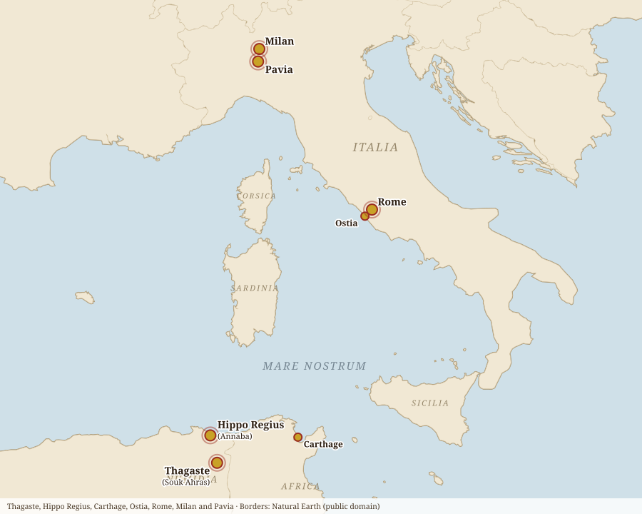</a><figcaption>The world of Augustine's life: Thagaste and Hippo on the Numidian coast, Carthage where he studied, Milan where he was converted and baptised, Ostia where Monica died, and Pavia, where his relics rest. Map by The Daily Word; borders from Natural Earth (public domain). Tap to enlarge.</figcaption></figure>

<h2 id=thagaste>Thagaste</h2>

Thagaste stood in the high country of Roman **Numidia**, about 60 km inland from the Mediterranean and from Hippo, in what is now the town of **Souk Ahras**, in Algeria. Algeria today is a largely Muslim country; in Augustine's century Thagaste was a small but fully Roman *municipium*, Latin-speaking, with a Christian community already old enough to have a bishop. The people of the region were **Berber** by blood, with a long **Punic** (Carthaginian) inheritance under the language and law of Rome. Augustine's family belonged to that mixed world: African, Roman, and, in Monica's house, Christian.

Patricius was hot-tempered and unbaptised for most of his life; Monica's patience and prayers won him, and he received baptism before he died. They were not rich. They stretched themselves to send their gifted son to school at **Madauros** (today Mdaourouch, a short way south of Thagaste), and then, when the money could be found, to **Carthage**, the great city of Roman Africa, for the study of rhetoric. There Augustine discovered Cicero, fell in love with wisdom, took a companion whom he loved for years, and became a father. Their son was named **Adeodatus**, "given by God."

<figure class=photo><picture><source srcset="/static/art/augustine-souk-ahras-600.webp 600w,/static/art/augustine-souk-ahras.webp 1280w" sizes="(max-width:760px) 100vw,760px" type="image/webp">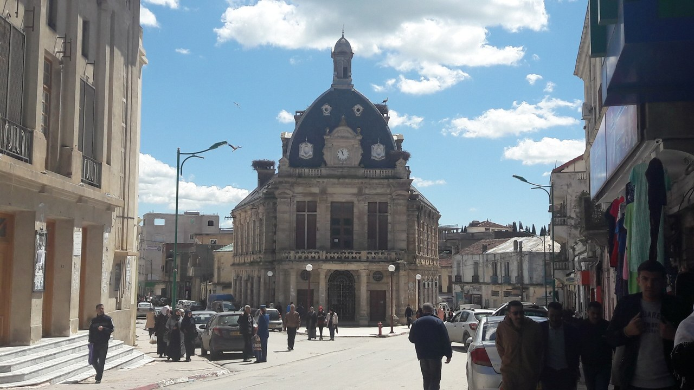</picture>
<figcaption>Souk Ahras, the modern town on the site of Thagaste, Augustine's birthplace in north-eastern Algeria. Photo: <a href="https://commons.wikimedia.org/wiki/File:Souk_Ahras,_Algeria.jpg">Nora Mahfouf</a>, <a href="https://creativecommons.org/licenses/by-sa/4.0">CC BY-SA 4.0</a>, via Wikimedia Commons.</figcaption>
</figure>

<h2 id=conversion>Conversion</h2>

For about nine years Augustine was a "hearer" of the **Manichaeans**, a sect that promised a reasoned answer to the problem of evil and let him put off the faith of his mother. He taught rhetoric at Thagaste, at Carthage, and then at Rome. In 384 he was appointed imperial professor of rhetoric at **Milan**, the seat of the Western emperor.

Milan was also the see of [St Ambrose](/saints/ambrose/), whose preaching he went to hear, at first only to study the bishop's eloquence. Ambrose opened the Scriptures to him, and the Christian faith began to seem not only holy but true. Monica, who had followed her son to Italy, rejoiced, and went on praying. Years earlier a bishop had comforted her tears with words she never forgot: that the son of those tears would not be lost.

Still he hesitated. He has told us, with a candour the Church has loved ever since, how part of him wanted holiness and part of him did not. In a garden in Milan, in the late summer of 386, the struggle came to its end. As he wept, he heard a child's voice from a nearby house, chanting again and again, **"Tolle, lege"** — "Take up and read." He took this as a word from God. He opened a book of the letters of [St Paul](/saints/paul/), and his eyes fell on Romans 13:13–14:

KJV · Romans 13:13–14
Let us walk honestly, as in the day; not in rioting and drunkenness, not in chambering and wantonness, not in strife and envying. But put ye on the Lord Jesus Christ, and make not provision for the flesh, to fulfil the lusts thereof.

Latin · Vulgate · Romans 13:13–14
Sicut in die honeste ambulemus: non in comessationibus et ebrietatibus, non in cubilibus et impudicitiis, non in contentione et aemulatione: sed induimini Dominum Iesum Christum, et carnis curam ne feceritis in desideriis.

"No further would I read," he wrote, "nor was there any need." The light of peace was poured into his heart. He resigned his chair, withdrew with Monica, Adeodatus and close friends to a country house at **Cassiciacum**, in the hills near Milan (often identified with Cassago Brianza), and prepared for baptism. At the **Easter Vigil of 387** (24–25 April), Ambrose baptised him, together with Adeodatus and his friend Alypius. The ancient baptistery of the cathedral, **San Giovanni alle Fonti**, whose remains can still be seen under Milan's Duomo, is the place where this is remembered; Ambrose himself rests in the [Basilica of Sant'Ambrogio](#sant-ambrogio).

On the way home to Africa they stopped at the port of **Ostia**. There, looking out of a window, mother and son shared a quiet conversation about the life of the saints that has become one of the treasures of the *Confessions*: a moment of contemplation, side by side, that seemed to touch the edge of eternal joy. A few days later Monica died, her life's prayer answered. Augustine was 33. He buried her at Ostia, and went home.

<h2 id=hippo>Hippo Regius</h2>

**Hippo Regius** — "royal Hippo" — was an old port on the Numidian coast, a little west of the later frontier with Roman Africa proper, and a busier, more important city than Thagaste. Today it is **Annaba**, in Algeria. Its ruins still lie in the grass below a hill, and on that hill stands the basilica built in Augustine's honour.

Augustine had meant to live quietly at Thagaste, in a little community of prayer and study. On a visit to Hippo in 391 the people, who had no priest they wanted as much, almost forced him into ordination. He served the church there as priest, and in 395 or 396 he was made bishop. For the rest of his life, some thirty-five years, Hippo was his home and his see. He preached constantly, often daily; he cared for the poor; he answered the Donatists and, later, the Pelagians; he wrote letters across the Latin world; and in the house he shared with his clergy he lived the common life that his Rule would teach to later centuries.

In 410 the Visigoth Alaric sacked Rome. The shock was felt in Africa, and it moved Augustine to begin *The City of God*. Twenty years later the danger came to his own gates. The **Vandals**, crossing from Spain, swept through Mauretania and Numidia. In May 429 they laid siege to Hippo. Augustine, now an old man, spent the last months of his life in prayer and in comfort of his people. He died on **28 August 430**, in the third month of the siege. The city held out a little longer, then fell in 431.

His body did not remain in Africa. In the century that followed, as the Vandal kingdom and later dangers pressed upon the Church there, his relics were taken to **Sardinia**. Around 720–725, **Liutprand**, the Lombard king, had them brought to **Pavia** and laid in the basilica of **San Pietro in Ciel d'Oro**, "St Peter in the Golden Sky," where they rest to this day, in a great marble tomb. A relic was later returned to Annaba for the modern basilica that looks out over his ruined city.

<figure class=photo><picture><source srcset="/static/art/augustine-hippo-ruins-600.webp 600w,/static/art/augustine-hippo-ruins.webp 1280w" sizes="(max-width:760px) 100vw,760px" type="image/webp">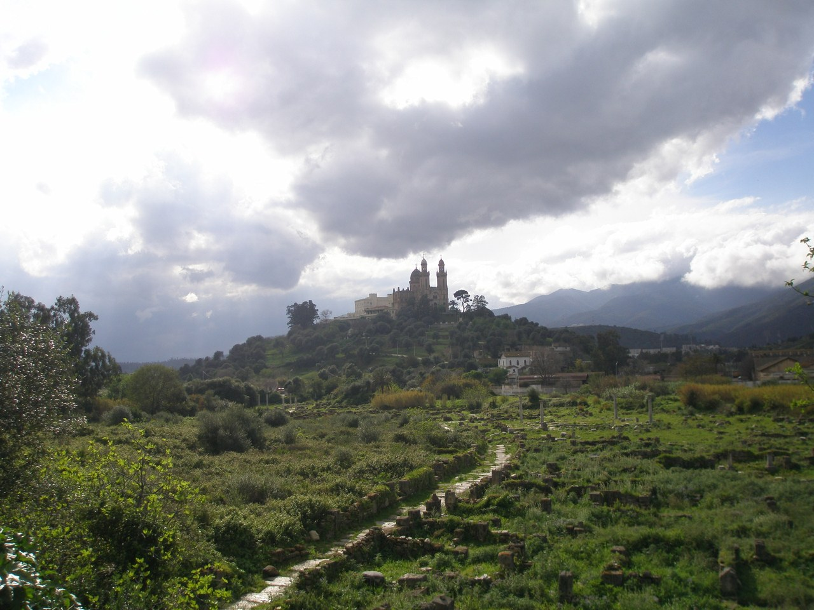</picture>
<figcaption>The ruins of Hippo Regius, with the Basilica of St Augustine on the hill above them, at Annaba in Algeria. Photo: <a href="https://commons.wikimedia.org/wiki/File:Hippone.JPG">Oris</a>, <a href="https://creativecommons.org/licenses/by-sa/3.0">CC BY-SA 3.0</a>, via Wikimedia Commons.</figcaption>
</figure>

<h2 id=confessions>The Confessions</h2>

Augustine began the *Confessions* around **397**, in the first years of his episcopate, and finished the thirteen books about **400**. He wrote them as a long prayer of praise and thanksgiving, addressed to God, and as a help to others. "I want to do this truth," he says, "in my heart, before you in confession, and before many witnesses with my pen."

The first nine books tell his life up to Monica's death: his childhood and schooling, the theft of the pears, Carthage, the Manichaean years, the grief of losing a friend, Rome and Milan, the garden, his baptism, the vision at Ostia. Book 10 is a searching account of the memory and of the self, still tempted, still in need of grace. Books 11 to 13 turn from his own story to the opening of Genesis, and to time, eternity and the creation. The book is at once autobiography, theology and prayer, and it has never gone out of print in the mind of the Church.

Two sentences have been especially dear to Christians. At the very beginning he writes:

Latin · Confessions I.1
Fecisti nos ad te, et inquietum est cor nostrum donec requiescat in te.

English
Thou hast made us for thyself, O Lord, and our heart is restless until it rests in thee.

And in Book 10, looking back on the God he had so long delayed to love:

Latin · Confessions X.27
Sero te amavi, pulchritudo tam antiqua et tam nova, sero te amavi!

English
Late have I loved thee, O Beauty so ancient and so new, late have I loved thee!

The *Confessions* gave the West a new way of speaking about the inner life: memory, will, desire, the restless heart, and the grace that heals it. Later mystics, reformers and philosophers have all drunk from it. It remains, after the Scriptures, one of the books in which the most people have recognised their own souls.

<h2 id=city-of-god>The City of God</h2>

When Rome was sacked in **410**, some pagans said the disaster had come because the empire had abandoned the old gods for Christ. Augustine began *The City of God* (*De civitate Dei*) in **413** to answer them, and he worked at it until **426**. It is a vast work, twenty-two books, written for the comfort of the Church and for the defence of the faith in a shaken world.

The first ten books reply to the charge. Rome, he reminds his readers, had suffered wars and vices long before the apostles came; the old gods had not saved her, and the Gospel had not been her ruin. The last twelve books set out a greater story. From the beginning of the world there have been two cities, formed by two loves:

Latin · City of God XIV.28
Fecerunt itaque civitates duas amores duo: terrenam scilicet amor sui usque ad contemptum Dei, caelestem vero amor Dei usque ad contemptum sui.

English
Two loves have made two cities: the earthly city, the love of self even to the contempt of God; the heavenly city, the love of God even to the contempt of self.

These two cities are interwoven in history until the last judgement. The City of God is not simply the visible Church, nor is the earthly city simply Rome; they are two ways of loving, two destinies, working themselves out in the rise and fall of kingdoms. In the course of the work Augustine also treats the creation, the fall, the history of Israel, the coming of Christ, just war, and the hope of the resurrection.

The book became a foundation of Christian thought about history and politics in the Middle Ages, and it has never ceased to be read. At the Reformation, Luther — himself an Augustinian friar — and Calvin both turned back to Augustine on sin, grace and the two cities. Philosophers have found in it, as in the *Confessions*, a depth of reflection on will, time and the meaning of a human life under God. For ordinary believers it remains a book of comfort: even when earthly cities fall, the City of God is not shaken.

<h2 id=rule>The Rule and the Augustinian habit</h2>

Augustine also left the Church a way of living together. The short **Rule** that bears his name, often called the *Praeceptum*, was written for the household of clergy and lay brothers who shared his house at Hippo: a life in common, with one heart and one soul toward God, poverty held in common, prayer at the set hours, and a gentle, watchful charity. It is one of the oldest monastic rules in the West.

In the Middle Ages that Rule became the rule of the **Canons Regular**, and in 1244 the Holy See gathered several communities of hermits into the **Order of St Augustine** (the Augustinian Friars). Augustinian nuns and friars still wear the distinctive black habit of the Order. Many other families have lived by the same Rule, or by a form of it, including the Dominicans in their origins.

Among those houses is the Augustinian monastery of St Mary Magdalene at **Cascia**, where [St Rita](/saints/rita-of-cascia/) received the habit and lived under the Rule of St Augustine for some forty years. Augustine was one of the three saints whom Rita loved from childhood, and the tradition of Cascia says that he, with St John the Baptist and St Nicholas of Tolentino, carried her into the monastery when every door was still locked. The habit that was influential in her life is his habit, and the Rule she professed is his Rule.

<h2 id=places>Holy places</h2>

Pilgrims still go to the cities of Augustine's life and death, and to the churches that keep his memory and Monica's.

### Basilica of St Augustine, Annaba

The **Basilica of St Augustine** stands on the hill above the ruins of Hippo Regius, at Annaba in Algeria. It was built between 1881 and 1900, and a relic of the saint, given back from Pavia, is kept there. From its terraces you look down on the stones of the city he served, and out toward the sea he knew as a boy and as a bishop. There is not yet a separate pilgrimage page for Annaba on this site.

<figure class=photo><picture><source srcset="/static/art/augustine-annaba-basilica-600.webp 600w,/static/art/augustine-annaba-basilica.webp 1280w" sizes="(max-width:760px) 100vw,760px" type="image/webp">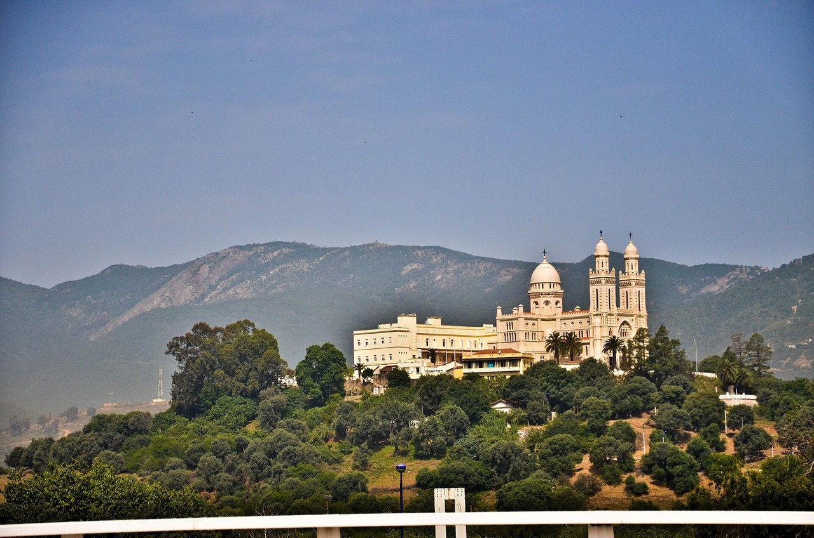</picture>
<figcaption>The Basilica of St Augustine, Annaba, looking over the site of Hippo. Photo: <a href="https://commons.wikimedia.org/wiki/File:Basilique_Saint-Augustin_Annaba_01.jpg">BRAHIM DJELLOUL Mustapha</a>, <a href="https://creativecommons.org/licenses/by-sa/4.0">CC BY-SA 4.0</a>, via Wikimedia Commons.</figcaption>
</figure>

### San Pietro in Ciel d'Oro, Pavia

Augustine's tomb is in the basilica of **San Pietro in Ciel d'Oro** in **Pavia**, in northern Italy, a church whose golden mosaic ceiling gave it its name. The *Arca di Sant'Agostino*, a tall Gothic marble tomb of the 14th century, stands in the vault, carved with scenes of his life; the relics themselves are kept below. Boethius is buried in the crypt. Pavia was the Lombard capital, and the church is a stage on the [Via Francigena](/pilgrimage/via-francigena/tuscany/), the old pilgrim road from Canterbury to Rome.

<figure class=photo><picture><source srcset="/static/art/st2-vi-tuscan-pavia-600.webp 600w,/static/art/st2-vi-tuscan-pavia.webp 1280w" sizes="(max-width:760px) 100vw,760px" type="image/webp">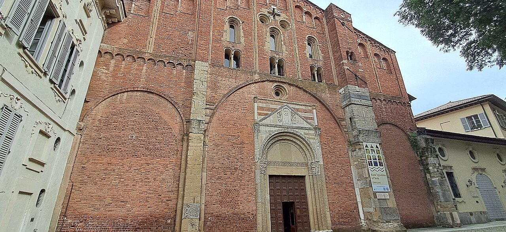</picture>
<figcaption>San Pietro in Ciel d'Oro, Pavia, where Augustine's relics have rested since the eighth century. Photo: <a href="https://commons.wikimedia.org/wiki/File:Pavia_-_Basilica_di_San_Pietro_in_Ciel_d%27Oro_-_2025-09-11_17-58-43_001.jpg">Bubici</a>, <a href="https://creativecommons.org/licenses/by-sa/4.0">CC BY-SA 4.0</a>, via Wikimedia Commons.</figcaption>
</figure>

<figure class=photo><picture><source srcset="/static/art/augustine-pavia-arca-600.webp 600w,/static/art/augustine-pavia-arca.webp 1280w" sizes="(max-width:760px) 100vw,760px" type="image/webp">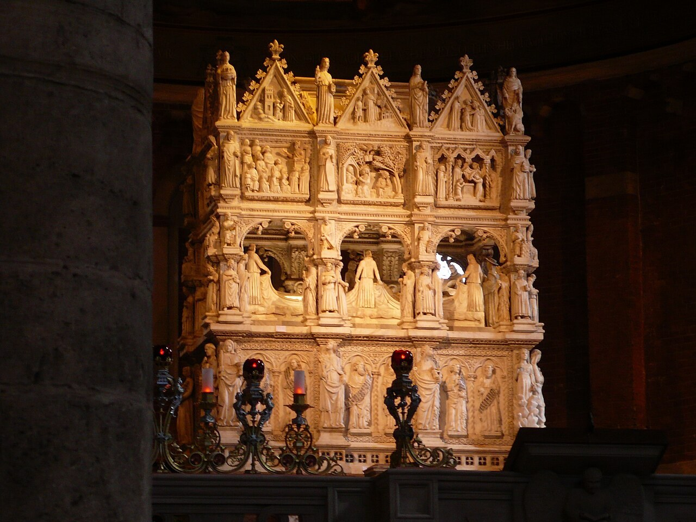</picture>
<figcaption>The <em>Arca di Sant'Agostino</em>, the fourteenth-century marble tomb in San Pietro in Ciel d'Oro. Photo: <a href="https://commons.wikimedia.org/wiki/File:Pavia_San_Pietro_Arca_Sant%27Agostino.JPG">Welleschik</a>, <a href="https://creativecommons.org/licenses/by-sa/3.0">CC BY-SA 3.0</a>, via Wikimedia Commons.</figcaption>
</figure>

### Sant'Agostino, Rome

The Roman church of the Augustinians, **Sant'Agostino in Campo Marzio**, stands a few steps from Piazza Navona. In 1430, under Pope Martin V, the relics of [St Monica](/saints/monica/) were brought here from Ostia, and her tomb is still honoured in the chapel that bears her name. The same church holds Caravaggio's *Madonna di Loreto* (the *Madonna dei Pellegrini*, about 1604–6): Mary, with the Child in her arms, stands in a doorway to receive two poor, kneeling pilgrims, their bare and dusty feet almost in the light. There is not yet a separate pilgrimage page for Sant'Agostino on this site.

<figure class=photo><picture><source srcset="/static/art/augustine-rome-sant-agostino-600.webp 600w,/static/art/augustine-rome-sant-agostino.webp 1280w" sizes="(max-width:760px) 100vw,760px" type="image/webp">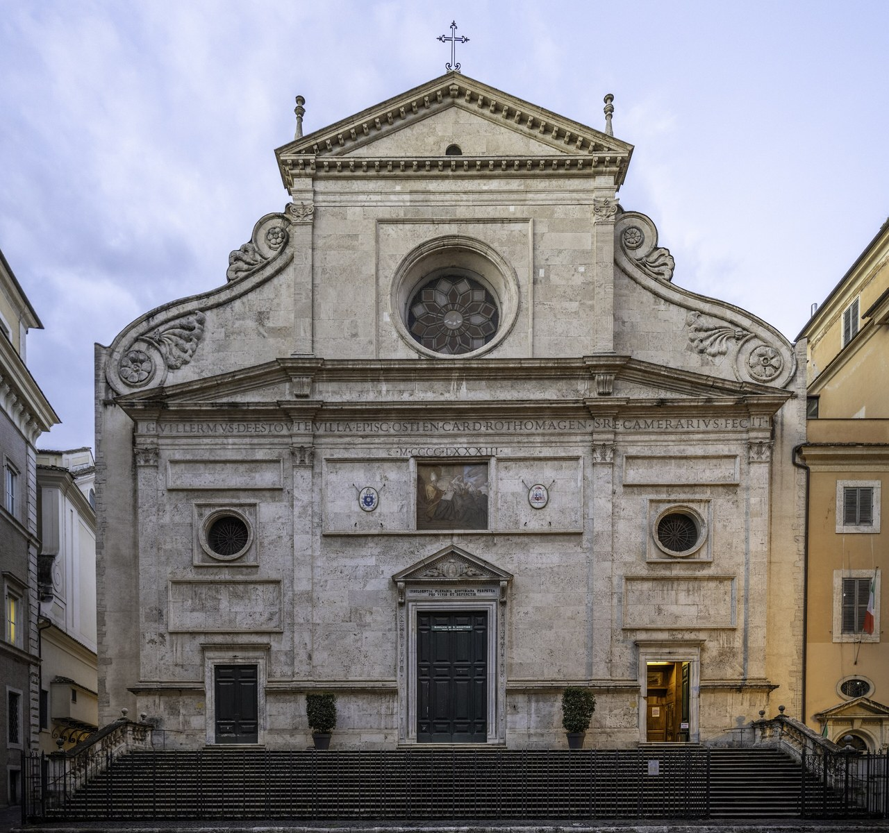</picture>
<figcaption>Sant'Agostino in Campo Marzio, Rome, the Augustinian church that holds the tomb of St Monica and Caravaggio's <em>Madonna di Loreto</em>. Photo: <a href="https://commons.wikimedia.org/wiki/File:Sant%27Agostino,_Rome.jpg">Wilfredor</a>, <a href="https://creativecommons.org/publicdomain/zero/1.0/">CC0</a>, via Wikimedia Commons.</figcaption>
</figure>

<figure class=photo><picture><source srcset="/static/art/augustine-caravaggio-loreto-600.webp 600w,/static/art/augustine-caravaggio-loreto.webp 1280w" sizes="(max-width:760px) 100vw,760px" type="image/webp">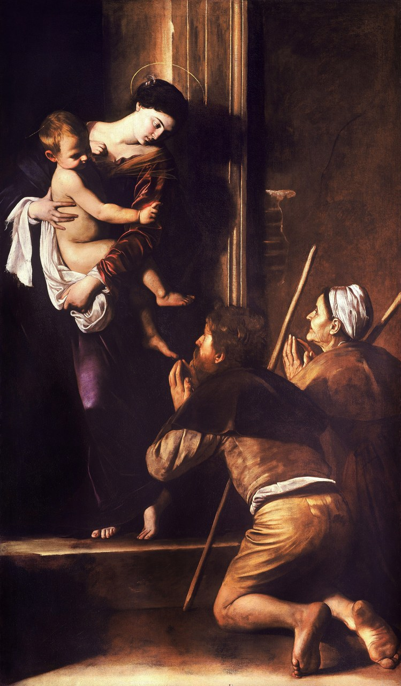</picture>
<figcaption>Caravaggio, <em>Madonna di Loreto</em> (the <em>Madonna dei Pellegrini</em>), about 1604–6, in Sant'Agostino, Rome. Public domain, via <a href="https://commons.wikimedia.org/wiki/File:Madonna_di_Loreto-Caravaggio_(c.1604-6).jpg">Wikimedia Commons</a>.</figcaption>
</figure>

<figure class=photo><picture><source srcset="/static/art/augustine-monica-tomb-600.webp 600w,/static/art/augustine-monica-tomb.webp 1280w" sizes="(max-width:760px) 100vw,760px" type="image/webp">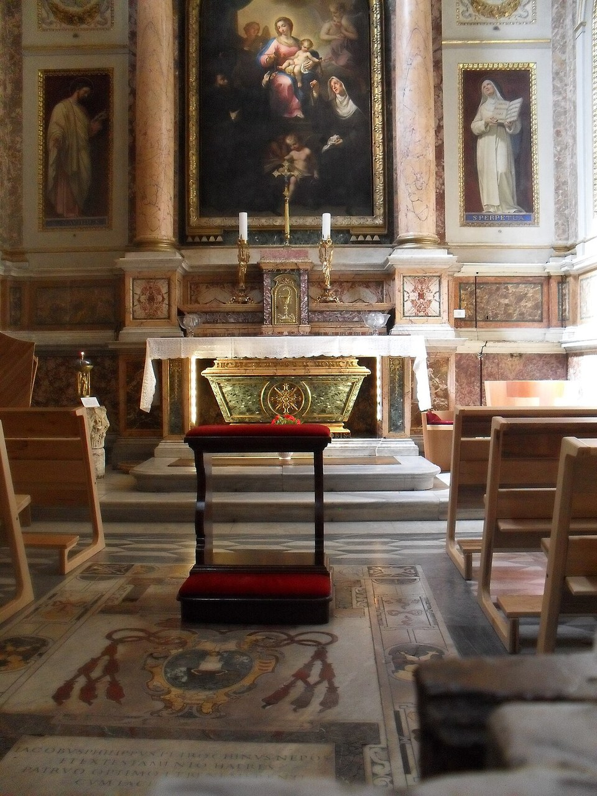</picture>
<figcaption>The tomb of St Monica in her chapel at Sant'Agostino, Rome. Photo: <a href="https://commons.wikimedia.org/wiki/File:Saint_Monica%27s_Tomb.JPG">Quodvultdeus</a>, <a href="https://creativecommons.org/licenses/by-sa/4.0">CC BY-SA 4.0</a>, via Wikimedia Commons.</figcaption>
</figure>

### Basilica of Sant'Ambrogio, Milan

The **Basilica of Sant'Ambrogio** is the church of [St Ambrose](/saints/ambrose/) himself: a great brick church with a wide atrium, two towers, and, in the crypt, the tomb of Ambrose beside the martyrs Gervasius and Protasius. Pilgrims come here to pray at the tomb of the bishop who baptised Augustine. The baptism itself is remembered at the remains of the cathedral baptistery, **San Giovanni alle Fonti**, under the Duomo of Milan, where the octagonal font of Ambrose's church can still be seen. There is not yet a separate pilgrimage page for either church on this site.

<figure class=photo><picture><source srcset="/static/art/augustine-sant-ambrogio-600.webp 600w,/static/art/augustine-sant-ambrogio.webp 1280w" sizes="(max-width:760px) 100vw,760px" type="image/webp">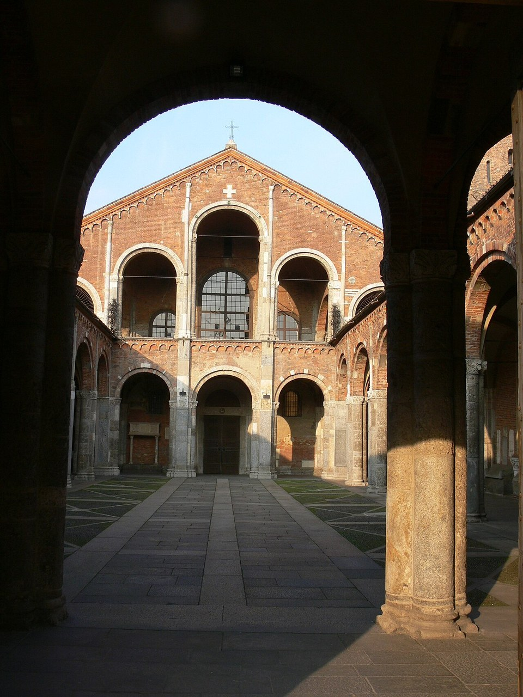</picture>
<figcaption>The atrium of the Basilica of Sant'Ambrogio, Milan, where St Ambrose is buried. Photo: <a href="https://commons.wikimedia.org/wiki/File:Atrio_di_sant%27Ambrogio_a_Milano.jpg">Lorenzo Fratti</a>, <a href="https://creativecommons.org/licenses/by/2.5">CC BY 2.5</a>, via Wikimedia Commons.</figcaption>
</figure>

<figure class=photo><picture><source srcset="/static/art/augustine-milan-baptistery-600.webp 600w,/static/art/augustine-milan-baptistery.webp 1280w" sizes="(max-width:760px) 100vw,760px" type="image/webp">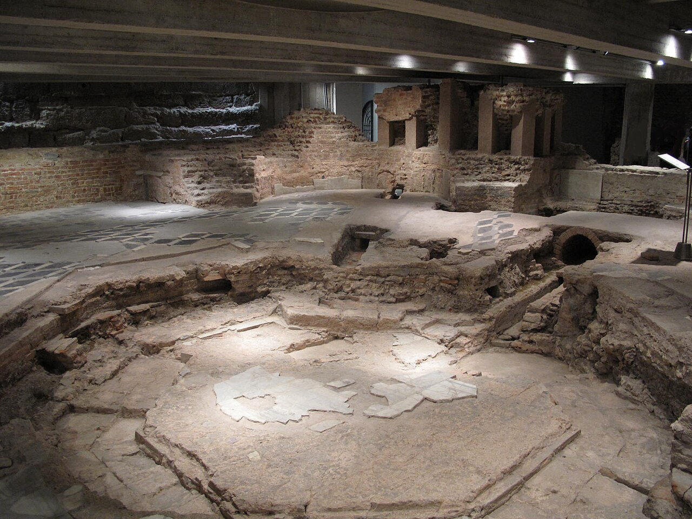</picture>
<figcaption>The remains of the baptistery of San Giovanni alle Fonti, under the Duomo of Milan, where tradition places Augustine's baptism at Easter 387. Photo: <a href="https://commons.wikimedia.org/wiki/File:Baptistery_of_San_Giovanni_alle_Fonti_3r.jpg">A ntv</a>, <a href="https://creativecommons.org/licenses/by-sa/3.0">CC BY-SA 3.0</a>, via Wikimedia Commons.</figcaption>
</figure>

### Ostia, the church of Santa Aurea

Monica died at the port of **Ostia** in 387. Her original epitaph was found in 1945 in the church of **Santa Aurea** at Ostia Antica, and a fragment of it is still kept there. The little brick church, with its rose window and campanile, stands in the old borgo beside the excavations of the Roman port. There is not yet a separate pilgrimage page for Ostia on this site; her tomb, as we have seen, is now in Sant'Agostino in Rome.

<figure class=photo><picture><source srcset="/static/art/augustine-ostia-santa-aurea-600.webp 600w,/static/art/augustine-ostia-santa-aurea.webp 1280w" sizes="(max-width:760px) 100vw,760px" type="image/webp">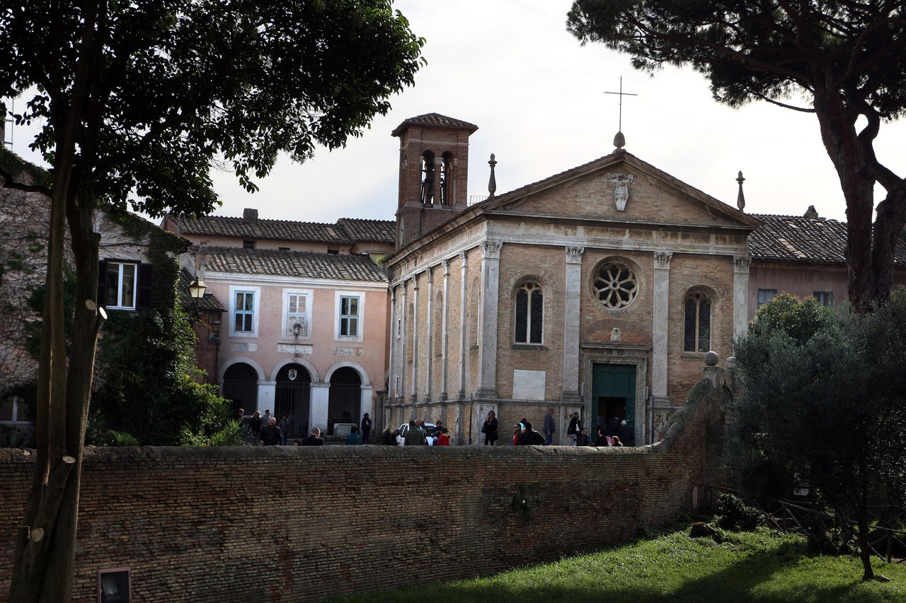</picture>
<figcaption>The church of Santa Aurea, Ostia Antica, where Monica's epitaph was found in 1945. Photo: <a href="https://commons.wikimedia.org/wiki/File:Ostia_antica,_santa_aurea,_00.JPG">Sailko</a>, <a href="https://creativecommons.org/licenses/by/3.0">CC BY 3.0</a>, via Wikimedia Commons.</figcaption>
</figure>

<h2 id=art>Augustine in art</h2>

Artists have loved to paint Augustine as a bishop and a scholar: in his study, with a book or a burning heart, sometimes with Monica, sometimes hearing the child's voice in the garden. A few works have become especially well known.

**Sandro Botticelli**, *St Augustine in His Study*, about 1480, a fresco in the church of **Ognissanti** in Florence. Augustine looks up from his desk, hand on his breast, among books, an astrolabe and a clock: the restless mind at the moment of being caught by God. (Botticelli later painted a smaller panel of Augustine in his cell, now in the Uffizi; the Ognissanti fresco is the one most often meant.)

<figure class=photo><picture><source srcset="/static/art/augustine-botticelli-ognissanti-600.webp 600w,/static/art/augustine-botticelli-ognissanti.webp 1280w" sizes="(max-width:760px) 100vw,760px" type="image/webp">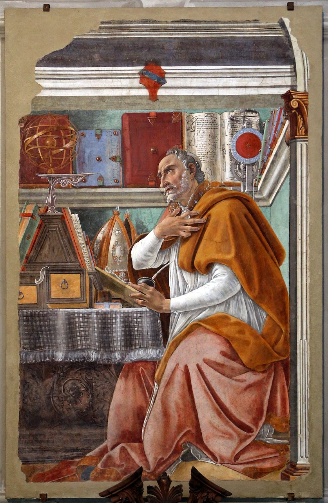</picture>
<figcaption>Sandro Botticelli, <em>St Augustine in His Study</em>, about 1480, fresco in Ognissanti, Florence. Photo: <a href="https://commons.wikimedia.org/wiki/File:Sandro_botticelli,_sant%27agostino_nello_studio,_1480_circa,_dall%27ex-coro_dei_frati_umiliati,_01.jpg">Sailko</a>, <a href="https://creativecommons.org/licenses/by/3.0">CC BY 3.0</a>, via Wikimedia Commons.</figcaption>
</figure>

**Vittore Carpaccio**, *The Vision of St Augustine*, 1502, in the Scuola di San Giorgio degli Schiavoni in Venice. Augustine sits in a wide, quiet study, a little white dog at his feet, at the moment when, by a beloved tradition, he had a vision of St Jerome. The room is full of the tools of a scholar's prayer.

<figure class=photo><picture><source srcset="/static/art/augustine-carpaccio-vision-600.webp 600w,/static/art/augustine-carpaccio-vision.webp 1280w" sizes="(max-width:760px) 100vw,760px" type="image/webp">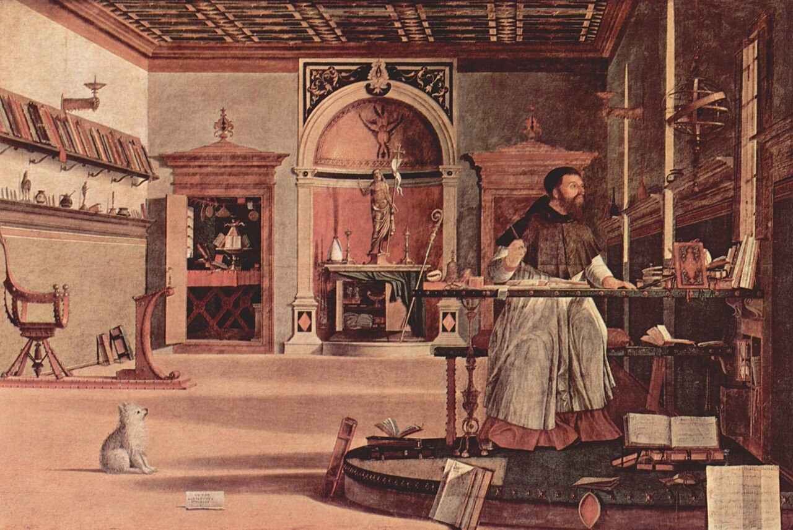</picture>
<figcaption>Vittore Carpaccio, <em>The Vision of St Augustine</em>, 1502, Scuola di San Giorgio degli Schiavoni, Venice. Public domain, via <a href="https://commons.wikimedia.org/wiki/File:Vittore_Carpaccio_026.jpg">Wikimedia Commons</a>.</figcaption>
</figure>

**Benozzo Gozzoli** painted a whole cycle of Augustine's life, in 1464–65, in the choir of the church of Sant'Agostino at **San Gimignano**. The frescoes follow him from the school at Thagaste to his death at Hippo. One of the most beautiful is his departure for Rome: a company on horseback in a Tuscan landscape, with an inscription honouring Augustine as "the most eloquent doctor of sacred speech."

<figure class=photo><picture><source srcset="/static/art/augustine-gozzoli-departure-600.webp 600w,/static/art/augustine-gozzoli-departure.webp 1280w" sizes="(max-width:760px) 100vw,760px" type="image/webp">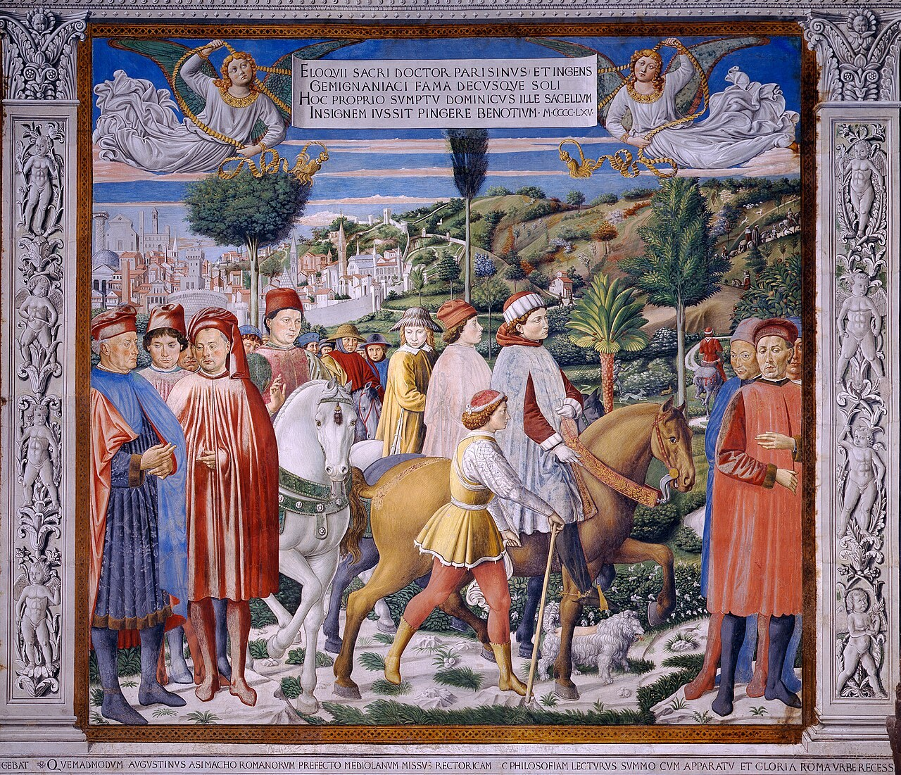</picture>
<figcaption>Benozzo Gozzoli, <em>St Augustine departing for Rome</em>, 1465, in the church of Sant'Agostino, San Gimignano. Public domain, via <a href="https://commons.wikimedia.org/wiki/File:Benozzo_Gozzoli,_Partenza_di_sant%E2%80%99Agostino_per_Roma,_1465,_San_Gimignano,_Chiesa_di_Sant%E2%80%99Agostino.jpg">Wikimedia Commons</a>.</figcaption>
</figure>

**Ary Scheffer**, *Saints Augustine and Monica*, 1854, now in the National Gallery, London (a second version is in the Louvre). Mother and son sit together, looking toward the light: the moment of contemplation at the window in Ostia. A detail of the painting is also the picture at the top of [St Monica's page](/saints/monica/).

<figure class=photo><picture><source srcset="/static/art/saint-monica-600.webp 600w,/static/art/saint-monica.webp 1280w" sizes="(max-width:760px) 100vw,760px" type="image/webp">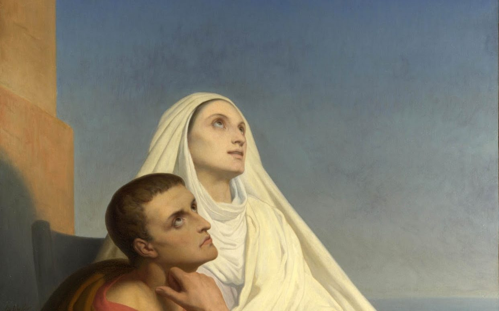</picture>
<figcaption>Ary Scheffer, <em>Saints Augustine and Monica</em>, 1854 (detail). Public domain, via <a href="https://commons.wikimedia.org/wiki/File:Saint_Augustine_and_Saint_Monica.jpg">Wikimedia Commons</a>.</figcaption>
</figure>

**Philippe de Champaigne**, *Saint Augustine*, about 1645–50, the painting at the top of this page. Augustine sits in golden bishop's vestments, a burning heart in one hand and a quill in the other, looking up toward the word *Veritas*, an open Bible beside him: the Doctor at work, and the convert still in love with the Beauty he found so late.

<figure class=photo><picture><source srcset="/static/art/saint-augustine-600.webp 600w,/static/art/saint-augustine.webp 1280w" sizes="(max-width:760px) 100vw,760px" type="image/webp">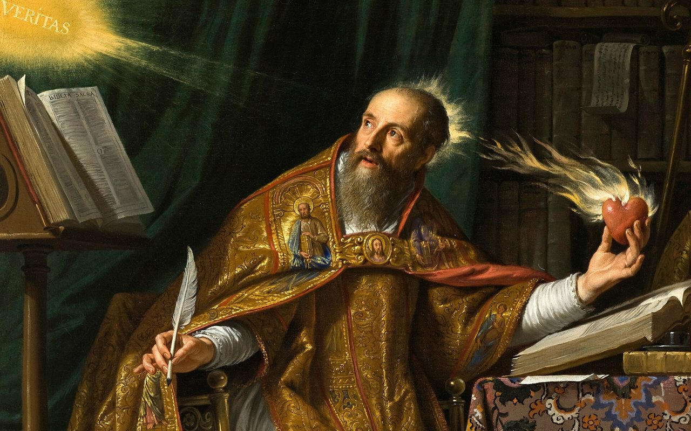</picture>
<figcaption>Philippe de Champaigne, <em>Saint Augustine</em>, about 1645–50. Public domain, via <a href="https://commons.wikimedia.org/wiki/File:Saint_Augustine_by_Philippe_de_Champaigne.jpg">Wikimedia Commons</a>.</figcaption>
</figure>

## Path to sainthood
Venerated immediately after his death (pre-Congregation). Named one of the four original **Doctors of the Church** (with Ambrose, Jerome and Gregory) by **Pope Boniface VIII in 1298**.

## Patronages
Theologians, printers, brewers, and those struggling with sin.

## Trivia
- His famous youthful prayer, told with a smile at his own expense: *"Grant me chastity and continence, but not yet"* (*Confessions* VIII.7).
- The *Confessions* is often called the first true autobiography in the literature of the West.
- His feast falls the day after his mother's (27 August).
- Luther entered the Augustinian order at Erfurt in 1505, and later, as a reformer, still called Augustine "the most reliable of the fathers."

## Sources
- [Benedict XVI, General Audience on St Augustine (9 Jan 2008), vatican.va](https://www.vatican.va/content/benedict-xvi/en/audiences/2008/documents/hf_ben-xvi_aud_20080109.html) — and the series that followed
- [Vatican News: St Augustine](https://www.vaticannews.va/en/saints/08/28/st---augustine--bishop-of-hyppo-and-doctor-of-the-church.html)
- [Catholic Encyclopedia: St Augustine](https://www.newadvent.org/cathen/02084a.htm) · [St Monica](https://www.newadvent.org/cathen/10482a.htm) · [Rule of St Augustine](https://www.newadvent.org/cathen/02079b.htm)
- [The Confessions and The City of God, at New Advent](https://www.newadvent.org/fathers/1101.htm)
- [St Monica](/saints/monica/) · [St Ambrose](/saints/ambrose/) · [St Rita of Cascia](/saints/rita-of-cascia/) · [St Paul](/saints/paul/)
- [Via Francigena: Pavia and San Pietro in Ciel d'Oro](/pilgrimage/via-francigena/tuscany/)
- [Basilica of Sant'Ambrogio, Milan](https://www.basilicasantambrogio.it/) · [Veneranda Fabbrica del Duomo: the archaeological area](https://www.duomomilano.it/en/)
- [Order of St Augustine](https://www.augustinian.org/)
- Britannica is also useful for further reading: [St Augustine](https://www.britannica.com/biography/Saint-Augustine)

Fact-checked on November 17, 2026 against Vatican documents (including Benedict XVI's audiences on St Augustine), Vatican News, New Advent (Catholic Encyclopedia and the Fathers), and the pilgrimage and sanctuary sources named above. Scripture is quoted from the KJV and the Vulgate. The English of the Confessions and The City of God follows traditional public-domain renderings. Where a place is identified by later tradition (Cassiciacum, the Milan baptistery), the text says so. The Daily Word queue and Advent calendar are unchanged. Feast days follow the General Roman Calendar.

