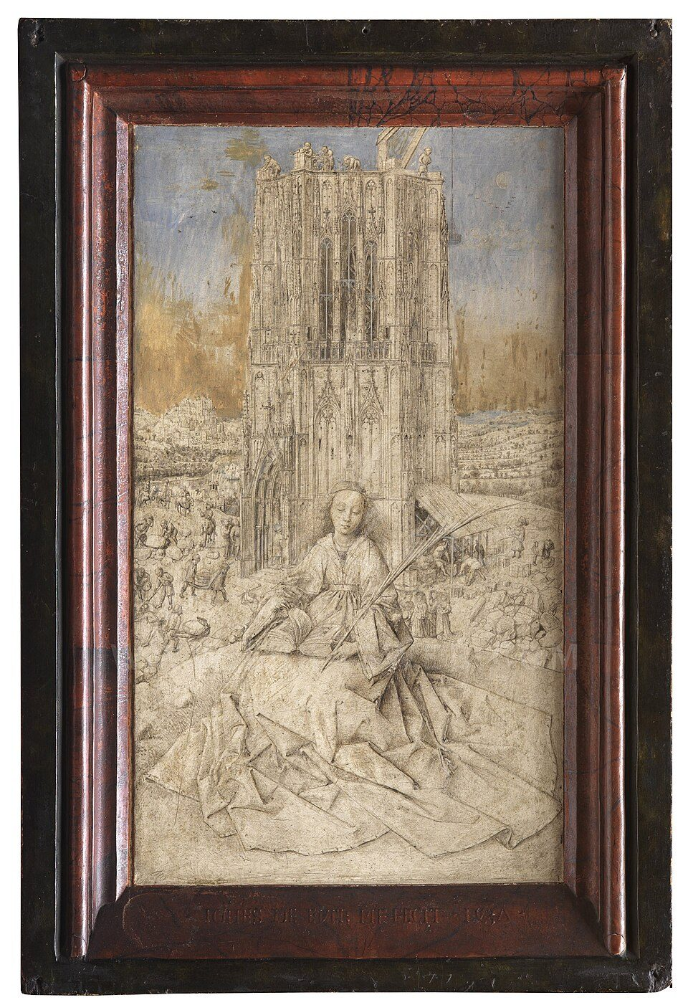

## The story
Barbara was, in legend, the beautiful daughter of a rich pagan, **Dioscorus**, who locked her in a tower to keep her from suitors. While he was away she became a Christian and had a third window put in the bath house he was building, in honour of the Holy Trinity.

## The full story

### The lightning
When her father discovered her faith, he denounced her to the governor. She was tortured, and her father himself beheaded her on a mountain. On the way down he was struck by **lightning** and burned to ashes. So she became patron of everyone who works with sudden fire and explosions: artillerymen, miners, firefighters and explosives workers. The powder magazine on a Spanish or Italian warship is still called the *santabárbara*. She remains in the Roman Martyrology, and she is especially loved in the Eastern Churches and in mining regions.

### Barbara branches
In Germany and Central Europe, cherry branches cut on her feast, 4 December, and put in water are expected to blossom by Christmas, the "Barbara branches" (*Barbarazweige*), a sign of new life in winter. Her passion comes down late. The calendar of 1969 left the universal feast to the churches that still keep her.

## Path to sainthood
Pre-Congregation saint; feast removed from the universal calendar in 1969.

## Patronages
Artillery, miners, firefighters, mathematicians, architects, sudden death.

## Trivia
- She is one of the Fourteen Holy Helpers.
- Paintings show her with a three-windowed tower.
- Santa Barbara, California, is named after her.

<figure class=photo>
<picture><source srcset="/static/art/barbara-van-eyck-600.webp 600w,/static/art/barbara-van-eyck.webp 1280w" sizes="(max-width:760px) 100vw,760px" type="image/webp"></picture>
<figcaption>Jan van Eyck, <em>Saint Barbara</em>, 1437, Royal Museum of Fine Arts Antwerp. The tower of her story, and the palm of a martyr. Public domain, via <a href="https://commons.wikimedia.org/wiki/File:Saint_Barbara_of_Nicodemia_-_Jan_van_Eyck_-_1437.jpg">Wikimedia Commons</a>.</figcaption>
</figure>

## Sources
- [Catholic Encyclopedia: St Barbara](https://www.newadvent.org/cathen/02284d.htm)

Written October 16, 2026 from the sources above, with van Eyck's drawing added November 6, 2026. Feast days follow the General Roman Calendar unless noted.

