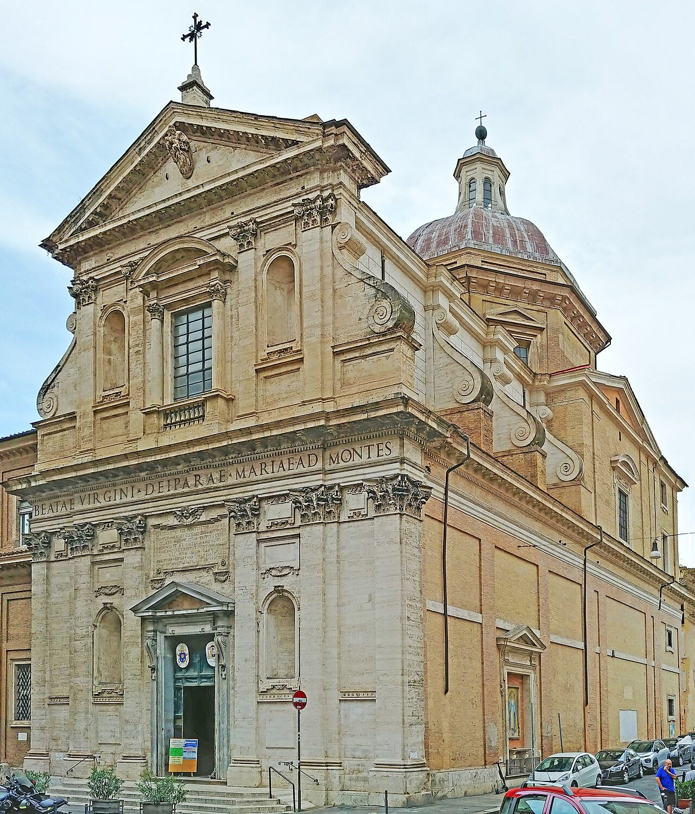

## The story
Benedict Joseph was the eldest of 15 children of a shopkeeper in **Amettes**, northern France. He tried to join the Trappists, Carthusians and Cistercians, and was turned away by all of them as too young, too odd, or too sickly.

## The full story

### A pilgrim of the roads
So he became a pilgrim instead. For seven years he walked thousands of kilometres across Europe, to Loreto, Assisi, Einsiedeln, Santiago de Compostela and the great shrines of Italy and France, sleeping outside, wearing rags, eating what he was given and giving most of it away. He spent his last years in **Rome**, sleeping in a niche in the ruins of the **Colosseum** and praying all day in churches, especially at the Forty Hours' adoration. Romans called him "the saint of the Forty Hours" and "the beggar of the Colosseum".

### Death in Holy Week
He collapsed on the steps of Santa Maria dei Monti on Wednesday of Holy Week **1783** and died in a nearby butcher's house. Children ran through the streets crying "The saint is dead!" Over 130 miracles were reported in the following months. His confessor, Fr Marconi, wrote his life soon afterwards.

<figure class=photo>
<picture><source srcset="/static/art/labre-monti-600.webp 600w,/static/art/labre-monti.webp 1280w" sizes="(max-width:760px) 100vw,760px" type="image/webp"></picture>
<figcaption>Santa Maria ai Monti in Rome, where he collapsed, and where his tomb is kept. Photo: <a href="https://commons.wikimedia.org/wiki/File:Roma,_chiesa_di_Santa_Maria_ai_Monti_-_Esterno.jpg">Pufui PcPifpef</a>, <a href="https://creativecommons.org/licenses/by-sa/4.0">CC BY-SA 4.0</a>, via Wikimedia Commons.</figcaption>
</figure>

## Path to sainthood
Canonised 1881 by Leo XIII.

## Patronages
The homeless, beggars, pilgrims, people with mental illness.

## Trivia
- He walked the Camino to Santiago, making him a patron of Camino pilgrims too.
- His tomb is in Santa Maria ai Monti in Rome.

## Sources
- [Catholic Encyclopedia: St Benedict Joseph Labre](https://www.newadvent.org/cathen/02442a.htm)

Written October 16, 2026 from the sources above. The church photograph was added November 6, 2026. Feast days follow the General Roman Calendar unless noted.

