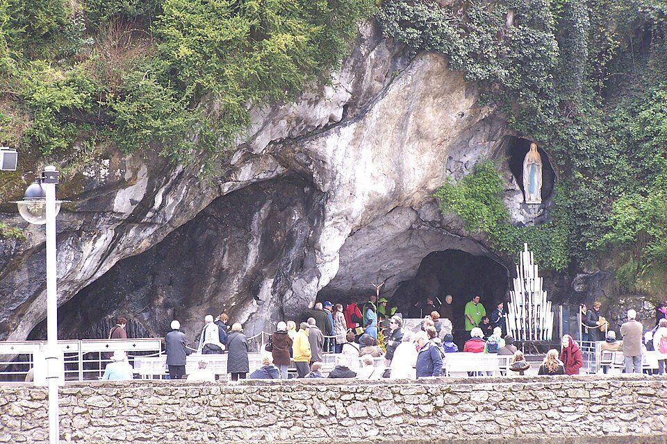

## The story
Bernadette was the eldest child of a miller ruined by poverty, living in the town's former prison cell, the *cachot*, in **Lourdes**. Sickly with asthma and barely able to read, on **11 February 1858**, aged 14, she was gathering firewood at the grotto of **Massabielle** when she saw "a lady" dressed in white with a blue sash and yellow roses at her feet.

## The full story

### The apparitions
The Lady appeared 18 times between February and July 1858. She asked for prayer and penance, told Bernadette to dig in the ground, where a **spring** appeared that still flows, and asked for a chapel to be built and processions to come. On 25 March she gave her name in the local dialect: "***Que soy era Immaculada Councepciou***" ("I am the Immaculate Conception"), a phrase Bernadette did not understand. The bishop recognised the apparitions in 1862. (See our [Lourdes](/pilgrimage/marian-shrines/lourdes/) page.)

<figure class=photo>
<picture><source srcset="/static/art/bernadette-grotto-600.webp 600w,/static/art/bernadette-grotto.webp 1280w" sizes="(max-width:760px) 100vw,760px" type="image/webp"></picture>
<figcaption>The grotto of Massabielle at Lourdes, where Bernadette saw the Lady, and where the spring still flows. Photo: <a href="https://commons.wikimedia.org/wiki/File:Grotto_of_Massabielle_Lourdes.jpg">Preacherdoc</a>, <a href="https://creativecommons.org/licenses/by-sa/4.0">CC BY-SA 4.0</a>, via Wikimedia Commons.</figcaption>
</figure>

### Nevers
Bernadette refused all attention. In 1866 she joined the **Sisters of Charity** at Nevers, where she worked as a nurse and sacristan and suffered tuberculosis of the bone. "I am like a broom: the Virgin used me, then put me back in my corner." She died on 16 April 1879, aged 35. Church and civil authorities questioned her many times, and she did not change her account. Her body was exhumed three times, in 1909, 1919, and 1925, and found remarkably preserved. The face and hands now visible are covered with a thin wax layer.

## Path to sainthood
Beatified 1925 and canonised 8 December 1933 by Pius XI. She was canonised for the holiness of her life, not for the visions.

## Patronages
Lourdes, the sick, people ridiculed for their faith, poverty.

## Trivia
- Her body lies in a glass reliquary in the chapel of the Espace Bernadette in Nevers.
- Franz Werfel's novel *The Song of Bernadette* (1941) became an Oscar-winning film in 1943.

## Sources
- [Sanctuary of Lourdes: Bernadette Soubirous](https://www.lourdes-france.com/en/bernadette-soubirous/)
- [Catholic Encyclopedia: Lourdes](https://www.newadvent.org/cathen/09389b.htm)

Written October 16, 2026 from the sources above. The grotto photograph was added November 6, 2026. Feast days follow the General Roman Calendar unless noted.

