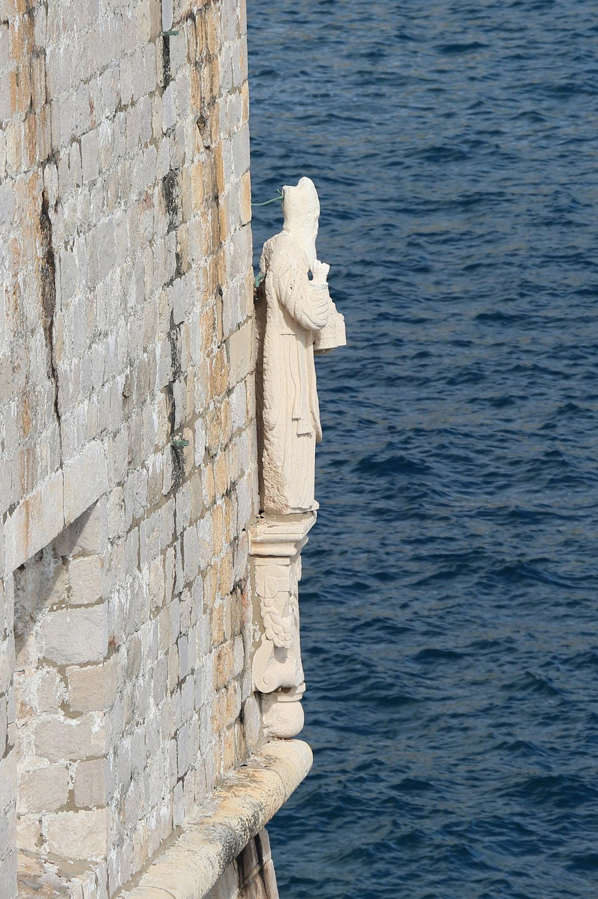

## The story
Blaise was bishop of **Sebaste** in Armenia (today Sivas, Turkey) and was martyred in the early 4th century, probably under the emperor Licinius. His *Acts* were written centuries later. The Church has kept him as a martyr bishop, and the blessing of throats is how that memory is still prayed, in the East and in the West.

## The full story

### The fish bone
The *Acts* say that Blaise, hiding in a cave from persecution, was visited by wild animals that he healed. When he was arrested and led to prison, a mother brought her son, who was choking on a **fish bone**. Blaise prayed over him and the boy was cured. A poor woman whose pig had been taken by a wolf got it back through his prayers; she later brought candles to his cell.

### The blessing of throats
So on his feast, 3 February, Catholics receive the **blessing of throats**: the priest holds two crossed candles to the throat and prays, "Through the intercession of St Blaise, bishop and martyr, may God deliver you from every disease of the throat and from every other illness." He was martyred by being torn with iron wool combs, then beheaded.

<figure class=photo>
<picture><source srcset="/static/art/blaise-dubrovnik-600.webp 600w,/static/art/blaise-dubrovnik.webp 1280w" sizes="(max-width:760px) 100vw,760px" type="image/webp"></picture>
<figcaption>St Blaise on the Sveta Margarita tower of the walls of Dubrovnik, the city that has kept his festival since 972. Photo: <a href="https://commons.wikimedia.org/wiki/File:Statue_of_St._Blaise%2C_Dubrovnik_01.jpg">Bernard Gagnon</a>, <a href="https://creativecommons.org/licenses/by-sa/4.0">CC BY-SA 4.0</a>, via Wikimedia Commons.</figcaption>
</figure>

## Path to sainthood
Pre-Congregation saint.

## Patronages
Throat illness, wool combers, animals, Dubrovnik (Croatia).

## Trivia
- He is the patron of **Dubrovnik**, whose walls carry his statue; the city has kept his festival since 972.
- He is one of the Fourteen Holy Helpers.

## Sources
- [Catholic Encyclopedia: St Blaise](https://www.newadvent.org/cathen/02592a.htm)

Written October 16, 2026 from the sources above. The Dubrovnik photograph was added November 6, 2026. Feast days follow the General Roman Calendar unless noted.

