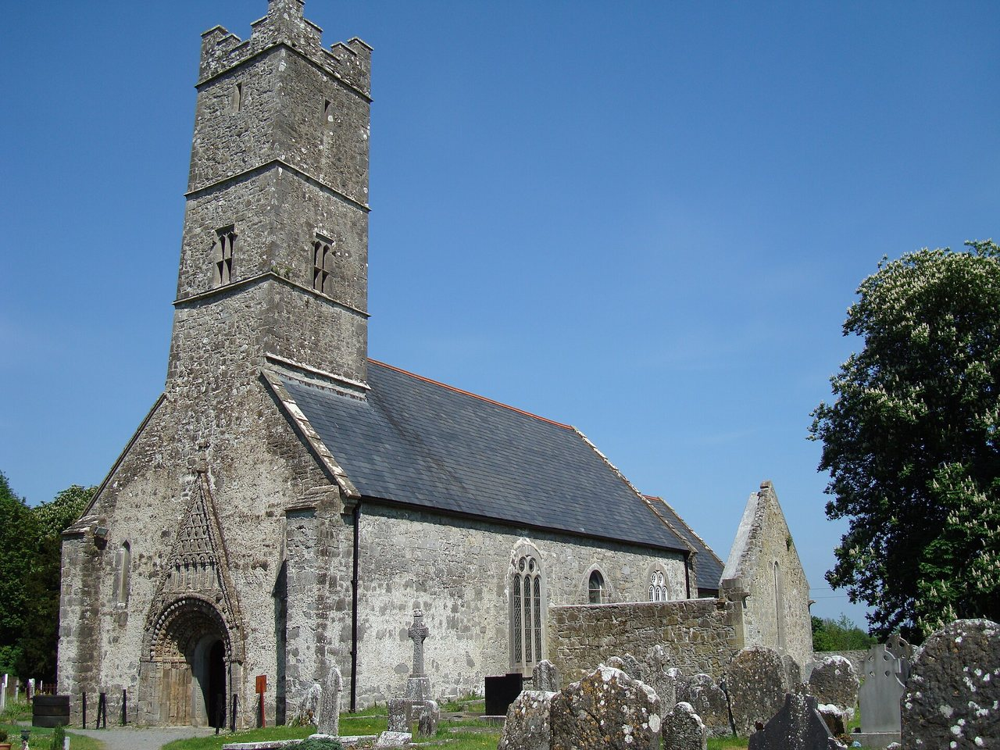

## The story
Brendan was born near **Tralee** in Co. Kerry and became a monk and abbot. He founded monasteries, the greatest at **Clonfert** (Co. Galway), where he is buried. Like many Irish monks he travelled by sea, to the Scottish islands and probably to Wales and Brittany.

## The full story

### The Voyage
His fame comes from the ***Navigatio Sancti Brendani*** (Voyage of St Brendan), a Latin work of about the 9th–10th century, one of the best-loved books of the Middle Ages. It tells how Brendan and fourteen monks sailed west in a skin-covered boat in search of the **Promised Land of the Saints**. They spent seven years among wondrous islands: an island of sheep, the Paradise of Birds where birds sang the Hours, a crystal column in the sea (perhaps an iceberg), a mountain that threw fire (perhaps a volcano), and an island that turned out to be a whale.

### Mass on the whale
On Easter morning the monks landed on a bare, black island, said Mass and lit a fire to cook. The island moved: it was the great fish **Jasconius**. They escaped, and returned to celebrate Easter on its back every year of the voyage. Brendan himself, and the monasteries, are the history. The *Navigatio* is the voyage the Middle Ages loved, not a ship's log. It also remembers that Irish monks reached the Faroes and Iceland before the Vikings. In **1976–77** the explorer **Tim Severin** sailed a replica leather boat from Ireland to Newfoundland, and showed that such a crossing could be made.

<figure class=photo>
<picture><source srcset="/static/art/brendan-clonfert-600.webp 600w,/static/art/brendan-clonfert.webp 1280w" sizes="(max-width:760px) 100vw,760px" type="image/webp"></picture>
<figcaption>St Brendan's Cathedral at Clonfert, where he is buried. The church now standing is medieval. Photo: <a href="https://commons.wikimedia.org/wiki/File:ClonfertCathedral.JPG">JohnArmagh</a>, public domain, via Wikimedia Commons.</figcaption>
</figure>

## Path to sainthood
Pre-Congregation saint.

## Patronages
Sailors, mariners, travellers, whales (popular), the diocese of Kerry and Clonfert.

## Trivia
- Medieval maps showed "St Brendan's Island" in the Atlantic well into the 18th century.
- Severin's boat, the *Brendan*, is displayed at Craggaunowen, Co. Clare.

## Sources
- [Catholic Encyclopedia: St Brendan](https://www.newadvent.org/cathen/02758c.htm)

Written October 16, 2026 from the sources above. The Clonfert photograph was added November 6, 2026. Feast days follow the General Roman Calendar unless noted.

