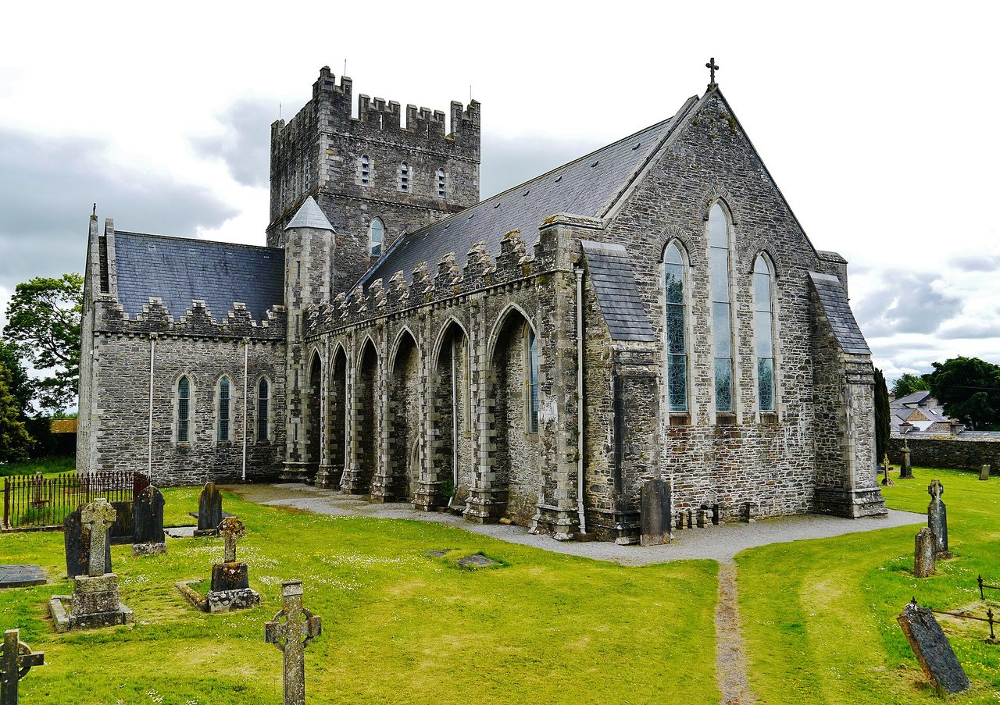

## The story
Brigid is, with Patrick and Columba, one of the three patron saints of Ireland. Tradition says she was born in Faughart, near Dundalk, to a chieftain and a slave woman, was famous for giving everything away, and founded a double monastery for women and men at **Kildare** (*Cill Dara*, "church of the oak"), about 480. Her first *Life*, by the monk Cogitosus, was written about 650.

## The full story

### The cloak
The best-known story says Brigid asked the King of Leinster for land to build her monastery. He laughed and said she could have as much as her cloak would cover. She spread it on the ground, and it grew until it covered the whole Curragh plain. Other stories tell of butter that never ran out, a lake of beer for visiting clergy, and her cross.

### Brigid's cross
She is said to have woven a cross out of rushes while sitting with a dying pagan chieftain, explaining the faith to him; he was baptised before he died. Irish households still weave **St Brigid's crosses** on 1 February and hang them over the door. Her monastery kept a perpetual fire, tended by nuns, until the Reformation; the flame was relit in Kildare in 1993. She lived, and she founded Kildare. Much of the detail comes from lives written later. Her feast falls on **Imbolc**, the old festival of spring, and she shares a name with a goddess of that season, so some household customs may be older ones that the Church took up and made Christian.

<figure class=photo>
<picture><source srcset="/static/art/brigid-kildare-600.webp 600w,/static/art/brigid-kildare.webp 1280w" sizes="(max-width:760px) 100vw,760px" type="image/webp"></picture>
<figcaption>St Brigid's Cathedral at Kildare, on the ground of the monastery she founded. The church now standing is medieval. Photo: <a href="https://commons.wikimedia.org/wiki/File:Kildare_Cathedral_Church_of_St._Brigid_Exterior_North_West_Side_5.jpg">Zairon</a>, <a href="https://creativecommons.org/licenses/by/4.0">CC BY 4.0</a>, via Wikimedia Commons.</figcaption>
</figure>

## Path to sainthood
Pre-Congregation saint.

## Patronages
Ireland, dairy workers, midwives, newborns, poets.

## Trivia
- Since 2023 Ireland has a public holiday on or near 1 February in her honour, the first named after a woman.
- Her head is said to be kept in a church in Lumiar, Lisbon.

## Sources
- [Catholic Encyclopedia: St Brigid of Ireland](https://www.newadvent.org/cathen/02784b.htm)

Written October 16, 2026 from the sources above. The Kildare photograph was added November 6, 2026. Feast days follow the General Roman Calendar unless noted.

