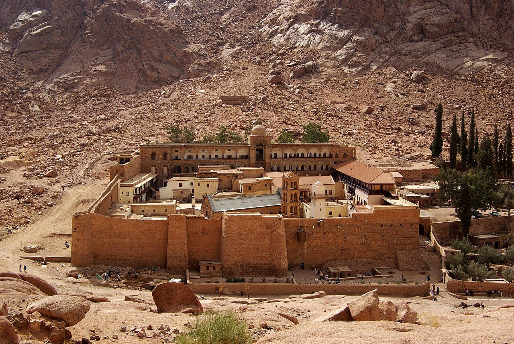

## Her story
Catherine of Alexandria is one of the most painted saints in Europe, and one of the least documented. No contemporary writer names her. Eusebius describes a noble Christian woman of Alexandria who resisted the emperor Maximinus; later readers wanted that woman to be Catherine. The texts do not say so.

What the medieval West and the Christian East actually knew was her **passion**, a legend that grew between the fifth century and the *Golden Legend*. She was a young scholar, daughter of a king in the telling, who went to the emperor Maxentius and argued him down. He called fifty philosophers. She converted them, and he had the philosophers burned. He wanted to marry her, or to break her. She refused. He built a machine of four spiked wheels turning against each other. At her prayer the wheel shattered and the pieces killed the executioners. She was beheaded. From the wound, the legend says, milk flowed instead of blood. Angels carried her body to **Mount Sinai**.

**Justinian** built a fortified monastery at the foot of Sinai in the sixth century, the monastery of the Burning Bush, later called the **Monastery of St Catherine**. It still stands, with one of the oldest working libraries in the world, and it keeps what it holds as her relics. Pilgrims have climbed to it for centuries. Her passion is why the house bears her name.

<figure class=photo>
<picture><source srcset="/static/art/catherine-sinai-600.webp 600w,/static/art/catherine-sinai.webp 1280w" sizes="(max-width:760px) 100vw,760px" type="image/webp"></picture>
<figcaption>The Monastery of St Catherine at the foot of Mount Sinai. Photo: <a href="https://commons.wikimedia.org/wiki/File:Katharinenkloster_Sinai_BW_2.jpg">Berthold Werner</a>, <a href="https://creativecommons.org/licenses/by-sa/3.0">CC BY-SA 3.0</a>, via Wikimedia Commons.</figcaption>
</figure>

She was one of the **Fourteen Holy Helpers**. Joan of Arc said Catherine's was one of the voices that sent her to Orléans. Universities, especially Paris, took a woman who had out-argued fifty philosophers as a patron of students. Painters gave her a wheel, a book and a sword. Caravaggio's Catherine leans on the broken wheel in a white shirt, the sword across her lap, looking nothing like a person who has just won an argument and everything like a person who knows what the argument will cost.

In the **1969** reform of the calendar her feast was dropped from the universal calendar, because so little could be known of her. In **2002** John Paul II put her back, as an optional memorial on **25 November**. She was not "de-canonised" in 1969. She was left to local calendars, and then restored.

## Path to sainthood
Pre-Congregation, by long popular devotion in East and West. Optional memorial on the General Roman Calendar since 2002.

## Patronages
Students, philosophers, librarians, preachers, young women, wheelwrights, and anyone whose work turns. Also the University of Paris in the old tradition, and millers.

## Trivia
- A Catherine wheel, the spinning firework, takes its name from the spiked wheel of the legend.
- The Sinai monastery was never captured in the Arab conquests. Its library still holds the *Codex Sinaiticus* leaves that did not go to London, Leipzig and St Petersburg, and icons older than almost any in Europe.
- She is not [Catherine of Siena](/saints/catherine-of-siena/). The two share a name, a book and a habit of being painted with a lily or a wheel, and otherwise nothing.

## Sources
- [Vatican News: saints of 25 November (St Catherine of Alexandria)](https://www.vaticannews.va/en/saints/11/25.html)
- [Catholic Encyclopedia: St Catherine of Alexandria](https://www.newadvent.org/cathen/03445a.htm)

Fact-checked on November 2, 2026 against Vatican News and New Advent (Catholic Encyclopedia). The Sinai photograph was added November 6, 2026. Feast days follow the General Roman Calendar unless noted.

