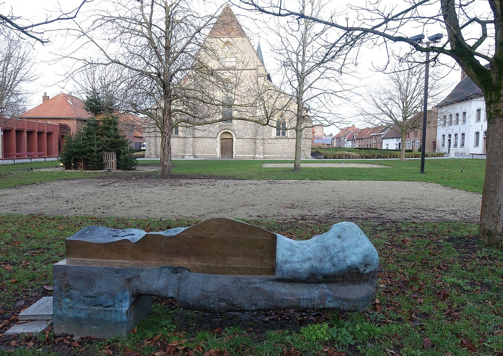

## The story
Christina was an orphaned peasant girl from **Brustem**, near Sint-Truiden in today's Belgium. Almost everything we know comes from a *Life* written about 1232 by the Dominican **Thomas of Cantimpré**, who said he had spoken with people who knew her. Cardinal Jacques de Vitry also mentions her.

## The full story

### The funeral
According to Thomas, Christina died of a seizure at about 22. During her funeral Mass, in the open coffin, she sat up and rose to the rafters of the church. The congregation fled. The priest coaxed her down. She said she had seen hell, purgatory and heaven, and had been offered the choice of staying in heaven or returning to suffer for the souls in purgatory. She chose to return.

### A strange life
She could not bear the smell of human beings, Thomas says, and climbed trees, church towers and rocks to escape it. She threw herself into ovens and freezing rivers, prayed balanced on fence posts, and was chained up by her family, who thought her mad. Later in life she grew calmer and was sought out for advice, including by Count Louis of Looz. She died at the convent of St Catherine in Sint-Truiden in 1224. Thomas wrote to teach the mercy of purgatory, from people who had known her. Christina was a real woman of that town, and Sint-Truiden has kept her.

<figure class=photo>
<picture><source srcset="/static/art/christina-truiden-600.webp 600w,/static/art/christina-truiden.webp 1280w" sizes="(max-width:760px) 100vw,760px" type="image/webp"></picture>
<figcaption>Johan Creten, <em>Christina Mirabilis</em>, 2012, in the beguinage of Sint-Truiden. A modern homage in the town that keeps her, not a portrait from her lifetime. Photo: <a href="https://commons.wikimedia.org/wiki/File:Johan_Creten_Christina_Mirabilis_Sint-Truiden_02.jpg">Eebie</a>, <a href="https://creativecommons.org/licenses/by-sa/4.0">CC BY-SA 4.0</a>, via Wikimedia Commons.</figcaption>
</figure>

## Path to sainthood
Never formally canonised; venerated locally in the diocese of Liège and in the Roman Martyrology tradition of the Low Countries.

## Patronages
Mental illness, therapists, psychiatrists (popular patronage).

## Trivia
- Nick Cave wrote a song, "Christina the Astonishing" (1996), about her.
- Her relics are at the Redemptorist church in Sint-Truiden.

## Sources
- Thomas of Cantimpré, *Vita Christinae Mirabilis* (c. 1232), in *Acta Sanctorum*, July, vol. 5.
- [Wikipedia: Christina the Astonishing (overview with scholarly references)](https://en.wikipedia.org/wiki/Christina_the_Astonishing)

Written October 16, 2026 from the sources above. The Sint-Truiden photograph was added November 6, 2026. Feast days follow the General Roman Calendar unless noted.

