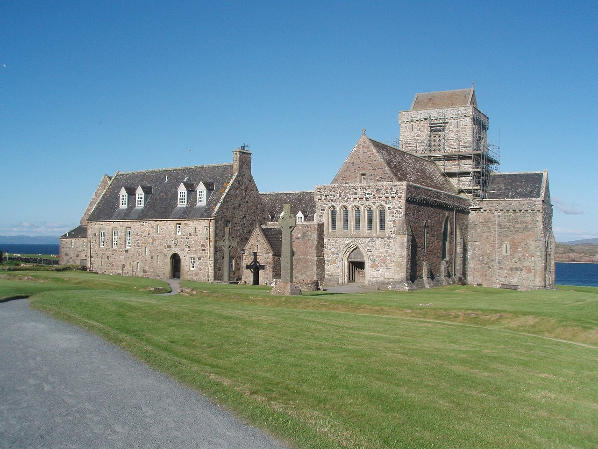

## The story
Columba (Colum Cille, "dove of the church") was born into the royal Uí Néill family in Donegal in **521**, trained as a monk and founded monasteries at Derry and Durrow. In **563**, with twelve companions, he left Ireland for the island of **Iona** off Scotland. Tradition says this was a penance after a quarrel over a copied psalter led to the battle of Cúl Dreimhne. From Iona he and his monks preached to the Picts and the Gaels, and Iona became one of the great centres of Christian learning in Europe.

## The full story

### The beast in the River Ness
His *Life* by **Adomnán**, ninth abbot of Iona (written about 700), tells that Columba came to the **River Ness** and found people burying a man who had been bitten by a "water beast". He sent a companion to swim across. The beast surged up with a roar, mouth open. Columba made the sign of the cross and commanded: "You will go no further. Do not touch the man. Go back at once." The beast fled "as if pulled back with ropes". This is the earliest written story of the creature now called **Nessie**.

### Iona
Columba died in the abbey church on Iona at night on **9 June 597**, the year St Augustine landed in Kent. Iona sent out St Aidan to found Lindisfarne in 635 (see our [St Cuthbert's Way](/pilgrimage/st-cuthbert/) pages). The *Book of Kells* was probably begun there. Adomnán wrote the *Life* about 700, using earlier sources, which is why Columba's mission is so well known. The beast is one of the wonders in that *Life*. It rose in the **River Ness**, not in the loch.

<figure class=photo>
<picture><source srcset="/static/art/columba-iona-600.webp 600w,/static/art/columba-iona.webp 1280w" sizes="(max-width:760px) 100vw,760px" type="image/webp"></picture>
<figcaption>Iona Abbey, the monastery he founded in 563. The church now standing is medieval. Photo: <a href="https://commons.wikimedia.org/wiki/File:Iona_Abbey_-_July_2011.jpeg">Akela NDE</a>, <a href="https://creativecommons.org/licenses/by-sa/2.0/fr/">CC BY-SA 2.0</a>, via Wikimedia Commons.</figcaption>
</figure>

## Path to sainthood
Pre-Congregation saint.

## Patronages
Ireland, Scotland, Derry, poets, bookbinders.

## Trivia
- The ecumenical **Iona Community** has lived and prayed in the restored abbey since 1938.
- A famous ruling attributed to the psalter dispute, "to every cow its calf, to every book its copy", is often called the first copyright case.

## Sources
- [Catholic Encyclopedia: St Columba](https://www.newadvent.org/cathen/04136a.htm)

Written October 16, 2026 from the sources above. The Iona photograph was added November 6, 2026. Feast days follow the General Roman Calendar unless noted.

