<nav class=toc aria-label="On this page">

On this page

<ol>
<li><a href="#why">Why the Church honours him</a></li>
<li><a href="#birth">"Among the prophets of God": a royal birth</a></li>
<li><a href="#boy">The dove of the church</a></li>
<li><a href="#schools">Scholar, deacon, priest</a></li>
<li><a href="#founder">"Full of white angels": Derry, Durrow and Kells</a></li>
<li><a href="#cathach">"To every cow its calf"</a></li>
<li><a href="#battle">Cúl Dreimhne and the penance of exile</a></li>
<li><a href="#voyage">"For the love of Christ": the voyage of 563</a></li>
<li><a href="#iona">The island of the dove</a></li>
<li><a href="#gate">The gate of King Bridei</a></li>
<li><a href="#ness">The beast in the River Ness</a></li>
<li><a href="#druid">The white pebble and the druid's wind</a></li>
<li><a href="#prophet">"As in one ray of the sun"</a></li>
<li><a href="#light">Fire from heaven</a></li>
<li><a href="#kings">The book of glass and the poets</a></li>
<li><a href="#books">Books the water could not touch</a></li>
<li><a href="#horse">The white horse weeps</a></li>
<li><a href="#death">"Where art thou, father?"</a></li>
<li><a href="#glory">A pillar of fire over Iona</a></li>
<li><a href="#relics">His relics and the Brecbennoch</a></li>
<li><a href="#kells">The Book of Kells</a></li>
<li><a href="#northumbria">From Iona to Lindisfarne</a></li>
<li><a href="#places">His places and churches</a></li>
<li><a href="#art">Columba in art</a></li>
</ol>
</nav>

## His story

Before he was born, his mother saw an angel. He brought her a robe so lovely that it seemed woven from the colours of all the flowers, and then he took it back and let it go into the air. It spread wider than the plains, wider than the mountains and the forests, until she could no longer see where it ended. "Woman, do not grieve," the angel told her. "You shall bear a son, so splendid that he will be counted among the prophets of God, and he has been chosen by God to lead innumerable souls to the heavenly country."

The child was Colum, a prince of the royal Uí Néill, born at Gartan in the hills of Donegal in 521. Ireland called him **Colum Cille**, "the dove of the church". He grew into a tall, fiery, gifted monk, a poet and a scribe, who covered Ireland with monasteries before he was forty: Derry in its oak grove, Durrow in the plain, Kells in the rich lands of Meath. Then, by an old and much-loved tradition, a quarrel over a copied book led to a battle and the deaths of many men, and Columba laid a penance on himself. He would leave Ireland for ever, and win for Christ as many souls as had been lost.

In 563 he sailed with twelve companions in a little boat of wicker and hides to the island of **Iona**, off the western tip of Mull. From that small island, for thirty-four years, he preached Christ to the Gaels of Dál Riata and to the pagan Picts of the north. The gate of the Pictish king flew open at his touch. The beast in the River Ness fled from the sign of the cross. Angels stood around him in the fields, and heavenly light filled the church when he prayed. He died before the altar on Iona at midnight on **9 June 597**, blessing his monks with his last strength. From his island came the Book of Kells, and the monks who carried the Gospel to the English of Northumbria. Ireland and Scotland have loved him ever since.

### 7 December 521 · Born at Gartan
Colum is born in Donegal to Fedlimid of the Cenél Conaill, great-great-grandson of Niall of the Nine Hostages, and to Eithne, after the angel's vision of the robe.

### Childhood · The ball of fire
Baptised by the priest Cruithnechán, he is fostered in his house, where Cruithnechán sees a ball of fire over the sleeping boy's face.

### c. 540 · Movilla and Clonard
He studies with St Finnian at Movilla, with the old bard Gemman in Leinster, and with St Finnian at Clonard; he becomes one of the "Twelve Apostles of Ireland".

### 546 · Derry, by tradition
He founds his first monastery in the oak grove of Derry, *Doire*, on land given by his kinsman.

### c. 553 · Durrow
He founds Durrow, the "field of oaks", in the heart of Ireland; Kells, by tradition, is given to him too.

### c. 560 · The Cathach
By tradition he copies St Finnian's psalter by night, and King Diarmait rules: "To every cow its calf, and to every book its copy."

### 561 · Cúl Dreimhne
Battle is joined at Cúl Dreimhne near Ben Bulben. Columba, by tradition, takes on himself the penance of exile, to win as many souls as were lost.

### 563 · To Iona with twelve companions
In the forty-second year of his age he sails from Ireland "for the love of Christ" and founds the monastery of Iona.

### c. 565 · The gate and the beast
At the court of King Bridei near Inverness the barred gate flies open; at the River Ness the beast is driven back by the sign of the cross.

### 574 · A king anointed
Commanded by an angel with a book of glass, he ordains Áedán mac Gabráin king of Dál Riata on Iona.

### 575 · Druim Cett
At the great assembly near Limavady he speaks for his people, and, by tradition, saves the poets of Ireland from banishment.

### May 597 · Iona blessed
Old and weak, he rides in a cart to bless his monks at work and blesses the whole island.

### 9 June 597 · Death at the altar
At the midnight bell he runs to the church, kneels before the altar and dies with a face full of joy, as the church fills with heavenly light.

### 634 · Oswald's vision
St Columba appears to Oswald of Northumbria before the battle of Heavenfield; Oswald wins and becomes king.

### 635 · Aidan to Lindisfarne
Iona sends St Aidan to Oswald; he founds Lindisfarne and brings the Gospel to the English of the north.

### c. 700 · Adomnán's Life
Adomnán, ninth abbot of Iona, writes the *Life of St Columba*.

### c. 800 · The Book of Kells
Columba's monks make the great Gospel book that will bear the name of Kells, the "great Gospel of Colum Cille".

<h2 id=why>Why the Church honours him</h2>

- **An apostle of two nations.** Columba is one of the three patrons of Ireland with [St Patrick](/saints/patrick/) and [St Brigid](/saints/brigid/), and he carried the faith across the sea to the Picts and Gaels of Scotland. Bede wrote that he converted the northern Picts "to the faith of Christ, by his preaching and example".
- **The great penitent.** By tradition, a battle fought for his sake broke his heart, and he gave up his homeland for ever to win souls for Christ. Few saints have shown so clearly that a great sin can become the door to a great mission.
- **A man of prayer and light.** Adomnán says he could not pass a single hour without prayer, reading or writing, and that heavenly light was seen around him as he prayed. Angels visited him on the hills of Iona.
- **A prophet and wonder-worker.** He drove back the beast of the Ness, opened the gate of a pagan king, healed the sick and foretold things far off as if he saw them, and every wonder was done in the name of Christ and by the sign of the cross.
- **A father of monks and of books.** His monasteries in Ireland and Scotland copied the Scriptures and kept learning alive. The Cathach, the Book of Durrow and the Book of Kells are his family's gift to the world.
- **A loving father to the end.** His last words to his monks were a plea for peace and "unfeigned charity among yourselves", with the promise that he would pray for them in heaven.

<figure class=photo>
<picture><source srcset="/static/art/col-clarke-honan-600.webp 600w,/static/art/col-clarke-honan.webp 888w" sizes="(max-width:760px) 100vw,760px" type="image/webp">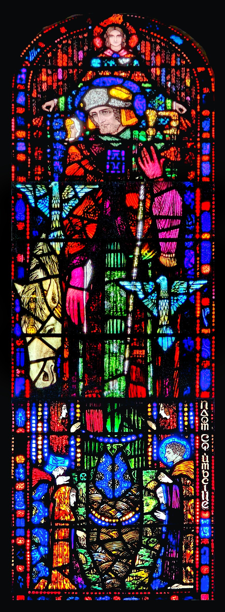</picture>
<figcaption><b>St Colmcille</b> in the window by <b>Harry Clarke</b> in the Honan Chapel of University College Cork, made in 1915–17, one of the masterpieces of the Irish stained-glass revival. Clarke shows him as abbot and founder, with his book and his church. Photo: <a href="https://commons.wikimedia.org/wiki/File:21_St_Colmcille,_Harry_Clarke,_Honan_Chapel_Stained_Glass.png">21 St Colmcille, Harry Clarke, Honan Chapel Stained Glass</a> by NateBergin, <a href="https://creativecommons.org/licenses/by/4.0">CC BY 4.0</a>, via Wikimedia Commons.</figcaption>
</figure>

<h2 id=birth>"Among the prophets of God": a royal birth</h2>

Colum was born on Thursday, 7 December 521, at Gartan, among the lakes and hills of Donegal. His father, Fedlimid, was of the Cenél Conaill, the ruling family of that country and a branch of the great Uí Néill, the descendants of Niall of the Nine Hostages who were the high kings of Ireland. His mother, Eithne, was of a noble family of Leinster. So the child was born a prince, close kin to kings, and if he had wished, he might have been a king himself.

<figure class=map style="max-width:640px;margin:14px auto 18px"><figcaption>Columba's world: Gartan, Derry, Durrow and Kells in Ireland; Iona off Mull in Dál Riata; and the court of King Bridei by Loch Ness and the River Ness. Map by The Daily Word; borders and rivers from Natural Earth (public domain); Iona and Loch Ness from OpenStreetMap. Tap to enlarge.</figcaption></figure>

God had other plans for him, and Adomnán tells how heaven announced them. Long before he was born, says Adomnán, Maucta, "a pilgrim from Britain, a holy man, a disciple of St. Patrick the Bishop", had foretold him: "In the last ages of the world a son shall be born, whose name Columba shall be announced in every province of the isles of the ocean, and brilliantly shall he enlighten the last ages of the earth."

Then came the vision of his mother. Adomnán tells it in the third book of his *Life*, which is all about the angels and the heavenly light around Columba:

> "On a certain night between the conception and birth of the venerable man, an angel of the Lord appeared to his mother in dreams, bringing to her, as he stood by her, a certain robe of extraordinary beauty, in which the most beautiful colours, as it were, of all the flowers seemed to be portrayed."

After a little while the angel asked for the robe back, lifted it up, spread it out and let it go into the empty air. "Why dost thou take this lovely cloak away from me so soon?" Eithne asked, and he answered: "Because this mantle is so exceedingly honourable that thou canst not retain it longer with thee." Then she saw the robe spread out farther and farther as it flew, until its width "exceeded the plains, and in all its measurements was larger than the mountains and forests". And she heard these words:

> "Woman, do not grieve, for thou shalt bring forth a son of so beautiful a character, that he shall be reckoned among his own people as one of the prophets of God, and hath been predestined by God to be the leader of innumerable souls to the heavenly country."

Donegal has kept the memory of his birth for fourteen centuries. By tradition he was born on a flagstone at Lacknacoo above Lough Gartan, *Leac na Cumha*, "the flagstone of loneliness". People who were leaving Ireland for ever used to come and sleep on it the night before they left, so that the saint who had known the pain of exile would spare them the worst of their homesickness.

<figure class=photo>
<picture><source srcset="/static/art/col-gartan-lough-600.webp 600w,/static/art/col-gartan-lough.webp 1280w" sizes="(max-width:760px) 100vw,760px" type="image/webp">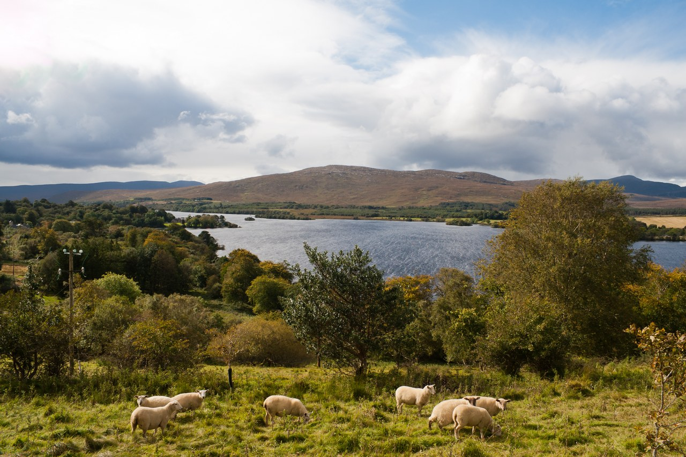</picture>
<figcaption><b>Lough Gartan</b> in Donegal, where Columba was born in 521. His birthplace, by tradition, is on the hillside above the lake at Lacknacoo. Photo: <a href="https://commons.wikimedia.org/wiki/File:Gartan_Lough_2012_09_19.jpg">Gartan Lough 2012 09 19</a> by Andreas F. Borchert, <a href="https://creativecommons.org/licenses/by-sa/4.0">CC BY-SA 4.0</a>, via Wikimedia Commons.</figcaption>
</figure>

<figure class=photo>
<picture><source srcset="/static/art/col-gartan-chapel-lough-600.webp 600w,/static/art/col-gartan-chapel-lough.webp 1280w" sizes="(max-width:760px) 100vw,760px" type="image/webp">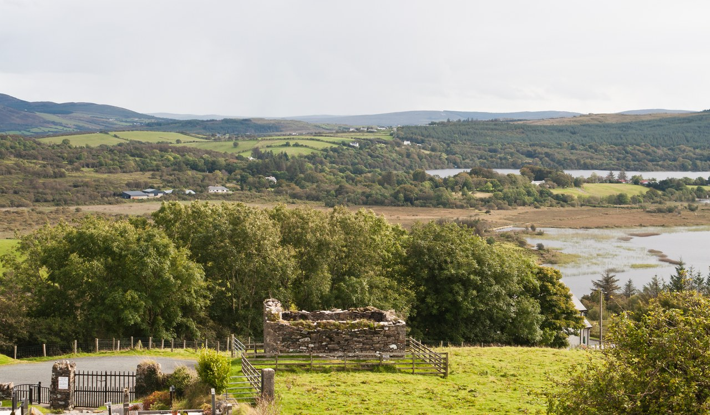</picture>
<figcaption>The ruins of <b>St Columbkille's Chapel at Gartan</b>, with Gartan Lough behind. The people of the parish have honoured his birthplace here for centuries. Photo: <a href="https://commons.wikimedia.org/wiki/File:Gartan_St._Columbkille%27s_Chapel_and_Gartan_Lough_2012_09_19.jpg">Gartan St. Columbkille's Chapel and Gartan Lough 2012 09 19</a> by Andreas F. Borchert, <a href="https://creativecommons.org/licenses/by-sa/4.0">CC BY-SA 4.0</a>, via Wikimedia Commons.</figcaption>
</figure>

<h2 id=boy>The dove of the church</h2>

The baby was baptised at Temple-Douglas, between Gartan and Letterkenny, by the priest **Cruithnechán**, who then took him into his house to foster and teach him, as the Irish custom was for the sons of noble families. Adomnán tells what Cruithnechán saw one night:

> "Cruithnecan, a priest of blameless life, to whose care the blessed youth was confided, upon returning home from the church after mass, found his house illuminated with a bright light, and saw in fact a ball of fire standing over the face of the little boy as he lay asleep. At the sight he at once shook with fear, and fell down with his face to the ground in great amazement, well knowing that it indicated the grace of the Holy Spirit poured out from heaven upon his young charge."

His name was Colum, which in Latin is *Columba*, "dove". Adomnán loved to point out that it was the same as the name of the prophet Jonah, which in Hebrew means "dove", and that the Holy Spirit came down on Christ in the form of a dove. Irish tradition adds that the children of the neighbourhood, seeing the little boy come out of the church where he loved to pray and read the psalms, used to call him *Colum Cille*, "the dove of the church". The name stayed with him all his life, and it is still the name by which Ireland knows him.

<figure class=photo>
<picture><source srcset="/static/art/col-ohea-dove-600.webp 600w,/static/art/col-ohea-dove.webp 543w" sizes="(max-width:760px) 100vw,760px" type="image/webp">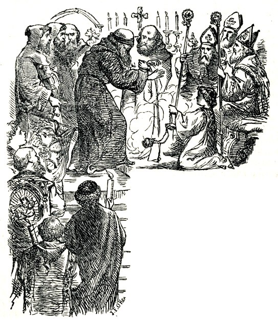</picture>
<figcaption><b>"Columba, Dove of the Cell"</b>, an engraving of 1867 by the Irish artist <b>John Fergus O'Hea</b>. His Irish name, <i>Colum Cille</i>, means "dove of the church". Image: <a href="https://commons.wikimedia.org/wiki/File:Columba_Dove_of_the_Cell.jpg">Columba Dove of the Cell</a> by John Fergus O'Hea, public domain, via Wikimedia Commons.</figcaption>
</figure>

<h2 id=schools>Scholar, deacon, priest</h2>

As a young man, Colum went to the great monastic schools of Ireland. He studied first under **St Finnian at Movilla**, on Strangford Lough in County Down, and there he was made a deacon. Adomnán tells that once, when there was no wine for the Mass, the young deacon went to a spring, blessed the water in the name of Christ, and it became wine. Then he went south into Leinster, to learn from an old Christian bard named **Gemman**, for he loved poetry all his life. Later he went to **St Finnian of Clonard**, the great teacher whose pupils are called the "Twelve Apostles of Ireland", and Colum was counted among them. He was with St Mobhí at Glasnevin, near Dublin, until the plague of 544 scattered the monks.

He was ordained a priest. He would never be a bishop; he remained a priest and an abbot all his life, and Bede noted with wonder that the bishops of the north were subject to the abbots of Iona, "according to the example of their first teacher, who was not a bishop, but a priest and monk".

Adomnán's picture of the man he became is one of the most beautiful in the whole *Life*:

> "He was angelic in appearance, graceful in speech, holy in work, with talents of the highest order and consummate prudence... He never could spend the space of even one hour without study, or prayer, or writing, or some other holy occupation. So incessantly was he engaged night and day in the unwearied exercise of fasting and watching, that the burden of each of these austerities would seem beyond the power of all human endurance. And still in all these he was beloved by all, for a holy joy ever beaming on his face revealed the joy and gladness with which the Holy Spirit filled his inmost soul."

<figure class=photo>
<picture><source srcset="/static/art/col-kildare-south-600.webp 600w,/static/art/col-kildare-south.webp 1280w" sizes="(max-width:760px) 100vw,760px" type="image/webp">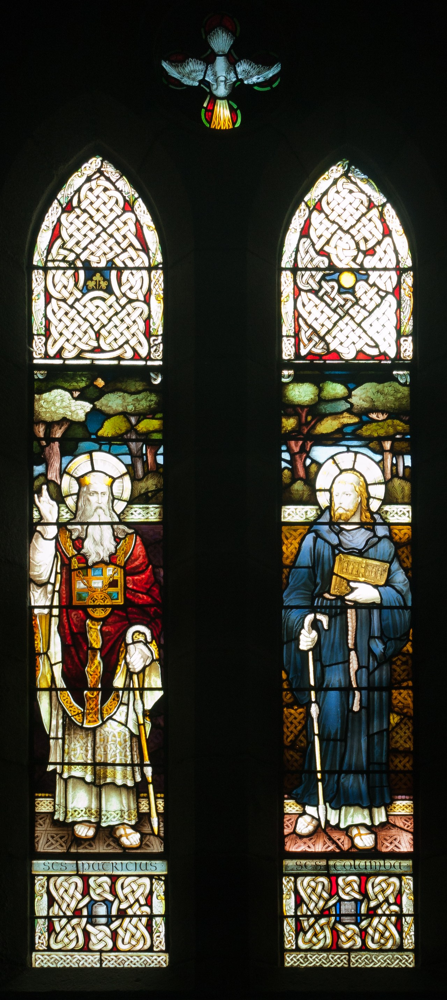</picture>
<figcaption><b>St Patrick and St Columba</b> together in a window of St Brigid's Cathedral, Kildare, by Heaton, Butler & Bayne of London, made after 1897. Columba was born less than a century after Patrick's mission, and grew up among the first generations of Christian Ireland. Photo: <a href="https://commons.wikimedia.org/wiki/File:Kildare_Cathedral_Nave_South_Window_06_Saints_Patrick_and_Columba_2013_09_04.jpg">Kildare Cathedral Nave South Window 06 Saints Patrick and Columba 2013 09 04</a> by Andreas F. Borchert, <a href="https://creativecommons.org/licenses/by-sa/4.0">CC BY-SA 4.0</a>, via Wikimedia Commons.</figcaption>
</figure>

<h2 id=founder>"Full of white angels": Derry, Durrow and Kells</h2>

Now the young priest began to found monasteries, and Ireland was soon full of them. The first, by tradition in 546, was at **Derry**, on a hill above the river Foyle, in a grove of oak trees given to him by his kinsman, the prince of that country. The place has borne his name ever since: in Irish it is *Doire Cholm Cille*, "the oak grove of Colum Cille". Columba so loved the oaks that, by tradition, he would not let a single one be cut down to build his church, and turned the building so that the trees would be spared.

A quatrain long sung in his name, and kept in Manus O'Donnell's Irish *Life*, tells of his love for the place:

> "This is why I love Derry: For its level fields, for its brightness, For the hosts of its white angels, From one end to the other."

About 553 he founded **Durrow**, *Dairmag*, the "plain of the oaks", in the heart of Ireland, in what is now County Offaly. Bede called it "a noble monastery", and it became one of the great houses of Irish learning; the Book of Durrow was written in his family of monks there. By tradition **Kells**, in County Meath, was given to Columba by the high king, and after his death his monks made it the head of his churches in Ireland. Later Irish Lives name many more foundations: Swords near Dublin, Raphoe and Tory in Donegal, Drumcliff in Sligo, and dozens more. Wherever a church in Ireland is called *Kilcolumb* or *Kilmacolm* or *Columbkille*, it remembers him.

<figure class=photo>
<picture><source srcset="/static/art/col-derry-long-tower-600.webp 600w,/static/art/col-derry-long-tower.webp 1280w" sizes="(max-width:760px) 100vw,760px" type="image/webp">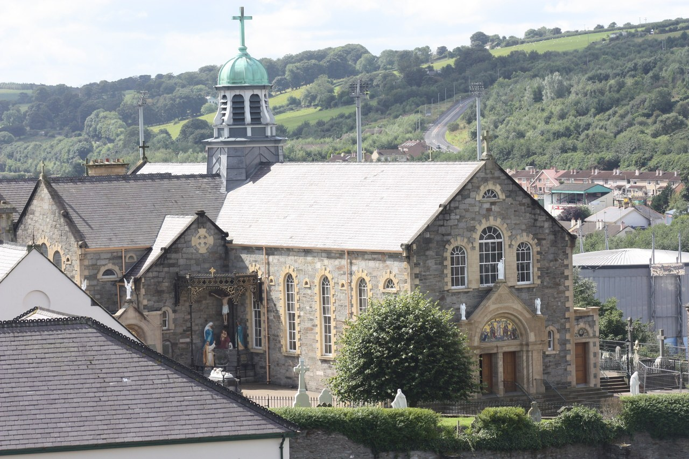</picture>
<figcaption><b>St Columba's Church, Long Tower</b>, in Derry, built in 1784–86 on the site of the medieval <i>Teampall Mór</i>, the "great church" of Columba's monastery. The people of Derry honour him here as the founder of their city. Photo: <a href="https://commons.wikimedia.org/wiki/File:Long_Tower_Church,_August_2009.JPG">Long Tower Church, August 2009</a> by Ardfern, <a href="https://creativecommons.org/licenses/by-sa/3.0">CC BY-SA 3.0</a>, via Wikimedia Commons.</figcaption>
</figure>

<figure class=photo>
<picture><source srcset="/static/art/col-durrow-cross-600.webp 600w,/static/art/col-durrow-cross.webp 1280w" sizes="(max-width:760px) 100vw,760px" type="image/webp">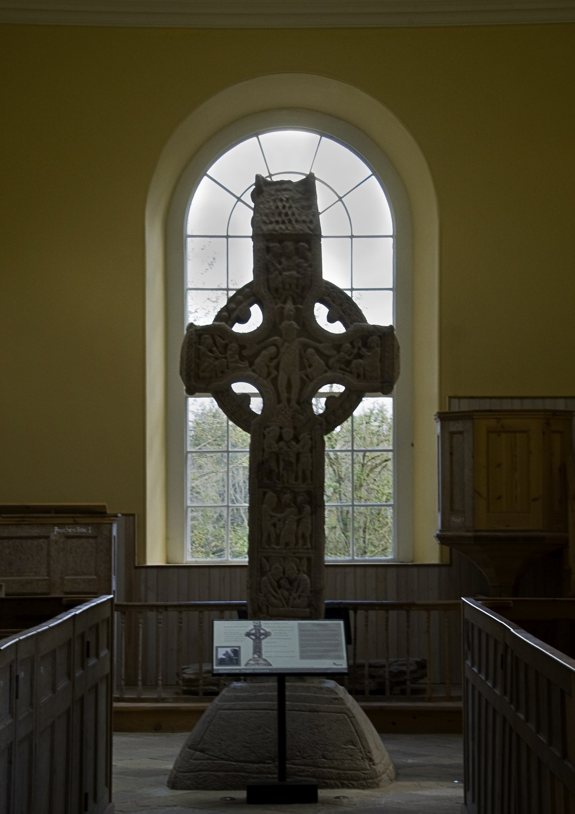</picture>
<figcaption>The <b>High Cross of Durrow</b>, carved in the 9th or 10th century, now kept indoors in the church at Durrow. Its panels show Christ in judgment and scenes from Scripture, cut by the monks of Columba's monastery. Photo: <a href="https://commons.wikimedia.org/wiki/File:Durrow_High_Cross.jpg">Durrow High Cross</a> by Robertrevill, <a href="https://creativecommons.org/licenses/by-sa/4.0">CC BY-SA 4.0</a>, via Wikimedia Commons.</figcaption>
</figure>

<figure class=photo>
<picture><source srcset="/static/art/col-kells-house-600.webp 600w,/static/art/col-kells-house.webp 1280w" sizes="(max-width:760px) 100vw,760px" type="image/webp">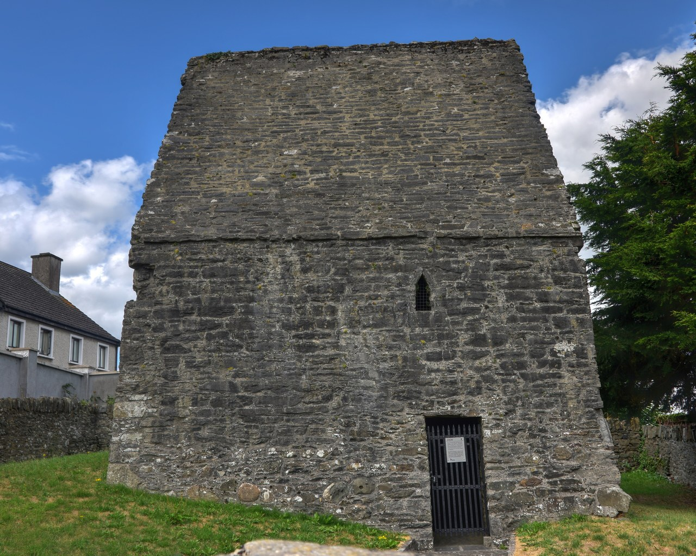</picture>
<figcaption><b>St Columb's House</b> in Kells, a stone-roofed oratory of the 10th or 11th century. It stands where, by tradition, Columba's own cell stood, and his relics were kept nearby. Photo: <a href="https://commons.wikimedia.org/wiki/File:St._Columb%27s_House,_Kells_2018-07-24_-_1.jpg">St. Columb's House, Kells 2018-07-24 - 1</a> by August Schwerdfeger, <a href="https://creativecommons.org/licenses/by/4.0">CC BY 4.0</a>, via Wikimedia Commons.</figcaption>
</figure>
<h2 id=cathach>"To every cow its calf"</h2>

Columba loved books with all his heart. He was a tireless scribe, and the Irish Lives say that he copied three hundred books with his own hand. One of the most famous stories ever told of him is about a book.

By tradition, it happened like this. Columba went to stay with his old master St Finnian and borrowed a book from him, a precious copy of the Psalms. After the Hours and the Mass each day, he stayed behind in the church and copied it secretly. Manus O'Donnell's great Irish *Life of Colum Cille*, written down at his castle of Lifford in Donegal in 1532 from the old books and stories of his people, tells how he had light to write by:

> "When evening came there would be candles for him the while he copied, to wit, the five fingers of his right hand blazing like five passing bright lights, so that they lit up and illumined the whole temple."

When Finnian learned that his book had been copied without his leave, he claimed the copy as his own. Columba would not give it up. The two saints took their case to **Diarmait mac Cerbaill**, the high king at Tara. "I contend that the son of my book is mine," said Finnian. Columba answered:

> "I contend that the book of Finnen is none the worse for my copying it, and it is not right that the divine words in that book should perish, or that I or any other should be hindered from writing them or reading them or spreading them among the tribes."

It was his desire, he said, "to give the profit thereof to all peoples". But the king gave a famous judgment against him:

> "To every cow her young cow, that is, her calf, and to every book its transcript. And therefore to Finnen belongeth the book thou hast written, O Columcille."

The judgment is often called the first copyright ruling in history.

The book itself, the tradition says, is the **Cathach**, "the Battler", a little psalter of the late sixth century written in a clear, beautiful Irish hand. It is the oldest surviving manuscript in Ireland, and one of the oldest copies of the Psalms in Latin anywhere in the world. Only 58 of its leaves are left, but on them you can still see the large initial letters, outlined in red dots, that began a whole new art: the art that would one day flower in the Book of Kells. The Cathach was so precious to Columba's family, the O'Donnells, that they enclosed it in a silver shrine and carried it into battle. Before the fighting, a monk in a state of grace would hang it round his neck and walk three times sunwise around the warriors of Tír Chonaill, and they believed that God would give them the victory. Today the manuscript is kept in the Royal Irish Academy in Dublin.

<figure class=photo>
<picture><source srcset="/static/art/col-cathach-48r-600.webp 600w,/static/art/col-cathach-48r.webp 271w" sizes="(max-width:760px) 100vw,760px" type="image/webp">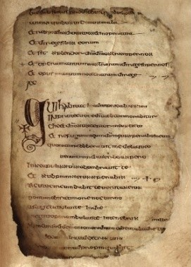</picture>
<figcaption>A page of the <b>Cathach of St Columba</b>, folio 48 recto, a psalter of the late 6th century, kept in the Royal Irish Academy, Dublin. By tradition it is the very book Columba copied, and the hand is his own. Image: <a href="https://commons.wikimedia.org/wiki/File:The_Cathach,_f.48r.jpg">The Cathach, f.48r</a> by Royal Irish Academy, public domain, via Wikimedia Commons.</figcaption>
</figure>

<figure class=photo>
<picture><source srcset="/static/art/col-cathach-q-600.webp 600w,/static/art/col-cathach-q.webp 412w" sizes="(max-width:760px) 100vw,760px" type="image/webp">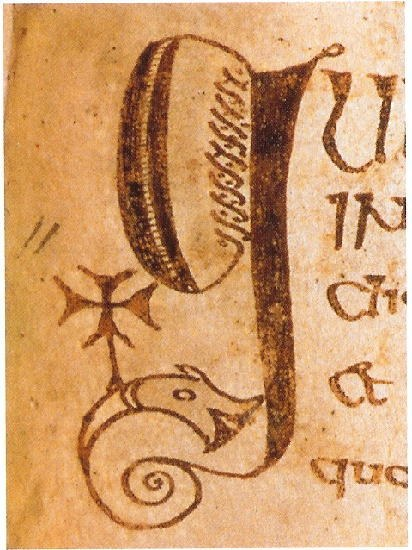</picture>
<figcaption>A great initial <b>Q</b> from the Cathach, with a curling tail that ends in an animal's head and a little cross beside it. These first steps in Irish book decoration lead straight to the Book of Kells. Image: <a href="https://commons.wikimedia.org/wiki/File:CathachOfStColumbaInitialQ.jpg">CathachOfStColumbaInitialQ</a> by Royal Irish Academy, public domain, via Wikimedia Commons.</figcaption>
</figure>

<h2 id=battle>Cúl Dreimhne and the penance of exile</h2>

There was another wound between Columba and the high king. Curnan, a young prince of Connacht, had struck down a rival in a hurling match at Tara and fled to Columba for protection. Diarmait's men dragged him from the saint's arms and put him to death, against all the laws of sanctuary. Columba's kinsmen of the Northern Uí Néill took up the quarrel, and in 561 they met Diarmait's army at **Cúl Dreimhne**, under the great flat mountain of Ben Bulben in Sligo. The Northern Uí Néill won the day, and by tradition three thousand men were killed.

The Irish Lives tell that Columba stood on the battlefield and prayed for his people, and that the victory was granted to his prayers. But when it was over, his heart was broken by the dead. The Church could not let such a thing pass. By tradition, a synod of the clergy of Ireland met at Teltown in Meath to judge him, and some wished to excommunicate him. Adomnán tells what happened when Columba came to the assembly: **St Brendan of Birr** rose, bowed his head, and kissed him. When the elders scolded him for honouring a man they had condemned, Brendan answered:

> "If you had seen what the Lord has this day thought fit to show to me regarding this his chosen one, whom you dishonour, you would never have excommunicated a person whom God not only doth not excommunicate... but even more and more highly esteemeth... I have seen a most brilliant pillar wreathed with fiery tresses preceding this same man of God whom you treat with contempt; I have also seen holy angels accompanying him on his journey through the plain. Therefore I do not dare to slight him whom I see foreordained by God to be the leader of his people to life."

The synod honoured him from then on. But Columba could not rest. By tradition, he went to his confessor, the holy hermit **St Molaise**, to ask what he must do, and Molaise gave him a hard penance. He must leave Ireland, the land he loved more than anything on earth, and never again see her soil. And he must win for Christ as many souls as had been lost at Cúl Dreimhne.

Columba accepted it gladly. It was the old Irish ideal of the "white martyrdom": to leave home and kindred for ever, as Abraham had done, for the love of God. What began as a penance became the great work of his life, and God made the exile of one man into the conversion of a nation.

<figure class=photo>
<picture><source srcset="/static/art/col-drumcliffe-600.webp 600w,/static/art/col-drumcliffe.webp 1280w" sizes="(max-width:760px) 100vw,760px" type="image/webp">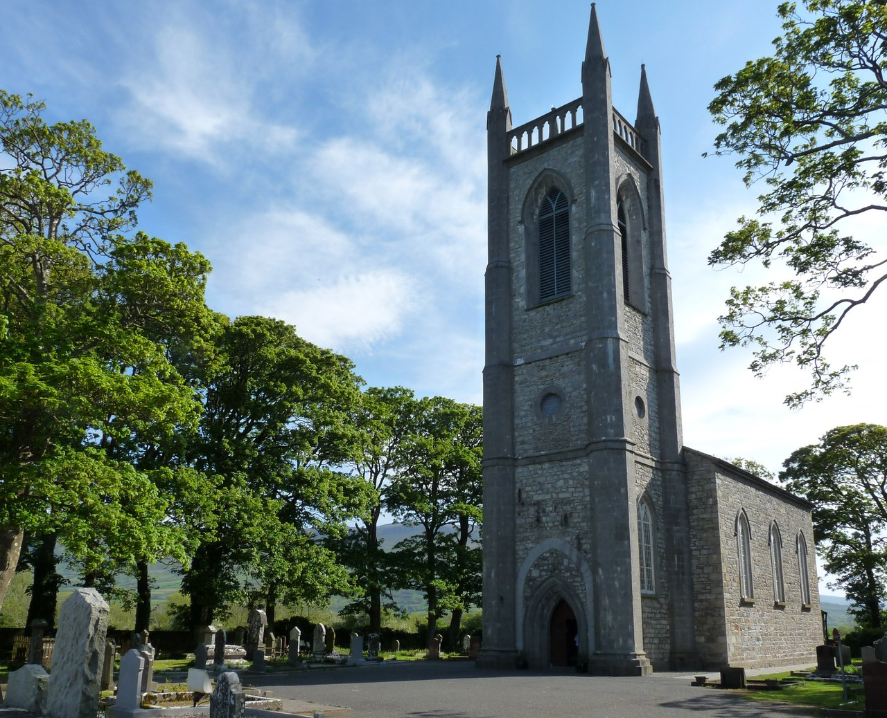</picture>
<figcaption>The church of <b>Drumcliff</b> in County Sligo, near the battlefield of Cúl Dreimhne under Ben Bulben. Columba founded a monastery here in about 575; the present church stands on its site, and its ancient high cross still stands in the churchyard. Photo: <a href="https://commons.wikimedia.org/wiki/File:Drumcliffe_Church_(3585068584).jpg">Drumcliffe Church (3585068584)</a> by michael clarke stuff, <a href="https://creativecommons.org/licenses/by-sa/2.0">CC BY-SA 2.0</a>, via Wikimedia Commons.</figcaption>
</figure>

<h2 id=voyage>"For the love of Christ": the voyage of 563</h2>

Adomnán gives the moment in a single, shining sentence:

> "In the second year after the battle of Culedrebina, and in the forty-second of his age, St. Columba, resolving to seek a foreign country for the love of Christ, sailed from Scotia (Ireland) to Britain."

It was the year 563, and the spring of the year, by tradition, about Pentecost. Columba took with him twelve companions, like Christ with his apostles. Among them were his cousin **Baithéne**, who would follow him as abbot of Iona, and Baithéne's brother Cobthach, his uncle Ernán, his faithful servant Diormit, and, by tradition, **Odran**, whose name lives on in the chapel and burial ground of St Oran on Iona. They sailed in a *currach*, a boat of wicker covered with ox hides, the kind of boat in which [St Brendan](/saints/brendan/) crossed the Atlantic.

Derry remembers the parting. By tradition, Columba sailed from the shore of the Foyle, or from Inishowen, and as the boat moved away he looked back and wept. The Irish poems that bear his name are full of that grief: of the grey eye that looks back to Ireland, of the white strands and the oaks of Derry that he would never see again.

They landed first, by tradition, on the southern tip of **Kintyre**, near Southend, where two footprints carved in a rock at Keil are still called St Columba's footprints. But from there the hills of Antrim could still be seen across the sea, and Columba had sworn not to live within sight of Ireland. So they sailed on to the north. At last they came to a small island off the western tip of Mull, about three miles long and a mile wide, and landed in a pebbly bay at its southern end. It was the eve of Pentecost, by tradition, 12 May 563. The bay is still called **Port na Curaich**, "the harbour of the currach". Columba climbed the hill above it and looked south. Ireland was gone below the horizon. The cairn that marks the spot is called *Càrn Cùl ri Éirinn*, "the cairn with its back to Ireland".

The island was **Iona**. It was given to him by his kinsman **Conall mac Comgaill**, king of the Gaels of **Dál Riata**, the Irish kingdom that stretched across the sea from Antrim into Argyll, and by the Picts who also claimed it.

<figure class=photo>
<picture><source srcset="/static/art/col-mayer-derry-farewell-600.webp 600w,/static/art/col-mayer-derry-farewell.webp 1280w" sizes="(max-width:760px) 100vw,760px" type="image/webp">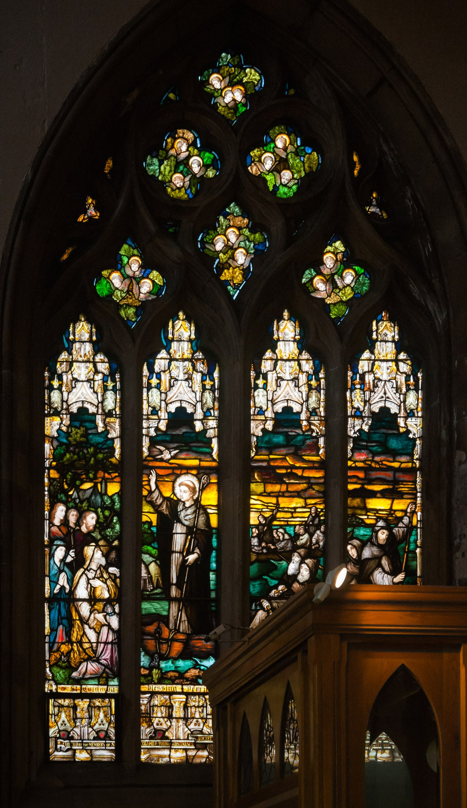</picture>
<figcaption><b>St Columba's farewell to Derry</b>, in the west window of the north aisle of St Eugene's Cathedral, Derry, made by Mayer & Co. of Munich at the end of the 19th century. The saint blesses his people on the shore before he sails for Iona. Photo: <a href="https://commons.wikimedia.org/wiki/File:Derry_St._Eugene%27s_Cathedral_North_Aisle_West_Window_Saint_Columba_2013_09_17.jpg">Derry St. Eugene's Cathedral North Aisle West Window Saint Columba 2013 09 17</a> by Andreas F. Borchert, <a href="https://creativecommons.org/licenses/by-sa/4.0">CC BY-SA 4.0</a>, via Wikimedia Commons.</figcaption>
</figure>

<figure class=photo>
<picture><source srcset="/static/art/col-mctaggart-coming-600.webp 600w,/static/art/col-mctaggart-coming.webp 800w" sizes="(max-width:760px) 100vw,760px" type="image/webp">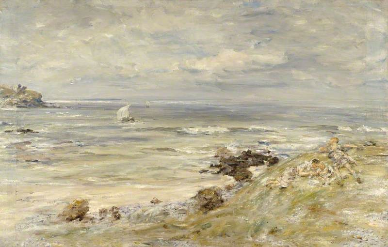</picture>
<figcaption><b>The Coming of Saint Columba</b>, painted in 1895 by <b>William McTaggart</b>, National Galleries of Scotland. McTaggart, the great painter of the Scottish seashore, shows the little sail of the saint's boat coming in over a bright western sea, watched from the shore. Image: <a href="https://commons.wikimedia.org/wiki/File:William_McTaggart_(1835-1910)_-_The_Coming_of_Saint_Columba_-_NG_1071_-_National_Galleries_of_Scotland.jpg">William McTaggart (1835-1910) - The Coming of Saint Columba - NG 1071 - National Galleries of Scotland</a> by William McTaggart, National Galleries of Scotland, public domain, via Wikimedia Commons.</figcaption>
</figure>

<figure class=photo>
<picture><source srcset="/static/art/col-keil-footprints-600.webp 600w,/static/art/col-keil-footprints.webp 640w" sizes="(max-width:760px) 100vw,760px" type="image/webp">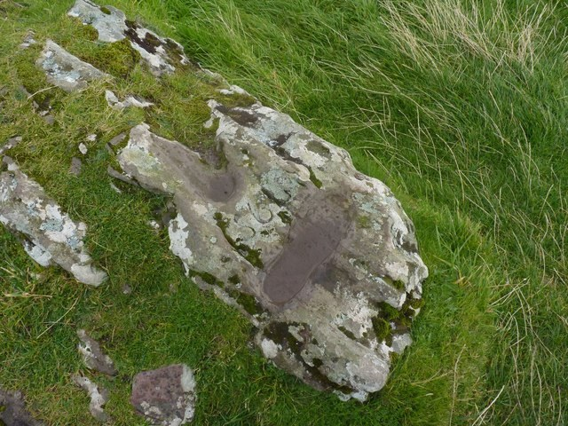</picture>
<figcaption><b>St Columba's Footprints</b> at Keil, near Southend at the Mull of Kintyre. By tradition this is where Columba first set foot in Scotland in 563, before sailing north beyond the sight of Ireland. Photo: <a href="https://commons.wikimedia.org/wiki/File:St_Columba%27s_Footprints,_Keil,_Mull_of_Kintyre_-_geograph.org.uk_-_3164685.jpg">St Columba's Footprints, Keil, Mull of Kintyre - geograph.org.uk - 3164685</a> by Becky Williamson, <a href="https://creativecommons.org/licenses/by-sa/2.0">CC BY-SA 2.0</a>, via Wikimedia Commons.</figcaption>
</figure>

<figure class=photo>
<picture><source srcset="/static/art/col-iona-columbas-bay-600.webp 600w,/static/art/col-iona-columbas-bay.webp 1280w" sizes="(max-width:760px) 100vw,760px" type="image/webp">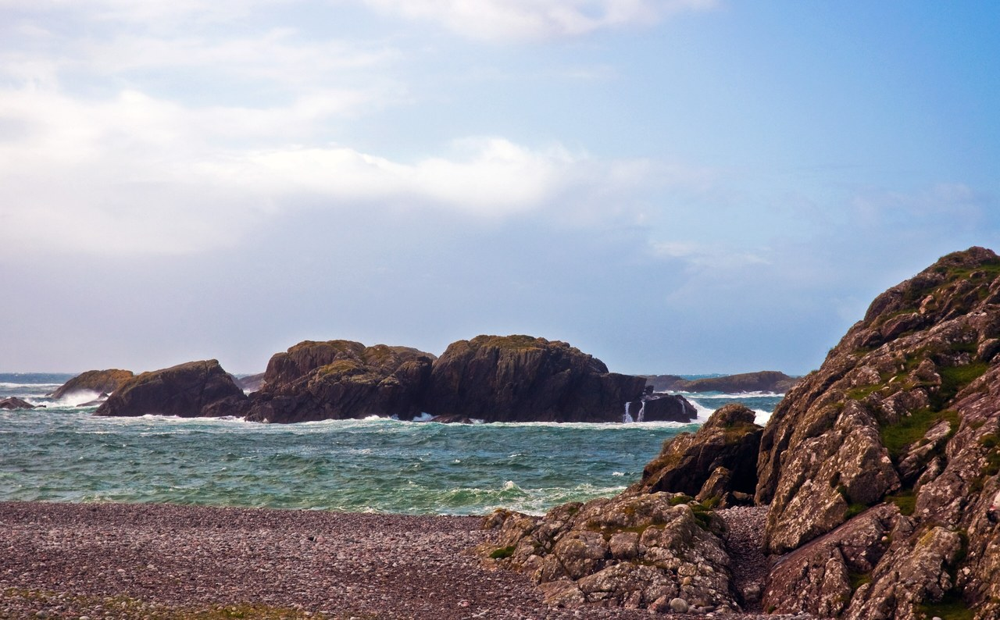</picture>
<figcaption><b>Port na Curaich</b>, St Columba's Bay, at the southern tip of Iona, where by tradition his currach came ashore. Pilgrims still pick up the green-veined pebbles of the beach. Photo: <a href="https://commons.wikimedia.org/wiki/File:Columba%27s_Bay,_Iona,_Scotland,_Sept._2010_-_Flickr_-_PhillipC.jpg">Columba's Bay, Iona, Scotland, Sept. 2010 - Flickr - PhillipC</a> by Phillip Capper, <a href="https://creativecommons.org/licenses/by/2.0">CC BY 2.0</a>, via Wikimedia Commons.</figcaption>
</figure>

<h2 id=iona>The island of the dove</h2>

On the green, sheltered eastern shore of Iona, looking across the sound to the pink granite of Mull, Columba and his twelve built their monastery: a church of oak timbers, a great house where the monks ate together, little huts or cells for each of them, a guest-house, barns, a kiln and a mill, all inside a great earthwork bank, the *vallum*, that still runs across the fields. Columba's own cell, Adomnán says, was made of planks and stood on a little rise, now called Tòrr an Aba, "the abbot's mound". There he slept on bare rock with a stone for a pillow, and there he read and wrote.

The life of the monastery was the life of prayer. The monks sang the psalms together through the day and in the night; they fasted on Wednesdays and Fridays; they worked in the fields and the barns, fished and kept cattle and seals, and copied the Scriptures in the scriptorium. Pilgrims and penitents came from Ireland, from Scotland and from the Saxon lands to be healed, to confess their sins, or to stay and become monks themselves. The monastery grew, and in Columba's lifetime it founded daughter houses on Tiree, on Hinba and on other islands of the west. Bede said the island was the head "of almost all those of the northern Scots, and all those of the Picts".

Adomnán's *Life* is full of little scenes of that life. Once Columba heard a shout from across the sound, someone calling for the boat, and said: "The man who is shouting beyond the Sound is not of very sharp wit, for when he is here today he will upset my inkhorn and spill the ink." His servant Diormit stood guard at the door, but he was called away for a moment, and the guest burst in, ran to kiss the saint, and caught the inkhorn with the hem of his cloak.

Another day he called one of the brothers and told him to go to the western shore of the island in three days' time and wait, for a crane would come, worn out, driven by the winds "from the northern region of Hibernia". The brother must carry it to a house nearby and feed it for three days and nights:

> "This bird do I consign to thee with such special care because it cometh from our own native place."

The crane came, as he had said, and was nursed, and on the third day it rose high into the air and flew straight back across the sea to Ireland. When the brother came back to the monastery that evening, Columba said to him, before he could speak: "God bless thee, my child, for thy kind attention to this foreign visitor."

<figure class=photo>
<picture><source srcset="/static/art/col-iona-abbey-1890-600.webp 600w,/static/art/col-iona-abbey-1890.webp 1280w" sizes="(max-width:760px) 100vw,760px" type="image/webp">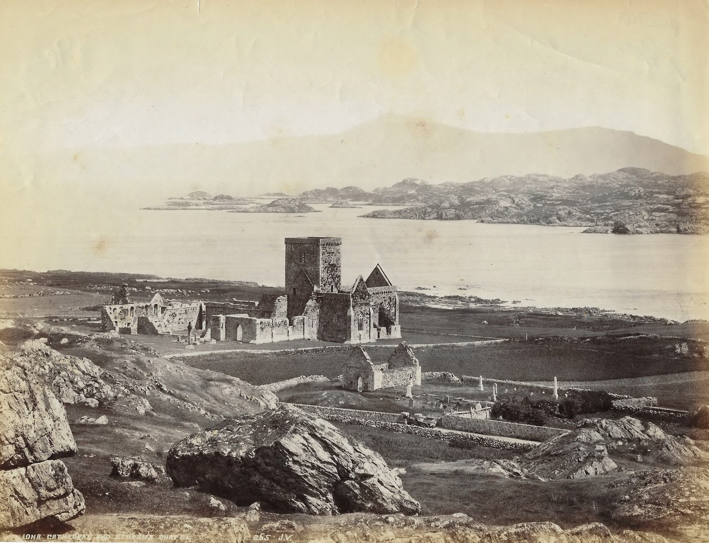</picture>
<figcaption><b>Iona Abbey in ruins</b>, in a photograph of about 1890, before the church was rebuilt. The medieval abbey stands on the site of Columba's monastery on the eastern shore, looking across the Sound of Iona to Mull. Image: <a href="https://commons.wikimedia.org/wiki/File:Iona_Abbey_C19_Ruin.jpg">Iona Abbey C19 Ruin</a>, public domain, via Wikimedia Commons.</figcaption>
</figure>
<h2 id=gate>The gate of King Bridei</h2>

Beyond the mountains of the Great Glen lay the kingdom of the northern Picts, still pagan, ruled by a powerful king named **Bridei son of Maelchon**. His royal fortress stood near the mouth of the River Ness, where Inverness is today; tradition has long placed it on the wooded hill of **Craig Phadrig**, above the town. In about 565, two years after he came to Iona, Columba set out to visit him, travelling up the long lochs of the Great Glen with a few of his monks. Adomnán tells what happened at the king's gate:

> "At another time, when the saint made his first journey to King Brude, it happened that the king, elated by the pride of royalty, acted haughtily, and would not open his gates on the first arrival of the blessed man. When the man of God observed this, he approached the folding doors with his companions, and having first formed upon them the sign of the cross of our Lord, he then knocked at and laid his hand upon the gate, which instantly flew open of its own accord, the bolts having been driven back with great force."

The saint and his monks walked in through the open gate. The king and his councillors were filled with fear, and Bridei came out of his palace to meet Columba with honour and gentle words. "And ever after from that day, so long as he lived," Adomnán says, "the king held this holy and reverend man in very great honour, as was due." Bede adds that Columba "converted that nation to the faith of Christ, by his preaching and example".

At the same court, Adomnán tells, the druids tried to stop the monks from singing Vespers near the fortress. Columba began to sing the 44th Psalm (the 45th in modern Bibles), "My heart is inditing a good matter", and his voice became so "wonderfully loud, like pealing thunder", that "king and people were struck with terror and amazement".

<figure class=photo>
<picture><source srcset="/static/art/col-skelton-gate-600.webp 600w,/static/art/col-skelton-gate.webp 300w" sizes="(max-width:760px) 100vw,760px" type="image/webp">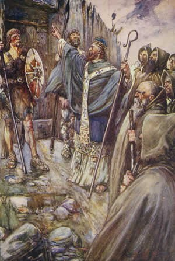</picture>
<figcaption><b>Columba at the gate of King Bridei's fortress</b>, an illustration of 1906 by <b>J. R. Skelton</b>. The saint makes the sign of the cross on the barred gate, and it flies open. Image: <a href="https://commons.wikimedia.org/wiki/File:Columba_at_Bridei%27s_fort.jpg">Columba at Bridei's fort</a> by J. R. Skelton, public domain, via Wikimedia Commons.</figcaption>
</figure>

<figure class=photo>
<picture><source srcset="/static/art/col-inverness-craig-phadrig-600.webp 600w,/static/art/col-inverness-craig-phadrig.webp 640w" sizes="(max-width:760px) 100vw,760px" type="image/webp">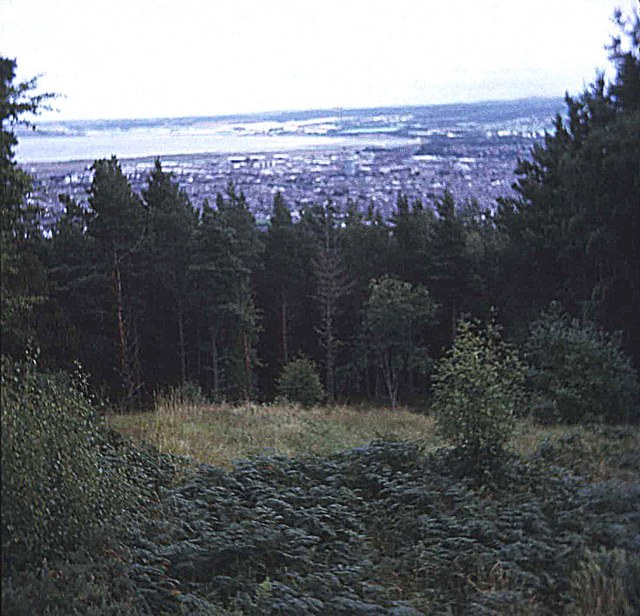</picture>
<figcaption><b>Inverness from Craig Phadrig</b>, the wooded hill with its ancient fort above the town, where tradition places the royal fortress of Bridei, king of the Picts. Columba came here in about 565. Photo: <a href="https://commons.wikimedia.org/wiki/File:Inverness_from_Craig_Phadrig_-_geograph.org.uk_-_621260.jpg">Inverness from Craig Phadrig - geograph.org.uk - 621260</a> by Trevor Rickard, <a href="https://creativecommons.org/licenses/by-sa/2.0">CC BY-SA 2.0</a>, via Wikimedia Commons.</figcaption>
</figure>

<h2 id=ness>The beast in the River Ness</h2>

On one of his journeys into the land of the Picts, Columba came to the **River Ness**, the short, swift river that runs from Loch Ness down to the sea at Inverness. There he found some of the local people burying a man. They told him that the man had been swimming in the river when a water beast seized him and bit him savagely; men in a boat had come to help him, but too late, and had pulled his body out with a hook. Here is Adomnán's account, the oldest written story of the creature people now call Nessie:

> "The blessed man, on hearing this, was so far from being dismayed, that he directed one of his companions to swim over and row across the coble that was moored at the farther bank. And Lugne Mocumin hearing the command of the excellent man, obeyed without the least delay, taking off all his clothes, except his tunic, and leaping into the water. But the monster, which, so far from being satiated, was only roused for more prey, was lying at the bottom of the stream, and when it felt the water disturbed above by the man swimming, suddenly rushed out, and, giving an awful roar, darted after him, with its mouth wide open, as the man swam in the middle of the stream."

Everyone on the bank froze with terror. But Columba did not move:

> "Then the blessed man observing this, raised his holy hand, while all the rest, brethren as well as strangers, were stupefied with terror, and, invoking the name of God, formed the saving sign of the cross in the air, and commanded the ferocious monster, saying, 'Thou shalt go no further, nor touch the man; go back with all speed.' Then at the voice of the saint, the monster was terrified, and fled more quickly than if it had been pulled back with ropes, though it had just got so near to Lugne, as he swam, that there was not more than the length of a spear-staff between the man and the beast."

Lugne swam across safely with the boat, and the brothers on the bank gave glory to God. And the pagans who had seen it, Adomnán says, "were forced by the greatness of this miracle, which they themselves had seen, to magnify the God of the Christians".

The sign of the cross that Columba made in the air over the Ness is the same sign that every Christian makes. The beast fled from it because it is the sign of Christ, who has conquered every power of darkness.

<figure class=photo>
<picture><source srcset="/static/art/col-river-ness-600.webp 600w,/static/art/col-river-ness.webp 1280w" sizes="(max-width:760px) 100vw,760px" type="image/webp">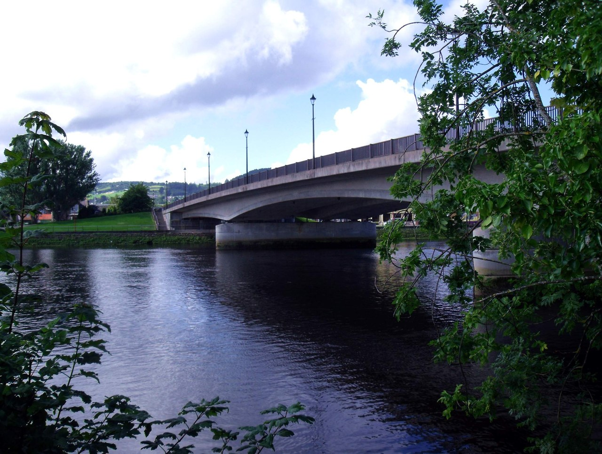</picture>
<figcaption>The <b>River Ness</b> at Inverness, flowing from Loch Ness to the sea. Adomnán sets the story of the beast here, on the river Columba crossed on his way to King Bridei. Photo: <a href="https://commons.wikimedia.org/wiki/File:Friars_Bridge_and_River_Ness,_Inverness,_Scotland.jpg">Friars Bridge and River Ness, Inverness, Scotland</a> by dave conner, <a href="https://creativecommons.org/licenses/by/2.0">CC BY 2.0</a>, via Wikimedia Commons.</figcaption>
</figure>

<figure class=photo>
<picture><source srcset="/static/art/col-loch-ness-breanski-600.webp 600w,/static/art/col-loch-ness-breanski.webp 1280w" sizes="(max-width:760px) 100vw,760px" type="image/webp">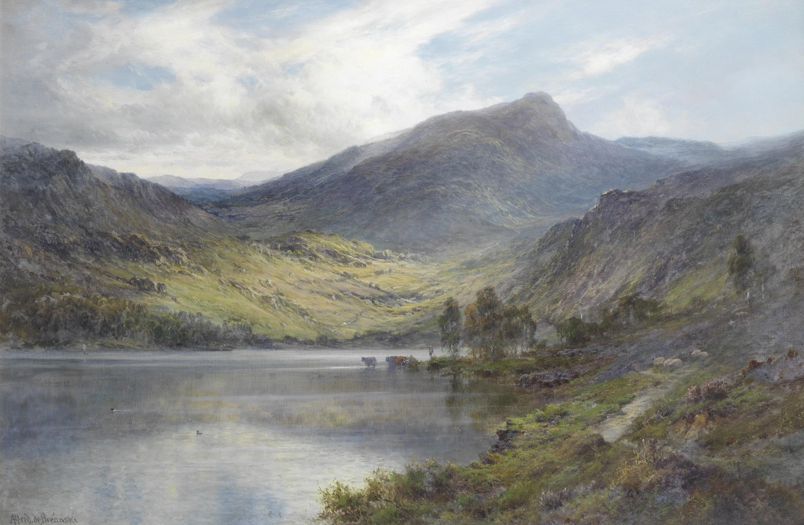</picture>
<figcaption><b>Loch Ness</b>, painted by <b>Alfred de Bréanski</b> (died 1928). The long, deep loch drains into the River Ness at its northern end. Image: <a href="https://commons.wikimedia.org/wiki/File:Alfred_de_Br%C3%A9anski_sr_Loch_Ness.jpg">Alfred de Bréanski sr Loch Ness</a> by Alfred de Bréanski, public domain, via Wikimedia Commons.</figcaption>
</figure>

<figure class=photo>
<picture><source srcset="/static/art/col-loch-ness-aerial-600.webp 600w,/static/art/col-loch-ness-aerial.webp 1280w" sizes="(max-width:760px) 100vw,760px" type="image/webp">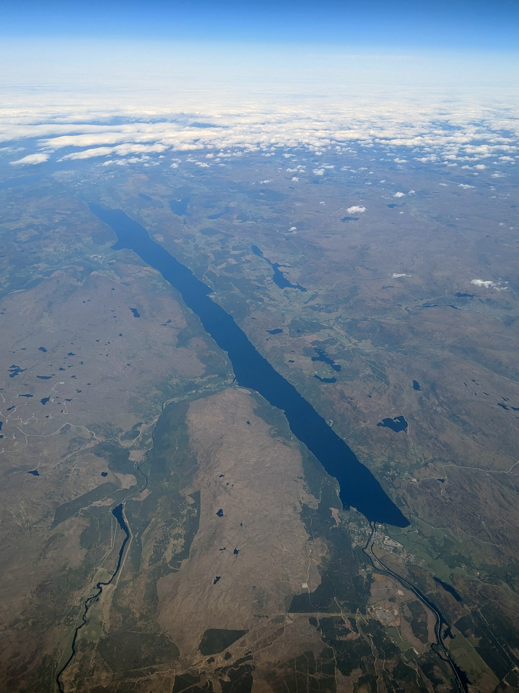</picture>
<figcaption><b>Loch Ness from the air</b>, a dark line twenty-three miles long in the Great Glen. Columba travelled this way between Iona and the Pictish court. Photo: <a href="https://commons.wikimedia.org/wiki/File:Aerial_view_of_Loch_Ness.jpg">Aerial view of Loch Ness</a> by Bmazerolles, <a href="https://creativecommons.org/licenses/by/4.0">CC BY 4.0</a>, via Wikimedia Commons.</figcaption>
</figure>

<h2 id=druid>The white pebble and the druid's wind</h2>

The chief druid of the Pictish court was **Broichan**, the king's own foster-father, and he set himself against the saint. He kept a young Irish girl as a slave, and Columba, out of pity for her, begged him to set her free. Broichan refused. Columba warned him that he would fall gravely ill if he did not let her go, and then he left the fortress and went down to the River Ness. There he picked up a white pebble from the stream and said to his companions: "Behold this white pebble by which God will effect the cure of many diseases among this heathen nation."

At that very moment, he told them, an angel had struck Broichan and shattered the glass cup in his hand, and the druid lay gasping, half dead. Soon two horsemen came galloping from the king, begging the saint to come and heal him, for Broichan now promised to free the girl. Columba blessed the pebble and sent it with two of his monks: if Broichan first freed the girl, they were to put the stone in water and let him drink. The girl was set free at once, and the pebble, dipped in the water, floated "like a nut or an apple". Broichan drank and was healed. The white stone was kept among the treasures of the king, and for years it healed the sick who came to it.

Broichan tried once more. He told Columba that he would raise a contrary wind and a great mist, so that the saint could not sail away down Loch Ness. On the day Columba was to sail, a storm came down the loch, and the wind blew hard against him. Columba called on Christ the Lord and went aboard his small boat, and while the sailors hesitated, he ordered them to raise the sails against the wind. Then, Adomnán says, "while the whole crowd was looking on", the boat "ran against the wind with extraordinary speed", and after a short time the wind veered round to help them on their way.

<h2 id=prophet>"As in one ray of the sun"</h2>

Adomnán's first book is all about Columba's gift of prophecy. Again and again he knew what was happening far away, or what would happen days or years ahead: a ship in danger on the sea, a king's death in battle, a guest who would arrive in the evening, a sinner who would come to confess. When some of the brothers asked him how he could know such things, Columba did not deny the gift:

> "He beheld the whole universe drawn together and laid open to his sight, as in one ray of the sun."

He did not use the gift for show. He used it to warn, to comfort and to save. One day, as he sat writing in his cell on Iona, his face suddenly changed and he cried out, "Help! Help!" He had sent an angel, he told the two brothers at the door, to catch one of his monks in Ireland who was falling from the top of a great house that was being built, and the angel had reached him "in the twinkling of an eye, before his body reached the ground". "How wonderful and almost unspeakable is the swiftness of angelic motion," Columba said, "like, as I imagine, to the rapidity of lightning."

When the monk Cormac, sailing the northern ocean in search of a hermitage, was driven for fourteen days before the wind into unknown seas, Columba saw his danger from Iona, called the brothers together to pray for him, and the wind turned and carried Cormac home. When King Áedán of Dál Riata went to war against the Miathi, Columba suddenly told his servant, "Ring the bell," and led the monks to the church. "Let us pray now earnestly to the Lord for this people and King Aidan," he said, "for they are engaging in battle at this moment." After a while he went out, looked up to heaven, and said: "The barbarians are fleeing now, and to Aidan is given the victory." And he told them the number of the slain. Again and again those he spoke of came, repented or died exactly as he had said.

<h2 id=light>Fire from heaven</h2>

Adomnán's third book tells of the angels and the heavenly light that God sent upon Columba. Many of these visions happened on **Hinba**, a small island where Columba went to pray in solitude, and which tradition has long found in **Eileach an Naoimh**, "the rocky isle of the saints", in the Garvellach islands, where the stone cells of the monks still stand.

Once four great founders of monasteries came from Ireland to visit him on Hinba: St Comgall of Bangor, St Cainnech, **St Brendan** and St Cormac. They asked Columba to celebrate the Mass for them. During the Mass, [St Brendan](/saints/brendan/) saw:

> "A ball of fire like a comet burning very brightly on the head of Columba, while he was standing before the altar, and consecrating the holy oblation, and thus it continued burning and rising upwards like a column, so long as he continued to be engaged in the same most sacred mysteries."

Another time on Hinba, the Holy Spirit came upon Columba so abundantly that for three whole days and nights he stayed shut in a house filled with heavenly brightness, without eating or drinking, and let no one come near him. Rays of light streamed out through the chinks of the door and the keyhole, and he was heard singing spiritual songs that no one had ever heard before. Afterwards he told a few of the brothers that many secrets "hidden from men since the beginning of the world" had been revealed to him, and the hardest passages of Scripture had become "clearer than the light to the eye of his pure heart".

On Iona, one winter's night, a young monk named **Virgnous**, who later became abbot, went into the church alone to pray while the others slept. After about an hour Columba came in, "and along with him, at the same time, a golden light, that came down from the highest heavens and filled that part of the church". Virgnous could no more bear to look at it than at the summer sun at noon. The next day Columba comforted the frightened young man and told him never to speak of it while he lived.

Another day Columba told his monks that he wished to go alone to the western plain of Iona, and that none of them must follow. One curious brother crept after him by another path and hid on a hill. From there he saw the saint standing on a little mound with his arms raised to heaven in prayer, and holy angels "clad in white robes and flying with wonderful speed" came and stood around him and spoke with him, and then flew back to heaven. That mound is still called the **Hill of the Angels**, *Sìthean Mòr*, and it stands beside the plain above the Bay at the Back of the Ocean.

<figure class=photo>
<picture><source srcset="/static/art/col-hinba-cell-600.webp 600w,/static/art/col-hinba-cell.webp 475w" sizes="(max-width:760px) 100vw,760px" type="image/webp">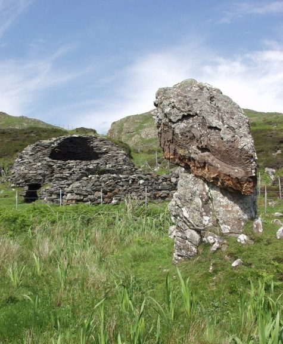</picture>
<figcaption>A <b>monks' beehive cell</b> on <b>Eileach an Naoimh</b> in the Garvellachs, which tradition identifies with Hinba, Columba's island of prayer, where the fire of heaven was seen upon him. By tradition his mother Eithne is buried on the island. Photo: <a href="https://commons.wikimedia.org/wiki/File:Eileach_an_Naoimh_Monk%27s_cell.jpg">Eileach an Naoimh Monk's cell</a> by Christopher Bruce, <a href="https://creativecommons.org/licenses/by-sa/2.0">CC BY-SA 2.0</a>, via Wikimedia Commons.</figcaption>
</figure>

<h2 id=kings>The book of glass and the poets</h2>

On Hinba, too, an angel came to Columba holding "a book of glass, regarding the appointment of kings". The angel commanded him to ordain **Áedán mac Gabráin** as king of Dál Riata. Columba loved Áedán's brother more and hesitated, and the angel struck him with a scourge, leaving a mark on his side that stayed with him all his life. Three nights the angel came with the book of glass, until Columba obeyed. He sailed to Iona, laid his hand on Áedán's head, consecrated and blessed him, and told him what would come of his sons and grandsons. It is the earliest account of the ordination of a king in the British Isles, and it began a long tradition: for centuries the kings of Scots were crowned on the Stone of Destiny, which legend says was Columba's pillow.

In 575 Columba returned to Ireland for the great assembly of **Druim Cett**, near Limavady, where the kings of the Northern Uí Néill and of Dál Riata settled the affairs of their peoples. By tradition, the high king Áed meant to banish all the poets of Ireland, for there were very many of them and they had grown proud and grasping. Columba, who loved poetry, pleaded for them, and won their pardon, on condition that they would live more humbly. The chief poet of Ireland, **Dallán Forgaill**, was so moved that he composed the *Amra Choluim Chille*, the "Wonder of Colum Cille", in his praise. Columba would not let him finish it while he lived, but after the saint's death it became one of the oldest poems in the Irish language. That is why Columba is the patron of poets.

<h2 id=books>Books the water could not touch</h2>

Columba wrote three Latin hymns that are still sung. The greatest, by tradition, is the ***Altus Prosator***, a mighty song of twenty-three verses that begins with the eternal God and goes through the creation of the world, the fall of the angels and the sin of Adam, to the last judgment and the joy of the saints. Its first words are *Altus prosator, vetustus dierum et ingenitus*: "The High Creator, the Ancient of Days, and unbegotten".

The books he wrote with his own hand were treasured as relics, and God honoured them. Adomnán tells how, many years after Columba's death, a young man fell from his horse into the river Boyne and was drowned. His body lay in the water for twenty days. When it was found, he still had his satchel of books under his arm, and all the books in it were rotten, except one, written by the hand of Columba, which was "as dry and wholly uninjured as if it had been enclosed in a desk". Another time a book of hymns in Columba's writing lay in a river in Leinster from Christmas to the end of Eastertide, and was found "perfectly white and beautiful". "The like things happened in several places," Adomnán says, "with regard to books written by the hands of St. Columba, namely, that the books could suffer no injury from being immersed in water."

His books could bring water too. In a spring of great drought on Iona, about fourteen years before Adomnán wrote, the monks walked round a newly sown field carrying the white tunic in which Columba died and books in his handwriting. They shook the tunic three times in the air and read from the books on the Hill of the Angels. At once clouds rose from the sea; rain fell day and night, and the harvest that year was abundant. Because his books were not harmed by the waters, and because his intercession tamed the weather, he is called on against floods, and he is the patron of bookbinders.
<h2 id=horse>The white horse weeps</h2>

Columba had ruled Iona for thirty-four years, and he was seventy-five years old. He knew that his death was near. One day in May 597, too weak now to walk, he was carried in a cart to the western side of the island, where the brothers were at work in the fields. He told them that he had longed to go to Christ at Easter, and that God had let him choose, "but lest a joyous festival should be turned for you into mourning, I thought it better to put off for a little longer the time of my departure from the world". The monks were heartbroken, and he comforted them as well as he could. Then, still sitting in the cart, he turned his face to the east and blessed the island and everyone on it. From that day, Adomnán says, the venomous snakes could do no harm on Iona "to man or beast".

A few days later, at Sunday Mass, the brothers saw his face suddenly glow with joy. He had seen an angel above the altar. "Wonderful and unspeakable is the subtility of the angelic nature!" he told them. "For lo, an angel of the Lord, who was sent to demand a certain deposit dear to God, hath, after looking down upon us within the church, and blessing us, returned again through the roof of the church, without leaving any trace of his passage out." None of them understood. The deposit was his own soul.

On Saturday of that week he went with Diormit, his faithful servant, to bless the barn and the two heaps of winnowed grain in it, and was glad that his monks would have enough for the year. When Diormit grew sad, Columba told him the secret:

> "This day in the Holy Scriptures is called the Sabbath, which means rest. And this day is indeed a Sabbath to me, for it is the last day of my present laborious life, and on it I rest after the fatigues of my labours; and this night at midnight, which commenceth the solemn Lord's Day, I shall, according to the sayings of Scripture, go the way of our fathers. For already my Lord Jesus Christ deigneth to invite me."

On the way back he sat down to rest by the path, at a spot where a cross was later set up in a millstone. Then the old white pack-horse that carried the milk-pails from the cowshed to the monastery came up to him. It laid its head on the saint's breast, and, knowing that its master was about to leave it, it began to cry out, "and like a human being, to shed copious tears on the saint's bosom, foaming and greatly wailing". Diormit started to drive it away, but Columba stopped him:

> "Let it alone, as it is so fond of me, let it pour out its bitter grief into my bosom. Lo! thou, as thou art a man, and hast a rational soul, canst know nothing of my departure hence, except what I myself have just told you, but to this brute beast devoid of reason, the Creator Himself hath evidently in some way made it known that its master is going to leave it."

He blessed the horse, and it turned away sadly. Then he climbed the little hill above the monastery, raised both his hands, and blessed it:

> "Small and mean though this place is, yet it shall be held in great and unusual honour, not only by Scotic kings and people, but also by the rulers of foreign and barbarous nations, and by their subjects; the saints also even of other churches shall regard it with no common reverence."

<figure class=photo>
<picture><source srcset="/static/art/col-duncan-white-horse-600.webp 600w,/static/art/col-duncan-white-horse.webp 400w" sizes="(max-width:760px) 100vw,760px" type="image/webp">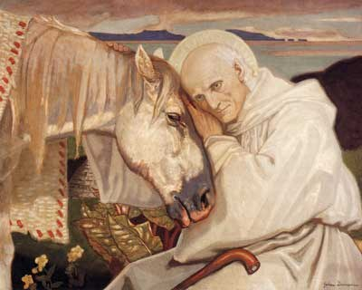</picture>
<figcaption><b>St Columba Bidding Farewell to the White Horse</b>, by the Scottish painter <b>John Duncan</b> (1866–1945). The old saint holds the weeping horse's head against his own, as Adomnán tells. Image: <a href="https://commons.wikimedia.org/wiki/File:Stcolumbaduncanunknowndate.jpg">Stcolumbaduncanunknowndate</a> by John Duncan, public domain, via Wikimedia Commons.</figcaption>
</figure>

<h2 id=death>"Where art thou, father?"</h2>

He went back to his hut and sat down to his last work: copying the Psalter. He came to the verse of Psalm 34 (33 in the Latin), "They that seek the Lord shall want no manner of thing that is good", and stopped. "Here," he said, "at the end of the page, I must stop; and what follows let Baithene write." The next verse is "Come, ye children, and hearken unto me: I will teach you the fear of the Lord", and Adomnán saw how fitting it was: Baithéne would be the next father and teacher of the monks.

Columba went to the church for the vigil of Sunday, and then lay down on his bed, which was a bare stone slab, with a stone for his pillow. There he gave Diormit his last words for the brothers:

> "These, O my children, are the last words I address to you: that ye be at peace, and have unfeigned charity among yourselves; and if you thus follow the example of the holy fathers, God, the Comforter of the good, will be your Helper and I, abiding with Him, will intercede for you; and He will not only give you sufficient to supply the wants of this present life, but will also bestow on you the good and eternal rewards which are laid up for those that keep His commandments."

Then he was silent. At midnight the bell rang for the night office. Columba rose at once, went to the church, running ahead of all the others, and knelt alone in prayer before the altar. Diormit, following more slowly, saw from a distance that the whole church was filled with heavenly light around the saint; a few of the brothers saw it too. As he came to the door the light vanished, and he went in, feeling his way in the dark:

> "Diormit therefore entering the church, cried out in a mournful voice, 'Where art thou, father?' And feeling his way in the darkness, as the brethren had not yet brought in the lights, he found the saint lying before the altar; and raising him up a little, he sat down beside him, and laid his holy head on his bosom."

The monks ran in with their lamps, and when they saw their father dying they wept aloud. And then, Adomnán says, the saint "opened wide his eyes and looked round him from side to side, with a countenance full of wonderful joy and gladness, no doubt seeing the holy angels coming to meet him". Diormit lifted Columba's right hand so that he could bless his monks, and the old abbot moved his hand with him as well as he could. Having blessed them, he breathed his last. It was the first hour of Sunday, 9 June 597. His face stayed ruddy and bright, so that he looked "not so much of one dead, as of one alive and sleeping".

<figure class=photo>
<picture><source srcset="/static/art/col-iona-shrine-chapel-600.webp 600w,/static/art/col-iona-shrine-chapel.webp 1280w" sizes="(max-width:760px) 100vw,760px" type="image/webp">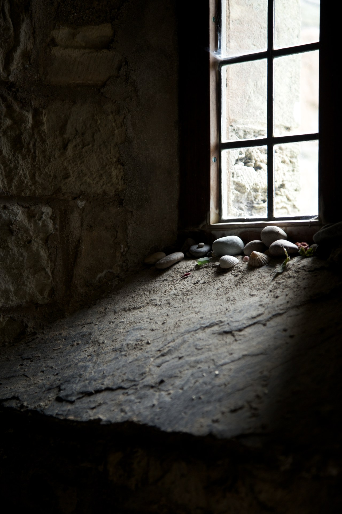</picture>
<figcaption>Inside <b>St Columba's Shrine</b> at Iona Abbey, the little chapel beside the west door of the church that by tradition marks the place of his first grave. Pebbles from the beaches of Iona lie on its ledge. Photo: <a href="https://commons.wikimedia.org/wiki/File:Iona_Abbey_-_interior_of_St_Columba%27s_shrine.jpg">Iona Abbey - interior of St Columba's shrine</a> by Tom Parnell, <a href="https://creativecommons.org/licenses/by-sa/4.0">CC BY-SA 4.0</a>, via Wikimedia Commons.</figcaption>
</figure>

<figure class=photo>
<picture><source srcset="/static/art/col-pillow-stone-600.webp 600w,/static/art/col-pillow-stone.webp 1280w" sizes="(max-width:760px) 100vw,760px" type="image/webp">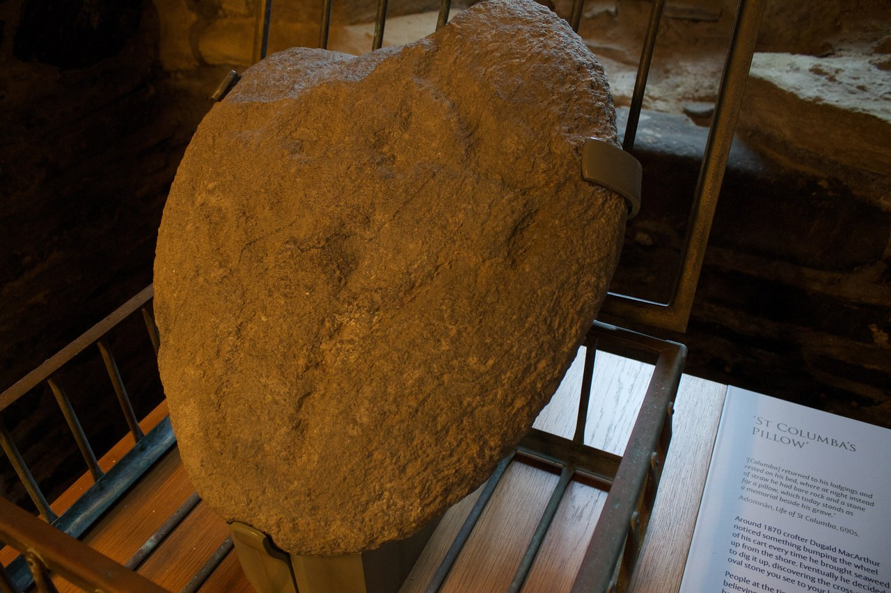</picture>
<figcaption>A carved stone in the Iona Abbey museum honoured as <b>St Columba's pillow</b>. Adomnán says his pillow was a stone, "which stands to this day as a kind of monument beside his grave". Photo: <a href="https://commons.wikimedia.org/wiki/File:The_pillow_of_St_Columba_(15064288008).jpg">The pillow of St Columba (15064288008)</a> by Brian Gratwicke, <a href="https://creativecommons.org/licenses/by/2.0">CC BY 2.0</a>, via Wikimedia Commons.</figcaption>
</figure>

<h2 id=glory>A pillar of fire over Iona</h2>

At the very hour of his death, God showed it far away. In Ireland, at a monastery in Meath, an old holy man named Lugud had a vision, and at dawn he told it in tears:

> "In the middle of this last night, Columba, the pillar of many churches, passed to the Lord; and at the moment of his blessed departure, I saw in the spirit the whole Iouan island, where I never was in the body, resplendent with the brightness of angels; and the whole heavens above it, up to the very zenith, were illumined with the brilliant light of the same heavenly messengers, who descended in countless numbers to bear away his holy soul."

That same night, some fishermen were fishing in the river Finn in Donegal, in the country where Columba was born. Suddenly they saw the whole sky light up, and in the east "something like an immense pillar of fire, which seemed to us, as it ascended upwards at that midnight, to illuminate the whole earth like the summer sun at noon".

The monks kept his funeral for three days and three nights, with psalms and prayers. Columba had once told a brother that no crowds would come to his funeral, only his own monks, and so it was: a great storm of wind without rain blew for all three days, so that no one could cross the sound to Iona. As soon as he was buried in a shroud of fine linen, "to rise again with lustrous and eternal brightness", the wind dropped and the whole sea became calm.

Adomnán ends his book in wonder at how far God had spread the name of the monk of a small island at the edge of the world:

> "His name hath not only become illustrious throughout the whole of our own Scotia (Ireland), and Britain, the largest island of the whole world, but hath reached even unto triangular Spain, and into Gaul, and to Italy, which lieth beyond the Penine Alps; and also to the city of Rome itself, the head of all cities."

In the very year he died, 597, [St Gregory the Great](/saints/gregory-the-great/) sent St Augustine to the English of Kent. The two great missions of Britain, from Rome in the south and from Iona in the north, began in the same year.

<h2 id=relics>His relics and the Brecbennoch</h2>

Columba's bones rested on Iona for two hundred years, honoured by kings and pilgrims, as he had foretold. Then the Vikings came. They raided Iona in 795 and 802, and in 806 they killed sixty-eight monks on the beach still called Martyrs' Bay. In 825 the monk **Blathmac**, who had stayed on the island with a few companions, was killed at the altar because he would not tell the raiders where the precious shrine of Columba was hidden. The monk-poet Walafrid Strabo, far away in Germany, wrote a poem in his honour.

For safety, the relics were divided. In 849 Kenneth mac Alpin, king of the Scots and the Picts, carried part of them to his new church at **Dunkeld** in Perthshire, which became the chief church of Columba in Scotland. The rest went to **Kells** in Ireland, where the monks of Iona had built a new monastery. Later, by a much-loved tradition, his body came to rest at **Downpatrick** with those of St Patrick and St Brigid, and the old rhyme says: "In Down three saints one grave do fill, Patrick, Brigid and Colum Cille."

The most famous of his relics in Scotland was the **Brecbennoch** of St Columba, "the speckled peaked thing", a small shrine that the kings of Scots gave into the keeping of the abbots of Arbroath, to be carried before the Scottish army so that the saint would fight for his people. It was carried at **Bannockburn** in 1314, where King Robert the Bruce won the freedom of Scotland. A tiny house-shaped shrine of the eighth century, the **Monymusk Reliquary**, long honoured as the Brecbennoch, is now one of the treasures of the National Museum of Scotland in Edinburgh. It is made of wood covered with silver and bronze, decorated with leaping, twisting beasts, and it was probably made by the monks of Iona.

In Ireland, the O'Donnells kept the **Cathach** in its shrine, its *cumdach*, of silver and gilt bronze, begun at Kells between 1072 and 1098 and rebuilt in the fourteenth century with Christ in majesty and the Crucifixion on its face. They carried it into battle for centuries.

<figure class=photo>
<picture><source srcset="/static/art/col-monymusk-600.webp 600w,/static/art/col-monymusk.webp 1280w" sizes="(max-width:760px) 100vw,760px" type="image/webp">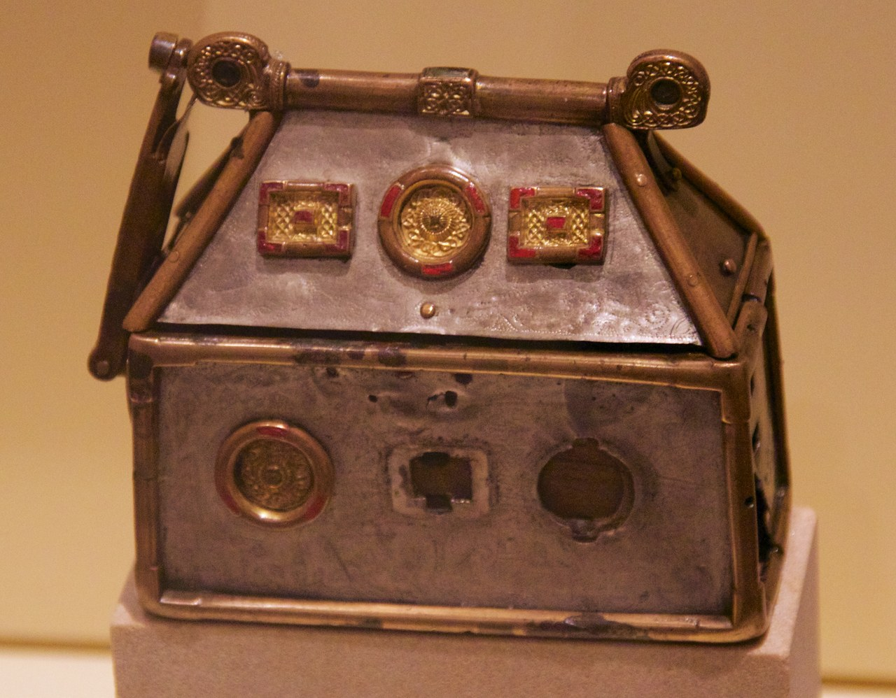</picture>
<figcaption>The <b>Monymusk Reliquary</b>, made about 750, probably on Iona, and long honoured as the Brecbennoch of St Columba, carried before the Scottish army at Bannockburn. National Museum of Scotland, Edinburgh. Photo: <a href="https://commons.wikimedia.org/wiki/File:Monymusk_Reliquary_2013-1.jpg">Monymusk Reliquary 2013-1</a> by Mike Peel, <a href="https://creativecommons.org/licenses/by-sa/4.0">CC BY-SA 4.0</a>, via Wikimedia Commons.</figcaption>
</figure>

<figure class=photo>
<picture><source srcset="/static/art/col-cathach-shrine-600.webp 600w,/static/art/col-cathach-shrine.webp 1280w" sizes="(max-width:760px) 100vw,760px" type="image/webp">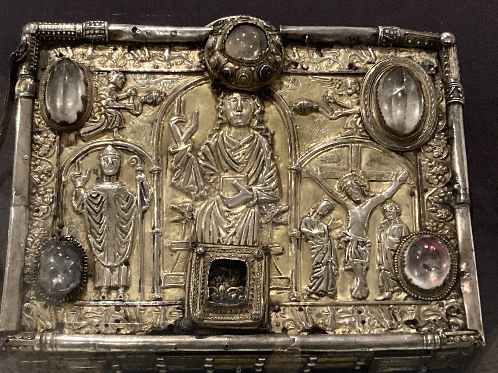</picture>
<figcaption>The <b>Shrine of the Cathach</b>, the <i>cumdach</i> made to hold Columba's psalter, begun at Kells in the late 11th century and rebuilt in the 14th. National Museum of Ireland, Dublin. Photo: <a href="https://commons.wikimedia.org/wiki/File:Shrine_of_the_Cathach.jpg">Shrine of the Cathach</a> by Ceoil, <a href="https://creativecommons.org/licenses/by-sa/4.0">CC BY-SA 4.0</a>, via Wikimedia Commons.</figcaption>
</figure>

<h2 id=kells>The Book of Kells</h2>

The greatest treasure that Columba's family of monks ever made is the **Book of Kells**, the four Gospels in Latin, written and painted about the year 800. Almost every page shines with colour: purple, green, gold and blue. Letters turn into beasts and birds and angels, interlacing patterns twist in endless knots, and in the great pictures Christ is enthroned in glory, the Virgin holds her Child, and the angels and the symbols of the evangelists fill every corner. It was most likely begun on Iona and finished at Kells, where the monks of Iona fled from the Vikings and built a new monastery between 807 and 814.

For centuries it was called simply the Gospel of Colum Cille. In 1007, the Annals of Ulster record, "the great Gospel of Columkille, the chief relic of the Western World, was wickedly stolen during the night from the western sacristy of the great stone church at Cenannas", for the sake of its golden cover. It was found a few months later, without its cover, "under a sod". Since 1661 it has been kept at **Trinity College Dublin**, where visitors from all over the world come to see it every day.

The most famous page is the ***Chi Rho*** page (folio 34 recto), where the first letters of the name of Christ in Greek, ΧΡ, fill the page at the beginning of St Matthew's account of the birth of Christ: "Now the generation of Christ was in this wise." Hidden in its spirals are angels, a moth, an otter with a fish, and two cats watching two mice nibbling a Host.

Older still is the **Book of Durrow**, made at or near Columba's monastery of Durrow between about 650 and 700. Its last page asks the reader to pray for "Columba" the scribe, and for centuries it was believed to be his own work. The country people loved it too: in the 1600s its keeper used to dip it in water and give the water to sick cattle to cure them.

<figure class=photo>
<picture><source srcset="/static/art/col-kells-chirho-600.webp 600w,/static/art/col-kells-chirho.webp 1123w" sizes="(max-width:760px) 100vw,760px" type="image/webp">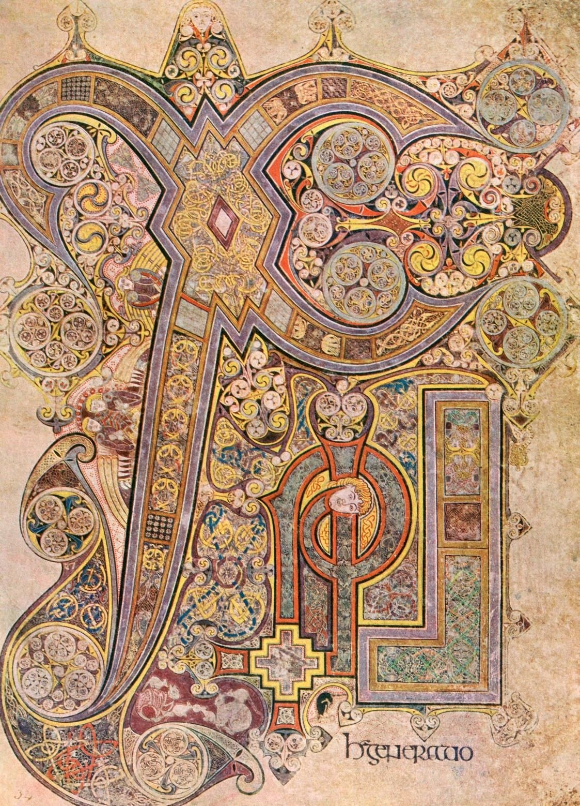</picture>
<figcaption>The <b>Chi Rho page</b> of the Book of Kells, folio 34 recto, about 800. The great monogram of the name of Christ opens the story of his birth in St Matthew. Trinity College Dublin. Image: <a href="https://commons.wikimedia.org/wiki/File:KellsFol034rChiRhoMonogram.jpg">KellsFol034rChiRhoMonogram</a> by Trinity College Dublin, public domain, via Wikimedia Commons.</figcaption>
</figure>

<figure class=photo>
<picture><source srcset="/static/art/col-kells-christ-600.webp 600w,/static/art/col-kells-christ.webp 1280w" sizes="(max-width:760px) 100vw,760px" type="image/webp">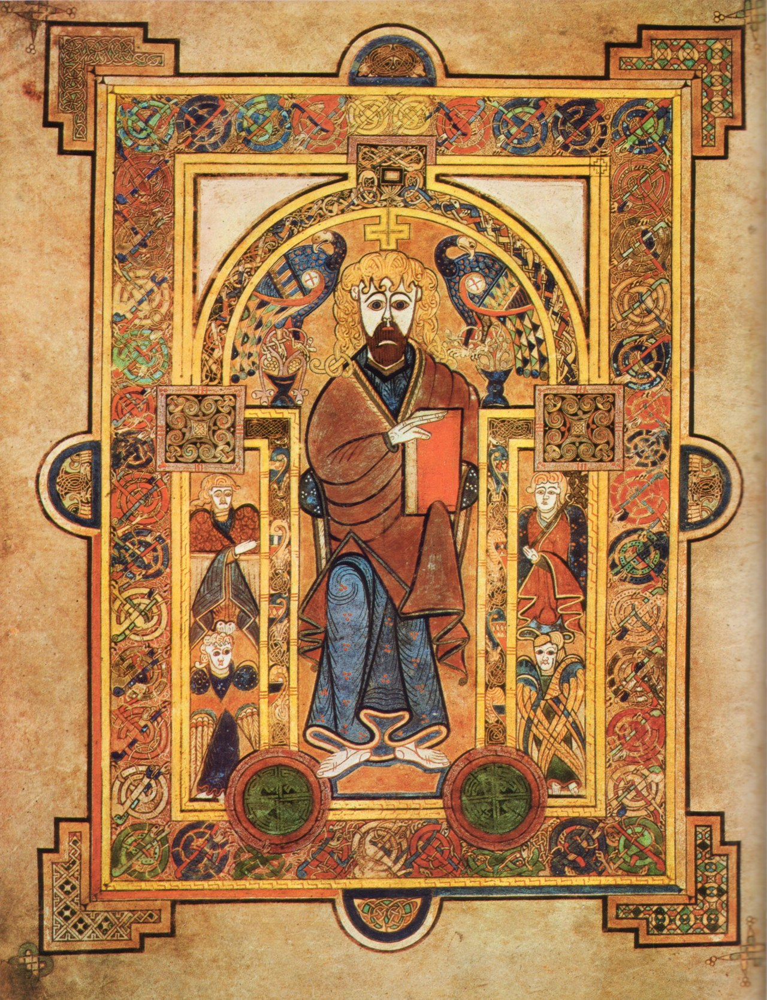</picture>
<figcaption><b>Christ enthroned</b>, folio 32 verso of the Book of Kells, flanked by peacocks, the symbol of the Resurrection, and by angels. Image: <a href="https://commons.wikimedia.org/wiki/File:KellsFol032vChristEnthroned.jpg">KellsFol032vChristEnthroned</a> by Trinity College Dublin, public domain, via Wikimedia Commons.</figcaption>
</figure>

<figure class=photo>
<picture><source srcset="/static/art/col-kells-virgin-600.webp 600w,/static/art/col-kells-virgin.webp 1280w" sizes="(max-width:760px) 100vw,760px" type="image/webp">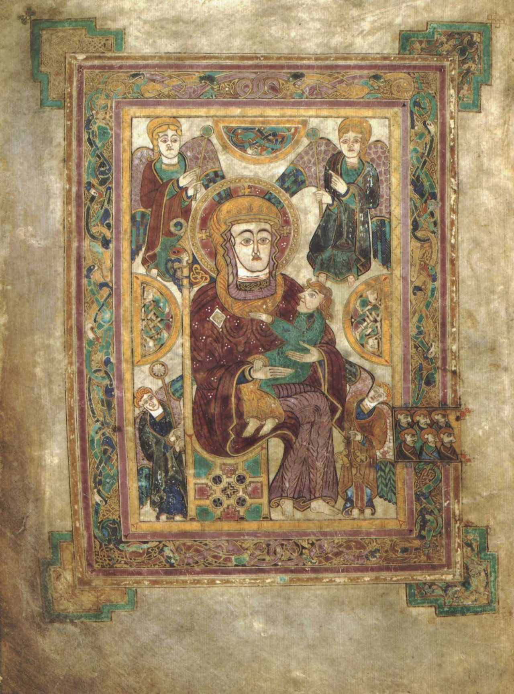</picture>
<figcaption><b>The Virgin and Child</b> with four angels, folio 7 verso of the Book of Kells, one of the oldest pictures of the Mother of God in any Western manuscript. Image: <a href="https://commons.wikimedia.org/wiki/File:KellsFol007vMadonnaChild.jpg">KellsFol007vMadonnaChild</a> by Trinity College Dublin, public domain, via Wikimedia Commons.</figcaption>
</figure>

<figure class=photo>
<picture><source srcset="/static/art/col-kells-horseman-600.webp 600w,/static/art/col-kells-horseman.webp 354w" sizes="(max-width:760px) 100vw,760px" type="image/webp">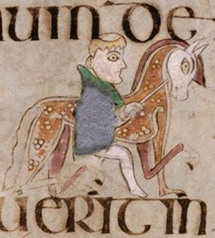</picture>
<figcaption>A tiny <b>horseman</b> in the text of St Luke's Gospel, folio 255 of the Book of Kells. The painters filled the margins and letters with such small creatures. Image: <a href="https://commons.wikimedia.org/wiki/File:Folio_255_Luke_(detail_of_horseman).jpg">Folio 255 Luke (detail of horseman)</a> by Trinity College Dublin, public domain, via Wikimedia Commons.</figcaption>
</figure>

<figure class=photo>
<picture><source srcset="/static/art/col-kells-trinity-600.webp 600w,/static/art/col-kells-trinity.webp 1280w" sizes="(max-width:760px) 100vw,760px" type="image/webp">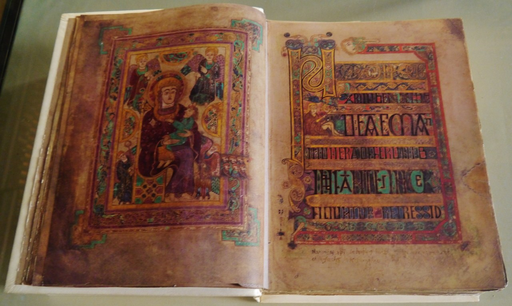</picture>
<figcaption>The <b>Book of Kells on display</b> at Trinity College Dublin, where it has been kept since 1661. It lies open in its case at two of its pages, which are changed from time to time. Photo: <a href="https://commons.wikimedia.org/wiki/File:Dublin_Trinity_College_Library_Long_Room_Book_of_Kells_1.jpg">Dublin Trinity College Library Long Room Book of Kells 1</a> by Zairon, <a href="https://creativecommons.org/licenses/by/4.0">CC BY 4.0</a>, via Wikimedia Commons.</figcaption>
</figure>

<figure class=photo>
<picture><source srcset="/static/art/col-durrow-man-600.webp 600w,/static/art/col-durrow-man.webp 1280w" sizes="(max-width:760px) 100vw,760px" type="image/webp">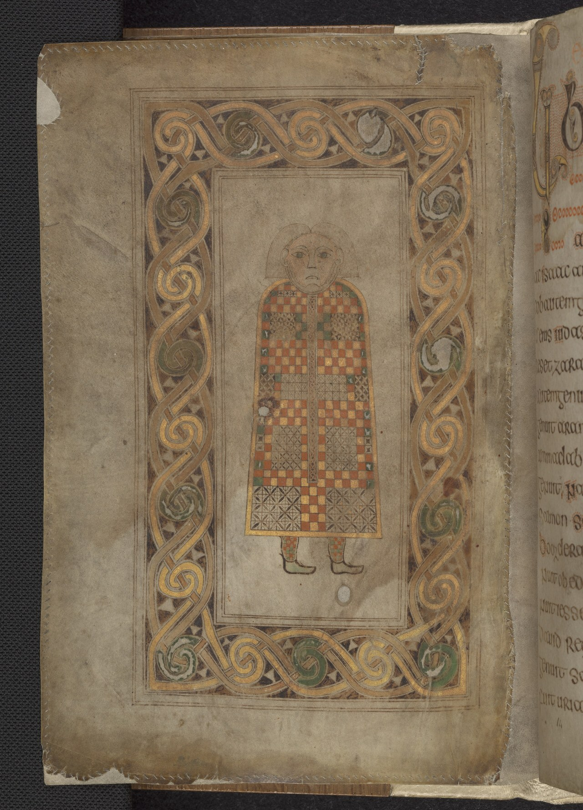</picture>
<figcaption>The <b>Man, the symbol of St Matthew</b>, folio 21 verso of the Book of Durrow, made in Columba's monastery family between about 650 and 700. Trinity College Dublin. Image: <a href="https://commons.wikimedia.org/wiki/File:IE_TCD_MS_57_f.21v.jpg">IE TCD MS 57 f.21v</a> by Trinity College Dublin Library, <a href="https://creativecommons.org/licenses/by/4.0">CC BY 4.0</a>, via Wikimedia Commons.</figcaption>
</figure>

<figure class=photo>
<picture><source srcset="/static/art/col-durrow-carpet-600.webp 600w,/static/art/col-durrow-carpet.webp 1280w" sizes="(max-width:760px) 100vw,760px" type="image/webp">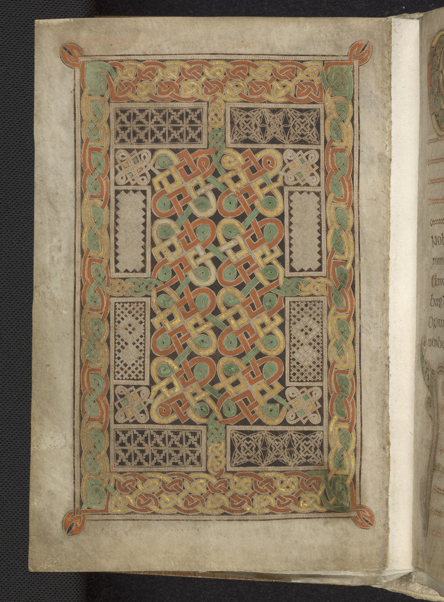</picture>
<figcaption>A <b>carpet page</b> from the Book of Durrow, folio 125 verso, a whole page of interlace around a cross, made for prayer and wonder rather than reading. Image: <a href="https://commons.wikimedia.org/wiki/File:IE_TCD_MS_57_f.125v.jpg">IE TCD MS 57 f.125v</a> by Trinity College Dublin Library, <a href="https://creativecommons.org/licenses/by/4.0">CC BY 4.0</a>, via Wikimedia Commons.</figcaption>
</figure>

<h2 id=northumbria>From Iona to Lindisfarne</h2>

Columba's mission did not end when he died. Iona's monks went on preaching across the north, and the greatest harvest came among the English of Northumbria. When the pagan king Æthelfrith was killed in 616, his young sons fled into exile among the Scots of Dál Riata, and there, on Iona and in the country around it, the prince **Oswald** was baptised with twelve companions.

In 634 Oswald came home to win back his kingdom, with a small army against the great host of the British king Cadwallon. Adomnán had the story from his predecessor, Abbot Failbe, who heard Oswald himself tell it. The night before the battle, as Oswald slept in his tent, he saw St Columba "beaming with angelic brightness, and of figure so majestic that his head seemed to touch the clouds". The saint spread his shining cloak over the whole camp, and said to him the words God spoke to Joshua before the crossing of the Jordan: "Be strong and of a good courage; behold, I shall be with thee." Then he added: "March out this following night from your camp to battle, for on this occasion the Lord has granted to me that your foes shall be put to flight." Oswald raised a wooden cross on the field of Heavenfield near Hexham, prayed with his men, and won a great victory.

As soon as he was king, Bede says, Oswald sent to the elders of the Scots, "among whom himself and his followers, when in banishment, had received the sacrament of baptism", asking for a bishop. Iona sent him **St Aidan**, "a man of singular meekness, piety, and moderation". In 635 Oswald gave Aidan the tidal island of **Lindisfarne**, and there Aidan founded a monastery like Iona, and set out on foot to preach to the English. Because Aidan did not yet speak English well, Bede writes, "it was most delightful to see the king himself interpreting the word of God to his commanders and ministers, for he had perfectly learned the language of the Scots during his long banishment".

From Lindisfarne, Columba's spiritual children carried the Gospel through the north and middle of England. A shepherd boy named Cuthbert saw the soul of Aidan carried to heaven by angels on the night he died, and became the great [St Cuthbert](/saints/cuthbert/) of Lindisfarne. The monks of Lindisfarne made the **Lindisfarne Gospels** about 715, in the same tradition of art as the Books of Durrow and Kells. Today pilgrims still walk [St Cuthbert's Way](/pilgrimage/st-cuthbert/) from Melrose to [Holy Island](/pilgrimage/st-cuthbert/holy-island/), following the path of the faith that came from Iona.

<figure class=photo>
<picture><source srcset="/static/art/col-turner-holy-island-600.webp 600w,/static/art/col-turner-holy-island.webp 1280w" sizes="(max-width:760px) 100vw,760px" type="image/webp">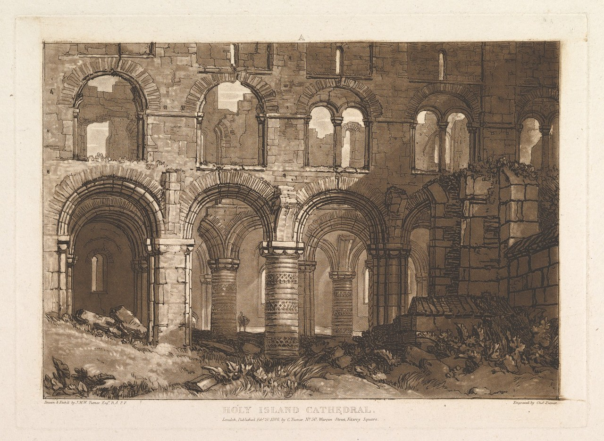</picture>
<figcaption><b>Holy Island Cathedral</b>, the ruins of Lindisfarne Priory, in a print from the <i>Liber Studiorum</i> of <b>J. M. W. Turner</b>, engraved by Charles Turner and published in 1808. Metropolitan Museum of Art, New York. The priory stands on the site of Aidan's monastery. Image: <a href="https://commons.wikimedia.org/wiki/File:Holy_Island_Cathedral_(Liber_Studiorum,_part_III,_plate_11)_MET_DP821354.jpg">Holy Island Cathedral (Liber Studiorum, part III, plate 11) MET DP821354</a> by J. M. W. Turner and Charles Turner, Metropolitan Museum of Art, <a href="https://creativecommons.org/publicdomain/zero/1.0/">CC0</a>, via Wikimedia Commons.</figcaption>
</figure>

<figure class=photo>
<picture><source srcset="/static/art/col-lindisfarne-matthew-600.webp 600w,/static/art/col-lindisfarne-matthew.webp 1280w" sizes="(max-width:760px) 100vw,760px" type="image/webp">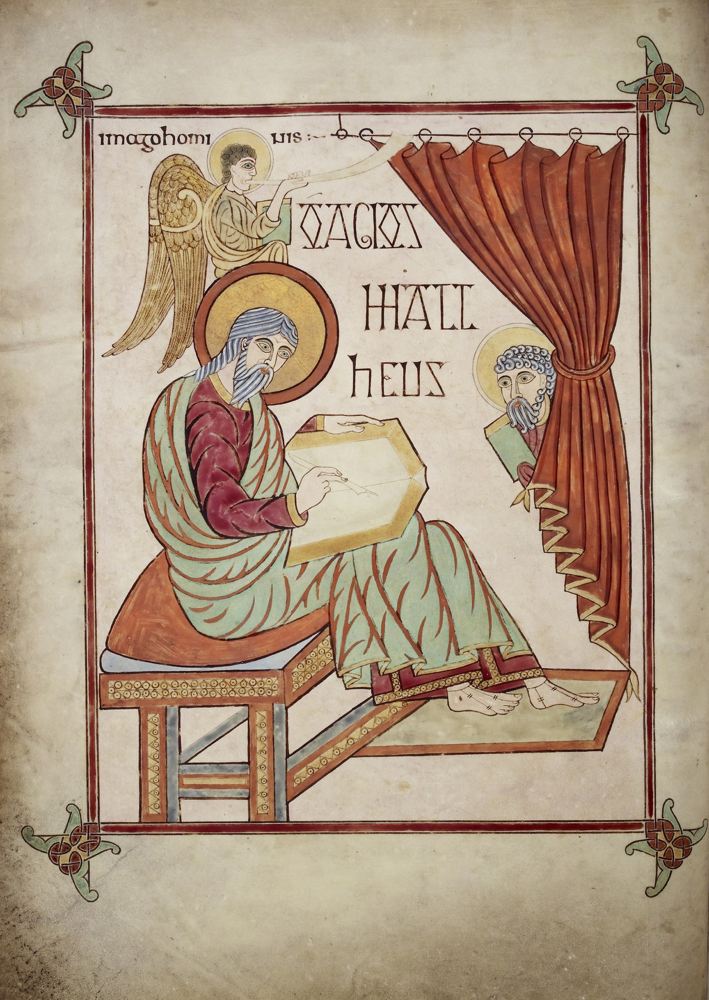</picture>
<figcaption><b>St Matthew</b> in the <b>Lindisfarne Gospels</b>, folio 25 verso, made at Lindisfarne about 715–720 by the monks of the monastery founded from Iona. British Library, London. Image: <a href="https://commons.wikimedia.org/wiki/File:St._Matthew_-_Lindisfarne_Gospels_(710-721),_f.25v_-_BL_Cotton_MS_Nero_D_IV.jpg">St. Matthew - Lindisfarne Gospels (710-721), f.25v - BL Cotton MS Nero D IV</a> by British Library, <a href="https://creativecommons.org/publicdomain/zero/1.0/">CC0</a>, via Wikimedia Commons.</figcaption>
</figure>
<h2 id=places>His places and churches</h2>

Columba's world stretches from the hills of Donegal to the Great Glen of Scotland, and from the Atlantic edge of Iona to the tidal island of Lindisfarne. In Ireland the places he founded are still towns and parishes that bear his name; in Scotland, his island is still a place of pilgrimage, prayer and peace, where people come from all over the world to walk where he walked.

<figure class=map><figcaption>St Columba's places and churches in Ireland, Scotland and Northumbria, with insets of Iona and Kells. Map by The Daily Word; borders and rivers from Natural Earth (public domain); places and the coasts of Iona and Mull located with OpenStreetMap. Tap to enlarge.</figcaption></figure>

### 1 · Iona

The island of Iona, *Ì Chaluim Chille*, "Columba's island", lies across a narrow sound from the Ross of Mull. It is three miles long, with white beaches, green machair and rocky hills, and its only village, Baile Mòr, sits beside the landing place. In the Middle Ages a **Benedictine abbey** was built on the site of Columba's monastery in about 1203 by Reginald, son of Somerled, lord of the Isles, and a convent of Augustinian nuns beside it. After the Reformation both fell into ruin. The abbey church was restored between 1902 and 1910, and from 1938 the ecumenical **Iona Community**, founded by George MacLeod, rebuilt the cloister and the monks' buildings by hand. Daily prayer is sung in the abbey church again.

<figure class=photo>
<picture><source srcset="/static/art/col-iona-abbey-1899-600.webp 600w,/static/art/col-iona-abbey-1899.webp 1280w" sizes="(max-width:760px) 100vw,760px" type="image/webp">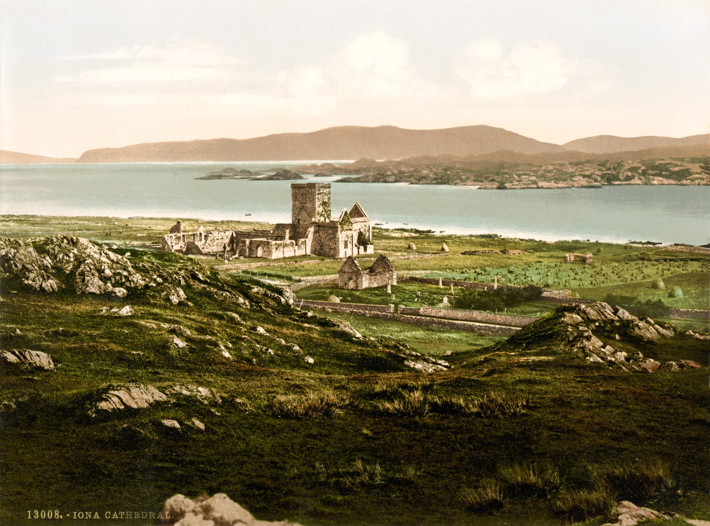</picture>
<figcaption><b>Iona Abbey</b> in a photochrom print of about 1899, by Photoglob of Zürich, before the restoration of the church. Library of Congress. Photochrom: <a href="https://commons.wikimedia.org/wiki/File:Iona_Cathedral,_Iona,_Scotland,_ca._1899.jpg">Iona Cathedral, Iona, Scotland, ca. 1899</a> by Photoglob Zürich / Detroit Publishing Co., public domain, via Wikimedia Commons.</figcaption>
</figure>

<figure class=photo>
<picture><source srcset="/static/art/col-iona-abbey-water-600.webp 600w,/static/art/col-iona-abbey-water.webp 510w" sizes="(max-width:760px) 100vw,760px" type="image/webp">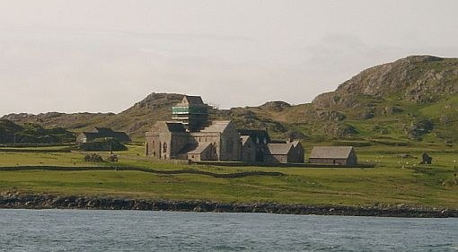</picture>
<figcaption><b>Iona Abbey from the sea</b>, as pilgrims see it from the ferry. The church is built on the site of Columba's oak church on the eastern shore. Photo: <a href="https://commons.wikimedia.org/wiki/File:Iona_Abbey_from_water.jpg">Iona Abbey from water</a> by Karl Gruber, <a href="https://creativecommons.org/licenses/by-sa/3.0">CC BY-SA 3.0</a>, via Wikimedia Commons.</figcaption>
</figure>

<figure class=photo>
<picture><source srcset="/static/art/col-iona-altar-600.webp 600w,/static/art/col-iona-altar.webp 800w" sizes="(max-width:760px) 100vw,760px" type="image/webp">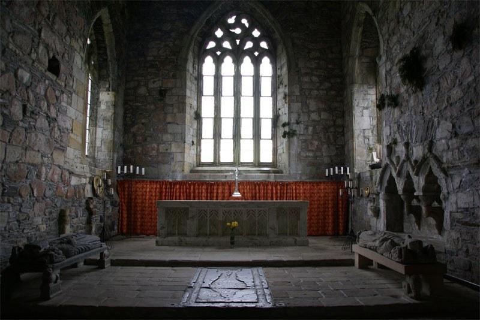</picture>
<figcaption>The <b>high altar of Iona Abbey</b>. Near this place, at the altar of his own church, Columba died at midnight on 9 June 597. Photo: <a href="https://commons.wikimedia.org/wiki/File:Iona_Abbey_-_altar.jpg">Iona Abbey - altar</a> by Otter, <a href="https://creativecommons.org/licenses/by-sa/3.0">CC BY-SA 3.0</a>, via Wikimedia Commons.</figcaption>
</figure>

**St Martin's Cross** has stood outside the west door of the abbey since the eighth century. Carved from a single block of stone, more than four metres high, it is one of the finest early Christian crosses in the British Isles, and the only one on Iona still standing where it was first set up. On its west face are the Virgin and Child with angels, Daniel in the lions' den, Abraham about to sacrifice Isaac, and David with his musicians; the east face is covered with serpents and bosses. It is named after [St Martin of Tours](/saints/martin-of-tours/), whom the Irish monks loved as a father of monks.

<figure class=photo>
<picture><source srcset="/static/art/col-iona-st-martins-sea-600.webp 600w,/static/art/col-iona-st-martins-sea.webp 1280w" sizes="(max-width:760px) 100vw,760px" type="image/webp">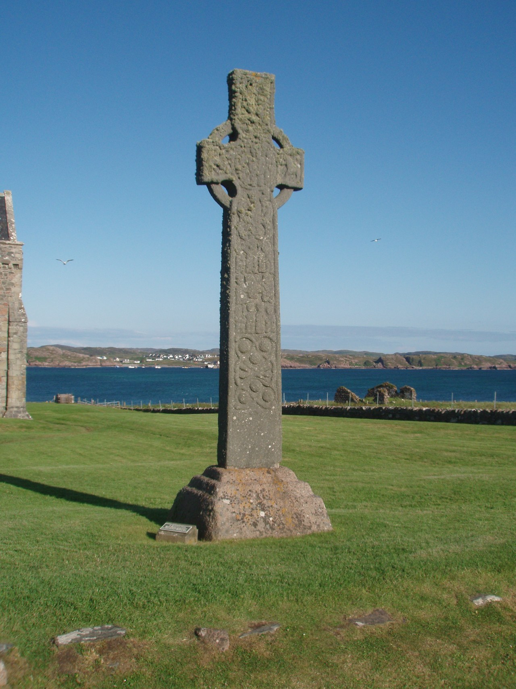</picture>
<figcaption><b>St Martin's Cross</b>, carved in the 8th century, in front of Iona Abbey, with the Sound of Iona behind. It has stood here for over twelve hundred years. Photo: <a href="https://commons.wikimedia.org/wiki/File:Iona_Abbey_-_St_Martin%27s_cross_-_July_2011_-_front.jpeg">Iona Abbey - St Martin's cross - July 2011 - front</a> by Akela NDE, <a href="https://creativecommons.org/licenses/by-sa/3.0">CC BY-SA 3.0</a>, via Wikimedia Commons.</figcaption>
</figure>

<figure class=photo>
<picture><source srcset="/static/art/col-iona-st-martins-600.webp 600w,/static/art/col-iona-st-martins.webp 307w" sizes="(max-width:760px) 100vw,760px" type="image/webp">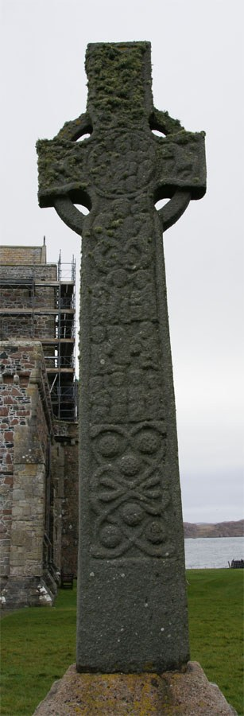</picture>
<figcaption>The west face of <b>St Martin's Cross</b>, with the Virgin and Child at the centre of the head, and scenes from the Old Testament on the shaft. Photo: <a href="https://commons.wikimedia.org/wiki/File:Iona_Abbey_-_St_Martin%27s_Cross.jpg">Iona Abbey - St Martin's Cross</a> by Otter, <a href="https://creativecommons.org/licenses/by-sa/3.0">CC BY-SA 3.0</a>, via Wikimedia Commons.</figcaption>
</figure>

<figure class=photo>
<picture><source srcset="/static/art/col-iona-cruit-600.webp 600w,/static/art/col-iona-cruit.webp 342w" sizes="(max-width:760px) 100vw,760px" type="image/webp">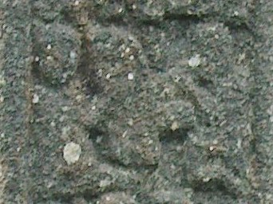</picture>
<figcaption>A detail of <b>St Martin's Cross</b>: King David's musicians, one with a lyre, the <i>cruit</i>, and one with triple pipes. The psalms of David were the daily prayer of Columba's monks. Photo: <a href="https://commons.wikimedia.org/wiki/File:Cruit_(lyre)_and_triple_pipes,_St_Martin%27s_Cross,_Iona.jpg">Cruit (lyre) and triple pipes, St Martin's Cross, Iona</a> by Magnus Hagdorn, <a href="https://creativecommons.org/licenses/by-sa/2.0">CC BY-SA 2.0</a>, via Wikimedia Commons.</figcaption>
</figure>

Beside it, in front of the little shrine chapel, stood **St John's Cross**, one of the first crosses ever made with the ring that became the sign of the Celtic cross. It was blown down long ago and broken; the pieces have been put together and are kept in the abbey museum, and a cast stands in its place.

<figure class=photo>
<picture><source srcset="/static/art/col-iona-st-johns-600.webp 600w,/static/art/col-iona-st-johns.webp 1280w" sizes="(max-width:760px) 100vw,760px" type="image/webp">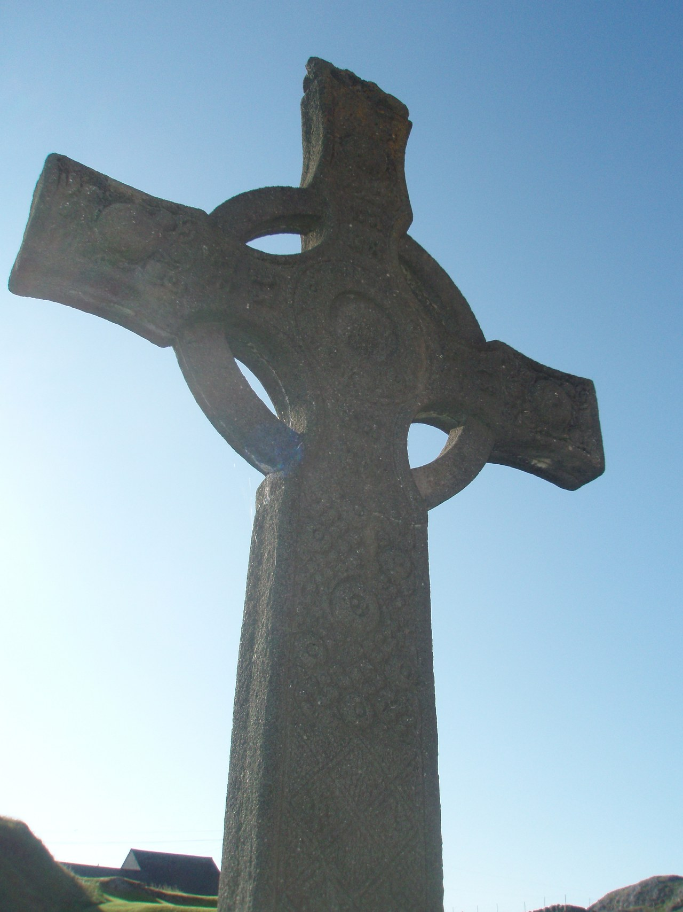</picture>
<figcaption>The cast of <b>St John's Cross</b> standing at its original place in front of St Columba's Shrine. Photo: <a href="https://commons.wikimedia.org/wiki/File:Iona_Abbey_-_St_John%27s_cross_(new)_-_July_2011.jpeg">Iona Abbey - St John's cross (new) - July 2011</a> by Akela NDE, <a href="https://creativecommons.org/licenses/by-sa/2.0/fr/deed.en">CC BY-SA 2.0 fr</a>, via Wikimedia Commons.</figcaption>
</figure>

<figure class=photo>
<picture><source srcset="/static/art/col-iona-st-johns-orig-600.webp 600w,/static/art/col-iona-st-johns-orig.webp 568w" sizes="(max-width:760px) 100vw,760px" type="image/webp">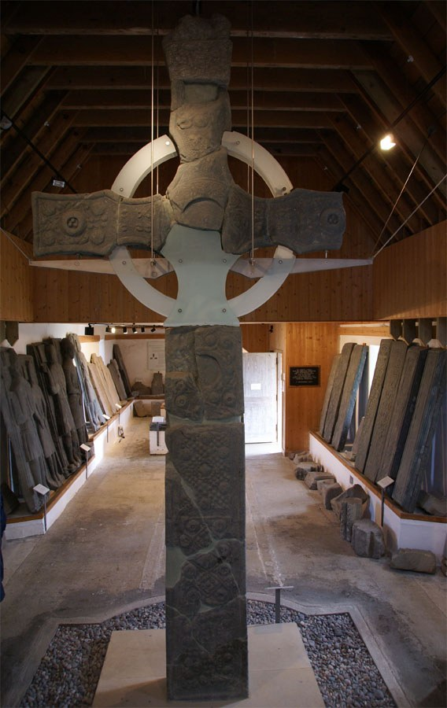</picture>
<figcaption>The original <b>St John's Cross</b>, of the 8th century, reassembled in the Iona Abbey museum. It is one of the oldest ringed crosses in Scotland. Photo: <a href="https://commons.wikimedia.org/wiki/File:Iona_Abbey_-_St_John%27s_Cross.jpg">Iona Abbey - St John's Cross</a> by Otter, <a href="https://creativecommons.org/licenses/by-sa/3.0">CC BY-SA 3.0</a>, via Wikimedia Commons.</figcaption>
</figure>

**St Oran's Chapel**, a small, plain stone chapel of the twelfth century, is the oldest building on the island still whole. It is named after **Odran**, by tradition one of Columba's twelve companions and the first of them to die and be buried on Iona. Around it lies the **Reilig Odhráin**, the ancient burial ground of Iona, where by tradition kings of Scotland, Ireland and Norway were brought to be buried near the saint, among them Kenneth mac Alpin, Duncan and Macbeth.

<figure class=photo>
<picture><source srcset="/static/art/col-iona-st-orans-600.webp 600w,/static/art/col-iona-st-orans.webp 800w" sizes="(max-width:760px) 100vw,760px" type="image/webp">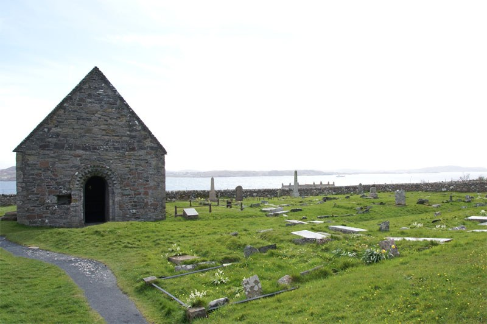</picture>
<figcaption><b>St Oran's Chapel</b>, built in the 12th century, the oldest intact building on Iona. Photo: <a href="https://commons.wikimedia.org/wiki/File:Iona_Abbey_-_St_Oran%27s_Chapel.jpg">Iona Abbey - St Oran's Chapel</a> by Otter, <a href="https://creativecommons.org/licenses/by-sa/3.0">CC BY-SA 3.0</a>, via Wikimedia Commons.</figcaption>
</figure>

<figure class=photo>
<picture><source srcset="/static/art/col-iona-st-orans-1867-600.webp 600w,/static/art/col-iona-st-orans-1867.webp 1280w" sizes="(max-width:760px) 100vw,760px" type="image/webp">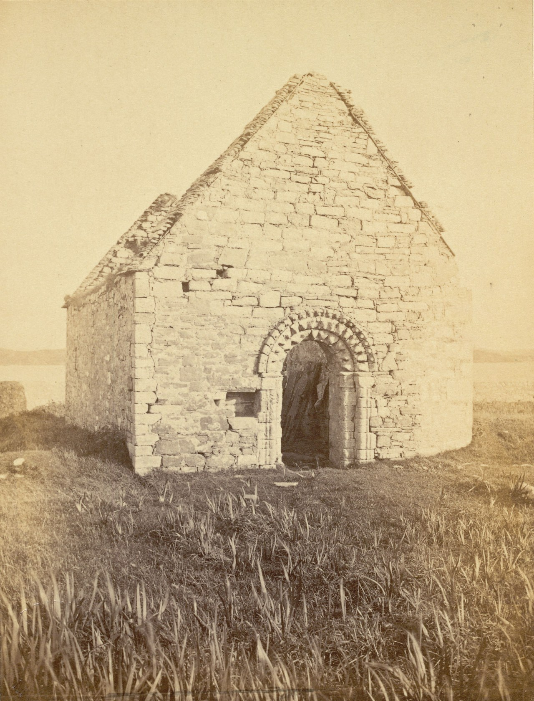</picture>
<figcaption><b>St Oran's Chapel</b> in 1867, photographed by <b>George Washington Wilson</b>, before its roof was restored. Photo: <a href="https://commons.wikimedia.org/wiki/File:St_Oran%27s_Chapel_1867.png">St Oran's Chapel 1867</a> by George Washington Wilson, public domain, via Wikimedia Commons.</figcaption>
</figure>

<figure class=photo>
<picture><source srcset="/static/art/col-iona-st-orans-int-600.webp 600w,/static/art/col-iona-st-orans-int.webp 1280w" sizes="(max-width:760px) 100vw,760px" type="image/webp">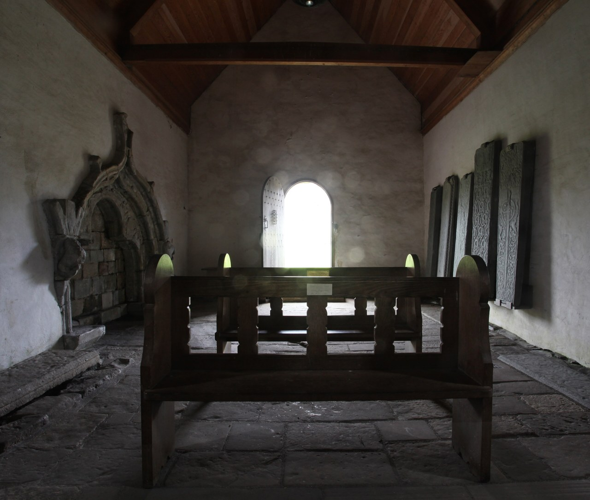</picture>
<figcaption>Inside <b>St Oran's Chapel</b>, with the tomb recess of the lords of the Isles, who were buried here. Photo: <a href="https://commons.wikimedia.org/wiki/File:St_Orans_Chapel_Iona_Interior.jpg">St Orans Chapel Iona Interior</a> by Colgill, <a href="https://creativecommons.org/licenses/by-sa/4.0">CC BY-SA 4.0</a>, via Wikimedia Commons.</figcaption>
</figure>

<figure class=photo>
<picture><source srcset="/static/art/col-iona-reilig-600.webp 600w,/static/art/col-iona-reilig.webp 1280w" sizes="(max-width:760px) 100vw,760px" type="image/webp">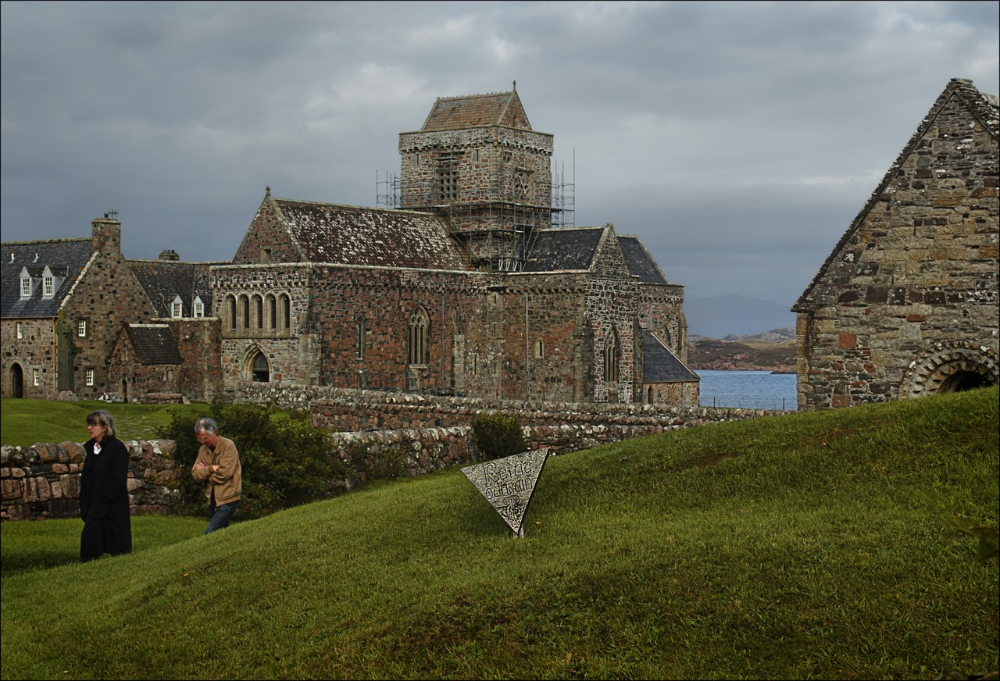</picture>
<figcaption>The <b>Reilig Odhráin</b>, the burial ground of the kings, with Iona Abbey behind. Photo: <a href="https://commons.wikimedia.org/wiki/File:The_Reilig_Odhrain_at_Iona_Abbey_(6159046243).jpg">The Reilig Odhrain at Iona Abbey (6159046243)</a> by dun_deagh, <a href="https://creativecommons.org/licenses/by-sa/2.0">CC BY-SA 2.0</a>, via Wikimedia Commons.</figcaption>
</figure>

**Dùn Ì**, the highest hill on Iona, rises just north of the abbey, a hundred metres above the sea. From its top you can see the whole island and the islands of the Hebrides all around.

<figure class=photo>
<picture><source srcset="/static/art/col-iona-dun-i-600.webp 600w,/static/art/col-iona-dun-i.webp 1280w" sizes="(max-width:760px) 100vw,760px" type="image/webp">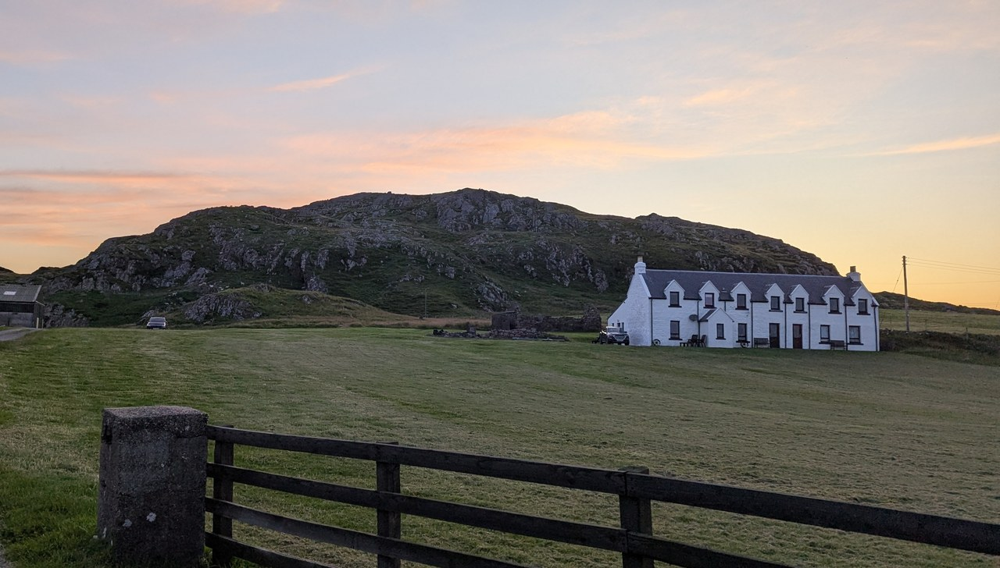</picture>
<figcaption><b>Dùn Ì</b>, the highest hill of Iona, at sunset. From its top Columba could see his whole island. Photo: <a href="https://commons.wikimedia.org/wiki/File:Dun_%C3%8C_at_sunset.jpg">Dun Ì at sunset</a> by Clydiee, <a href="https://creativecommons.org/licenses/by-sa/4.0">CC BY-SA 4.0</a>, via Wikimedia Commons.</figcaption>
</figure>

On the western side of the island, facing the open Atlantic, is the **Bay at the Back of the Ocean**, *Camas Cùil an t-Saimh*, a wide white beach beside the machair where the monks grew their grain. Close by rises the little knoll of **Sìthean Mòr**, the Hill of the Angels, where the curious brother saw the angels in white come down around the praying saint. At the southern tip of the island is **Port na Curaich**, St Columba's Bay, where he landed in 563. Pilgrims walk there from the abbey across the moor, and they often take a pebble from the beach home with them, or throw one into the sea for something they want to leave behind.

<figure class=photo>
<picture><source srcset="/static/art/col-iona-bay-back-ocean-600.webp 600w,/static/art/col-iona-bay-back-ocean.webp 1280w" sizes="(max-width:760px) 100vw,760px" type="image/webp">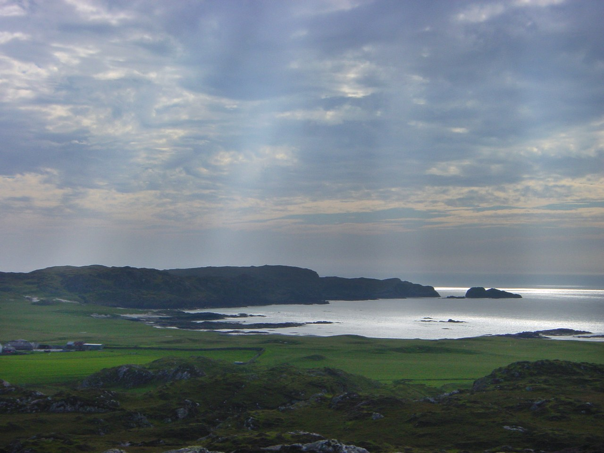</picture>
<figcaption>The <b>Bay at the Back of the Ocean</b> on the Atlantic side of Iona. The Hill of the Angels, Sìthean Mòr, rises inland from here. Photo: <a href="https://commons.wikimedia.org/wiki/File:Camas_Cuil_an_t-Saimh.jpg">Camas Cuil an t-Saimh</a> by Martin Burns, <a href="https://creativecommons.org/licenses/by/2.0">CC BY 2.0</a>, via Wikimedia Commons.</figcaption>
</figure>

### 2 · Gartan

Columba's birthplace, in the hills between Letterkenny and Glenveagh in Donegal, is a quiet country of lakes. A cross marks the place of his birth at Lacknacoo, above Lough Gartan, with the flagstone *Leac na Cumha* beside it; nearby are the ruins of **St Columbkille's Chapel** and an old graveyard, and the ruined church of the monastery that the Irish Lives say he founded in his home country.

<figure class=photo>
<picture><source srcset="/static/art/col-gartan-church-600.webp 600w,/static/art/col-gartan-church.webp 636w" sizes="(max-width:760px) 100vw,760px" type="image/webp"></picture>
<figcaption>The ruined <b>church of St Columba at Gartan</b>, by tradition on the site of the monastery he founded near his birthplace. Photo: <a href="https://commons.wikimedia.org/wiki/File:St_Columba%27s_church,_Gartan,_Donegal.jpg">St Columba's church, Gartan, Donegal</a> by Kay Atherton, <a href="https://creativecommons.org/licenses/by-sa/2.0">CC BY-SA 2.0</a>, via Wikimedia Commons.</figcaption>
</figure>

### 3 · Derry

Derry, *Doire Cholm Cille*, has honoured Columba as its founder for fourteen centuries. Its great Catholic church of **St Columba, Long Tower**, stands on the site of the *Teampall Mór*, the "great church" of the medieval monastery, built in 1164. Nearby, on the walled hill, rises **St Columb's Cathedral**, the cathedral of the Church of Ireland, built in 1633 and also named after him. St Eugene's Cathedral has his farewell to Derry in its windows. Every June the city keeps his feast.

<figure class=photo>
<picture><source srcset="/static/art/col-derry-cathedral-600.webp 600w,/static/art/col-derry-cathedral.webp 1280w" sizes="(max-width:760px) 100vw,760px" type="image/webp"></picture>
<figcaption><b>St Columb's Cathedral</b> in Derry, built in 1633 and dedicated to St Columba, the city's founder. Photo: <a href="https://commons.wikimedia.org/wiki/File:St_Columb%27s_Cathedral,_Derry.jpg">St Columb's Cathedral, Derry</a> by Alexey Komarov, <a href="https://creativecommons.org/licenses/by-sa/4.0">CC BY-SA 4.0</a>, via Wikimedia Commons.</figcaption>
</figure>

### 4 · Durrow

Columba's monastery of Durrow, near Tullamore in County Offaly, was one of the great schools of Ireland. Today the site is a peaceful place in woodland, with the old church of St Columba, its 10th-century high cross now inside, early grave slabs, and **St Columba's holy well**, where people still come to pray.

<figure class=photo>
<picture><source srcset="/static/art/col-durrow-well-600.webp 600w,/static/art/col-durrow-well.webp 1280w" sizes="(max-width:760px) 100vw,760px" type="image/webp"></picture>
<figcaption><b>St Columba's Well</b> at Durrow, a holy well beside the site of his monastery. Photo: <a href="https://commons.wikimedia.org/wiki/File:Holy_well,_Durrow.jpg">Holy well, Durrow</a> by Seán Dunne, <a href="https://creativecommons.org/licenses/by-sa/4.0">CC BY-SA 4.0</a>, via Wikimedia Commons.</figcaption>
</figure>

### 5 · Kells

Kells, *Ceanannas*, in County Meath, became the head of all Columba's churches in Ireland after the monks of Iona fled there from the Vikings in the ninth century. In the old churchyard of St Columba's church stands a round tower and the ninth-century **South Cross**, called on its own inscription the Cross of Patrick and Columba. Just outside the churchyard is **St Columb's House**, a little stone-roofed church that the monks built as an oratory and a safe house for their relics. In the town stands the **Market Cross**, carved with scenes of Christ and the saints. A facsimile of the Book of Kells is kept in the town, and the original is in Trinity College Dublin.

<figure class=photo>
<picture><source srcset="/static/art/col-kells-south-cross-600.webp 600w,/static/art/col-kells-south-cross.webp 1200w" sizes="(max-width:760px) 100vw,760px" type="image/webp"></picture>
<figcaption>The <b>South Cross of Kells</b>, the Cross of Patrick and Columba, carved in the 9th century in the churchyard of St Columba's. Photo: <a href="https://commons.wikimedia.org/wiki/File:Cross_of_Kells1.JPG">Cross of Kells1</a> by Nemoi, <a href="https://creativecommons.org/licenses/by-sa/3.0">CC BY-SA 3.0</a>, via Wikimedia Commons.</figcaption>
</figure>

<figure class=photo>
<picture><source srcset="/static/art/col-kells-market-cross-600.webp 600w,/static/art/col-kells-market-cross.webp 1280w" sizes="(max-width:760px) 100vw,760px" type="image/webp"></picture>
<figcaption>The <b>Market Cross of Kells</b>, a 9th-century high cross with scenes from the Gospels, now standing in front of the town's heritage centre. Photo: <a href="https://commons.wikimedia.org/wiki/File:Kells_Market_Cross.jpg">Kells Market Cross</a> by Sheila1988, <a href="https://creativecommons.org/licenses/by-sa/4.0">CC BY-SA 4.0</a>, via Wikimedia Commons.</figcaption>
</figure>

### 6 · Glencolumbkille

On the wild Atlantic coast of south-west Donegal, the valley of *Gleann Cholm Cille* has been named after Columba since the Middle Ages. By tradition he lived and prayed here for a time with his monks, and drove the evil spirits out of the valley. Every 9 June the people walk the **Turas Cholmcille**, a pilgrimage of fifteen stations around the glen, among standing stones carved with crosses, cairns, holy wells and the ruins of early churches, praying at each one.

<figure class=photo>
<picture><source srcset="/static/art/col-glencolmcille-pillar-600.webp 600w,/static/art/col-glencolmcille-pillar.webp 1280w" sizes="(max-width:760px) 100vw,760px" type="image/webp"></picture>
<figcaption>A <b>cross-carved pillar</b> at Glencolumbkille, in a photograph of about 1900. Stones like this mark the stations of the Turas around the glen. National Library of Ireland. Photo: <a href="https://commons.wikimedia.org/wiki/File:Pillar_cross_at_Glencolmcille_aka_Glencolumbkille_in_Donegal_(8735027634).jpg">Pillar cross at Glencolmcille aka Glencolumbkille in Donegal (8735027634)</a> by National Library of Ireland, no known copyright restrictions, via Wikimedia Commons.</figcaption>
</figure>

<figure class=photo>
<picture><source srcset="/static/art/col-glencolmcille-cairn-600.webp 600w,/static/art/col-glencolmcille-cairn.webp 1280w" sizes="(max-width:760px) 100vw,760px" type="image/webp"></picture>
<figcaption>The cairn at the <b>sixth station of the Turas Cholmcille</b>, where pilgrims walk around the stones in prayer on his feast day. Photo: <a href="https://commons.wikimedia.org/wiki/File:Gleann_Cholm_Cille_Turas_Cholmcille_Stad_6_Cairn_East_Face_and_View_to_the_Sea_2010_09_24.jpg">Gleann Cholm Cille Turas Cholmcille Stad 6 Cairn East Face and View to the Sea 2010 09 24</a> by Andreas F. Borchert, <a href="https://creativecommons.org/licenses/by-sa/4.0">CC BY-SA 4.0</a>, via Wikimedia Commons.</figcaption>
</figure>

### 7 · Drumcliff and Cúl Dreimhne

Drumcliff, under Ben Bulben in County Sligo, is near the place where the battle of Cúl Dreimhne was fought in 561. Columba founded a monastery here in about 575, and its tenth-century high cross and the stump of a round tower still stand beside the church.

### 8 · Craig Phadrig and the Ness

The hill of Craig Phadrig, on the western edge of Inverness, is crowned by an ancient fort that has long been honoured as the fortress of King Bridei, where the gate flew open. Below it, the River Ness runs from Loch Ness to the Moray Firth.

### 9 to 14 · Kintyre, Hinba, Lindisfarne and the schools of his youth

At **Keil**, near Southend in Kintyre, St Columba's footprints and the ruins of an old chapel and holy well mark his first landing in Scotland. **Eileach an Naoimh** in the Garvellachs, by tradition his island of Hinba, keeps its beehive cells, its chapels and the grave of his mother. **Lindisfarne**, Holy Island, the monastery of Aidan, can be reached on foot across the sands at low tide. **Clonard** in Meath and **Movilla** on Strangford Lough, where he studied as a young man, are now quiet ruins and graveyards. **Dunadd**, the rock fortress of the kings of Dál Riata in Argyll, still has the footprint carved in its summit where, by tradition, the kings were made.

<h2 id=art>Columba in art</h2>

Columba has been shown by artists for more than a thousand years, but the greatest flowering of his art came in the nineteenth and twentieth centuries, when Ireland and Scotland rediscovered their saints. Painters showed him in his boat, at the Pictish gate, with the white horse; stained-glass makers put him in the windows of hundreds of churches, usually as an abbot in a white habit, holding a book, a little church, or the model of a currach, sometimes with a dove.

### History painting

The hero picture at the top of this page is William Hole's great mural of about 1899 in the Scottish National Portrait Gallery in Edinburgh, which shows Columba preaching to King Bridei and his court. It belongs to the same romantic tradition as McTaggart's *Coming of Saint Columba*, Duncan's farewell to the white horse and Skelton's scene at the gate, all shown in his story above.

### Patron of Ireland, with Patrick and Brigid

In Irish stained glass Columba often stands with [St Patrick](/saints/patrick/) and [St Brigid](/saints/brigid/), the three patrons of Ireland.

<figure class=photo>
<picture><source srcset="/static/art/col-clarke-ballinrobe-600.webp 600w,/static/art/col-clarke-ballinrobe.webp 1280w" sizes="(max-width:760px) 100vw,760px" type="image/webp"></picture>
<figcaption><b>St Brigid, St Patrick and St Colmcille</b> in the window by <b>Harry Clarke</b> in St Mary's Church, Ballinrobe, County Mayo. Photo: <a href="https://commons.wikimedia.org/wiki/File:09_St_Brigid,_St_Patrick_and_St_Colmcille,_by_Harry_Clarke_St._Mary%27s_Ballinrobe.png">09 St Brigid, St Patrick and St Colmcille, by Harry Clarke St. Mary's Ballinrobe</a> by NateBergin, <a href="https://creativecommons.org/licenses/by/4.0">CC BY 4.0</a>, via Wikimedia Commons.</figcaption>
</figure>

<figure class=photo>
<picture><source srcset="/static/art/col-monaghan-patrons-600.webp 600w,/static/art/col-monaghan-patrons.webp 1280w" sizes="(max-width:760px) 100vw,760px" type="image/webp"></picture>
<figcaption><b>The patrons of Ireland</b>, Brigid, Patrick and Columba, in a window by Franz Mayer & Co. of Munich in St Macartan's Cathedral, Monaghan. Photo: <a href="https://commons.wikimedia.org/wiki/File:Monaghan_Saint_Macartan%27s_Cathedral_Window_Patrons_of_Ireland_Detail_2013_09_21.jpg">Monaghan Saint Macartan's Cathedral Window Patrons of Ireland Detail 2013 09 21</a> by Andreas F. Borchert, <a href="https://creativecommons.org/licenses/by-sa/4.0">CC BY-SA 4.0</a>, via Wikimedia Commons.</figcaption>
</figure>

<figure class=photo>
<picture><source srcset="/static/art/col-healy-loughrea-600.webp 600w,/static/art/col-healy-loughrea.webp 1280w" sizes="(max-width:760px) 100vw,760px" type="image/webp"></picture>
<figcaption>The <b>rose window of the Lady Chapel</b> in St Brendan's Cathedral, Loughrea, made in 1906–07 by <b>Michael Healy</b> of An Túr Gloine. Columba is one of six Irish saints around the Virgin and Child, with Patrick, Brendan, Colman, Jarlath and Brigid. Photo: <a href="https://commons.wikimedia.org/wiki/File:Loughrea_St._Brendan%27s_Cathedral_Lady_Chapel_Rose_Window_by_Michael_Healy_2019_09_05.jpg">Loughrea St. Brendan's Cathedral Lady Chapel Rose Window by Michael Healy 2019 09 05</a> by Andreas F. Borchert, <a href="https://creativecommons.org/licenses/by-sa/4.0">CC BY-SA 4.0</a>, via Wikimedia Commons.</figcaption>
</figure>

### Scenes from his life

Some windows tell his whole story in pictures.

<figure class=photo>
<picture><source srcset="/static/art/col-kildare-west-600.webp 600w,/static/art/col-kildare-west.webp 1280w" sizes="(max-width:760px) 100vw,760px" type="image/webp"></picture>
<figcaption>The <b>west window of St Brigid's Cathedral, Kildare</b>, by Heaton, Butler & Bayne, with the lives of St Patrick (left), St Brigid (centre) and St Columba (right). In Columba's light, on the right, he is seen crossing the sea in his boat. Photo: <a href="https://commons.wikimedia.org/wiki/File:Kildare_Cathedral_Nave_West_Window_Saints_Patrick,_Brigid,_and_Columba_2013_09_04.jpg">Kildare Cathedral Nave West Window Saints Patrick, Brigid, and Columba 2013 09 04</a> by Andreas F. Borchert, <a href="https://creativecommons.org/licenses/by-sa/4.0">CC BY-SA 4.0</a>, via Wikimedia Commons.</figcaption>
</figure>

## Path to sainthood

St Columba was honoured as a saint from the hour of his death, and his feast was kept on Iona from the first years after it. Adomnán's *Life*, written about 700, is one of the most important saints' lives of the early Middle Ages, and Columba's name is in the Roman Martyrology on **9 June**, the day of his death. He is a pre-Congregation saint, venerated long before the formal process of canonisation began. His feast is kept on 9 June in Ireland and Scotland, and by Catholics, Anglicans and Orthodox Christians around the world.

## Patronages

Ireland, with St Patrick and St Brigid; Scotland; the city of Derry; poets; bookbinders; floods, and those in danger from water.

## Trivia

- His name is the Latin word for "dove". The prophet Jonah's name means "dove" in Hebrew, and Adomnán loved to point out the likeness.
- The Cathach, the psalter of the famous copying story, is the oldest surviving manuscript in Ireland, and it was hidden inside its shrine for so long that it was only rediscovered when the shrine was opened in 1813.
- Adomnán's story of the River Ness is the oldest written account of the creature people now call the Loch Ness Monster.
- The Stone of Destiny, on which the kings of Scots were crowned, is said by legend to have been Columba's pillow.
- Columba died in 597, the same year in which [St Gregory the Great](/saints/gregory-the-great/) sent St Augustine to Kent.
- His mission to the English through Lindisfarne gave the north of England its first great saints, among them [St Cuthbert](/saints/cuthbert/).
- The Gaelic name of Iona, *Ì Chaluim Chille*, means "the island of Colum Cille".
- The poet W. B. Yeats is buried in the churchyard of Drumcliff, on the site of Columba's monastery under Ben Bulben.
- Other Irish saints on this site who knew the world of Columba: [St Brendan the Navigator](/saints/brendan/), who saw the fire on his head at Mass, and [St Kevin](/saints/kevin/) of Glendalough.

## Sources

- [Adomnán: *Life of Saint Columba, Founder of Hy*, translated by William Reeves (1874), Internet Archive](https://archive.org/details/lifeofsaintcolum00adamuoft)
- [Adomnán: *Life of St Columba*, Reeves translation, Internet Medieval Sourcebook, Fordham University](https://sourcebooks.fordham.edu/basis/columba-e.asp)
- [Bede: *Ecclesiastical History of the English Nation*, Book III, Internet Medieval Sourcebook, Fordham University](https://sourcebooks.fordham.edu/basis/bede-book3.asp)
- [Catholic Encyclopedia: St Columba](https://www.newadvent.org/cathen/04136a.htm)
- [Manus O'Donnell: *Betha Colaim Chille, Life of Columcille* (1532), edited and translated by A. O'Kelleher and G. Schoepperle (1918), Internet Archive](https://archive.org/details/bethacolaimchill00odon)
- [Historic Environment Scotland: Iona Abbey and Nunnery](https://www.historicenvironment.scot/visit-a-place/places/iona-abbey-and-nunnery/)
- [Library of Congress: Iona Cathedral (Abbey), Iona, Scotland, photochrom](https://www.loc.gov/pictures/item/2001706025/)
- [Wikipedia: Columba](https://en.wikipedia.org/wiki/Columba)
- [Wikipedia: Adomnán](https://en.wikipedia.org/wiki/Adomn%C3%A1n)
- [Wikipedia: Life of Columba](https://en.wikipedia.org/wiki/Life_of_Columba)
- [Wikipedia: Iona](https://en.wikipedia.org/wiki/Iona)
- [Wikipedia: Iona Abbey](https://en.wikipedia.org/wiki/Iona_Abbey)
- [Wikipedia: Iona Community](https://en.wikipedia.org/wiki/Iona_Community)
- [Wikipedia: St Oran's Chapel](https://en.wikipedia.org/wiki/St_Oran%27s_Chapel)
- [Wikipedia: Battle of Cúl Dreimhne](https://en.wikipedia.org/wiki/Battle_of_C%C3%BAl_Dreimhne)
- [Wikipedia: Diarmait mac Cerbaill](https://en.wikipedia.org/wiki/Diarmait_mac_Cerbaill)
- [Wikipedia: Manus O'Donnell](https://en.wikipedia.org/wiki/Manus_O%27Donnell)
- [Wikipedia: Cathach of St. Columba](https://en.wikipedia.org/wiki/Cathach_of_St._Columba)
- [Wikipedia: Book of Kells](https://en.wikipedia.org/wiki/Book_of_Kells)
- [Wikipedia: Book of Durrow](https://en.wikipedia.org/wiki/Book_of_Durrow)
- [Wikipedia: Monymusk Reliquary](https://en.wikipedia.org/wiki/Monymusk_Reliquary)
- [Wikipedia: Battle of Bannockburn](https://en.wikipedia.org/wiki/Battle_of_Bannockburn)
- [Wikipedia: Blathmac](https://en.wikipedia.org/wiki/Blathmac)
- [Wikipedia: Bridei I](https://en.wikipedia.org/wiki/Bridei_I)
- [Wikipedia: Craig Phadrig](https://en.wikipedia.org/wiki/Craig_Phadrig)
- [Wikipedia: Loch Ness Monster](https://en.wikipedia.org/wiki/Loch_Ness_Monster)
- [Wikipedia: Dál Riata](https://en.wikipedia.org/wiki/D%C3%A1l_Riata)
- [Wikipedia: Hinba](https://en.wikipedia.org/wiki/Hinba)
- [Wikipedia: Eileach an Naoimh](https://en.wikipedia.org/wiki/Eileach_an_Naoimh)
- [Wikipedia: Altus Prosator](https://en.wikipedia.org/wiki/Altus_Prosator)
- [Wikipedia: Amra Choluim Chille](https://en.wikipedia.org/wiki/Amra_Choluim_Chille)
- [Wikipedia: Gartan](https://en.wikipedia.org/wiki/Gartan)
- [Wikipedia: Glencolumbkille](https://en.wikipedia.org/wiki/Glencolumbkille)
- [Wikipedia: Durrow Abbey](https://en.wikipedia.org/wiki/Durrow_Abbey)
- [Wikipedia: Abbey of Kells](https://en.wikipedia.org/wiki/Abbey_of_Kells)
- [Wikipedia: St Columba's Church, Long Tower](https://en.wikipedia.org/wiki/St_Columba%27s_Church,_Long_Tower)
- [Wikipedia: St Columb's Cathedral](https://en.wikipedia.org/wiki/St_Columb%27s_Cathedral)
- [Wikipedia: Aidan of Lindisfarne](https://en.wikipedia.org/wiki/Aidan_of_Lindisfarne)
- [Wikipedia: Oswald of Northumbria](https://en.wikipedia.org/wiki/Oswald_of_Northumbria)
- [Wikipedia: Lindisfarne Gospels](https://en.wikipedia.org/wiki/Lindisfarne_Gospels)

Quotations from Adomnán are from William Reeves's public-domain English translation of the *Life of St Columba* (1874), as given in the Internet Medieval Sourcebook, with "Hy" and the bracketed place names kept as Reeves wrote them; quotations from Bede are from the public-domain translation in the same Sourcebook. The stories of the copied psalter, the judgment of King Diarmait, the counsel of St Molaise, the oak grove of Derry, the cairn on Iona, the birth-stone of Gartan and the poets at Druim Cett come from the later Irish tradition, chiefly the *Betha Colaim Chille* of Manus O'Donnell (1532), and are told here as tradition. Quotations from Manus O'Donnell's *Life* are from the public-domain translation by A. O'Kelleher and G. Schoepperle (1918). The Altus Prosator line is our own rendering. Dates of his birth and of the founding of Derry, Durrow and Kells follow the traditional reckoning. Map coordinates are from OpenStreetMap and Wikimedia Commons.

Originally written October 16, 2026 from the sources above. The Iona photograph was added November 6, 2026. Expanded November 27, 2026 with his full story, two maps and pictures from Wikimedia Commons, fact-checked against Adomnán's Life in the Reeves translation, Bede's Ecclesiastical History and the sources listed. Feast days follow the General Roman Calendar unless noted.

