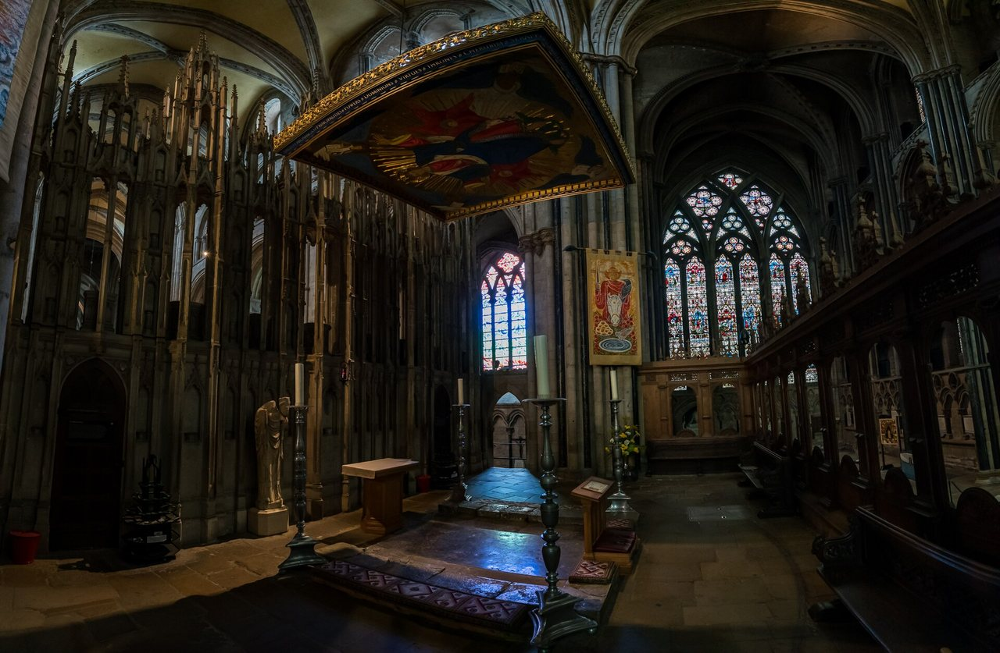

## The story
Cuthbert was a shepherd boy who, one night in 651, saw a light in the sky like angels carrying a soul to heaven; it was the night St Aidan died. He became a monk at **Melrose**, then prior of **Lindisfarne**, then a hermit on the **Inner Farne**, and finally, unwillingly, bishop of Lindisfarne. He died on Inner Farne on 20 March 687. (See our [St Cuthbert's Way](/pilgrimage/st-cuthbert/) pages.)

## The full story

### The otters
**St Bede** tells that while staying at Coldingham, Cuthbert went down to the sea at night and stood in the cold water up to his neck, praying until dawn. A monk who followed him secretly saw that when he came out, two **otters** bounded up, warmed his feet with their breath and dried them with their fur, then slipped back into the sea. Cuthbert, guessing he had been seen, asked the monk to tell no one until after his death.

### The incorrupt body
When his tomb was opened in **698**, eleven years after his death, his body was found incorrupt. Fleeing the Vikings, the monks carried it around the North for over a century, until it came to rest at **Durham** in 995, where the great cathedral was built over it. His coffin, pectoral cross and the *St Cuthbert Gospel* (now in the British Library) survive. An anonymous Lindisfarne monk and Bede are why his life is so well known. Bede tells the otters, and says he had the story from a witness: a man at peace with the creation around him.

<figure class=photo>
<picture><source srcset="/static/art/cuthbert-durham-600.webp 600w,/static/art/cuthbert-durham.webp 1280w" sizes="(max-width:760px) 100vw,760px" type="image/webp"></picture>
<figcaption>The shrine of St Cuthbert in Durham Cathedral, behind the high altar. Photo: <a href="https://commons.wikimedia.org/wiki/File:St_Cuthbert%27s_Tomb_%28634-687%29%2C_Durham_Cathedral_-_geograph.org.uk_-_6973439.jpg">Brian Deegan</a>, <a href="https://creativecommons.org/licenses/by-sa/2.0">CC BY-SA 2.0</a>, via Wikimedia Commons.</figcaption>
</figure>

## Path to sainthood
Pre-Congregation saint.

## Patronages
Northumbria, Durham, shepherds, sailors.

## Trivia
- Eider ducks on the Farne Islands are still called "Cuddy's ducks"; Cuthbert made rules protecting them in 676, one of the earliest bird-protection laws.
- His shrine is behind the high altar of Durham Cathedral.

## Sources
- [Catholic Encyclopedia: St Cuthbert](https://www.newadvent.org/cathen/04578a.htm)

Written October 16, 2026 from the sources above. The Durham photograph was added November 6, 2026. Feast days follow the General Roman Calendar unless noted.

