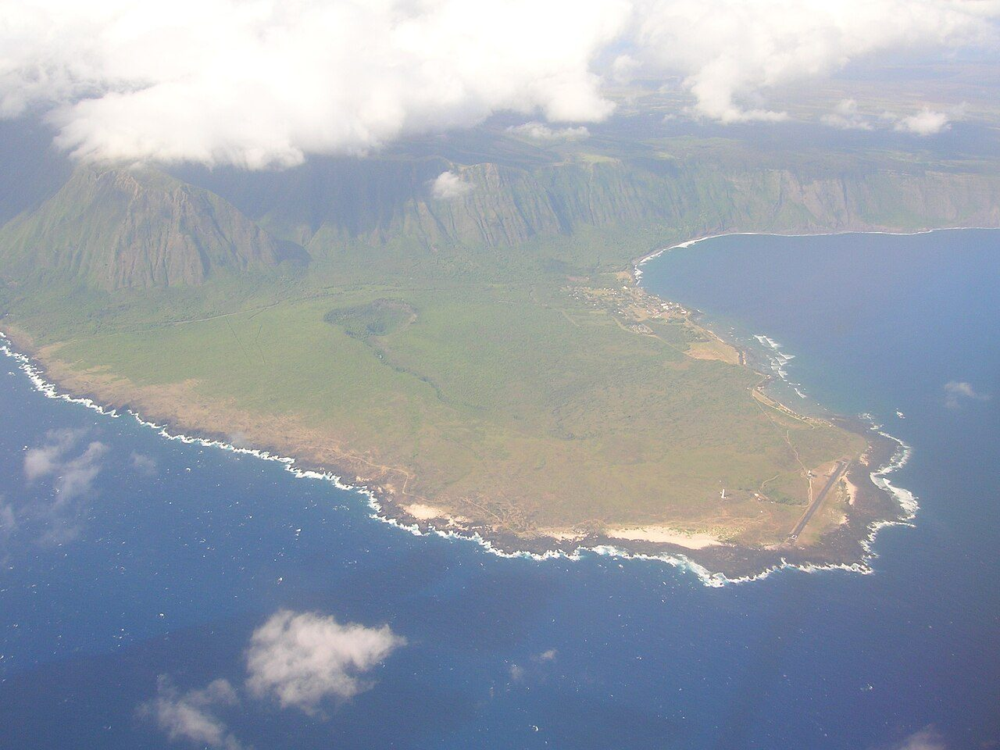

## The story
Jozef De Veuster was born in Tremelo, Belgium, and joined the **Congregation of the Sacred Hearts**, taking the name Damien. He went to Hawaii in his brother's place in 1864 and was ordained in Honolulu.

## The full story

### Kalaupapa
In 1866 the Hawaiian government began exiling people with leprosy (Hansen's disease) to the remote **Kalaupapa** peninsula on Molokai, cut off by 600 m cliffs. In 1873 Damien volunteered to go.

<figure class=photo>
<picture><source srcset="/static/art/damien-kalaupapa-600.webp 600w,/static/art/damien-kalaupapa.webp 1280w" sizes="(max-width:760px) 100vw,760px" type="image/webp"></picture>
<figcaption>The Kalaupapa peninsula, under the cliffs of Molokai, where Damien went in 1873. Photo: <a href="https://commons.wikimedia.org/wiki/File:Starr_050516-1188_aerial_photograph_of_Molokai,_Kalaupapa_Peninsula.jpg">Forest and Kim Starr</a>, <a href="https://creativecommons.org/licenses/by/3.0">CC BY 3.0</a>, via Wikimedia Commons.</figcaption>
</figure>

He found some 800 people living in misery. He built houses, a church, a hospital and coffins, dug graves, dressed wounds, taught farming and organised a choir and a band, and demanded supplies from the government. He began his sermons "We lepers".

### "I am one of them"
In 1884, he noticed he could not feel boiling water on his foot: he had leprosy. He kept working, helped by **St Marianne Cope** and her Franciscan sisters, and died on 15 April 1889, aged 49. When a Presbyterian minister attacked his memory, **Robert Louis Stevenson**, who had visited Molokai, wrote a famous open letter in his defence. His own letters, and the people who lived beside him, are how the Church knows the story.

## Path to sainthood
Beatified 1995 by John Paul II; canonised 11 October 2009 by Benedict XVI.

## Patronages
People with leprosy and HIV/AIDS, outcasts, Hawaii.

## Trivia
- His statue represents Hawaii in the US Capitol.
- His body was moved to Leuven, Belgium, in 1936; a relic of his hand was returned to Kalaupapa in 1995.

## Sources
- [Catholic Encyclopedia: Father Damien](https://www.newadvent.org/cathen/04615a.htm)

Written October 16, 2026 from the sources above. The peninsula photograph was added November 6, 2026. Feast days follow the General Roman Calendar unless noted.

