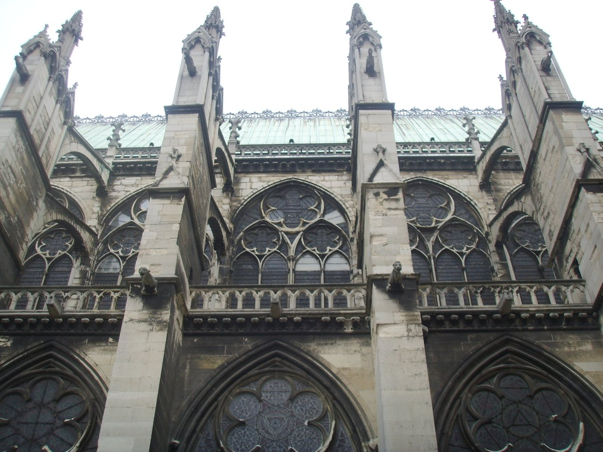

## The story
Denis (Dionysius) was sent from Rome to Gaul around 250 and became the first **bishop of Paris**. During the persecution of Decius he was arrested with the priest **Rusticus** and the deacon **Eleutherius**, and all three were beheaded. Gregory of Tours recorded his martyrdom in the 6th century.

## The full story

### The walking martyr
The famous legend, written in the 9th century by Abbot Hilduin, says Denis was beheaded on **Montmartre** ("mount of the martyr"), then picked up his head and walked about **6 km** north, preaching a sermon all the way, to the place where he wished to be buried. A **cephalophore** ("head-carrier"), he is shown holding his own head; a statue on the portal of Notre-Dame de Paris shows him so.

### Saint-Denis
The **Basilica of Saint-Denis** was built over his tomb. It became the burial place of the kings of France and, under Abbot **Suger** in the 1140s, the birthplace of **Gothic** architecture. "Montjoie Saint-Denis!" was the French royal battle cry. Gregory of Tours records the martyrdom of the bishop. The walk with the head is Hilduin's ninth-century telling. Hilduin also joined this Denis to **Dionysius the Areopagite**, converted by St Paul in Athens (Acts 17:34), and to the fifth-century writer called Pseudo-Dionysius. Those are three men.

<figure class=photo>
<picture><source srcset="/static/art/denis-paris-600.webp 600w,/static/art/denis-paris.webp 1280w" sizes="(max-width:760px) 100vw,760px" type="image/webp"></picture>
<figcaption>The Basilica of Saint-Denis, built over his tomb and later the burial church of the kings of France. This Gothic building begins in the twelfth century. Photo: <a href="https://commons.wikimedia.org/wiki/File:Basilica_di_saint_Denis_esterno_04.JPG">Sailko</a>, <a href="https://creativecommons.org/licenses/by/2.5">CC BY 2.5</a>, via Wikimedia Commons.</figcaption>
</figure>

## Path to sainthood
Pre-Congregation saint.

## Patronages
Paris, France; invoked against headaches.

## Trivia
- A well-known saying, attributed to Madame du Deffand, says of his walk: "It is only the first step that is difficult."
- He is one of the Fourteen Holy Helpers.

## Sources
- [Catholic Encyclopedia: St Denis](https://www.newadvent.org/cathen/04721a.htm)

Written October 16, 2026 from the sources above. The Saint-Denis photograph was added November 6, 2026. Feast days follow the General Roman Calendar unless noted.

