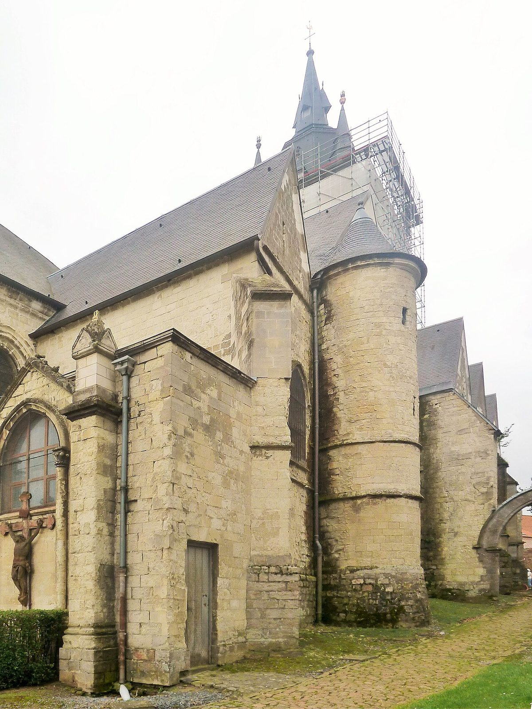

## The story
Drogo (Druon) was born to a noble Flemish family at Épinoy. His father died before his birth and his mother died giving birth to him. When at ten he learned of it, he felt so guilty that he spent his life in penance. At 18 he gave away his inheritance and became a pilgrim, travelling to Rome nine times.

## The full story

### Shepherd at Sebourg
He worked as a shepherd for a woman in **Sebourg**, near Valenciennes, for six years. Villagers said he was seen tending his sheep and praying at Mass at the same time, giving rise to a saying, "I'm not St Drogo; I can't ring the bells and walk in the procession."

### Walled in
On a pilgrimage he was struck by a disfiguring illness (perhaps a hernia or a hideous growth) that frightened people. So he had a cell built against the church at Sebourg, with only a small window through which he received the Eucharist and a little food, and lived walled up for some **40 years**, until he died in 1186. A short Life was written soon after he died, and Sebourg has kept his feast and his relics ever since.

<figure class=photo>
<picture><source srcset="/static/art/drogo-sebourg-600.webp 600w,/static/art/drogo-sebourg.webp 1280w" sizes="(max-width:760px) 100vw,760px" type="image/webp"></picture>
<figcaption>The church of Saint-Druon at Sebourg, which keeps his relics. Scaffolding was on the roof when the photograph was taken. Photo: <a href="https://commons.wikimedia.org/wiki/File:Sebourg.-_l%27Eglise_Saint_Druon.JPG">Pierre André Leclercq</a>, <a href="https://creativecommons.org/licenses/by-sa/3.0">CC BY-SA 3.0</a>, via Wikimedia Commons.</figcaption>
</figure>

## Path to sainthood
Venerated locally since the 12th century.

## Patronages
Shepherds, coffee-house owners (in some regions), people considered ugly, hernia sufferers.

## Trivia
- His relics are in the church of Saint-Druon at Sebourg, France.
- He is sometimes called the patron of coffee, though no one is sure why.

## Sources
- *Vita S. Drogonis*, in *Acta Sanctorum*, April, vol. 2 (16 April).
- [Wikipedia: Drogo (overview with scholarly references)](https://en.wikipedia.org/wiki/Drogo)

Written October 16, 2026 from the sources above. The Sebourg photograph was added November 6, 2026. Feast days follow the General Roman Calendar unless noted.

