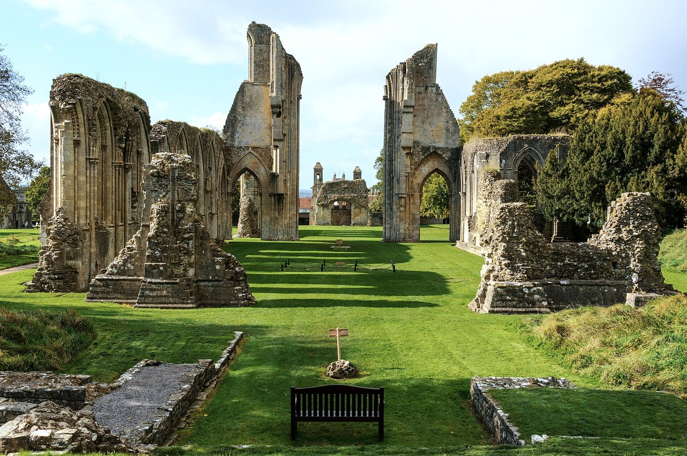

## The story
Dunstan was born near **Glastonbury**, educated by Irish monks there, and served at the court of King Athelstan. He became abbot of Glastonbury in 943, restored monastic life there under the Rule of St Benedict, and as **Archbishop of Canterbury** (959–988) led the great reform of the English Church under King Edgar. He was also a musician, illuminator and skilled metalworker.

## The full story

### The tongs
The famous legend says that while Dunstan was working at his forge, the devil came to tempt him, disguised as a beautiful woman (or a man asking for a job). Dunstan noticed hooves under the robe, pulled his tongs red-hot from the fire, and seized the devil by the nose. The devil's howls were heard for miles around.

### The horseshoe
In another tale the devil asked Dunstan to shoe his hoof. Dunstan nailed a horseshoe on so painfully that the devil begged for mercy and promised never to enter a house with a horseshoe over the door. This is said to be the origin of the lucky horseshoe. His career as reformer and archbishop is well documented. The devil and the horseshoe come in later lives, told of a man who really was a smith.

<figure class=photo>
<picture><source srcset="/static/art/dunstan-glastonbury-600.webp 600w,/static/art/dunstan-glastonbury.webp 1280w" sizes="(max-width:760px) 100vw,760px" type="image/webp"></picture>
<figcaption>The ruins of Glastonbury Abbey, where Dunstan was abbot. What stands is later medieval work, and ruined. Photo: <a href="https://commons.wikimedia.org/wiki/File:Glastonbury_Abbey_church_view_from_east.jpg">Steve Slater</a>, <a href="https://creativecommons.org/licenses/by/2.0">CC BY 2.0</a>, via Wikimedia Commons.</figcaption>
</figure>

## Path to sainthood
Pre-Congregation saint; the most popular English saint until Thomas Becket.

## Patronages
Goldsmiths, silversmiths, blacksmiths, locksmiths, musicians.

## Trivia
- He wrote the order for the coronation of King Edgar in 973, the basis of every English coronation since, including that of Charles III in 2023.
- The village of Mayfield in Sussex claims to keep his tongs.

## Sources
- [Catholic Encyclopedia: St Dunstan](https://www.newadvent.org/cathen/05199a.htm)

Written October 16, 2026 from the sources above. The Glastonbury photograph was added November 6, 2026. Feast days follow the General Roman Calendar unless noted.

