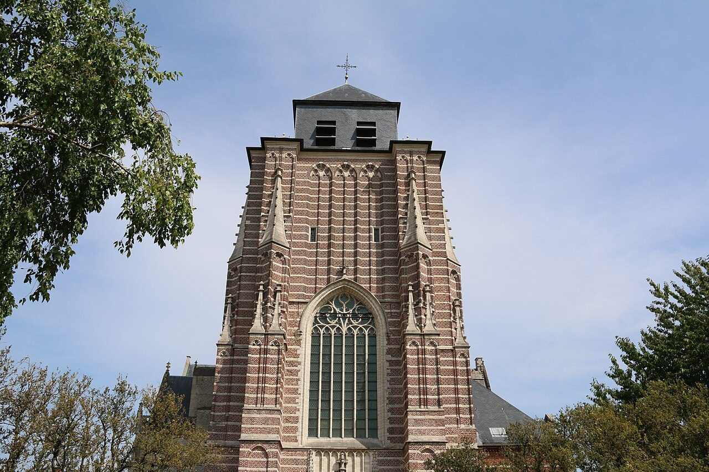

## Her story
Dymphna's story, as it has been told since the thirteenth century, is an Irish one that ends in Flanders. She was the daughter of a pagan king. Her mother, a Christian, died. The king, unhinged by grief, fixed on his daughter, who looked like her mother, and decided to marry her. Dymphna, who had been baptised and had a priest named **Gerebernus** for a confessor, refused. She fled with the priest and a few companions, crossed to the Continent, and hid at **Geel**, in the Kempen of what is now Belgium. Her father tracked the money they had spent, found them, killed Gerebernus, and when she still refused, cut off his daughter's head.

The Life was written around the 1240s, after a grave was opened at Geel and the bones were received as a saint's. No Irish writing of the seventh century names her. The flight and the martyrdom are the story Geel has told from that Life. Godfried Maes painted it in 1688 as a crowded martyrdom, the sword already raised, angels coming down with a wreath: the picture at the head of this page.

What Geel did with the story is documented, and it is the reason she matters. From the Middle Ages the church and the infirmary at Geel took in pilgrims who came for mental suffering. When the infirmary overflowed, the townspeople boarded them in their own houses. That **family-care** system is still there: patients of the psychiatric hospital live with families in the town, go to the shops, and are known by name. It is one of the oldest such arrangements in Europe. The legend gave the town a saint who had died at the hands of a disordered mind. The town's answer was not only a shrine. It was a bed in a neighbour's house.

Her feast is **15 May**. She is not on the General Roman Calendar. The church of St Dymphna at Geel still has her shrine.

<figure class=photo>
<picture><source srcset="/static/art/dymphna-geel-600.webp 600w,/static/art/dymphna-geel.webp 1280w" sizes="(max-width:760px) 100vw,760px" type="image/webp"></picture>
<figcaption>The tower of St Dymphna's church at Geel, Sint-Dimpnakerk. Photo: <a href="https://commons.wikimedia.org/wiki/File:Sint-Dimpnakerk_Geel_04.jpg">FrDr</a>, <a href="https://creativecommons.org/licenses/by-sa/4.0">CC BY-SA 4.0</a>, via Wikimedia Commons.</figcaption>
</figure>

## Path to sainthood
Pre-Congregation, from the Geel cult that grew after the thirteenth-century finding of bones and the writing of the Life. Widely invoked, never given a universal feast.

## Patronages
People with mental illness, anxiety, depression and epilepsy; psychiatrists and psychiatric nurses; victims of incest and of family violence; sleepwalkers. Also runaways.

## Trivia
- Geel's boarding-out system was already being described by visitors in the seventeenth century, and it was studied by doctors from the nineteenth. It did not begin as a modern reform. It began as hospitality around a shrine.
- She is often shown with a sword, a book, and a devil or a chained figure under her feet. The sword is the weapon that killed her, turned into her attribute.
- Her name is also spelled Dimpna or Dymphna. The Geel church uses Dimpna.

## Sources
- [Vatican News: saints of 15 May (St Dymphna)](https://www.vaticannews.va/en/saints/05/15.html)
- [Catholic Encyclopedia: St Dymphna](https://www.newadvent.org/cathen/05221b.htm)

Fact-checked on November 2, 2026 against Vatican News and New Advent (Catholic Encyclopedia). The Geel photograph was added November 6, 2026. Feast days follow the General Roman Calendar unless noted.

