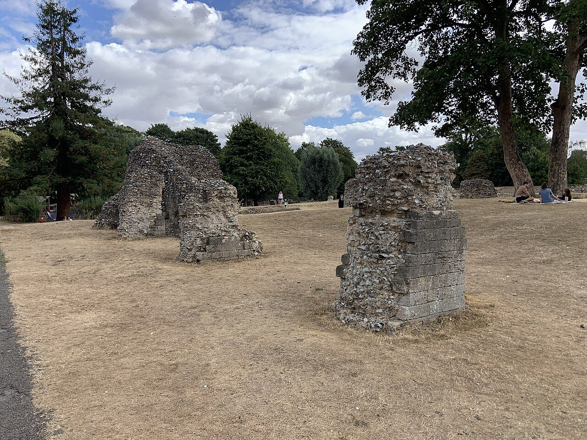

## The story
Edmund ruled the kingdom of East Anglia in a century when Viking armies were overwriting the map of England. Later medieval lives add a foreign birth and further story. The near-contemporary Anglo-Saxon Chronicle is terser on the end: in 869–870 the Great Heathen Army overwintered at Thetford and Edmund fought them and was killed.

## The full story

### The refusal and the tree
Medieval passion accounts — above all Abbo of Fleury, writing about a century later from St Dunstan's telling — say Edmund refused to renounce Christ or rule as a Viking puppet. He was bound to a tree, scourged, shot so thickly with arrows that he bristled 'like a hedgehog', and finally beheaded. A wolf, Abbo adds, guarded his severed head until searchers heard it cry 'Here, here, here' in the woods.

### Bury St Edmunds
The body was moved to Beodricesworth, renamed Bury St Edmunds. The abbey became one of England's richest pilgrimage shrines; kings swore oaths at his tomb. The abbey was destroyed at the Dissolution and Edmund's relics were lost — the ruins and the cathedral still carry his name and story.

<figure class=photo>
<picture><source srcset="/static/art/edmund-bury-abbey-600.webp 600w,/static/art/edmund-bury-abbey.webp 1280w" sizes="(max-width:760px) 100vw,760px" type="image/webp"></picture>
<figcaption>The ruins of the abbey at Bury St Edmunds, the shrine-church the Dissolution brought down. Photo: <a href="https://commons.wikimedia.org/wiki/File:Bury_St_Edmunds,_abbey_ruins.jpg">Smb1001</a>, <a href="https://creativecommons.org/licenses/by-sa/4.0">CC BY-SA 4.0</a>, via Wikimedia Commons.</figcaption>
</figure>

## Path to sainthood
Venerated soon after death; coinage in his name ('St Edmund penny') circulated within a generation. Never formally canonised — pre-Congregation recognition by popular cult and the Church in England.

## Patronages
Kings, East Anglia, Bury St Edmunds, pandemics and torture victims (popular).

## Trivia
- Edmund, not George, was England's patron saint for centuries; St Edmund's Day is still marked at Bury.
- His emblem, crossed arrows with a crown, still appears in the arms of Bury St Edmunds and on Suffolk church screens.

## Sources
- [Catholic Encyclopedia: St Edmund the Martyr, New Advent](https://www.newadvent.org/cathen/05295a.htm)
- [Bury St Edmunds Cathedral (official)](https://stedscathedral.org/)
- Abbo of Fleury, *Passio Sancti Eadmundi* (c. 985); *Anglo-Saxon Chronicle*, s.a. 870

Written October 19, 2026 from the sources above, with the abbey photograph added November 6, 2026. The Chronicle gives the death; Abbo gives the passion England kept. Feast days follow the General Roman Calendar unless noted.

