<nav class=toc aria-label="On this page">

On this page

<ol>
<li><a href="#why">Why the Church honours him</a></li>
<li><a href="#birth">"Receive him as thy servant": a child of Provence</a></li>
<li><a href="#victor">The knotted cord at Saint-Victor</a></li>
<li><a href="#marriage">Elzéar and Delphine</a></li>
<li><a href="#household">"If God be well served in my house"</a></li>
<li><a href="#poor">"The treasury of Jesus Christ"</a></li>
<li><a href="#ariano">The lamb and the lion: Count of Ariano</a></li>
<li><a href="#heart">"You will always find me there"</a></li>
<li><a href="#vows">The vow at the castle altar</a></li>
<li><a href="#knight">A soldier and a saint</a></li>
<li><a href="#tutor">"It is not yet too late to begin"</a></li>
<li><a href="#advocate">Advocate of the poor</a></li>
<li><a href="#death">"This is my hope"</a></li>
<li><a href="#delphine">Delphine alone</a></li>
<li><a href="#godson">Canonised by his godson</a></li>
<li><a href="#texas">A saint for soldiers on the Rio Grande</a></li>
<li><a href="#places">His places and churches</a></li>
<li><a href="#art">Elzéar in art</a></li>
</ol>
</nav>

## His story

On the day he was born, his mother took him in her arms and gave him back to God. "My Lord God, I give thee thanks for this little boy," prayed Lauduna of Albe, whom the people of Provence called the Good Countess, "receive him as thy servant, and pour out thy benediction upon him." The baby was Elzéar of Sabran, born in 1285 in the castle of Saint-Jean-de-Robians, below the Luberon hills, heir to the great Provençal house of Sabran and to the Italian county of Ariano in the Kingdom of Naples.

He grew into everything a medieval lord was meant to be: a horseman and a captain, a counsellor of kings, a judge, a husband. He led the troops of King Robert of Naples in the streets of Rome, governed a rebellious county, tutored a crown prince and sat at the head of a royal council. Yet his household lived like a monastery of joy, his castle gates were open to lepers and beggars, and he and his wife, **Blessed Delphine of Glandèves**, kept a virgin marriage for love of Christ and joined the Third Order of St Francis together. King Robert's court marvelled at a man who was "at once a great soldier, a courtier, a married man, a virgin, and a saint".

He died in Paris on **27 September 1323**, on an embassy for his king, with the story of the Passion read to him every day and the words "This is my hope" on his lips as he received the Eucharist. His own godson, Pope Urban V, raised him to the altars in 1369. Four centuries later, Spanish soldiers on the northern frontier of New Spain named their presidio for him, the patron of soldiers, and so a town on the Rio Grande below El Paso still carries his name: **San Elizario, Texas**.

### 1285 · Born at Robians
Elzéar is born in the castle of Saint-Jean-de-Robians near Cabrières-d'Aigues, son of Hermengaud of Sabran, Count of Ariano, and Lauduna of Albe, who offers him to God.

### Boyhood · Saint-Victor of Marseille
He is educated by his uncle William of Sabran, abbot of the great abbey of Saint-Victor, who finds the boy wearing a knotted cord for penance.

### c. 1295 · Betrothed to Delphine
At the wish of King Charles II of Naples, the ten-year-old Elzéar is betrothed to Delphine of Glandèves, heiress of Puimichel, two years older than he.

### 1299 · Married at Puimichel
The young couple marry, and Delphine asks her husband to keep a virgin marriage with her for the love of God. He agrees.

### Ansouis and Puimichel · A holy household
For seven years they live at Ansouis, then at Puimichel, where Elzéar writes his rules for a household where everyone hears Mass and peace reigns.

### 1309 · Count of Ariano
His father dies and Elzéar inherits the county of Ariano in the Kingdom of Naples. He wins over its rebels with patience and kindness.

### 1310 · Bread in the famine
In a year of scarcity he opens his granaries and gives great alms to the poor of Provence.

### 1312 · Rome
Elzéar leads King Robert's troops in Rome with Prince John against the Emperor Henry VII, who is crowned at the Lateran, not at St Peter's.

### 1316 · The vow at the altar
Elzéar and Delphine make public vows of perpetual chastity at the altar of their castle chapel.

### 1317 · Tertiaries of St Francis
The two enter the Third Order of St Francis. Elzéar makes his will at Toulon and becomes tutor to Charles, Duke of Calabria, the heir of Naples.

### Naples · Advocate of the poor
As head of the regency council he asks for one office only, advocate of the poor, and carries their petitions through the streets in a bag of purple velvet.

### 1323 · Embassy to Paris
King Robert sends him to the French court to ask the hand of Marie of Valois for the Duke of Calabria.

### 27 September 1323 · Death in Paris
After a general confession and the Viaticum, Elzéar dies in Paris. His body is carried home to Apt and buried in the Franciscan church.

### 1369 · Canonised by his godson
On 15 April Pope Urban V, whom Elzéar had held at the font, proclaims him a saint at St Peter's in Rome.

### 1373 · The tomb at Apt
A magnificent tomb is raised over his body in the Franciscan church at Apt, carved with scenes of his charity.

### 1789 · San Elceario on the Rio Grande
A Spanish presidio named for San Elceario, patron of soldiers, moves to the Hacienda de los Tiburcios below El Paso del Norte. The town of San Elizario grows around it.

### 1882 · The Presidio Chapel
The present chapel of San Elizario is completed, built partly from the bricks of the old presidio walls.

<h2 id=why>Why the Church honours him</h2>

- **A saint in the world.** Elzéar never left court, castle or battlefield, and he made all of them holy. He shows that a soldier, a statesman and a husband can be a saint without leaving his duties.
- **A holy marriage.** He and Delphine lived a virgin marriage of tender friendship, prayer and service, and they are honoured together as the holy spouses of Provence.
- **A lover of the Eucharist.** He received Holy Communion almost every day and told Delphine that no pleasure on earth equalled it. "Enter in spirit his sacred heart," he wrote to her. "You will always find me there."
- **A father of the poor.** He kissed and dressed the sores of lepers with his own hands, washed the feet of twelve poor men every day, and asked his king for one office only: advocate of the poor.
- **A peacemaker.** He conquered rebels with mercy, burned the letters of those who slandered him, and taught a prince that "more princes are ruined by their tongues and anger, than by the edge of the sword".
- **The patron of soldiers.** A brave knight and a captain who prayed all night before he was dubbed, he is honoured as a patron of soldiers and the military, from Provence to the Texas border.

<figure class=photo>
<picture><source srcset="/static/art/elz-portrait-cross-600.webp 600w,/static/art/elz-portrait-cross.webp 643w" sizes="(max-width:760px) 100vw,760px" type="image/webp">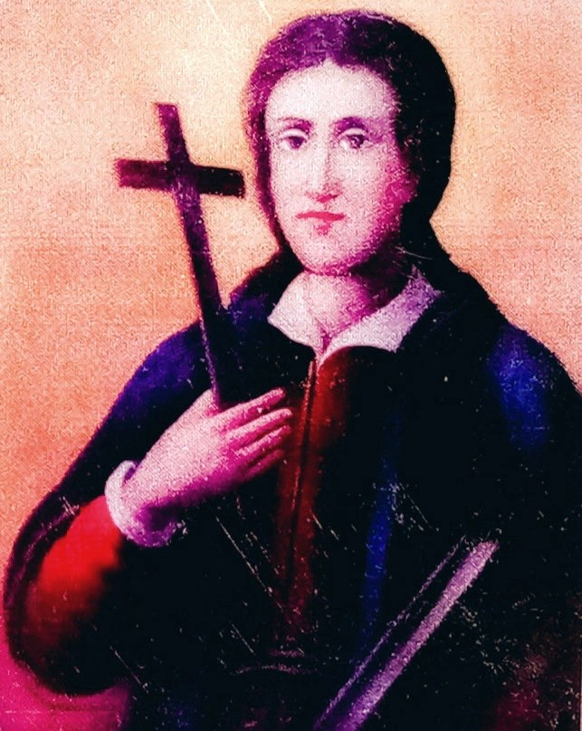</picture>
<figcaption><b>St Elzéar of Sabran</b> in an eighteenth-century Italian portrait, <i>Elzeario da Sabrano</i>. He holds the cross that he called the source of all his patience. Image: <a href="https://commons.wikimedia.org/wiki/File:Elzeario_da_Sabrano.jpg">Elzeario da Sabrano</a>, public domain, via Wikimedia Commons.</figcaption>
</figure>

<h2 id=birth>"Receive him as thy servant": a child of Provence</h2>

Elzéar was born in 1285 in the castle of Saint-Jean-de-Robians, in the parish of Cabrières-d'Aigues, on the sunny southern slopes of the Luberon. The Sabrans were one of the oldest families of Provence, lords of Ansouis and of the castle of Sabran west of the Rhône. His father, Hermengaud of Sabran, served the Angevin kings of Naples, who were also counts of Provence, and had been given the county of Ariano, high in the hills east of Naples. His mother, Lauduna of Albe, was so generous to the poor that Provence called her *la bonne comtesse*, the Good Countess.

<figure class=map style="max-width:640px;margin:14px auto 18px"><a href="/static/maps/map-elzear-loc.svg">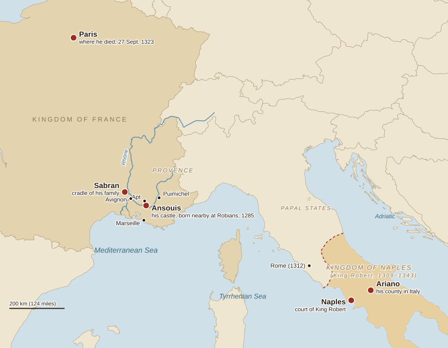</a><figcaption>St Elzéar's world: his castles of Ansouis and Robians in Provence, the cradle of the Sabrans west of the Rhône, the Kingdom of Naples with his county of Ariano, Rome, where he fought in 1312, and Paris, where he died in 1323. Map by The Daily Word; borders and rivers from Natural Earth (public domain). Tap to enlarge.</figcaption></figure>

Lauduna's prayer over her newborn son is one of the most striking in the lives of the saints. She thanked God for the child and asked Him to bless him, and then she added: "But, O Lord! if thou foreseest that he would be a rebel to thy will, then, I pray thee, after he has been baptized, take him out of this world." She wanted a saint or nothing. God gave her a saint.

<figure class=photo>
<picture><source srcset="/static/art/elz-cabrieres-view-600.webp 600w,/static/art/elz-cabrieres-view.webp 1280w" sizes="(max-width:760px) 100vw,760px" type="image/webp">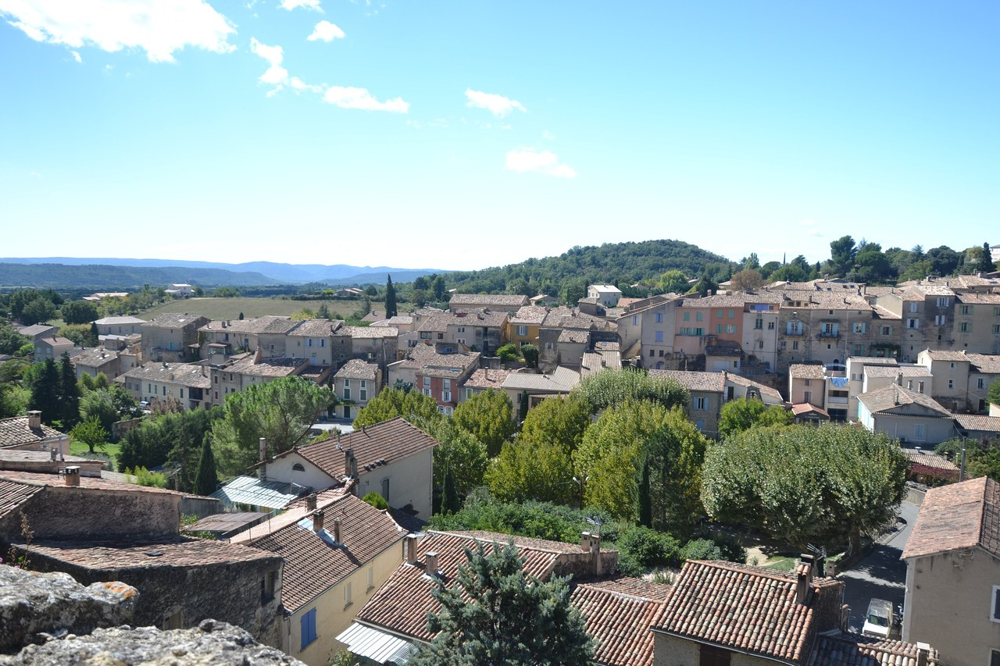</picture>
<figcaption><b>Cabrières-d'Aigues</b>, the village below the Luberon in whose parish Elzéar was born, at the castle of Robians. Photo: <a href="https://commons.wikimedia.org/wiki/File:Vue_sur_Cabri%C3%A8re.JPG">Vue sur Cabrière</a> by Marianne Casamance, <a href="https://creativecommons.org/licenses/by-sa/4.0">CC BY-SA 4.0</a>, via Wikimedia Commons.</figcaption>
</figure>

The child seemed to have been born with a love of the poor. Whenever he saw a beggar he would not be quiet until something had been given, so his nurses and governess kept their pockets always full of bread and small coins when they took him out. It was his delight to share his own dinner with poor children.

<h2 id=victor>The knotted cord at Saint-Victor</h2>

The boy was sent to Marseille to be educated by his uncle, **William of Sabran**, abbot of the ancient abbey of Saint-Victor, one of the great Benedictine houses of the Mediterranean, built over the tombs of the martyrs of Marseille. There, among the monks, Elzéar learned his letters, the psalms and the love of prayer.

<figure class=photo>
<picture><source srcset="/static/art/elz-saint-victor-print-600.webp 600w,/static/art/elz-saint-victor-print.webp 1280w" sizes="(max-width:760px) 100vw,760px" type="image/webp">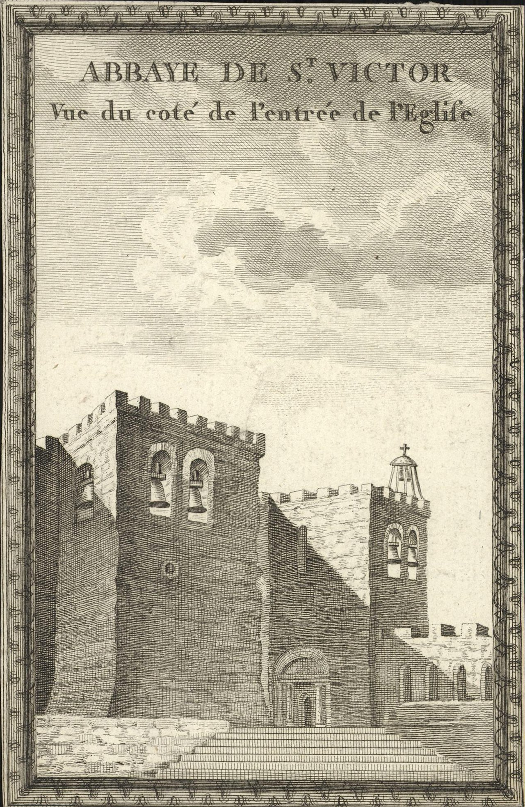</picture>
<figcaption><b>The Abbey of Saint-Victor, Marseille</b>, seen from the side of the church entrance, in an eighteenth-century print. Here Elzéar was educated by his uncle, Abbot William of Sabran. Rijksmuseum, Amsterdam. Image: <a href="https://commons.wikimedia.org/wiki/File:Abbaye_de_St._Victor._Vue_du_cot%C3%A9_de_l%27entr%C3%A9e_de_l%27Eglise,_objectnr_A_57501.jpg">Abbaye de St. Victor. Vue du coté de l'entrée de l'Eglise, objectnr A 57501</a> by Rijksmuseum, public domain, via Wikimedia Commons.</figcaption>
</figure>

Even as a young boy he wanted to give Christ everything. He secretly wore a rough knotted cord, set with sharp points, around his body, until one day the blood that came through his clothes gave him away. The abbot scolded him sternly and took the cord, calling him a "self-murderer", yet in his heart he "secretly admired so great fervour in a tender young lord". Abbot William taught his nephew the better way: to fast with the Church, to pray with joy, and to turn the fire in his heart into love of his neighbour.

<h2 id=marriage>Elzéar and Delphine</h2>

The Sabrans were vassals of the Angevin King **Charles II of Naples**, and the king wished to join two great Provençal houses. When Elzéar was ten, he was betrothed to **Delphine of Glandèves**, the twelve-year-old heiress of Puimichel, left an orphan in her infancy and brought up by her aunt, abbess of the convent of St Catherine of Sorps at Bauduen.

Delphine had already given her heart to God. When marriage was first mentioned to her, the girl had cried out, "I wish fire would burn down all my castles, and all my retainers would run away, so that no one would care to have me." She had made a secret vow of virginity. Elzéar and Delphine were married in the castle of Puimichel in 1299, and at her suggestion the two young people agreed to live together as brother and sister for the love of Christ. Their marriage became one of the loveliest friendships in the history of the saints.

<figure class=photo>
<picture><source srcset="/static/art/elz-delphine-bust-600.webp 600w,/static/art/elz-delphine-bust.webp 1056w" sizes="(max-width:760px) 100vw,760px" type="image/webp">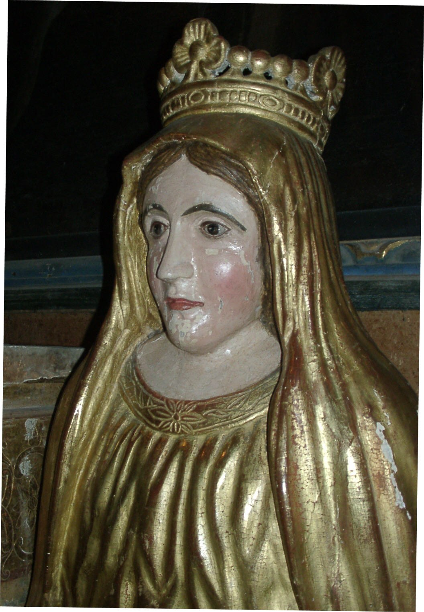</picture>
<figcaption><b>Blessed Delphine of Glandèves</b>, Elzéar's wife, in her gilded reliquary bust in the church of Saint-Martin at Ansouis. Photo: <a href="https://commons.wikimedia.org/wiki/File:Buste_Delphine_Ansouis_1.jpg">Buste Delphine Ansouis 1</a> by Rikiwiki21, public domain, via Wikimedia Commons.</figcaption>
</figure>

<figure class=photo>
<picture><source srcset="/static/art/elz-puimichel-village-600.webp 600w,/static/art/elz-puimichel-village.webp 1280w" sizes="(max-width:760px) 100vw,760px" type="image/webp">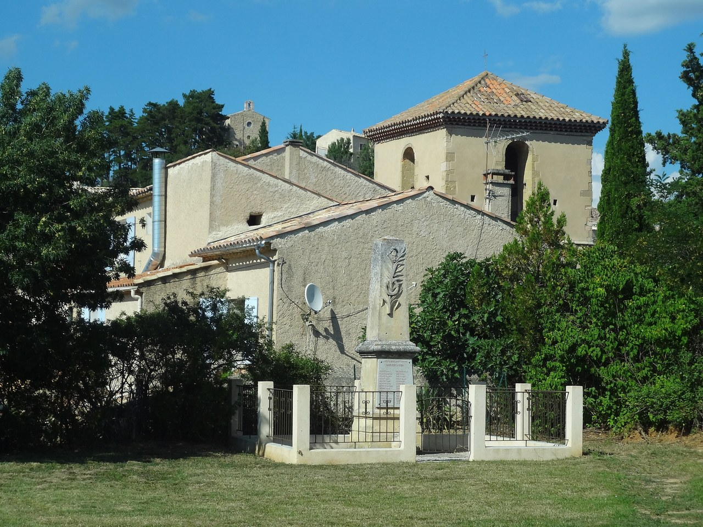</picture>
<figcaption><b>Puimichel</b>, in the hills of Haute-Provence, Delphine's home and the castle where the young couple were married and later kept their holy household. Photo: <a href="https://commons.wikimedia.org/wiki/File:Village_de_Puimichel.jpg">Village de Puimichel</a> by Sébastien Thébault, <a href="https://creativecommons.org/licenses/by-sa/3.0">CC BY-SA 3.0</a>, via Wikimedia Commons.</figcaption>
</figure>

<h2 id=household>"If God be well served in my house"</h2>

For seven years the couple lived at **Ansouis**, in the castle of the Sabrans on its rock above the vineyards, and then at **Puimichel**. Elzéar received Holy Communion almost every day. "I do not think a man on earth can enjoy any pleasure equal to that which I feel in the holy communion," he said to Delphine. "It is the greatest delight and comfort of a soul in her earthly pilgrimage." He prayed the office of the Church each day, and in prayer he was often lifted out of himself.

When they set up house at Puimichel, he wrote down rules for everyone who lived under his roof. They begin:

> 1. Every one in my family shall daily hear mass, whatever business they may have. If God be well served in my house, nothing will be wanting.

No one in his household was to swear or blaspheme. Everyone was to honour chastity, confess every week and receive Communion on the great feasts. The women were to pray and read in the mornings and work in the afternoons. There was to be no gambling at dice. And then comes a line that shows the warmth of the man:

> Yet I desire not my castle to be a cloister, nor my people hermits. Let them be merry, and sometimes divert themselves; but never at the expense of conscience, or with danger of offending God. 7. Let peace be perpetually maintained in my family. Where peace reigns, there God dwells.

He would allow no servant to cheat or squeeze his tenants. "I had rather go naked to paradise," he said, "than, being clothed with gold and scarlet, be dragged with the impious rich man into hell. We shall be wealthy enough if we fear God."

<figure class=photo>
<picture><source srcset="/static/art/elz-ansouis-gate-600.webp 600w,/static/art/elz-ansouis-gate.webp 1280w" sizes="(max-width:760px) 100vw,760px" type="image/webp">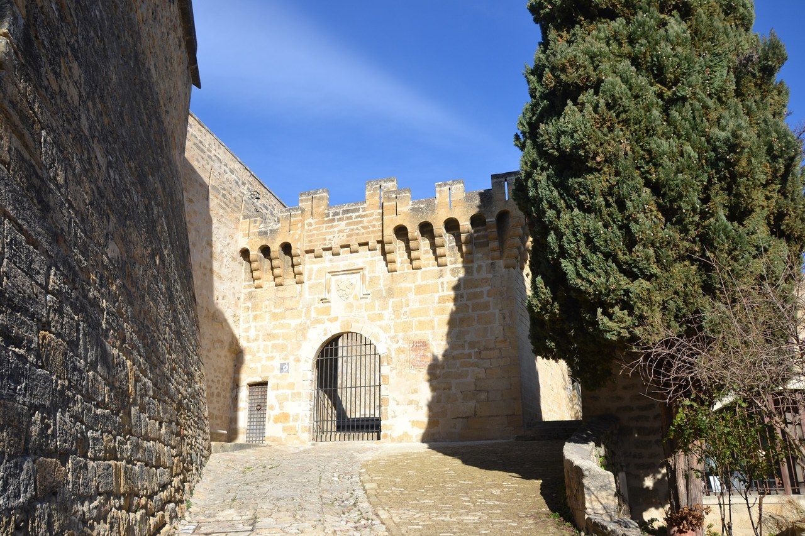</picture>
<figcaption>The <b>gate of the castle of Ansouis</b>, where Elzéar and Delphine lived for seven years and where their household learned to hear Mass every day. Photo: <a href="https://commons.wikimedia.org/wiki/File:Ansouis_-_entr%C3%A9e_chateau.jpg">Ansouis - entrée chateau</a> by Marianne Casamance, <a href="https://creativecommons.org/licenses/by-sa/4.0">CC BY-SA 4.0</a>, via Wikimedia Commons.</figcaption>
</figure>

<h2 id=poor>"The treasury of Jesus Christ"</h2>

Elzéar loved the poor as if they were Christ Himself, because he believed they were. He often visited the hospitals, especially those of the lepers, "whose loathsome sores he frequently kissed, cleansed, and dressed with his own hands". Every day he washed the feet of twelve poor men and served them at table himself, carving their meat and pouring their wine. He kept great granaries of corn and storehouses of food for the hungry, and in the scarcity of 1310 he gave alms so freely that his steward feared for his fortune.

Someone once asked him why he loved beggars so tenderly. He answered with great feeling: "Because the bosom of the poor is the treasury of Jesus Christ." He used to say, "How can we ask God to bestow on us his kingdom, if we deny him a cup of water?"

The sculptors who carved his tomb at Apt half a century after his death chose this as the heart of his story: the young count laying his hands on three lepers, who look up at him with ravaged faces and are healed. That carving, now in the Walters Art Museum in Baltimore, is the picture at the top of this page.

<figure class=photo>
<picture><source srcset="/static/art/elz-brugge-print-600.webp 600w,/static/art/elz-brugge-print.webp 1280w" sizes="(max-width:760px) 100vw,760px" type="image/webp">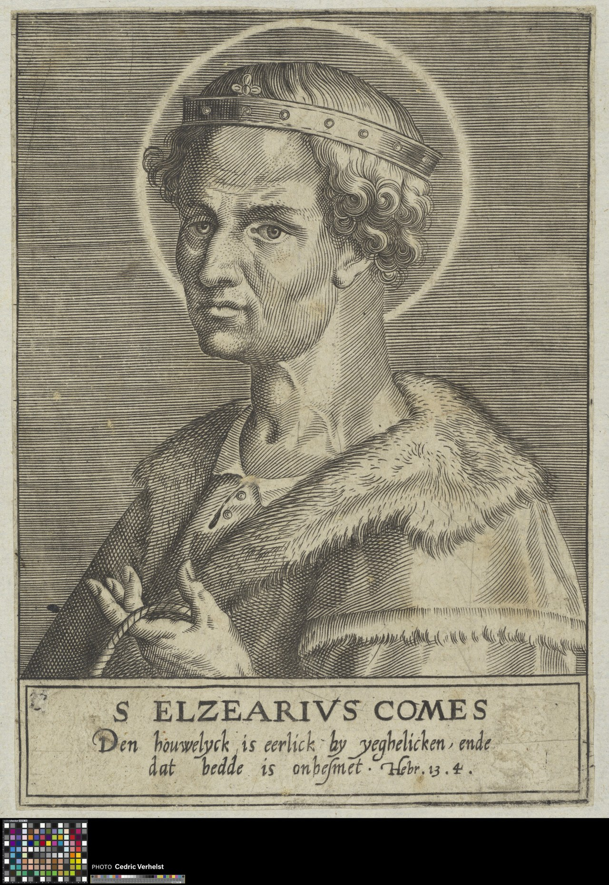</picture>
<figcaption><b>"S Elzearius Comes"</b>, St Elzéar the Count, crowned as a nobleman in a Flemish engraving of the sixteenth or seventeenth century. The verse beneath is Hebrews 13:4 in Dutch: "Marriage is honourable in all, and the bed undefiled." Musea Brugge. Image: <a href="https://commons.wikimedia.org/wiki/File:Musea_Brugge,_HUB,_2014_GRO0019_506_III.jpg">Musea Brugge, HUB, 2014 GRO0019 506 III</a> by Musea Brugge, <a href="https://creativecommons.org/publicdomain/zero/1.0/">CC0</a>, via Wikimedia Commons.</figcaption>
</figure>

<h2 id=ariano>The lamb and the lion: Count of Ariano</h2>

In 1309 Hermengaud of Sabran died, and Elzéar inherited the county of **Ariano**, in the Apennine hills of the Kingdom of Naples. He crossed to Italy to take possession, and found the people of Ariano in open revolt. They hated the French lords their Angevin kings had set over them, and they shut their gates against their new count.

For three years Elzéar bore their insults with patience. The king's cousin, Philip, Prince of Taranto, lost his temper with him. "Allow me to take these rebels to task for you," he said. "I will hang up half a thousand, and make the rest as pliant as a glove." Elzéar smiled. "What! would you have me begin my government with massacres and blood? I will overcome these men by good offices. It is no great matter for a lion to tear lambs; but for a lamb to tear a lion in pieces is admirable. Now, by God's assistance, you will shortly see this miracle."

The miracle came. The people of Ariano, won over by the kindness of a lord who would not punish them, opened their gates and loved and honoured him ever after as their father. When the goods of the guilty were confiscated to him, he secretly gave them back to their wives and children. He explained where his patience came from: "If I receive any affront, or feel any movement of impatience begin to arise in my breast, I turn all my thoughts towards Jesus Christ crucified, and say to myself: Can what I suffer bear any comparison with what Jesus Christ was pleased to undergo for me?"

<figure class=photo>
<picture><source srcset="/static/art/elz-ariano-castle-600.webp 600w,/static/art/elz-ariano-castle.webp 1280w" sizes="(max-width:760px) 100vw,760px" type="image/webp">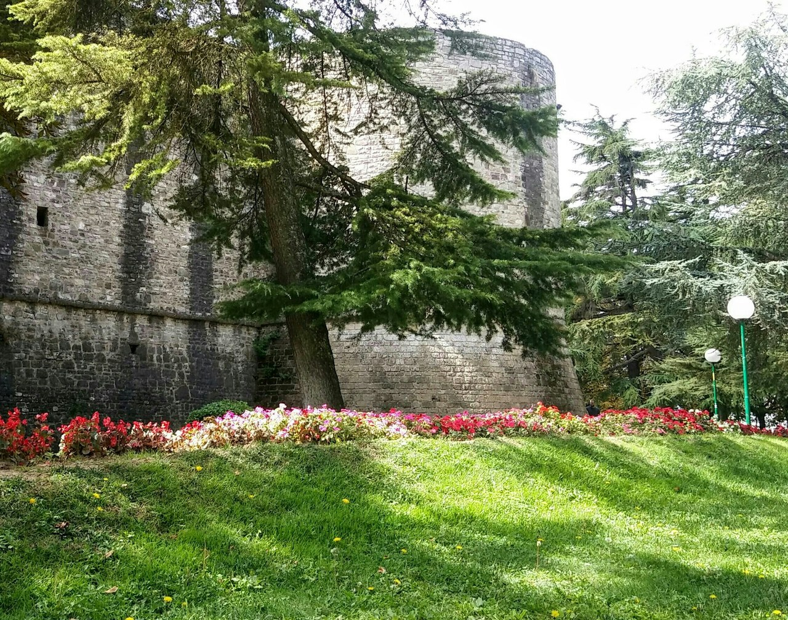</picture>
<figcaption>The northern side of the <b>Norman castle of Ariano Irpino</b>, chief stronghold of the county that Elzéar inherited in 1309 and won over with kindness. Photo: <a href="https://commons.wikimedia.org/wiki/File:Ariano_Irpino_%E2%80%93_Norman_Castle_(northern_side).jpg">Ariano Irpino – Norman Castle (northern side)</a> by ALC, <a href="https://creativecommons.org/licenses/by-sa/4.0">CC BY-SA 4.0</a>, via Wikimedia Commons.</figcaption>
</figure>

Once one of his officers wrote letters to Elzéar full of slander against him. Elzéar learned of it and burned the letters without reading a word. When the man next came to wait on him, the count embraced him and gave him a rich present. The captain was so overcome that afterwards he "offered himself to be cut in a hundred pieces for his service".

<h2 id=heart>"You will always find me there"</h2>

The years in Italy kept Elzéar far from Delphine, and they wrote to each other often. One of his letters has been treasured ever since as a little treatise on love and the Eucharist:

> You desire to hear often of me. Go often to visit our amiable Lord Jesus Christ in the holy sacrament. Enter in spirit his sacred heart. You know that to be my constant dwelling. You will always find me there.

Husband and wife were never really apart. Each found the other in the tabernacle, in the Heart of Christ, and in the work of mercy that filled their days.

<h2 id=vows>The vow at the castle altar</h2>

When his affairs in Italy were settled, Elzéar came home to Provence for two years and was welcomed at Ansouis with great joy. There, in 1316, after receiving Holy Communion, he and Delphine knelt at the foot of the altar in the chapel of the castle and made public vows of perpetual chastity. Elzéar had kept that purity untouched all his life without a vow. Now he and his wife promised it together before God.

The next year the couple entered the **Third Order of St Francis**, the order of penance for lay men and women who live the Gospel of Francis in the world. They were part of a great Franciscan family at the court of Naples. King Robert's brother, **St Louis of Toulouse**, had renounced the crown to become a Franciscan friar and bishop, and had died young in 1297. Robert's queen, Sancia of Majorca, loved the friars and the Poor Clares, and Robert himself wrote sermons and theology. In the household of the holy spouses, the poverty of [St Francis](/saints/francis-of-assisi/) and the courtesy of a Provençal castle met and became one.

<figure class=photo>
<picture><source srcset="/static/art/elz-martini-louis-600.webp 600w,/static/art/elz-martini-louis.webp 1280w" sizes="(max-width:760px) 100vw,760px" type="image/webp">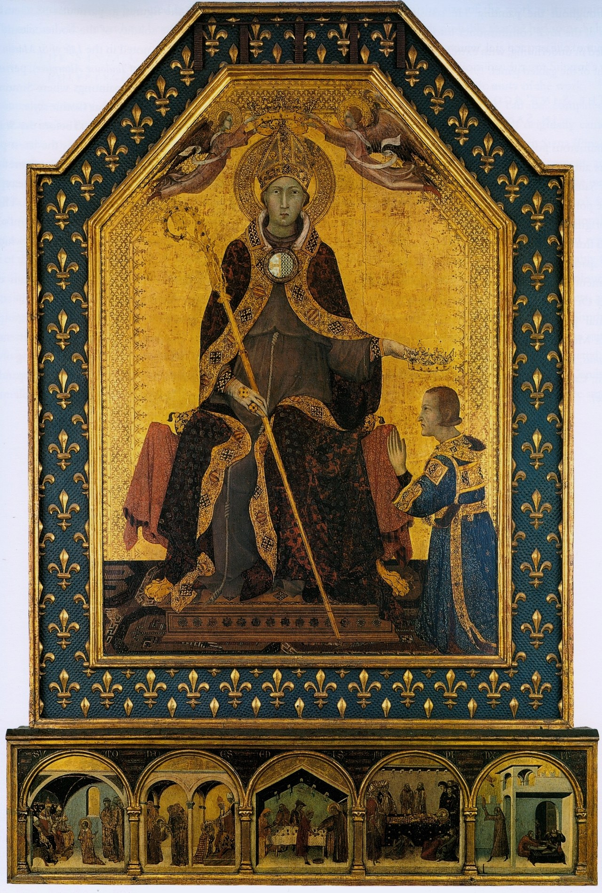</picture>
<figcaption><b>St Louis of Toulouse crowning his brother Robert of Naples</b>, the altarpiece painted by <b>Simone Martini</b> in 1317, the year Elzéar entered the Third Order. Museo di Capodimonte, Naples. Louis, the Franciscan bishop, was Robert's elder brother. Image: <a href="https://commons.wikimedia.org/wiki/File:Simone_Martini._St._Louis_of_Toulouse_Altarpiece._1317._Mus.Capodimonte,_Naples..jpg">Simone Martini. St. Louis of Toulouse Altarpiece. 1317. Mus.Capodimonte, Naples.</a> by Simone Martini, public domain, via Wikimedia Commons.</figcaption>
</figure>

<h2 id=knight>A soldier and a saint</h2>

Elzéar was a real knight. King Robert raised him to knighthood himself, and Elzéar prepared for it as the old chivalry intended: he kept the night vigil in the church, watching in prayer, then went to confession and received Communion in the morning. The king wept for joy at the sight, and the whole court admired a man who was "at once a great soldier, a courtier, a married man, a virgin, and a saint."

<figure class=photo>
<picture><source srcset="/static/art/elz-martini-robert-600.webp 600w,/static/art/elz-martini-robert.webp 1169w" sizes="(max-width:760px) 100vw,760px" type="image/webp">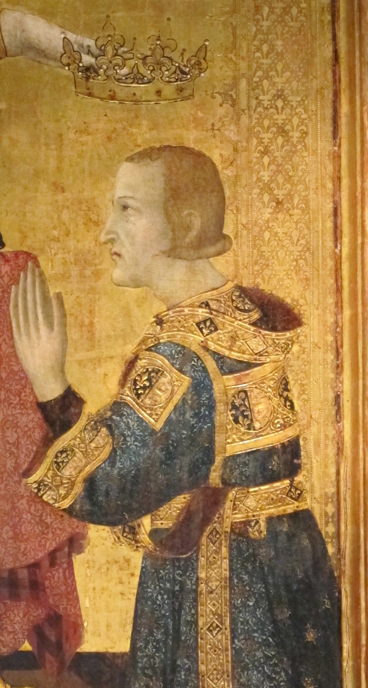</picture>
<figcaption><b>King Robert of Naples</b>, Elzéar's lord, friend and king, kneeling in prayer in Simone Martini's altarpiece of 1317. Image: <a href="https://commons.wikimedia.org/wiki/File:RobertNeapol_Martini,_Simone.jpg">RobertNeapol Martini, Simone</a> by Simone Martini, public domain, via Wikimedia Commons.</figcaption>
</figure>

In 1312 the German king **Henry VII** marched into Italy to be crowned emperor in Rome, and King Robert sent troops to hold the city against him. Elzéar led them, with the king's brother, Prince John. There was fighting in the streets and around the bridges of the Tiber, and Henry's army never reached St Peter's: he was crowned on 29 June 1312 in the Lateran basilica instead. Henry's own brother, Archbishop Baldwin of Trier, had the story painted in a picture chronicle of the expedition, and its pages show the fighting in Rome that Elzéar saw.

<figure class=photo>
<picture><source srcset="/static/art/elz-balduin-rome-600.webp 600w,/static/art/elz-balduin-rome.webp 816w" sizes="(max-width:760px) 100vw,760px" type="image/webp">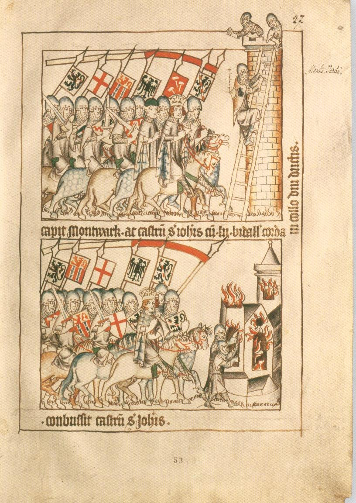</picture>
<figcaption>A page of the <b>Codex Balduineus</b>, the picture chronicle of the Emperor Henry VII's expedition to Italy made about 1340 for his brother, Archbishop Baldwin of Trier. Landeshauptarchiv Koblenz. Image: <a href="https://commons.wikimedia.org/wiki/File:Kaiser_Heinrichs_Romfahrt.jpg">Kaiser Heinrichs Romfahrt</a> by Codex Balduineus, Landeshauptarchiv Koblenz, public domain, via Wikimedia Commons.</figcaption>
</figure>

<figure class=photo>
<picture><source srcset="/static/art/elz-balduin-fight-600.webp 600w,/static/art/elz-balduin-fight.webp 1280w" sizes="(max-width:760px) 100vw,760px" type="image/webp">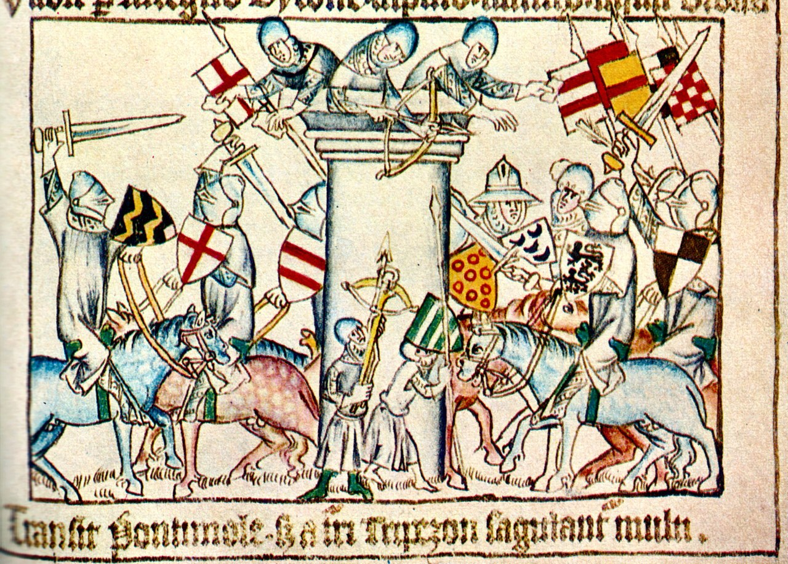</picture>
<figcaption>A battle scene from the <b>Codex Balduineus</b>, about 1340, with the arms of the German lords who fought for Henry VII in Italy. Landeshauptarchiv Koblenz. Image: <a href="https://commons.wikimedia.org/wiki/File:Codex_Balduineus_S.19b.jpg">Codex Balduineus S.19b</a> by Codex Balduineus, Landeshauptarchiv Koblenz, public domain, via Wikimedia Commons.</figcaption>
</figure>

Elzéar was brave in battle, and he fought without hatred. When the emperor at last sought peace, the victory was owed above all to "the valour and conduct of Elzear". King Robert loaded him with gifts. Elzéar accepted them "with one hand not to disoblige the king, but with the other distributed them all among the poor."

<h2 id=tutor>"It is not yet too late to begin"</h2>

In 1317 King Robert chose Elzéar, out of all the lords of his kingdom, to be governor of his son and heir, **Charles, Duke of Calabria**. The young prince was lively and proud, and he had picked up the vices of a court. Elzéar won his friendship first. Then, when the moment was right, he spoke to him tenderly about his faults, about the virtue a ruler needs, and about the life to come. The prince was so moved that he threw his arms around his tutor's neck and cried, "It is not yet too late to begin: what then must I do?"

Elzéar taught him piety, magnanimity, justice and mercy. He told him to fear God, who protects a prince when earth fails him, and gave him a piece of advice that every leader could keep: "When you are angry, speak not a word; otherwise you undo yourself. More princes are ruined by their tongues and anger, than by the edge of the sword. You must hate flatterers as a plague." Under his care the young duke became "a grave and virtuous prince".

<figure class=photo>
<picture><source srcset="/static/art/elz-charles-tomb-600.webp 600w,/static/art/elz-charles-tomb.webp 1280w" sizes="(max-width:760px) 100vw,760px" type="image/webp">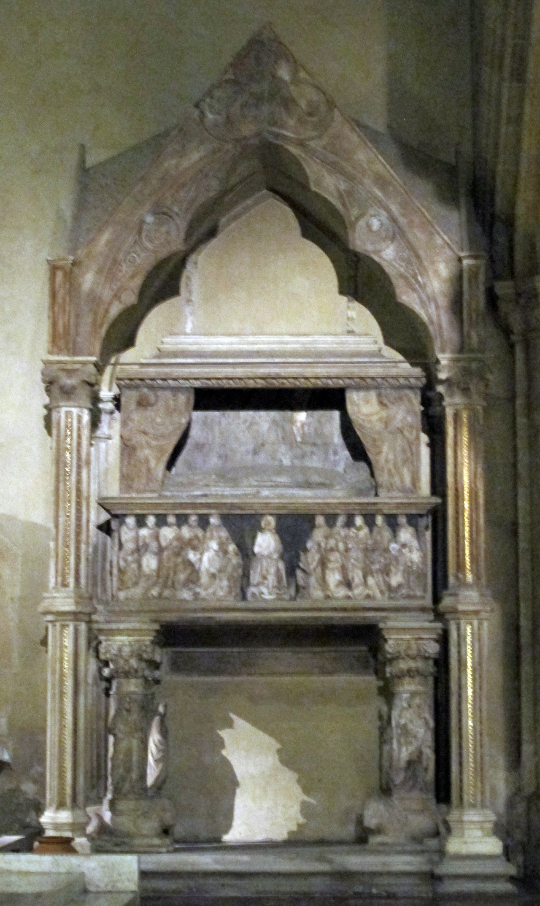</picture>
<figcaption>The tomb of Elzéar's pupil <b>Charles, Duke of Calabria</b> (died 1328), carved by <b>Tino di Camaino</b> and his assistants about 1330–33 in the church of Santa Chiara, Naples. Photo: <a href="https://commons.wikimedia.org/wiki/File:Tino_di_camaino_e_aiuti,_sepolcro_di_carlo_duca_di_calabria_(1330-33_ca.)_01.JPG">Tino di camaino e aiuti, sepolcro di carlo duca di calabria (1330-33 ca.) 01</a> by Sailko, <a href="https://creativecommons.org/licenses/by/3.0">CC BY 3.0</a>, via Wikimedia Commons.</figcaption>
</figure>

<h2 id=advocate>Advocate of the poor</h2>

When King Robert sailed for Provence, he left the Duke of Calabria as regent of Naples, with Elzéar at the head of his council, governing almost all the affairs of the kingdom. Elzéar asked the young regent for one favour: to name him advocate of the poor and their agent at court. The duke laughed. "What kind of office do you beg? You will have no competitors in this ambition. I admit your request, and recommend to you all the poor of this kingdom."

Elzéar bowed and thanked him from his heart. He had a great bag of purple velvet made, and carried it through the streets of Naples, gathering into it all the petitions of the poor, hearing their grievances with a cheerful face, giving alms and comforting everyone he met. He pleaded the causes of widows and orphans with wonderful eloquence. When people offered him rich presents and called him churlish for refusing them, he answered, "It is more safe and easy to refuse all presents than to discern which might be received without danger."

<h2 id=death>"This is my hope"</h2>

In 1323 King Robert sent Elzéar to Paris, with the flower of the Neapolitan nobility, to ask for the hand of **Marie of Valois**, daughter of Count Charles of Valois, for the Duke of Calabria. He arranged the marriage, and then, in Paris, he fell gravely ill. He knew that he was dying. He made a general confession of his whole life to the provincial of the Franciscans, and asked that the story of the Passion of Christ, which had always been his favourite prayer, be read aloud to him every day. It gave him great comfort in his pain.

When the priest brought him Holy Communion for the last time, Elzéar greeted the Lord with joy: "This is my hope; in this I desire to die." After the anointing and a painful agony, he died on **27 September 1323**. His body was carried home to Provence and buried, as he had asked in the will he made at Toulon in 1317, in the church of the Franciscans at **Apt**, wearing the habit of St Francis.

<figure class=photo>
<picture><source srcset="/static/art/elz-apt-town-600.webp 600w,/static/art/elz-apt-town.webp 1280w" sizes="(max-width:760px) 100vw,760px" type="image/webp">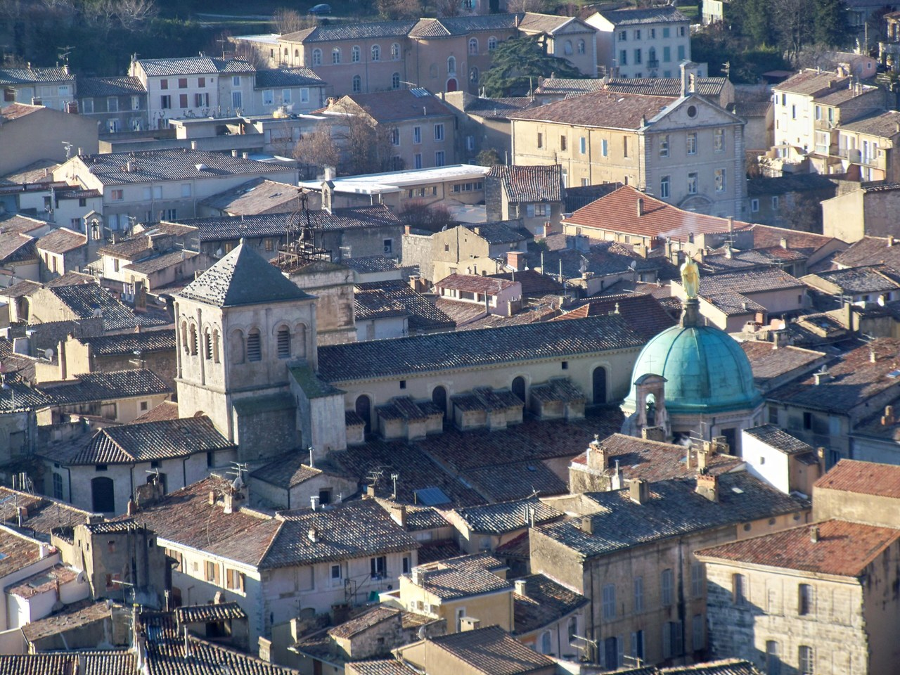</picture>
<figcaption><b>Apt</b>, where Elzéar's body was brought home from Paris and buried. The bell tower and dome of the Cathedral of Sainte-Anne rise above the old town. Photo: <a href="https://commons.wikimedia.org/wiki/File:Apt_-_Cath%C3%A9drale_Ste_Anne.JPG">Apt - Cathédrale Ste Anne</a> by Véronique Pagnier, <a href="https://creativecommons.org/publicdomain/zero/1.0/">CC0</a>, via Wikimedia Commons.</figcaption>
</figure>

<h2 id=delphine>Delphine alone</h2>

Delphine was in Naples when the news came. She gave her husband back to God in prayer, as his mother had done on the day he was born. She stayed for some years at the court of **King Robert and Queen Sancia**, as the queen's closest friend and counsellor. When Robert died in 1343, Sancia gave up the crown and took the veil as a Poor Clare in Naples, and Delphine stayed close to her.

Delphine then sold everything she owned and gave it to the poor, and lived as a beggar for Christ. She returned to Provence, first to Cabrières, near the castle where her husband had been born, and at last to Apt, near his tomb. She died at Apt on **26 November**, and was buried beside Elzéar in the Franciscan church, in the habit of the Order. The Church honours her as **Blessed Delphine**.

<figure class=photo>
<picture><source srcset="/static/art/elz-sancia-robert-600.webp 600w,/static/art/elz-sancia-robert.webp 1280w" sizes="(max-width:760px) 100vw,760px" type="image/webp">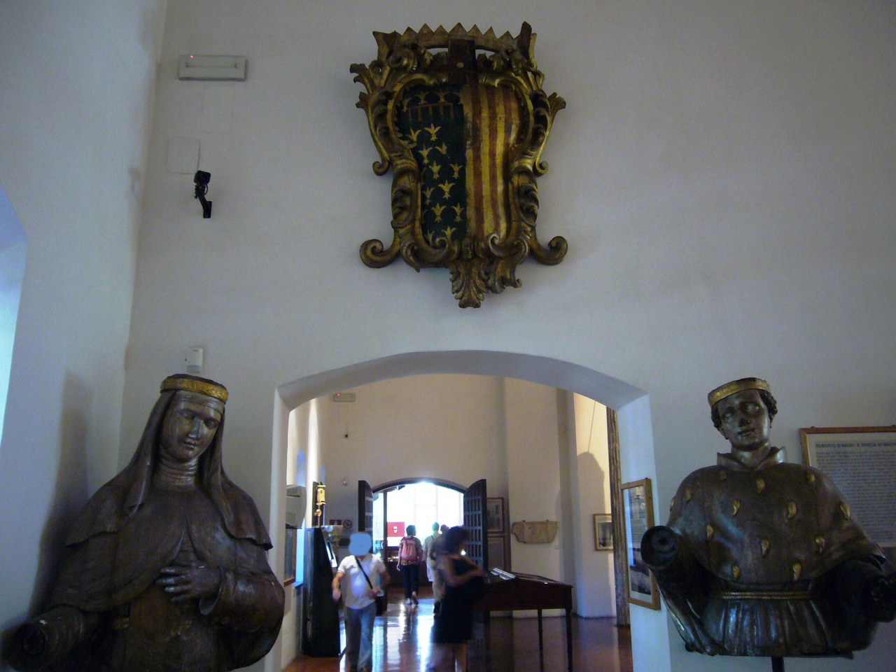</picture>
<figcaption><b>Queen Sancia and King Robert of Naples</b>, the founders of Santa Chiara, in portrait busts in the museum of the Santa Chiara monastery, Naples. Delphine was Sancia's friend and guide. Photo: <a href="https://commons.wikimedia.org/wiki/File:Napoli_s_Chiara_museo_-_Sancia_e_Roberto_d%27Angi%C3%B2_1040888.JPG">Napoli s Chiara museo - Sancia e Roberto d'Angiò 1040888</a> by Lalupa, <a href="https://creativecommons.org/licenses/by-sa/4.0">CC BY-SA 4.0</a>, via Wikimedia Commons.</figcaption>
</figure>

<h2 id=godson>Canonised by his godson</h2>

Years before, Elzéar had stood godfather to a baby born in 1310 at the castle of Grizac in the mountains of the Gévaudan: **Guillaume de Grimoard**. The child became a Benedictine monk, a great canon lawyer, abbot of Saint-Victor at Marseille, where Elzéar had studied as a boy, and in 1362 **Pope Urban V**.

On 15 April 1369, at St Peter's in Rome, the godson proclaimed his godfather a saint. Urban died the next year, and his successor, Gregory XI, published the bull of canonisation on 5 January 1371. In 1373 a splendid tomb was raised over the saint's body in the Franciscan church at Apt, with carvings of his charity around its base.

<figure class=photo>
<picture><source srcset="/static/art/elz-urban-v-600.webp 600w,/static/art/elz-urban-v.webp 1016w" sizes="(max-width:760px) 100vw,760px" type="image/webp">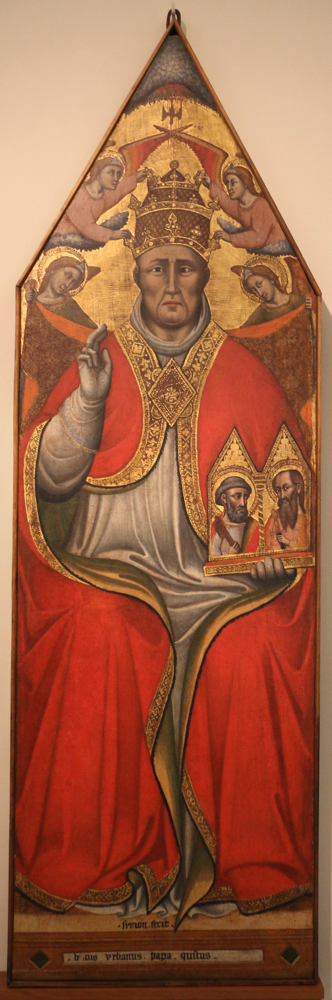</picture>
<figcaption><b>Pope Urban V</b>, Elzéar's godson, who canonised him in 1369, painted by <b>Simone dei Crocifissi</b> about 1375. Pinacoteca Nazionale, Bologna. Photo: <a href="https://commons.wikimedia.org/wiki/File:Simone_dei_crocifissi,_urbano_V,_1375_ca.,_forse_dalla_cattedrale_di_s._pietro_01.jpg">Simone dei crocifissi, urbano V, 1375 ca., forse dalla cattedrale di s. pietro 01</a> by Sailko, public domain, via Wikimedia Commons.</figcaption>
</figure>

<h2 id=texas>A saint for soldiers on the Rio Grande</h2>

Elzéar's fame as a knight made him a patron of soldiers, and the soldiers of Spain carried his name to the New World. On the far northern frontier of New Spain, in what is now Chihuahua, the army kept a presidio in the **Valle de San Elceario**, the valley of St Elzéar. In **1789** the garrison was moved up the Rio Grande to the Hacienda de los Tiburcios, twenty-two miles below El Paso del Norte, to guard the river settlements of Ysleta and Socorro and the caravans of the Camino Real. The presidio kept its old name, **San Elceario**, after the French patron of soldiers, and the town that grew up around its adobe walls became **San Elizario**.

It was holy ground already. On 20 April 1598 the expedition of Juan de Oñate had reached the Rio Grande at or near this place, and on 30 April, at the ceremony called **La Toma**, the colonists heard Mass and took possession of New Mexico. At the heart of the new presidio stood an adobe chapel, *Nuestra Señora del Pilar y Glorioso San José*, built to serve the Spanish soldiers and their families. In 1807 the American explorer Zebulon Pike was held prisoner there for three days on his way to Chihuahua.

The river gave and the river took away. In 1829 a great flood swept through San Elizario and destroyed the chapel, and the Rio Grande cut a new channel south of the town, leaving it on an island, **La Isla**, between the old and new beds. The people rebuilt on higher ground, and by 1841 a new chapel served a town of more than a thousand. In 1848 the Treaty of Guadalupe Hidalgo made the deepest channel of the river the border, and San Elizario became part of Texas. In 1850 it became the first seat of El Paso County.

Between **1877 and 1882**, the people built the chapel that stands today, of new adobe and of bricks from the walls of the old presidio. The same years brought sorrow, when the Salt War of 1877 over the salt lakes beyond the Guadalupe Mountains ended in killings in the town. The chapel rose anyway. After an electrical fire in 1935 the interior was renewed with a hand-painted pressed-tin ceiling, columns dressed as classical posts and stained-glass windows that join the Sacred Heart to the Lone Star of Texas. In 1944 the church was repainted in honour of the local soldiers fighting in the Second World War, and plaques at the back now name the men of the valley who died in their country's wars. The patron of soldiers has kept faith with them.

<figure class=photo>
<picture><source srcset="/static/art/elz-se-marker-600.webp 600w,/static/art/elz-se-marker.webp 1280w" sizes="(max-width:760px) 100vw,760px" type="image/webp">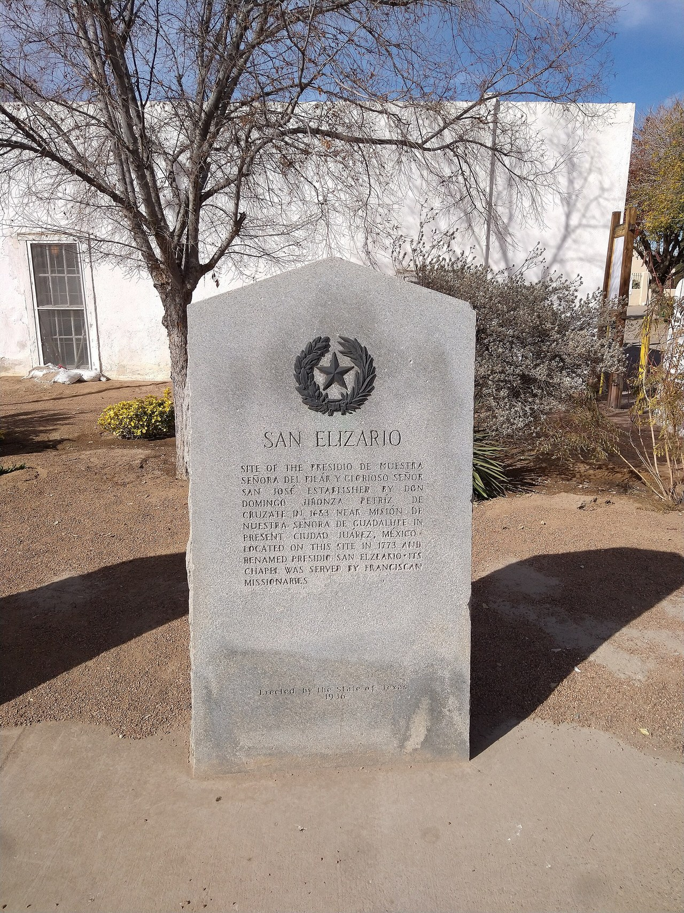</picture>
<figcaption>A <b>Texas historical marker</b> at San Elizario, El Paso County. The chapel became a Recorded Texas Historic Landmark in 1962, and its marker names it for "the 13th-century French patron of the military, St. Elzear". Photo: <a href="https://commons.wikimedia.org/wiki/File:San_Elizario_historic_marker,_El_Paso_county,_TX.jpg">San Elizario historic marker, El Paso county, TX</a> by Megalibrarygirl, <a href="https://creativecommons.org/licenses/by-sa/4.0">CC BY-SA 4.0</a>, via Wikimedia Commons.</figcaption>
</figure>

<h2 id=places>His places and churches</h2>

St Elzéar's world stretched from the hill villages of Provence to the Apennines of Naples, and from there, through the soldiers who loved him, to the deserts of the Rio Grande. In Provence the castles where he lived still crown their rocks above the vineyards of the Luberon, and his reliquary bust and Delphine's keep watch in the village church of Ansouis. In Italy, Ariano honours him as co-patron of its cathedral. And on the El Paso Mission Trail, his name is spoken every day in the town of San Elizario.

<figure class=map><figcaption>St Elzéar's places and churches in Provence, numbered 1 to 8, with insets of the Kingdom of Naples (9 and 10) and the El Paso Mission Trail in Texas (11 to 13); the dashed line in the Texas inset is the Mission Trail. Map by The Daily Word; borders and rivers from Natural Earth (public domain); the Rio Grande near El Paso and the places located with OpenStreetMap. Tap to enlarge.</figcaption></figure>

### 1 · Ansouis: the castle and the church of Saint-Martin

The castle of the Sabrans rises on its rock over the village of **Ansouis**, between the Luberon and the Durance. Elzéar and Delphine lived here for seven years in their holy household, and here, at the altar of the castle chapel, they made their vows. In 1836 the Sabrans bought it back, and they kept it until 2008.

<figure class=photo>
<picture><source srcset="/static/art/elz-ansouis-village-600.webp 600w,/static/art/elz-ansouis-village.webp 1200w" sizes="(max-width:760px) 100vw,760px" type="image/webp">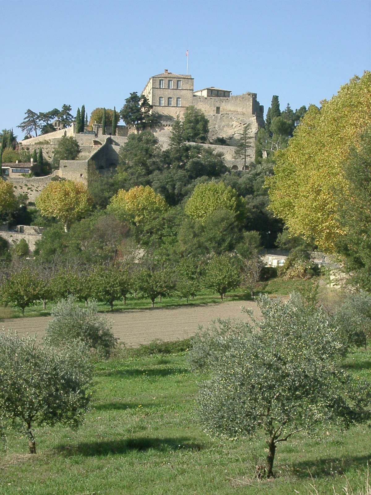</picture>
<figcaption><b>Ansouis</b>, its castle crowning the hill above the village and the olive groves. Photo: <a href="https://commons.wikimedia.org/wiki/File:Ansouis_1.jpg">Ansouis 1</a> by Rikiwiki21, <a href="https://www.gnu.org/licenses/gpl-3.0.html">GPL</a>, via Wikimedia Commons.</figcaption>
</figure>

<figure class=photo>
<picture><source srcset="/static/art/elz-ansouis-castle-600.webp 600w,/static/art/elz-ansouis-castle.webp 1280w" sizes="(max-width:760px) 100vw,760px" type="image/webp">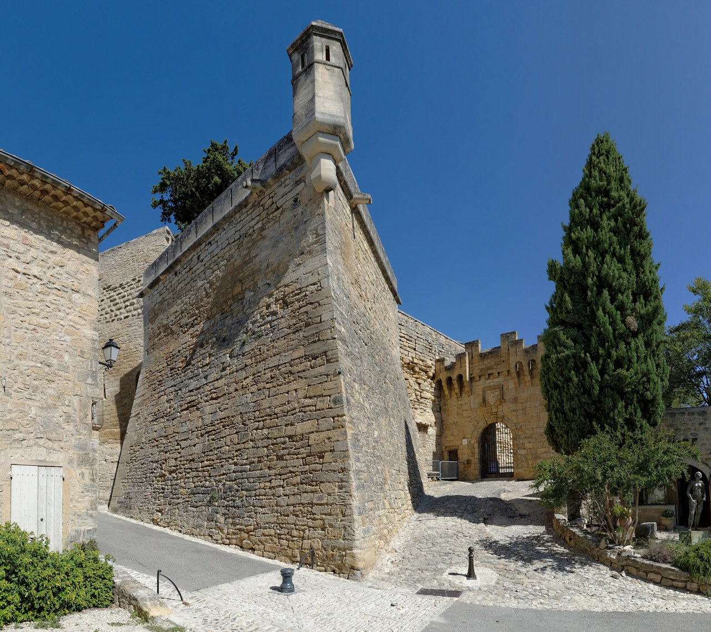</picture>
<figcaption>The <b>ramparts and entrance of the castle of Ansouis</b>, home of the Sabrans. Photo: <a href="https://commons.wikimedia.org/wiki/File:Ch%C3%A2teau_d%27Ansouis_01.jpg">Château d'Ansouis 01</a> by François de Dijon, <a href="https://creativecommons.org/licenses/by-sa/3.0">CC BY-SA 3.0</a>, via Wikimedia Commons.</figcaption>
</figure>

<figure class=photo>
<picture><source srcset="/static/art/elz-ansouis-church-castle-600.webp 600w,/static/art/elz-ansouis-church-castle.webp 1280w" sizes="(max-width:760px) 100vw,760px" type="image/webp">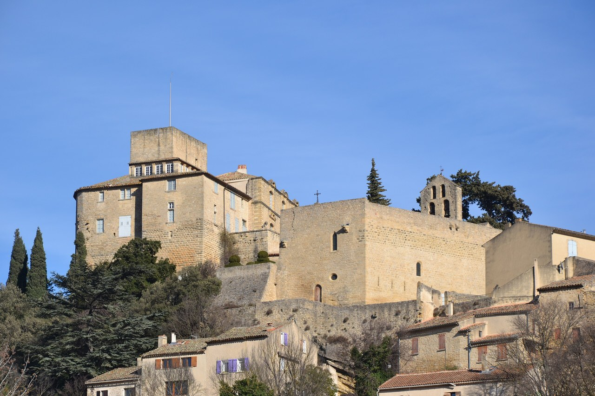</picture>
<figcaption>The <b>church of Saint-Martin and the castle of Ansouis</b>. The parish church stands against the castle walls, and keeps the relics of the holy spouses. Photo: <a href="https://commons.wikimedia.org/wiki/File:Ansouis_-_%C3%A9glise_et_ch%C3%A2teau.jpg">Ansouis - église et château</a> by Marianne Casamance, <a href="https://creativecommons.org/licenses/by-sa/4.0">CC BY-SA 4.0</a>, via Wikimedia Commons.</figcaption>
</figure>

Below the castle, the parish church of **Saint-Martin** keeps the gilded reliquary busts of St Elzéar and Blessed Delphine, set on the altar that bears their names, under a painting of the two saints together.

<figure class=photo>
<picture><source srcset="/static/art/elz-ansouis-nave-600.webp 600w,/static/art/elz-ansouis-nave.webp 1280w" sizes="(max-width:760px) 100vw,760px" type="image/webp">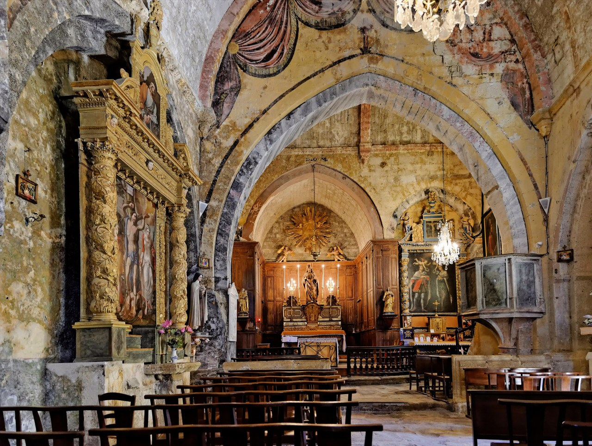</picture>
<figcaption>The <b>nave of Saint-Martin, Ansouis</b>, with its gilded altarpieces. Photo: <a href="https://commons.wikimedia.org/wiki/File:%C3%89glise_Saint-Martin_d%27Ansouis_02.jpg">Église Saint-Martin d'Ansouis 02</a> by François de Dijon, <a href="https://creativecommons.org/licenses/by-sa/3.0">CC BY-SA 3.0</a>, via Wikimedia Commons.</figcaption>
</figure>

<figure class=photo>
<picture><source srcset="/static/art/elz-ansouis-altar-600.webp 600w,/static/art/elz-ansouis-altar.webp 1280w" sizes="(max-width:760px) 100vw,760px" type="image/webp">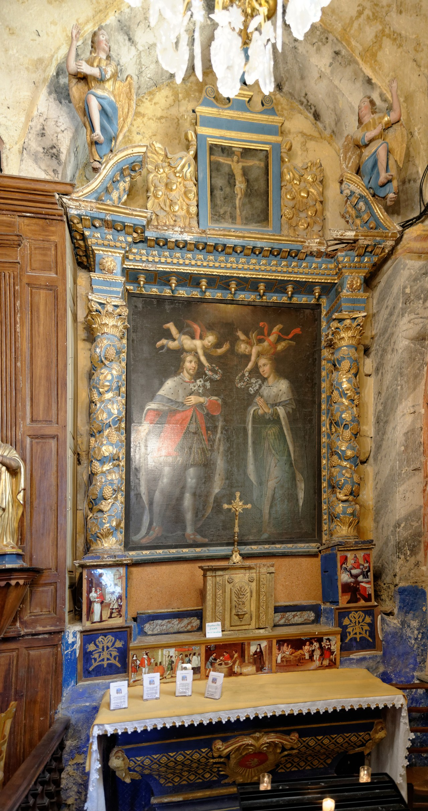</picture>
<figcaption>The <b>altar of St Delphine and St Elzéar</b> in the church of Saint-Martin, Ansouis. Photo: <a href="https://commons.wikimedia.org/wiki/File:%C3%89glise_Saint-Martin_d%27Ansouis_06.jpg">Église Saint-Martin d'Ansouis 06</a> by François de Dijon, <a href="https://creativecommons.org/licenses/by-sa/3.0">CC BY-SA 3.0</a>, via Wikimedia Commons.</figcaption>
</figure>

<figure class=photo>
<picture><source srcset="/static/art/elz-ansouis-reliquaries-600.webp 600w,/static/art/elz-ansouis-reliquaries.webp 1280w" sizes="(max-width:760px) 100vw,760px" type="image/webp">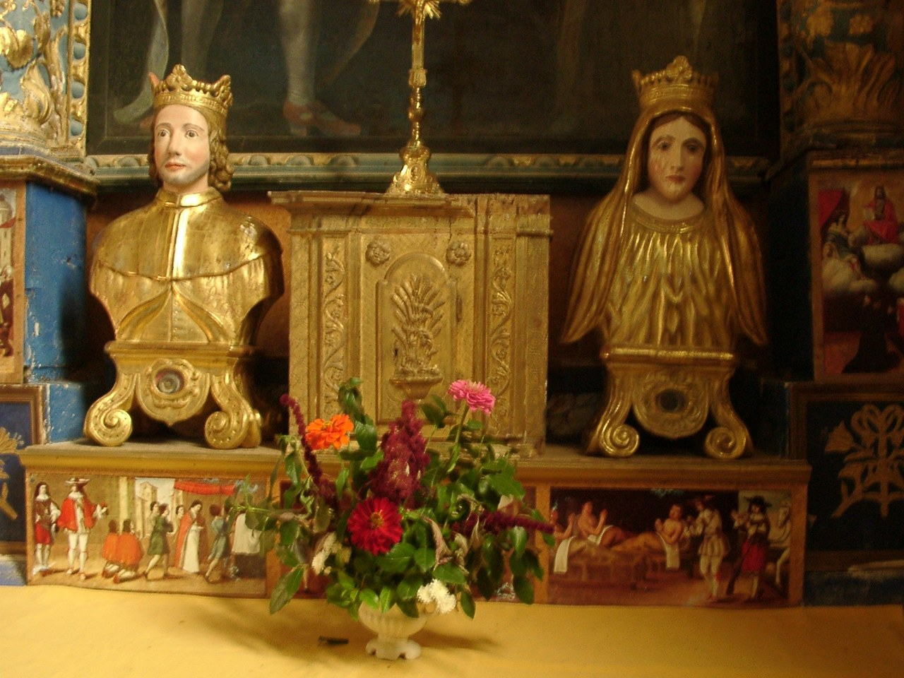</picture>
<figcaption>The <b>reliquary busts of St Elzéar and Blessed Delphine</b> on their altar at Ansouis, with flowers between them. Photo: <a href="https://commons.wikimedia.org/wiki/File:Ansouis_5.jpg">Ansouis 5</a> by Rikiwiki21, <a href="https://www.gnu.org/licenses/gpl-3.0.html">GPL</a>, via Wikimedia Commons.</figcaption>
</figure>

### 2 · Cabrières-d'Aigues: Robians, where he was born

Elzéar was born in the castle of **Saint-Jean-de-Robians**, in the parish of **Cabrières-d'Aigues** on the southern slopes of the Luberon, and Delphine came back here to live near the castle of his birth after his death. The village chapel is dedicated to *Notre-Dame-de-Toutes-Fleurs et Saint-Elzéar*, Our Lady of All Flowers and St Elzéar.

<figure class=photo>
<picture><source srcset="/static/art/elz-cabrieres-chapel-600.webp 600w,/static/art/elz-cabrieres-chapel.webp 1280w" sizes="(max-width:760px) 100vw,760px" type="image/webp">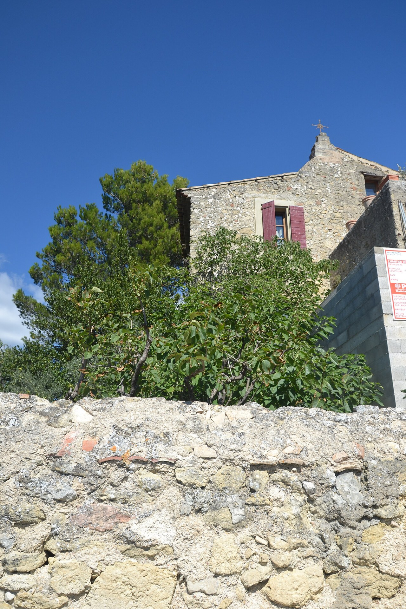</picture>
<figcaption>The <b>chapel of Notre-Dame-de-Toutes-Fleurs et Saint-Elzéar</b>, Cabrières-d'Aigues. Photo: <a href="https://commons.wikimedia.org/wiki/File:Cabri%C3%A8re_-_Notre-Dame-de-Toutes-Fleurs_1.JPG">Cabrière - Notre-Dame-de-Toutes-Fleurs 1</a> by Marianne Casamance, <a href="https://creativecommons.org/licenses/by-sa/4.0">CC BY-SA 4.0</a>, via Wikimedia Commons.</figcaption>
</figure>

### 3 · Apt: the Cathedral of Sainte-Anne

Elzéar was buried in the Franciscan church of **Apt**, and Delphine beside him. In 1373 a magnificent tomb was raised over them there. The Revolution destroyed the tomb and the church, but fragments of the sculpture survive in Baltimore and Avignon, and the town's ancient **Cathedral of Sainte-Anne**, one of the oldest shrines of the mother of Our Lady in the West, keeps the memory of the holy spouses. Apt keeps the feast of St Elzéar every year. For the grandmother of Jesus herself, see [Saints Joachim and Anne](/saints/joachim-and-anne/).

<figure class=photo>
<picture><source srcset="/static/art/elz-apt-cathedral-600.webp 600w,/static/art/elz-apt-cathedral.webp 1280w" sizes="(max-width:760px) 100vw,760px" type="image/webp">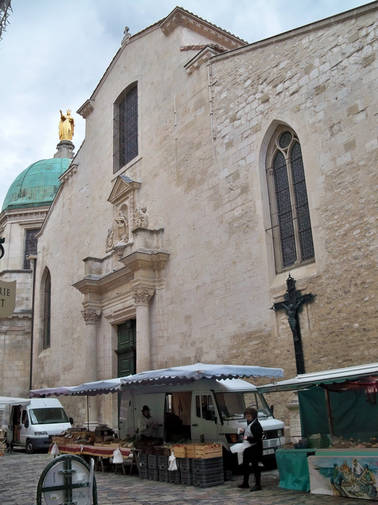</picture>
<figcaption>The <b>Cathedral of Sainte-Anne, Apt</b>, on its narrow street in the old town. Photo: <a href="https://commons.wikimedia.org/wiki/File:Facade_Ste_Anne_d%27Apt.JPG">Facade Ste Anne d'Apt</a> by Véronique Pagnier, public domain, via Wikimedia Commons.</figcaption>
</figure>

<figure class=photo>
<picture><source srcset="/static/art/elz-apt-nave-600.webp 600w,/static/art/elz-apt-nave.webp 1200w" sizes="(max-width:760px) 100vw,760px" type="image/webp">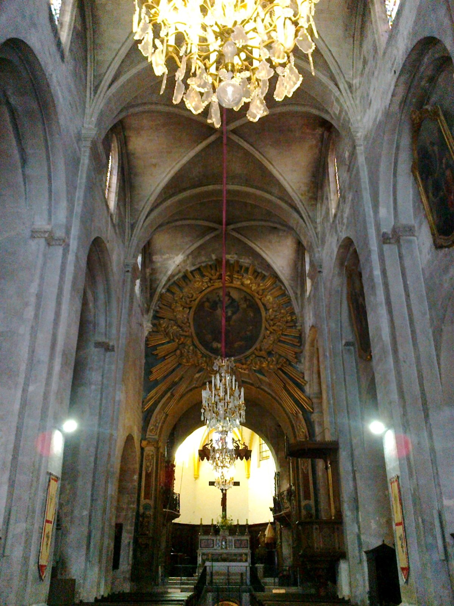</picture>
<figcaption>The <b>nave of the Cathedral of Sainte-Anne, Apt</b>. Photo: <a href="https://commons.wikimedia.org/wiki/File:Luberon_Apt_Eglise_Sainte-Anne_Nef_09072013_-_panoramio.jpg">Luberon Apt Eglise Sainte-Anne Nef 09072013 - panoramio</a> by René Boulay, <a href="https://creativecommons.org/licenses/by-sa/3.0">CC BY-SA 3.0</a>, via Wikimedia Commons.</figcaption>
</figure>

### 4 · Puimichel: Delphine's castle

The hill village of **Puimichel**, in Haute-Provence, was Delphine's inheritance. The two were married in its castle, and here Elzéar wrote the rules of his holy household. At the top of the village stands the **chapel of Saint-Elzéar**, with views in every direction.

<figure class=photo>
<picture><source srcset="/static/art/elz-puimichel-chapel-600.webp 600w,/static/art/elz-puimichel-chapel.webp 1280w" sizes="(max-width:760px) 100vw,760px" type="image/webp">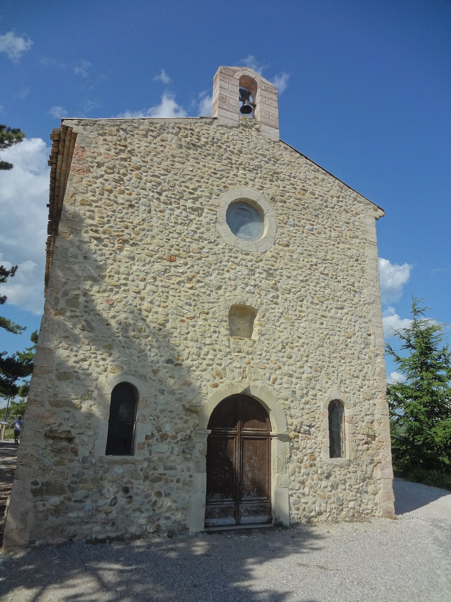</picture>
<figcaption>The <b>chapel of Saint-Elzéar</b> at the top of the village of Puimichel. Photo: <a href="https://commons.wikimedia.org/wiki/File:Fa%C3%A7ade_de_la_chapelle_Saint-Elz%C3%A9ard_de_Puimichel.jpg">Façade de la chapelle Saint-Elzéard de Puimichel</a> by Sébastien Thébault, <a href="https://creativecommons.org/licenses/by-sa/3.0">CC BY-SA 3.0</a>, via Wikimedia Commons.</figcaption>
</figure>

### 5 · Montfuron: the chapel of Saint-Elzéar

At **Montfuron**, in the hills above Manosque, the old parish church is dedicated to Notre-Dame and St Elzéar, and the seventeenth-century **chapel of Saint-Elzéar** in the cemetery is a listed historic monument.

<figure class=photo>
<picture><source srcset="/static/art/elz-montfuron-chapel-600.webp 600w,/static/art/elz-montfuron-chapel.webp 1280w" sizes="(max-width:760px) 100vw,760px" type="image/webp">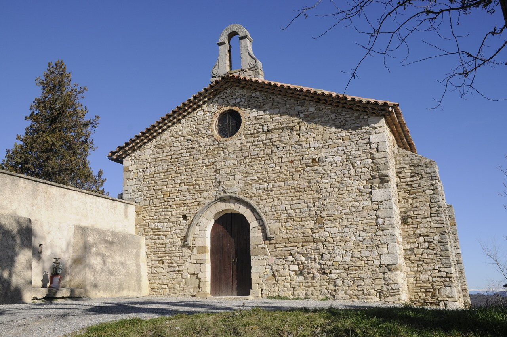</picture>
<figcaption>The <b>chapel of Saint-Elzéar, Montfuron</b>, Alpes-de-Haute-Provence. Photo: <a href="https://commons.wikimedia.org/wiki/File:Chapelle_Saint_Elz%C3%A9ar_-_Montfuron_(Alpes_de_Haute_Provence).jpg">Chapelle Saint Elzéar - Montfuron (Alpes de Haute Provence)</a> by Territo13, <a href="https://creativecommons.org/licenses/by-sa/4.0">CC BY-SA 4.0</a>, via Wikimedia Commons.</figcaption>
</figure>

### 6 · Marseille: the Abbey of Saint-Victor

Elzéar was educated in the great abbey of **Saint-Victor**, above the old port of Marseille, where his uncle William of Sabran was abbot. The fortress-church still stands over its crypts, among the oldest Christian places in France, and it was here that his godson Guillaume de Grimoard, the future Urban V, made his novitiate and later served as abbot.

<figure class=photo>
<picture><source srcset="/static/art/elz-saint-victor-600.webp 600w,/static/art/elz-saint-victor.webp 1224w" sizes="(max-width:760px) 100vw,760px" type="image/webp">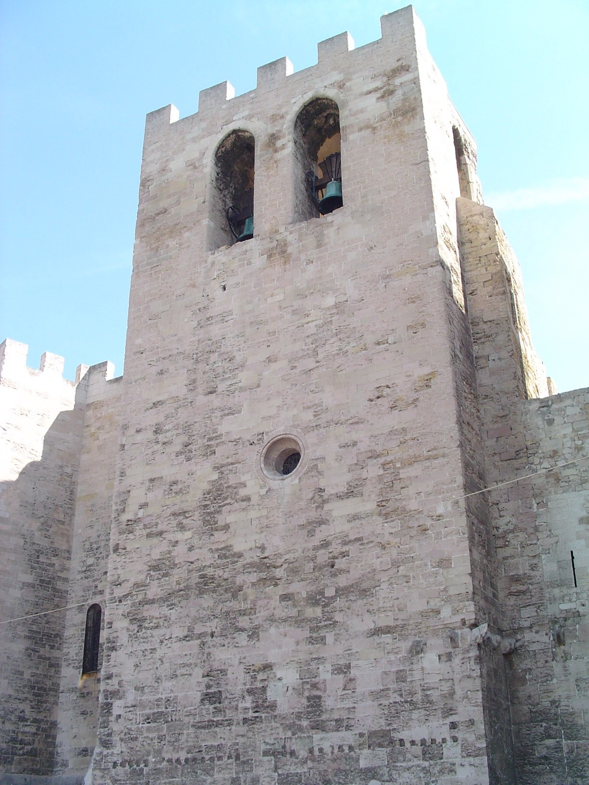</picture>
<figcaption>The fortified <b>Abbey of Saint-Victor, Marseille</b>, where Elzéar was educated as a boy. Photo: <a href="https://commons.wikimedia.org/wiki/File:Abbaye_Saint-Victor_(Marseille).jpg">Abbaye Saint-Victor (Marseille)</a> by Hagen de Merak, <a href="https://creativecommons.org/licenses/by-sa/2.5">CC BY-SA 2.5</a>, via Wikimedia Commons.</figcaption>
</figure>

<figure class=photo>
<picture><source srcset="/static/art/elz-saint-victor-nave-600.webp 600w,/static/art/elz-saint-victor-nave.webp 1280w" sizes="(max-width:760px) 100vw,760px" type="image/webp">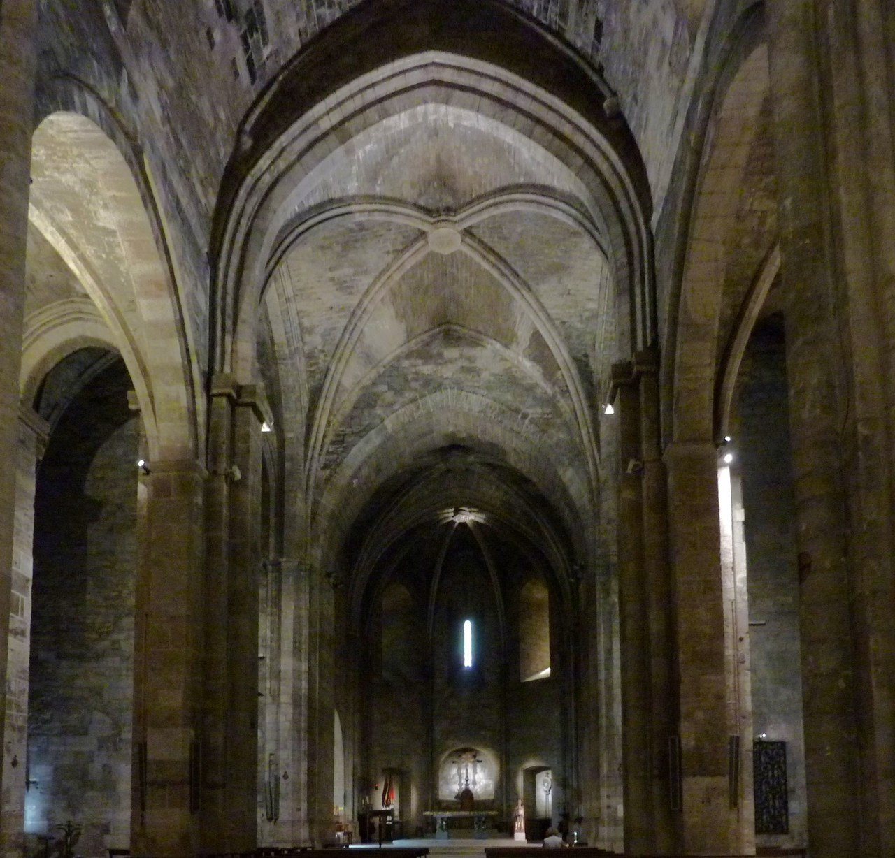</picture>
<figcaption>The <b>nave of Saint-Victor</b>, Marseille. Photo: <a href="https://commons.wikimedia.org/wiki/File:2017_Interior_of_Abbaye_Saint-Victor_(1).jpg">2017 Interior of Abbaye Saint-Victor (1)</a> by Chris06, <a href="https://creativecommons.org/licenses/by-sa/4.0">CC BY-SA 4.0</a>, via Wikimedia Commons.</figcaption>
</figure>

### 7 · Avignon: Saint-Didier and the Petit Palais

In **Avignon**, the city of the popes, the collegiate church of **Saint-Didier** keeps a Gothic reliquary of St Elzéar and Blessed Delphine, and the **Musée du Petit Palais** keeps sculptures from his tomb at Apt (see the art section below).

<figure class=photo>
<picture><source srcset="/static/art/elz-avignon-reliquary-600.webp 600w,/static/art/elz-avignon-reliquary.webp 1280w" sizes="(max-width:760px) 100vw,760px" type="image/webp">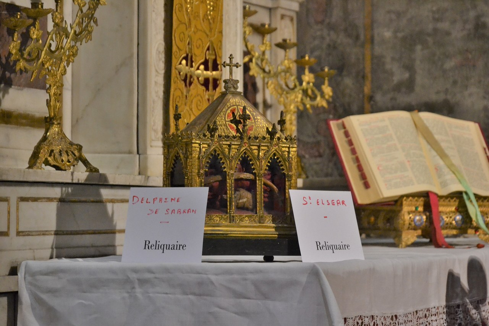</picture>
<figcaption>The <b>reliquary of Blessed Delphine and St Elzéar</b> in the collegiate church of Saint-Didier, Avignon. Photo: <a href="https://commons.wikimedia.org/wiki/File:Avignon_-_Coll%C3%A9giale_Saint_Didier_-_Reliquaire_Delphine_Sabran_%26_Saint_Elz%C3%A9ar.jpg">Avignon - Collégiale Saint Didier - Reliquaire Delphine Sabran & Saint Elzéar</a> by Marianne Casamance, <a href="https://creativecommons.org/licenses/by-sa/4.0">CC BY-SA 4.0</a>, via Wikimedia Commons.</figcaption>
</figure>

### 8 · Sabran: the cradle of the family

West of the Rhône, in the Gard, the ruined castle of **Sabran** on its hilltop gave the family its name.

<figure class=photo>
<picture><source srcset="/static/art/elz-sabran-castle-600.webp 600w,/static/art/elz-sabran-castle.webp 1280w" sizes="(max-width:760px) 100vw,760px" type="image/webp">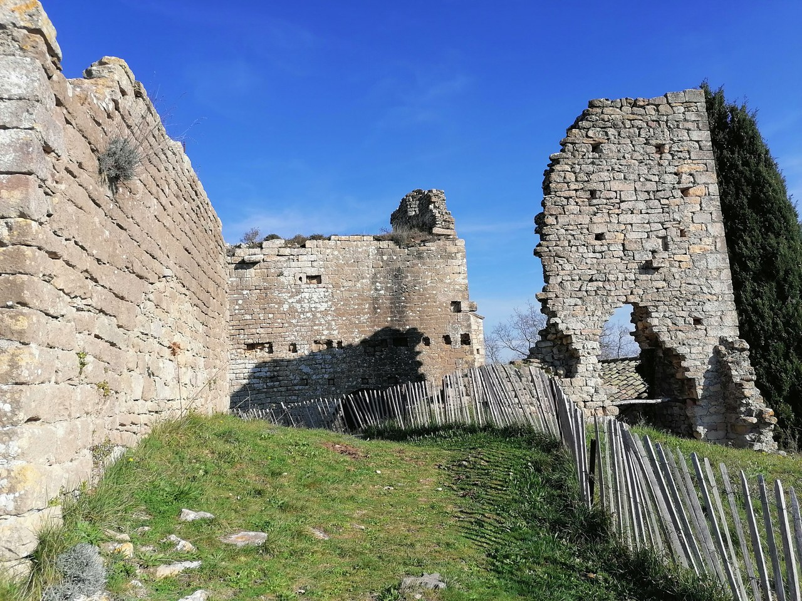</picture>
<figcaption>The <b>ruined castle of Sabran</b>, Gard, the cradle of the Sabran family. Photo: <a href="https://commons.wikimedia.org/wiki/File:Sabran_20260324_Ch%C3%A2teau_ruin%C3%A9_162130.jpg">Sabran 20260324 Château ruiné 162130</a> by RhôneA7, <a href="https://creativecommons.org/licenses/by/4.0">CC BY 4.0</a>, via Wikimedia Commons.</figcaption>
</figure>

### 9 · Naples: Santa Chiara

The great Franciscan church of **Santa Chiara** in Naples was founded by King Robert and Queen Sancia in the years when Elzéar sat at the head of the king's council. Robert lies there behind the high altar, his pupil the Duke of Calabria beside him, and Sancia's Poor Clares kept its cloister. For the saint of the church's name, see [St Clare](/saints/clare/).

<figure class=photo>
<picture><source srcset="/static/art/elz-santa-chiara-600.webp 600w,/static/art/elz-santa-chiara.webp 1280w" sizes="(max-width:760px) 100vw,760px" type="image/webp">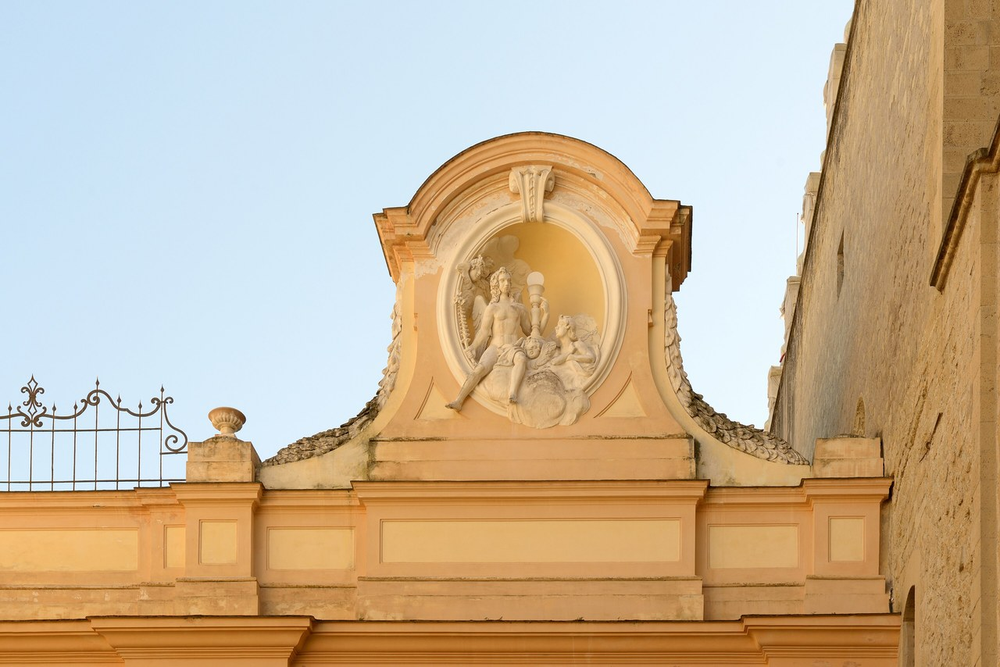</picture>
<figcaption>Above the entrance to the cloisters of <b>Santa Chiara, Naples</b>. Photo: <a href="https://commons.wikimedia.org/wiki/File:Basilica_di_Santa_Chiara_Napoli_esterno.jpg">Basilica di Santa Chiara Napoli esterno</a> by Wolfgang Moroder, <a href="https://creativecommons.org/licenses/by-sa/3.0">CC BY-SA 3.0</a>, via Wikimedia Commons.</figcaption>
</figure>

<figure class=photo>
<picture><source srcset="/static/art/elz-robert-tomb-600.webp 600w,/static/art/elz-robert-tomb.webp 1280w" sizes="(max-width:760px) 100vw,760px" type="image/webp">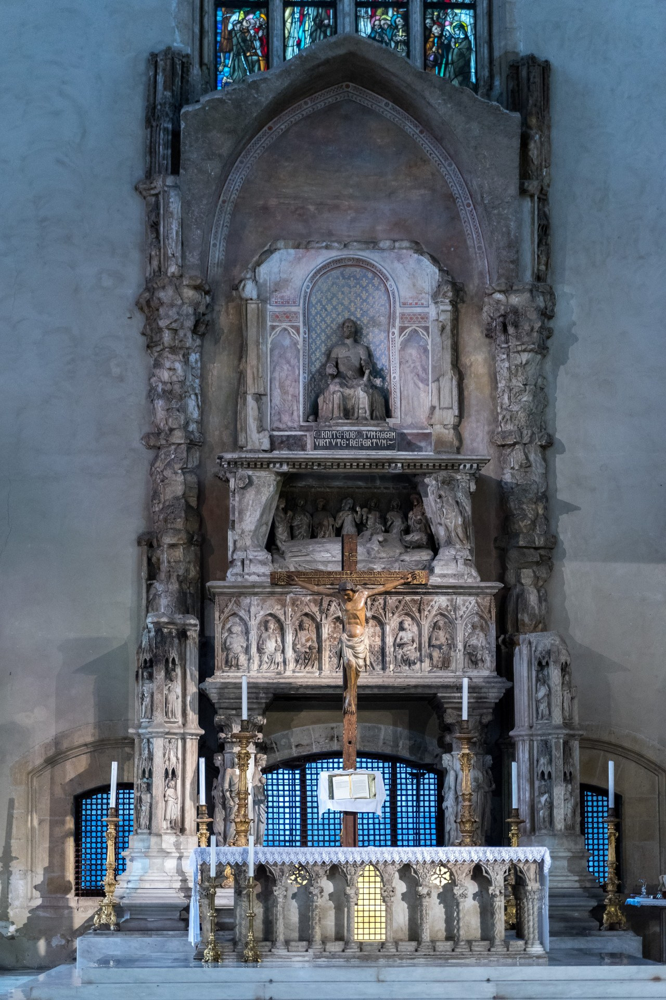</picture>
<figcaption>The tomb of <b>King Robert of Naples</b> (died 1343) behind the high altar of Santa Chiara, carved by Giovanni and Pacio Bertini of Florence. Photo: <a href="https://commons.wikimedia.org/wiki/File:Naples_-_Santa_Chiara_-_Autel_et_tombe_de_Robert_de_Naples.jpg">Naples - Santa Chiara - Autel et tombe de Robert de Naples</a> by Jean-Christophe Benoist, <a href="https://creativecommons.org/licenses/by/4.0">CC BY 4.0</a>, via Wikimedia Commons.</figcaption>
</figure>

### 10 · Ariano Irpino: his county

The hill town of **Ariano**, now Ariano Irpino, was the county of the Sabrans from 1294 to 1413. Its people, who once shut their gates against Elzéar, came to love him as their father, and the **Cathedral of Ariano** honours him as co-patron with St Otto, with his statue at its portals.

<figure class=photo>
<picture><source srcset="/static/art/elz-ariano-cathedral-600.webp 600w,/static/art/elz-ariano-cathedral.webp 800w" sizes="(max-width:760px) 100vw,760px" type="image/webp">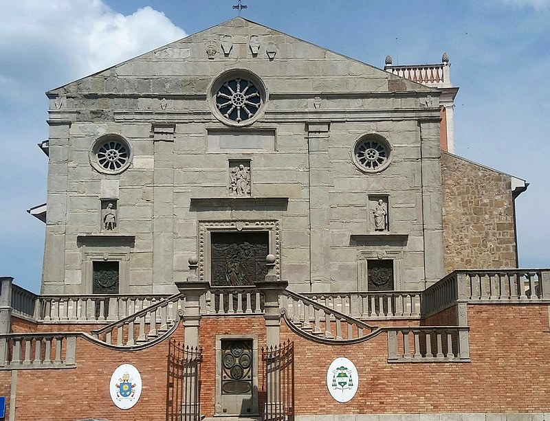</picture>
<figcaption>The <b>Cathedral of Ariano Irpino</b>, where St Elzéar is honoured as co-patron. Photo: <a href="https://commons.wikimedia.org/wiki/File:Ariano_Irpino_Cathedral_facade.jpeg">Ariano Irpino Cathedral facade</a> by ALC, <a href="https://creativecommons.org/licenses/by-sa/4.0">CC BY-SA 4.0</a>, via Wikimedia Commons.</figcaption>
</figure>

### 11 · San Elizario, Texas: the Presidio Chapel

<figure class=photo>
<picture><source srcset="/static/art/elz-anton-san-elizario-600.webp 600w,/static/art/elz-anton-san-elizario.webp 1200w" sizes="(max-width:760px) 100vw,760px" type="image/webp">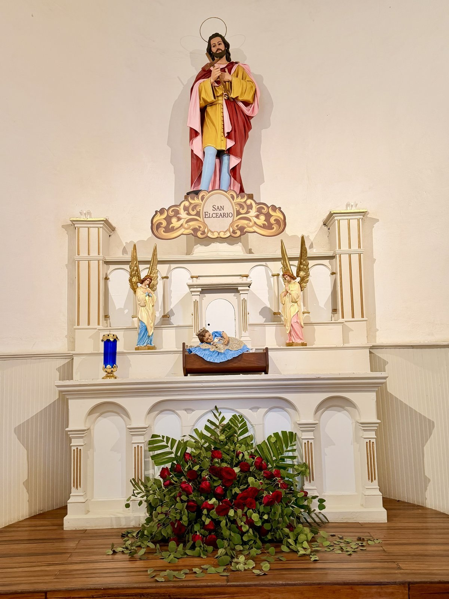</picture>
<figcaption><b>San Elceario</b>, St Elzéar of Sabran, above an altar of the Presidio Chapel of San Elizario, with the Infant Jesus in his crib and red roses on the sanctuary floor. Photo: Anton Olson, San Elizario Presidio Chapel, El Paso Mission Trail, November 2026</figcaption>
</figure>

The white chapel of **San Elizario** stands on the south side of the old plaza, at the heart of the San Elizario Historic District, about fifteen miles southeast of downtown El Paso, where El Camino Real crosses out of Mexico into the United States. It is the fourth chapel built at the old presidio named for the patron of soldiers, completed in 1882, and it is still a living parish church. Above one of its altars, St Elzéar of Sabran, *San Elceario*, stands in his crimson robes with his cross, as he has for the soldiers and families of the border for more than two centuries.

<figure class=photo>
<picture><source srcset="/static/art/elz-se-chapel-600.webp 600w,/static/art/elz-se-chapel.webp 1280w" sizes="(max-width:760px) 100vw,760px" type="image/webp">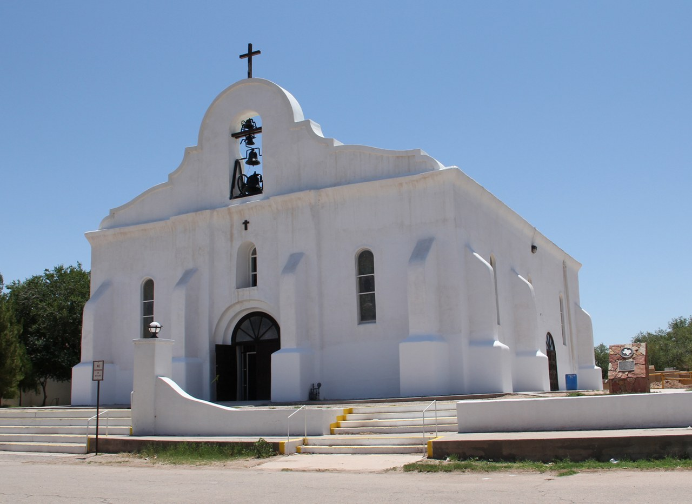</picture>
<figcaption>The <b>Presidio Chapel of San Elizario</b>, built between 1877 and 1882 on the site of the presidio of 1789. National Park Service. Photo: <a href="https://commons.wikimedia.org/wiki/File:Presidio_Chapel_of_San_Elizario,_Mission_Trail,_El_Paso,_Texas_(2b82a8e9-155d-451f-671e-392e6e94b7d0).jpg">Presidio Chapel of San Elizario, Mission Trail, El Paso, Texas (2b82a8e9-155d-451f-671e-392e6e94b7d0)</a> by National Park Service, public domain, via Wikimedia Commons.</figcaption>
</figure>

<figure class=photo>
<picture><source srcset="/static/art/elz-se-chapel-color-600.webp 600w,/static/art/elz-se-chapel-color.webp 1280w" sizes="(max-width:760px) 100vw,760px" type="image/webp">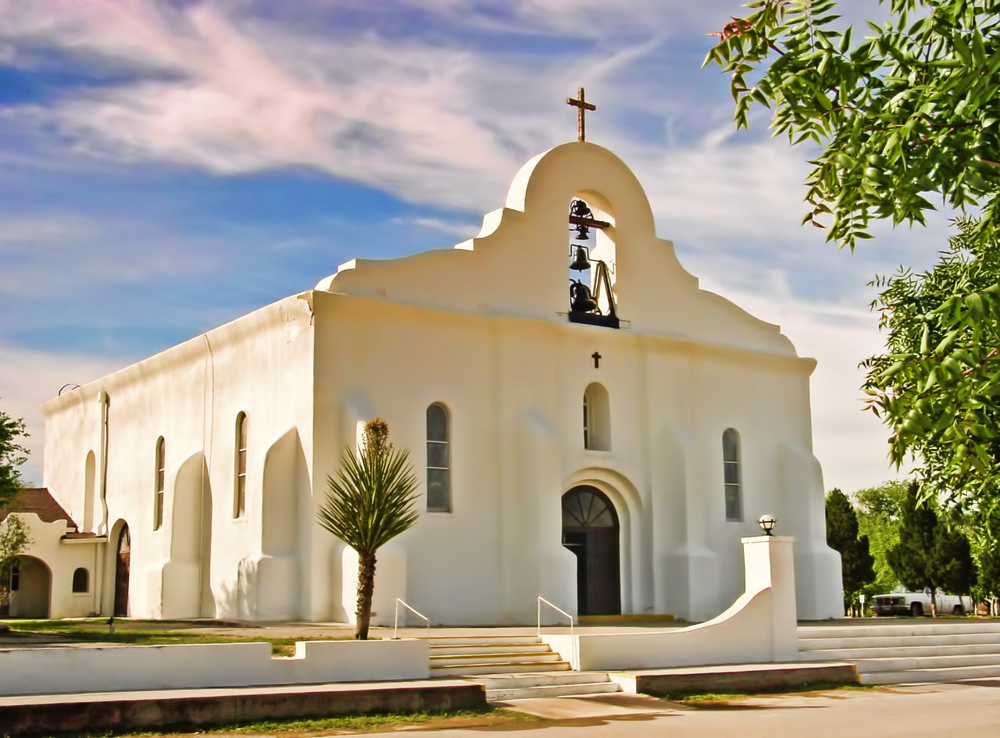</picture>
<figcaption>The chapel in afternoon light, from the plaza. Photo: <a href="https://commons.wikimedia.org/wiki/File:San_Elizario_Mission.jpg">San Elizario Mission</a> by Jsweida, <a href="https://creativecommons.org/licenses/by-sa/3.0">CC BY-SA 3.0</a>, via Wikimedia Commons.</figcaption>
</figure>

The chapel was built in the traditional way, with thick adobe walls, new adobe bricks and bricks taken from the walls of the old presidio. In the early twentieth century the flat triangular bell gable was turned into the rounded bell tower and curving parapet that are its signature today. The Historic American Buildings Survey photographed and drew it in 1936.

<figure class=photo>
<picture><source srcset="/static/art/elz-se-habs-1936-600.webp 600w,/static/art/elz-se-habs-1936.webp 1280w" sizes="(max-width:760px) 100vw,760px" type="image/webp">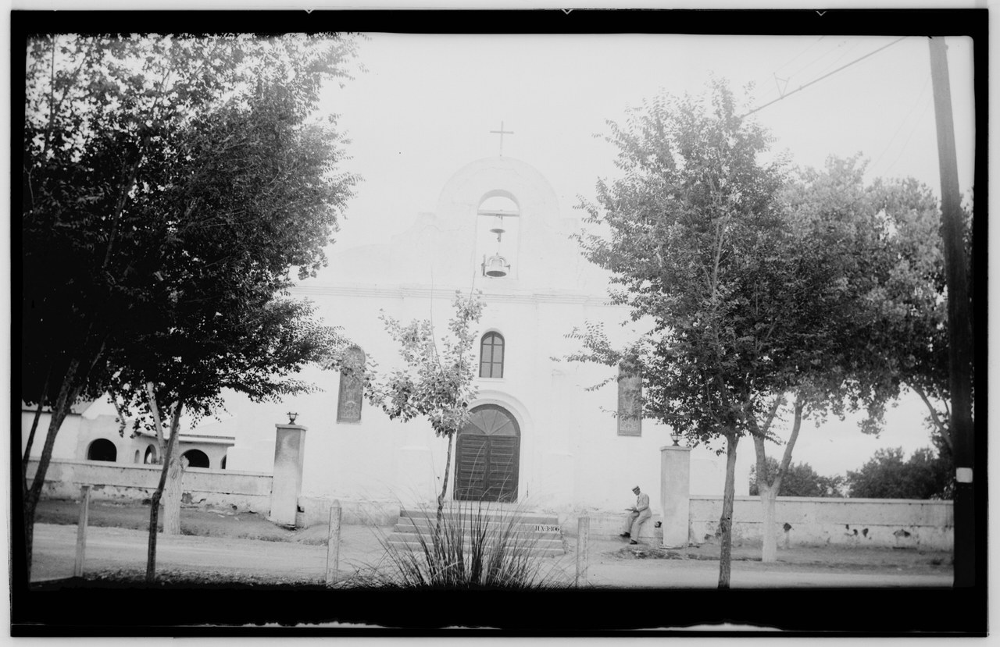</picture>
<figcaption>The <b>west front of the Iglesia de San Elceario</b>, photographed by Marvin Eickenroht for the Historic American Buildings Survey on 25 May 1936. Library of Congress. Photo: <a href="https://commons.wikimedia.org/wiki/File:Historic_American_Buildings_Survey,_Marvin_Eickenroht,_Photographer_May_25,_1936_WEST_ELEVATION_(FRONT)._-_Iglesia_de_San_Elceario,_South_side_of_San_Elizario_Plaza,_San_Elizario_HABS_TEX,71-SANEL,1-1.tif">Historic American Buildings Survey, Marvin Eickenroht, Photographer May 25, 1936 WEST ELEVATION (FRONT). - Iglesia de San Elceario, South side of San Elizario Plaza, San Elizario HABS TEX,71-SANEL,1-1.tif</a> by Marvin Eickenroht, Historic American Buildings Survey, public domain, via Wikimedia Commons.</figcaption>
</figure>

<figure class=photo>
<picture><source srcset="/static/art/elz-se-habs-sheet-600.webp 600w,/static/art/elz-se-habs-sheet.webp 1280w" sizes="(max-width:760px) 100vw,760px" type="image/webp">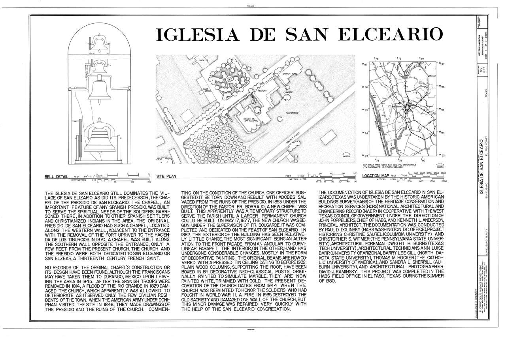</picture>
<figcaption>The first of seven measured drawing sheets of the <b>Iglesia de San Elceario</b> made for the Historic American Buildings Survey, with a site plan of the plaza and the history of the church. Library of Congress. Image: <a href="https://commons.wikimedia.org/wiki/File:Iglesia_de_San_Elceario,_South_side_of_San_Elizario_Plaza,_San_Elizario,_El_Paso_County,_TX_HABS_TEX,71-SANEL,1-_(sheet_1_of_7).png">Iglesia de San Elceario, South side of San Elizario Plaza, San Elizario, El Paso County, TX HABS TEX,71-SANEL,1- (sheet 1 of 7)</a> by Historic American Buildings Survey, public domain, via Wikimedia Commons.</figcaption>
</figure>

After the electrical fire of 1935, the interior was made new: a hand-painted pressed-tin ceiling over the old vigas, ornate posts around the plain wooden columns, and stained-glass windows that join the Sacred Heart to the Lone Star of Texas. The 1944 repainting in honour of the valley's World War II soldiers gave the church much of its present look.

<figure class=photo>
<picture><source srcset="/static/art/elz-se-interior-600.webp 600w,/static/art/elz-se-interior.webp 1280w" sizes="(max-width:760px) 100vw,760px" type="image/webp">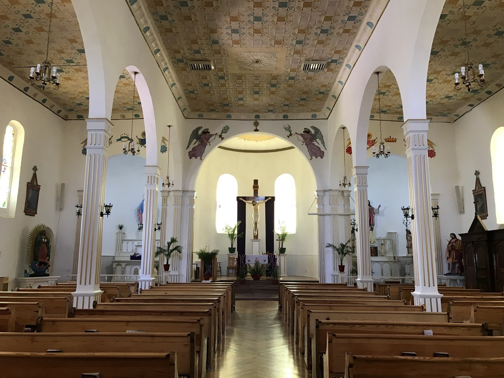</picture>
<figcaption>The <b>interior of the Presidio Chapel</b>, with its pressed-tin ceiling and arcades. National Park Service. Photo: <a href="https://commons.wikimedia.org/wiki/File:A_wide_view_of_the_inside_of_the_Presidio_Mission_in_San_Elizario,_TX_(c2206e9b-8149-4ef9-9191-54727cef1fa0).JPG">A wide view of the inside of the Presidio Mission in San Elizario, TX (c2206e9b-8149-4ef9-9191-54727cef1fa0)</a> by National Trails Office, National Park Service, public domain, via Wikimedia Commons.</figcaption>
</figure>

<figure class=photo>
<picture><source srcset="/static/art/elz-se-habs-interior-600.webp 600w,/static/art/elz-se-habs-interior.webp 1280w" sizes="(max-width:760px) 100vw,760px" type="image/webp">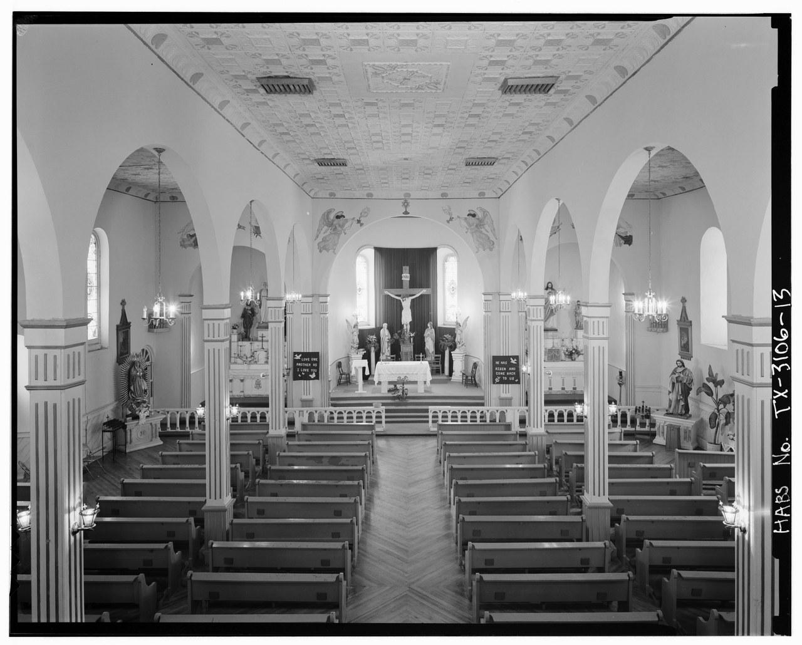</picture>
<figcaption>The nave <b>looking south to the altar from the rear balcony</b>, photographed by David J. Kaminsky for the Historic American Buildings Survey in 1980. Library of Congress. Photo: <a href="https://commons.wikimedia.org/wiki/File:Interior_view_looking_south_to_altar_from_rear_balcony_-_Iglesia_de_San_Elceario,_South_side_of_San_Elizario_Plaza,_San_Elizario,_El_Paso_County,_TX_HABS_TEX,71-SANEL,1-13.tif">Interior view looking south to altar from rear balcony - Iglesia de San Elceario, South side of San Elizario Plaza, San Elizario, El Paso County, TX HABS TEX,71-SANEL,1-13.tif</a> by David J. Kaminsky, Historic American Buildings Survey, public domain, via Wikimedia Commons.</figcaption>
</figure>

<figure class=photo>
<picture><source srcset="/static/art/elz-se-altar-600.webp 600w,/static/art/elz-se-altar.webp 1280w" sizes="(max-width:760px) 100vw,760px" type="image/webp">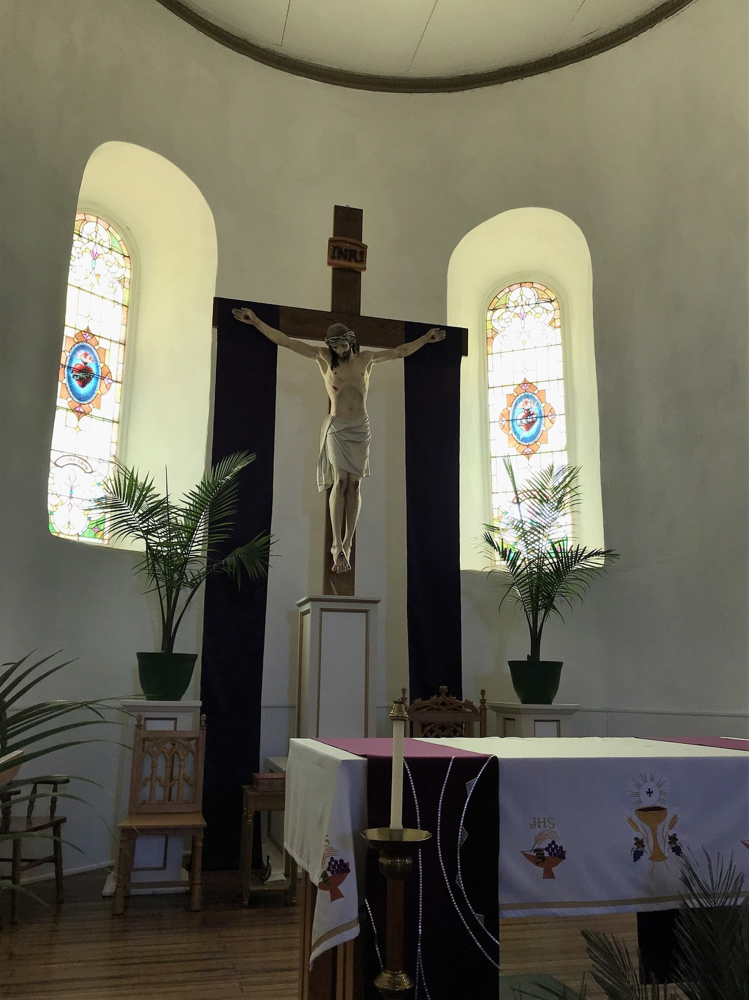</picture>
<figcaption>The <b>sanctuary of the Presidio Chapel</b>, with its crucifix and stained glass. National Park Service. Photo: <a href="https://commons.wikimedia.org/wiki/File:The_altar_at_the_Presidio_Mission_in_San_Elizario,_TX_(1962ba1b-f9c4-497f-a07d-e379242a8e00).JPG">The altar at the Presidio Mission in San Elizario, TX (1962ba1b-f9c4-497f-a07d-e379242a8e00)</a> by National Trails Office, National Park Service, public domain, via Wikimedia Commons.</figcaption>
</figure>

<figure class=photo>
<picture><source srcset="/static/art/elz-se-mary-600.webp 600w,/static/art/elz-se-mary.webp 1280w" sizes="(max-width:760px) 100vw,760px" type="image/webp">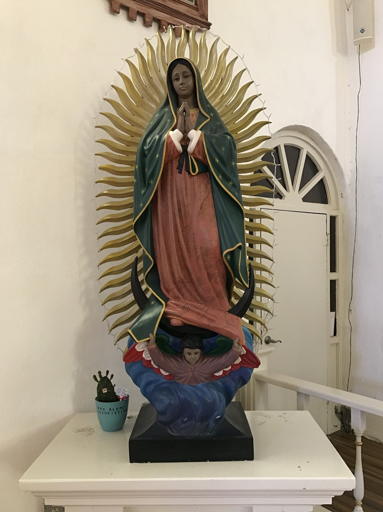</picture>
<figcaption><b>Our Lady of Guadalupe</b> in the Presidio Chapel. National Park Service. Photo: <a href="https://commons.wikimedia.org/wiki/File:A_statue_of_the_Blessed_Virgin_Mary_at_the_Presidio_Mission_in_San_Elizario,_TX_(3d1376cf-7528-4e8e-8d7b-bf9dc3b389ba).JPG">A statue of the Blessed Virgin Mary at the Presidio Mission in San Elizario, TX (3d1376cf-7528-4e8e-8d7b-bf9dc3b389ba)</a> by National Trails Office, National Park Service, public domain, via Wikimedia Commons.</figcaption>
</figure>

<figure class=photo>
<picture><source srcset="/static/art/elz-se-bell-600.webp 600w,/static/art/elz-se-bell.webp 1280w" sizes="(max-width:760px) 100vw,760px" type="image/webp">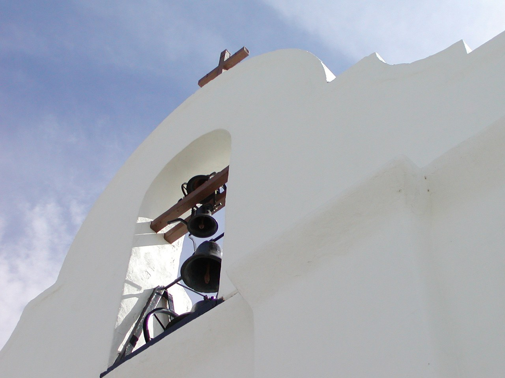</picture>
<figcaption>The <b>bell tower</b> of the Presidio Chapel. National Park Service. Photo: <a href="https://commons.wikimedia.org/wiki/File:The_bell_tower_at_Presidio_Chapel_of_San_Elizario_in_San_Elizario,_Texas_(c3fcab51-c0f5-43d2-a4b9-e6fc460ae84a).JPG">The bell tower at Presidio Chapel of San Elizario in San Elizario, Texas (c3fcab51-c0f5-43d2-a4b9-e6fc460ae84a)</a> by National Trails Office, National Park Service, public domain, via Wikimedia Commons.</figcaption>
</figure>

The chapel looks out over the plaza that the Spanish laid out on the old presidio's grid, with the adobe buildings of the historic district around it, among them the long porch of **Los Portales**, now the museum and visitor centre. Every September the town keeps the **San Elceario Fiesta** for its patron, as it has for more than a hundred years.

<figure class=photo>
<picture><source srcset="/static/art/elz-se-plaza-600.webp 600w,/static/art/elz-se-plaza.webp 640w" sizes="(max-width:760px) 100vw,760px" type="image/webp">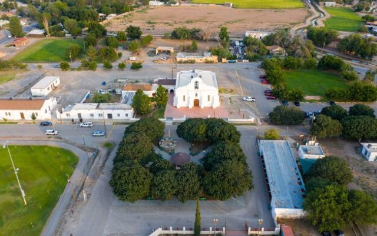</picture>
<figcaption><b>The plaza of San Elizario</b> from the air, with the chapel at its side. Photo: <a href="https://commons.wikimedia.org/wiki/File:Plaza_de_San_Elizario,_Texas.png">Plaza de San Elizario, Texas</a> by Tomas8024, <a href="https://creativecommons.org/publicdomain/zero/1.0/">CC0</a>, via Wikimedia Commons.</figcaption>
</figure>

<figure class=photo>
<picture><source srcset="/static/art/elz-se-portales-600.webp 600w,/static/art/elz-se-portales.webp 1280w" sizes="(max-width:760px) 100vw,760px" type="image/webp">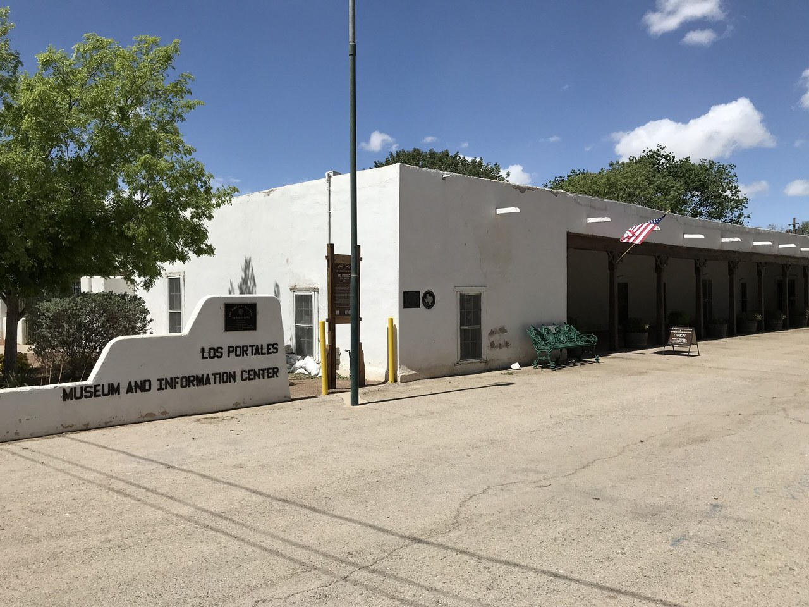</picture>
<figcaption><b>Los Portales</b>, the museum and information centre of the San Elizario Historic District. National Park Service. Photo: <a href="https://commons.wikimedia.org/wiki/File:The_Los_Portales_Museum_and_Information_Center_in_San_Elizario,_TX_(1d019181-fc3e-4bfc-af80-b96e6ce543fb).JPG">The Los Portales Museum and Information Center in San Elizario, TX (1d019181-fc3e-4bfc-af80-b96e6ce543fb)</a> by National Trails Office, National Park Service, public domain, via Wikimedia Commons.</figcaption>
</figure>

The river that once flowed north of the town moved south in the floods of 1829 and the years after, leaving San Elizario, Socorro and Ysleta on **La Isla**, the island between the old and new channels. In 1916, when American cavalry patrolled the border, a troop of Ohio cavalrymen mapped it.

<figure class=photo>
<picture><source srcset="/static/art/elz-se-island-map-600.webp 600w,/static/art/elz-se-island-map.webp 1280w" sizes="(max-width:760px) 100vw,760px" type="image/webp">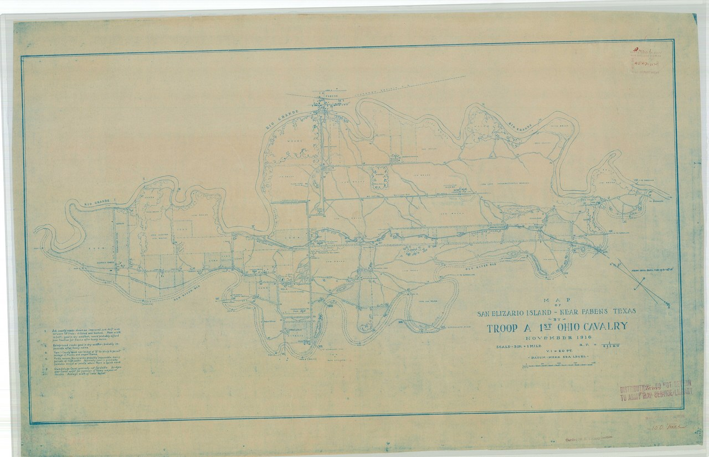</picture>
<figcaption><b>Map of San Elizario Island near Fabens, Texas</b>, drawn in 1916 by Troop A, 1st Ohio Cavalry, on border service. U.S. National Archives. Image: <a href="https://commons.wikimedia.org/wiki/File:Map_of_San_Elizario_Island_near_Fabens,_Texas_by_Troop_A,_1st_Ohio_Cavalry_-_NARA_-_137930336.jpg">Map of San Elizario Island near Fabens, Texas by Troop A, 1st Ohio Cavalry - NARA - 137930336</a> by Troop A, 1st Ohio Cavalry, U.S. National Archives, public domain, via Wikimedia Commons.</figcaption>
</figure>

### 12 · Socorro Mission

Upriver from San Elizario, the **Mission of Nuestra Señora de la Purísima Concepción del Socorro** was founded in 1682 by Franciscans for the Spanish families and the Piro, Tano and Jemez people who fled south after the Pueblo Revolt. Its white adobe church, rebuilt after the floods of 1829, is one of the three historic churches of the Mission Trail.

<figure class=photo>
<picture><source srcset="/static/art/elz-socorro-600.webp 600w,/static/art/elz-socorro.webp 1280w" sizes="(max-width:760px) 100vw,760px" type="image/webp">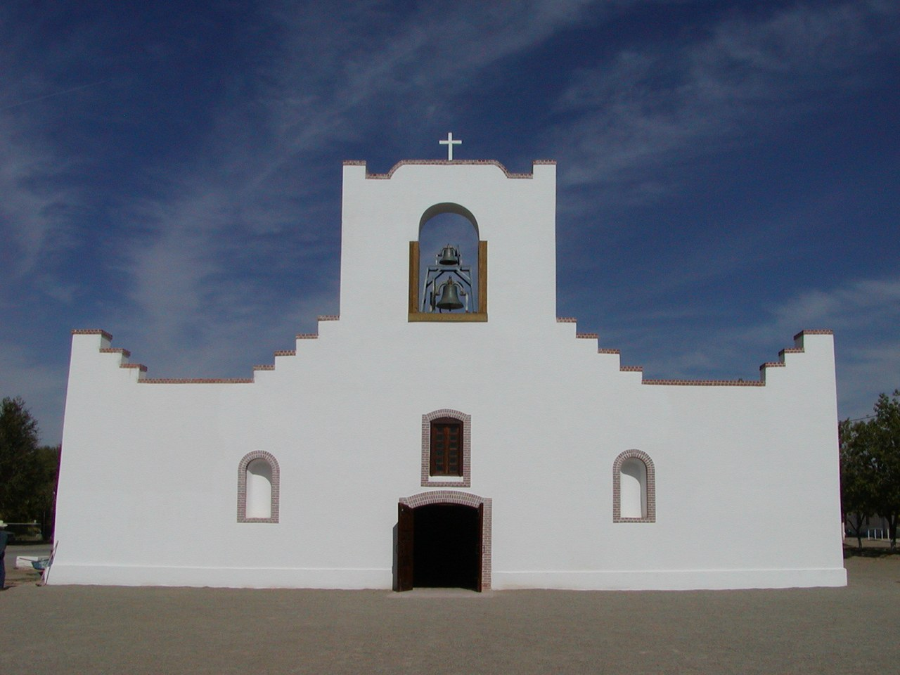</picture>
<figcaption>The <b>Socorro Mission</b>, Socorro, Texas. National Park Service. Photo: <a href="https://commons.wikimedia.org/wiki/File:An_exterior_frontal_view_of_the_Socorro_Mission_in_Socorro,_TX_(a7d4211c-0a3d-4661-9feb-15ad351051e4).JPG">An exterior frontal view of the Socorro Mission in Socorro, TX (a7d4211c-0a3d-4661-9feb-15ad351051e4)</a> by National Trails Office, National Park Service, public domain, via Wikimedia Commons.</figcaption>
</figure>

### 13 · Ysleta Mission

At the northern end of the Mission Trail, the **Ysleta Mission** of the Tigua people of Ysleta del Sur Pueblo was founded in 1682 and is the oldest continuously operating parish in Texas. The three mission churches of Ysleta, Socorro and San Elizario are all living parishes of the Diocese of El Paso, nine miles apart along the old Camino Real.

<figure class=photo>
<picture><source srcset="/static/art/elz-ysleta-600.webp 600w,/static/art/elz-ysleta.webp 1280w" sizes="(max-width:760px) 100vw,760px" type="image/webp"></picture>
<figcaption>The <b>interior of the Ysleta Mission</b>, El Paso. National Park Service. Photo: <a href="https://commons.wikimedia.org/wiki/File:Ysleta_del_Sur_Mission,_El_Paso,_Texas_(2a1a0369-155d-451f-6740-577bf5e9f8f5).jpg">Ysleta del Sur Mission, El Paso, Texas (2a1a0369-155d-451f-6740-577bf5e9f8f5)</a> by National Park Service, public domain, via Wikimedia Commons.</figcaption>
</figure>

<h2 id=art>Elzéar in art</h2>

Artists have shown St Elzéar in two ways: as the young count in rich clothes, often crowned, with his wife beside him, and as the Franciscan tertiary in the grey or brown habit, among the saints of the order of St Francis. The oldest images of him were carved for his own tomb, half a century after his death, to show the charity that Provence remembered.

### The tomb at Apt

In 1373 the Franciscans of Apt raised a great tomb over Elzéar's body, with groups of figures around its base carved in white stone. The tomb was broken up in the Revolution. The scene of Elzéar healing the lepers went to the Walters Art Museum in Baltimore, the picture at the top of this page, and other pieces are in the **Musée du Petit Palais** in Avignon.

<figure class=photo>
<picture><source srcset="/static/art/elz-tomb-flagellation-600.webp 600w,/static/art/elz-tomb-flagellation.webp 1181w" sizes="(max-width:760px) 100vw,760px" type="image/webp"></picture>
<figcaption>A carved group from the <b>base of the tomb of St Elzéar at Apt</b>, about 1373, now in the Musée du Petit Palais, Avignon. Image: <a href="https://commons.wikimedia.org/wiki/File:Elzear_de_Sabran-flagellation-Petit_Palais.jpg">Elzear de Sabran-flagellation-Petit Palais</a> by Musée du Petit Palais, Avignon, public domain, via Wikimedia Commons.</figcaption>
</figure>

<figure class=photo>
<picture><source srcset="/static/art/elz-tomb-christ-600.webp 600w,/static/art/elz-tomb-christ.webp 1280w" sizes="(max-width:760px) 100vw,760px" type="image/webp"></picture>
<figcaption><b>Christ blessing</b>, a statuette from the tomb at Apt, about 1373. Musée du Petit Palais, Avignon. Image: <a href="https://commons.wikimedia.org/wiki/File:Christ_b%C3%A9nissant-Mus%C3%A9e_Avignon_petit_palais.jpg">Christ bénissant-Musée Avignon petit palais</a> by Musée du Petit Palais, Avignon, public domain, via Wikimedia Commons.</figcaption>
</figure>

### The holy spouses

Provence always paints Elzéar and Delphine together. At Ansouis the two stand side by side in the painting over their altar, and in the church of Quinsac in the Dordogne a window shows them side by side under the Sacred Heart, with a vase of lilies between them.

<figure class=photo>
<picture><source srcset="/static/art/elz-ansouis-painting-600.webp 600w,/static/art/elz-ansouis-painting.webp 1280w" sizes="(max-width:760px) 100vw,760px" type="image/webp"></picture>
<figcaption><b>St Elzéar and Blessed Delphine</b>, the painting and altar in the church of Saint-Martin, Ansouis, with their reliquary busts below. The painting is protected as a historic monument. Photo: <a href="https://commons.wikimedia.org/wiki/File:84_-_PA00081799_-_Ansouis_-_%C3%A9glise_tableau_et_autel_Elz%C3%A9ar_et_Delphine.jpg">84 - PA00081799 - Ansouis - église tableau et autel Elzéar et Delphine</a> by Marianne Casamance, <a href="https://creativecommons.org/licenses/by-sa/4.0">CC BY-SA 4.0</a>, via Wikimedia Commons.</figcaption>
</figure>

<figure class=photo>
<picture><source srcset="/static/art/elz-quinsac-window-600.webp 600w,/static/art/elz-quinsac-window.webp 1280w" sizes="(max-width:760px) 100vw,760px" type="image/webp"></picture>
<figcaption><b>St Elzéar and St Delphine of Sabran</b> in the stained-glass window above the west door of the church of Saint-Saturnin, Quinsac (Dordogne), given by a Countess of Sabran-Pontevès. Photo: <a href="https://commons.wikimedia.org/wiki/File:Quinsac_(Dordogne)_-_%C3%89glise_Saint-Saturnin_-_Vitrail_-01.jpg">Quinsac (Dordogne) - Église Saint-Saturnin - Vitrail -01</a> by MOSSOT, <a href="https://creativecommons.org/licenses/by-sa/4.0">CC BY-SA 4.0</a>, via Wikimedia Commons.</figcaption>
</figure>

### Among the saints of St Francis

As a tertiary, Elzéar took his place in the great Franciscan series of saints that the engravers of Antwerp published around 1600, and on the altars of Franciscan churches from Bavaria to Brazil.

<figure class=photo>
<picture><source srcset="/static/art/elz-collaert-600.webp 600w,/static/art/elz-collaert.webp 1280w" sizes="(max-width:760px) 100vw,760px" type="image/webp"></picture>
<figcaption><b>St Elzéar of Sabran</b>, plate 14 of the series <i>Saints of the Franciscan Order</i>, engraved by <b>Adriaen Collaert</b> after <b>Pieter de Jode</b>, published by Theodoor Galle in Antwerp, 1580–1618. Museum Plantin-Moretus, Antwerp. Image: <a href="https://commons.wikimedia.org/wiki/File:De_heilige_Elz%C3%A9ar_de_Sabran,_objectno_PK.OP.06638.tif">De heilige Elzéar de Sabran, objectno PK.OP.06638.tif</a> by Adriaen Collaert after Pieter de Jode, Museum Plantin-Moretus, public domain, via Wikimedia Commons.</figcaption>
</figure>

<figure class=photo>
<picture><source srcset="/static/art/elz-grainet-600.webp 600w,/static/art/elz-grainet.webp 1172w" sizes="(max-width:760px) 100vw,760px" type="image/webp"></picture>
<figcaption><b>St Elzéar</b> on the baroque high altar of the Holy Trinity church at <b>Grainet</b>, Bavaria. Photo: <a href="https://commons.wikimedia.org/wiki/File:Hl_Elzearius,_Grainet.jpg">Hl Elzearius, Grainet</a> by ekpah, <a href="https://creativecommons.org/licenses/by-sa/3.0">CC BY-SA 3.0</a>, via Wikimedia Commons.</figcaption>
</figure>

<figure class=photo>
<picture><source srcset="/static/art/elz-grainet-altar-600.webp 600w,/static/art/elz-grainet-altar.webp 1280w" sizes="(max-width:760px) 100vw,760px" type="image/webp"></picture>
<figcaption>The <b>top of the high altar at Grainet</b>, where St Elzéar stands among the saints of the Franciscan order with St Pacificus. Photo: <a href="https://commons.wikimedia.org/wiki/File:Hochaltar_Aufzug,_Grainet.jpg">Hochaltar Aufzug, Grainet</a> by ekpah, <a href="https://creativecommons.org/licenses/by-sa/3.0">CC BY-SA 3.0</a>, via Wikimedia Commons.</figcaption>
</figure>

<figure class=photo>
<picture><source srcset="/static/art/elz-vac-600.webp 600w,/static/art/elz-vac.webp 1280w" sizes="(max-width:760px) 100vw,760px" type="image/webp"></picture>
<figcaption><b>"S. Elzearius Comes"</b> on the altar of St Elizabeth of Hungary in the Franciscan church of the Holy Cross, <b>Vác</b>, Hungary. Elizabeth, like Elzéar, was a royal tertiary of St Francis; see [St Elizabeth of Hungary](/saints/elizabeth-of-hungary/). Photo: <a href="https://commons.wikimedia.org/wiki/File:V%C3%A1c,_ferences_templom,_Szent_Erzs%C3%A9bet-olt%C3%A1r_2025_08.jpg">Vác, ferences templom, Szent Erzsébet-oltár 2025 08</a> by Pasztilla aka Attila Terbócs, <a href="https://creativecommons.org/licenses/by-sa/4.0">CC BY-SA 4.0</a>, via Wikimedia Commons.</figcaption>
</figure>

<figure class=photo>
<picture><source srcset="/static/art/elz-salvador-600.webp 600w,/static/art/elz-salvador.webp 1280w" sizes="(max-width:760px) 100vw,760px" type="image/webp"></picture>
<figcaption><b>São Elzeário</b>, St Elzéar in the Franciscan habit, in the church of the <b>Third Order of St Francis</b> in Salvador, Bahia, Brazil. Photo: <a href="https://commons.wikimedia.org/wiki/File:Igreja_da_Ordem_Terceira_de_S%C3%A3o_Francisco_Salvador_S%C3%A3o_Elze%C3%A1rio_2018-0275.jpg">Igreja da Ordem Terceira de São Francisco Salvador São Elzeário 2018-0275</a> by Paul R. Burley, <a href="https://creativecommons.org/licenses/by-sa/4.0">CC BY-SA 4.0</a>, via Wikimedia Commons.</figcaption>
</figure>

## Path to sainthood

St Elzéar was honoured as a saint from the day of his death, and Provence prayed at his tomb in Apt. His godson, **Pope Urban V**, canonised him on **15 April 1369** at St Peter's in Rome, and **Gregory XI** published the bull on 5 January 1371. His feast is **27 September**, the day of his death. The Franciscan family keeps Elzéar and Blessed Delphine together on **26 September**, and Delphine's own feast is 26 November. Apt, Avignon, Ariano Irpino and the old abbey of Saint-Victor in Marseille all keep his memory.

## Patronages

Soldiers and the military; married couples and those who keep a chaste marriage; the poor; Ariano Irpino, where he is co-patron of the cathedral; Apt; and the town of San Elizario, Texas, whose presidio and chapel bear his name.

## Trivia

- San Elizario is the Texas form of his Spanish name, *San Elceario* or *San Elzeario*. The old spelling is still on the gold plaque under his statue in the Presidio Chapel.
- His wife, Blessed Delphine, outlived him by more than thirty years, and the two are buried together at Apt.
- His godson became Pope Urban V, the only Avignon pope to be raised to the altars. Urban was beatified in 1870.
- He was a cousin of St Roseline de Villeneuve, the Carthusian prioress of Provence.
- His pupil Charles, Duke of Calabria, married Marie of Valois as Elzéar had arranged, and their daughter became Queen Joanna I of Naples.
- The alabaster group of Elzéar healing the lepers in Baltimore was carved for the tomb raised over him in 1373, fifty years after his death.
- In 1807 the American explorer Zebulon Pike was held for three days in the presidio named for St Elzéar.
- Other soldier saints on this site: [St Martin of Tours](/saints/martin-of-tours/), [St George](/saints/george/), [St Sebastian](/saints/sebastian/), [St Joan of Arc](/saints/joan-of-arc/), [St Nuno Álvares Pereira](/saints/nuno-alvares-pereira/), and the crusader king [St Louis IX](/saints/louis-ix/), also a Franciscan tertiary.

## Sources

- [Catholic Encyclopedia: St Elzéar of Sabran](https://www.newadvent.org/cathen/05397a.htm)
- [Catholic Encyclopedia: Blessed Delphine](https://www.newadvent.org/cathen/04701a.htm)
- [Alban Butler: *The Lives of the Fathers, Martyrs, and Other Principal Saints*, vol. 9, 27 September, SS. Elzear and Delphina, Internet Archive](https://archive.org/details/livesoffathersma09butl_0)
- [Sabine Baring-Gould: *The Lives of the Saints*, vol. 10 (September), Internet Archive](https://archive.org/details/TheLivesOfTheSaintsV10)
- [Walters Art Museum: Saint Elzéar Curing the Lepers](https://art.thewalters.org/detail/25661/)
- [Wikipédia: Elzéar de Sabran](https://fr.wikipedia.org/wiki/Elz%C3%A9ar_de_Sabran)
- [Wikipédia: Ansouis](https://fr.wikipedia.org/wiki/Ansouis)
- [Wikipédia: Cathédrale Sainte-Anne d'Apt](https://fr.wikipedia.org/wiki/Cath%C3%A9drale_Sainte-Anne_d%27Apt)
- [Wikipédia: Montfuron](https://fr.wikipedia.org/wiki/Montfuron)
- [Wikipedia: Ariano Irpino](https://en.wikipedia.org/wiki/Ariano_Irpino)
- [Wikipedia: Pope Urban V](https://en.wikipedia.org/wiki/Pope_Urban_V)
- [Texas State Historical Association, Handbook of Texas: San Elizario, TX](https://www.tshaonline.org/handbook/entries/san-elizario-tx)
- [Handbook of Texas: San Elizario Presidio](https://www.tshaonline.org/handbook/entries/san-elizario-presidio)
- [Handbook of Texas: Salt War of San Elizario](https://www.tshaonline.org/handbook/entries/salt-war-of-san-elizario)
- [National Park Service: Texas: Presidio Chapel of San Elizario](https://www.nps.gov/articles/000/texas-presidio-chapel-of-san-elizario.htm)
- [National Park Service: San Elizario Historic District](https://www.nps.gov/places/san-elizario-historic-district.htm)
- [Texas Historical Commission Atlas: San Elizario Chapel, Recorded Texas Historic Landmark](https://atlas.thc.texas.gov/Details/5141004533)
- [The Historical Marker Database: San Elizario Presidio Chapel](https://www.hmdb.org/m.asp?m=289873)
- [El Paso Mission Trail Association: San Elizario Presidio and Chapel](https://www.elpasomissions.org/history/san-elizario/san-elizario-presidio-and-chapel/)
- [El Paso Mission Trail Association: San Elceario Fiesta](https://www.elpasomissions.org/explore/annual-events/september-san-elceario-fiesta/)
- [El Paso Mission Trail Association: Tourist guide](https://www.elpasomissions.org/tourist-guide/)
- [Wikipedia: Socorro Mission](https://en.wikipedia.org/wiki/Socorro_Mission)
- [Wikipedia: Ysleta Mission](https://en.wikipedia.org/wiki/Ysleta_Mission)
- [Library of Congress: Iglesia de San Elceario, Historic American Buildings Survey](https://www.loc.gov/item/tx0456/)

Written and verified November 27, 2026 from the sources above, with Anton Olson's photograph from the Presidio Chapel of San Elizario taken the same day. Dates follow the Catholic Encyclopedia for his birth (1285), French sources for the marriage (1299), the vows (1316) and the Third Order (1317), and the Handbook of Texas and the Texas Historical Commission for the presidio (1789); Butler gives the marriage as 1308. Quotations of St Elzéar are from Butler's <i>Lives</i>, Delphine's girlhood words and Lauduna's prayer from Baring-Gould. Feast days follow the Roman Martyrology unless noted. Pictures from Wikimedia Commons, credited in each caption.

