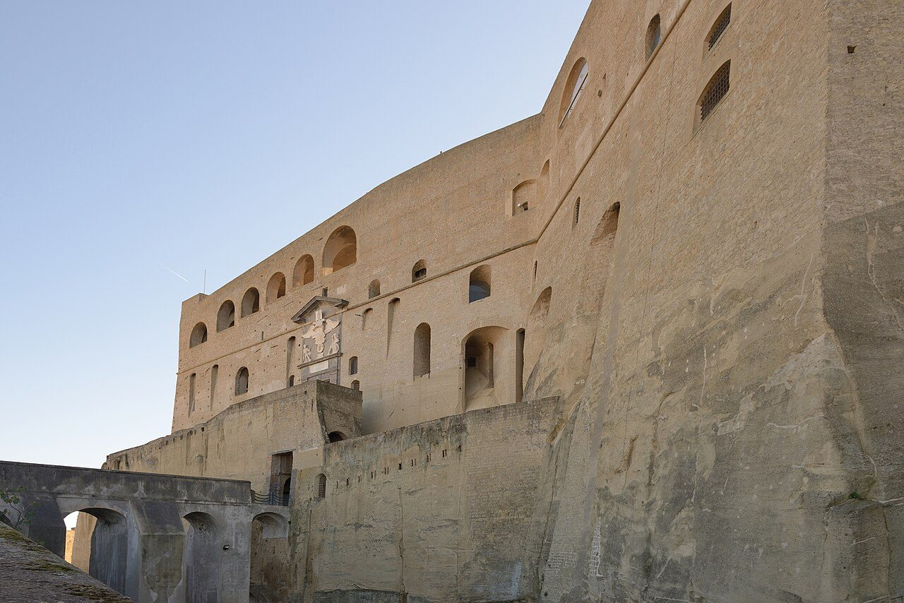

## The story
Erasmus, bishop of Formia, belongs to the Diocletian persecution. The passion that tells his sufferings comes late, and sailors made him their own. The crackling blue glow on masts before a storm — 'St Elmo's fire' — was read as his lantern, his protection, or his warning.

## The full story

### The windlass
His *Passio* describes imprisonment, an angel freeing him, preaching in Illyricum, and torture in which his intestines were wound out on a windlass (a ship's capstan in art — hence sailors). The windlass is how that passion, and then the painters, have shown his martyrdom. Early martyrologies know a bishop-martyr at Formia. The acts that survive are later. The glow on the mast is a real fire of the sea, and sailors named it for him.

### Fire on the mast
Churches of Sant'Elmo guard harbours from Naples to Malta, and Shakespeare's Ariel sings of flames 'on the topmast' in *The Tempest*, in the long wake of the sailors' name for him.

## Path to sainthood
Pre-Congregation; numbered among the Fourteen Holy Helpers; immense maritime cult in the Middle Ages.

## Patronages
Sailors, abdominal pain and childbirth (Holy Helper patronages), Gaeta and Formia.

## Trivia
- Castel Sant'Elmo still crowns Naples — the saint's name on a star fort above the bay.
- Sailors' name for the glow, *corposant*, comes from the Portuguese *corpo santo*, "holy body".

<figure class=photo>
<picture><source srcset="/static/art/erasmus-sant-elmo-600.webp 600w,/static/art/erasmus-sant-elmo.webp 1280w" sizes="(max-width:760px) 100vw,760px" type="image/webp"></picture>
<figcaption>Castel Sant'Elmo, the sixteenth-century star fort above Naples that carries his sailors' name. Photo: <a href="https://commons.wikimedia.org/wiki/File:Castel_Sant_Elmo_Napoli_lato_ingresso.jpg">Wolfgang Moroder</a>, <a href="https://creativecommons.org/licenses/by-sa/3.0">CC BY-SA 3.0</a>, via Wikimedia Commons.</figcaption>
</figure>

## Sources
- [Wikipedia: Erasmus of Formia (overview with scholarly references)](https://en.wikipedia.org/wiki/Erasmus_of_Formia)

Written October 19, 2026 from the sources above. The Naples photograph was added November 6, 2026. Feast days follow the General Roman Calendar unless noted.

