<nav class=toc aria-label="On this page">

On this page

<ol>
<li><a href="#why">Why the Church honours him</a></li>
<li><a href="#youth">The king of the revels</a></li>
<li><a href="#leper">The leper on the road</a></li>
<li><a href="#damiano">"Francis, go, repair my house"</a></li>
<li><a href="#bishop">Before the bishop: "Our Father who art in heaven"</a></li>
<li><a href="#brothers">The Portiuncula and the first brothers</a></li>
<li><a href="#rule">To Rome: the Rule and the Pope's dream</a></li>
<li><a href="#clare">St Clare and the Poor Ladies</a></li>
<li><a href="#sultan">Before the Sultan, 1219</a></li>
<li><a href="#greccio">Christmas at Greccio, 1223</a></li>
<li><a href="#verna">The stigmata on La Verna, 1224</a></li>
<li><a href="#canticle">The Canticle of the Creatures</a></li>
<li><a href="#death">"Welcome, my Sister Death"</a></li>
<li><a href="#flowers">The Little Flowers: the wolf, the birds and perfect joy</a></li>
<li><a href="#after">Saint, basilica and eight hundred years</a></li>
<li><a href="#places">His places and churches</a></li>
<li><a href="#art">Francis in art</a></li>
</ol>
</nav>

## His story

He was the son of one of the richest men in Assisi, the life of every party, and he wanted to be a knight. Then Christ met him: in a dream on the road to war, in the face of a leper, and in the voice of a painted crucifix in a ruined chapel. **St Francis** gave everything back, down to the clothes he wore, and spent the rest of his life trying to live the Gospel exactly as it is written. He called poverty his bride, every creature his brother or sister, and himself a "little poor man," *il Poverello*. Within his lifetime thousands followed him. Eight hundred years after his death, he may be the best-loved saint in the world.

Much of what we know comes from people who knew him: his first biographer **Thomas of Celano**, who wrote at the Pope's request within three years of his death; his companions, including **Brother Leo**; and **St Bonaventure**, whose *Major Legend* of 1263 became the official life and the script for the great frescoes in Assisi. Francis also left his own writings, among them his *Testament* and the *Canticle of the Creatures*. The best-known stories of all, the wolf of Gubbio and many others, come from the *Little Flowers of St Francis*, gathered about a century after his death. Where a story comes from later tradition, we say so, gently, and tell it anyway, because the Church has loved these stories for centuries.

### 1181 or 1182 · Born in Assisi
Son of **Pietro di Bernardone**, a rich cloth merchant, and his wife **Pica**. Baptised Giovanni, he is soon renamed **Francesco** by his father, who loved France.

### 1202 · War and prison
He rides out with Assisi against Perugia, is captured, and spends more than a year as a prisoner, then falls seriously ill.

### 1205 · The dream at Spoleto
Setting out to win glory as a knight, he hears a voice at Spoleto tell him to go home. Soon after, he embraces a leper on the road.

### 1205–1206 · San Damiano and the bishop
The crucifix at San Damiano speaks to him. Before Bishop Guido he gives back everything to his father, even his clothes.

### 1208 · The Gospel at the Portiuncula
He hears the Gospel of the mission of the apostles and takes it as his rule of life. The first brothers join him.

### 1209 · The Rule approved
With eleven companions he goes to Rome, and **Pope Innocent III** approves their simple Rule by word of mouth.

### 1212 · St Clare
On the night after Palm Sunday, **Clare** of Assisi leaves her family home to follow him. Her sisters settle at San Damiano.

### 1219 · Damietta
In the middle of the Fifth Crusade he crosses the lines in Egypt to preach to **Sultan al-Kamil**.

### 1223 · The Rule and the crib
**Pope Honorius III** confirms the final Rule on 29 November. At Christmas, at Greccio, Francis celebrates the Nativity with a manger, an ox and an ass.

### 1224 · The stigmata
On Mount La Verna, around the feast of the Holy Cross, he receives the wounds of Christ.

### 1225 · The Canticle
Sick and almost blind at San Damiano, he composes the *Canticle of the Creatures*.

### 3 October 1226 · "Sister Death"
He dies at the Portiuncula, laid on the bare ground, singing a psalm.

### 16 July 1228 · Saint
**Pope Gregory IX**, his friend, canonises him in Assisi and lays the first stone of his basilica the next day.

<figure class=photo>
<picture><source srcset="/static/art/francis-cimabue-600.webp 600w,/static/art/francis-cimabue.webp 1280w" sizes="(max-width:760px) 100vw,760px" type="image/webp">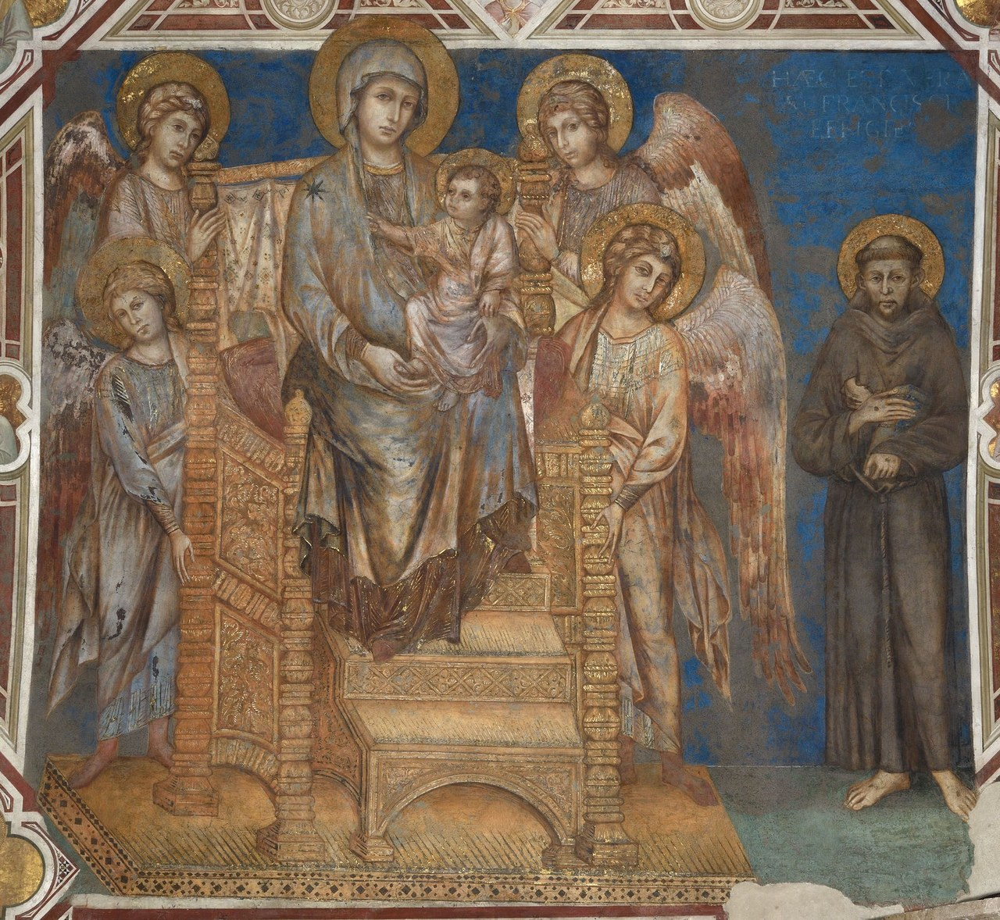</picture>
<figcaption>St Francis beside the Virgin and Child, from <b>Cimabue</b>'s <i>Maestà</i> in the Lower Church of the Basilica of St Francis, about 1280, shown after its recent restoration. Painted about half a century after his death, this small, gentle, rather tired-looking friar has long been loved as the truest likeness of him. Image: <a href="https://commons.wikimedia.org/wiki/File:Cimabue_-_Madonna_and_Child,_Angels_and_St._Francis_-_after_resoration_2023.4.jpg">Cimabue - Madonna and Child, Angels and St. Francis - after resoration 2023.4</a>, public domain, via Wikimedia Commons.</figcaption>
</figure>

<h2 id=why>Why the Church honours him</h2>

- **He took the Gospel at its word.** When Francis heard Christ tell the apostles to take "neither gold nor silver," he did it, that day. His whole Rule was, in his own words, "to observe the holy Gospel of our Lord Jesus Christ."
- **He rebuilt the Church, stone by stone and soul by soul.** He began by repairing three ruined chapels with his own hands, and ended by renewing the faith of a whole age. His friars, Clare's sisters and his "Third Order" of lay men and women carried that renewal across the world.
- **He loved the poor and the outcast as Christ.** It began with a leper he could not bear to look at, and whom he kissed.
- **He was a peacemaker.** He greeted everyone with "The Lord give you peace," reconciled feuding towns, and crossed the battle lines of a crusade to speak of Christ to the Sultan of Egypt.
- **He saw God's goodness in all creation.** Sun, moon, fire, water, birds and even death were his brothers and sisters. In 1979 St John Paul II named him the patron of ecology.
- **He bore the wounds of Christ.** On La Verna, two years before he died, the poor man who had so loved the crucified Lord received the marks of the Cross in his own body.

<h2 id=youth>The king of the revels</h2>

Francis grew up in a merchant's house on the hillside of Assisi, in a town that was beginning to grow rich on trade. He learned his letters from the priests of the little church of **San Giorgio**, but he was never much of a scholar. He loved French songs, fine clothes and good company. Thomas of Celano, who did not want to flatter him, says that he outdid all his friends in vanity. The Catholic Encyclopedia puts it more kindly: he was "the very king of frolic." Yet even then, his early biographers say, he could not refuse a beggar who asked in the name of God.

Assisi and its larger neighbour Perugia, a few hours' walk across the valley, were old rivals. In **1202** the two towns went to war, and Francis, about twenty, rode out with the men of Assisi. They were beaten at Collestrada, below Perugia, and he spent more than a year as a prisoner in the enemy city. He came home ill. During the long fever that followed, Celano tells us, he walked out one day to look at the countryside he loved, and found that it no longer delighted him.

But the dream of glory came back. In **1205** a knight of Assisi was leaving to fight in southern Italy, and Francis, in splendid new armour, arranged to go with him. The night before he left, he dreamed of a great hall hung with arms, all marked with the Cross, and heard that they were for him and his men. He set out joyfully. At **Spoleto**, a day's ride away, he fell ill again, and in the night, the *Legend of the Three Companions* says, a voice asked him who could do more for him, the lord or the servant. "The lord," Francis answered. "Then why do you leave the lord for the servant?" "Lord, what do you want me to do?" he asked. "Go back to your own land, and it will be told you what to do." In the morning he turned his horse round and rode home to Assisi, to the laughter of the town.

<h2 id=leper>The leper on the road</h2>

Back home Francis was a changed man, though he did not yet know what he had been changed into. He went off alone to pray in a cave outside the town. When his friends teased him about his absent mind and asked if he was thinking of taking a wife, he answered that he was, a bride nobler, richer and lovelier than any they had ever seen. He meant, though no one understood it yet, **Lady Poverty**.

Then came the meeting that he himself put at the beginning of everything. Riding one day on the plain below Assisi, he met a **leper**. Lepers lived apart in hospices outside the towns, and Francis had always been so revolted by them that he would hold his nose at the sight of their houses. This time, by God's grace, he got down from his horse, gave the man money, and kissed his hand. The leper gave him the kiss of peace. Not long after, he went to the leper hospice himself, carrying alms, and kissed each one.

Twenty years later, when he dictated his *Testament* as he was dying, this was the first thing he wanted his brothers to remember:

> When I was in sin, it seemed very bitter to me to see lepers. And the Lord Himself led me among them, and I showed mercy to them. And when I left them, what had seemed bitter to me was turned into sweetness of soul and body.

<h2 id=damiano>"Francis, go, repair my house"</h2>

Below the town walls, among the olive trees, stood the little church of **San Damiano**, old and falling apart, served by one poor priest. One day in **1205**, Francis went in to pray before the painted crucifix that hung over the altar. It is still there to see: a tall, gentle, wide-eyed Christ, alive on the Cross, painted in the style of an icon. As Francis prayed, the lips of the image moved, his companions wrote, and a voice said to him: "**Francis, go, repair my house, which, as you see, is falling completely to ruin.**"

Francis took the words literally. He went home, loaded a horse with bolts of his father's finest cloth, rode to the market at **Foligno**, sold the cloth and then the horse, and walked back to San Damiano with the money. The priest, sensibly afraid of Pietro di Bernardone, would not take it, so Francis threw it on a windowsill and asked if he could stay. Only later did he understand that Christ had meant more than one chapel: the house to be repaired was the Church.

<figure class=photo>
<picture><source srcset="/static/art/francis-fresco-crucifix-600.webp 600w,/static/art/francis-fresco-crucifix.webp 1280w" sizes="(max-width:760px) 100vw,760px" type="image/webp">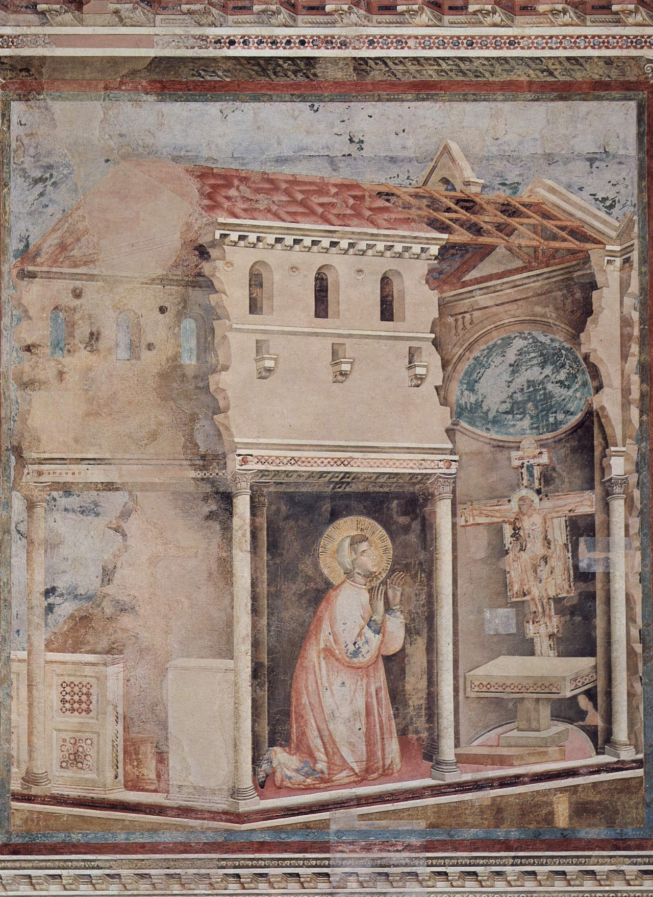</picture>
<figcaption><i>The Miracle of the Crucifix</i>, scene 4 of the <i>Legend of St Francis</i> in the Upper Church at Assisi, 1290s. The chapel is drawn half in ruins, as Bonaventure describes it. Image: <a href="https://commons.wikimedia.org/wiki/File:Giotto_di_Bondone_078.jpg">Giotto di Bondone 078</a>, public domain, via Wikimedia Commons.</figcaption>
</figure>

<figure class=photo>
<picture><source srcset="/static/art/francis-damiano-cross-600.webp 600w,/static/art/francis-damiano-cross.webp 1280w" sizes="(max-width:760px) 100vw,760px" type="image/webp">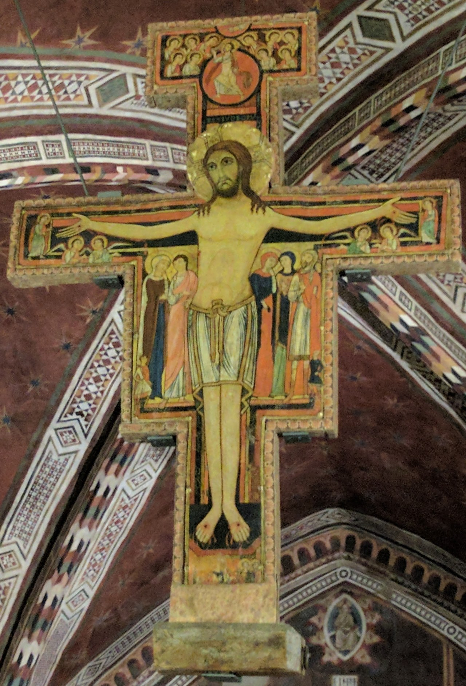</picture>
<figcaption>The <b>San Damiano Cross</b>, painted by an unknown Umbrian artist in the twelfth century. This is the copy that hangs in San Damiano today. When the Poor Clares moved into the town in the thirteenth century they took the original with them, and it now hangs in the Basilica of Santa Chiara. Photo: <a href="https://commons.wikimedia.org/wiki/File:Crocefisso_di_San_Damiano_Assisi.jpg">Crocefisso di San Damiano Assisi</a> by Giaccai, <a href="https://creativecommons.org/licenses/by-sa/4.0">CC BY-SA 4.0</a>, via Wikimedia Commons.</figcaption>
</figure>

<h2 id=bishop>Before the bishop: "Our Father who art in heaven"</h2>

Pietro di Bernardone was furious. Francis hid in a cave near San Damiano for a month. When he came out, thin and dirty, the people of Assisi pelted him with mud and stones and called him mad, and his father dragged him home, beat him and locked him up. His mother, Pica, set him free while his father was away. Pietro then took him to court, demanding his money back and asking that his son give up his inheritance. Francis said that, as a servant of God, he would answer only to the bishop.

So, in the bishop's square of Assisi, before **Bishop Guido** and a crowd of townspeople, Francis gave back the money. Then he went further. He took off every piece of clothing he wore, laid them at his father's feet, and said, in the words of the Catholic Encyclopedia's summary of the early lives:

> Hitherto I have called you my father on earth; henceforth I desire to say only "Our Father who art in Heaven."

Underneath, the biographers noticed, he was wearing a hair shirt. The bishop, moved to tears, wrapped him in his own cloak. Someone found him an old labourer's tunic, and Francis chalked a cross on it and walked out of the city singing. Dante would later write that, on that day, Francis married Lady Poverty. The hall where it happened, beside the church of Santa Maria Maggiore, is now the **Sanctuary of the Renunciation**, and since 2019 it has also been the resting place of the young [St Carlo Acutis](/saints/carlo-acutis/).

What followed was hard. Robbers threw him into a snowdrift. He washed dishes in a monastery for his food. Then he came back to Assisi and begged the townspeople for stones to rebuild San Damiano, carrying them himself. "Whoever gives me one stone," he called out, "will have one reward; whoever gives two, two rewards." He went on to repair the chapel of **San Pietro** and then a tiny, abandoned chapel of Our Lady in the woods on the plain, called the **Portiuncula**, "the little portion."

<h2 id=brothers>The Portiuncula and the first brothers</h2>

Francis loved the Portiuncula more than any place on earth. There, probably on **24 February 1208**, the feast of St Matthias, he heard the Gospel at Mass in which Christ sends out his apostles: take no gold or silver, no bag for the journey, no second tunic, no sandals, no staff, and preach that the Kingdom of God is at hand. "This is what I want," he said, "this is what I long for with all my heart." He threw away his shoes and staff, tied his tunic with a rope, and began to preach penance and peace.

He was not alone for long. The first to come was **Bernard of Quintavalle**, one of the richest men in Assisi, who had watched Francis pray all night in his house. The second was **Peter Catanii**, a learned man of the town. Together they went to the church of San Nicolò on the main square and asked God what they should do. Three times they opened the Book of the Gospels at random, and three times it fell open at Christ's call to leave everything: "If you would be perfect, go, sell what you have and give to the poor"; "Take nothing for your journey"; "If anyone would come after me, let him deny himself and take up his cross." "Brothers," Francis said, "this is our life and our rule." Bernard gave away his fortune in the square that same day. Then came **Brother Giles**, then others, until there were twelve.

They lived at first in a tumbledown shed at **Rivotorto**, on the plain, so cramped that Francis chalked each brother's name on a beam to mark his place. When a peasant drove his donkey in on them one day, shouting, "Get in, get in, we'll do well in here!", Francis took it as a sign, and the brothers moved to the Portiuncula, which the Benedictines of Monte Subasio gave them. He called his brothers the **Friars Minor**, the "lesser brothers," and he wanted them to be the least of all.

<h2 id=rule>To Rome: the Rule and the Pope's dream</h2>

In **1209** Francis wrote a short Rule, little more than those Gospel verses, and walked to Rome with his eleven companions to ask the Pope's blessing. **Innocent III** was the most powerful pope of the Middle Ages, and some of his cardinals thought the plan impossible: no one could live like that. Cardinal John of St Paul answered that if they rejected it as too hard, they would be saying that the Gospel itself could not be lived.

Here the Franciscan sources tell a famous story. St Bonaventure and the *Legend of the Three Companions* say that the Pope had a dream. He saw the **Lateran Basilica**, the cathedral of Rome and the "mother of all churches," leaning and about to fall, and a small, poor, shabby man holding it up on his shoulders. When he met Francis, he recognised him. "This," he said, "is the man who will hold up the Church of Christ by his deeds and his teaching." Whatever the Pope dreamed, it is certain that he gave the brothers his approval by word of mouth and sent them out to preach penance everywhere. Francis was made a deacon, and he never became a priest.

<figure class=photo>
<picture><source srcset="/static/art/francis-fresco-innocent-600.webp 600w,/static/art/francis-fresco-innocent.webp 1280w" sizes="(max-width:760px) 100vw,760px" type="image/webp">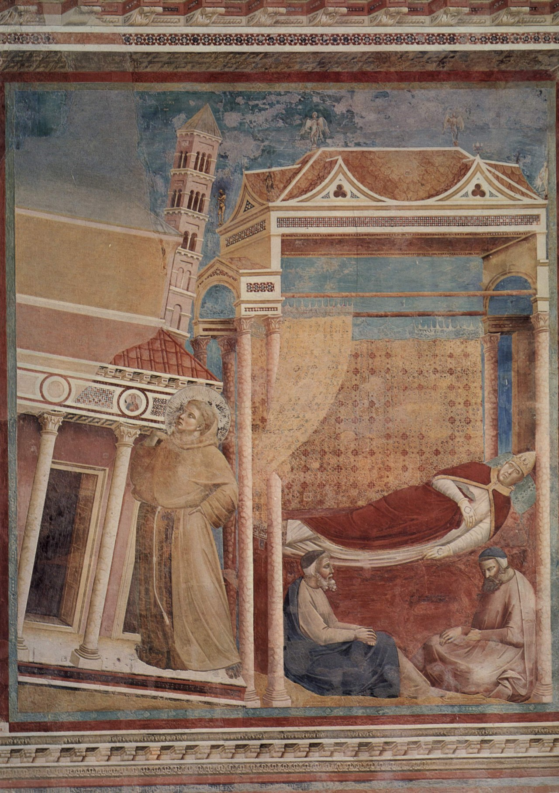</picture>
<figcaption><i>The Dream of Innocent III</i>, scene 6 of the <i>Legend of St Francis</i> in the Upper Church. The Pope dreams; the little poor man holds up the leaning Lateran. The story comes from the Franciscan tradition of the thirteenth century. Image: <a href="https://commons.wikimedia.org/wiki/File:Giotto_di_Bondone_(und_Werkstatt)_001.jpg">Giotto di Bondone (und Werkstatt) 001</a>, public domain, via Wikimedia Commons.</figcaption>
</figure>

<h2 id=clare>St Clare and the Poor Ladies</h2>

Among those who heard Francis preach in Assisi was a young noblewoman named **Clare di Favarone**, who lived with her family on the cathedral square. She was about eighteen. She met Francis in secret, with a companion, and decided to give her life to Christ as he had. On the night after **Palm Sunday 1212**, she slipped out of her family's house through a little-used door and went down through the woods to the Portiuncula, where the brothers met her with torches. Before the altar of Our Lady, Francis cut off her long hair, and she put on a rough habit.

Her family came to drag her home. She clung to the altar and showed them her shorn head, and they gave up. Soon her sister **Agnes** joined her, then others, and Francis settled them at **San Damiano**, the chapel he had rebuilt with his own hands. There [St Clare](/saints/clare/) lived for forty-one years, the first abbess of the Poor Ladies, now the **Poor Clares**. She was Francis's dearest friend and the most faithful keeper of his ideal. When he was dying, she was too ill to come to him, and he sent her his blessing and the promise that she would see him again.

<h2 id=sultan>Before the Sultan, 1219</h2>

Francis longed to preach Christ to the Muslim world, and perhaps to die a martyr. He set out twice and was turned back, once by a shipwreck and once by illness. In **1219** he finally sailed from Ancona for the East, with Brother Illuminato and other companions, and reached the camp of the Fifth Crusade outside **Damietta**, in the Nile delta of Egypt, which the crusaders were besieging.

He warned the crusaders not to attack, and was ignored; the attack failed with terrible loss. Then, with Illuminato, he walked across the lines to the camp of the enemy. The soldiers seized them, beat them, and brought them before the Sultan of Egypt himself, **al-Malik al-Kamil**, nephew of the great Saladin. Al-Kamil, a cultured and thoughtful man, listened to the barefoot preacher for several days. The bishop and historian **Jacques de Vitry**, who was in the crusader camp, wrote that the Sultan received Francis courteously, heard him gladly, and sent him back to the Christian camp with respect and safe conduct, asking him to pray that God would show him the faith most pleasing to Him.

St Bonaventure adds that Francis offered to walk into a fire with the Sultan's religious teachers, so that God could show which faith was true, and that when they would not, he offered to go in alone. That is the scene the Assisi frescoes chose. A cherished tradition holds that the Sultan gave Francis a gift, and an ivory horn kept in the relic chapel of the basilica in Assisi is honoured as that gift. Neither man converted the other, but they parted as friends. Eight hundred years later, in 2019, Pope Francis recalled their meeting when he travelled to the Arabian Peninsula.

<figure class=photo>
<picture><source srcset="/static/art/francis-fresco-sultan-600.webp 600w,/static/art/francis-fresco-sultan.webp 1280w" sizes="(max-width:760px) 100vw,760px" type="image/webp">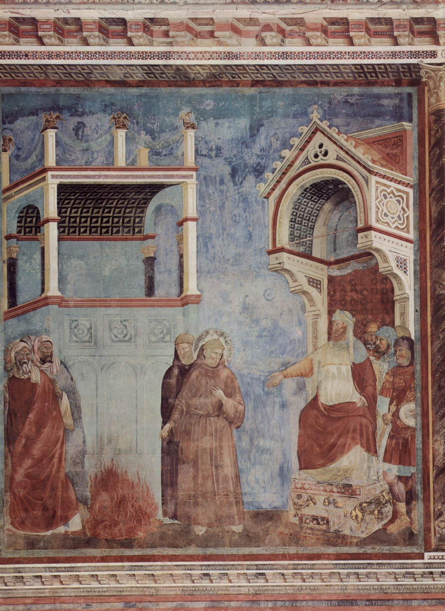</picture>
<figcaption><i>The Trial by Fire before the Sultan</i>, scene 11 of the <i>Legend of St Francis</i> in the Upper Church, following Bonaventure's account: Francis ready to walk into the fire, the Sultan's advisers slipping away. Image: <a href="https://commons.wikimedia.org/wiki/File:Giotto_di_Bondone_071.jpg">Giotto di Bondone 071</a>, public domain, via Wikimedia Commons.</figcaption>
</figure>

On the way home, troubles in his order called him back to Italy. His brothers now numbered in the thousands, and with the help of Cardinal Ugolino, the future Gregory IX, he wrote the Rule that **Pope Honorius III** approved on **29 November 1223**, still followed by Franciscans today. It begins: "The Rule and life of the Friars Minor is this, namely, to observe the holy Gospel of our Lord Jesus Christ."

<h2 id=greccio>Christmas at Greccio, 1223</h2>

Christmas was Francis's favourite feast. He said that if he could speak to the Emperor, he would ask for a law that on Christmas Day everyone must scatter grain for the birds, and give extra hay to the oxen and donkeys, in honour of the Son of God laid in a manger.

A few weeks before Christmas in **1223**, he asked a good friend, a nobleman named **John of Greccio**, to help him with an idea. Thomas of Celano tells it in Francis's words: "I wish to enact the memory of that babe who was born in Bethlehem: to see as much as is possible with my own bodily eyes the discomfort of his infant needs, how he lay in a manger, and how, with an ox and an ass standing by, he rested on hay." John prepared everything in a cave on the wooded hillside at **Greccio**, above the valley of Rieti.

On Christmas night the friars came from all around, and the people of the countryside climbed the hill with candles and torches. "The manger is prepared, the hay is carried in, the ox and the ass are led to the spot," Celano wrote. "There simplicity is given a place of honour, poverty is exalted, humility is commended, and out of Greccio is made a new Bethlehem." Mass was sung over the manger. Francis, as deacon, sang the Gospel and preached about the "babe of Bethlehem," saying the word *Bethlehem* so tenderly, Celano says, that it sounded like the bleating of a lamb. One man there saw a vision of a lifeless child lying in the manger, and Francis bending down and waking him from a deep sleep. Celano thought it a true picture of what Francis had done: in many hearts the child Jesus had been forgotten, and Francis woke Him again.

Every crib set up in a church or home at Christmas looks back to that night.

<figure class=photo>
<picture><source srcset="/static/art/francis-fresco-greccio-600.webp 600w,/static/art/francis-fresco-greccio.webp 1280w" sizes="(max-width:760px) 100vw,760px" type="image/webp">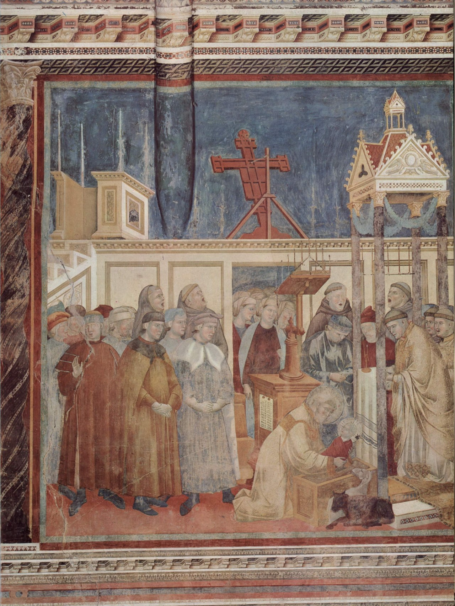</picture>
<figcaption><i>The Crib at Greccio</i>, scene 13 of the <i>Legend of St Francis</i>. The painter moved the scene from the cave into a fine Italian church of his own day, and painted the back of a great crucifix leaning over the choir, a detail historians love. Image: <a href="https://commons.wikimedia.org/wiki/File:Giotto_di_Bondone_(und_Werkstatt)_007.jpg">Giotto di Bondone (und Werkstatt) 007</a>, public domain, via Wikimedia Commons.</figcaption>
</figure>

<h2 id=verna>The stigmata on La Verna, 1224</h2>

In 1213 a nobleman, **Count Orlando of Chiusi**, had given Francis a mountain: **La Verna**, a wooded crag of rock in the Apennines of Tuscany, as a place to pray. In August **1224**, worn out and often ill, Francis went up with a few close companions, among them **Brother Leo**, to keep a forty-day fast in honour of St Michael. He asked to be left alone in a hut across a ravine, and Leo brought him bread and water.

On or about **14 September**, the feast of the Exaltation of the Holy Cross, as he prayed on the mountainside, Francis saw a **seraph**, an angel with six wings of fire, coming down from heaven, and in the midst of the wings the figure of a man crucified. He was filled with joy at the beauty of the vision and with grief at the suffering. When it faded, he found on his own hands and feet the marks of nails, and in his side a wound like that of a lance. He was the first person known to have received the **stigmata**, the wounds of Christ, and for the rest of his life he tried to hide them from all but a few close friends, covering his feet and keeping his hands in his sleeves.

That autumn, on La Verna, Francis wrote out for Brother Leo, who was troubled in spirit, a small parchment with his *Praises of God* on one side and a blessing on the other: "The Lord bless you and keep you; may He show His face to you and be merciful to you. May He turn His countenance to you and give you peace. The Lord bless you, Brother Leo." Leo carried it folded in his habit until he died, and added notes in red ink telling what had happened on the mountain. That parchment, in Francis's own hand, is still kept in the basilica at Assisi.

<h2 id=canticle>The Canticle of the Creatures</h2>

Francis came down from La Verna a dying man. His eyes, ruined by an infection probably caught in the East, could no longer bear the light. In **1225**, while staying in a small hut near San Damiano, where Clare could care for him, he spent a night tormented by pain and by mice running over him. In the morning, he told his brothers, God had assured him of His Kingdom. Then he sat up and sang a new song, in the Umbrian Italian of ordinary people, not in Latin: the **Canticle of Brother Sun**, also called the *Canticle of the Creatures*. It is one of the earliest poems in the Italian language, and Pope Francis's encyclical *Laudato Si'* takes its title from its refrain.

> Praised be you, my Lord, with all your creatures, especially Sir Brother Sun, who is the day and through whom you give us light. And he is beautiful and radiant with great splendour; and bears a likeness of you, Most High.
>
> Praised be you, my Lord, through Sister Moon and the stars, in heaven you formed them clear and precious and beautiful.
>
> Praised be you, my Lord, through Brother Wind, and through the air, cloudy and serene, and every kind of weather through whom you give sustenance to your creatures.
>
> Praised be you, my Lord, through Sister Water, who is very useful and humble and precious and chaste.
>
> Praised be you, my Lord, through Brother Fire, through whom you light the night, and he is beautiful and playful and robust and strong.
>
> Praised be you, my Lord, through our Sister, Mother Earth, who sustains and governs us, and who produces various fruit with coloured flowers and herbs.

He added a verse later, when the bishop and the mayor of Assisi had fallen out, praising those who forgive for love of God. He sent his brothers to sing it before both men, and they made peace. The last verse he added near the end, when the doctor told him he had only a little time left: "Praised be you, my Lord, through our Sister Bodily Death, from whom no living person can escape."

<h2 id=death>"Welcome, my Sister Death"</h2>

In the summer of 1226 the people of Assisi brought him home, under guard, for fear that the Perugians would steal him and his relics. He lay for a time in the bishop's palace. Then, knowing the end was near, he asked to be carried down to the Portiuncula, where it had all begun. On the way, at the edge of the plain, he asked his bearers to stop and turn him towards the town he could no longer see, and he blessed Assisi.

At the Portiuncula, Thomas of Celano tells us, he greeted death as a friend: "**Welcome, my Sister Death.**" His Roman friend, the noblewoman **Jacopa dei Settesoli**, whom he called "Brother Jacopa," arrived with the almond biscuits he loved, and he let her stay. He blessed his brothers. He asked to be laid naked on the bare ground, to be poor to the very end, and asked for the Passion according to St John to be read to him. Then he began to sing Psalm 141 (142), "With my voice I cry out to the Lord," and at the last verse, "Bring my soul out of prison, that I may give thanks to your name," he died. It was the evening of **Saturday, 3 October 1226**. He was about forty-four. St Bonaventure says that a great flock of larks, birds that love the light, came down at dusk and circled singing over the roof of the little hut.

The next morning the brothers and the people of Assisi carried his body up to the town with hymns and branches. They went by way of San Damiano, and stopped so that Clare and her sisters could see him one last time through the grille. He was buried in the church of **San Giorgio**, where he had learned to read as a boy.

<h2 id=flowers>The Little Flowers: the wolf, the birds and perfect joy</h2>

About a century after his death, an unknown Franciscan in the Marches put into Italian a collection of stories about Francis and his first companions. The *Little Flowers of St Francis* (*Fioretti*) is more a book of love than of history, and it has been one of the most-read books in Italian ever since. These are some of its best-loved stories, told as the Church has always told them, as cherished tradition.

**The wolf of Gubbio.** A huge wolf was terrorising the town of Gubbio, killing animals and people, and no one dared go outside the walls. Francis went out to meet it. When it rushed at him he made the sign of the cross and said, "Come here, Brother Wolf. I command you in the name of Christ not to harm me or anyone." The wolf lay down at his feet. Francis told it that it had done great wrong, but that he wanted to make peace between it and the town: the people would feed it, and it would never harm anyone again. The wolf bowed its head and laid its paw in Francis's hand as a pledge. It lived in Gubbio for two years, going from door to door to be fed, and when it died of old age the people mourned it.

**The sermon to the birds.** This story is older than the *Fioretti*; Thomas of Celano told it within three years of Francis's death. Near **Bevagna**, Francis saw a great flock of birds and ran to greet them. They did not fly away. "My brother birds," he said, "you should greatly praise your Creator and love him always. He gave you feathers to wear, wings to fly, and whatever you need." The birds stretched their necks, spread their wings and opened their beaks, and did not leave until he had blessed them with the sign of the cross. From that day, Celano says, he exhorted all creatures to praise their Creator. It is the scene in the fresco at the top of this page.

**Perfect joy.** Walking with Brother Leo through the cold rain from Perugia to the Portiuncula, Francis told him that perfect joy was not in working miracles, speaking every language, or converting the whole world. Then where? If we arrive soaked, frozen and hungry, he said, and the porter takes us for tramps, shuts the door on us and leaves us outside all night in the snow, and we bear it patiently, thinking of the sufferings of Christ, "write, Brother Leo, that this is perfect joy."

<h2 id=after>Saint, basilica and eight hundred years</h2>

Francis had been dead less than two years when **Pope Gregory IX**, the cardinal who had been his friend and protector, came to Assisi and canonised him in San Giorgio on **16 July 1228**. The next day the Pope laid the first stone of a great double church on the western edge of the town, on a slope once called the "Hill of Hell," where criminals were executed. It was soon renamed the "Hill of Paradise." On **25 May 1230**, his body was moved there and buried deep in the rock under the altar, so well hidden that no one knew exactly where for six hundred years, until it was found after fifty-two nights of digging in **1818**.

His friars spread across the world. Within his lifetime, the young Portuguese priest who became [St Anthony of Padua](/saints/anthony-of-padua/) joined them, and Francis wrote to him that he was glad he taught theology to the brothers, as long as it did not extinguish the spirit of prayer. Francis's family of saints includes [St Elizabeth of Hungary](/saints/elizabeth-of-hungary/), [St Margaret of Cortona](/saints/margaret-of-cortona/), [St Joseph of Cupertino](/saints/joseph-of-cupertino/), [St Padre Pio](/saints/padre-pio/) and [St Maximilian Kolbe](/saints/maximilian-kolbe/).

In **2026**, the eight hundredth anniversary of his death, his remains were opened to extended public veneration for the first time, in the Lower Church of his basilica from 22 February to 22 March. More than 370,000 pilgrims came to pray before them. The same year, Italy made his feast, **4 October**, a national holiday again.

<figure class=photo>
<picture><source srcset="/static/art/francis-basilica-600.webp 600w,/static/art/francis-basilica.webp 1280w" sizes="(max-width:760px) 100vw,760px" type="image/webp">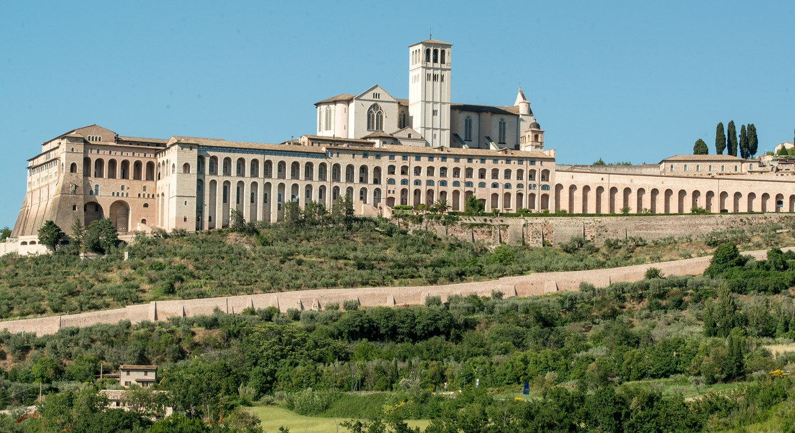</picture>
<figcaption>The <b>Basilica of St Francis</b> rises on its arches above the valley at the western end of Assisi, the friary of the Sacred Convent beside it. Photo: <a href="https://commons.wikimedia.org/wiki/File:Papal_Basilica_of_Saint_Francis_of_Assisi.jpg">Papal Basilica of Saint Francis of Assisi</a> by Peter K Burian, <a href="https://creativecommons.org/licenses/by-sa/4.0">CC BY-SA 4.0</a>, via Wikimedia Commons.</figcaption>
</figure>

<h2 id=places>His places and churches</h2>

Almost all of Francis's story can still be walked. Assisi and the Franciscan sites around it are a UNESCO World Heritage Site, and the walk from the basilica down to San Damiano, or up to the Carceri, takes less than an hour.

<figure class=map><a href="/static/maps/map-francis-assisi.svg">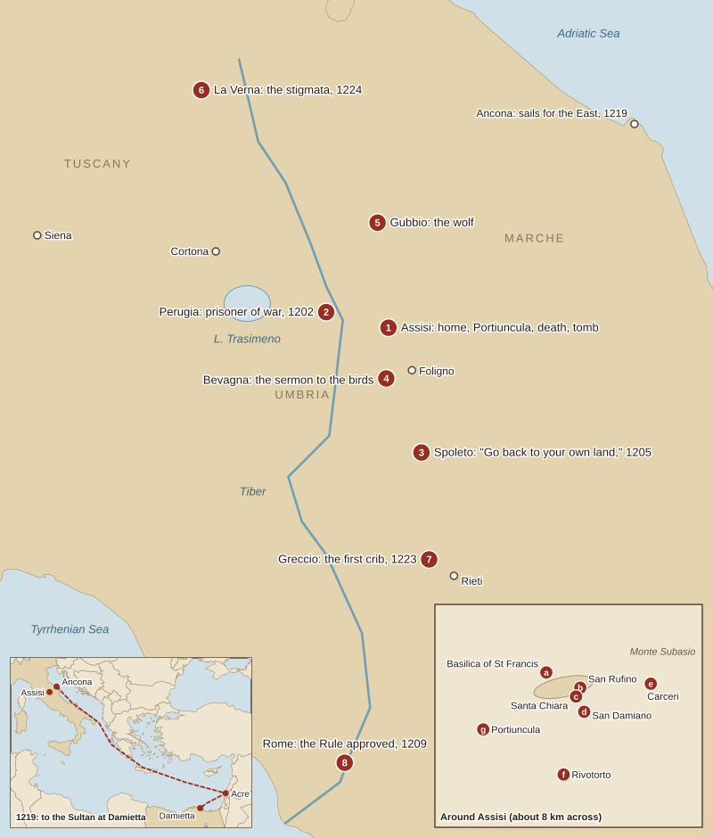</a><figcaption>St Francis's Italy: Assisi and the valley below it, Perugia where he was a prisoner, Spoleto where he turned back, Bevagna and the birds, Gubbio and the wolf, La Verna and the stigmata, Greccio and the crib, and Rome. The insets show the holy places around Assisi, and his voyage to the Sultan at Damietta in 1219. Map by The Daily Word; borders from Natural Earth (public domain); the Tiber, Lake Trasimeno and the voyage are drawn approximately. Tap to enlarge.</figcaption></figure>

### The Basilica of St Francis, Assisi

The basilica was built quickly, between 1228 and 1253, when Pope Innocent IV consecrated it, by Brother Elias, Francis's successor. It is two churches, one on top of the other, built into the hillside, with the saint's tomb below them both.

The **Upper Church** is tall, bright and Gothic, with some of the oldest stained glass in Italy. Around its nave runs the *Legend of St Francis*, 28 large frescoes of his life painted in the 1290s and based on Bonaventure's *Major Legend*; five of them appear on this page. In the earthquake of **26 September 1997**, part of its vault came down, killing two friars and two experts who were inspecting the damage, and shattering frescoes by Cimabue into thousands of pieces. It was repaired and reopened in just over two years, and restorers have been piecing the fragments together ever since.

<figure class=photo>
<picture><source srcset="/static/art/francis-upper-church-600.webp 600w,/static/art/francis-upper-church.webp 1280w" sizes="(max-width:760px) 100vw,760px" type="image/webp">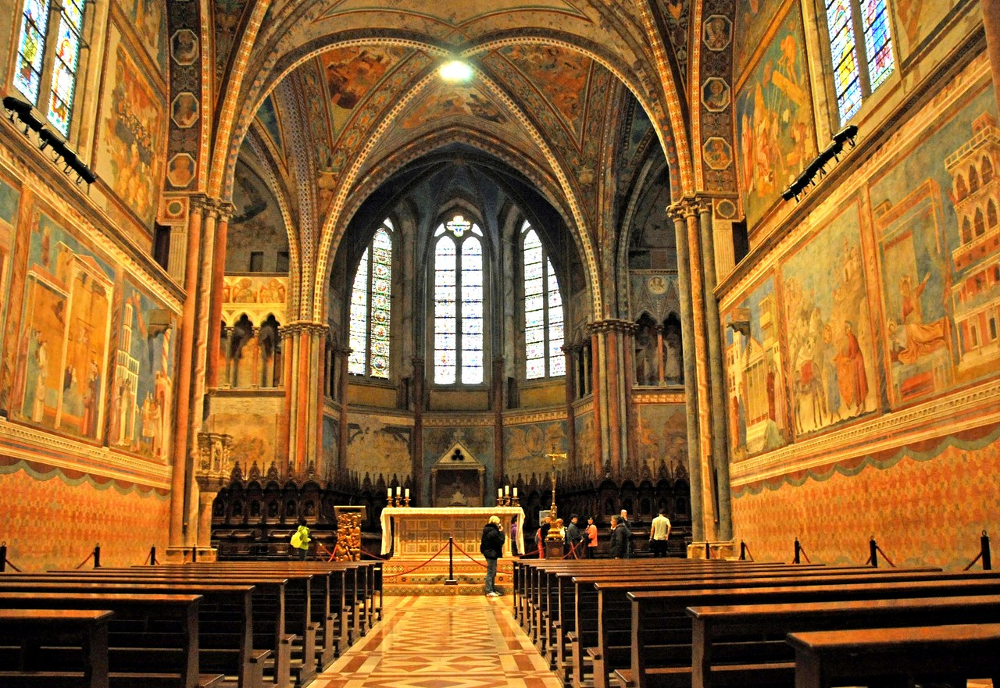</picture>
<figcaption>The <b>Upper Church</b>, with the frescoes of the <i>Legend of St Francis</i> along the walls of the nave and the blue, star-painted vault above. Photo: <a href="https://commons.wikimedia.org/wiki/File:000_Upper_Basilica_in_Assisi.jpg">000 Upper Basilica in Assisi</a> by Dennis G. Jarvis, <a href="https://creativecommons.org/licenses/by-sa/2.0">CC BY-SA 2.0</a>, via Wikimedia Commons.</figcaption>
</figure>

The **Lower Church** is low, dark and wonderful, like a painted cave. Cimabue, Simone Martini, Pietro Lorenzetti and the workshop of Giotto all worked there. Over the altar are four famous allegories of the virtues of St Francis: Poverty, Chastity, Obedience, and Francis in glory.

<figure class=photo>
<picture><source srcset="/static/art/francis-lower-church-600.webp 600w,/static/art/francis-lower-church.webp 1280w" sizes="(max-width:760px) 100vw,760px" type="image/webp">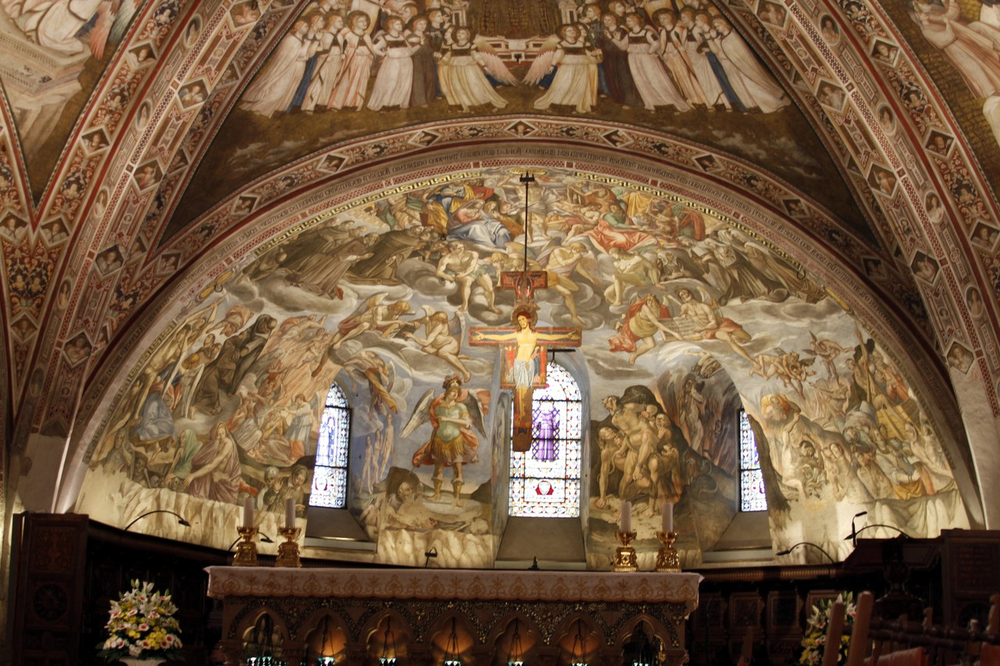</picture>
<figcaption>The apse and altar of the <b>Lower Church</b>, every surface painted, with the crucifix hanging above. Photo: <a href="https://commons.wikimedia.org/wiki/File:Apse_interior_and_Blue_Crucifix_-_Basilica_di_San_Francesco_-_Assisi_2016.jpg">Apse interior and Blue Crucifix - Basilica di San Francesco - Assisi 2016</a> by José Luiz, <a href="https://creativecommons.org/licenses/by-sa/4.0">CC BY-SA 4.0</a>, via Wikimedia Commons.</figcaption>
</figure>

Beneath it all, down a stair, is the **tomb of St Francis**, a rough stone sarcophagus set in the rock behind an iron grille, with the graves of four of his first companions, Leo, Rufino, Masseo and Angelo, around it. It is one of the quietest and most prayerful places in the world.

<figure class=photo>
<picture><source srcset="/static/art/francis-tomb-600.webp 600w,/static/art/francis-tomb.webp 1280w" sizes="(max-width:760px) 100vw,760px" type="image/webp">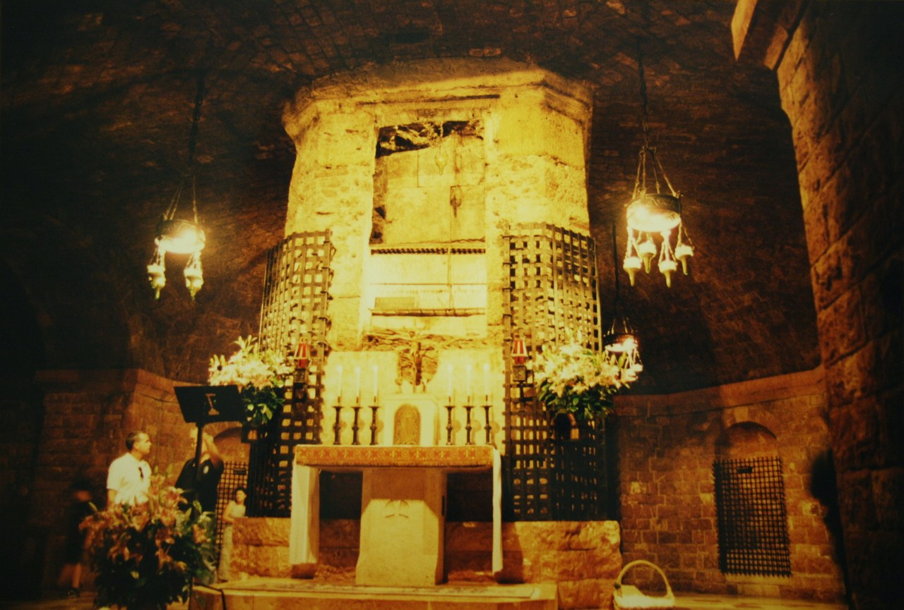</picture>
<figcaption>The <b>tomb of St Francis</b> in the crypt, where his body was hidden in 1230 and found again in 1818. Photo: <a href="https://commons.wikimedia.org/wiki/File:Assisi_Basilica_di_S._Francesco,_Tomb_of_St._Francis_(9809556204).jpg">Assisi Basilica di S. Francesco, Tomb of St. Francis (9809556204)</a> by Gary Todd, <a href="https://creativecommons.org/publicdomain/zero/1.0/">CC0</a>, via Wikimedia Commons.</figcaption>
</figure>

### San Rufino, Assisi's cathedral

At the top of the town stands **San Rufino**, the cathedral of Assisi, with its beautiful Romanesque façade of three rose windows. By tradition, Francis and Clare were both baptised in its font, which is still in use. Francis often preached here, and Clare's family lived on the square in front of it.

<figure class=photo>
<picture><source srcset="/static/art/francis-san-rufino-600.webp 600w,/static/art/francis-san-rufino.webp 1280w" sizes="(max-width:760px) 100vw,760px" type="image/webp">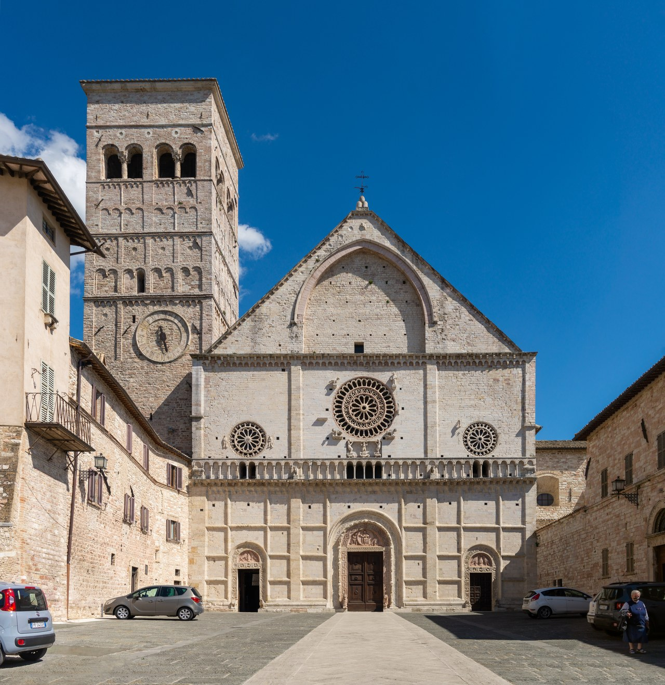</picture>
<figcaption>The cathedral of <b>San Rufino</b>, where Francis and Clare were baptised. Photo: <a href="https://commons.wikimedia.org/wiki/File:Assisi_Cathedral_-_Cattedrale_di_San_Rufino.jpg">Assisi Cathedral - Cattedrale di San Rufino</a> by Marco Ober, <a href="https://creativecommons.org/licenses/by-sa/4.0">CC BY-SA 4.0</a>, via Wikimedia Commons.</figcaption>
</figure>

### San Damiano

A short walk below the town, among olive trees, **San Damiano** is still very much as Francis and Clare knew it, a small stone church and convent now cared for by the friars. You can see the little choir where the Poor Clares prayed, their refectory with its old tables, the window where Clare is said to have held up the Blessed Sacrament to drive off an army of mercenaries, and the place where she died in 1253. It was here that the crucifix spoke to Francis, and here, in a hut in the garden, that he sang the Canticle.

<figure class=photo>
<picture><source srcset="/static/art/francis-san-damiano-600.webp 600w,/static/art/francis-san-damiano.webp 1280w" sizes="(max-width:760px) 100vw,760px" type="image/webp">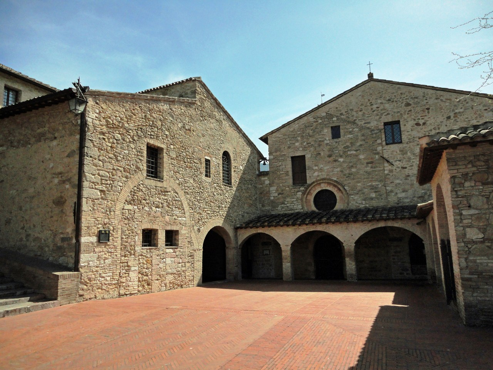</picture>
<figcaption><b>San Damiano</b>, the chapel Francis rebuilt and the home of St Clare and her sisters for forty years. Photo: <a href="https://commons.wikimedia.org/wiki/File:San_Damiano_Church_in_Assisi,_Italy.jpg">San Damiano Church in Assisi, Italy</a> by Laurajsi, <a href="https://creativecommons.org/licenses/by-sa/3.0">CC BY-SA 3.0</a>, via Wikimedia Commons.</figcaption>
</figure>

### The Basilica of Santa Chiara

After Clare's death her sisters moved inside the town, to a new church built for her between 1257 and 1265 over the old church of San Giorgio, where Francis had learned to read, had been buried and had been canonised. Its striped pink and white stone and huge flying buttresses stand out across the valley. Inside are Clare's body, in the crypt, and the original **San Damiano Cross**, the very one that spoke to Francis, in a side chapel.

<figure class=photo>
<picture><source srcset="/static/art/francis-santa-chiara-600.webp 600w,/static/art/francis-santa-chiara.webp 1280w" sizes="(max-width:760px) 100vw,760px" type="image/webp">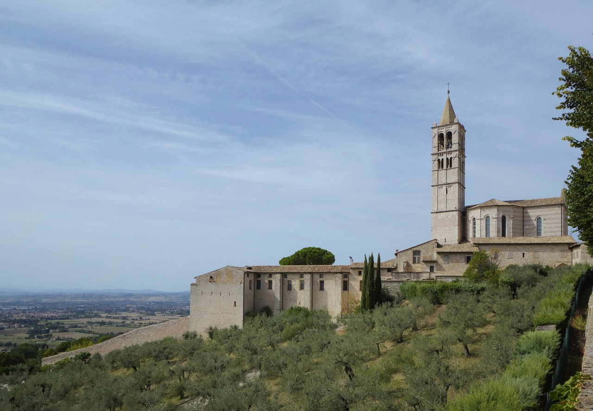</picture>
<figcaption>The <b>Basilica of Santa Chiara</b> and the convent of the Poor Clares, seen from the south-east. Photo: <a href="https://commons.wikimedia.org/wiki/File:Italy,_Assisi,_Basilica_of_Santa_Chiara_BW_2021-09-25_12-44-16.jpg">Italy, Assisi, Basilica of Santa Chiara BW 2021-09-25 12-44-16</a> by Berthold Werner, <a href="https://creativecommons.org/licenses/by-sa/4.0">CC BY-SA 4.0</a>, via Wikimedia Commons.</figcaption>
</figure>

### Santa Maria degli Angeli and the Portiuncula

The Portiuncula is now enclosed inside a huge church, **Santa Maria degli Angeli**, built from 1569 on the plain below Assisi. Under its dome the tiny stone chapel stands like a jewel box, its front painted with a nineteenth-century fresco of Christ and Our Lady granting Francis the **Pardon of Assisi**. A cherished tradition says that Christ appeared to Francis here and granted, at his request, forgiveness to all who come to the chapel with a contrite heart and confess; the Portiuncula Indulgence is still offered each year on 2 August. Close by is the **Chapel of the Transitus**, built on the site of the hut where he died, and a garden of thornless roses which, legend says, lost their thorns when Francis threw himself among them to fight temptation.

<figure class=photo>
<picture><source srcset="/static/art/francis-portiuncula-600.webp 600w,/static/art/francis-portiuncula.webp 1280w" sizes="(max-width:760px) 100vw,760px" type="image/webp">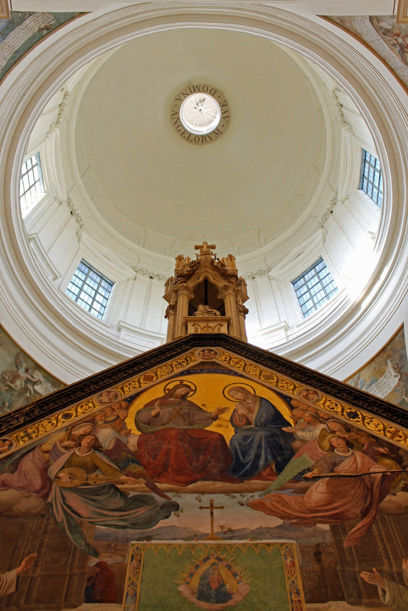</picture>
<figcaption>The <b>Portiuncula</b> under the dome of Santa Maria degli Angeli, with Friedrich Overbeck's fresco of the Pardon of Assisi on its front. Photo: <a href="https://commons.wikimedia.org/wiki/File:Portiuncula_with_cupola.jpg">Portiuncula with cupola</a> by Alekjds, <a href="https://creativecommons.org/licenses/by-sa/4.0">CC BY-SA 4.0</a>, via Wikimedia Commons.</figcaption>
</figure>

### Rivotorto

On the plain between Assisi and the Portiuncula, a nineteenth-century church at **Rivotorto** shelters the *Sacro Tugurio*, the stone huts honoured as the "holy hovel" where the first brothers lived, crammed together in the shed with their names chalked on the beams.

<figure class=photo>
<picture><source srcset="/static/art/francis-rivotorto-600.webp 600w,/static/art/francis-rivotorto.webp 1280w" sizes="(max-width:760px) 100vw,760px" type="image/webp">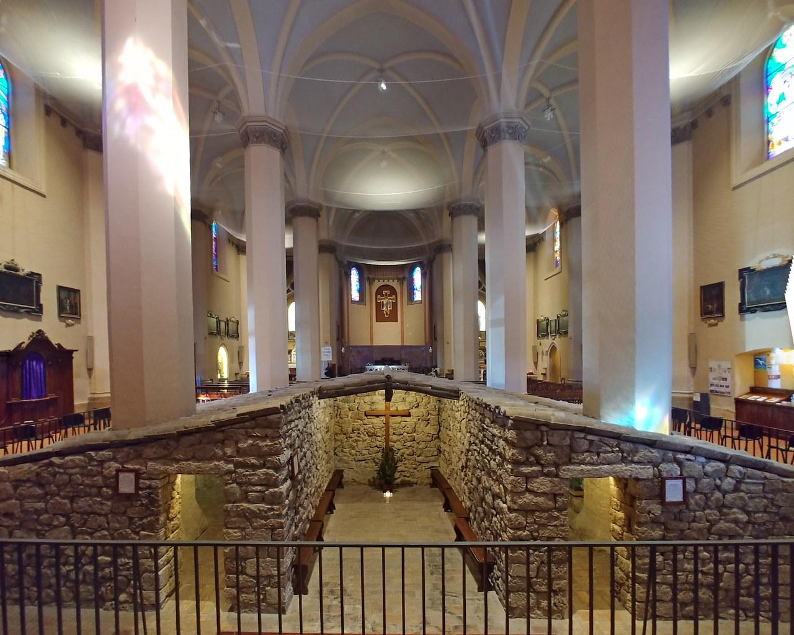</picture>
<figcaption>The church at <b>Rivotorto</b>, with the stone <i>Sacro Tugurio</i> standing in the nave. Photo: <a href="https://commons.wikimedia.org/wiki/File:Rivotorto,_santuario_di_Santa_Maria_in_Rivotorto_-_Interno.jpg">Rivotorto, santuario di Santa Maria in Rivotorto - Interno</a> by Pufui PcPifpef, <a href="https://creativecommons.org/licenses/by-sa/4.0">CC BY-SA 4.0</a>, via Wikimedia Commons.</figcaption>
</figure>

### The Carceri

High on Monte Subasio above Assisi, the brothers used to retreat to caves in the woods to pray; they called them the *carceri*, the "prisons," because they shut themselves away there. The **Eremo delle Carceri**, a small hermitage hanging over a ravine among ancient holm oaks, grew up around Francis's own cave. An old story tells that in this ilex grove a nightingale sang with Francis, verse for verse, in praise of God.

<figure class=photo>
<picture><source srcset="/static/art/francis-carceri-600.webp 600w,/static/art/francis-carceri.webp 1280w" sizes="(max-width:760px) 100vw,760px" type="image/webp">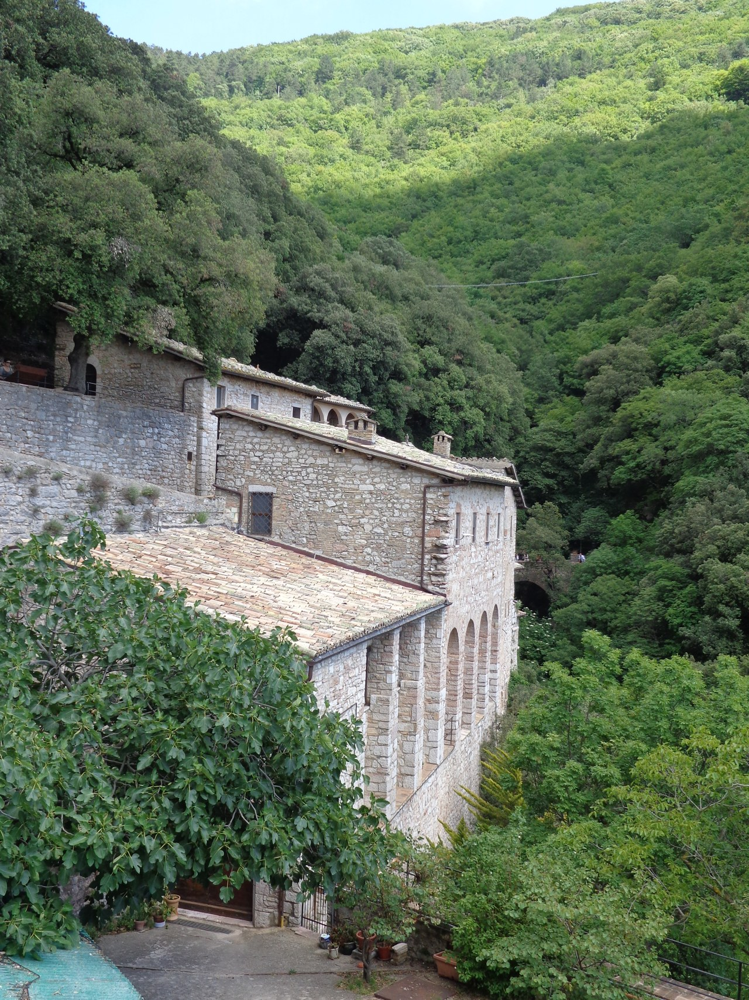</picture>
<figcaption>The <b>Eremo delle Carceri</b> on Monte Subasio, built around the cave where Francis prayed. Photo: <a href="https://commons.wikimedia.org/wiki/File:Eremo_delle_Carceri_01.JPG">Eremo delle Carceri 01</a> by Superchilum, <a href="https://creativecommons.org/licenses/by-sa/3.0">CC BY-SA 3.0</a>, via Wikimedia Commons.</figcaption>
</figure>

### Greccio

The friary at **Greccio** clings to a cliff above the valley of Rieti, in Lazio. In the rock is the **Chapel of the Crib**, built where the manger stood in 1223, with an old fresco that shows two Christmases side by side: Mary with the newborn Jesus in Bethlehem, and Francis kneeling at the manger in Greccio. Pope Francis came here on 1 December 2019 to sign his letter on the Christmas crib, *Admirabile Signum*.

<figure class=photo>
<picture><source srcset="/static/art/francis-greccio-chapel-600.webp 600w,/static/art/francis-greccio-chapel.webp 1280w" sizes="(max-width:760px) 100vw,760px" type="image/webp">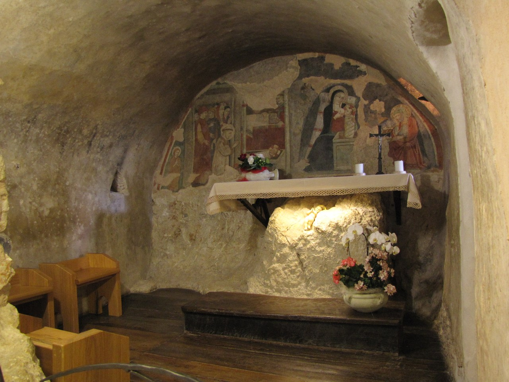</picture>
<figcaption>The <b>Chapel of the Crib</b> at Greccio, on the spot where Francis celebrated Christmas in 1223. Photo: <a href="https://commons.wikimedia.org/wiki/File:20110517_Greccio_003_(5762392422).jpg">20110517 Greccio 003 (5762392422)</a> by Christopher John SSF, <a href="https://creativecommons.org/licenses/by/2.0">CC BY 2.0</a>, via Wikimedia Commons.</figcaption>
</figure>

### La Verna

The sanctuary of **La Verna** sits on a crag of sheer rock in a forest of beeches and firs, about 1,100 metres high, in the Tuscan Apennines. The friars still keep the places of 1224: the rock ledges where Francis slept and prayed, the precipice where, the friars tell, the devil tried to throw him down, and the **Chapel of the Stigmata**, built in 1263 over the spot where he received the wounds. Every afternoon the friars walk in procession to the chapel, as they have for centuries. The sanctuary is full of glazed terracottas by **Andrea della Robbia**, blue and white, made in the fifteenth century.

<figure class=photo>
<picture><source srcset="/static/art/francis-verna-600.webp 600w,/static/art/francis-verna.webp 1280w" sizes="(max-width:760px) 100vw,760px" type="image/webp">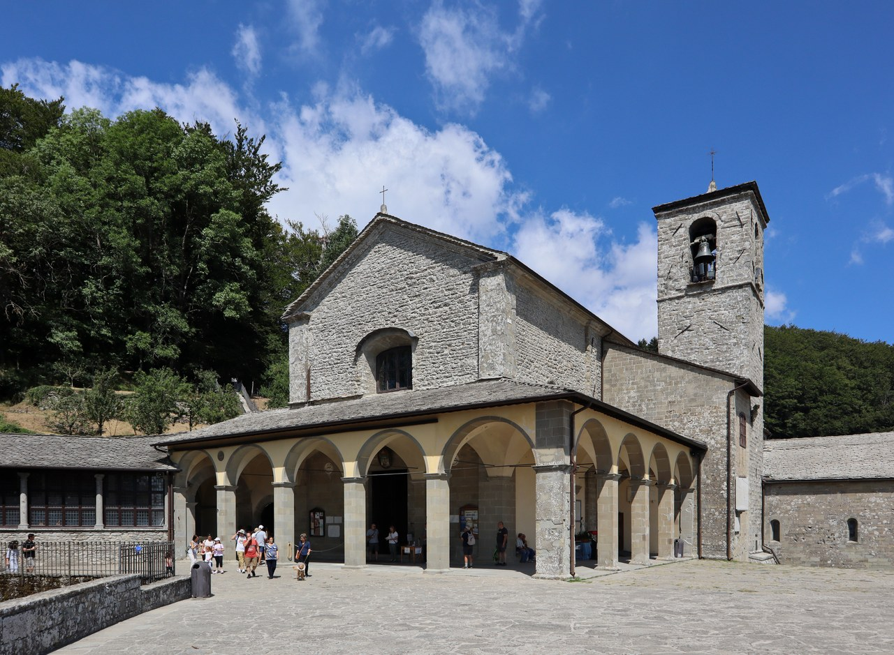</picture>
<figcaption>The sanctuary of <b>La Verna</b>, with its basilica and courtyard among the trees of the mountain. Photo: <a href="https://commons.wikimedia.org/wiki/File:Chiusi_della_Verna_-_Santuario_della_Verna_-_2023-09-10_22-09-04_001.jpg">Chiusi della Verna - Santuario della Verna - 2023-09-10 22-09-04 001</a> by Terragio67, <a href="https://creativecommons.org/licenses/by-sa/4.0">CC BY-SA 4.0</a>, via Wikimedia Commons.</figcaption>
</figure>

<figure class=photo>
<picture><source srcset="/static/art/francis-verna-stigmata-600.webp 600w,/static/art/francis-verna-stigmata.webp 1280w" sizes="(max-width:760px) 100vw,760px" type="image/webp">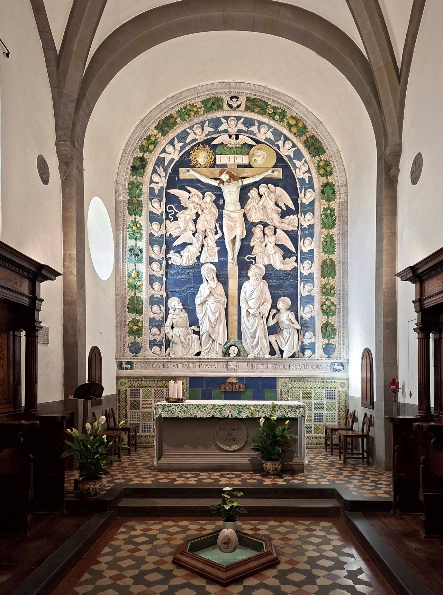</picture>
<figcaption>The <b>Chapel of the Stigmata</b> at La Verna, with Andrea della Robbia's great terracotta of the Crucifixion above the altar. Photo: <a href="https://commons.wikimedia.org/wiki/File:Santuario_della_Verna_-_Cappella_delle_sacre_stimmate.jpg">Santuario della Verna - Cappella delle sacre stimmate</a> by Anna.Massini, <a href="https://creativecommons.org/licenses/by/4.0">CC BY 4.0</a>, via Wikimedia Commons.</figcaption>
</figure>

<h2 id=art>Francis in art</h2>

No saint before him had ever been painted so soon after his death, or so often. Many of the pictures on this page are, in a way, pictures of how his followers saw Christ in him.

### Bonaventura Berlinghieri: the Pescia altarpiece (1235)

In the church of **San Francesco in Pescia**, in Tuscany, hangs a tall panel signed by **Bonaventura Berlinghieri** of Lucca and dated **1235**, only nine years after Francis died. It is one of the earliest surviving images of him. He stands gaunt and solemn in his habit, showing the wounds on his hands and feet, while six little scenes tell the story of his stigmata and of miracles at his tomb, along with the sermon to the birds.

<figure class=photo>
<picture><source srcset="/static/art/francis-berlinghieri-600.webp 600w,/static/art/francis-berlinghieri.webp 1280w" sizes="(max-width:760px) 100vw,760px" type="image/webp">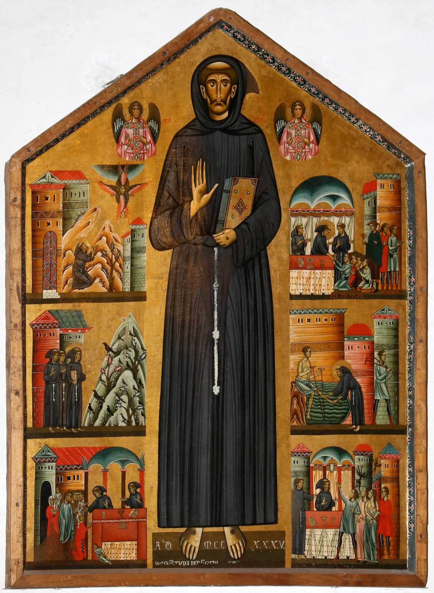</picture>
<figcaption>Bonaventura Berlinghieri, <i>St Francis and scenes from his life</i>, 1235, church of San Francesco, Pescia. Photo: <a href="https://commons.wikimedia.org/wiki/File:Bonaventura_Berlinghieri,_San_Francesco_e_storie_della_sua_vita,_1235,_01.jpg">Bonaventura Berlinghieri, San Francesco e storie della sua vita, 1235, 01</a> by Sailko, <a href="https://creativecommons.org/licenses/by-sa/4.0">CC BY-SA 4.0</a>, via Wikimedia Commons.</figcaption>
</figure>

### Cimabue: the Lower Church *Maestà*

The portrait of Francis by **Cimabue** at the top of this page, in the Lower Church in Assisi, dates from about 1280. Painted when some of the friars who knew him were still alive, it shows a small, slight man with a thin beard and a gentle, weary face, not at all the hero of legend. Many believe it is close to how he really looked.

### The *Legend of St Francis* in the Upper Church (1290s)

The 28 frescoes of the *Legend of St Francis* in the Upper Church, seen throughout this page, are among the most famous paintings in the world, and for centuries they have been credited to **Giotto**. They were painted in the 1290s, perhaps under the first Franciscan pope, Nicholas IV. Whether Giotto painted them is one of the great friendly arguments of art history. Many Italian scholars accept the old attribution, which goes back to medieval and Renaissance writers. Many others, especially in England, Germany and America, think the cycle is the work of several painters, perhaps from Rome, and some speak simply of the "St Francis Master." We follow the basilica's own custom and the long tradition in calling them "attributed to Giotto." Whoever held the brush, they turned Bonaventure's book into pictures for every pilgrim, and set the image of Francis for centuries.

### Giovanni Bellini: *St Francis in the Desert* (Frick Collection, New York)

**Giovanni Bellini**'s great panel of about **1475–80**, in **The Frick Collection** in New York, is one of the most loved paintings in America. Francis has stepped out of his hut on a rocky hillside, barefoot, his arms open and his face lifted towards a light coming from the upper left. The wounds are faintly visible on his hands. Around him, painted with loving detail, are a donkey, a heron, a rabbit peeping from the rocks, and a distant walled town. The Frick explains that it most likely shows the moment of the stigmata, told not with a seraph but through light and the beauty of creation.

<figure class=photo>
<picture><source srcset="/static/art/francis-bellini-600.webp 600w,/static/art/francis-bellini.webp 1280w" sizes="(max-width:760px) 100vw,760px" type="image/webp">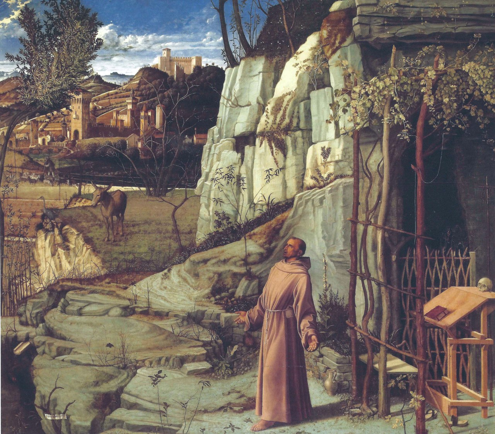</picture>
<figcaption>Giovanni Bellini, <i>St Francis in the Desert</i>, about 1475–80, The Frick Collection, New York. Image: <a href="https://commons.wikimedia.org/wiki/File:1480_Bellini_St.Francis_in_the_Desert_anagoria.jpg">1480 Bellini St.Francis in the Desert anagoria</a>, public domain, via Wikimedia Commons.</figcaption>
</figure>

### Caravaggio: *Saint Francis of Assisi in Ecstasy* (Wadsworth Atheneum, Hartford)

**Caravaggio**'s first known religious painting, from about **1595–96**, is in the **Wadsworth Atheneum Museum of Art** in Hartford, Connecticut. It shows Francis on La Verna after the stigmata, collapsed in a kind of loving swoon, held in the arms of a gentle young angel. In the dark behind them are a small fire and distant figures, perhaps Brother Leo and shepherds who have glimpsed a light in the sky. There is no seraph here; only the friend of God, worn out with love, and the angel who catches him.

<figure class=photo>
<picture><source srcset="/static/art/francis-caravaggio-600.webp 600w,/static/art/francis-caravaggio.webp 1280w" sizes="(max-width:760px) 100vw,760px" type="image/webp">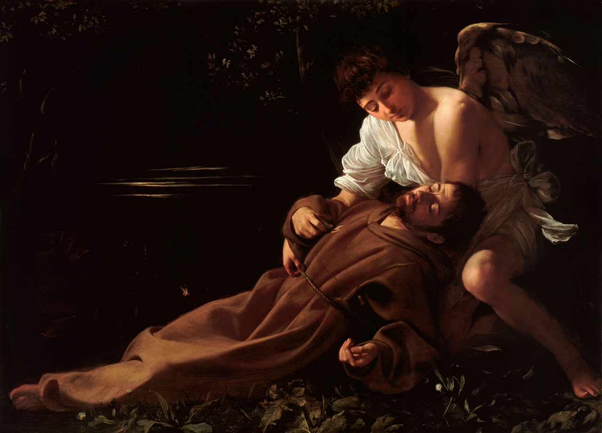</picture>
<figcaption>Caravaggio, <i>Saint Francis of Assisi in Ecstasy</i>, about 1595–96, Wadsworth Atheneum Museum of Art, Hartford. Image: <a href="https://commons.wikimedia.org/wiki/File:Saint_Francis_of_Assisi_in_Ecstasy-Caravaggio_(c.1595).jpg">Saint Francis of Assisi in Ecstasy-Caravaggio (c.1595)</a>, public domain, via Wikimedia Commons.</figcaption>
</figure>

### El Greco: *Saint Francis in Ecstasy* (Museo Lázaro Galdiano, Madrid)

**El Greco** painted Francis more often than any other saint; his workshop made dozens of versions. This early one, of about **1577–80**, in the **Museo Lázaro Galdiano** in Madrid, was painted soon after he arrived in Spain. Francis, his hands crossed on his chest, gazes up at a light in the corner of the canvas, a skull resting on the rock before him. The museum notes the beauty of the sensitive hands and the upturned eyes.

<figure class=photo>
<picture><source srcset="/static/art/francis-el-greco-600.webp 600w,/static/art/francis-el-greco.webp 1280w" sizes="(max-width:760px) 100vw,760px" type="image/webp">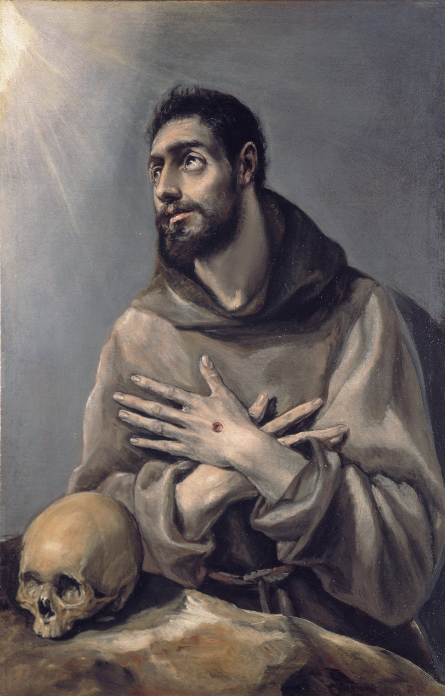</picture>
<figcaption>El Greco, <i>Saint Francis in Ecstasy</i>, about 1577–80, Museo Lázaro Galdiano, Madrid. Image: <a href="https://commons.wikimedia.org/wiki/File:El_Greco_-_Saint_Francis_in_ecstasy_-_Google_Art_Project.jpg">El Greco - Saint Francis in ecstasy - Google Art Project</a>, public domain, via Wikimedia Commons.</figcaption>
</figure>

### Francisco de Zurbarán: *Saint Francis in Meditation* (National Gallery, London)

The Spanish painter **Francisco de Zurbarán**, who worked for many monasteries, painted Francis again and again as the perfect penitent. In this canvas of **1639**, in the **National Gallery** in London, he kneels in the dark in a heavily patched habit, his face half hidden by his hood, holding a skull and looking up in prayer. It is almost the opposite of Bellini's sunlit Francis, and just as true: the saint who wept for the sufferings of Christ.

<figure class=photo>
<picture><source srcset="/static/art/francis-zurbaran-600.webp 600w,/static/art/francis-zurbaran.webp 1280w" sizes="(max-width:760px) 100vw,760px" type="image/webp">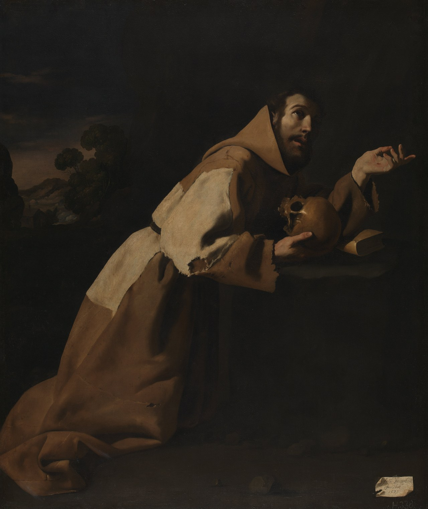</picture>
<figcaption>Francisco de Zurbarán, <i>Saint Francis in Meditation</i>, 1639, The National Gallery, London. Image: <a href="https://commons.wikimedia.org/wiki/File:Saint_Francis_in_Meditation_by_Francisco_de_Zurbar%C3%A1n.jpg">Saint Francis in Meditation by Francisco de Zurbarán</a>, public domain, via Wikimedia Commons.</figcaption>
</figure>

## Path to sainthood
Canonised less than two years after his death, on **16 July 1228**, by **Pope Gregory IX**, a personal friend, in the church of San Giorgio in Assisi. **Pius XII** named him a patron of Italy, with St Catherine of Siena, in 1939, and **John Paul II** named him patron of ecology in 1979. His feast is **4 October**. Franciscans also keep the evening of 3 October as the *Transitus*, the memory of his passing, and celebrate the feast of the Stigmata on 17 September.

## Patronages
Italy; animals; ecology and those who care for creation; and merchants. He is also the patron of countless towns and churches, and the city of San Francisco bears his name.

## Trivia
- He set up the **first live nativity scene** at Greccio in 1223, the origin of the Christmas crib.
- In 1224 he received the **stigmata** on Mount La Verna, the first widely recorded case in history.
- His *Canticle of the Sun* is one of the earliest poems written in Italian.
- **Pope Francis** (elected 2013) was the first pope to take his name. He said he chose it when a friend, the Brazilian Cardinal Cláudio Hummes, embraced him at the moment of his election and said, "Don't forget the poor."
- The beloved prayer "Lord, make me an instrument of your peace" is very much in his spirit, but it is not his. It was first published anonymously in a French magazine in 1912.
- Francis was never ordained a priest. He was a deacon, and out of reverence he would not go further.
- The **Tau**, the T-shaped cross, was his favourite sign. He signed his letters with it, including the blessing he wrote for Brother Leo.
- Pilgrims to Assisi greet one another with his words: *Pace e bene*, "peace and good."

## Sources
- [Thomas of Celano, *The Life of St Francis*, chapter 30: the crib at Greccio (Brothers of Peace)](https://brothersofpeace.org/news-events/blog/284-greccio-text)
- [Pope Francis, *Laudato Si'* (2015), with the text of the Canticle, vatican.va](https://www.vatican.va/content/francesco/en/encyclicals/documents/papa-francesco_20150524_enciclica-laudato-si.html)
- [Pope Francis, *Admirabile Signum* on the Christmas crib, signed at Greccio (2019), vatican.va](https://www.vatican.va/content/francesco/en/apost_letters/documents/papa-francesco-lettera-ap_20191201_admirabile-signum.html)
- [Benedict XVI, General Audience on St Francis (27 Jan 2010), vatican.va](https://www.vatican.va/content/benedict-xvi/en/audiences/2010/documents/hf_ben-xvi_aud_20100127.html)
- [Vatican News: St Francis of Assisi](https://www.vaticannews.va/en/saints/10/04/st--francis-of-assisi--founder-of-the-franciscan--order--patron-.html)
- [Vatican News: Remains of St Francis to be visible for veneration in Assisi (February 2026)](https://www.vaticannews.va/en/church/news/2026-02/saint-francis-assisi-relics-displayed-800-anniversary-death.html)
- [Vatican News: Public veneration of St Francis's relics ends (March 2026)](https://www.vaticannews.va/en/church/news/2026-03/st-francis-assisi-public-veneration-relics-ends.html)
- [Catholic Encyclopedia: St Francis of Assisi](https://www.newadvent.org/cathen/06221a.htm)
- [Britannica: St Francis of Assisi](https://www.britannica.com/biography/Saint-Francis-of-Assisi)
- [UNESCO: Assisi, the Basilica of San Francesco and Other Franciscan Sites](https://whc.unesco.org/en/list/990/)
- [The Frick Collection: Giovanni Bellini, *St. Francis in the Desert*](https://collections.frick.org/objects/39/st-francis-in-the-desert)
- [Wadsworth Atheneum Museum of Art](https://www.thewadsworth.org/)
- [The National Gallery, London: Zurbarán, *Saint Francis in Meditation*](https://www.nationalgallery.org.uk/paintings/francisco-de-zurbaran-saint-francis-in-meditation)
- [Museo Lázaro Galdiano: El Greco, *San Francisco de Asís en éxtasis*](https://www.museolazarogaldiano.es/fondos/san-francisco-de-asis-en-extasis)
- [Italian law 151 of 2025 restoring 4 October as a national holiday (Normattiva)](https://www.normattiva.it/eli/id/2025/10/10/25G00153/CONSOLIDATED)

Written October 15, 2026 from Vatican documents, Vatican News and New Advent (Catholic Encyclopedia). Expanded November 24, 2026 with the story of his life told from the early Franciscan sources: Francis's own <i>Testament</i> and <i>Canticle</i>, Thomas of Celano's lives, the <i>Legend of the Three Companions</i> and St Bonaventure's <i>Major Legend</i>, with the stories of the <i>Little Flowers</i> and other later traditions labelled as such; the places and churches connected with him; and his portrayal in art, using museum records and Wikimedia Commons. Quotations follow published English translations, lightly modernised; the Canticle follows the Vatican's translation in <i>Laudato Si'</i>. The map was drawn for this page from Natural Earth data (public domain). Feast days follow the General Roman Calendar.

