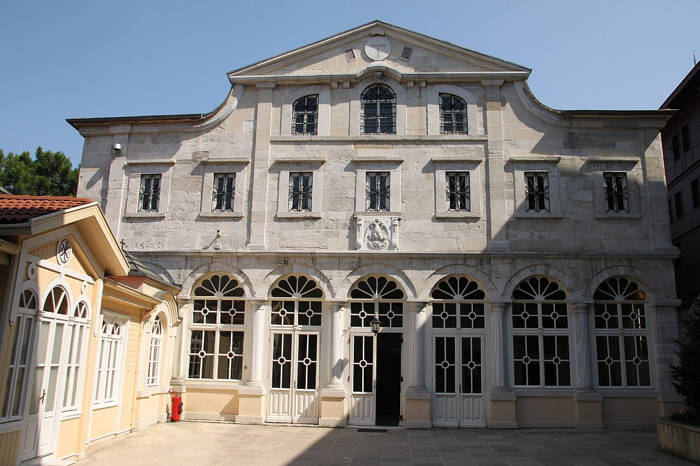

## His story
Gregory was born around 329 at Arianzum, near Nazianzus in Cappadocia. His father, also Gregory, became bishop of Nazianzus after a late conversion. His mother Nonna is the person the family credited with that conversion. The son was sent to school in Caesarea, Alexandria, and Athens. In Athens he shared a room and a life of study with [Basil the Great](/saints/basil-the-great/). He later said the city knew two roads: one to the schools, and one to the churches, and that he and Basil kept to both.

He did not want to be ordained. When his father pressed him into the priesthood around 362 he ran away to Basil's monastery, then came back, ashamed, and preached about the weight of the office. The next pressure was worse. Basil, by then bishop of Caesarea and trying to hold his province against an Arian rival, made Gregory bishop of Sasima, a dusty post-station, in 372. Gregory went there under protest and would not stay. He felt used. The friendship survived, but he said so plainly. It is one of the few quarrels between saints that the saints themselves wrote down.

He helped his ageing father at Nazianzus. Then, in 379, the small Nicene congregation in Constantinople asked him to come. The city was largely Arian. Gregory preached in a house-chapel he called the Anastasia, the Resurrection. There he gave the five Theological Orations, still the classic short account of how the Church speaks of the Father, the Son, and the Holy Spirit as one God. In 381 the emperor Theodosius gathered the council that became the second ecumenical council. Gregory was, for a short time, its president and the city's bishop. Rivals objected that he was already bishop of Sasima and could not be moved. He refused to fight for the chair. He resigned in a speech the council did not forget, and he went home.

He governed Nazianzus only until a successor could be found, then retired to Arianzum. He wrote poems, letters, and the oration on Basil's death. He died there around **390**. The East calls him Gregory the Theologian, a title it shares with almost no one else but the apostle John.

The orations, letters, and poems are his. He tells the Sasima episode himself, and so does the record of the council of 381. The creed of that council, what Christians now call the Nicene Creed in its fuller form, was finished in the months around his resignation. He had already preached the faith those clauses defend. Rubens's painting shows him trampling heresy, a Baroque picture of the preacher. His own account of himself is full of reluctance, illness, and second thoughts. In November 2004 John Paul II returned relics of Gregory and of [John Chrysostom](/saints/john-chrysostom/) to Patriarch Bartholomew. They are in the church of St George at the Phanar in Istanbul.

<figure class=photo>
<picture><source srcset="/static/art/gregory-phanar-600.webp 600w,/static/art/gregory-phanar.webp 1280w" sizes="(max-width:760px) 100vw,760px" type="image/webp"></picture>
<figcaption>The church of St George at the Phanar, seat of the Patriarch of Constantinople, where the relics returned in 2004 are kept. Photo: <a href="https://commons.wikimedia.org/wiki/File:Church_of_St._George,_Istanbul_(August_2010).jpg">Klearchos Kapoutsis</a>, <a href="https://creativecommons.org/licenses/by/2.0">CC BY 2.0</a>, via Wikimedia Commons.</figcaption>
</figure>

## Path to sainthood
Pre-Congregation. A Doctor of the Church. With Basil and [John Chrysostom](/saints/john-chrysostom/) he is one of the Three Holy Hierarchs (30 January in the East). The Roman calendar keeps him with Basil on **2 January**. Older Western books kept him on 9 May.

## Patronages
Poets, theologians, and people who have been given an office they did not seek. Constantinople claimed him. Nazianzus still does.

## Trivia
- He called his own verse a remedy for insomnia and a way of putting doctrine into lines people could remember.
- He described Basil and himself at Athens as "one soul in two bodies", and later admitted that Sasima had tested the phrase.
- His father baptized him, ordained him, and consecrated him, three sacramental acts Gregory both honoured and fled.

## Sources
- [Catholic Encyclopedia: St Gregory of Nazianzus](https://www.newadvent.org/cathen/07010b.htm)
- Gregory, *Orations* 27–31 (the Theological Orations) and *Oration 43* on Basil
- [Benedict XVI, General Audience on St Gregory Nazianzen (8 and 22 August 2007), vatican.va](https://www.vatican.va/content/benedict-xvi/en/audiences/2007/documents/hf_ben-xvi_aud_20070808.html)

Fact-checked on November 6, 2026 against Gregory's orations, New Advent, and the Vatican audiences above. The Phanar photograph was added in the same revision. The 2004 return of the relics is the translation this page dates.

