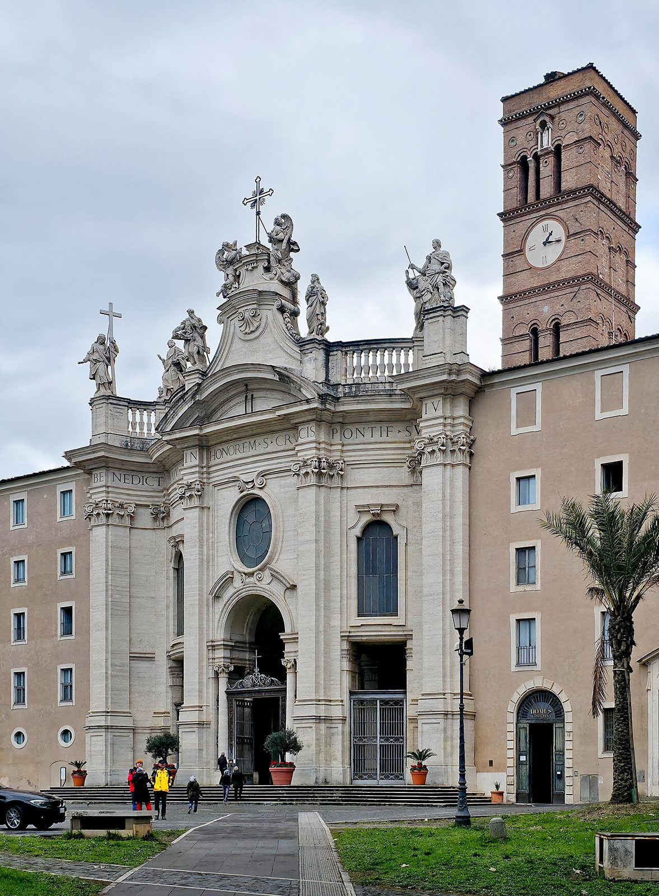

## Her story
Helena (Flavia Julia Helena) was the mother of the emperor **Constantine**. Ancient writers agree she was of humble birth. **St Ambrose**, preaching decades after her death, called her a *stabularia*, a stable-girl or innkeeper. Constantine rose, and she rose with him: he gave her the title Augusta, and coins were struck in her name. Around **326–328**, already an old woman, she travelled to the Holy Land.

What she certainly did there was build. She founded churches at **Bethlehem**, over the cave of the Nativity, and on the **Mount of Olives**. Constantine himself was building the great basilica over the tomb of Christ in Jerusalem, the church that became the Holy Sepulchre. Helena's journey belongs to that building campaign. She died about **330**, and a huge porphyry sarcophagus connected with her is in the Vatican Museums.

The finding of the True Cross is the story the Church has told since the end of the fourth century. She dug beneath a temple of Venus in Jerusalem, found three crosses, and knew Christ's cross when it healed a dying woman. Ambrose tells it in his funeral oration for Theodosius (395), Rufinus about 402, and then Socrates, Sozomen and Theodoret. Rome's basilica of **Santa Croce in Gerusalemme** still keeps relics said to be from that finding, with earth she is said to have brought from Jerusalem.

<figure class=photo>
<picture><source srcset="/static/art/helena-santacroce-600.webp 600w,/static/art/helena-santacroce.webp 1280w" sizes="(max-width:760px) 100vw,760px" type="image/webp"></picture>
<figcaption>Santa Croce in Gerusalemme, which keeps the relics and the earth linked with her finding. The facade is later than Helena. Photo: <a href="https://commons.wikimedia.org/wiki/File:05_Facade_Santa_Croce_Gerusalemme.jpg">NateBergin</a>, <a href="https://creativecommons.org/licenses/by/4.0">CC BY 4.0</a>, via Wikimedia Commons.</figcaption>
</figure>

## Path to sainthood
Pre-Congregation saint, honoured in East and West from the fourth century. Her feast is **18 August** in the Roman Martyrology. She is not on the universal General Roman Calendar. In the East she is remembered with Constantine on 21 May.

## Patronages
New discoveries, converts, archaeologists, difficult marriages. Invoked by people looking for what has been lost.

## Trivia
- The town of Drepanum in Bithynia, a likely birthplace, was renamed Helenopolis in her honour.
- Medieval England also gave her a British father, "Old King Cole" of Colchester, a story of its own.
- Painters almost always put a large cross in her arms, as Cima da Conegliano does. The cross is the attribute; the crown is the Augusta.

## Sources
- [Vatican News: saints of 18 August (St Helena)](https://www.vaticannews.va/en/saints/08/18.html)
- [Catholic Encyclopedia: St Helena](https://www.newadvent.org/cathen/07202b.htm)
- Ambrose, *On the Death of Theodosius*, 40–48; Rufinus, *Church History* 10.7–8

Fact-checked on November 2, 2026 against Vatican News and New Advent (Catholic Encyclopedia), with the late-fourth-century accounts of the cross named above. The Santa Croce photograph was added November 6, 2026. Feast days follow the General Roman Calendar unless noted.

