<nav class=toc aria-label="On this page">

On this page

<ol>
<li><a href="#why">Why the Church honours her</a></li>
<li><a href="#tithe">The tenth child, given to God</a></li>
<li><a href="#disibodenberg">Enclosed with Jutta on the Disibodenberg</a></li>
<li><a href="#light">"The shade of the living Light"</a></li>
<li><a href="#write">"Write what you see and hear"</a></li>
<li><a href="#trier">Pope Eugene III reads her book at Trier</a></li>
<li><a href="#scivias">Scivias: "Know the Ways"</a></li>
<li><a href="#rupertsberg">A new home on the Rupertsberg</a></li>
<li><a href="#music">"A symphony of the Holy Spirit": her music</a></li>
<li><a href="#healing">Healer of body and soul: Physica and Causae et Curae</a></li>
<li><a href="#lingua">The unknown language</a></li>
<li><a href="#works">The Book of Divine Works</a></li>
<li><a href="#letters">"Listen, O King": letters to popes and emperors</a></li>
<li><a href="#journeys">Four preaching journeys</a></li>
<li><a href="#eibingen">Eibingen across the Rhine</a></li>
<li><a href="#interdict">The silenced choir</a></li>
<li><a href="#death">Two streams of light</a></li>
<li><a href="#saint">Saint and Doctor of the Church</a></li>
<li><a href="#places">Her places and churches</a></li>
<li><a href="#art">Hildegard in art</a></li>
</ol>
</nav>

## Her story

A little girl of three, on a farm in the Rhineland hills, sees a light so great that her soul trembles. She has no words for it and cannot know that it will never leave her. Seventy years later, an old abbess who has written books for popes, sung new songs for the Church and preached in the great cathedrals of Germany will try to describe it in a letter: a radiance "far, far brighter than a cloud which carries the sun," which she calls "the reflection of the living Light."

That girl was Hildegard, the tenth child of a noble family, offered to God as a tithe. At eight she was entrusted to the holy Jutta of Sponheim, and at fourteen she was enclosed with her beside the monks of the Disibodenberg, above the meeting of the Nahe and the Glan. At forty-two she heard a voice from heaven telling her to write down what she saw. Out of that obedience came *Scivias* and two more great books of visions, about seventy chants, the first morality play set to music, books of medicine and natural history, a language of her own, and some four hundred letters to popes, emperors, bishops and ordinary people who asked for her prayers. She founded two abbeys, on the Rupertsberg at Bingen and at Eibingen across the Rhine, and travelled on four preaching journeys when she was past sixty.

Her contemporaries called her the "Teutonic prophetess" and the "Sibyl of the Rhine". When she died, on 17 September 1179, her sisters saw two streams of light cross the sky over the room where she lay. In 2012 Pope Benedict XVI, a fellow German, enrolled her among the saints of the universal Church and named her a Doctor of the Church, one of only four women to bear that title.

### 1098 · Bermersheim, near Alzey
Hildegard is born to Hildebert and Mechtild, the tenth of their children, and baptised in the village church of St Martin.

### c. 1106 · Given to God
At about eight her parents entrust her, as a tithe to God, to the care of the young noblewoman Jutta of Sponheim.

### 1 November 1112 · The Disibodenberg
On All Saints' Day Hildegard and Jutta are enclosed in a cell beside the Benedictine monks of the Disibodenberg, receiving the veil from Bishop Otto of Bamberg.

### 1136 · Magistra
Jutta dies in the odour of sanctity, and the sisters elect Hildegard to lead them.

### 1141 · "Write what you see and hear"
At forty-two she receives the command from heaven to write down her visions, and begins *Scivias* with the monk Volmar and her sister Richardis.

### 1147–48 · Synod of Trier
Pope Eugene III reads from her writings before the bishops and gives her his blessing to write. St Bernard of Clairvaux encourages her.

### c. 1150 · The Rupertsberg
With about twenty sisters she moves to a new abbey on the Rupertsberg, where the Nahe meets the Rhine at Bingen.

### 1151 · *Scivias* completed
Her first great book is finished. Its play of the Virtues, the *Ordo Virtutum*, and her songs are sung in the new house.

### 1151–58 · The healing books
She writes on plants, stones, animals and the human body: the works known as *Physica* and *Causae et Curae*.

### 1158–71 · Four preaching journeys
Past sixty, she travels along the Main, the Moselle, the Rhine and into Swabia, preaching to clergy and people.

### 1163 · Barbarossa's protection
Emperor Frederick Barbarossa, whom she has met at Ingelheim, places her abbey under his protection; later she rebukes him for supporting antipopes.

### 1165 · Eibingen
She founds a second abbey across the Rhine above Rüdesheim and crosses by boat to visit it.

### c. 1174 · The *Book of Divine Works*
She completes her last great visionary book, on God, the cosmos and the human person.

### 1178–79 · The interdict
Refusing to let a reconciled man's body be taken from her abbey's cemetery, she sees her community forbidden to sing the Divine Office, until the ban is lifted in March 1179.

### 17 September 1179 · Her death
She dies at the Rupertsberg aged eighty-one; her sisters see two streams of light cross over the room.

### 1632–41 · The relics saved
When Swedish troops destroy the Rupertsberg, the nuns carry her relics to safety; since 1641 they have rested at Eibingen.

### 2012 · Saint and Doctor
Benedict XVI extends her veneration to the universal Church on 10 May and proclaims her a Doctor of the Church on 7 October.

<h2 id=why>Why the Church honours her</h2>

- **A life offered from childhood.** Given to God at eight, she spent more than seventy years in the Benedictine life of prayer, the Psalms and the Divine Office, and became a spiritual mother to generations of nuns.
- **A prophet who obeyed.** She did not seek her visions or boast of them. She submitted them to her abbot, to St Bernard and to the Pope, and wrote only when the Church had blessed her work. Benedict XVI called this "the seal of an authentic experience of the Holy Spirit."
- **A teacher of the whole faith.** Her visions open up creation, the Fall, redemption, the Church, the sacraments and the Last Things. Benedict XVI named her a Doctor of the Church for the depth and soundness of her teaching.
- **Courage before the powerful.** She wrote to popes, bishops and the Emperor himself, calling them to holiness, and preached reform to the clergy in the cathedrals of Germany.
- **Delight in God's creation.** In her songs, her healing books and her visions of the cosmos, she sings of the world as God's work, full of his "greening" life, and of man and woman as the crown of that work.
- **Faithful to the end.** In her last year she bore an interdict rather than betray a soul reconciled to the Church, and she died in peace, surrounded by her daughters, with signs of light in the heavens.

<h2 id=tithe>The tenth child, given to God</h2>

<figure class=map style="max-width:560px;margin:14px auto 18px"><figcaption>Hildegard's whole life was lived within a few hours' walk of the Rhine: from her family home at Bermersheim to the Disibodenberg, about 18 miles (28 km) to the west, then to the Rupertsberg at Bingen, about 15 miles (25 km) down the Nahe, and Eibingen, just over 2 miles (4 km) across the Rhine. Map by The Daily Word; coastlines, rivers and borders from Natural Earth (public domain). Tap to enlarge.</figcaption></figure>

Hildegard was born in 1098 at **Bermersheim**, near Alzey, in the rolling farmland of Rheinhessen west of the Rhine. Her parents, Hildebert and Mechtild, were nobles with lands in the region, and she was their tenth child. They were devout people, and they had resolved to give one child in ten to God, as the Old Law gave a tithe of the harvest. Hildegard was that tithe.

She was a frail child, often ill, but she was quick and thoughtful. She was baptised in the little church of St Martin in Bermersheim, which still stands among the village graves and is honoured today as "Hildegard's baptismal church".

<figure class=photo>
<picture><source srcset="/static/art/hild-bermersheim-600.webp 600w,/static/art/hild-bermersheim.webp 1280w" sizes="(max-width:760px) 100vw,760px" type="image/webp">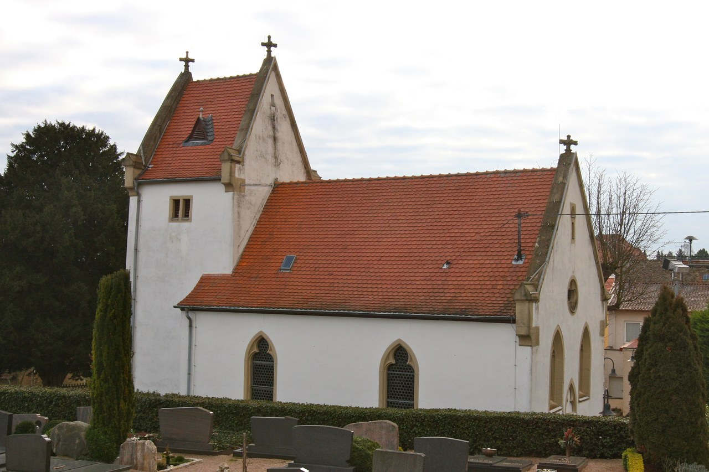</picture>
<figcaption>The church of St Martin at <b>Bermersheim vor der Höhe</b>, where Hildegard was baptised. The village honours it as her baptismal church. Photo: <a href="https://commons.wikimedia.org/wiki/File:Taufkirche_der_Heiligen_Hildegard_von_Bingen.jpg">Taufkirche der Heiligen Hildegard von Bingen</a> by Dickunddoof4, <a href="https://creativecommons.org/licenses/by-sa/3.0">CC BY-SA 3.0</a>, via Wikimedia Commons.</figcaption>
</figure>

<figure class=photo>
<picture><source srcset="/static/art/hild-bermersheim-2-600.webp 600w,/static/art/hild-bermersheim-2.webp 1280w" sizes="(max-width:760px) 100vw,760px" type="image/webp">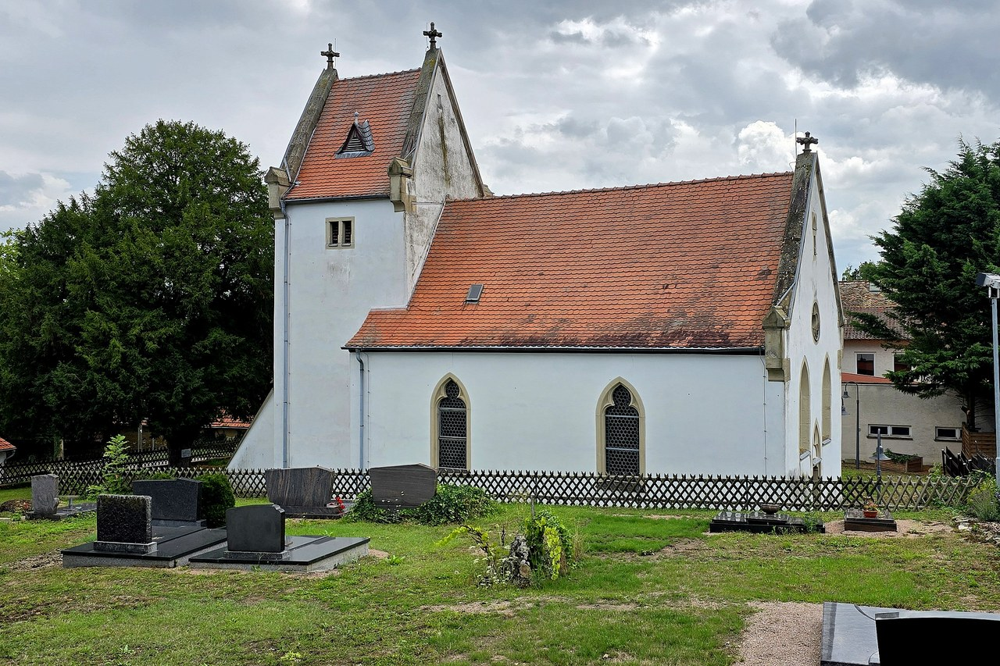</picture>
<figcaption>St Martin's at Bermersheim in summer. Hildegard's family home stood nearby, in the farmland between the Rhine and the Nahe. Photo: <a href="https://commons.wikimedia.org/wiki/File:2025_Bermersheim_vor_der_H%C3%B6he,_dooptsjerke_fan_Hildegard_fan_Bingen_(1).jpg">2025 Bermersheim vor der Höhe, dooptsjerke fan Hildegard fan Bingen (1)</a> by RomkeHoekstra, <a href="https://creativecommons.org/publicdomain/zero/1.0/">CC0</a>, via Wikimedia Commons.</figcaption>
</figure>

About 1106, when she was eight, her parents entrusted her to Jutta of Sponheim, a young noblewoman only six years older than Hildegard who had decided to give her whole life to God in prayer. For some years the two girls were taught by a widow, Uda of Göllheim, while Jutta prepared for the enclosed life.

<figure class=photo>
<picture><source srcset="/static/art/hild-rochus-jutta-600.webp 600w,/static/art/hild-rochus-jutta.webp 639w" sizes="(max-width:760px) 100vw,760px" type="image/webp">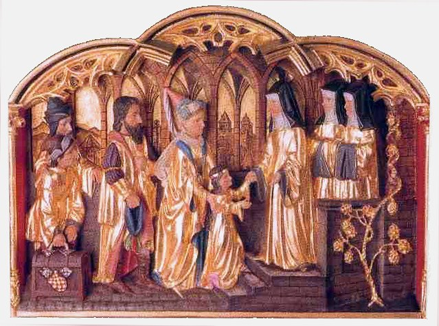</picture>
<figcaption>The eight-year-old Hildegard is brought by her parents to Jutta of Sponheim. A panel of the Hildegard altar of 1895 in the Rochuskapelle at Bingen. Image: <a href="https://commons.wikimedia.org/wiki/File:JDie_achtj%C3%A4hrige_Hildegard_von_Bingen_(Mitte)_wird_zu_Jutta_von_Sponheim_(Mitte_rechts)_auf_den_Disibodenberg_gebracht.jpg">JDie achtjährige Hildegard von Bingen (Mitte) wird zu Jutta von Sponheim (Mitte rechts) auf den Disibodenberg gebracht</a>, public domain, via Wikimedia Commons.</figcaption>
</figure>

<h2 id=disibodenberg>Enclosed with Jutta on the Disibodenberg</h2>

On **All Saints' Day, 1 November 1112**, Jutta and the fourteen-year-old Hildegard were enclosed in a cell built against the abbey of the **Disibodenberg**, a wooded hill above the place where the Glan flows into the Nahe. The monks there kept the memory of St Disibod, an Irish missionary bishop who had lived as a hermit on this hill in the seventh century.

Jutta became Hildegard's teacher and mother in the spiritual life. She taught her to read the Psalter in Latin and to sing the Office, and to play the psaltery, a stringed instrument. Hildegard would always say she had little formal learning, but she had the whole of the Psalms, the liturgy and the Scriptures in her heart. A monk of the abbey, **Volmar**, became her teacher and friend, and later her secretary for more than thirty years.

<figure class=photo>
<picture><source srcset="/static/art/hild-krebs-disibodenberg-600.webp 600w,/static/art/hild-krebs-disibodenberg.webp 1280w" sizes="(max-width:760px) 100vw,760px" type="image/webp">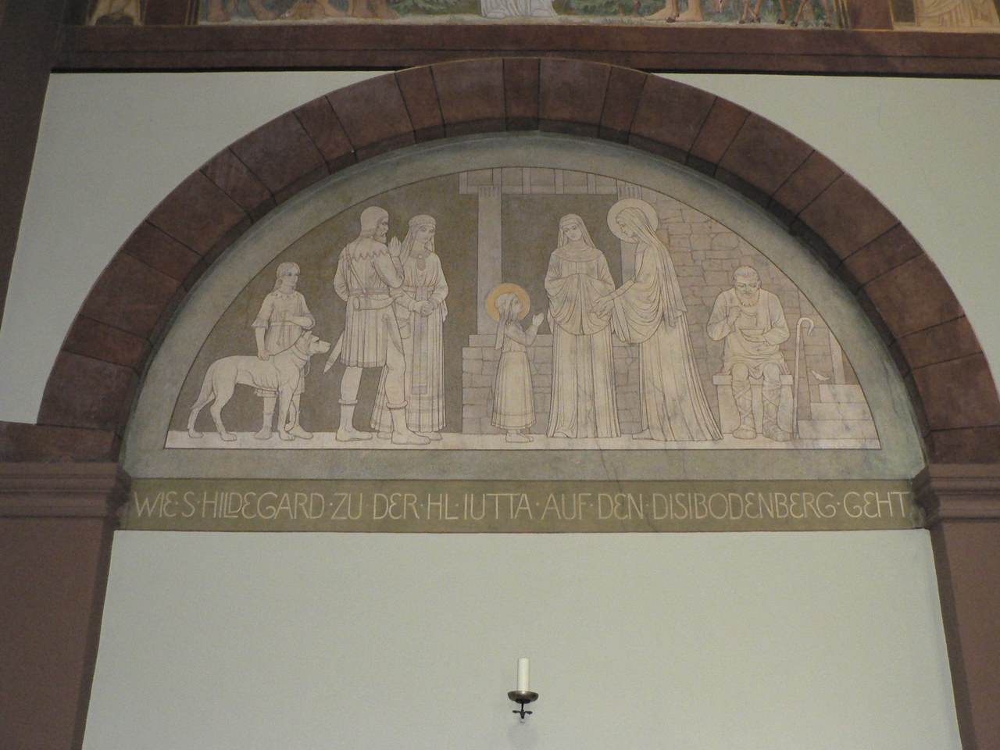</picture>
<figcaption>"How Hildegard goes to St Jutta on the Disibodenberg." The first of five scenes from her life painted by Fr Paulus Krebs OSB of the Beuron School, in the church of the Abbey of St Hildegard at Eibingen, 1907–13. Photo: <a href="https://commons.wikimedia.org/wiki/File:Abtei_St._Hildegard_Mittelschiff_1._Bogenfeld.JPG">Abtei St. Hildegard Mittelschiff 1. Bogenfeld</a> by Kurt Wichmann, <a href="https://creativecommons.org/licenses/by/3.0">CC BY 3.0</a>, via Wikimedia Commons.</figcaption>
</figure>

<figure class=photo>
<picture><source srcset="/static/art/hild-disibodenberg-rivers-600.webp 600w,/static/art/hild-disibodenberg-rivers.webp 1280w" sizes="(max-width:760px) 100vw,760px" type="image/webp">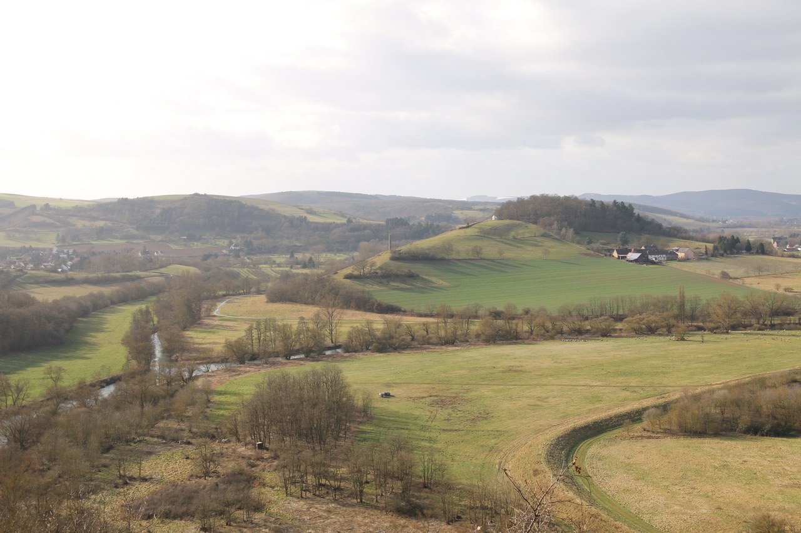</picture>
<figcaption>The wooded hill of the <b>Disibodenberg</b> above the meeting of the Glan and the Nahe. Hildegard lived here for nearly forty years. Photo: <a href="https://commons.wikimedia.org/wiki/File:Disibodenberg_mit_Glan_und_Nahe.JPG">Disibodenberg mit Glan und Nahe</a> by Viewcatcher, <a href="https://creativecommons.org/licenses/by-sa/3.0">CC BY-SA 3.0</a>, via Wikimedia Commons.</figcaption>
</figure>

Little by little other young women came to join them, and the cell became a small convent of nuns living beside the monks. Bishop Otto of Bamberg had received their vows on the day of their enclosure. When Jutta died in 1136, worn out by fasting and prayer and mourned as a saint, the sisters chose Hildegard, then thirty-eight, as their *magistra*, their mother and leader.

<figure class=photo>
<picture><source srcset="/static/art/hild-disibodenberg-reconstruction-600.webp 600w,/static/art/hild-disibodenberg-reconstruction.webp 1250w" sizes="(max-width:760px) 100vw,760px" type="image/webp">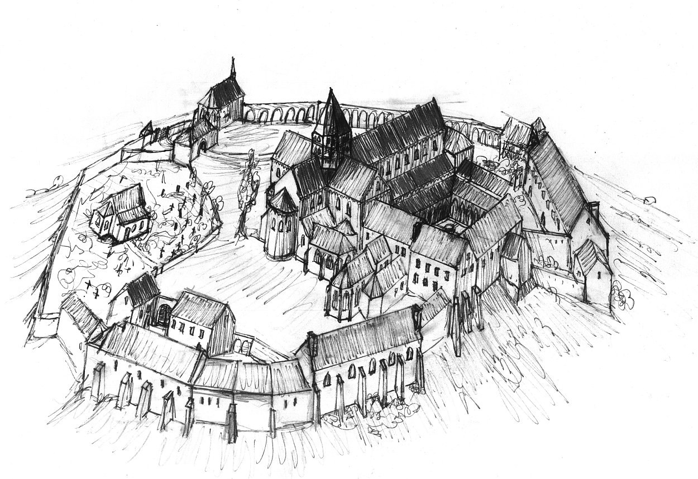</picture>
<figcaption>The Disibodenberg as it may have looked around 1500, in a reconstruction drawing by Andreas Rockstein. Photo: <a href="https://commons.wikimedia.org/wiki/File:Disibodenberg_Rekonstruktion.jpg">Disibodenberg Rekonstruktion</a> by Andreas Rockstein, <a href="https://creativecommons.org/licenses/by/3.0">CC BY 3.0</a>, via Wikimedia Commons.</figcaption>
</figure>

<h2 id=light>"The shade of the living Light"</h2>

Hildegard had seen her light since she was three. As a child she thought everyone saw such things, and when she found they did not, she kept silent, telling only Jutta and Volmar. She saw it, she wrote, not in sleep or in ecstasy, but awake, with her eyes open and her mind clear, "in the open places", by day and by night.

Near the end of her life, when the monk Guibert of Gembloux asked her how her visions came to her, she answered him at length. "From my infancy," she wrote, "I have always seen this vision in my soul, even to the present time when I am more than seventy years old." The light she saw was "far, far brighter than a cloud which carries the sun," and she called it "the reflection of the living Light". Sometimes, within it, she saw another light, which she called "the living Light" itself; and when she saw that, "all sadness and pain vanish from my memory, so that I am again as a simple maid and not as an old woman."

<figure class=photo>
<picture><source srcset="/static/art/hild-lucca-writing-600.webp 600w,/static/art/hild-lucca-writing.webp 547w" sizes="(max-width:760px) 100vw,760px" type="image/webp">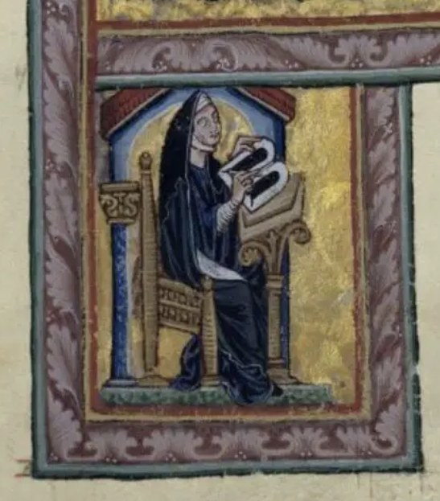</picture>
<figcaption>Hildegard receives the living Light and writes, in the Lucca manuscript of her <i>Book of Divine Works</i>, made about 1220–30. Image: <a href="https://commons.wikimedia.org/wiki/File:St._Hildegard_von_Bingen_writing,_Lucca_codex,_Liber_Divinorum_Operum_(1163-1173).jpg">St. Hildegard von Bingen writing, Lucca codex, Liber Divinorum Operum (1163-1173)</a>, <a href="https://creativecommons.org/publicdomain/zero/1.0/">CC0</a>, via Wikimedia Commons.</figcaption>
</figure>

<h2 id=write>"Write what you see and hear"</h2>

In 1141, when she was forty-two years and seven months old, the light came upon her with new force. "A fiery light of exceeding brilliance came and permeated my whole brain," she wrote, "and inflamed my whole heart and my whole breast." She understood at once the meaning of the Psalms, the Gospels and the other books of Scripture. And she heard a voice from heaven: "Cry out, therefore, and write thus!" "Write what you see and hear."

At first she refused, out of humility and fear of what people would say. She fell gravely ill and lay sick until she obeyed. Then, with Volmar to correct her Latin and her beloved young sister **Richardis von Stade** to help her, she began to write.

<figure class=photo>
<picture><source srcset="/static/art/hild-salem-600.webp 600w,/static/art/hild-salem.webp 533w" sizes="(max-width:760px) 100vw,760px" type="image/webp">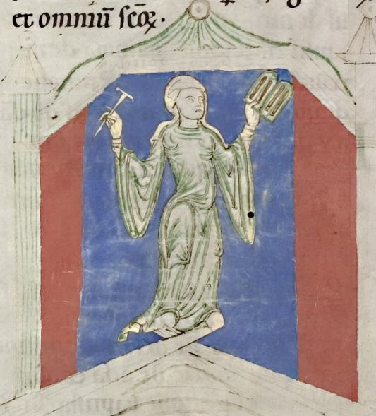</picture>
<figcaption>Hildegard as pictured in the Salem copy of <i>Scivias</i>, made about 1200 at the Cistercian abbey of Salem and now in Heidelberg University Library. Image: <a href="https://commons.wikimedia.org/wiki/File:St._Hildegard_von_Bingen,_The_Salem_Scivias_(1200),_detail.jpg">St. Hildegard von Bingen, The Salem Scivias (1200), detail</a>, <a href="https://creativecommons.org/publicdomain/zero/1.0/">CC0</a>, via Wikimedia Commons.</figcaption>
</figure>

<h2 id=trier>Pope Eugene III reads her book at Trier</h2>

Hildegard still wanted to be sure that what she saw came from God. About 1146–47 she wrote to the most famous holy man of her day, **St Bernard of Clairvaux**, opening her heart to him. "This vision burns like a flame in my breast and in my soul," she told him, "and teaches me to understand the text profoundly." Bernard answered with encouragement: he rejoiced in the grace of God in her and urged her to receive it with humility and devotion.

<figure class=photo>
<picture><source srcset="/static/art/hild-bernard-600.webp 600w,/static/art/hild-bernard.webp 1280w" sizes="(max-width:760px) 100vw,760px" type="image/webp">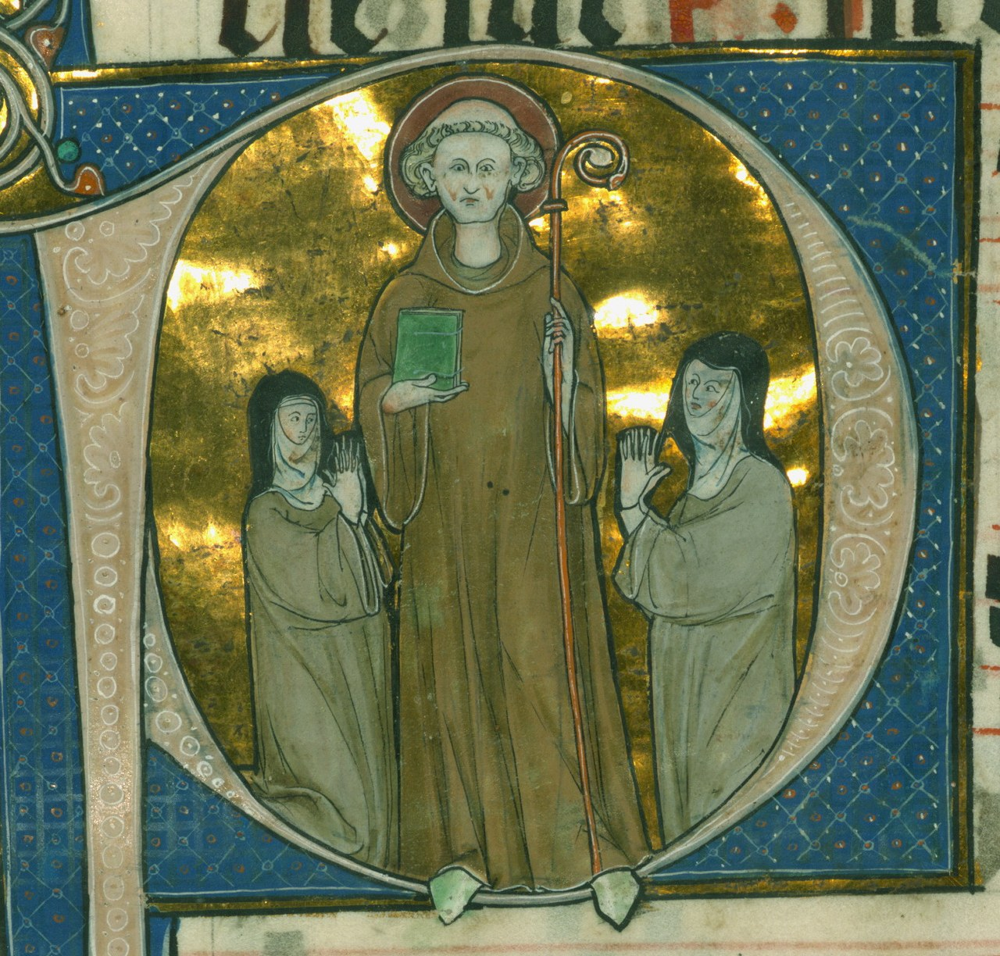</picture>
<figcaption>St Bernard of Clairvaux, from a thirteenth-century manuscript in the Walters Art Museum, Baltimore. He encouraged Hildegard to trust the grace God had given her. Image: <a href="https://commons.wikimedia.org/wiki/File:Bernard_of_Clairvaux_13th_century.jpg">Bernard of Clairvaux 13th century</a>, public domain, via Wikimedia Commons.</figcaption>
</figure>

Soon afterwards Pope **Eugene III**, a Cistercian and Bernard's former monk, held a synod of bishops at **Trier** over the winter of 1147–48. Archbishop Henry of Mainz told him about the nun of the Disibodenberg. The Pope sent Bishop Albero of Verdun and others to visit her and bring back her writings. Then, before the assembled bishops and cardinals, Eugene III himself read aloud from her book. All gave thanks to God, and Bernard spoke in her favour. The Pope wrote to Hildegard, blessing her and telling her to write down whatever the Holy Spirit made known to her.

From then on her fame spread across Christendom. People began to call her the "Teutonic prophetess".

<figure class=photo>
<picture><source srcset="/static/art/hild-trier-600.webp 600w,/static/art/hild-trier.webp 1280w" sizes="(max-width:760px) 100vw,760px" type="image/webp">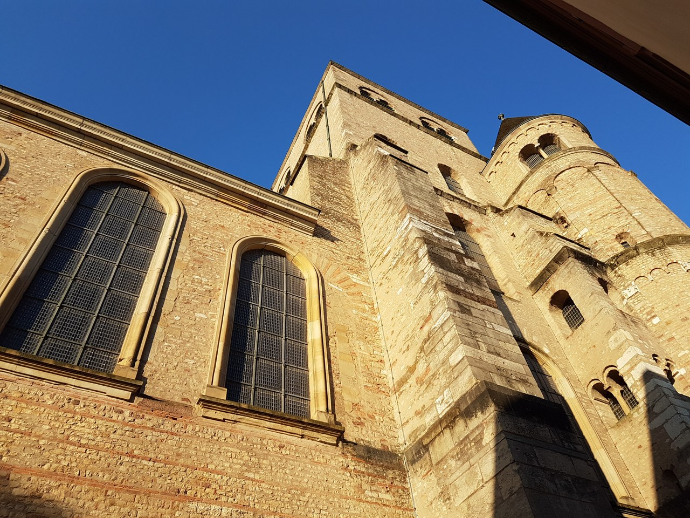</picture>
<figcaption>Trier Cathedral, where Pope Eugene III held his synod in 1147–48. Hildegard later preached in Trier herself. Photo: <a href="https://commons.wikimedia.org/wiki/File:2018_Trierer_Dom,_Westwerk_%26_Nordseite.jpg">2018 Trierer Dom, Westwerk & Nordseite</a> by Kleon3, <a href="https://creativecommons.org/licenses/by-sa/4.0">CC BY-SA 4.0</a>, via Wikimedia Commons.</figcaption>
</figure>

<figure class=photo>
<picture><source srcset="/static/art/hild-eugene-600.webp 600w,/static/art/hild-eugene.webp 432w" sizes="(max-width:760px) 100vw,760px" type="image/webp">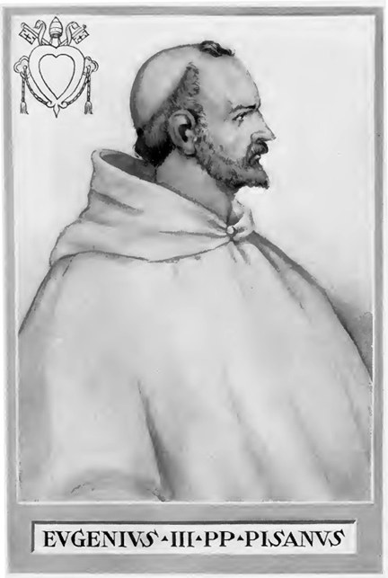</picture>
<figcaption>Pope <b>Eugene III</b>, who read Hildegard's writings aloud to the bishops at Trier and blessed her work. Engraving from Artaud de Montor's <i>Lives and Times of the Popes</i>. Image: <a href="https://commons.wikimedia.org/wiki/File:Pope_Eugene_III.jpg">Pope Eugene III</a>, public domain, via Wikimedia Commons.</figcaption>
</figure>

<h2 id=scivias>Scivias: "Know the Ways"</h2>

*Scivias*, short for *Scito vias Domini*, "Know the ways of the Lord", took Hildegard ten years and was finished in 1151. It is a great book of twenty-six visions in three parts. The first tells of the Creator and creation, the fall of the angels and of Adam and Eve, and the human soul. The second tells of the Redeemer, the Church and the sacraments. The third shows the history of salvation as a great building raised by God, ending with the Last Judgement and a new heaven and earth, and closes with a song of praise.

Each vision is told in two parts: first what she saw, and then what the "voice from heaven" told her it meant. At the Rupertsberg the visions were painted in a splendid manuscript, the **Rupertsberg *Scivias***, made around 1165–80 under her eye. The original was lost in Dresden at the end of the Second World War, but the nuns of Eibingen had painted a faithful copy by hand in 1927–33, and photographs survive. The pictures below are its visions.

<figure class=photo>
<picture><source srcset="/static/art/hild-scivias-cosmos-600.webp 600w,/static/art/hild-scivias-cosmos.webp 1000w" sizes="(max-width:760px) 100vw,760px" type="image/webp">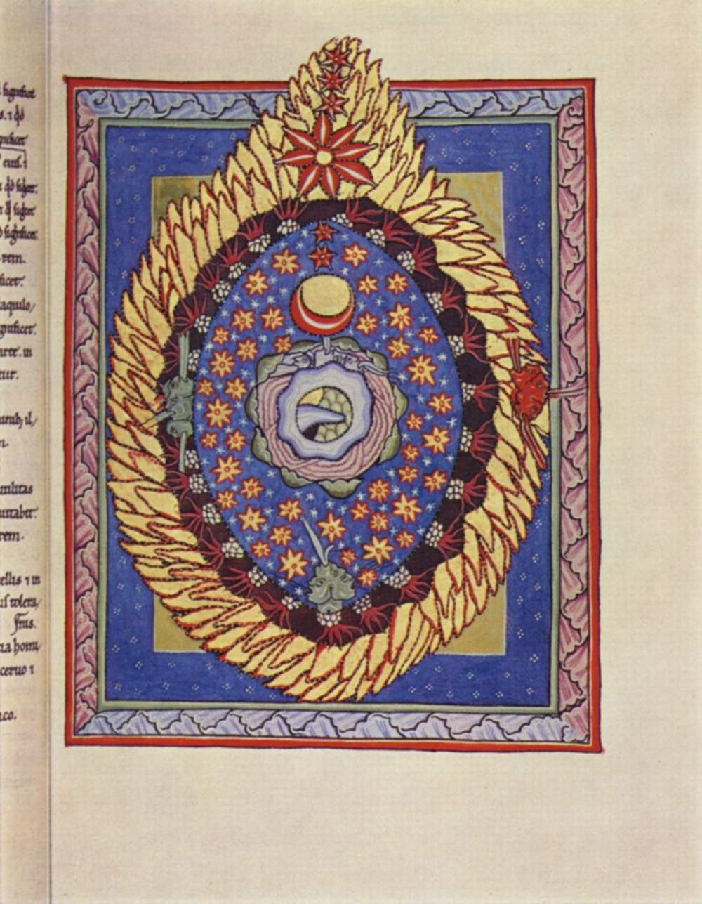</picture>
<figcaption><b>The universe</b> (Book I, vision 3). Hildegard saw creation as a vast egg-shaped form, ringed with fire, stars and winds, with the earth at its heart. Image: <a href="https://commons.wikimedia.org/wiki/File:Meister_des_Hildegardis-Codex_001.jpg">Meister des Hildegardis-Codex 001</a>, public domain, via Wikimedia Commons.</figcaption>
</figure>

<figure class=photo>
<picture><source srcset="/static/art/hild-scivias-fall-600.webp 600w,/static/art/hild-scivias-fall.webp 1280w" sizes="(max-width:760px) 100vw,760px" type="image/webp">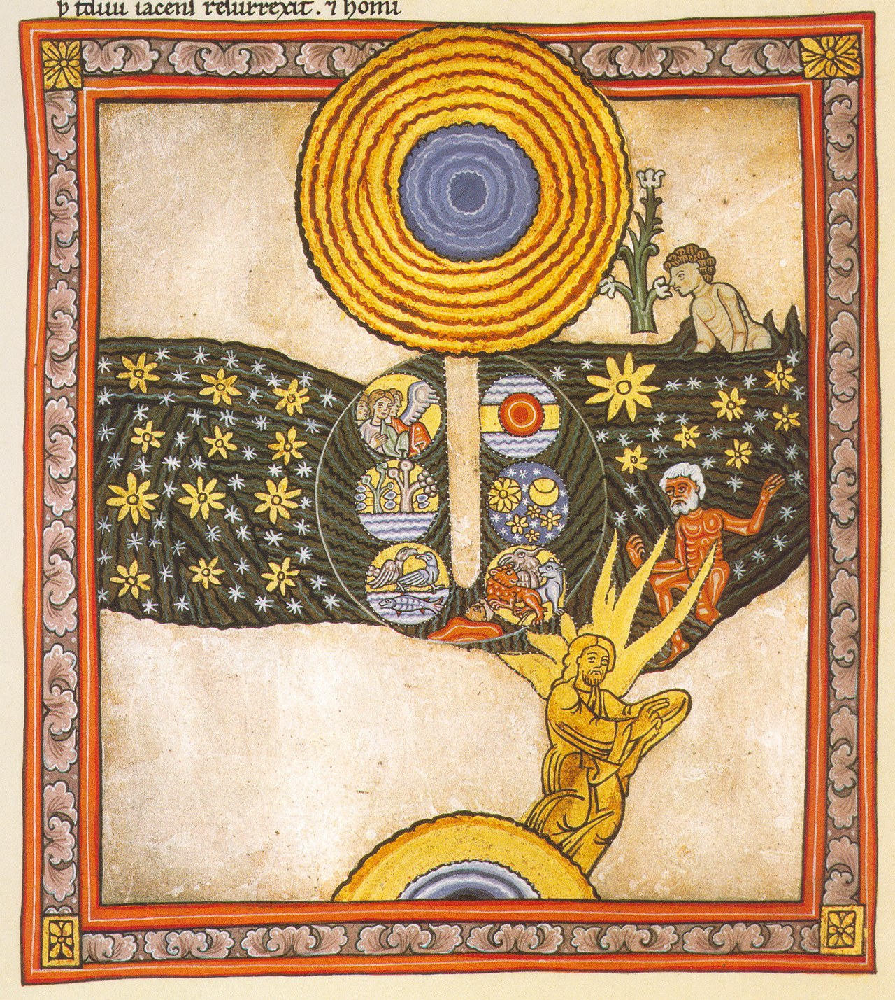</picture>
<figcaption><b>The fall of the angels and of Adam and Eve</b> (Book I, vision 2). The proud stars fall from heaven, and the serpent breathes upon Eve. Image: <a href="https://commons.wikimedia.org/wiki/File:Bingen_Six_Days_of_Creation.jpg">Bingen Six Days of Creation</a>, public domain, via Wikimedia Commons.</figcaption>
</figure>

<figure class=photo>
<picture><source srcset="/static/art/hild-scivias-soul-600.webp 600w,/static/art/hild-scivias-soul.webp 961w" sizes="(max-width:760px) 100vw,760px" type="image/webp">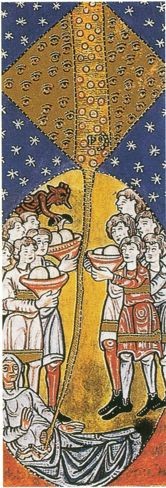</picture>
<figcaption><b>The soul and its tabernacle</b> (Book I, vision 4). The living soul comes from God to the child in its mother's womb, while people bring what they have made of their lives. Image: <a href="https://commons.wikimedia.org/wiki/File:Meister_des_Hildegardis-Codex_%E2%80%94_fertility-birth_in_Scivias_%E2%80%94_c._1185.jpg">Meister des Hildegardis-Codex — fertility-birth in Scivias — c. 1185</a>, public domain, via Wikimedia Commons.</figcaption>
</figure>

<figure class=photo>
<picture><source srcset="/static/art/hild-scivias-angels-600.webp 600w,/static/art/hild-scivias-angels.webp 1280w" sizes="(max-width:760px) 100vw,760px" type="image/webp">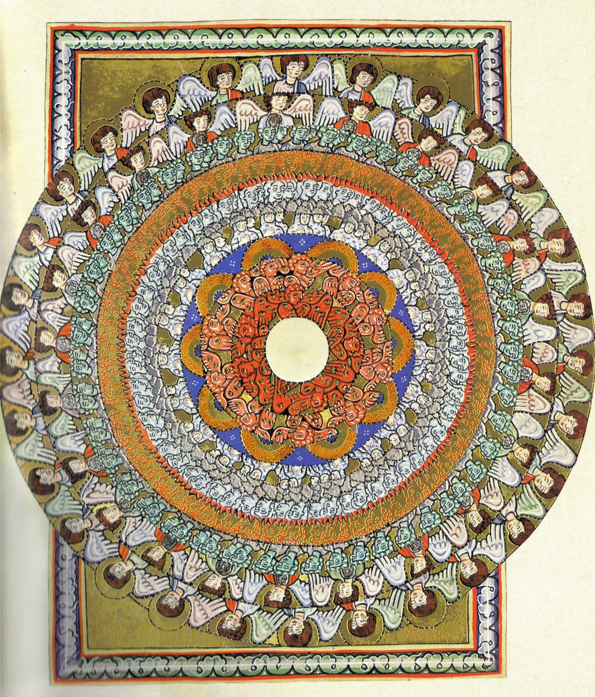</picture>
<figcaption><b>The choirs of angels</b> (Book I, vision 6), nine rings of angels around the hidden glory of God. Image: <a href="https://commons.wikimedia.org/wiki/File:07angels-hildegard_von_bingen.jpg">07angels-hildegard von bingen</a>, public domain, via Wikimedia Commons.</figcaption>
</figure>

<figure class=photo>
<picture><source srcset="/static/art/hild-scivias-trinity-600.webp 600w,/static/art/hild-scivias-trinity.webp 1000w" sizes="(max-width:760px) 100vw,760px" type="image/webp">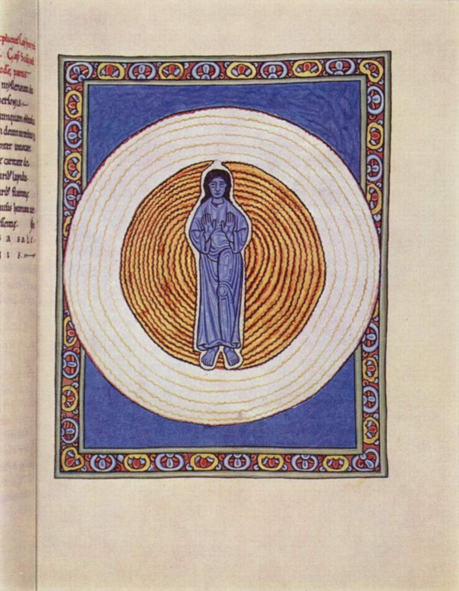</picture>
<figcaption><b>The Trinity</b> (Book II, vision 2): "a most splendid light, and in it a sapphire-coloured figure of a man", within a gleaming fire. Hildegard saw the Father, the Son and the Holy Spirit as one light. Image: <a href="https://commons.wikimedia.org/wiki/File:Meister_des_Hildegardis-Codex_003.jpg">Meister des Hildegardis-Codex 003</a>, public domain, via Wikimedia Commons.</figcaption>
</figure>

<figure class=photo>
<picture><source srcset="/static/art/hild-scivias-2-600.webp 600w,/static/art/hild-scivias-2.webp 1000w" sizes="(max-width:760px) 100vw,760px" type="image/webp">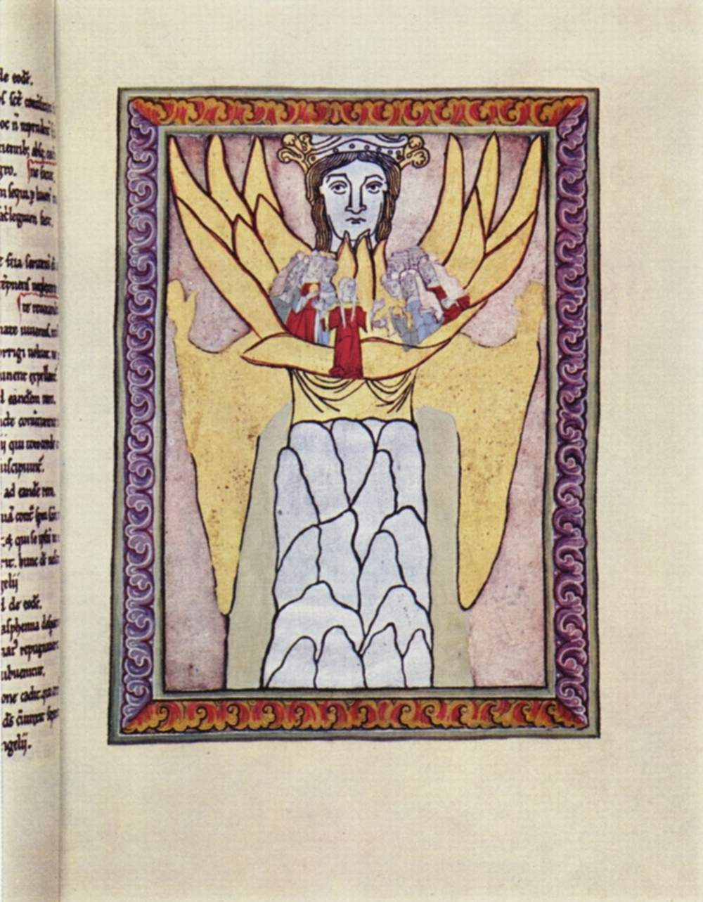</picture>
<figcaption>Another vision of the Rupertsberg <i>Scivias</i>: a radiant winged figure full of eyes, a picture of the virtues watching over the soul. Image: <a href="https://commons.wikimedia.org/wiki/File:Meister_des_Hildegardis-Codex_002.jpg">Meister des Hildegardis-Codex 002</a>, public domain, via Wikimedia Commons.</figcaption>
</figure>

<h2 id=rupertsberg>A new home on the Rupertsberg</h2>

As word of Hildegard spread, more and more young women came to the Disibodenberg, and the sisters' quarters grew crowded. In a vision she was shown a new place: the **Rupertsberg**, a hill at **Bingen** where the Nahe flows into the Rhine, by the grave of St Rupert, a young nobleman of the eighth century whom the people of Bingen honoured as a saint.

The abbot of the Disibodenberg, Kuno, did not want to lose her. Hildegard fell so ill that she lay as if paralysed, unable to move, until the abbot himself came and saw her, understood that this was God's will, and gave his consent. About 1150 she moved with some twenty sisters to the Rupertsberg, about fifteen miles down the Nahe. The new church was consecrated by Archbishop Henry of Mainz in 1152. The beginnings were poor and hard, and some of the sisters left, but the house grew into a flourishing abbey that would one day hold fifty nuns.

<figure class=photo>
<picture><source srcset="/static/art/hild-krebs-rupertsberg-600.webp 600w,/static/art/hild-krebs-rupertsberg.webp 1280w" sizes="(max-width:760px) 100vw,760px" type="image/webp">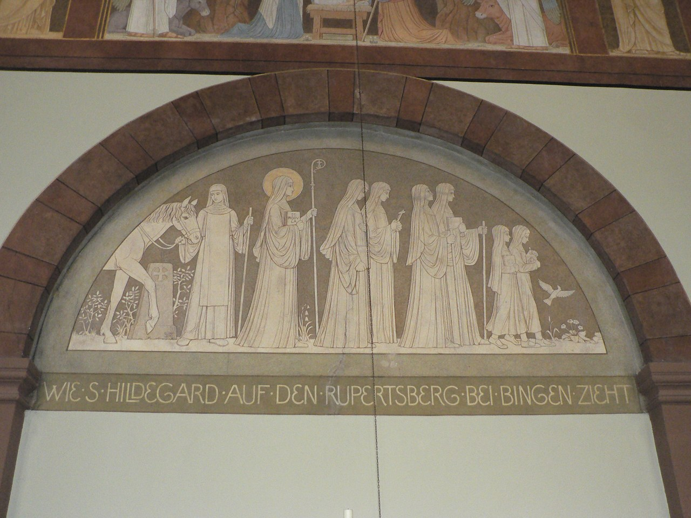</picture>
<figcaption>"How Hildegard moves to the Rupertsberg at Bingen." The second scene of Fr Paulus Krebs's cycle at Eibingen. Photo: <a href="https://commons.wikimedia.org/wiki/File:Abtei_St._Hildegard_Mittelschiff_2._Bogenfeld.JPG">Abtei St. Hildegard Mittelschiff 2. Bogenfeld</a> by Kurt Wichmann, <a href="https://creativecommons.org/licenses/by/3.0">CC BY 3.0</a>, via Wikimedia Commons.</figcaption>
</figure>

<figure class=photo>
<picture><source srcset="/static/art/hild-rupertsberg-old-600.webp 600w,/static/art/hild-rupertsberg-old.webp 882w" sizes="(max-width:760px) 100vw,760px" type="image/webp">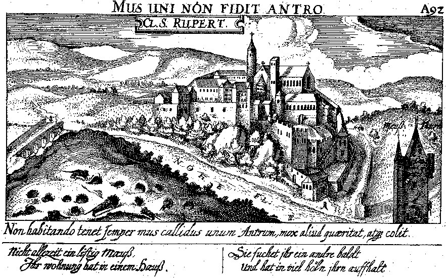</picture>
<figcaption>The Rupertsberg abbey above the Nahe, opposite Bingen, in an engraving of about 1620, a few years before it was destroyed in the Thirty Years' War. Image: <a href="https://commons.wikimedia.org/wiki/File:Kloster_Rupertsberg.gif">Kloster Rupertsberg.gif</a>, public domain, via Wikimedia Commons.</figcaption>
</figure>

One sorrow came with the move. Richardis, Hildegard's dearest helper, was elected abbess of Bassum in the north, and left. Hildegard begged her to stay and wrote to the Pope and to the archbishop, but Richardis went, and died the next year, 1152. Hildegard wrote to Richardis's brother that she had "cherished her with divine love", and she accepted God's will.

In 1163 Emperor **Frederick Barbarossa** placed the Rupertsberg under his protection, and its charters and privileges were kept by the abbey for centuries.

<figure class=photo>
<picture><source srcset="/static/art/hild-privilege-600.webp 600w,/static/art/hild-privilege.webp 1280w" sizes="(max-width:760px) 100vw,760px" type="image/webp">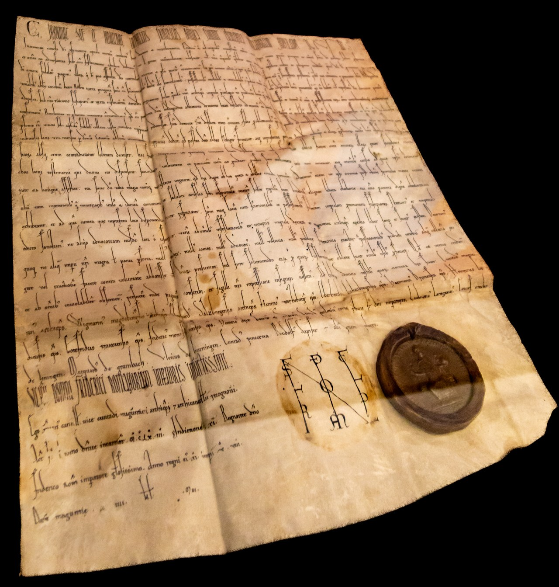</picture>
<figcaption>An imperial charter of protection for the abbey of the Rupertsberg, issued under Frederick Barbarossa, with its seal. Image: <a href="https://commons.wikimedia.org/wiki/File:Schutzprivileg_Barbarossas_f%C3%BCr_das_Kloster_Rupertsberg-DSC2194.jpg">Schutzprivileg Barbarossas für das Kloster Rupertsberg-DSC2194</a>, public domain, via Wikimedia Commons.</figcaption>
</figure>

<h2 id=music>"A symphony of the Holy Spirit": her music</h2>

On the Rupertsberg Hildegard's sisters sang. Hildegard wrote the words and melodies of some seventy chants for the Mass and the Office: antiphons, responsories, hymns and sequences, gathered under the title ***Symphonia armonie celestium revelationum***, "Symphony of the harmony of heavenly revelations". She sang of the Virgin Mary as *O viridissima virga*, "O greenest branch", of the Holy Spirit, of the angels, of St Rupert and St Disibod, and of St Ursula and her companions. Her melodies soar over wide ranges, far beyond most chant of her day.

For Hildegard music was the language of heaven. "For her," said Benedict XVI, "the entire creation is a symphony of the Holy Spirit who is in himself joy and jubilation."

<figure class=photo>
<picture><source srcset="/static/art/hild-riesencodex-music-600.webp 600w,/static/art/hild-riesencodex-music.webp 998w" sizes="(max-width:760px) 100vw,760px" type="image/webp">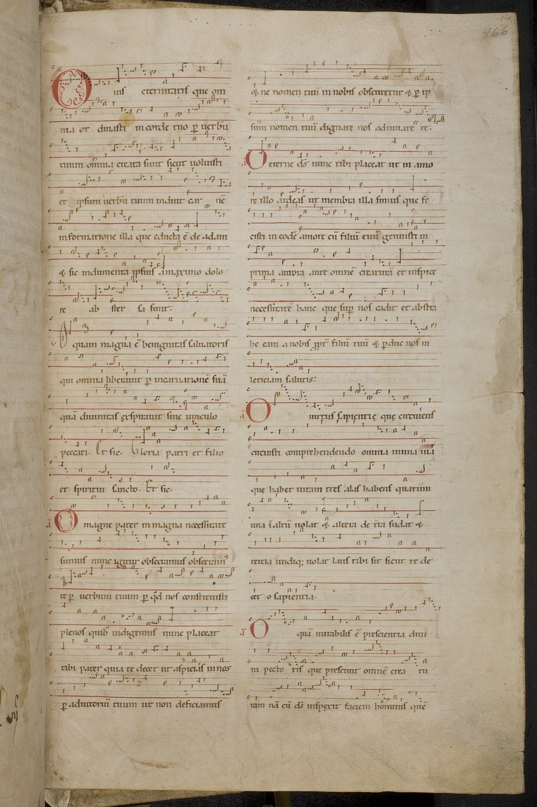</picture>
<figcaption>A page of her songs in the <b>Riesencodex</b>, the "giant book" of her works compiled at the Rupertsberg around 1180, now in Wiesbaden. Image: <a href="https://commons.wikimedia.org/wiki/File:Riesencodex_-_fl.0466r.jpg">Riesencodex - fl.0466r</a>, public domain, via Wikimedia Commons.</figcaption>
</figure>

<figure class=photo>
<picture><source srcset="/static/art/hild-dendermonde-600.webp 600w,/static/art/hild-dendermonde.webp 1280w" sizes="(max-width:760px) 100vw,760px" type="image/webp">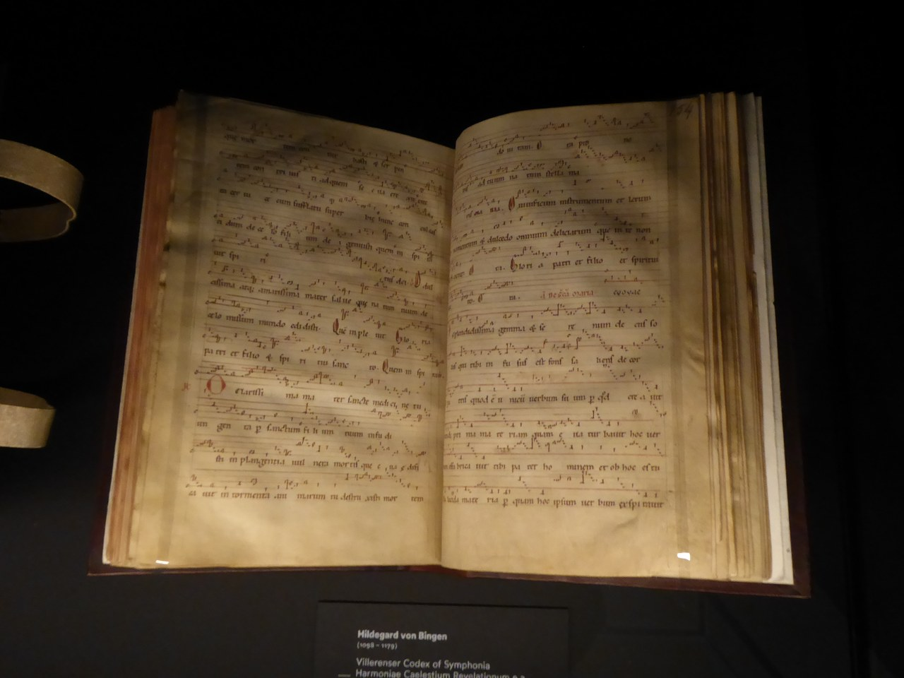</picture>
<figcaption>The <b>Dendermonde Codex</b> of her <i>Symphonia</i>, copied in her lifetime and kept for centuries at the abbey of Dendermonde in Flanders. Photo: <a href="https://commons.wikimedia.org/wiki/File:Hildegard_von_Bingen,_Symphonia_Harmoniae_Caelestium_Revelationum.jpg">Hildegard von Bingen, Symphonia Harmoniae Caelestium Revelationum</a> by Okapi071, <a href="https://creativecommons.org/publicdomain/zero/1.0/">CC0</a>, via Wikimedia Commons.</figcaption>
</figure>

She also wrote a sung drama, the ***Ordo Virtutum***, "Play of the Virtues", probably for her sisters around 1151. It is the oldest known morality play. The Soul, *Anima*, is tempted away by the Devil and returns, bruised and repentant, to the Virtues, who welcome her home. Every part is sung, except the Devil's: he alone can only shout, because he has no share in the harmony of heaven.

<figure class=photo>
<picture><source srcset="/static/art/hild-ordo-600.webp 600w,/static/art/hild-ordo.webp 1280w" sizes="(max-width:760px) 100vw,760px" type="image/webp">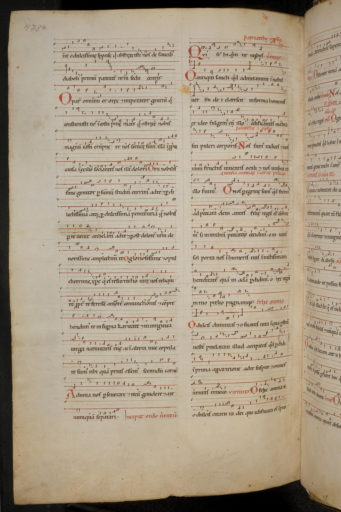</picture>
<figcaption>The beginning of the <i>Ordo Virtutum</i> in the Riesencodex. Image: <a href="https://commons.wikimedia.org/wiki/File:Riesencodex_-_fl.0478v.jpg">Riesencodex - fl.0478v</a>, public domain, via Wikimedia Commons.</figcaption>
</figure>

<figure class=photo>
<picture><source srcset="/static/art/hild-lucca-musicians-600.webp 600w,/static/art/hild-lucca-musicians.webp 1280w" sizes="(max-width:760px) 100vw,760px" type="image/webp">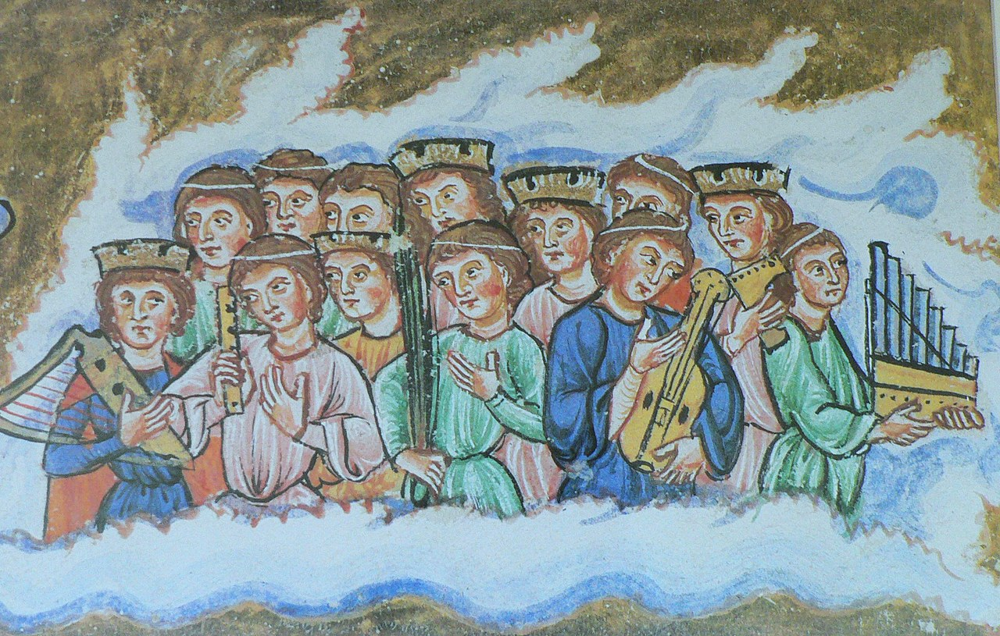</picture>
<figcaption>The blessed sing and play among the clouds of heaven, from the Lucca manuscript of her <i>Book of Divine Works</i>. Image: <a href="https://commons.wikimedia.org/wiki/File:Musicians_from_The_Book_of_Divine_Works_-_Liber_divinorum_operum,_written_by_Hildegard_of_Bingen.jpg">Musicians from The Book of Divine Works - Liber divinorum operum, written by Hildegard of Bingen</a>, public domain, via Wikimedia Commons.</figcaption>
</figure>

<h2 id=healing>Healer of body and soul: Physica and Causae et Curae</h2>

Between 1151 and 1158 Hildegard wrote about the natural world and the healing of the body. The book known as ***Physica*** describes plants, the elements, trees, stones, fish, birds, animals, reptiles and metals, with their uses for health. It contains one of the first written mentions of hops being used in brewing beer. ***Causae et Curae***, "Causes and Cures", tells how the human body is made, how sickness comes, and how it may be treated.

At the heart of her vision is ***viriditas***, "greenness": the fresh, living power God has poured into all creation, in the green of plants, in the health of the body and in a soul alive with grace. As abbess she cared for her sisters and for the sick who came to the abbey gate, and many came to her for healing and for prayer.

<figure class=photo>
<picture><source srcset="/static/art/hild-physica-600.webp 600w,/static/art/hild-physica.webp 1280w" sizes="(max-width:760px) 100vw,760px" type="image/webp">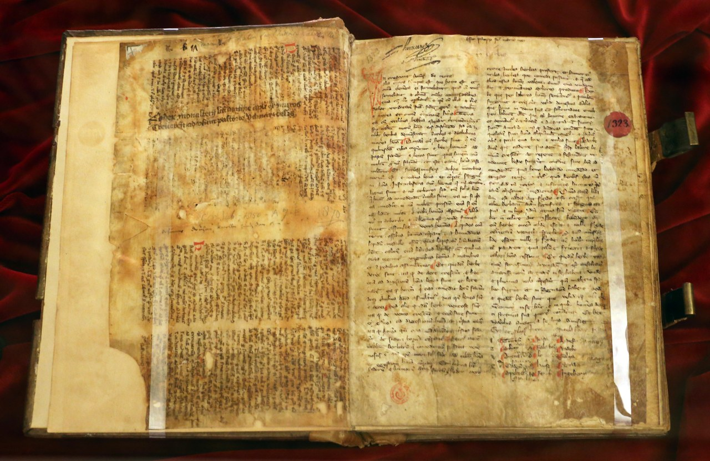</picture>
<figcaption>A manuscript of the <i>Physica</i> in the Biblioteca Medicea Laurenziana, Florence. Photo: <a href="https://commons.wikimedia.org/wiki/File:Ildegarda_di_bingen,_physica,_renania,_1310_ca._(ashburnham_1323).jpg">Ildegarda di bingen, physica, renania, 1310 ca. (ashburnham 1323)</a> by Sailko, <a href="https://creativecommons.org/licenses/by/3.0">CC BY 3.0</a>, via Wikimedia Commons.</figcaption>
</figure>

<figure class=photo>
<picture><source srcset="/static/art/hild-herbgarden-600.webp 600w,/static/art/hild-herbgarden.webp 1280w" sizes="(max-width:760px) 100vw,760px" type="image/webp">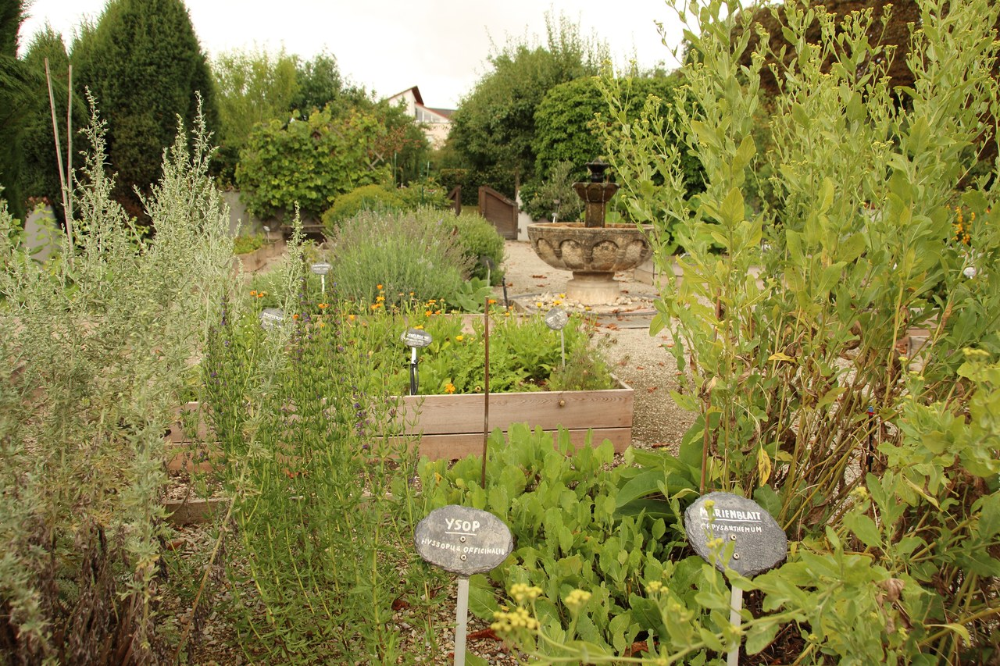</picture>
<figcaption>The herb garden of the Hildegard Forum on the Rochusberg in Bingen, planted in 1998 for the nine-hundredth anniversary of her birth with the plants she wrote about. Photo: <a href="https://commons.wikimedia.org/wiki/File:Heilkr%C3%A4utergarten_Hildegard-Forum_Rochusberg_Bingen_(01).jpg">Heilkräutergarten Hildegard-Forum Rochusberg Bingen (01)</a> by Marion Halft, <a href="https://creativecommons.org/licenses/by-sa/4.0">CC BY-SA 4.0</a>, via Wikimedia Commons.</figcaption>
</figure>

<h2 id=lingua>The unknown language</h2>

Hildegard also received a *Lingua ignota*, an "unknown language", with an alphabet of its own, the *litterae ignotae*. About a thousand words of it survive, each with its Latin or German meaning: names for God (*Aigonz*), the angels (*Aleganz*), the saints, the parts of the body, the clothes, the trees and the plants. She seems to have used it among her sisters as a mystical language of praise. One of her antiphons, *O orzchis Ecclesia*, sets a few of its words among the Latin.

Volmar, her faithful secretary, once wrote to her as if in wonder at all these gifts: what would become of "the voice of the unheard melody" and "the unheard language" when she was gone?

<figure class=photo>
<picture><source srcset="/static/art/hild-litterae-600.webp 600w,/static/art/hild-litterae.webp 900w" sizes="(max-width:760px) 100vw,760px" type="image/webp">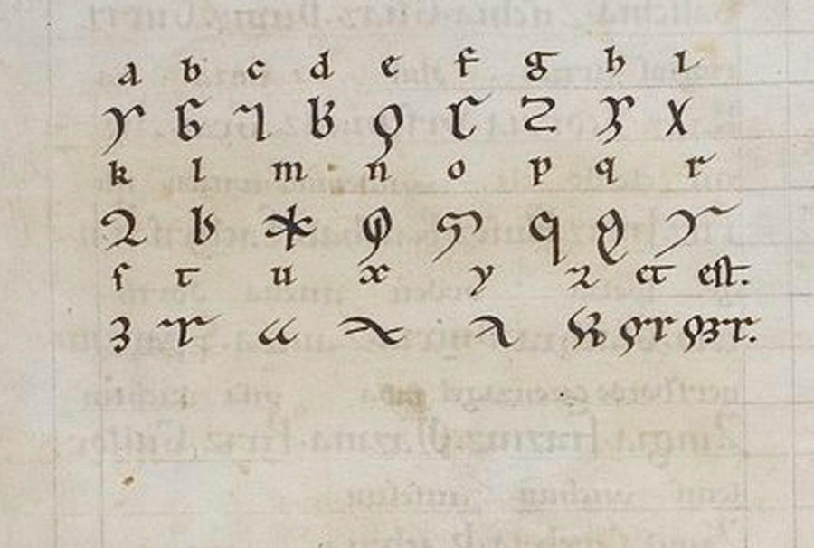</picture>
<figcaption>The <i>litterae ignotae</i>, the alphabet of her unknown language, as written in the Riesencodex. Image: <a href="https://commons.wikimedia.org/wiki/File:Hildegard_von_bingen_-_litterae_ignotae.jpg">Hildegard von bingen - litterae ignotae</a>, public domain, via Wikimedia Commons.</figcaption>
</figure>

<h2 id=works>The Book of Divine Works</h2>

After *Scivias* she wrote two more great books of visions. The ***Liber Vitae Meritorum***, the "Book of Life's Merits" (1158–63), is a dialogue between the virtues and the vices. The ***Liber Divinorum Operum***, the "Book of Divine Works" (about 1163–74), was her last and greatest. It begins with the words of St John, "In the beginning was the Word", and shows the whole cosmos as the work of God's love, with the human person at its centre, made in his image.

Its first vision is of **Love**, *Caritas*, a fiery figure who says: "I, the highest and fiery power, have kindled every living spark... I flame above the beauty of the fields, I shine in the waters, I burn in the sun, the moon and the stars."

<figure class=photo>
<picture><source srcset="/static/art/hild-lucca-wga-600.webp 600w,/static/art/hild-lucca-wga.webp 650w" sizes="(max-width:760px) 100vw,760px" type="image/webp">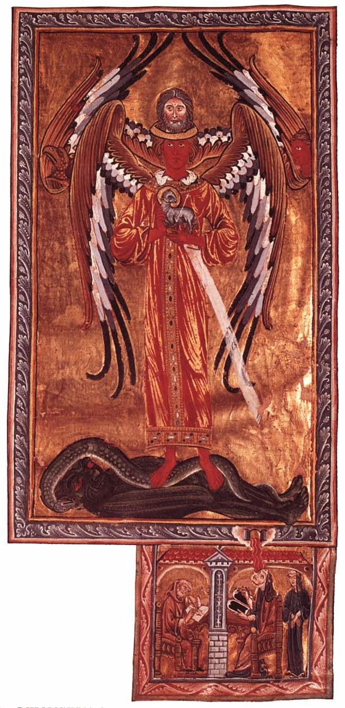</picture>
<figcaption><b>Love</b>, <i>Caritas</i>, the first vision of the <i>Book of Divine Works</i>, with Hildegard writing below. Lucca, Biblioteca Statale, MS 1942. Image: <a href="https://commons.wikimedia.org/wiki/File:12th-century_painters_-_The_Book_of_Divine_Works_By_Hildegard_of_Bingen_-_WGA15934.jpg">12th-century painters - The Book of Divine Works By Hildegard of Bingen - WGA15934</a>, public domain, via Wikimedia Commons.</figcaption>
</figure>

<figure class=photo>
<picture><source srcset="/static/art/hild-universal-man-600.webp 600w,/static/art/hild-universal-man.webp 768w" sizes="(max-width:760px) 100vw,760px" type="image/webp">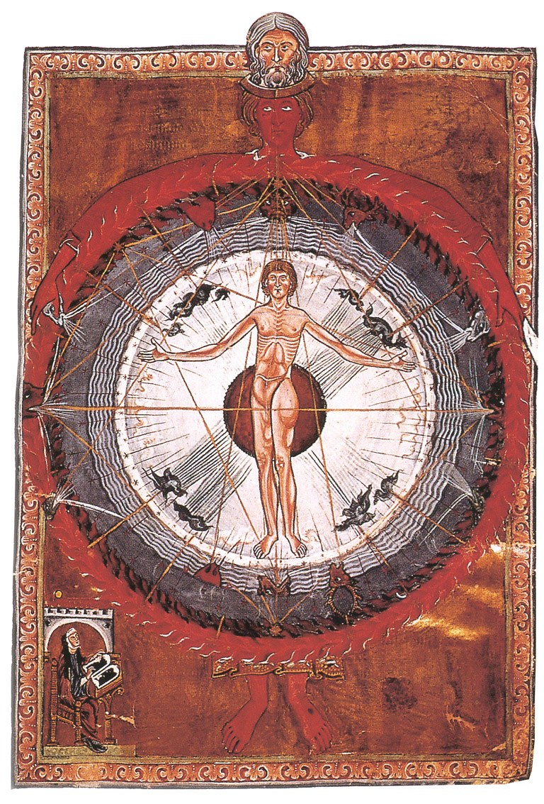</picture>
<figcaption><b>The cosmic man</b> (Book I, vision 2): the human person at the centre of creation, held within the circles of the universe and in the embrace of God. Image: <a href="https://commons.wikimedia.org/wiki/File:Hildegard_von_Bingen_Liber_Divinorum_Operum.jpg">Hildegard von Bingen Liber Divinorum Operum</a>, public domain, via Wikimedia Commons.</figcaption>
</figure>

<figure class=photo>
<picture><source srcset="/static/art/hild-seasons-600.webp 600w,/static/art/hild-seasons.webp 806w" sizes="(max-width:760px) 100vw,760px" type="image/webp">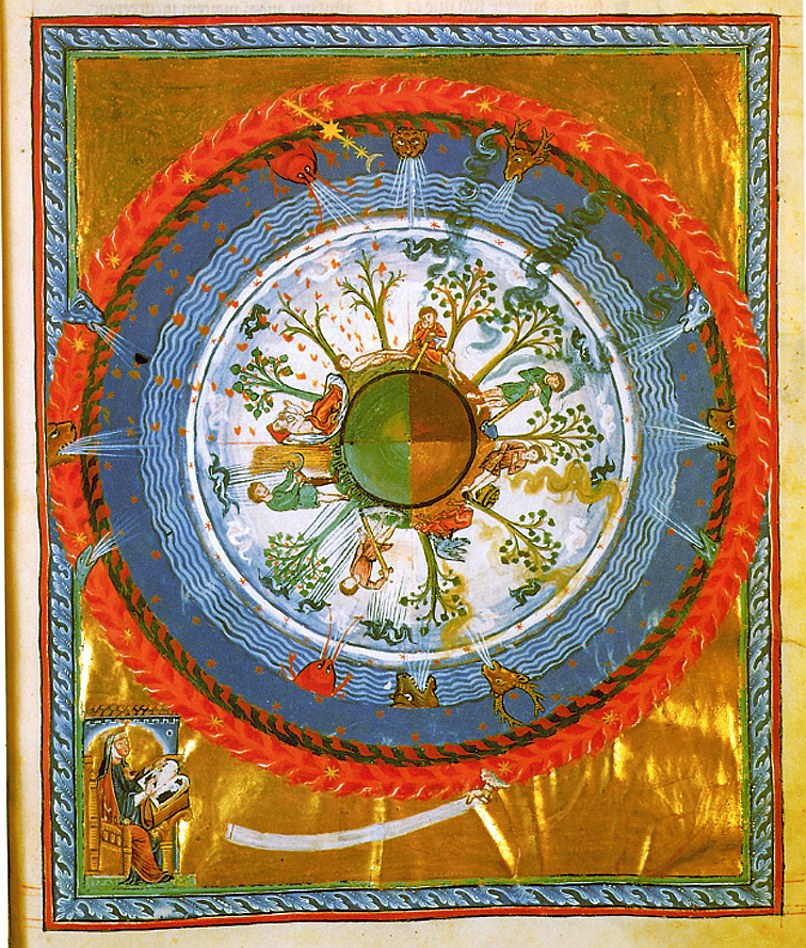</picture>
<figcaption><b>The seasons of the world</b>, from the Lucca <i>Book of Divine Works</i>: the earth turning through the year, with the labours of each season. Image: <a href="https://commons.wikimedia.org/wiki/File:Hildegard_von_Bingen-_%27Werk_Gottes%27,_12._Jh..jpg">Hildegard von Bingen- 'Werk Gottes', 12. Jh.</a>, public domain, via Wikimedia Commons.</figcaption>
</figure>

<figure class=photo>
<picture><source srcset="/static/art/hild-ghent-600.webp 600w,/static/art/hild-ghent.webp 1280w" sizes="(max-width:760px) 100vw,760px" type="image/webp">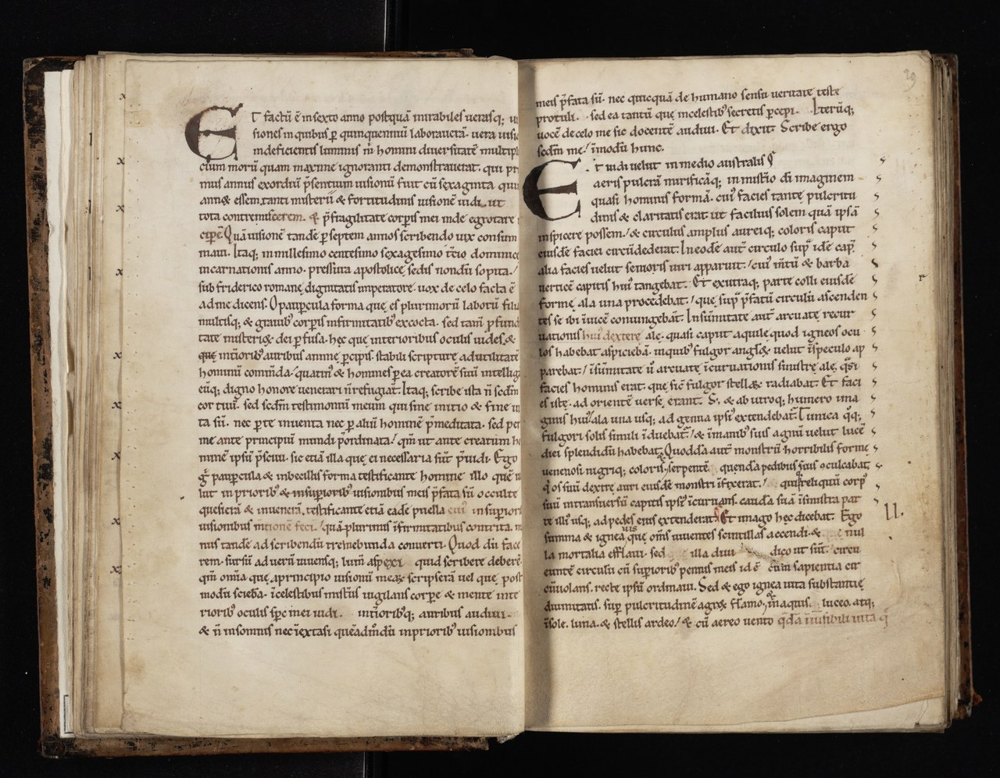</picture>
<figcaption>A twelfth-century manuscript of the <i>Book of Divine Works</i> in Ghent University Library, made in her lifetime. Photo: <a href="https://commons.wikimedia.org/wiki/File:Archive-ugent-be-0B56522C-9B29-11E1-8926-9B5B3B7C8C91_DS-37.jpg">Archive-ugent-be-0B56522C-9B29-11E1-8926-9B5B3B7C8C91 DS-37</a> by Ghent University Library, <a href="https://creativecommons.org/licenses/by-sa/4.0">CC BY-SA 4.0</a>, via Wikimedia Commons.</figcaption>
</figure>

<h2 id=letters>"Listen, O King": letters to popes and emperors</h2>

About four hundred of Hildegard's letters survive. She wrote to four popes (Eugene III, Anastasius IV, Adrian IV and Alexander III), to King Conrad III and Emperor Frederick Barbarossa, to archbishops, abbots and abbesses, to St Bernard and to her friend St Elisabeth of Schönau, and to ordinary men and women who asked her prayers and advice. She called them all to conversion and to love of God.

She met **Barbarossa** at his palace at **Ingelheim**, on the Rhine near Bingen, about 1154. When he later set up antipopes against Pope Alexander III, she did not spare him. "Listen, O King, if you wish to live!" she wrote, in words she said came from God. "Otherwise my sword will pierce you!"

<figure class=photo>
<picture><source srcset="/static/art/hild-krebs-barbarossa-600.webp 600w,/static/art/hild-krebs-barbarossa.webp 1280w" sizes="(max-width:760px) 100vw,760px" type="image/webp">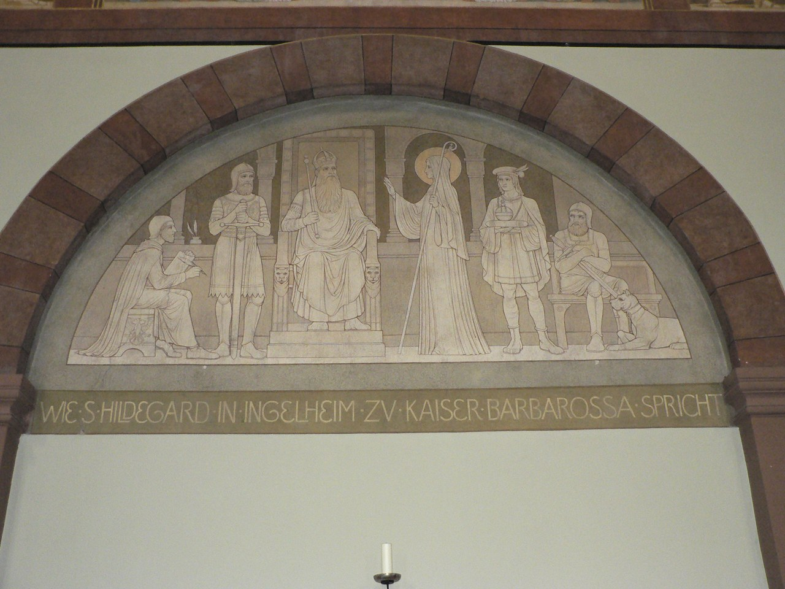</picture>
<figcaption>"How Hildegard speaks to the Emperor Barbarossa at Ingelheim." The third scene of the Krebs cycle at Eibingen. Photo: <a href="https://commons.wikimedia.org/wiki/File:Abtei_St._Hildegard_Mittelschiff_3._Bogenfeld.JPG">Abtei St. Hildegard Mittelschiff 3. Bogenfeld</a> by Kurt Wichmann, <a href="https://creativecommons.org/licenses/by/3.0">CC BY 3.0</a>, via Wikimedia Commons.</figcaption>
</figure>

<figure class=photo>
<picture><source srcset="/static/art/hild-barbarossa-600.webp 600w,/static/art/hild-barbarossa.webp 1000w" sizes="(max-width:760px) 100vw,760px" type="image/webp">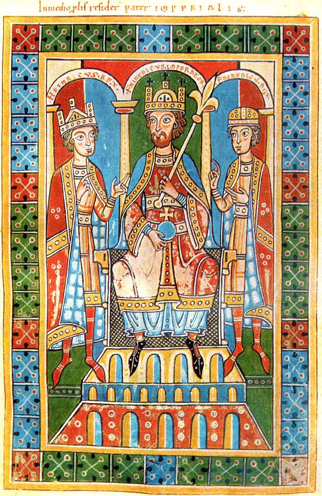</picture>
<figcaption>Emperor <b>Frederick I Barbarossa</b> with his sons, from the Welf Chronicle of Weingarten, painted about 1180. Image: <a href="https://commons.wikimedia.org/wiki/File:Friedrich-barbarossa-und-soehne-welfenchronik_1-1000x1540.jpg">Friedrich-barbarossa-und-soehne-welfenchronik 1-1000x1540</a>, public domain, via Wikimedia Commons.</figcaption>
</figure>

<figure class=photo>
<picture><source srcset="/static/art/hild-epistolae-600.webp 600w,/static/art/hild-epistolae.webp 1167w" sizes="(max-width:760px) 100vw,760px" type="image/webp">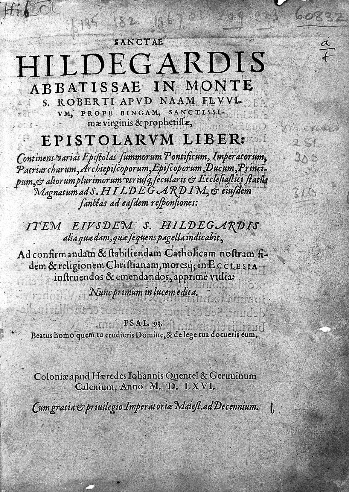</picture>
<figcaption>The first printed edition of her letters, the <i>Epistolarum liber</i>, published at Cologne in 1566. Photo: <a href="https://commons.wikimedia.org/wiki/File:Title_page_from_Hildegard_von_Bingen,_Epistolarum_liber,_1566_Wellcome_L0015598.jpg">Title page from Hildegard von Bingen, Epistolarum liber, 1566 Wellcome L0015598</a> by Wellcome Collection, <a href="https://creativecommons.org/licenses/by/4.0">CC BY 4.0</a>, via Wikimedia Commons.</figcaption>
</figure>

<h2 id=journeys>Four preaching journeys</h2>

At the invitation of the popes Adrian IV and Alexander III, Hildegard did something almost unheard of for a woman of her time: she went out to preach. Between 1158 and 1171, already in her sixties and often unwell, she made four journeys by boat and on horseback, speaking to clergy and people in monasteries, in cathedrals and even in public squares.

1. **About 1158, along the Main:** Mainz, Wertheim, Würzburg, Kitzingen, Ebrach and Bamberg.
2. **1160, to the Moselle and Lorraine:** Trier, where she preached in public, Metz and Krauftal.
3. **1161–63, down the Rhine:** Boppard, Andernach, Siegburg, Cologne and Werden. In Cologne she preached against the Cathar heresy and called the clergy to renewal.
4. **1170–71, into Swabia:** Maulbronn, Hirsau, Kirchheim and Zwiefalten. She was seventy-two.

<figure class=photo>
<picture><source srcset="/static/art/hild-tours-map-600.webp 600w,/static/art/hild-tours-map.webp 495w" sizes="(max-width:760px) 100vw,760px" type="image/webp">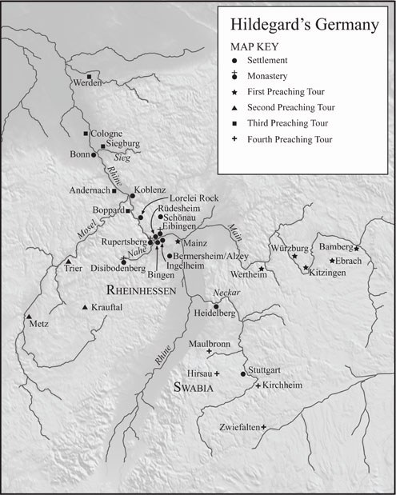</picture>
<figcaption>Hildegard's four preaching tours. Map by Sean and Carmen Butcher. Photo: <a href="https://commons.wikimedia.org/wiki/File:Hildegard_map.jpg">Hildegard map</a> by Sean Butcher & Carmen Butcher, <a href="https://creativecommons.org/licenses/by-sa/2.5">CC BY-SA 2.5</a>, via Wikimedia Commons.</figcaption>
</figure>

<h2 id=eibingen>Eibingen across the Rhine</h2>

By 1165 the Rupertsberg was full. Hildegard took over an empty monastery at **Eibingen**, on the hillside above Rüdesheim across the Rhine, founded in 1148 by Marka of Rüdesheim, and filled it with nuns. Eibingen welcomed women who were not of noble birth. Hildegard remained abbess of both houses and crossed the river by boat twice a week to visit her daughters.

On one of those crossings, the Church at Eibingen remembers, a mother brought her blind little boy to Hildegard. She took water from the Rhine, moistened his eyes, and he could see.

<figure class=photo>
<picture><source srcset="/static/art/hild-krebs-blindboy-600.webp 600w,/static/art/hild-krebs-blindboy.webp 1280w" sizes="(max-width:760px) 100vw,760px" type="image/webp">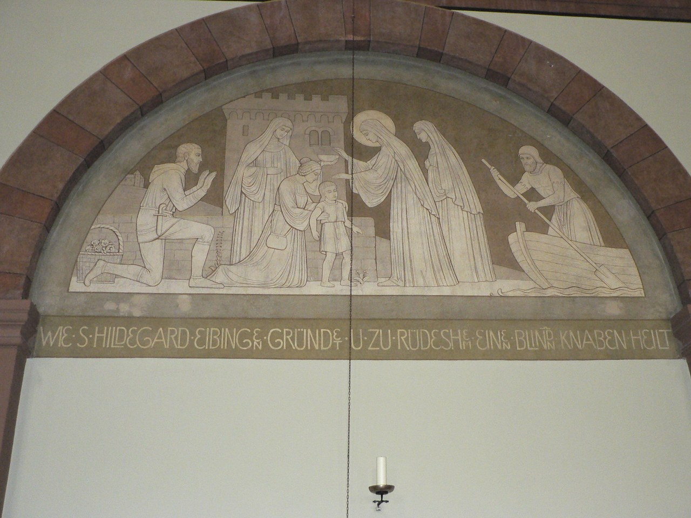</picture>
<figcaption>"How Hildegard heals a blind boy." The fourth scene of the Krebs cycle at Eibingen, which also recalls her founding of the abbey there. Photo: <a href="https://commons.wikimedia.org/wiki/File:Abtei_St._Hildegard_Mittelschiff_4._Bogenfeld.JPG">Abtei St. Hildegard Mittelschiff 4. Bogenfeld</a> by Kurt Wichmann, <a href="https://creativecommons.org/licenses/by/3.0">CC BY 3.0</a>, via Wikimedia Commons.</figcaption>
</figure>

In 1173 Volmar died, and she grieved for her faithful friend. The monk Gottfried came as her secretary, and after him Guibert of Gembloux, who stayed with her until the end.

<h2 id=interdict>The silenced choir</h2>

In 1178, when she was eighty, a young nobleman who had once been excommunicated died at Bingen. He had been reconciled to the Church and received the last sacraments, and Hildegard had him buried in the abbey's cemetery, with all Bingen following the procession. The prelates of Mainz, in the absence of the archbishop, ordered his body to be dug up and cast out.

Hildegard refused, because he had died in the peace of the Church. The record of her canonisation tells that she went to the grave, made the sign of the cross over it with her abbess's staff, and that every trace of it vanished, so that no one could find it. The prelates placed the Rupertsberg under interdict: the sisters could no longer sing the Divine Office or Mass, and could not receive Holy Communion.

For a woman who had spent her life in song, this was a deep wound. She wrote to the prelates of Mainz a beautiful letter about music: that singing God's praises restores in us something of the voice Adam had before the Fall, when he sang with the angels, and that "those who, without just cause, impose silence on a church… will lose their place among the chorus of angels". At last the Archbishop of Cologne brought witnesses to the young man's absolution, and in March 1179 Archbishop Christian of Mainz lifted the interdict. Her sisters sang again.

<h2 id=death>Two streams of light</h2>

Hildegard died at the Rupertsberg on **17 September 1179**, aged eighty-one, surrounded by her sisters. Her *Life*, written by the monks Gottfried and Theoderic of Echternach, records that as she passed, two streams of light, brilliant and of many colours, appeared in the sky and crossed over the room where she was dying, and that within the light a shining cross was seen, glowing red. Many miracles were told at her grave.

<figure class=photo>
<picture><source srcset="/static/art/hild-krebs-death-600.webp 600w,/static/art/hild-krebs-death.webp 1280w" sizes="(max-width:760px) 100vw,760px" type="image/webp">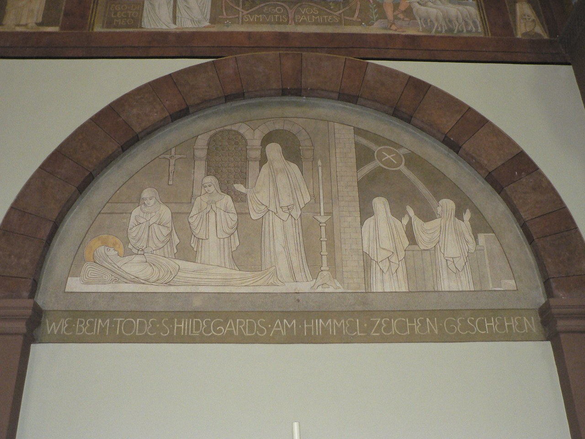</picture>
<figcaption>"How signs appeared in the sky at the death of Hildegard." The last scene of the Krebs cycle at Eibingen. Photo: <a href="https://commons.wikimedia.org/wiki/File:Abtei_St._Hildegard_Mittelschiff_5._Bogenfeld.JPG">Abtei St. Hildegard Mittelschiff 5. Bogenfeld</a> by Kurt Wichmann, <a href="https://creativecommons.org/licenses/by/3.0">CC BY 3.0</a>, via Wikimedia Commons.</figcaption>
</figure>

<figure class=photo>
<picture><source srcset="/static/art/hild-antependium-600.webp 600w,/static/art/hild-antependium.webp 1280w" sizes="(max-width:760px) 100vw,760px" type="image/webp">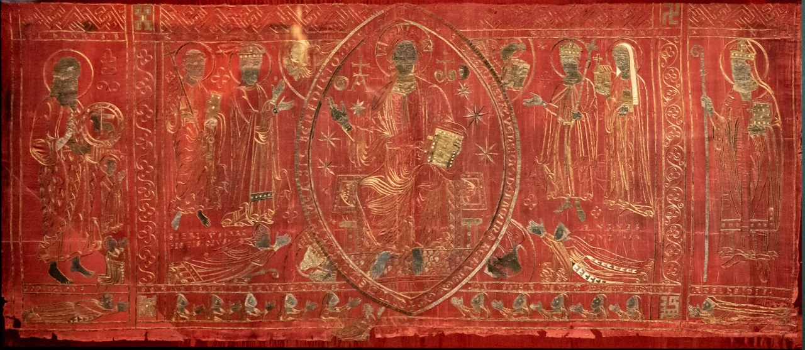</picture>
<figcaption>The <b>Rupertsberg antependium</b>, an altar frontal embroidered by the nuns of her abbey around 1220, which shows Hildegard among the saints. It is now in the Royal Museums of Art and History, Brussels. Image: <a href="https://commons.wikimedia.org/wiki/File:Antependium_from_Rupertsberg-WUS04522.jpg">Antependium from Rupertsberg-WUS04522</a>, public domain, via Wikimedia Commons.</figcaption>
</figure>

<h2 id=saint>Saint and Doctor of the Church</h2>

From the day she died, the people of the Rhineland called her Saint Hildegard. Popes Gregory IX and Innocent IV ordered inquiries into her life and miracles in the 1220s–40s, and in 1233 three clerics of Mainz reported to the Pope on her holy life and the many wonders at her grave, but the process was never brought to a close. Her name was placed in the Roman Martyrology at the end of the sixteenth century, and her feast on 17 September was kept in the dioceses of the Rhineland and by the Benedictines.

When Swedish soldiers burned the Rupertsberg in 1632, during the Thirty Years' War, Abbess Anna Lerch von Dirmstein and her nuns fled across the Rhine to Eibingen, carrying Hildegard's relics with them. Since 1641 they have rested at **Eibingen**. In 1979, for the eight-hundredth anniversary of her death, St John Paul II called her "a light for her people and her time", and the German bishops asked that she be declared a Doctor of the Church.

On **10 May 2012** Pope **Benedict XVI** extended her veneration to the universal Church, an "equivalent canonisation" confirming the cult the faithful had given her for eight centuries. On **7 October 2012**, in St Peter's Square, he proclaimed her a **Doctor of the Church**, together with St John of Ávila. In 2021 Pope Francis placed her feast in the General Roman Calendar as an optional memorial on 17 September.

<figure class=photo>
<picture><source srcset="/static/art/hild-ablass-600.webp 600w,/static/art/hild-ablass.webp 1280w" sizes="(max-width:760px) 100vw,760px" type="image/webp">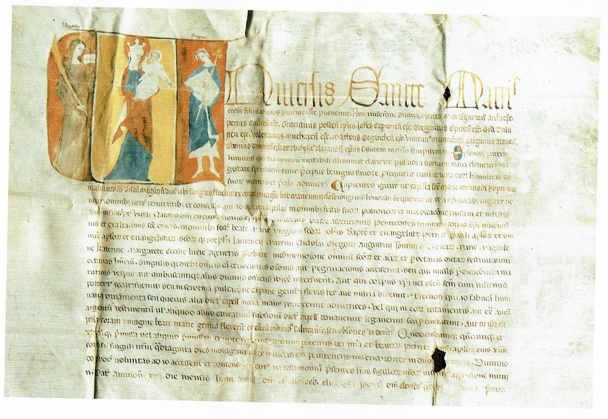</picture>
<figcaption>St Hildegard pictured on a letter of indulgence for pilgrims to the Rupertsberg, issued at Avignon in 1342. Landeshauptarchiv Koblenz. Image: <a href="https://commons.wikimedia.org/wiki/File:Hildegard_ablassurkunde_rupertsberg.jpg">Hildegard ablassurkunde rupertsberg</a>, public domain, via Wikimedia Commons.</figcaption>
</figure>

<h2 id=places>Her places and churches</h2>

<figure class=map><figcaption>St Hildegard's Rhineland and the towns of her four preaching journeys. Map by The Daily Word; coastlines, rivers and borders from Natural Earth (public domain). Tap to enlarge.</figcaption></figure>

### Bermersheim vor der Höhe

A quiet village in Rheinhessen, just north of Alzey. The church of St Martin, where Hildegard was baptised, keeps her memory and is shared today by Catholics and Protestants.

### The Disibodenberg

The abbey where Hildegard lived for nearly forty years was abandoned in the sixteenth century and fell into ruin. Its stones stand today in a peaceful park above the meeting of the Nahe and the Glan, near Odernheim am Glan, cared for by the Scivias Foundation, with a small museum and a chapel of St Hildegard built in 1998.

<figure class=photo>
<picture><source srcset="/static/art/hild-disibodenberg-ruins-600.webp 600w,/static/art/hild-disibodenberg-ruins.webp 1280w" sizes="(max-width:760px) 100vw,760px" type="image/webp">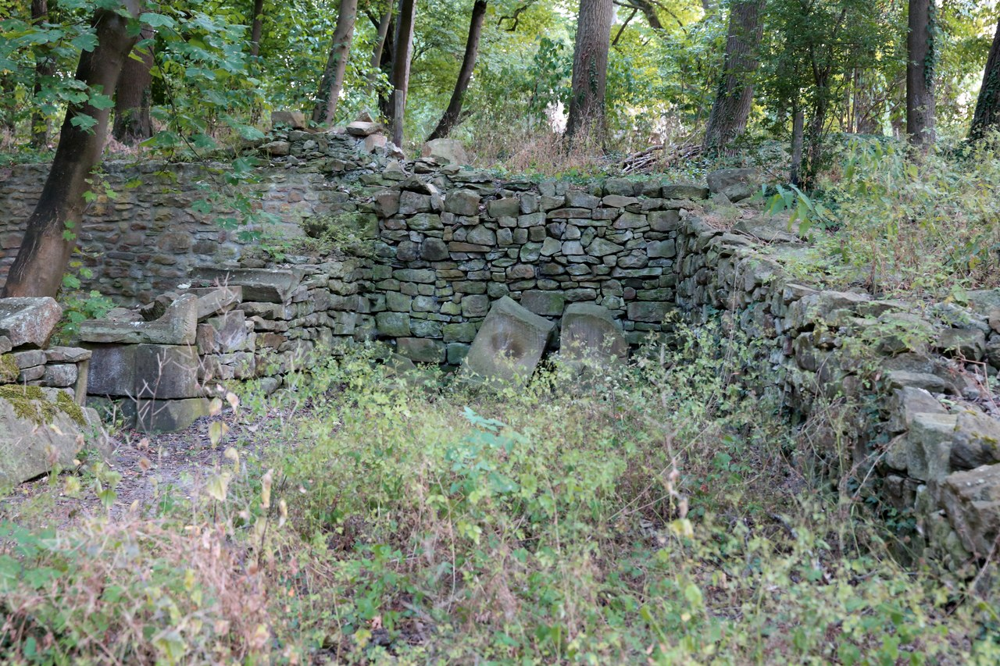</picture>
<figcaption>The ruins of the <b>Disibodenberg</b> abbey today. Photo: <a href="https://commons.wikimedia.org/wiki/File:Klosterruine_Disibodenberg_-_Bad_Sobernheim_-_Landkreis_Bad_Kreuznach_-_201308.JPG">Klosterruine Disibodenberg - Bad Sobernheim - Landkreis Bad Kreuznach - 201308</a> by Mag4music, <a href="https://creativecommons.org/licenses/by-sa/3.0">CC BY-SA 3.0</a>, via Wikimedia Commons.</figcaption>
</figure>

<figure class=photo>
<picture><source srcset="/static/art/hild-disibodenberg-church-600.webp 600w,/static/art/hild-disibodenberg-church.webp 1280w" sizes="(max-width:760px) 100vw,760px" type="image/webp">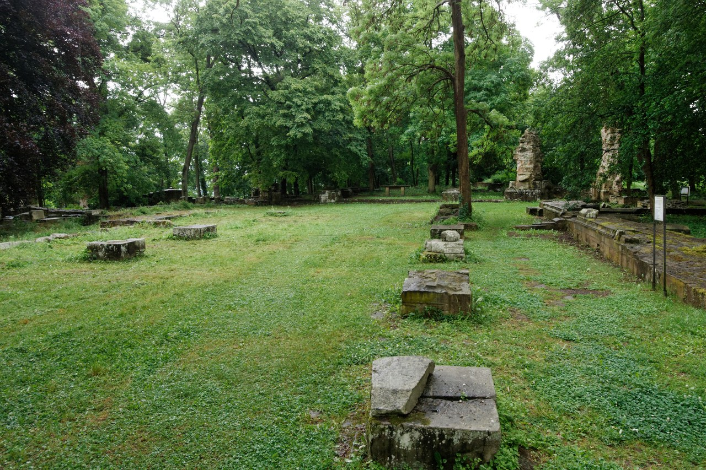</picture>
<figcaption>The nave of the abbey church of the Disibodenberg, consecrated in 1143 while Hildegard lived there. Photo: <a href="https://commons.wikimedia.org/wiki/File:Disibodenberg_Kirche_1.jpg">Disibodenberg Kirche 1</a> by E-W, <a href="https://creativecommons.org/licenses/by-sa/3.0">CC BY-SA 3.0</a>, via Wikimedia Commons.</figcaption>
</figure>

<figure class=photo>
<picture><source srcset="/static/art/hild-disibodenberg-1790-600.webp 600w,/static/art/hild-disibodenberg-1790.webp 1280w" sizes="(max-width:760px) 100vw,760px" type="image/webp">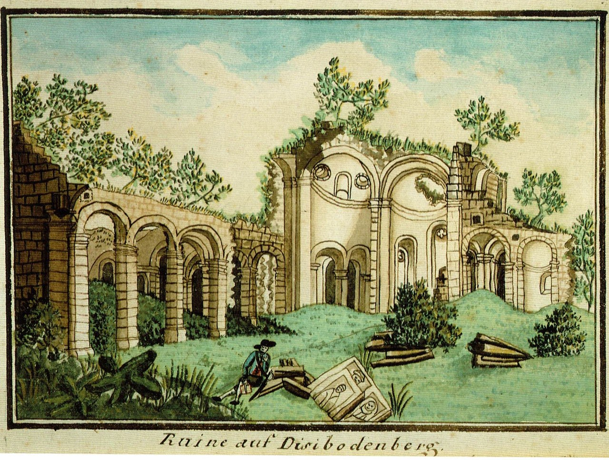</picture>
<figcaption>The ruins of the church in 1790, from a print in a private collection. Image: <a href="https://commons.wikimedia.org/wiki/File:Disibodenberg_ruine_1790.jpg">Disibodenberg ruine 1790</a>, public domain, via Wikimedia Commons.</figcaption>
</figure>

<figure class=photo>
<picture><source srcset="/static/art/hild-disibodenberg-refectory-600.webp 600w,/static/art/hild-disibodenberg-refectory.webp 1024w" sizes="(max-width:760px) 100vw,760px" type="image/webp">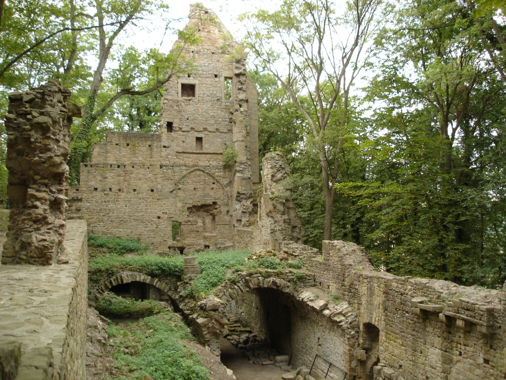</picture>
<figcaption>The gable of the refectory, built in the thirteenth century. Photo: <a href="https://commons.wikimedia.org/wiki/File:Kloster_Disibodenberg_02.jpg">Kloster Disibodenberg 02</a> by Saharadesertfox, <a href="https://creativecommons.org/licenses/by-sa/3.0">CC BY-SA 3.0</a>, via Wikimedia Commons.</figcaption>
</figure>

<figure class=photo>
<picture><source srcset="/static/art/hild-disibodenberg-chapel-600.webp 600w,/static/art/hild-disibodenberg-chapel.webp 1280w" sizes="(max-width:760px) 100vw,760px" type="image/webp">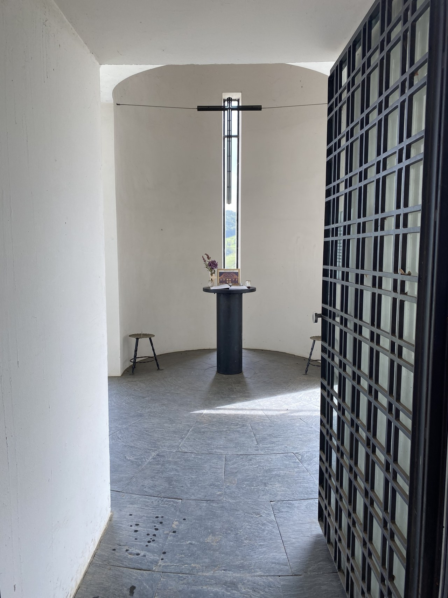</picture>
<figcaption>The <b>Hildegard chapel</b> on the Disibodenberg, built in 1998 for the nine-hundredth anniversary of her birth. Photo: <a href="https://commons.wikimedia.org/wiki/File:Hildegardiskapelle_(Disibodenberg)_pic1.jpg">Hildegardiskapelle (Disibodenberg) pic1</a> by Alf van Beem, <a href="https://creativecommons.org/publicdomain/zero/1.0/">CC0</a>, via Wikimedia Commons.</figcaption>
</figure>

### Bingen: the Rupertsberg and the Rochuskapelle

The Rupertsberg abbey stood on the left bank of the Nahe at its mouth, in what is now Bingerbrück. After it was destroyed in 1632 its ruins lingered until 1857, when most were cleared to make way for the railway. Five arches of the old abbey church survive inside a later house, the Villa am Rupertsberg, which opened to visitors in 2023.

<figure class=photo>
<picture><source srcset="/static/art/hild-nahe-600.webp 600w,/static/art/hild-nahe.webp 1280w" sizes="(max-width:760px) 100vw,760px" type="image/webp">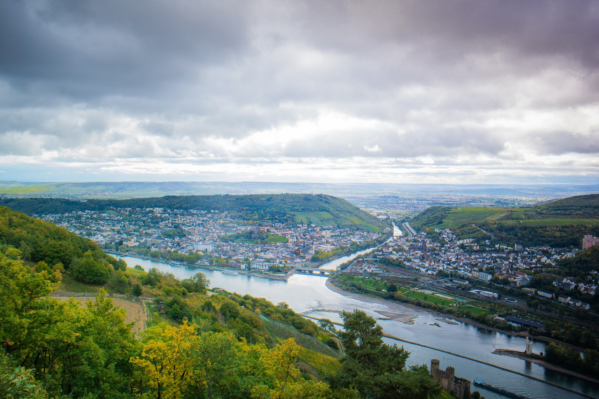</picture>
<figcaption>Looking across the Rhine to <b>Bingen</b> and the mouth of the Nahe. The Rupertsberg stood on the near bank of the Nahe, just where it meets the Rhine. Photo: <a href="https://commons.wikimedia.org/wiki/File:Bingen_am_Rhein,_Nahem%C3%BCndung_20151007-SAM_0992.jpg">Bingen am Rhein, Nahemündung 20151007-SAM 0992</a> by Tinka9517, <a href="https://creativecommons.org/licenses/by-sa/4.0">CC BY-SA 4.0</a>, via Wikimedia Commons.</figcaption>
</figure>

<figure class=photo>
<picture><source srcset="/static/art/hild-rupertsberg-plaque-600.webp 600w,/static/art/hild-rupertsberg-plaque.webp 1280w" sizes="(max-width:760px) 100vw,760px" type="image/webp">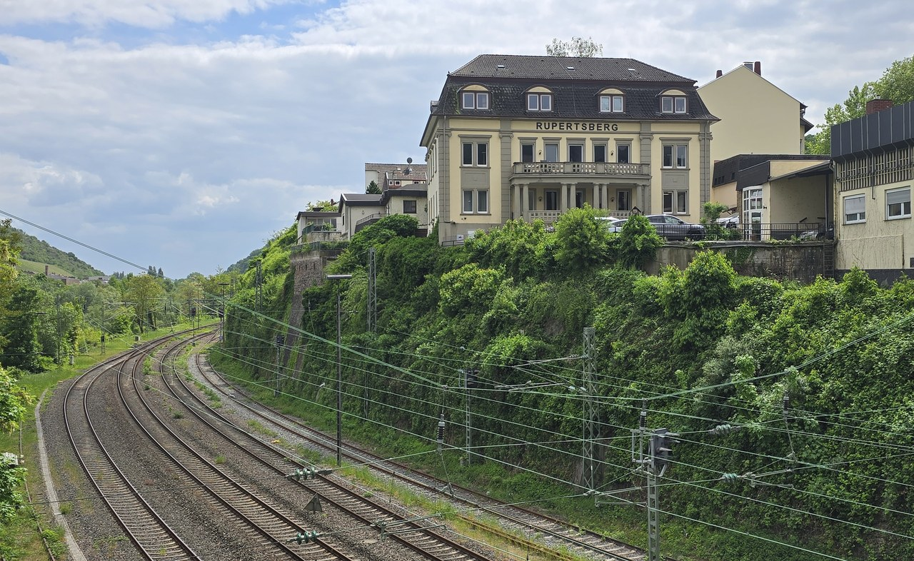</picture>
<figcaption>The site of the Rupertsberg today, above the railway at Bingerbrück. Photo: <a href="https://commons.wikimedia.org/wiki/File:2025_Bingen,_plak_fan_it_eardere_kleaster_Rupertsberg.jpg">2025 Bingen, plak fan it eardere kleaster Rupertsberg</a> by RomkeHoekstra, <a href="https://creativecommons.org/publicdomain/zero/1.0/">CC0</a>, via Wikimedia Commons.</figcaption>
</figure>

Across the Nahe, on the Rochusberg above Bingen, stands the **Rochuskapelle**, the pilgrimage chapel of [St Roch](/saints/roch/), rebuilt in 1893–95 after a fire. It holds a richly carved **Hildegard altar** of 1895 telling her life in pictures, and the Hildegard Forum with its herb garden is close by.

<figure class=photo>
<picture><source srcset="/static/art/hild-rochus-600.webp 600w,/static/art/hild-rochus.webp 1280w" sizes="(max-width:760px) 100vw,760px" type="image/webp">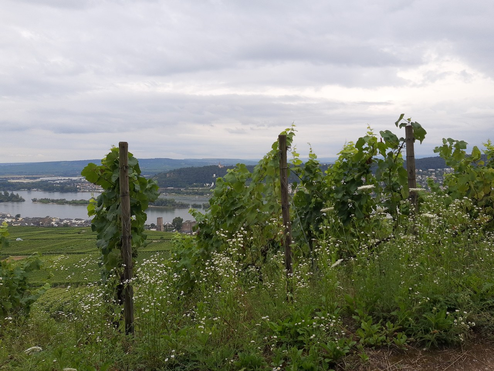</picture>
<figcaption>The <b>Rochuskapelle</b> on its hill above Bingen, seen from the vineyards across the Rhine. Photo: <a href="https://commons.wikimedia.org/wiki/File:View_of_Rochuskapelle_from_vineyards_across_the_Rhine,_R%C3%BCdesheim.jpg">View of Rochuskapelle from vineyards across the Rhine, Rüdesheim</a> by Gerda Arendt, <a href="https://creativecommons.org/publicdomain/zero/1.0/">CC0</a>, via Wikimedia Commons.</figcaption>
</figure>

<figure class=photo>
<picture><source srcset="/static/art/hild-rochus-altar-600.webp 600w,/static/art/hild-rochus-altar.webp 1101w" sizes="(max-width:760px) 100vw,760px" type="image/webp">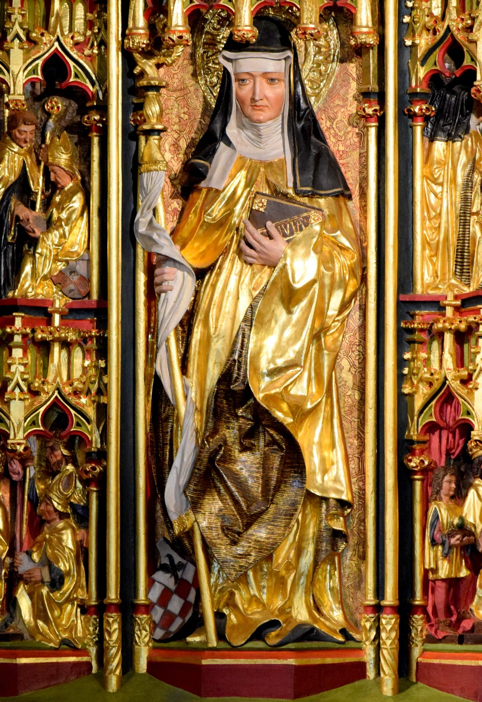</picture>
<figcaption>St Hildegard on the Hildegard altar of the Rochuskapelle. Photo: <a href="https://commons.wikimedia.org/wiki/File:Rochuskapel_(Bingen),_alterbyld_Hildegard_fan_Bingen.jpg">Rochuskapel (Bingen), alterbyld Hildegard fan Bingen</a> by RomkeHoekstra, <a href="https://creativecommons.org/licenses/by-sa/4.0">CC BY-SA 4.0</a>, via Wikimedia Commons.</figcaption>
</figure>

### Eibingen: the parish and pilgrimage church of St Hildegard

The church at Eibingen stands on the site of Hildegard's second abbey, which was dissolved in 1802. Burned in 1932, it was rebuilt in 1935. Her relics rest at the high altar in a golden **shrine** made in 1929 by the Cologne goldsmith Josef Kleefisch. Every year on 17 September the shrine is carried in procession through the streets of Eibingen.

<figure class=photo>
<picture><source srcset="/static/art/hild-eibingen-church-600.webp 600w,/static/art/hild-eibingen-church.webp 1280w" sizes="(max-width:760px) 100vw,760px" type="image/webp">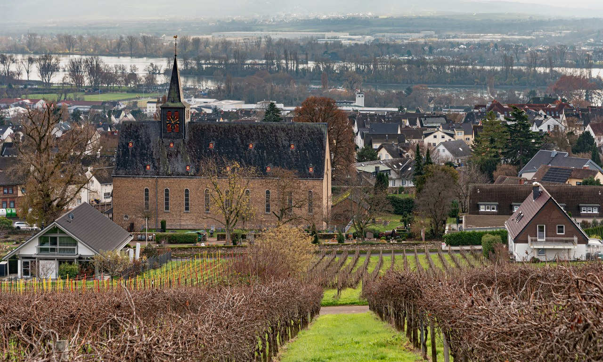</picture>
<figcaption>The pilgrimage church of St Hildegard at <b>Eibingen</b>, among the vineyards above Rüdesheim. Photo: <a href="https://commons.wikimedia.org/wiki/File:R%C3%BCdesheim_am_Rhein_-_Wallfahrtskirche_St._Hildegard.jpg">Rüdesheim am Rhein - Wallfahrtskirche St. Hildegard</a> by Jorge Franganillo, <a href="https://creativecommons.org/licenses/by/4.0">CC BY 4.0</a>, via Wikimedia Commons.</figcaption>
</figure>

<figure class=photo>
<picture><source srcset="/static/art/hild-shrine-600.webp 600w,/static/art/hild-shrine.webp 1280w" sizes="(max-width:760px) 100vw,760px" type="image/webp">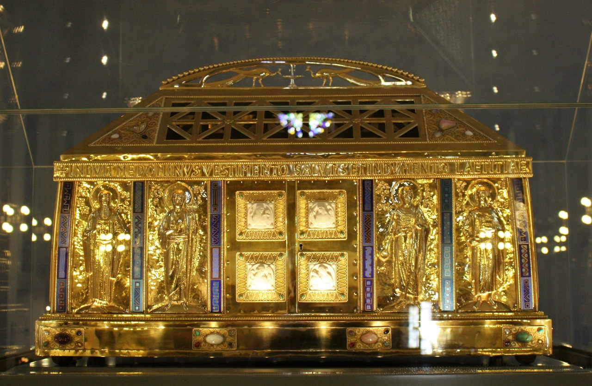</picture>
<figcaption>The <b>shrine of St Hildegard</b> at Eibingen, made in 1929, which holds her relics. Photo: <a href="https://commons.wikimedia.org/wiki/File:Eibingen_Kirche_Reliquienschrein_Hl._Hildegard.JPG">Eibingen Kirche Reliquienschrein Hl. Hildegard</a> by RichHein, <a href="https://creativecommons.org/publicdomain/zero/1.0/">CC0</a>, via Wikimedia Commons.</figcaption>
</figure>

### The Abbey of St Hildegard

Above Eibingen, on the hillside among the vineyards, stands the **Benedictine Abbey of St Hildegard**, built in 1900–04 by Prince Karl of Löwenstein and settled by nuns from Prague on her feast day, 17 September 1904. They continue the life of Hildegard's communities. Its church is painted throughout in the Beuron style, including Fr Paulus Krebs's cycle of her life. The nuns were driven out by the Nazis in 1941 and returned in 1945. The abbey is part of the Upper Middle Rhine Valley World Heritage Site.

<figure class=photo>
<picture><source srcset="/static/art/hild-abbey-west-600.webp 600w,/static/art/hild-abbey-west.webp 1280w" sizes="(max-width:760px) 100vw,760px" type="image/webp"></picture>
<figcaption>The church of the <b>Abbey of St Hildegard</b> seen from the vineyards. Photo: <a href="https://commons.wikimedia.org/wiki/File:Abtei_St._Hildegard,_R%C3%BCdesheim,_West_facade_20140922_1.jpg">Abtei St. Hildegard, Rüdesheim, West facade 20140922 1</a> by DXR, <a href="https://creativecommons.org/licenses/by-sa/3.0/de/deed.en">CC BY-SA 3.0 de</a>, via Wikimedia Commons.</figcaption>
</figure>

<figure class=photo>
<picture><source srcset="/static/art/hild-abbey-vineyards-600.webp 600w,/static/art/hild-abbey-vineyards.webp 1280w" sizes="(max-width:760px) 100vw,760px" type="image/webp"></picture>
<figcaption>The abbey above the vineyards of Rüdesheim. Photo: <a href="https://commons.wikimedia.org/wiki/File:RMF,_Eibingen_Abbey_and_vineyards.jpg">RMF, Eibingen Abbey and vineyards</a> by Gerda Arendt, <a href="https://creativecommons.org/publicdomain/zero/1.0/">CC0</a>, via Wikimedia Commons.</figcaption>
</figure>

<figure class=photo>
<picture><source srcset="/static/art/hild-abbey-nave-600.webp 600w,/static/art/hild-abbey-nave.webp 1280w" sizes="(max-width:760px) 100vw,760px" type="image/webp"></picture>
<figcaption>The nave of the abbey church, painted by the monks of Beuron in 1907–13. Photo: <a href="https://commons.wikimedia.org/wiki/File:Abtei_St._Hildegard,_R%C3%BCdesheim,_Nave_and_Sanctuary_20140922_1.jpg">Abtei St. Hildegard, Rüdesheim, Nave and Sanctuary 20140922 1</a> by DXR, <a href="https://creativecommons.org/licenses/by-sa/3.0/de/deed.en">CC BY-SA 3.0 de</a>, via Wikimedia Commons.</figcaption>
</figure>

<figure class=photo>
<picture><source srcset="/static/art/hild-abbey-1920s-600.webp 600w,/static/art/hild-abbey-1920s.webp 1280w" sizes="(max-width:760px) 100vw,760px" type="image/webp"></picture>
<figcaption>The abbey in the 1920s, on a postcard sent in 1926. Image: <a href="https://commons.wikimedia.org/wiki/File:Abtei_St._Hildegard_Eibingen_1920er_Jahre.jpg">Abtei St. Hildegard Eibingen 1920er Jahre</a>, public domain, via Wikimedia Commons.</figcaption>
</figure>

<figure class=photo>
<picture><source srcset="/static/art/hild-krebs-prophetess-600.webp 600w,/static/art/hild-krebs-prophetess.webp 870w" sizes="(max-width:760px) 100vw,760px" type="image/webp"></picture>
<figcaption>St Hildegard with her quill and a scroll bearing words from her <i>Ordo Virtutum</i>, painted by Fr Paulus Krebs above the sacristy door of the abbey church. Image: <a href="https://commons.wikimedia.org/wiki/File:Fr._Paulus_Krebs,_St._Hildegard,_Prophetess_(1907-1913).jpg">Fr. Paulus Krebs, St. Hildegard, Prophetess (1907-1913)</a>, <a href="https://creativecommons.org/publicdomain/zero/1.0/">CC0</a>, via Wikimedia Commons.</figcaption>
</figure>

<h2 id=art>Hildegard in art</h2>

### In her own time

Hildegard is one of the few saints of the twelfth century whose picture we have from her own lifetime, in the manuscripts of her books. In the Rupertsberg *Scivias* she sits in her cell with the fire of the Spirit coming down upon her, writing on wax tablets, while Volmar looks in; that picture is at the top of this page. A prayer book made for her community around 1175 is filled with bright paintings of the life of Christ.

<figure class=photo>
<picture><source srcset="/static/art/hild-prayerbook-nativity-600.webp 600w,/static/art/hild-prayerbook-nativity.webp 1280w" sizes="(max-width:760px) 100vw,760px" type="image/webp"></picture>
<figcaption>The Nativity, from the <b>prayer book of Hildegard's community</b>, made about 1175. Munich, Bavarian State Library. Image: <a href="https://commons.wikimedia.org/wiki/File:Gebetbuch_der_Hildegard_von_Bingen_(um_1175)_-_031.jpg">Gebetbuch der Hildegard von Bingen (um 1175) - 031</a>, public domain, via Wikimedia Commons.</figcaption>
</figure>

<figure class=photo>
<picture><source srcset="/static/art/hild-prayerbook-baptism-600.webp 600w,/static/art/hild-prayerbook-baptism.webp 1280w" sizes="(max-width:760px) 100vw,760px" type="image/webp"></picture>
<figcaption>The Baptism of Christ, from the same prayer book. Image: <a href="https://commons.wikimedia.org/wiki/File:Gebetbuch_der_Hildegard_von_Bingen_(um_1175)_-_043.jpg">Gebetbuch der Hildegard von Bingen (um 1175) - 043</a>, public domain, via Wikimedia Commons.</figcaption>
</figure>

<figure class=photo>
<picture><source srcset="/static/art/hild-prayerbook-cross-600.webp 600w,/static/art/hild-prayerbook-cross.webp 1280w" sizes="(max-width:760px) 100vw,760px" type="image/webp"></picture>
<figcaption>The Crucifixion, from the same prayer book. Image: <a href="https://commons.wikimedia.org/wiki/File:Gebetbuch_der_Hildegard_von_Bingen_(um_1175)_-_127.jpg">Gebetbuch der Hildegard von Bingen (um 1175) - 127</a>, public domain, via Wikimedia Commons.</figcaption>
</figure>

### Late medieval and Renaissance

<figure class=photo>
<picture><source srcset="/static/art/hild-wernigerode-600.webp 600w,/static/art/hild-wernigerode.webp 1280w" sizes="(max-width:760px) 100vw,760px" type="image/webp"></picture>
<figcaption>St Hildegard, on the left, on the closed wings of the altar in the church of St Sylvestri at Wernigerode, about 1480. Image: <a href="https://commons.wikimedia.org/wiki/File:Sylvestri_Altar_out_right.JPG">Sylvestri Altar out right</a>, public domain, via Wikimedia Commons.</figcaption>
</figure>

<figure class=photo>
<picture><source srcset="/static/art/hild-kobel-600.webp 600w,/static/art/hild-kobel.webp 600w" sizes="(max-width:760px) 100vw,760px" type="image/webp"></picture>
<figcaption>St Hildegard in a woodcut by Jacob Köbel, printed in 1532. Image: <a href="https://commons.wikimedia.org/wiki/File:Hildegard-1532_Holzschnitt_v._Jacob_K%C3%B6bel.jpg">Hildegard-1532 Holzschnitt v. Jacob Köbel</a>, public domain, via Wikimedia Commons.</figcaption>
</figure>

<figure class=photo>
<picture><source srcset="/static/art/hild-grunewald-600.webp 600w,/static/art/hild-grunewald.webp 1280w" sizes="(max-width:760px) 100vw,760px" type="image/webp"></picture>
<figcaption>The Nativity panel of Matthias Grünewald's <b>Isenheim Altarpiece</b> (1512–16). The church in the landscape behind the Virgin is recognised as the abbey church of the Rupertsberg. Image: <a href="https://commons.wikimedia.org/wiki/File:Mathis_Gothart_Gr%C3%BCnewald_036.jpg">Mathis Gothart Grünewald 036</a>, public domain, via Wikimedia Commons.</figcaption>
</figure>

### Engravings and paintings

<figure class=photo>
<picture><source srcset="/static/art/hild-marshall-600.webp 600w,/static/art/hild-marshall.webp 1280w" sizes="(max-width:760px) 100vw,760px" type="image/webp"></picture>
<figcaption>St Hildegard, "virgin and prophetess", in an engraving by William Marshall, seventeenth century. Photo: <a href="https://commons.wikimedia.org/wiki/File:Hildegard_von_Bingen._Line_engraving_by_W._Marshall._Wellcome_V0002761.jpg">Hildegard von Bingen. Line engraving by W. Marshall. Wellcome V0002761</a> by Wellcome Collection, <a href="https://creativecommons.org/licenses/by/4.0">CC BY 4.0</a>, via Wikimedia Commons.</figcaption>
</figure>

<figure class=photo>
<picture><source srcset="/static/art/hild-fassbinder-600.webp 600w,/static/art/hild-fassbinder.webp 800w" sizes="(max-width:760px) 100vw,760px" type="image/webp"></picture>
<figcaption>St Hildegard contemplating a flower as she writes, a painting attributed to Wilhelm Fassbinder, 1898. Image: <a href="https://commons.wikimedia.org/wiki/File:St._Hildegard_von_Bingen_(attr._Wilhelm_Fassbinder,_1898).webp">St. Hildegard von Bingen (attr. Wilhelm Fassbinder, 1898).webp</a>, <a href="https://creativecommons.org/publicdomain/zero/1.0/">CC0</a>, via Wikimedia Commons.</figcaption>
</figure>

## Path to sainthood

Hildegard was honoured as a saint from her death. Popes Gregory IX (1227–41) and Innocent IV (1243–54) ordered inquiries into her life and miracles; a report of 1233 recorded the many wonders at her grave, but the formal process was never completed. Her name entered the Roman Martyrology in the late sixteenth century, and her feast was kept on 17 September in the dioceses of Speyer, Mainz, Trier and Limburg and by the Benedictines. Her relics were saved from the Rupertsberg in 1632 and have rested at Eibingen since 1641. On 10 May 2012 Benedict XVI extended her cult to the universal Church by equivalent canonisation, and on 7 October 2012 he proclaimed her a Doctor of the Universal Church. Since 2021 her feast, 17 September, has been an optional memorial in the General Roman Calendar.

## Patronages

Musicians, composers and singers, writers, linguists, scientists, herbalists and those who work with healing plants; she is also invoked by Benedictines, by people who are often ill, and by the dioceses of the Rhineland.

## Trivia

- Besides her great books she wrote the lives of the two saints of her homes: St Disibod of the Disibodenberg and St Rupert of the Rupertsberg.
- She described herself as "a feather on the breath of God". *A Feather on the Breath of God*, a 1982 recording of her songs by Gothic Voices, helped make her music loved around the world.
- In 1998 Germany issued a 10-mark silver coin for the nine-hundredth anniversary of her birth, showing her writing *Scivias*.
- The giant **Riesencodex** of her works weighs about 15 kg (33 lb). The nuns carried it to safety in 1632; after the Second World War it was brought back to Wiesbaden from the Soviet zone of Germany.
- Her *Physica* contains one of the first written mentions of hops used to keep beer.
- She is one of four women Doctors of the Church, with [St Catherine of Siena](/saints/catherine-of-siena/), [St Teresa of Ávila](/saints/teresa-of-avila/) and [St Thérèse of Lisieux](/saints/therese-of-lisieux/). See also the father of her Benedictine life, [St Benedict](/saints/benedict/), and [St Ursula](/saints/ursula/), whom she honoured in her songs.

## Sources

- [Benedict XVI: Apostolic Letter proclaiming St Hildegard of Bingen a Doctor of the Universal Church (7 October 2012)](https://www.vatican.va/content/benedict-xvi/en/apost_letters/documents/hf_ben-xvi_apl_20121007_ildegarda-bingen.html)
- [Benedict XVI: General Audience on St Hildegard of Bingen (1 September 2010)](https://www.vatican.va/content/benedict-xvi/en/audiences/2010/documents/hf_ben-xvi_aud_20100901.html)
- [Benedict XVI: General Audience on St Hildegard of Bingen, part 2 (8 September 2010)](https://www.vatican.va/content/benedict-xvi/en/audiences/2010/documents/hf_ben-xvi_aud_20100908.html)
- [Congregation for Divine Worship: Decree inscribing St Gregory of Narek, St John of Ávila and St Hildegard of Bingen in the General Roman Calendar (25 January 2021)](https://www.vatican.va/roman_curia/congregations/ccdds/documents/rc_con_ccdds_doc_20210125_decreto-dottori_en.html)
- [Catholic Encyclopedia (New Advent): St Hildegard](https://www.newadvent.org/cathen/07351a.htm)
- [Abbey of St Hildegard, Eibingen: Scenes depicting the life of St Hildegard](https://abtei-st-hildegard.de/portfolio-item/scenes-depicting-the-life-of-st-hildegard/)
- [Christian History Institute: Hildegard's Germany](https://christianhistoryinstitute.org/magazine/article/ch161-hildegards-germany)
- [Wikipedia: Hildegard of Bingen](https://en.wikipedia.org/wiki/Hildegard_of_Bingen)
- [Wikipedia: Scivias](https://en.wikipedia.org/wiki/Scivias)
- [Wikipedia: Ordo Virtutum](https://en.wikipedia.org/wiki/Ordo_Virtutum)
- [Wikipedia: List of compositions by Hildegard of Bingen](https://en.wikipedia.org/wiki/List_of_compositions_by_Hildegard_of_Bingen)
- [Wikipedia: Dendermonde Codex](https://en.wikipedia.org/wiki/Dendermonde_Codex)
- [Wikipedia: Lingua Ignota](https://en.wikipedia.org/wiki/Lingua_Ignota)
- [Wikipedia: Physica](https://en.wikipedia.org/wiki/Physica_(Hildegard))
- [Wikipedia: Liber Divinorum Operum](https://en.wikipedia.org/wiki/Liber_Divinorum_Operum)
- [Wikipedia: Wiesbaden Codex (Riesencodex)](https://en.wikipedia.org/wiki/Wiesbaden_Codex)
- [Wikipedia: Jutta of Sponheim](https://en.wikipedia.org/wiki/Jutta_of_Sponheim)
- [Wikipedia: Richardis von Stade](https://en.wikipedia.org/wiki/Richardis_von_Stade)
- [Wikipedia: Disibodenberg](https://en.wikipedia.org/wiki/Disibodenberg)
- [Wikipedia: Eibingen Abbey](https://en.wikipedia.org/wiki/Eibingen_Abbey)
- [Wikipedia (German): Hildegard von Bingen](https://de.wikipedia.org/wiki/Hildegard_von_Bingen)
- [Wikipedia (German): Kloster Rupertsberg](https://de.wikipedia.org/wiki/Kloster_Rupertsberg)
- [Wikipedia (German): St. Hildegard (Eibingen)](https://de.wikipedia.org/wiki/St._Hildegard_(Eibingen))
- [Wikipedia (German): Rochuskapelle (Bingen)](https://de.wikipedia.org/wiki/Rochuskapelle_(Bingen))
- [Wikipedia (German): Bermersheim vor der Höhe](https://de.wikipedia.org/wiki/Bermersheim_vor_der_H%C3%B6he)

The quotations from her letter to Guibert of Gembloux and from *Scivias* follow the English translations quoted in the Wikipedia articles above; the letters to Bernard and to Barbarossa are quoted from Benedict XVI. The miracles at Rüdesheim and at her death are told as recorded in her *Life* and remembered by the nuns of Eibingen.

Originally written October 16, 2026 from the sources above. Expanded November 27, 2026 with her full story, two maps and pictures from Wikimedia Commons, fact-checked against the Vatican documents, the Catholic Encyclopedia and the sources listed. Feast days follow the General Roman Calendar.

