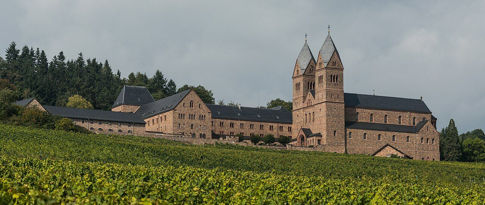

## The story
Hildegard was the tenth child of a noble family and was given to the Church at eight, living with the anchoress **Jutta** at Disibodenberg. She became abbess in 1136 and later founded her own convents at **Rupertsberg**, by Bingen, and **Eibingen**, across the Rhine.

## The full story

### The visions
From childhood she saw what she called "the shade of the living light". At 42 she felt commanded to write her visions down. The result was ***Scivias*** ("Know the Ways"), illustrated with extraordinary images, which Pope **Eugene III** read aloud at the Synod of Trier in 1147–48, approving her work. She wrote two more great visionary books.

### A woman of many talents
She composed some **70 chants** and the first known morality play with music, *Ordo Virtutum*. She wrote on medicine and natural science (*Physica*, *Causae et Curae*), invented a secret language (*Lingua Ignota*), corresponded with popes, emperors and St Bernard, and went on four preaching tours, unusual for a woman of her time. Her own books and letters are why we can still hear her. Some modern "Hildegard medicine" goes beyond what those books say.

<figure class=photo>
<picture><source srcset="/static/art/hildegard-eibingen-600.webp 600w,/static/art/hildegard-eibingen.webp 1280w" sizes="(max-width:760px) 100vw,760px" type="image/webp"></picture>
<figcaption>The Abbey of St Hildegard above Rüdesheim, home of the nuns who continue the community she founded at Eibingen. The house one sees was raised in the twentieth century. Photo: <a href="https://commons.wikimedia.org/wiki/File:Abtei_St._Hildegard,_R%C3%BCdesheim,_Southwest_view_20140922_1.jpg">DXR</a>, <a href="https://creativecommons.org/licenses/by-sa/4.0">CC BY-SA 4.0</a>, via Wikimedia Commons.</figcaption>
</figure>

## Path to sainthood
Long venerated as a saint in Germany; Benedict XVI extended her cult to the universal Church on 10 May 2012 and named her a **Doctor of the Church** on 7 October 2012.

## Patronages
Musicians, writers, linguists, scientists (popular).

## Trivia
- She is one of only four women Doctors of the Church.
- Recordings of her music (such as *A Feather on the Breath of God*, 1982) have sold widely.

## Sources
- [Benedict XVI: Apostolic Letter proclaiming St Hildegard a Doctor of the Church (2012)](https://www.vatican.va/content/benedict-xvi/en/apost_letters/documents/hf_ben-xvi_apl_20121007_ildegarda-bingen.html)
- [Catholic Encyclopedia: St Hildegard](https://www.newadvent.org/cathen/07351a.htm)

Written October 16, 2026 from the sources above. The Rüdesheim photograph was added November 6, 2026. Feast days follow the General Roman Calendar unless noted.

