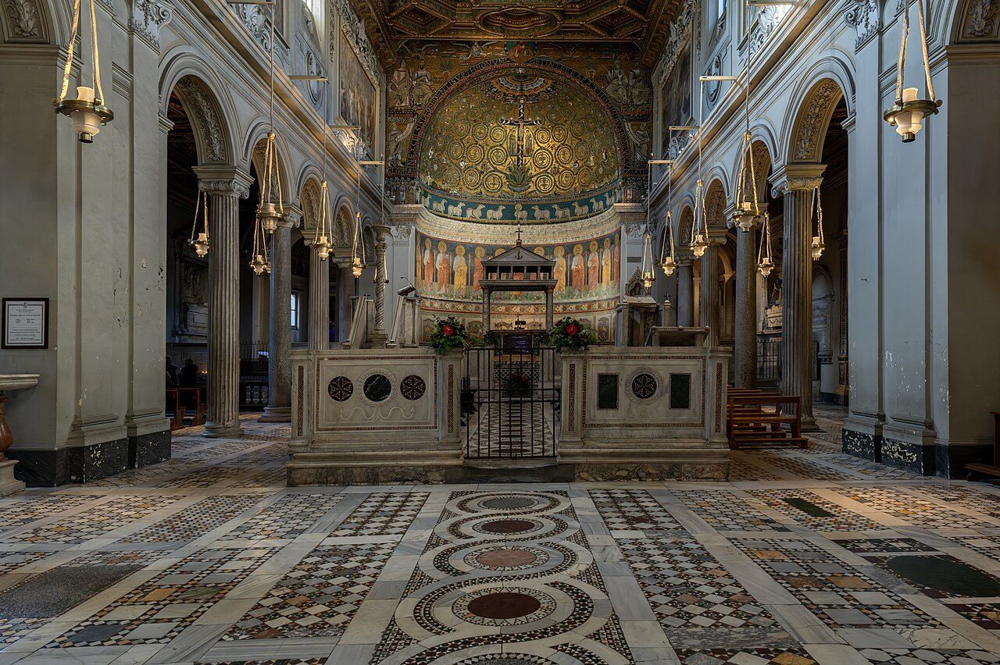

## The story
Ignatius, bishop of Antioch — tradition calls him a disciple of John the Apostle — was arrested under Trajan and sent under guard of ten soldiers ('my ten leopards') across Asia Minor and Greece to die in Rome. Seven letters in his own voice survive from the road.

## The full story

### Letters on the road to death
At Smyrna and Troas he wrote to Ephesus, Magnesia, Tralles, Rome, Philadelphia and Smyrna, and to Polycarp. These seven letters of the middle recension are his, from the early second century, among the earliest Christian writings outside the New Testament. They burn with three themes: unity around the bishop, the real flesh-and-blood reality of Christ against docetism, and a longing for martyrdom. To Rome he pleaded: do not free me — 'I am God's wheat, to be ground by the teeth of beasts, that I may be found pure bread of Christ.'

### The arena
He was killed by wild beasts in Rome, probably under Trajan (c. 107; some place it a little later). Eusebius preserves the outline; the vivid arena details come from later *Acts*. His bones, the tradition says, were gathered and carried back to Antioch, and later brought to St Clement's in Rome.

<figure class=photo>
<picture><source srcset="/static/art/ignatius-clemente-600.webp 600w,/static/art/ignatius-clemente.webp 1280w" sizes="(max-width:760px) 100vw,760px" type="image/webp"></picture>
<figcaption>San Clemente in Rome, the basilica that keeps the tradition of his relics. Photo: <a href="https://commons.wikimedia.org/wiki/File:Basilica_di_San_Clemente_al_Laterano_-_interno.jpg">Ninfamania</a>, <a href="https://creativecommons.org/licenses/by/4.0">CC BY 4.0</a>, via Wikimedia Commons.</figcaption>
</figure>

## Path to sainthood
Pre-Congregation; honoured as martyr and Apostolic Father from antiquity; feast kept East and West.

## Patronages
The Church in the eastern Mediterranean (traditional); throat ailments (popular).

## Trivia
- His letters are the first to use the phrase 'the Catholic Church' (*katholikē ekklēsia*) in surviving Christian literature.
- He calls his guards 'leopards' and says they grow worse the better he treats them — a flash of dry realism in a farewell letter.

## Sources
- [Catholic Encyclopedia: St Ignatius of Antioch, New Advent](https://www.newadvent.org/cathen/07644a.htm)
- [Vatican News: St Ignatius of Antioch](https://www.vaticannews.va/en/saints/10/17/st--ignatius-of-antioch--bishop--martyr-in-rome.html)
- [Ignatius, Letter to the Romans, New Advent (Fathers)](https://www.newadvent.org/fathers/0107.htm)

Written October 19, 2026 from the sources above. The San Clemente photograph was added November 6, 2026. Feast days follow the General Roman Calendar unless noted.

