<nav class=toc aria-label="On this page">

On this page

<ol>
<li><a href="#why">Why the Church honours him</a></li>
<li><a href="#stridon">A boy from Stridon</a></li>
<li><a href="#rome">Student days in Rome and the catacombs</a></li>
<li><a href="#trier">Trier and Aquileia: "a choir of the blessed"</a></li>
<li><a href="#dream">The dream at Antioch: "Ciceronian, not Christian"</a></li>
<li><a href="#chalcis">The desert of Chalcis and the Hebrew alphabet</a></li>
<li><a href="#priest">Priest at Antioch, pupil at Constantinople</a></li>
<li><a href="#damasus">Secretary to Pope Damasus</a></li>
<li><a href="#aventine">Paula, Eustochium, Marcella and the Aventine circle</a></li>
<li><a href="#journey">Leaving Rome: the road to Bethlehem</a></li>
<li><a href="#bethlehem">Bethlehem: "the cottage of Christ"</a></li>
<li><a href="#vulgate">The great work: the Hebrew truth</a></li>
<li><a href="#augustine">A friendship by letter: Jerome and Augustine</a></li>
<li><a href="#sack">"The City which had taken the whole world"</a></li>
<li><a href="#death">His death, and his long journey to Rome</a></li>
<li><a href="#lion">The lion of Bethlehem: a legend</a></li>
<li><a href="#hat">The red hat: a lovely anachronism</a></li>
<li><a href="#legacy">Doctor of the Church and the Vulgate's long life</a></li>
<li><a href="#places">His places and churches</a></li>
<li><a href="#art">Jerome in art</a></li>
</ol>
</nav>

## His story

Every time The Daily Word sets a verse in Latin beside the Greek and the English, St Jerome is in the room. For more than a thousand years, the Western Church heard Scripture in words he chose. Monks sang his Psalms, preachers quoted his Gospels, and painters showed him at his desk with a pen in his hand and a lion asleep at his feet.

He was not a gentle man by nature. He was quick-tempered, sharp-tongued and impatient with fools, and he knew it. But he loved Christ with his whole heart, and he loved the Word of God with a passion that drove him from the lecture halls of Rome to a desert in Syria, and from the palace of a pope to a cave beside the place where Christ was born. There, for thirty-four years, he gave his life to one task: to put the Bible into the language of the people, faithfully, from the Hebrew and the Greek. His motto could be a single sentence of his: **"Ignorance of the Scriptures is ignorance of Christ."**

Pope Benedict XVI called him "a Church Father who centred his life on the Bible." Pope Francis, on the 1600th anniversary of his death, wrote of his "living and tender love" for the written word of God, and gave him a title that suits him well: the **Lion of Bethlehem**.

### c. 342–347 · Stridon
Jerome is born to a well-to-do Christian family in Stridon, a small town on the border of Dalmatia and Pannonia. No one now knows exactly where it stood.

### c. 359–366 · Rome
He studies grammar under the famous teacher Donatus. On Sundays he visits the tombs of the martyrs in the catacombs. He is baptised, probably by Pope Liberius.

### c. 367–373 · Trier and Aquileia
At Trier, on the Moselle, he is drawn to the monastic life. At Aquileia he joins a circle of young ascetics around Bishop Valerian.

### 375 · Antioch
In the middle of Lent, gravely ill, he dreams that he stands before the judgement seat of Christ and is told, "You are a Ciceronian, not a Christian."

### c. 375–377 · The desert of Chalcis
He lives as a hermit in the Syrian desert and begins to learn Hebrew from a monk who had been born a Jew.

### 378 · Antioch
Bishop Paulinus ordains him a priest.

### c. 379–382 · Constantinople
He studies under St Gregory Nazianzen and is in the city for the great Council of 381.

### 382–385 · Rome
Secretary to Pope Damasus, who asks him to revise the Latin Gospels. He teaches Scripture to Paula, Eustochium, Marcella and their friends on the Aventine.

### 385–386 · The Holy Land and Egypt
After the death of Damasus he leaves Rome for ever. With Paula and Eustochium he makes a pilgrimage through the Holy Land and visits the monks of Egypt.

### 386 · Bethlehem
He settles beside the Grotto of the Nativity. Paula builds monasteries for men and for women and a hostel for pilgrims.

### c. 390–405 · The Hebrew truth
He translates the Old Testament from the Hebrew. With his revision of the Gospels, it becomes the heart of the Latin Bible later called the Vulgate.

### 410 · The sack of Rome
News comes that the Goths have taken Rome. "My voice sticks in my throat," he writes.

### 30 September 420 · Bethlehem
He dies in his cell near the grotto, an old man, and is buried in the cave beside the place of Christ's birth.

### c. 1285 · Rome
By tradition, his remains are brought to Santa Maria Maggiore, the "Bethlehem of the West."

### 1298 · Doctor of the Church
Pope Boniface VIII orders the feasts of the four great Latin Doctors, Ambrose, Augustine, Jerome and Gregory, to be kept throughout the Church.

### 1546 · Trent
The Council of Trent declares his Vulgate the authentic Latin Bible of the Church.

### 2020 · Pope Francis
On the 1600th anniversary of his death, Pope Francis writes the apostolic letter *Scripturae Sacrae Affectus*, "A love for Sacred Scripture."

<figure class=photo>
<picture><source srcset="/static/art/jerome-durer-engraving-600.webp 600w,/static/art/jerome-durer-engraving.webp 1280w" sizes="(max-width:760px) 100vw,760px" type="image/webp">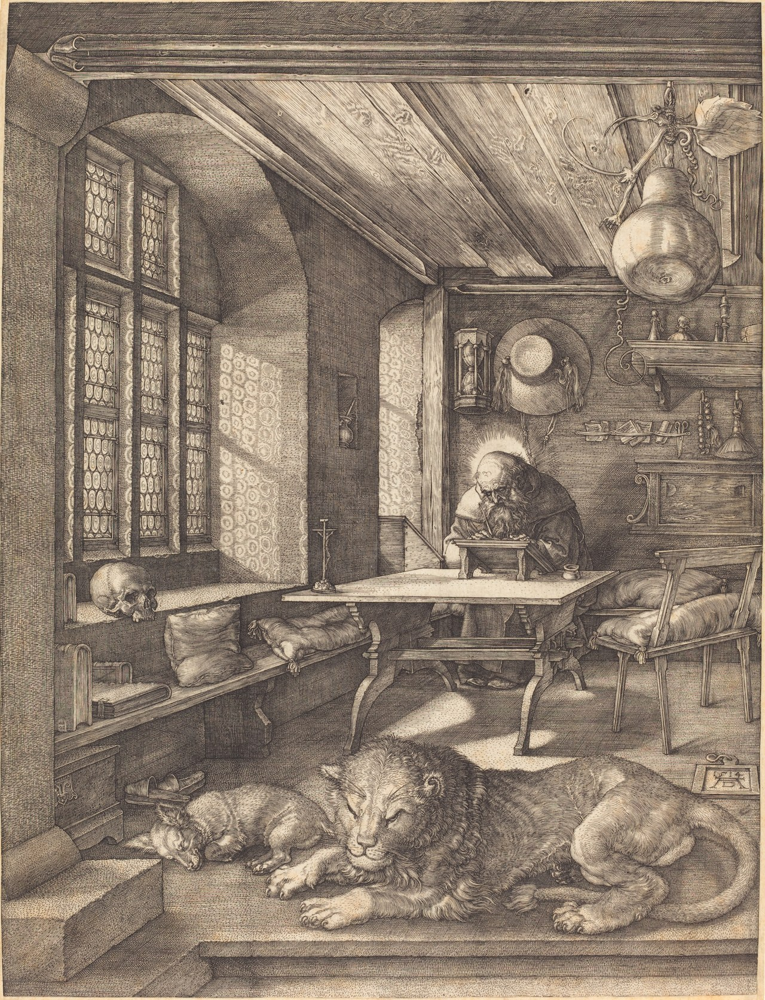</picture>
<figcaption><i>Saint Jerome in His Study</i>, the engraving by <b>Albrecht Dürer</b>, 1514. The light pours through the round panes, the lion and the little dog doze, and the saint writes on in perfect peace. It is one of Dürer's three "master engravings." National Gallery of Art, Washington. Image: <a href="https://commons.wikimedia.org/wiki/File:Albrecht_D%C3%BCrer,_Saint_Jerome_in_His_Study,_1514,_NGA_6642.jpg">Albrecht Dürer, Saint Jerome in His Study, 1514, NGA 6642</a>, <a href="https://creativecommons.org/publicdomain/zero/1.0/">CC0</a>, via Wikimedia Commons.</figcaption>
</figure>

<h2 id=why>Why the Church honours him</h2>

- **He gave the West its Bible.** His Latin translation, made from the original Hebrew and Greek, became the Bible of the Western Church for more than a thousand years. Pope Francis wrote that "medieval Europe learned to read, pray and think from the pages of the Bible translated by Jerome."
- **He taught that to know Scripture is to know Christ.** "Ignorance of the Scriptures is ignorance of Christ": the Second Vatican Council quoted his words in *Dei Verbum*.
- **He was a great Doctor of the Church.** He is one of the four great Latin Doctors, with Ambrose, Augustine and Gregory the Great.
- **He gave up everything for God.** He left a brilliant career, lived as a hermit, and spent his last thirty-four years in a poor monastery at Bethlehem.
- **He fought his own temper.** He was honest about his faults, and his life shows how the grace of God can make a saint even of a difficult man.
- **He was a teacher and friend of holy women.** He taught Paula, Eustochium and Marcella to read Scripture in Hebrew and Greek, and they became saints too.

<h2 id=stridon>A boy from Stridon</h2>

Eusebius Hieronymus, whom we call Jerome, was born in the little town of **Stridon**, "on the border of Dalmatia and Pannonia," as he wrote himself, sometime between about 342 and 347. His father was named Eusebius, and his parents were Christians and comfortably off.

Nobody knows today where Stridon stood. The Goths destroyed it in Jerome's own lifetime, and scholars have looked for it in Slovenia, in Croatia and in Bosnia. Croatians and Slovenes both honour him as their own, and Croatian Catholics have long kept a church in Rome in his name.

Even as a boy, he loved books. That love would be the joy, and sometimes the trial, of his whole life.

<h2 id=rome>Student days in Rome and the catacombs</h2>

When he was about twelve, his father sent him to Rome to study. He sat under **Donatus**, the most famous grammarian of the age, and read the Latin classics: Virgil, Terence and, above all, Cicero, whose rolling sentences he loved.

Rome in those days was a city of temples and theatres, and a young man had plenty to distract him. Jerome admitted later that he had not always lived well. But on Sundays he and his friends went out to the catacombs, the underground cemeteries where the martyrs lay. Many years later he remembered it:

> "Often I would find myself entering those crypts, deep dug in the earth, with their walls on either side lined with the bodies of the dead... Here and there the light, not entering in through windows, but filtering down from above through shafts, relieved the horror of the darkness."

And a line of Virgil came to his mind: "Everywhere horror grips the soul, and the very silence terrifies."

Before he left Rome he asked for baptism, and he was baptised, probably by **Pope Liberius**, in about 366. Years later, writing to Pope Damasus from the desert, he remembered Rome as "the church whence I have received the garb of Christ."

<figure class=photo>
<picture><source srcset="/static/art/jerome-catacomb-600.webp 600w,/static/art/jerome-catacomb.webp 1280w" sizes="(max-width:760px) 100vw,760px" type="image/webp">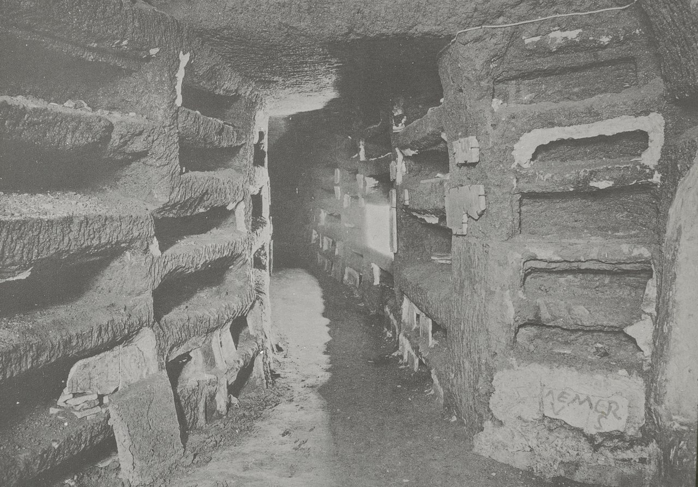</picture>
<figcaption>A gallery of the <b>Catacomb of Priscilla</b>, on the Via Salaria in Rome, in an old glass-plate photograph. Passages like this, lined with the graves of the first Christians, were the ones the young Jerome explored on Sundays. Image: <a href="https://commons.wikimedia.org/wiki/File:Roma._Catacomba_di_Priscilla_Gangen_met_graven,_GD010210.jpg">Roma. Catacomba di Priscilla Gangen met graven, GD010210</a>, public domain, via Wikimedia Commons.</figcaption>
</figure>

<h2 id=trier>Trier and Aquileia: "a choir of the blessed"</h2>

After his studies he went north to **Trier**, on the Moselle, then one of the capitals of the Roman Empire. Pope Francis wrote that it was there that Jerome first discovered the monastic life of the East, made known in the West by St Athanasius. He began to copy books for his own library and to think about giving his life wholly to God.

He came home by way of **Aquileia**, at the head of the Adriatic. There he found a band of young men living together in prayer and study around the holy bishop Valerian. Among them was Rufinus, his dearest friend in those days. Jerome later called the little community "a choir of the blessed."

But the group broke up, and in about 373 Jerome set out for the East.

<figure class=photo>
<picture><source srcset="/static/art/jerome-trier-600.webp 600w,/static/art/jerome-trier.webp 1280w" sizes="(max-width:760px) 100vw,760px" type="image/webp">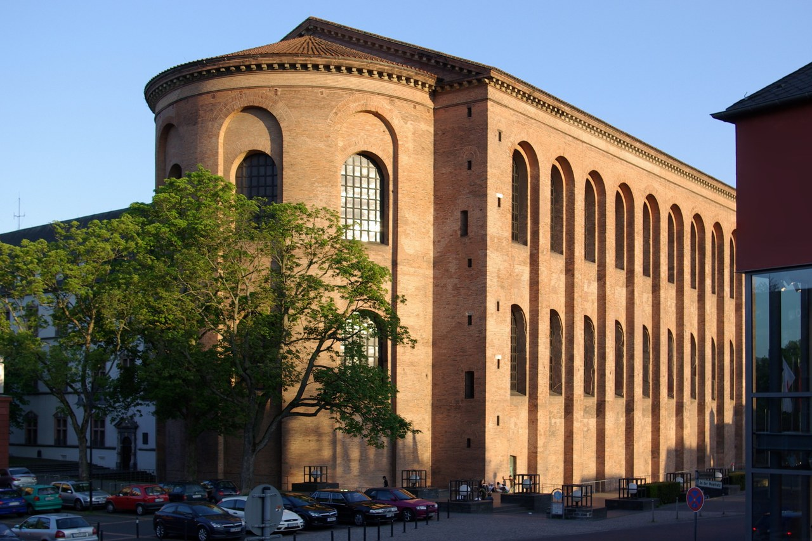</picture>
<figcaption>The <b>Aula Palatina</b>, the throne hall of the Roman emperors at <b>Trier</b>, built about AD 300–310 and now a Protestant church. Jerome would have known it when Trier was an imperial city. Photo: <a href="https://commons.wikimedia.org/wiki/File:Trier_Konstantinbasilika_BW_1.JPG">Trier Konstantinbasilika BW 1</a> by Berthold Werner, public domain, via Wikimedia Commons.</figcaption>
</figure>

<figure class=photo>
<picture><source srcset="/static/art/jerome-aquileia-600.webp 600w,/static/art/jerome-aquileia.webp 1280w" sizes="(max-width:760px) 100vw,760px" type="image/webp">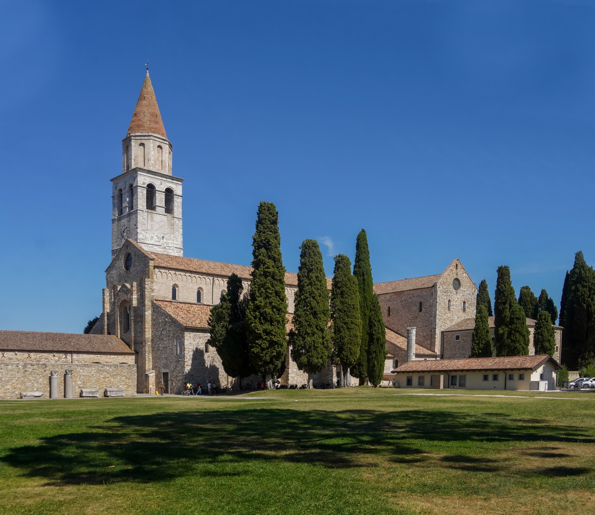</picture>
<figcaption>The <b>Basilica of Aquileia</b>. The first church here was built in the fourth century, and its great floor mosaics, with the Good Shepherd and the story of Jonah, were already old when Jerome came here to pray with Bishop Valerian's circle. Photo: <a href="https://commons.wikimedia.org/wiki/File:Basilica_Patriarcale_(Aquileia)_-_Exterior.jpg">Basilica Patriarcale (Aquileia) - Exterior</a> by ThePhotografer, <a href="https://creativecommons.org/licenses/by-sa/4.0">CC BY-SA 4.0</a>, via Wikimedia Commons.</figcaption>
</figure>

<h2 id=dream>The dream at Antioch: "Ciceronian, not Christian"</h2>

He reached **Antioch**, one of the great cities of the Christian East, worn out by the journey. He had given up home, family and comfort, but there was one thing he could not give up: his library. He would fast, and then sit down to read Cicero and Plautus for pleasure. When he opened the prophets, their rough style put him off.

Then, in the middle of Lent in 375, he fell gravely ill. In a fever he had a dream that changed his life. He told it years later in a letter to Eustochium:

> "Suddenly I was caught up in the spirit and dragged before the judgement seat of the Judge... Asked who and what I was, I replied: 'I am a Christian.' But He who presided said: 'You lie. You are a follower of Cicero and not of Christ. For where your treasure is, there will your heart be also.'"

He was beaten, and he cried out for mercy and swore never again to read worldly books. He woke with his shoulders, he said, "black and blue," and from that day "I read the books of God with a zeal greater than I had previously given to the books of men."

The famous words of the dream, in Latin, are *Ciceronianus es, non Christianus*: "You are a Ciceronian, not a Christian." He did not give up the classics for ever, and his Latin always kept their music. But from that Lent, the Bible came first.

<h2 id=chalcis>The desert of Chalcis and the Hebrew alphabet</h2>

To make his conversion real, he went out into the **desert of Chalcis**, in the Syrian wilderness east of Antioch, where many hermits lived in caves and huts. It was harder than he had imagined. He was sunburnt, lonely, and tempted. "Although in my fear of hell I had consigned myself to this prison, where I had no companions but scorpions and wild beasts," he wrote, "I often found myself amid bevies of girls... I used to sit alone because I was filled with bitterness."

He found an unexpected remedy. A monk who had been born a Jew agreed to teach him Hebrew. He remembered it many years later:

> "I betook myself to a brother who before his conversion had been a Jew and asked him to teach me Hebrew. Thus, after having familiarised myself with... the fluency of Cicero... I began to learn my letters anew and to study to pronounce words both harsh and guttural... how often I despaired, how often I gave over and then in my eagerness to learn commenced again... But I thank the Lord that from this seed of learning sown in bitterness I now cull sweet fruits."

Those sweet fruits would one day be the whole Old Testament in Latin. God had used his struggles in the desert to prepare him for his life's work.

<figure class=photo>
<picture><source srcset="/static/art/jerome-leonardo-600.webp 600w,/static/art/jerome-leonardo.webp 1280w" sizes="(max-width:760px) 100vw,760px" type="image/webp">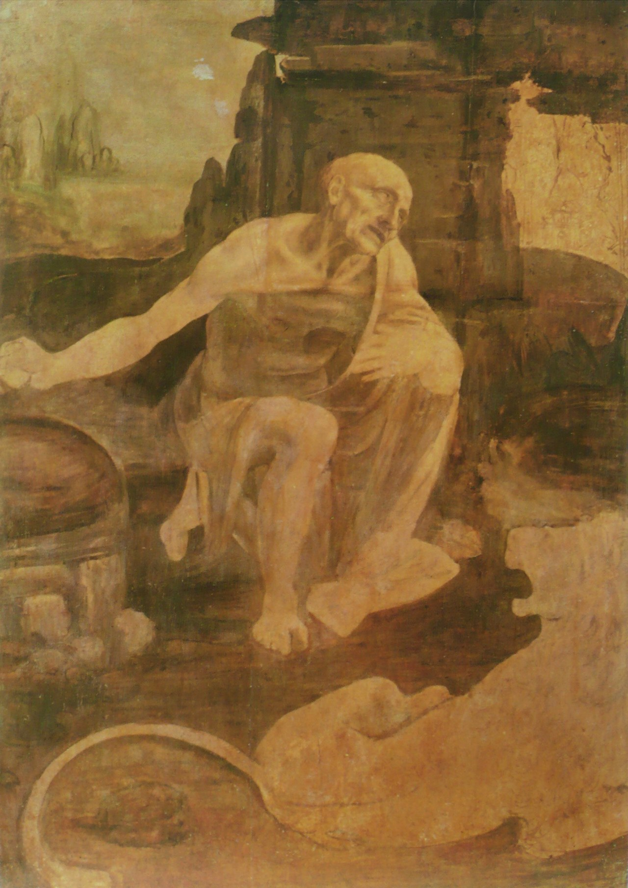</picture>
<figcaption><i>Saint Jerome</i>, by <b>Leonardo da Vinci</b>, about 1481–82, left unfinished. The hermit kneels in the desert, about to strike his breast with a stone, and the lion lies at his feet. Cardinal Fesch, Napoleon's uncle, found the panel in the nineteenth century; it had been cut into five pieces. Pope Pius IX bought it in 1856. Vatican Museums. Image: <a href="https://commons.wikimedia.org/wiki/File:Leonardo_da_Vinci_-_Saint_Jerome.jpg">Leonardo da Vinci - Saint Jerome</a>, public domain, via Wikimedia Commons.</figcaption>
</figure>

<h2 id=priest>Priest at Antioch, pupil at Constantinople</h2>

The desert was full of quarrels among the monks about bishops and doctrine, and Jerome was not a man to keep quiet. He wrote to Pope Damasus for guidance: "As I follow no leader save Christ, so I communicate with none but Your Blessedness, that is, with the chair of Peter." In the end he went back to Antioch.

There, in 378, Bishop **Paulinus** ordained him a priest. Jerome accepted on condition that he could remain a monk, and that the duties of a parish priest would not be forced on him.

Then he went to **Constantinople**, to study under one of the greatest preachers of the age, [St Gregory Nazianzen](/saints/gregory-nazianzen/), whom he called "my instructor in the Scriptures." He was in the city in 381 for the great Council that completed the Nicene Creed. There he improved his Greek, translated sermons of Origen, and translated and continued the *Chronicle* of Eusebius.

<h2 id=damasus>Secretary to Pope Damasus</h2>

In 382 he came to Rome with Paulinus for a council, and the elderly **Pope Damasus** kept him there as his secretary. Damasus was a lover of the martyrs and of the Scriptures, and he soon saw what this learned monk could do.

The Latin Bibles of the time were a muddle. Christians had made many translations from the Greek, and copyists had added mistakes. Jerome said there were almost as many versions as there were manuscripts. So Damasus asked him to do something bold: to revise the Latin text of the **four Gospels** against the best Greek manuscripts.

It was delicate work. People loved the words they had always heard, even when they were wrong. Jerome knew that some would call him a forger for changing a single word, and they did. But he went ahead with a light hand, correcting only where the meaning was changed. He also made a first light revision of the Latin Psalms.

<h2 id=aventine>Paula, Eustochium, Marcella and the Aventine circle</h2>

On the Aventine Hill lived **Marcella**, a noble widow who had turned her palace into a house of prayer. A group of women gathered around her, among them the widow **Paula**, her daughters **Eustochium** and **Blaesilla**, and others. They asked Jerome to teach them the Scriptures.

He was an exacting teacher, and they were keen pupils. Pope Francis wrote that they learned Greek and Hebrew, and that Paula and Eustochium chanted the Psalms in Hebrew. Marcella fired questions at him by letter, and after he left Rome the priests of the city went to her for help with difficult texts.

Many of Jerome's most beautiful letters were written to these women. They show a side of him the world rarely saw: tender, encouraging, and full of joy in God.

<figure class=photo>
<picture><source srcset="/static/art/jerome-zurbaran-600.webp 600w,/static/art/jerome-zurbaran.webp 1280w" sizes="(max-width:760px) 100vw,760px" type="image/webp">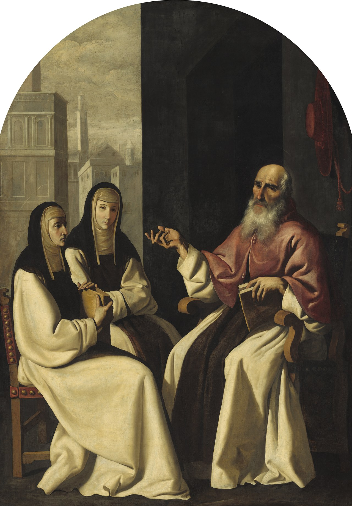</picture>
<figcaption><i>Saint Jerome with Saint Paula and Saint Eustochium</i>, by <b>Francisco de Zurbarán</b> and his workshop, about 1640–50. The old teacher explains the Scriptures to the mother and daughter who followed him to Bethlehem. National Gallery of Art, Washington. Image: <a href="https://commons.wikimedia.org/wiki/File:Francisco_de_Zurbar%C3%A1n_and_Workshop,_Saint_Jerome_with_Saint_Paula_and_Saint_Eustochium,_c._1640-1650,_NGA_41703.jpg">Francisco de Zurbarán and Workshop, Saint Jerome with Saint Paula and Saint Eustochium, c. 1640-1650, NGA 41703</a>, <a href="https://creativecommons.org/publicdomain/zero/1.0/">CC0</a>, via Wikimedia Commons.</figcaption>
</figure>

<h2 id=journey>Leaving Rome: the road to Bethlehem</h2>

Jerome's sharp pen made him enemies. He mocked worldly clergy and attacked lax Christians, and people resented the influence of this foreign monk over the noble ladies of Rome. When young Blaesilla died after a time of fasting, some blamed him. And in December 384 Pope Damasus, his protector, died.

In August 385 he sailed from Rome, never to return. Pope Francis says simply that he left because of "jealousies and misunderstandings."

Paula and Eustochium followed him. Together they made a long pilgrimage through the Holy Land, praying at every place of the Gospel. In Egypt they visited the desert monks, and Jerome spent about a month in Alexandria with **Didymus the Blind**, the great teacher of Scripture. Then, in 386, they settled in **Bethlehem**.

<figure class=photo>
<picture><source srcset="/static/art/jerome-vivian-600.webp 600w,/static/art/jerome-vivian.webp 1272w" sizes="(max-width:760px) 100vw,760px" type="image/webp">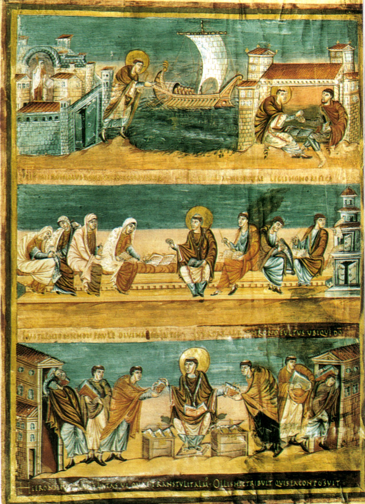</picture>
<figcaption>The story of Jerome in the <b>Vivian Bible</b> (First Bible of Charles the Bald), painted at Tours in 845–46. At the top he leaves Rome by sea and pays his Hebrew teacher; in the middle he explains the Scriptures to Paula and Eustochium while scribes copy; at the bottom he hands out the finished Bible. Bibliothèque nationale de France, Latin 1, folio 3 verso. Image: <a href="https://commons.wikimedia.org/wiki/File:Prima_bibbia_di_carlo_il_calvo,_scene_della_vita_di_san_girolamo,_846_circa,_Ms._Lat_1_f._423_v._37,50x49,5_cm,_parigi,_biblioteque_nationale.jpg">Prima bibbia di carlo il calvo, scene della vita di san girolamo, 846 circa, Ms. Lat 1 f. 423 v. 37,50x49,5 cm, parigi, biblioteque nationale</a>, public domain, via Wikimedia Commons.</figcaption>
</figure>

<h2 id=bethlehem>Bethlehem: "the cottage of Christ"</h2>

Paula was very rich, and she gave it all. In Bethlehem she built a **monastery for men**, led by Jerome; a **convent for women**, which she led herself; and a **hostel for pilgrims**. Jerome wrote that the hostel was built so that travellers might find "the welcome which Mary and Joseph had missed."

When Paula first entered the Grotto of the Nativity, Jerome wrote, she "protested in my hearing that she could behold with the eyes of faith the infant Lord wrapped in swaddling clothes and crying in the manger." And she cried out: "Hail Bethlehem, house of bread, wherein was born that Bread that came down from heaven."

Paula and Eustochium wrote a letter to Marcella, begging her to come and join them, which may well have been shaped by Jerome. It paints the little town they loved:

> "In the cottage of Christ all is simple and rustic: and except for the chanting of psalms there is complete silence. Wherever one turns the labourer at his plough sings alleluia, the toiling mower cheers himself with psalms, and the vine-dresser while he prunes his vine sings one of the lays of David."

Jerome lived in a cave close to the grotto where Christ was born. He taught, wrote, and welcomed pilgrims. He never forgot the honour of where he lived. Yet he wrote to a friend: "Nothing is lacking to your faith although you have not seen Jerusalem, and I am none the better for living where I do." Pope Francis loved one of his sayings: "Blessed are they who have Bethlehem in their heart, in whose heart Christ is born each day!"

Paula died in 404, and Jerome wrote her life in a long letter to Eustochium. Eustochium took her mother's place and died in about 419, a year before him.

<h2 id=vulgate>The great work: the Hebrew truth</h2>

At Bethlehem Jerome began the work for which the whole Church thanks him. At first he revised the Latin Old Testament from the Greek Septuagint. His revision of the Psalms from the Greek, made in about 386–389, was loved in Gaul and became known as the **Gallican Psalter**. It is the Psalter still found in the Clementine Vulgate.

But the more he studied, the more he was convinced that a translator must go back to the source: the original Hebrew, which he called the *Hebraica veritas*, "the Hebrew truth." From about 390 to 405 he translated book after book of the Old Testament from the Hebrew, comparing every line with the Greek versions in the great six-column Bible, the *Hexapla*, that Origen had made. He even made a second Psalter, straight from the Hebrew.

He wrote a preface to each book, explaining what he had done and answering his critics. He was not afraid to ask Jewish scholars for help. One of them, Baraninas, was so afraid of his neighbours that he would only come to teach Jerome after dark: "a second edition of Nicodemus," Jerome joked. In his work he followed a rule: translate the sense, not word for word, except in Holy Scripture, "where even the order of the words is a mystery."

His Latin was clear and strong, and it gave the Church phrases she still prays every day. Over the centuries his work, together with a few older Latin books, became the Bible of the West. From the thirteenth century it was called the *Vulgata*, the "common" version, because it belonged to all.

He did not only translate. He wrote commentaries on almost every book of the Bible. In the prologue to his commentary on Isaiah he wrote the words that sum up his life:

> "If, according to the apostle Paul, Christ is the power of God and the wisdom of God, and if the man who does not know Scripture does not know the power and wisdom of God, then **ignorance of the Scriptures is ignorance of Christ**."

The Second Vatican Council quoted this sentence in *Dei Verbum*, its great document on the Word of God. To a young woman consecrated to God, Demetrias, he gave this advice: "Love Sacred Scripture and wisdom will love you." And to a friend who wanted to study the Bible with him: "Let us learn upon earth that knowledge which will continue with us in heaven."

<figure class=photo>
<picture><source srcset="/static/art/jerome-amiatinus-600.webp 600w,/static/art/jerome-amiatinus.webp 1280w" sizes="(max-width:760px) 100vw,760px" type="image/webp">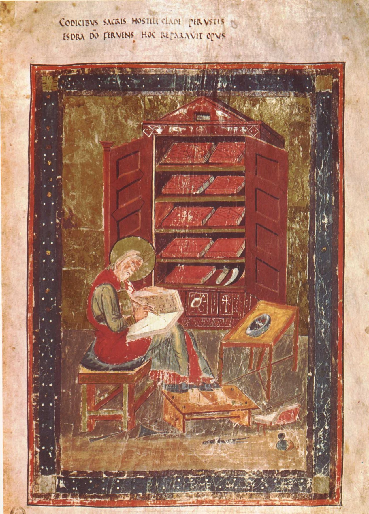</picture>
<figcaption>The scribe Ezra in the <b>Codex Amiatinus</b>, the oldest complete one-volume Latin Bible in the world, written in Northumbria at the monastery of Wearmouth–Jarrow about 700, mostly in Jerome's translation. It was sent as a gift to the pope in 716. In the cupboard behind him stand the books of the Bible. Biblioteca Medicea Laurenziana, Florence. Image: <a href="https://commons.wikimedia.org/wiki/File:CodxAmiatinusFolio5rEzra.jpg">CodxAmiatinusFolio5rEzra</a>, public domain, via Wikimedia Commons.</figcaption>
</figure>

<h2 id=augustine>A friendship by letter: Jerome and Augustine</h2>

Far away in North Africa, a younger bishop was reading Jerome's work closely. He was [St Augustine](/saints/augustine/) of Hippo. The two great Doctors never met, but they wrote to each other for more than twenty years.

It began badly. Augustine wrote questioning Jerome's reading of a passage in Galatians, and his letter went astray and was passed around in Italy before it reached Bethlehem. Jerome felt insulted. Augustine also worried that the new translation from the Hebrew would divide Latin Christians from the Greeks, who used the Septuagint. He told Jerome of a bishop at Oea, in today's Libya, whose congregation was in uproar when he read Jerome's new version of the Book of Jonah, because the plant that shaded the prophet had become "ivy" instead of the familiar "gourd." Jerome replied that the Hebrew word meant neither, and that ivy was the nearest he could find.

But the two men were saints, and charity won. Both fought the same errors and both loved the same Lord. In 416 Jerome wrote, "I am resolved to love you, to look up to you, to reverence and admire you, and to defend your opinions as my own." Near the end of his life he wrote to Augustine:

> "Go on and prosper! You are renowned throughout the whole world; Catholics revere and look up to you as the restorer of the ancient faith."

<figure class=photo>
<picture><source srcset="/static/art/jerome-carpaccio-augustine-600.webp 600w,/static/art/jerome-carpaccio-augustine.webp 1280w" sizes="(max-width:760px) 100vw,760px" type="image/webp">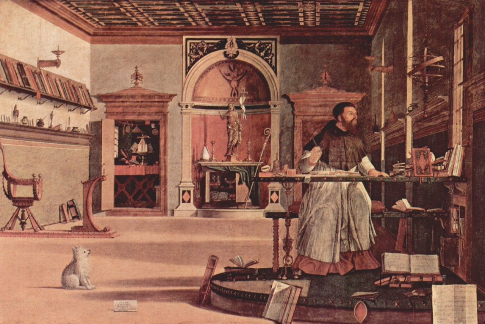</picture>
<figcaption><i>The Vision of Saint Augustine</i>, by <b>Vittore Carpaccio</b>, 1502. A medieval legend said that as Augustine sat down to write to Jerome, the room filled with light, and he heard Jerome's voice telling him that he had died and gone to God. Scuola di San Giorgio degli Schiavoni, Venice. Image: <a href="https://commons.wikimedia.org/wiki/File:Vittore_Carpaccio_026.jpg">Vittore Carpaccio 026</a>, public domain, via Wikimedia Commons.</figcaption>
</figure>

<h2 id=sack>"The City which had taken the whole world"</h2>

In 410 the unthinkable happened. Alaric and his Goths captured and sacked Rome. Refugees streamed to the East, and many came to Bethlehem. Old Marcella, who had taught him so much, was beaten by the invaders and died soon after. Jerome could hardly write:

> "My voice sticks in my throat; and, as I dictate, sobs choke my utterance. The City which had taken the whole world was itself taken."

He laid aside his commentary on Ezekiel to care for the refugees who arrived at Bethlehem with nothing. For a time, works of mercy came before his books.

<h2 id=death>His death, and his long journey to Rome</h2>

His last years were hard. His friends had died before him, and in 416 a band of violent men, stirred up in the quarrel over the teaching of Pelagius, attacked and set fire to the monasteries at Bethlehem. Still he kept working, dictating to his scribes.

He died in his cell at Bethlehem on **30 September 420**, close to the place where the Word was made flesh. By his wish, he was buried in a cave beside the Grotto of the Nativity, near the tombs of Paula and Eustochium. Pilgrims still pray there today.

Many centuries later his remains made one last journey. The Basilica of Santa Maria Maggiore in Rome, which keeps the wood of the Holy Crib, records that "the remains of the Doctor of the Church, who chose to live in Bethlehem at the Holy Crib of the Child Jesus, were moved around 1285" to "the Bethlehem of the West." Where exactly they rest in the basilica today is not certain. But it is fitting that the man who lived beside the manger should be honoured beside its relic.

<figure class=photo>
<picture><source srcset="/static/art/jerome-carpaccio-funeral-600.webp 600w,/static/art/jerome-carpaccio-funeral.webp 1280w" sizes="(max-width:760px) 100vw,760px" type="image/webp">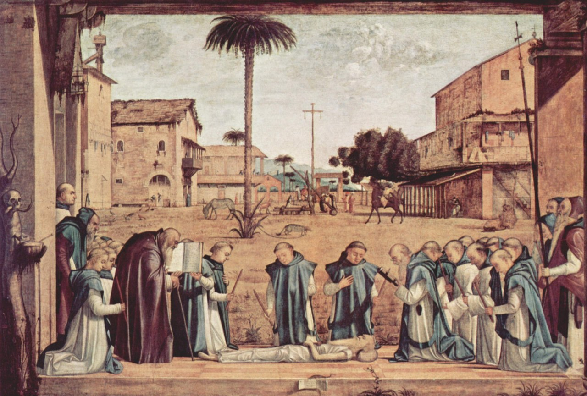</picture>
<figcaption><i>The Funeral of Saint Jerome</i>, by <b>Vittore Carpaccio</b>, 1502. The monks of Bethlehem sing the last prayers around their father's body, and the faithful lion mourns at the edge of the scene. Scuola di San Giorgio degli Schiavoni, Venice. Image: <a href="https://commons.wikimedia.org/wiki/File:Vittore_Carpaccio_007.jpg">Vittore Carpaccio 007</a>, public domain, via Wikimedia Commons.</figcaption>
</figure>

<h2 id=lion>The lion of Bethlehem: a legend</h2>

No one can think of St Jerome without his lion. The story is a legend, not history, but it is a lovely one. It is told in the *Golden Legend*, the great medieval book of saints' lives, written about 1260.

One evening, it says, as Jerome sat with his brothers listening to the holy reading, a lion came limping into the monastery. The monks fled, but Jerome went to meet it "as he should come against his guest." The lion held up its paw. Jerome had the brothers wash it, found a thorn deep in the pad of the foot, and healed it. The lion stayed on, "as a tame beast with them."

Jerome gave it a job: to guard the monastery's donkey while it grazed. One day the lion fell asleep, and passing merchants stole the donkey. The lion came home ashamed and alone, and the monks thought it had eaten its friend. So Jerome made it do the donkey's work, carrying wood, and the lion bore it patiently. Then one day it saw the merchants' caravan coming back with the donkey leading the camels. With a great roar it drove the whole caravan into the monastery. The merchants confessed and asked pardon, and Jerome forgave them.

Where did the story come from? A very similar tale was told much earlier about **St Gerasimus**, a holy abbot who lived near the Jordan in the fifth century. John Moschus tells it in *The Spiritual Meadow*. Gerasimus's lion, named Jordanes, is said to have died of grief on his master's grave. In later Latin the two names, *Gerasimus* and *Geronimus*, looked very alike, and it seems the lion simply wandered from one saint to the other.

Whatever its source, the lion has become Jerome's own, and it suits him. Pope Francis wrote that "as a true 'Lion of Bethlehem'" Jerome could be fierce in his language, but always in the service of the truth. And, as Jerome himself wrote in his very first book, lions can roar but also weep.

<figure class=photo>
<picture><source srcset="/static/art/jerome-carpaccio-lion-600.webp 600w,/static/art/jerome-carpaccio-lion.webp 1280w" sizes="(max-width:760px) 100vw,760px" type="image/webp">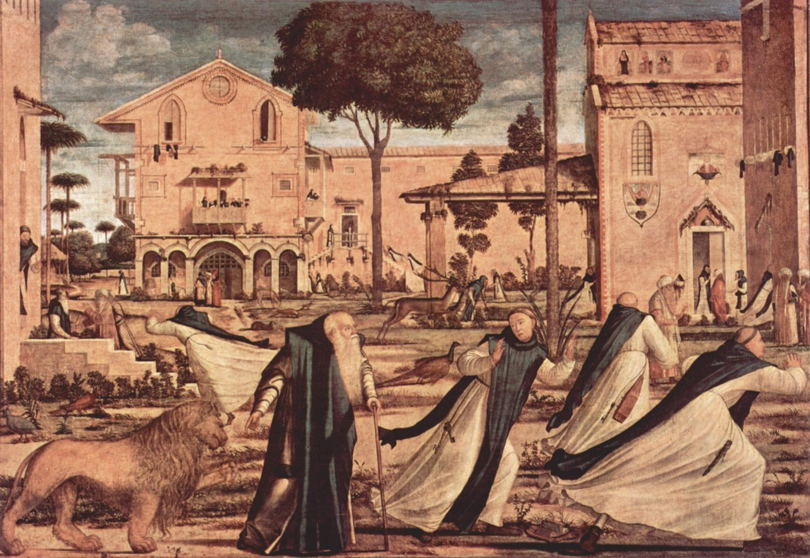</picture>
<figcaption><i>Saint Jerome and the Lion in the Monastery</i>, by <b>Vittore Carpaccio</b>, 1502. The old saint greets the limping lion, while the brothers flee in every direction. Carpaccio painted it for the confraternity of the Dalmatians in Venice, Jerome's own countrymen. Scuola di San Giorgio degli Schiavoni, Venice. Image: <a href="https://commons.wikimedia.org/wiki/File:Vittore_Carpaccio_014.jpg">Vittore Carpaccio 014</a>, public domain, via Wikimedia Commons.</figcaption>
</figure>

<h2 id=hat>The red hat: a lovely anachronism</h2>

In countless paintings Jerome wears the scarlet robes of a cardinal, or his red hat hangs on the wall of his study. There were no cardinals in his day, at least not as we know them. The *Golden Legend* said he had been made a "cardinal priest" in Rome, and the painters followed it. Pope Francis explained that tradition shows him in a cardinal's robes "as a sign of his being a priest of Rome under Pope Damasus," and the National Gallery in London notes gently that he wears them "even though the office did not exist during his lifetime."

It is a happy mistake. The red hat reminds us that the hermit of Bethlehem had once served the pope, and that his work was done for the whole Church.

<figure class=photo>
<picture><source srcset="/static/art/jerome-el-greco-600.webp 600w,/static/art/jerome-el-greco.webp 1278w" sizes="(max-width:760px) 100vw,760px" type="image/webp">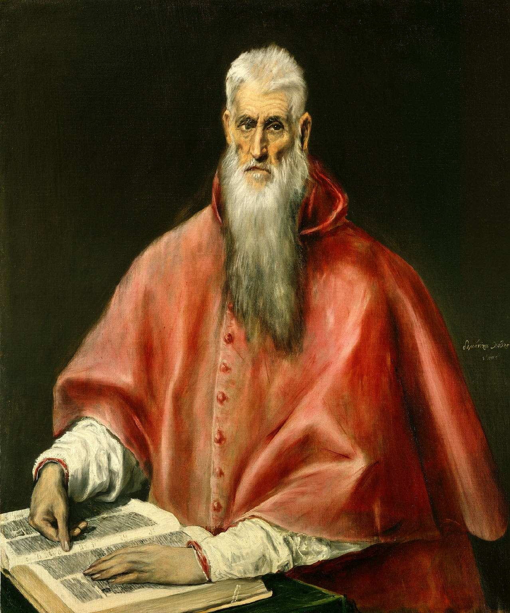</picture>
<figcaption><i>Saint Jerome as Cardinal</i>, by <b>El Greco</b>, about 1590–1600. The bony fingers keep the place in a great Bible. El Greco and his workshop painted several versions of this picture. Frick Collection, New York. Image: <a href="https://commons.wikimedia.org/wiki/File:El_Greco_-_San_Jer%C3%B3nimo.jpg">El Greco - San Jerónimo</a>, public domain, via Wikimedia Commons.</figcaption>
</figure>

<h2 id=legacy>Doctor of the Church and the Vulgate's long life</h2>

The Church honoured him from the beginning. By the early Middle Ages he was named, with Ambrose, Augustine and Gregory the Great, one of the four great Doctors of the West, and in **1298** Pope Boniface VIII ordered that their feasts be kept throughout the Church. In 1920 Pope Benedict XV called him "the greatest Doctor in explaining the Scriptures."

His translation lived on. Monks copied it all over Europe, and it was the first great book ever printed, in the Gutenberg Bible. In **1546** the Council of Trent declared that "the old and vulgate edition" should be "held as authentic" in "public lectures, disputations, sermons and expositions." Popes Sixtus V and Clement VIII then had the text carefully revised, and in **1592** the official edition appeared, the **Sixto-Clementine Vulgate**. It remained the Latin Bible of the Catholic Church until the Nova Vulgata of 1979.

That 1592 Bible is the Latin text that The Daily Word sets beside each verse, among its [four witnesses](/about/) to the Word. So every morning, St Jerome is still at work.

<figure class=photo>
<picture><source srcset="/static/art/jerome-clementine-600.webp 600w,/static/art/jerome-clementine.webp 937w" sizes="(max-width:760px) 100vw,760px" type="image/webp">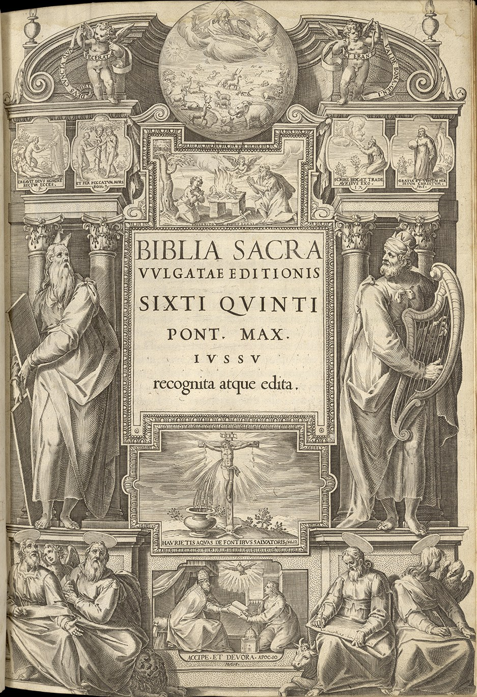</picture>
<figcaption>The title page of the <b>Sixto-Clementine Vulgate</b>, the official edition of St Jerome's Bible printed in Rome in 1592. It still carries the name of Pope Sixtus V, who began the revision, although it was Clement VIII who brought it out. Image: <a href="https://commons.wikimedia.org/wiki/File:Frontispiece_of_the_Sixto-Clementine_Vulgate_(1592).jpg">Frontispiece of the Sixto-Clementine Vulgate (1592)</a>, public domain, via Wikimedia Commons.</figcaption>
</figure>

<h2 id=places>His places and churches</h2>

St Jerome's world stretched from the Moselle to the Nile. The map follows his journeys, with close-ups of the Rome he knew and of the holy places at Bethlehem where he spent his last thirty-four years.

<figure class=map><figcaption>The journeys of St Jerome, from Stridon and Rome to Trier, Antioch, Constantinople and Bethlehem, with insets of Rome and of the Nativity complex at Bethlehem (a simple plan, not to scale). Map by The Daily Word; coastlines from Natural Earth (public domain); routes are approximate. Tap to enlarge.</figcaption></figure>

### The Church of the Nativity, Bethlehem

The Emperor Constantine built a great basilica over the cave of Christ's birth after his mother, [St Helena](/saints/helena/), visited the Holy Land in 326. It was dedicated in 339, and Jerome came to live beside it less than fifty years later. Jerome himself recorded that in pagan times the cave had been "overshadowed by a grove of Tammuz, that is of Adonis," so that the very place of Christ's birth had been hidden under a pagan shrine. The basilica was rebuilt by the Emperor Justinian in the sixth century, and that church still stands. Pilgrims enter it, bowing low, through the tiny **Door of Humility**. With the grotto it is the oldest site of Christian worship in continuous use, and since 2012 it has been a UNESCO World Heritage Site. For a visitor's guide, see our [Bethlehem pilgrimage page](/pilgrimage/holy-land/bethlehem/).

<figure class=photo>
<picture><source srcset="/static/art/jerome-nativity-600.webp 600w,/static/art/jerome-nativity.webp 1280w" sizes="(max-width:760px) 100vw,760px" type="image/webp">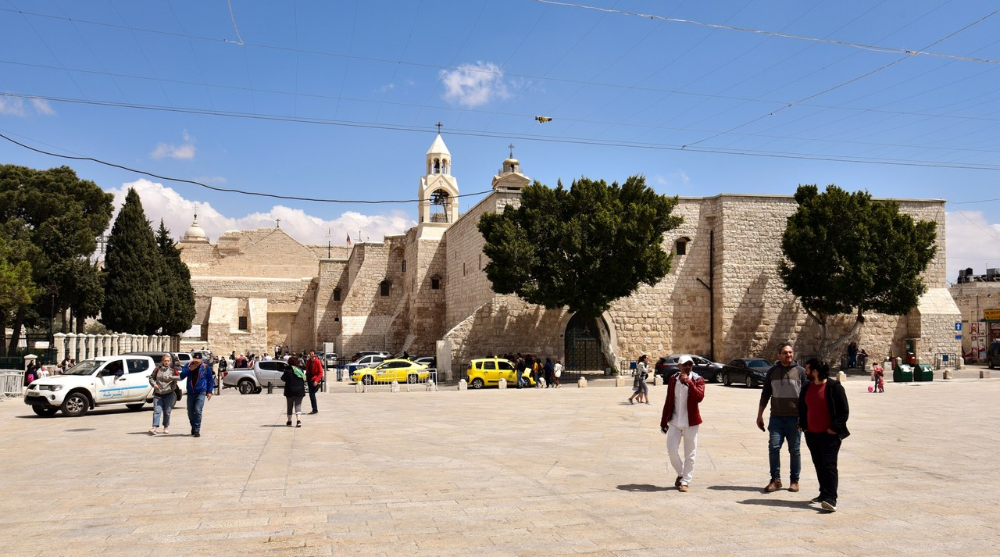</picture>
<figcaption>Manger Square, Bethlehem, with the <b>Church of the Nativity</b> at the far end. The fortress-like front hides one of the oldest churches in the world. Photo: <a href="https://commons.wikimedia.org/wiki/File:Church_of_the_Nativity,_2019_(01).jpg">Church of the Nativity, 2019 (01)</a> by Bahnfrend, <a href="https://creativecommons.org/licenses/by-sa/4.0">CC BY-SA 4.0</a>, via Wikimedia Commons.</figcaption>
</figure>

<figure class=photo>
<picture><source srcset="/static/art/jerome-nativity-nave-600.webp 600w,/static/art/jerome-nativity-nave.webp 1280w" sizes="(max-width:760px) 100vw,760px" type="image/webp">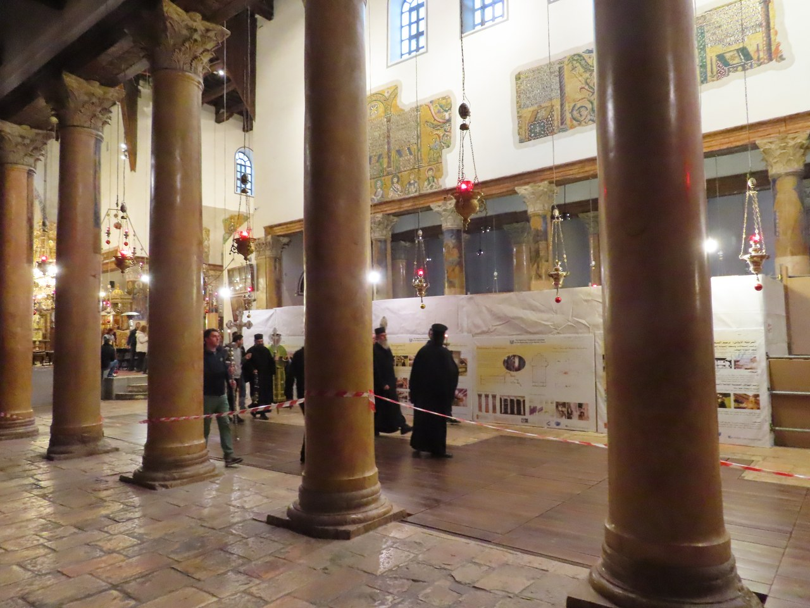</picture>
<figcaption>The nave of the <b>Church of the Nativity</b>, with its rows of red limestone columns from the sixth-century church of Justinian. Jerome prayed in the earlier basilica of Constantine on this spot. Photo: <a href="https://commons.wikimedia.org/wiki/File:Holy_Land_2019_(1)_P056_Bethlehem_Church_of_the_Nativity.jpg">Holy Land 2019 (1) P056 Bethlehem Church of the Nativity</a> by Fallaner, <a href="https://creativecommons.org/licenses/by-sa/4.0">CC BY-SA 4.0</a>, via Wikimedia Commons.</figcaption>
</figure>

### St Catherine's Church and the Grotto of St Jerome

Next to the basilica stands the Franciscan **Church of St Catherine**, the Catholic parish church of Bethlehem. Each Christmas the Latin Patriarch of Jerusalem celebrates Midnight Mass here, and it is broadcast around the world. The church was rebuilt in 1881, and its Crusader cloister was restored in 1948 by the architect Antonio Barluzzi. Jerome's own monastery may have stood on the site of this cloister. In the middle of the cloister stands a statue of St Jerome on a tall column.

Under the church, steps lead down to a series of caves joined to the Grotto of the Nativity. Here, pilgrims are shown the chapel of St Joseph, the chapel of the Holy Innocents, the cell where Jerome is said to have lived and worked, and the cave where he was first buried, near tombs honoured as those of Paula and Eustochium. [St Catherine of Alexandria](/saints/catherine-of-alexandria/), to whom the church is dedicated, was honoured here by the Franciscans from the fourteenth century.

<figure class=photo>
<picture><source srcset="/static/art/jerome-st-catherine-600.webp 600w,/static/art/jerome-st-catherine.webp 1280w" sizes="(max-width:760px) 100vw,760px" type="image/webp">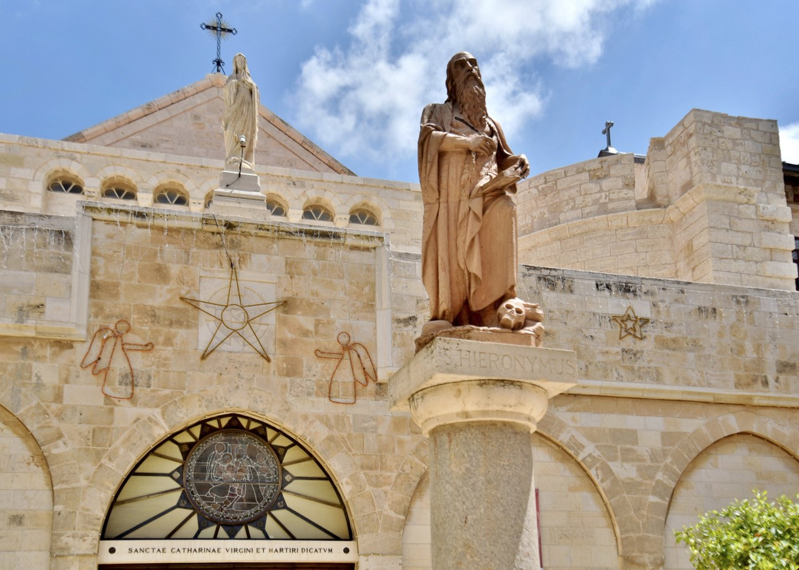</picture>
<figcaption>The statue of <b>St Jerome</b> in the cloister of <b>St Catherine's Church</b>, Bethlehem, with the church front behind. Photo: <a href="https://commons.wikimedia.org/wiki/File:Church_of_Saint_Catherine,_Bethlehem,_2019_(01).jpg">Church of Saint Catherine, Bethlehem, 2019 (01)</a> by Bahnfrend, <a href="https://creativecommons.org/licenses/by-sa/4.0">CC BY-SA 4.0</a>, via Wikimedia Commons.</figcaption>
</figure>

<figure class=photo>
<picture><source srcset="/static/art/jerome-statue-600.webp 600w,/static/art/jerome-statue.webp 1280w" sizes="(max-width:760px) 100vw,760px" type="image/webp">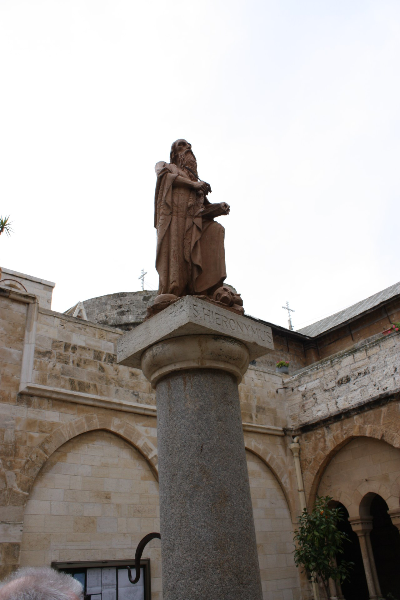</picture>
<figcaption>St Jerome on his column in the cloister of St Catherine's, Bethlehem. He is close to the place where he lived, prayed and translated the Bible. Photo: <a href="https://commons.wikimedia.org/wiki/File:Saint_Jerome_statue_in_Church_of_Saint_Catherine_courtyard.jpg">Saint Jerome statue in Church of Saint Catherine courtyard</a> by Wknight94, <a href="https://creativecommons.org/licenses/by-sa/3.0">CC BY-SA 3.0</a>, via Wikimedia Commons.</figcaption>
</figure>

<figure class=photo>
<picture><source srcset="/static/art/jerome-grotto-600.webp 600w,/static/art/jerome-grotto.webp 1280w" sizes="(max-width:760px) 100vw,760px" type="image/webp">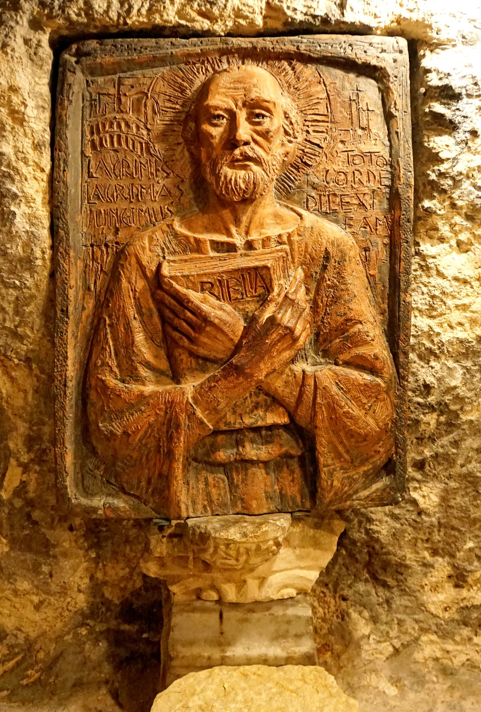</picture>
<figcaption>A relief of St Jerome in the caves beneath St Catherine's, Bethlehem, near the altar of St Jerome and St Eusebius. This is the cave where Jerome was first buried. Photo: <a href="https://commons.wikimedia.org/wiki/File:Palestine-06363_-_Grotto_of_St._Jerome_(34545947420).jpg">Palestine-06363 - Grotto of St. Jerome (34545947420)</a> by Dennis G. Jarvis, <a href="https://creativecommons.org/licenses/by-sa/2.0">CC BY-SA 2.0</a>, via Wikimedia Commons.</figcaption>
</figure>

### Santa Maria Maggiore, Rome

The great basilica of Our Lady on the Esquiline Hill keeps the relic of the **Holy Crib** and has long been called "the Bethlehem of the West." By tradition, Jerome's remains were brought here around 1285, to rest near the manger he had lived beside. The basilica's museum also keeps a rare medieval vestment called "the Chasuble of St Jerome," and the first Christmas crib figures in the history of art, carved by Arnolfo di Cambio in 1291. Pope Sixtus V built the splendid **Sistine Chapel** here. Beneath it lies the old Chapel of the Nativity, which once held Arnolfo's crib. See our [Santa Maria Maggiore pilgrimage page](/pilgrimage/rome/santa-maria-maggiore/).

<figure class=photo>
<picture><source srcset="/static/art/jerome-smm-600.webp 600w,/static/art/jerome-smm.webp 1280w" sizes="(max-width:760px) 100vw,760px" type="image/webp">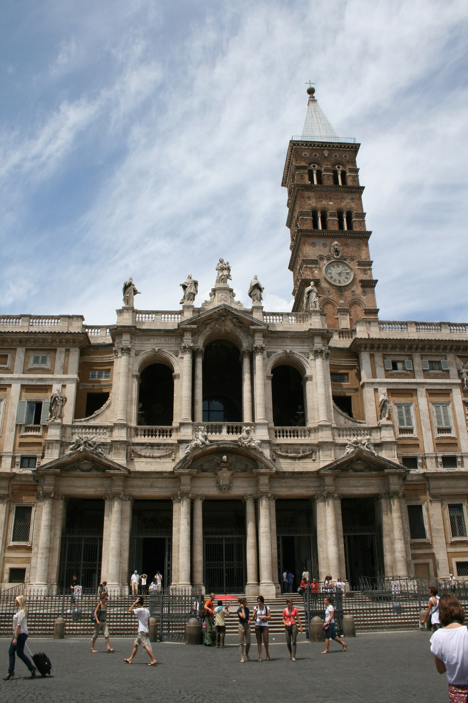</picture>
<figcaption>The <b>Basilica of Santa Maria Maggiore</b>, Rome, the "Bethlehem of the West," where Jerome's remains are said to have been brought around 1285. Photo: <a href="https://commons.wikimedia.org/wiki/File:Facade_of_Santa_Maria_Maggiore_(Rome),_July_2011.jpg">Facade of Santa Maria Maggiore (Rome), July 2011</a> by MichalPL, <a href="https://creativecommons.org/licenses/by-sa/4.0">CC BY-SA 4.0</a>, via Wikimedia Commons.</figcaption>
</figure>

<figure class=photo>
<picture><source srcset="/static/art/jerome-smm-sistine-600.webp 600w,/static/art/jerome-smm-sistine.webp 1280w" sizes="(max-width:760px) 100vw,760px" type="image/webp">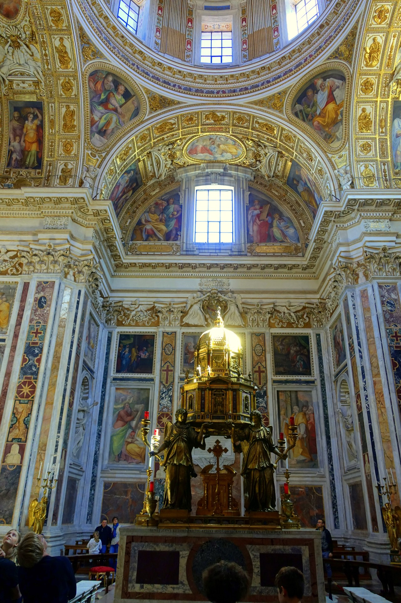</picture>
<figcaption>The <b>Sistine Chapel</b> in Santa Maria Maggiore, built by Domenico Fontana for Pope Sixtus V. The gilded tabernacle stands over the old Chapel of the Nativity below. Photo: <a href="https://commons.wikimedia.org/wiki/File:Cappella_Sistina_-_Santa_Maria_Maggiore_-_Rome,_Italy_-_DSC05696.jpg">Cappella Sistina - Santa Maria Maggiore - Rome, Italy - DSC05696</a> by Daderot, public domain, via Wikimedia Commons.</figcaption>
</figure>

### San Girolamo dei Croati, Rome

On the Via Tomacelli, near where the river port of Ripetta once stood, is the national church of Croatia in Rome, **St Jerome of the Croats**. In 1453 Pope Nicholas V gave a small ruined church here to refugees from Dalmatia and the lands taken by the Turks, in honour of their countryman Jerome. The present church was built in 1585–87 and then rebuilt for Pope Sixtus V by Martino Longhi the Elder. It is now the chapel of the Pontifical Croatian College of St Jerome.

<figure class=photo>
<picture><source srcset="/static/art/jerome-croati-600.webp 600w,/static/art/jerome-croati.webp 1280w" sizes="(max-width:760px) 100vw,760px" type="image/webp">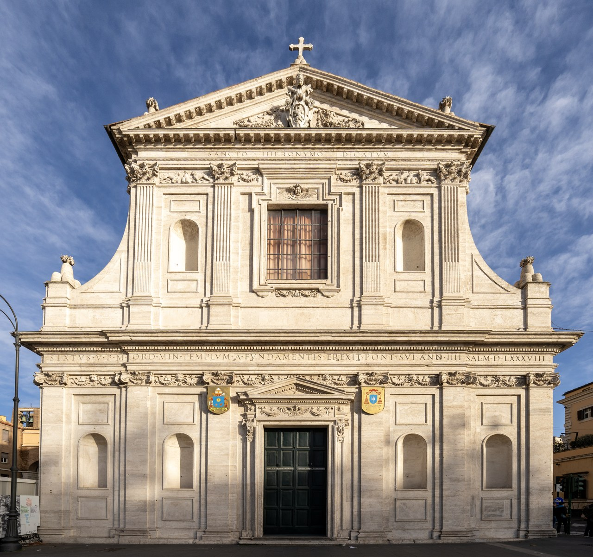</picture>
<figcaption><b>San Girolamo dei Croati</b> (St Jerome of the Croats), Rome, rebuilt by Martino Longhi the Elder for Pope Sixtus V. Photo: <a href="https://commons.wikimedia.org/wiki/File:San_Girolamo_dei_Croati_-_esterno.jpg">San Girolamo dei Croati - esterno</a> by Pamphili, <a href="https://creativecommons.org/licenses/by/4.0">CC BY 4.0</a>, via Wikimedia Commons.</figcaption>
</figure>

### San Girolamo della Carità, Rome

Near the Campo de' Fiori stands **San Girolamo della Carità**. Tradition says it was built on the site of Paula's house, where she welcomed Jerome while he served Pope Damasus. More than a thousand years later, [St Philip Neri](/saints/philip-neri/) lived in the house beside it from 1551 to 1583, and it was here that his first Oratory met. The present church was rebuilt after a fire in the seventeenth century, with a façade by Carlo Rainaldi.

<figure class=photo>
<picture><source srcset="/static/art/jerome-carita-600.webp 600w,/static/art/jerome-carita.webp 1280w" sizes="(max-width:760px) 100vw,760px" type="image/webp">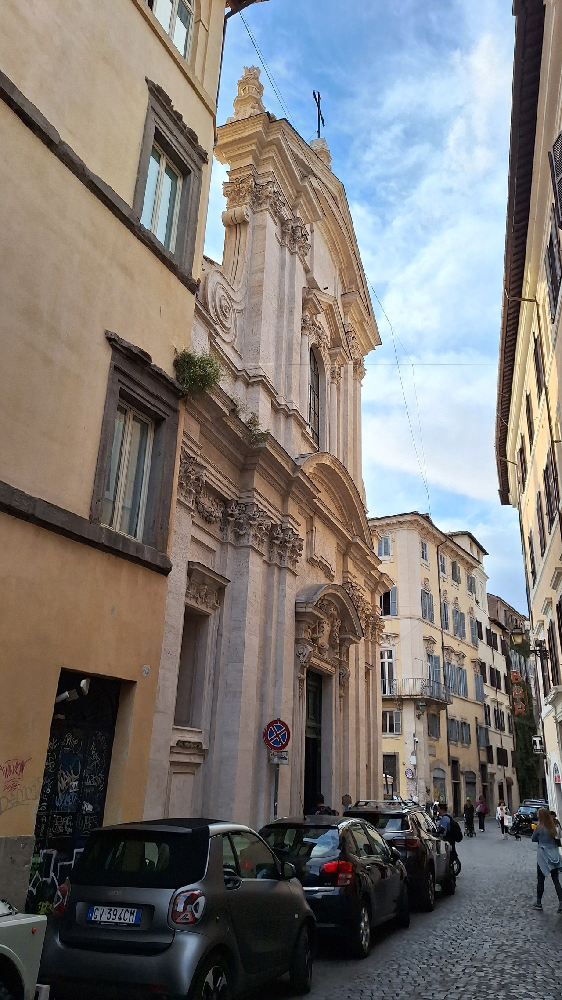</picture>
<figcaption><b>San Girolamo della Carità</b>, Rome, said to stand on the site of St Paula's house, where Jerome stayed. Photo: <a href="https://commons.wikimedia.org/wiki/File:San_Girolamo_della_Carit%C3%A0_(Rome)_2025.jpg">San Girolamo della Carità (Rome) 2025</a> by Joris, <a href="https://creativecommons.org/licenses/by-sa/4.0">CC BY-SA 4.0</a>, via Wikimedia Commons.</figcaption>
</figure>

### The catacombs, Aquileia and Trier

The **catacombs** of Rome, where the young Jerome went on Sundays to pray at the tombs of the martyrs, can still be visited. The great Basilica of **Aquileia**, with its fourth-century mosaic floors, and the Roman throne hall at **Trier** both stand today, as they did when Jerome passed through. Photographs of all three appear above, in the story of his early years. See also our page on the [Catacombs of San Sebastiano](/pilgrimage/rome/san-sebastiano/).

<h2 id=art>Jerome in art</h2>

After the Virgin Mary and the apostles, few saints have been painted more often than St Jerome. Renaissance artists loved him because he was a scholar, like their patrons. They showed him in two ways: as a scholar in his study, surrounded by books, and as a penitent in the wilderness, beating his breast with a stone. The lion, the red hat, the skull and the crucifix tell you who he is.

### The scholar in his study

<figure class=photo>
<picture><source srcset="/static/art/jerome-antonello-600.webp 600w,/static/art/jerome-antonello.webp 1280w" sizes="(max-width:760px) 100vw,760px" type="image/webp">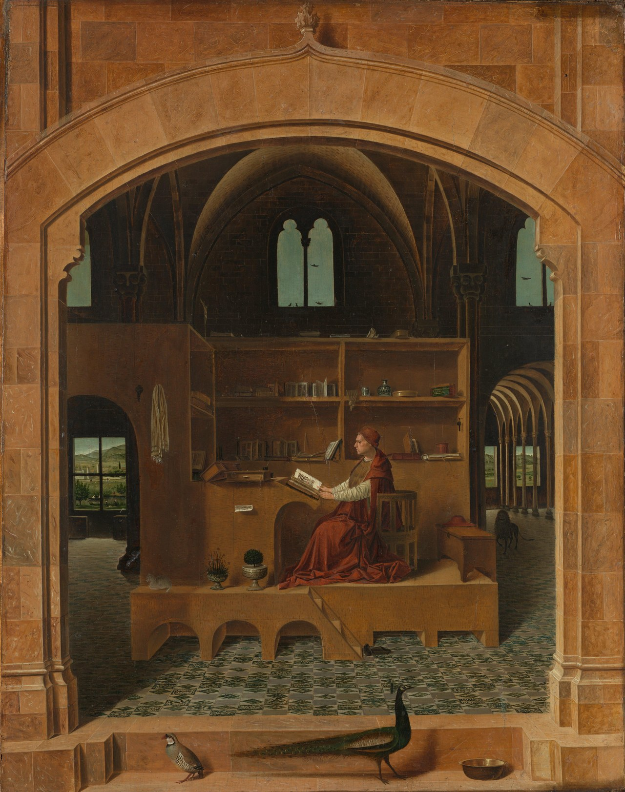</picture>
<figcaption><i>Saint Jerome in His Study</i>, by <b>Antonello da Messina</b>, about 1475. The saint's study is a wooden platform set inside a vast church, and a lion pads through the shadows on the right. The tiny panel was once thought to be by Jan van Eyck or Hans Memling. National Gallery, London. Image: <a href="https://commons.wikimedia.org/wiki/File:Antonello_da_Messina_-_St_Jerome_in_his_study_-_National_Gallery_London.jpg">Antonello da Messina - St Jerome in his study - National Gallery London</a>, public domain, via Wikimedia Commons.</figcaption>
</figure>

<figure class=photo>
<picture><source srcset="/static/art/jerome-van-eyck-600.webp 600w,/static/art/jerome-van-eyck.webp 1280w" sizes="(max-width:760px) 100vw,760px" type="image/webp">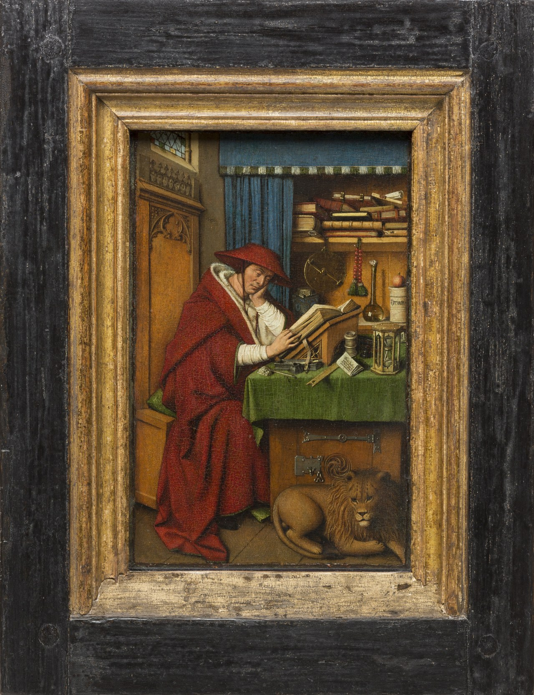</picture>
<figcaption><i>Saint Jerome in His Study</i>, by <b>Jan van Eyck</b> and his workshop, about 1435–42, a panel only about 20 cm high. The date painted on the wall, 1442, is after van Eyck's death. Detroit Institute of Arts. Image: <a href="https://commons.wikimedia.org/wiki/File:Jan_van_Eyck_-_Saint_Jerome_in_His_Study_-_25.4_-_Detroit_Institute_of_Arts.jpg">Jan van Eyck - Saint Jerome in His Study - 25.4 - Detroit Institute of Arts</a>, public domain, via Wikimedia Commons.</figcaption>
</figure>

<figure class=photo>
<picture><source srcset="/static/art/jerome-ghirlandaio-600.webp 600w,/static/art/jerome-ghirlandaio.webp 1280w" sizes="(max-width:760px) 100vw,760px" type="image/webp">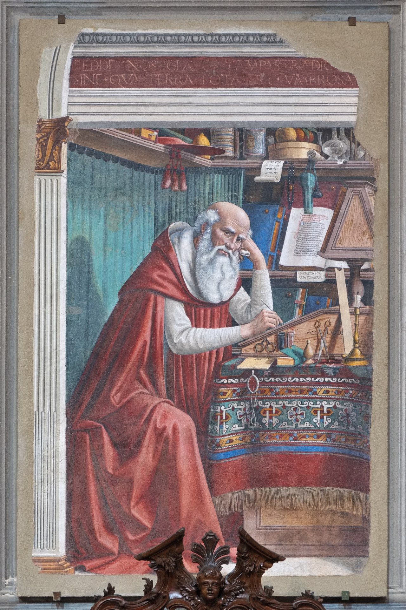</picture>
<figcaption><i>Saint Jerome in His Study</i>, the fresco by <b>Domenico Ghirlandaio</b>, dated 1480 on the desk. Look for the spectacles and scissors on the desk, and the notes in Hebrew and Greek above. It was painted for the Vespucci family as a pair with Botticelli's Augustine. Church of Ognissanti, Florence. Photo: <a href="https://commons.wikimedia.org/wiki/File:Domenico_Ghirlandaio,_St_Jerome_in_His_Study,_1480,_Ognissanti,_Florence.jpg">Domenico Ghirlandaio, St Jerome in His Study, 1480, Ognissanti, Florence</a> by Armin Kleiner, <a href="https://creativecommons.org/licenses/by-sa/4.0">CC BY-SA 4.0</a>, via Wikimedia Commons.</figcaption>
</figure>

<figure class=photo>
<picture><source srcset="/static/art/jerome-botticelli-600.webp 600w,/static/art/jerome-botticelli.webp 1280w" sizes="(max-width:760px) 100vw,760px" type="image/webp">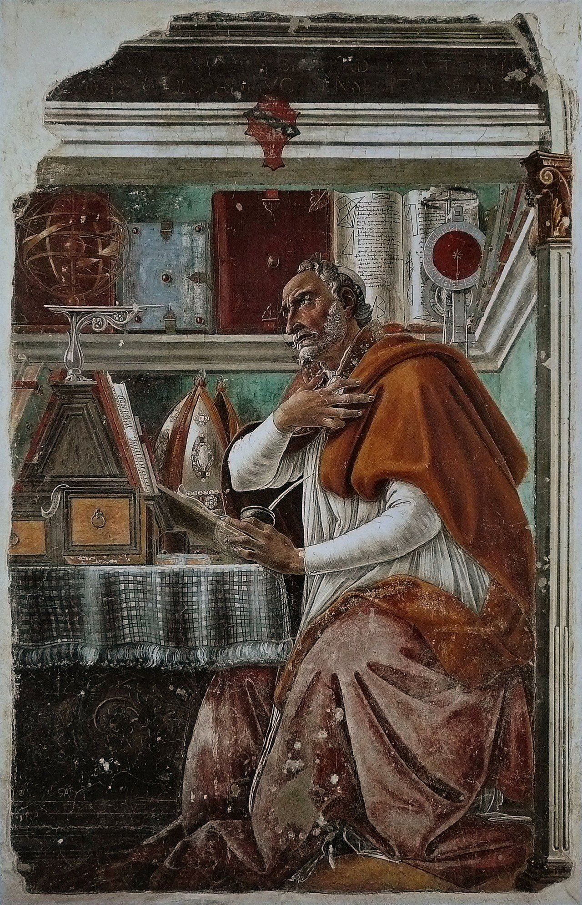</picture>
<figcaption><i>Saint Augustine in His Study</i>, by <b>Sandro Botticelli</b>, 1480. Augustine looks up, startled, at the moment when, by legend, he learned of Jerome's death in a vision of light. It faces Ghirlandaio's Jerome across the nave. Church of Ognissanti, Florence. Image: <a href="https://commons.wikimedia.org/wiki/File:Sandro_Botticelli_-_Saint_Augustin.jpg">Sandro Botticelli - Saint Augustin</a>, public domain, via Wikimedia Commons.</figcaption>
</figure>

<figure class=photo>
<picture><source srcset="/static/art/jerome-durer-lisbon-600.webp 600w,/static/art/jerome-durer-lisbon.webp 1280w" sizes="(max-width:760px) 100vw,760px" type="image/webp">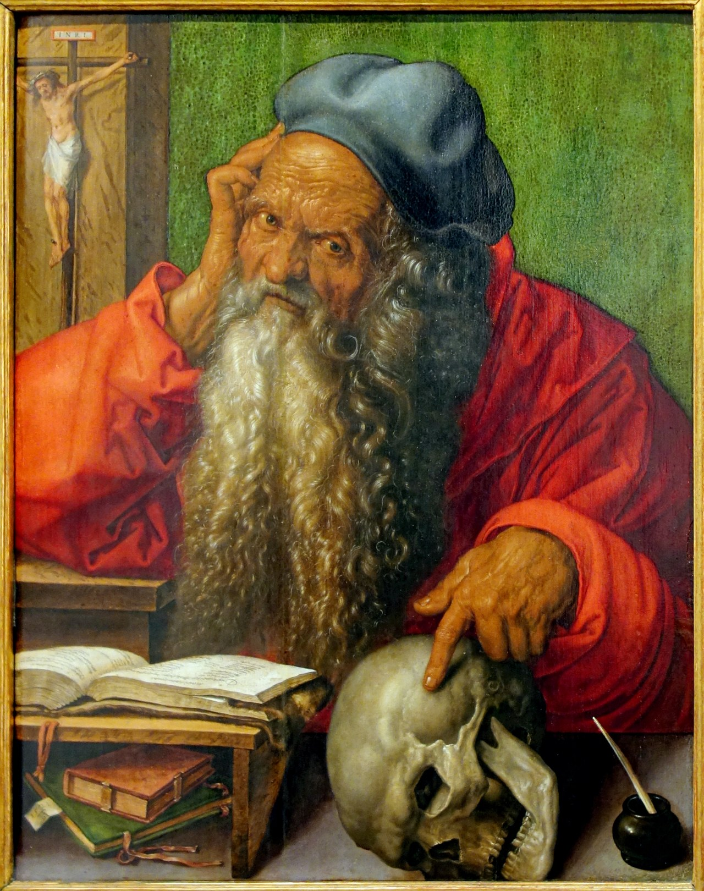</picture>
<figcaption><i>Saint Jerome</i>, by <b>Albrecht Dürer</b>, 1521. Dürer painted it during his journey to the Low Countries, using as his model an old man of ninety-three, and gave it to Rui Fernandes de Almada, a Portuguese official in Antwerp. Jerome points to the skull: remember that you must die. Museu Nacional de Arte Antiga, Lisbon. Image: <a href="https://commons.wikimedia.org/wiki/File:Albrecht_D%C3%BCrer_035.jpg">Albrecht Dürer 035</a>, public domain, via Wikimedia Commons.</figcaption>
</figure>

<figure class=photo>
<picture><source srcset="/static/art/jerome-caravaggio-valletta-600.webp 600w,/static/art/jerome-caravaggio-valletta.webp 1280w" sizes="(max-width:760px) 100vw,760px" type="image/webp">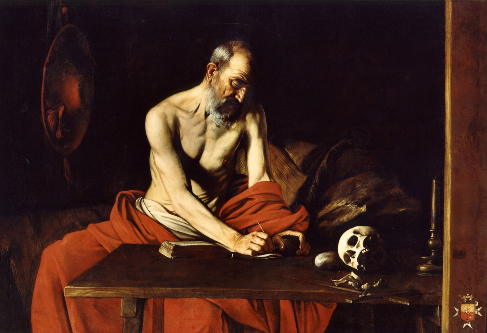</picture>
<figcaption><i>Saint Jerome Writing</i>, by <b>Caravaggio</b>, 1607–08, painted in Malta for one of the Knights of St John. Like the painting at the top of this page, from the Galleria Borghese, it shows the old man absorbed in his work, with the skull close at hand. St John's Co-Cathedral, Valletta. Image: <a href="https://commons.wikimedia.org/wiki/File:Caravaggio_-_Saint_Jerome_in_his_study_-_Oratory_of_St_John_the_Baptist,_St_John%E2%80%99s_Co-Cathedral,_Valletta.jpg">Caravaggio - Saint Jerome in his study - Oratory of St John the Baptist, St John’s Co-Cathedral, Valletta</a>, public domain, via Wikimedia Commons.</figcaption>
</figure>

### The penitent in the wilderness

<figure class=photo>
<picture><source srcset="/static/art/jerome-bellini-600.webp 600w,/static/art/jerome-bellini.webp 1280w" sizes="(max-width:760px) 100vw,760px" type="image/webp">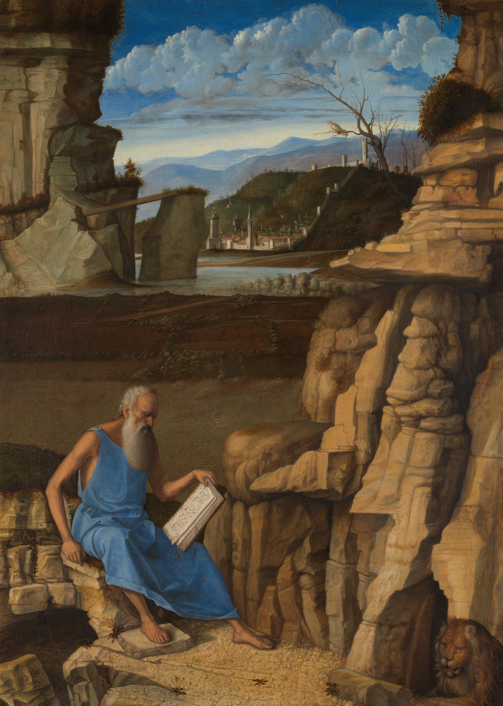</picture>
<figcaption><i>Saint Jerome reading in a Landscape</i>, by <b>Giovanni Bellini</b>, about 1480–85. The hermit reads peacefully in the desert, and the whole bright world of Venice's mainland seems to rest around him. National Gallery, London. Image: <a href="https://commons.wikimedia.org/wiki/File:Bellini,_Giovanni_-_Saint_Jerome_reading_in_a_landscape_-_National_Gallery.jpg">Bellini, Giovanni - Saint Jerome reading in a landscape - National Gallery</a>, public domain, via Wikimedia Commons.</figcaption>
</figure>

<figure class=photo>
<picture><source srcset="/static/art/jerome-bosch-600.webp 600w,/static/art/jerome-bosch.webp 1280w" sizes="(max-width:760px) 100vw,760px" type="image/webp">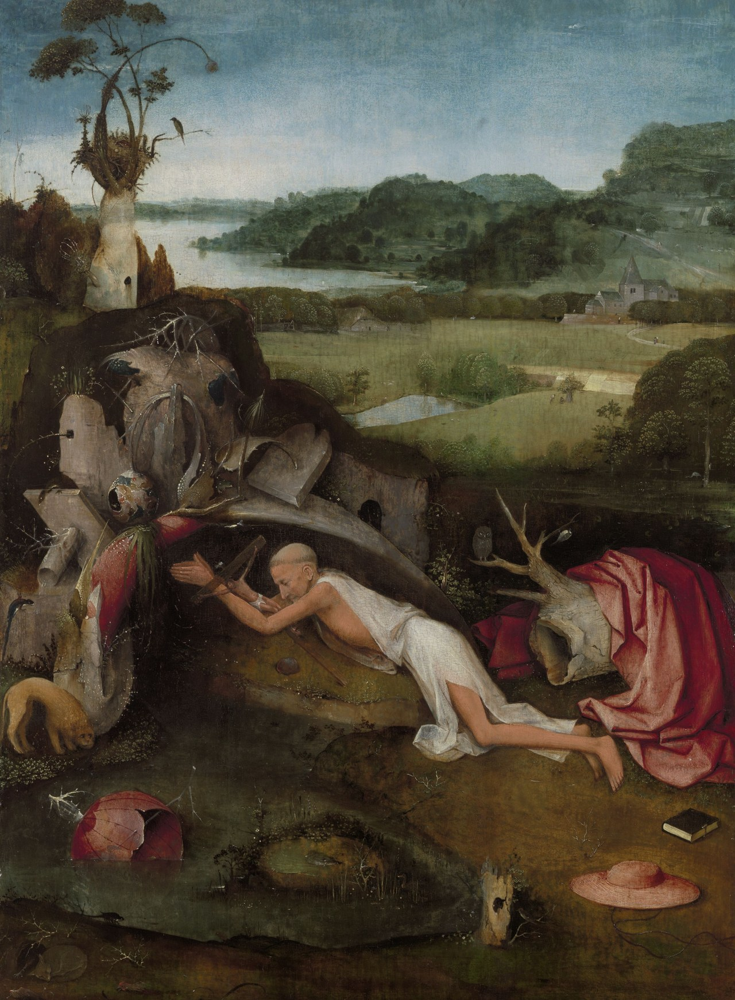</picture>
<figcaption><i>Saint Jerome at Prayer</i>, by <b>Hieronymus Bosch</b>, about 1485–95. Bosch's own first name, Jheronimus, was Jerome. The saint lies flat on the ground clasping the crucifix, while strange signs of sin rot away around him. Museum of Fine Arts (MSK), Ghent. Image: <a href="https://commons.wikimedia.org/wiki/File:Jheronimus_Bosch_-_Saint_Jerome_-_1908-H_-_Museum_of_Fine_Arts_Ghent_(MSK).jpg">Jheronimus Bosch - Saint Jerome - 1908-H - Museum of Fine Arts Ghent (MSK)</a>, public domain, via Wikimedia Commons.</figcaption>
</figure>

<figure class=photo>
<picture><source srcset="/static/art/jerome-la-tour-600.webp 600w,/static/art/jerome-la-tour.webp 1280w" sizes="(max-width:760px) 100vw,760px" type="image/webp">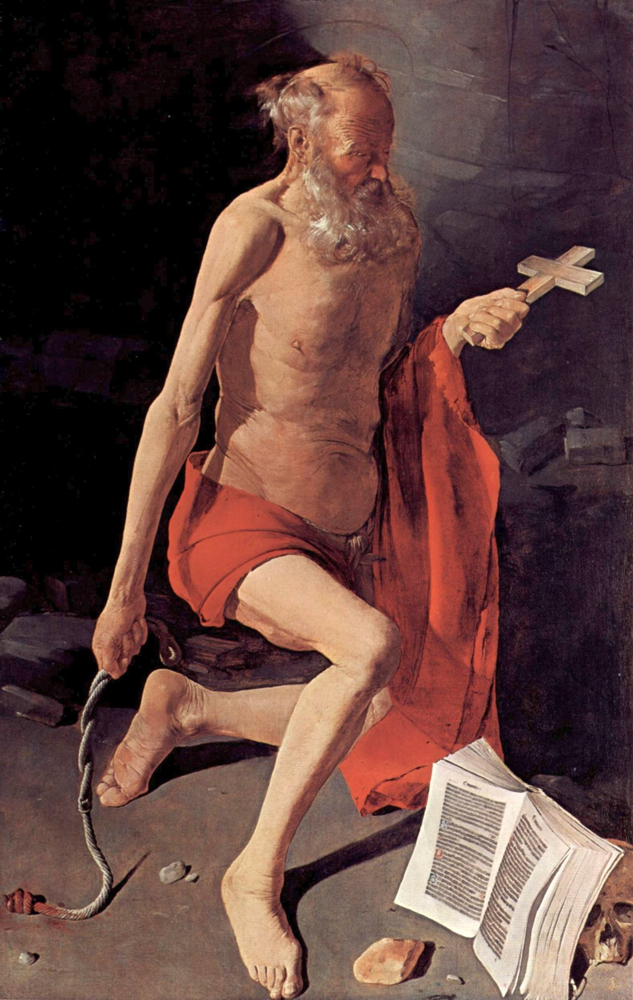</picture>
<figcaption><i>Saint Jerome Penitent</i>, by <b>Georges de La Tour</b>, about 1630–35. There is no lion and no study: only an old man, a cross, a scourge and his Bible. Musée de Grenoble. Image: <a href="https://commons.wikimedia.org/wiki/File:Georges_de_La_Tour_011.jpg">Georges de La Tour 011</a>, public domain, via Wikimedia Commons.</figcaption>
</figure>

<figure class=photo>
<picture><source srcset="/static/art/jerome-ribera-600.webp 600w,/static/art/jerome-ribera.webp 1280w" sizes="(max-width:760px) 100vw,760px" type="image/webp">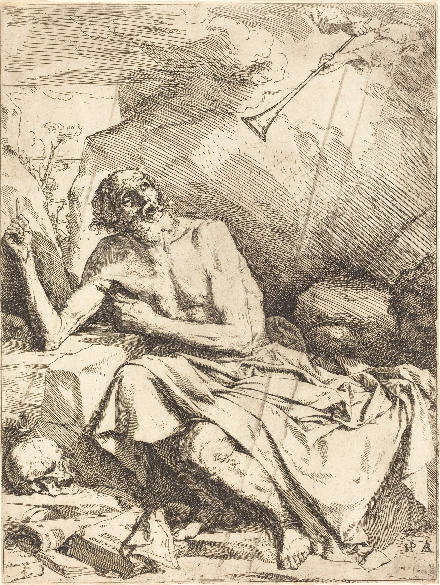</picture>
<figcaption><i>Saint Jerome Hearing the Trumpet of the Last Judgement</i>, the etching by <b>Jusepe de Ribera</b>, 1621. A saying long attributed to Jerome tells how, whatever he did, he seemed to hear the trumpet calling the dead to judgement. National Gallery of Art, Washington. Image: <a href="https://commons.wikimedia.org/wiki/File:Jusepe_de_Ribera,_Saint_Jerome_Hearing_the_Trumpet_of_the_Last_Judgment,_1621,_NGA_10152.jpg">Jusepe de Ribera, Saint Jerome Hearing the Trumpet of the Last Judgment, 1621, NGA 10152</a>, <a href="https://creativecommons.org/publicdomain/zero/1.0/">CC0</a>, via Wikimedia Commons.</figcaption>
</figure>

## Path to sainthood
Venerated as a saint from the time of his death, long before formal canonisation existed. He is one of the four great Latin Doctors of the Church, a title confirmed for him by Pope Boniface VIII in **1298**. His feast on **30 September**, the day of his death, is a memorial in the General Roman Calendar. The Eastern Orthodox churches honour him on **15 June**.

## Patronages
**Translators**, **librarians**, **scholars** and students of Scripture; archivists, archaeologists and **Bible scholars**; Since 2017 the United Nations has marked his feast, 30 September, as **International Translation Day**.

## Trivia
- His Latin name was *Eusebius Hieronymus*, from the Greek for "holy name." The English "Jerome," the Italian "Girolamo," the Spanish "Jerónimo" and the Croatian "Jeronim" all come from it.
- The famous phrase from the dream, *Ciceronianus es, non Christianus*, is told by Jerome himself in his Letter 22, to Eustochium.
- He wrote that a translator should translate "sense for sense," except in Scripture, "where even the order of the words is a mystery."
- His dispute with Augustine over the plant in Jonah 4:6, "ivy" or "gourd," is one of the earliest arguments about a Bible translation on record.
- The Codex Amiatinus, the oldest complete Latin Bible in one volume, was made in England about 700 and weighs over 34 kilograms (75 lb).
- The painter Hieronymus Bosch was named after him, and the Apache leader Geronimo was known by the Spanish form of his name.
- Other Doctors of the Church on this site: [St Ambrose](/saints/ambrose/), [St Augustine](/saints/augustine/), [St Gregory the Great](/saints/gregory-the-great/), his teacher [St Gregory Nazianzen](/saints/gregory-nazianzen/), and [St Athanasius](/saints/athanasius/), who first made the monks of Egypt known in the West. Read also of [St Anthony the Abbot](/saints/anthony-the-abbot/), father of all the hermits Jerome admired.

## Sources
- [Pope Francis, apostolic letter *Scripturae Sacrae Affectus* on the 1600th anniversary of the death of St Jerome (30 September 2020)](https://www.vatican.va/content/francesco/en/apost_letters/documents/papa-francesco-lettera-ap_20200930_scripturae-sacrae-affectus.html)
- [Pope Benedict XVI, General Audience of 7 November 2007: St Jerome (1)](https://www.vatican.va/content/benedict-xvi/en/audiences/2007/documents/hf_ben-xvi_aud_20071107.html)
- [Pope Benedict XVI, General Audience of 14 November 2007: St Jerome (2)](https://www.vatican.va/content/benedict-xvi/en/audiences/2007/documents/hf_ben-xvi_aud_20071114.html)
- [Second Vatican Council, *Dei Verbum*, 25](https://www.vatican.va/archive/hist_councils/ii_vatican_council/documents/vat-ii_const_19651118_dei-verbum_en.html)
- [Vatican News: St Jerome, Priest and Doctor of the Church](https://www.vaticannews.va/en/saints/09/30/st--jerome--priest-and-doctor-of-the-church.html)
- [Catholic Encyclopedia: St Jerome](https://www.newadvent.org/cathen/08341a.htm)
- [Catholic Encyclopedia: Doctors of the Church](https://www.newadvent.org/cathen/05075a.htm)
- [Catholic Encyclopedia: Vulgate](https://www.newadvent.org/cathen/15515b.htm)
- [Encyclopaedia Britannica: St Jerome (W. J. Burghardt)](https://www.britannica.com/biography/Saint-Jerome)
- [Jerome, Letter 15, to Pope Damasus](https://www.newadvent.org/fathers/3001015.htm)
- [Jerome, Letter 22, to Eustochium (the dream)](https://www.newadvent.org/fathers/3001022.htm)
- [Jerome, Letter 125, to Rusticus (learning Hebrew)](https://www.newadvent.org/fathers/3001125.htm)
- [Jerome, Letter 127, to Principia (Marcella and the sack of Rome)](https://www.newadvent.org/fathers/3001127.htm)
- [Jerome, Letter 108, to Eustochium (the life of Paula)](https://www.newadvent.org/fathers/3001108.htm)
- [Paula and Eustochium, Letter 46, to Marcella (Bethlehem)](https://www.newadvent.org/fathers/3001046.htm)
- [Jerome, Letter 53, to Paulinus](https://www.newadvent.org/fathers/3001053.htm)
- [Jerome, Letter 84, to Pammachius and Oceanus (Baraninas)](https://www.newadvent.org/fathers/3001084.htm)
- [Jerome, Letter 57, to Pammachius (on the best method of translating)](https://www.newadvent.org/fathers/3001057.htm)
- [Jerome, Letter 58, to Paulinus](https://www.newadvent.org/fathers/3001058.htm)
- [Jerome, *De Viris Illustribus* (Lives of Illustrious Men)](https://www.newadvent.org/fathers/2708.htm)
- [Augustine, Letter 71, to Jerome (the gourd at Oea)](https://www.newadvent.org/fathers/1102071.htm)
- [Jerome, Letter 75 in Augustine's collection (ivy or gourd)](https://www.newadvent.org/fathers/1102075.htm)
- [Jerome, Letter 172 in Augustine's collection (416)](https://www.newadvent.org/fathers/1102172.htm)
- [Jerome, Letter 195 in Augustine's collection (418)](https://www.newadvent.org/fathers/1102195.htm)
- [Orthodox Church in America: St Jerome (Hieronymus) of Stridon, 15 June](https://www.oca.org/saints/lives/2026/06/15/101732-saint-jerome-hieronymus-of-stridon)
- [Council of Trent, Fourth Session (8 April 1546)](https://www.papalencyclicals.net/councils/trent/fourth-session.htm)
- [Jacobus de Voragine, *The Golden Legend*, vol. 5 (Caxton's translation): the life of St Jerome](https://sourcebooks.fordham.edu/basis/goldenlegend/GoldenLegend-Volume5.asp)
- [Wikipedia: Gerasimus of the Jordan](https://en.wikipedia.org/wiki/Gerasimus_of_the_Jordan)
- [Wikipedia: Stridon](https://en.wikipedia.org/wiki/Stridon)
- [United Nations: International Translation Day](https://www.un.org/en/observances/international-translation-day)
- [Basilica of Santa Maria Maggiore: Museum](https://www.basilicasantamariamaggiore.va/en/polo-museale/museo-storico.html)
- [UNESCO: Birthplace of Jesus, Church of the Nativity and the Pilgrimage Route, Bethlehem](https://whc.unesco.org/en/list/1433)
- [UNESCO: Archaeological Area and the Patriarchal Basilica of Aquileia](https://whc.unesco.org/en/list/825)
- [UNESCO: Roman Monuments, Cathedral of St Peter and Church of Our Lady in Trier](https://whc.unesco.org/en/list/367)
- [Wikipedia: Church of Saint Catherine, Bethlehem](https://en.wikipedia.org/wiki/Church_of_Saint_Catherine,_Bethlehem)
- [Wikipedia: San Girolamo dei Croati](https://en.wikipedia.org/wiki/San_Girolamo_dei_Croati)
- [Wikipedia: San Girolamo della Carità](https://en.wikipedia.org/wiki/San_Girolamo_della_Carit%C3%A0)
- [Wikipedia: Sixto-Clementine Vulgate](https://en.wikipedia.org/wiki/Sixto-Clementine_Vulgate)
- [Wikipedia: Codex Amiatinus](https://en.wikipedia.org/wiki/Codex_Amiatinus)
- [Wikipedia: Vivian Bible](https://en.wikipedia.org/wiki/Vivian_Bible)
- [Vatican Museums: Leonardo da Vinci, *St Jerome*](https://www.museivaticani.va/content/museivaticani/en/collezioni/musei/la-pinacoteca/sala-ix---secolo-xv-xvi/leonardo-da-vinci--s--girolamo.html)
- [Galleria Borghese: Caravaggio, *San Girolamo*](https://www.collezionegalleriaborghese.it/opere/san-girolamo)
- [National Gallery, London: Antonello da Messina, *Saint Jerome in his Study*](https://www.nationalgallery.org.uk/paintings/antonello-da-messina-saint-jerome-in-his-study)
- [National Gallery, London: Giovanni Bellini, *Saint Jerome reading in a Landscape*](https://www.nationalgallery.org.uk/paintings/giovanni-bellini-saint-jerome-reading-in-a-landscape)
- [National Gallery of Art, Washington: Albrecht Dürer, *Saint Jerome in His Study*](https://www.nga.gov/collection/art-object-page.6642.html)
- [National Gallery of Art, Washington: Zurbarán, *Saint Jerome with Saint Paula and Saint Eustochium*](https://www.nga.gov/collection/art-object-page.41703.html)
- [National Gallery of Art, Washington: Ribera, *Saint Jerome Hearing the Trumpet of the Last Judgment*](https://www.nga.gov/collection/art-object-page.10152.html)
- [Museu Nacional de Arte Antiga, Lisbon: Albrecht Dürer, *St Jerome*](http://www.museudearteantiga.pt/collections/european-painting/st-jerome.html)
- [Albertina, Vienna: Dürer, *Portrait of a 93-year-old man* (study for the St Jerome)](https://sammlungenonline.albertina.at/en/objects/13507/bildnis-eines-93jahrigen-mannes-studie-fur-das-gemalde-de)
- [MSK Ghent: Hieronymus Bosch, *Saint Jerome*](https://www.mskgent.be/en/collection/1908-h)
- [Wikipedia: Saint Jerome in His Study (after van Eyck), Detroit Institute of Arts](https://en.wikipedia.org/wiki/Saint_Jerome_in_His_Study_(after_van_Eyck))
- [Wikipedia: Saint Jerome Writing (Caravaggio, Valletta)](https://en.wikipedia.org/wiki/Saint_Jerome_Writing_(Caravaggio,_Valletta))
- [Wikipedia: Scuola di San Giorgio degli Schiavoni (Carpaccio's cycle)](https://en.wikipedia.org/wiki/Scuola_di_San_Giorgio_degli_Schiavoni)

First written from the Benedict XVI audiences and the Catholic Encyclopedia. Expanded and fact-checked November 25, 2026 with the story of his life from his own letters (15, 22, 46, 53, 57, 58, 84, 108, 125 and 127) and <i>Lives of Illustrious Men</i> and his letters with St Augustine; Pope Francis's apostolic letter <i>Scripturae Sacrae Affectus</i> and the audiences of Pope Benedict XVI; <i>Dei Verbum</i> and the Council of Trent; the Catholic Encyclopedia and Britannica; the lion legend from the <i>Golden Legend</i>, labelled as legend, with its source in the story of St Gerasimus; the history of his relics from the Basilica of Santa Maria Maggiore; the churches and places connected with him; and his portrayal in art, using museum records and Wikimedia Commons. Quotations from his letters follow the translations in the <i>Nicene and Post-Nicene Fathers</i>. The map was drawn for this page from Natural Earth data (public domain). Feast days follow the General Roman Calendar unless noted.

