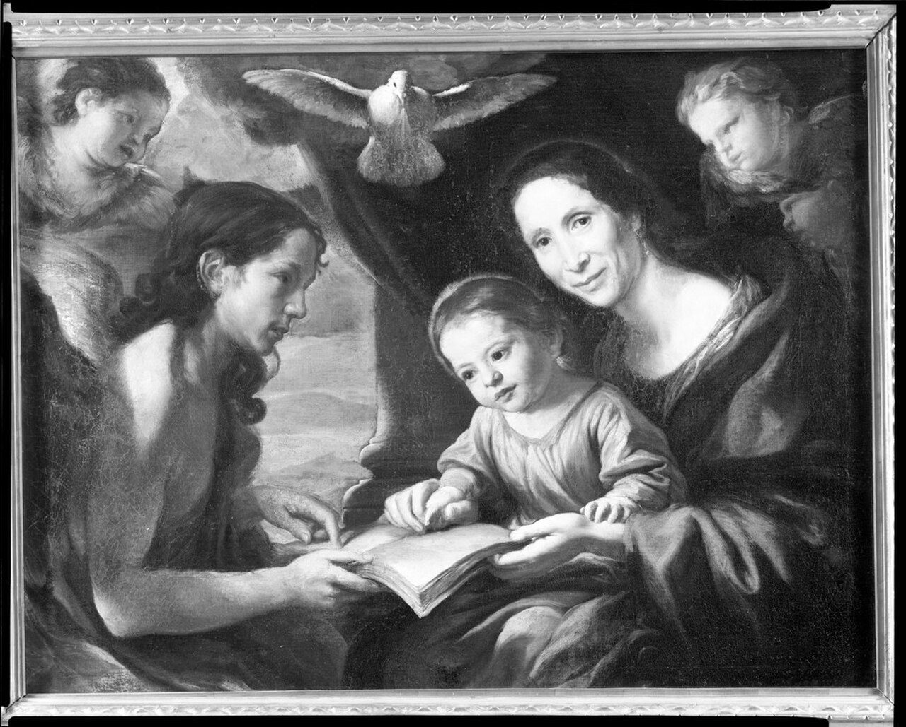

## Their story
The New Testament never names Mary's parents. What the Church has long told about them comes from the *Protoevangelium of James*, an infancy gospel usually dated to the second century. It is not Scripture. It is the book that gave them names: **Joachim** and **Anne** (Hannah), and a story shaped like the biblical stories of childless couples who are heard.

Joachim is a rich and righteous man who goes up to the Temple and is turned away, the tale says, because he has no child. He goes into the wilderness to fast. Anne stays home and grieves, and sees a sparrow's nest, and prays. An angel speaks to each of them. They hurry toward each other and meet at the Golden Gate of Jerusalem. Giotto painted that meeting on the walls of the Scrovegni Chapel around 1305: two people embracing in a gateway, the whole hope of the story in one gesture. Mary is born. Her parents present her in the Temple. The rest of the book is about Mary's childhood and the birth of Jesus, and it is full of details the Gospels do not have. The Church has loved the story without putting the book in the Bible. [Mary's](/saints/mary/) page on this site says the same thing in one sentence. This page is the longer saying of it.

A devotion to her mother is very old in the East: by the sixth century a church of St Anne stood in Constantinople. In the West Anne's cult grew strong in the later Middle Ages, when the "holy kinship" became a favourite subject for altarpieces. Joachim was slower to receive his own feast. For a long time Anne was kept on **26 July** and Joachim on **16 August**. The Roman calendar of 1969 joined them on 26 July, which is the date this site uses.

## Two cults, one legend
Anne became the grandmother people prayed to: for a child, for a safe birth, for a marriage, for the household. Joachim remained the quieter figure, the grandfather at the gate. Shrines claimed Anne's relics, notably at Apt in Provence, with a story that they had come from the East. In 1625, at Auray in Brittany, a farmer named Yvon Nicolazic said St Anne had told him where a statue of her was buried. Ste-Anne-d'Auray grew from that report, a devotion of the seventeenth century alongside the old story of the gate.

## Path to sainthood
Pre-Congregation, by long public devotion, not by a modern process and not by a verse of Scripture that names them. The Roman calendar remembers them together on **26 July** as the parents of the Blessed Virgin Mary.

## Patronages
Anne: grandmothers, mothers, women in labour, and homemakers. Joachim: grandfathers and fathers. Together they are the saints people ask to watch a family line.

## Trivia
- "Anne" is the Greek form of Hannah, the mother of Samuel, and the Protoevangelium wants the reader to hear that echo.
- Giotto's cycle in Padua gives Joachim several scenes before Mary is born. The Golden Gate is the one Europe remembered.
- A picture of Anne teaching Mary to read is a favourite of the later Middle Ages. It is a devotion, not a scene the Gospels describe.

<figure class=photo>
<picture><source srcset="/static/art/anne-teaching-600.webp 600w,/static/art/anne-teaching.webp 1280w" sizes="(max-width:760px) 100vw,760px" type="image/webp"></picture>
<figcaption>Antonio Gherardi (1638–1702), <em>Saint Anne Teaching the Virgin to Read</em>, Harvard Art Museums. The grandmother and the book, a devotion of later centuries. Public domain, via <a href="https://commons.wikimedia.org/wiki/File:Antonio_Gherardi_-_Saint_Anne_Teaching_the_Virgin_to_Read_-_1957.125_-_Fogg_Museum.jpg">Wikimedia Commons</a>.</figcaption>
</figure>

## Sources
- The *Protoevangelium of James* (second century), an apocryphal infancy gospel, not canonical
- [Catholic Encyclopedia: St Anne](https://www.newadvent.org/cathen/01538a.htm)
- [Vatican News: Sts Joachim and Anne](https://www.vaticannews.va/en/saints/07/26/sts--joachim-and-anne--parents-of-the-blessed-virgin-mary.html)

Fact-checked on November 6, 2026 against the Protoevangelium's place in the Church's memory, New Advent, and Vatican News. The book is not treated as Scripture.

