<nav class=toc aria-label="On this page">

On this page

<ol>
<li><a href="#why">Why the Church honours him</a></li>
<li><a href="#stable">Born in a stable</a></li>
<li><a href="#boccaperta">"Bocca aperta": the open-mouthed boy</a></li>
<li><a href="#rejected">"Good for nothing"</a></li>
<li><a href="#mule">The friar who tended the mule</a></li>
<li><a href="#exams">The exam miracle</a></li>
<li><a href="#grottella">"My Mother" of the Grottella</a></li>
<li><a href="#christmas">Christmas night: flying to the altar</a></li>
<li><a href="#cross">Lifting the great cross</a></li>
<li><a href="#heaven">"How beautiful God has made heaven"</a></li>
<li><a href="#naples">Before the Inquisition at Naples</a></li>
<li><a href="#pope">Rising before Pope Urban VIII</a></li>
<li><a href="#assisi">Assisi: the dark night and the dawn</a></li>
<li><a href="#ambassador">The Spanish ambassador</a></li>
<li><a href="#brunswick">"The deer is wounded": the Duke of Brunswick</a></li>
<li><a href="#humble">"Brother ass"</a></li>
<li><a href="#hidden">Hidden in the mountains</a></li>
<li><a href="#osimo">Osimo and the angels of Loreto</a></li>
<li><a href="#death">"Behold, my delight"</a></li>
<li><a href="#glory">Blessed, then saint</a></li>
<li><a href="#places">His places and churches</a></li>
<li><a href="#art">Joseph in art</a></li>
</ol>
</nav>

## His story

On a Christmas Eve in the little friary of the Grottella, outside the town of Copertino in the heel of Italy, shepherds came down from the hills to honour the newborn Christ with bagpipes and flutes. As they played, one of the friars began to dance for joy. Then, with a great cry, he "flew as a bird through the air from the middle of the church to the high altar", and knelt there in the air among the lighted candles for about a quarter of an hour without burning his habit. "The shepherds marvelled exceedingly."

That friar was Joseph of Cupertino, and the shepherds were neither the first nor the last to marvel. He had been born in a stable, like the Child he loved. As a boy he was so slow and so lost in God that the other children called him "Open Mouth". The Capuchins sent him away as good for nothing; the Conventual Franciscans let him in to look after their mule. He passed his examinations for the priesthood only because God, it seemed, let the bishop ask him the one thing he knew.

Then the wonders began. At the name of Jesus or Mary, at a hymn, at a holy picture, he was rapt out of himself, and very often lifted into the air: to the altar, to the pulpit, to a statue of Our Lady, into an olive tree. More than seventy such flights were recorded at Copertino alone. A pope saw him rise, and so did a Spanish ambassador and a Lutheran duke who became a Catholic because of what he saw. The Inquisition examined him and found no fault, and then, to keep the crowds away, hid him for the rest of his life in quiet friaries at Assisi, in the mountains of the Marches, and finally at Osimo, where he died on 18 September 1663. The Church declared him blessed in 1753 and a saint in 1767. Today the "Flying Friar" is the patron of students and of everyone facing an examination, and of air travellers, pilots and astronauts.

### 17 June 1603 · Born in a stable
Giuseppe Desa is born at Copertino, in the Kingdom of Naples, in a stable, because his dead father's creditors have driven his mother from her home.

### c. 1611 · First ecstasies
At about eight he begins to be rapt in God at the sound of the organ or of hymns. The other boys call him "bocca aperta", "open mouth".

### August 1620 · The Capuchins
He is received as a lay brother, Brother Stephen, by the Capuchins at Martina, and sent away eight months later as unfit.

### 1620s · The mule of the Grottella
His mother obtains his admission as a tertiary at the Conventual friary of Santa Maria della Grottella, where he tends the mule.

### 19 June 1625 · A cleric
Received into the Order as a cleric, he makes his novitiate at the Grottella.

### 28 March 1628 · A priest
After the "exam miracle", he is ordained a priest. He lives at the Grottella for about sixteen years, and the flights begin.

### 21 October 1638 · Naples
Denounced as drawing the people after him, he sets out to face the Inquisition at Naples. He is examined three times and found blameless.

### 1639 · Rome
Kissing the feet of Pope Urban VIII, he is rapt into the air. The Pope sends him to Assisi, where he arrives on 30 April 1639.

### 1645 · Visitors of rank
The High Admiral of Castile, Spanish ambassador to the Holy See, sees him fly over the heads of the people to a statue of the Immaculate Conception.

### 1649–1650 · The Duke of Brunswick
John Frederick, Duke of Brunswick, a Lutheran, sees him rise at Mass and is received into the Catholic Church.

### 23 July 1653 · Hidden away
By order of the Holy Office he is taken secretly to the Capuchin friary of Pietrarubbia, then to Fossombrone, where he lives for about three years.

### July 1657 · Osimo
Pope Alexander VII sends him back to his own Conventual brethren, at Osimo in the Marches.

### 18 September 1663 · His death
He dies at Osimo, sixty years old, at the words of the hymn "Ave Maris Stella".

### 24 February 1753 · Blessed
Pope Benedict XIV beatifies him in St Peter's.

### 16 July 1767 · Saint
Pope Clement XIII canonises him in St Peter's.

<h2 id=why>Why the Church honours him</h2>

- **Holiness in littleness.** The boy who could not tell rye bread from wheat, who broke the dishes and forgot to eat, became a saint by giving God everything he had, and God filled his emptiness with wisdom and love.
- **Love that lifted him from the earth.** His ecstasies and flights were the overflow of a heart on fire with the love of God. A Jesuit who knew him said his heart was "more disposed to this union than powder is to be ignited by the smallest spark".
- **Obedience.** At one word from his superior he came back from the highest ecstasy. He went without complaint wherever the Church sent him, even into hiding for the last ten years of his life.
- **Humility.** He called himself "brother ass" and the greatest of sinners, hid his gifts as far as he could and wept when great people came to see him.
- **Devotion to the Eucharist and to Mary.** The Mass, Christ in the Blessed Sacrament and "my Mother", Our Lady, were the centre of his life. Many of his flights were to the altar or to an image of the Virgin.
- **A friend of the struggling.** Because God helped him through his examinations, students, pupils and everyone facing a test have asked his help for more than three centuries.

<h2 id=stable>Born in a stable</h2>

Copertino is a small town on the flat red earth of the Salento, the heel of Italy, among olive groves and vineyards a few miles inland from the Ionian Sea. In 1603 it belonged to the Kingdom of Naples. Joseph's father, **Felice Desa**, was a poor carpenter who died before his son was born, leaving debts, and his creditors seized the family house. His wife **Franceschina Panaca**, near her time, had to take shelter in a stable, and there, on 17 June 1603, she gave birth to a son. He was baptised the same day by the archpriest of Copertino and named Giuseppe Maria, Joseph Mary.

<figure class=photo>
<picture><source srcset="/static/art/joc-baptism-600.webp 600w,/static/art/joc-baptism.webp 1200w" sizes="(max-width:760px) 100vw,760px" type="image/webp">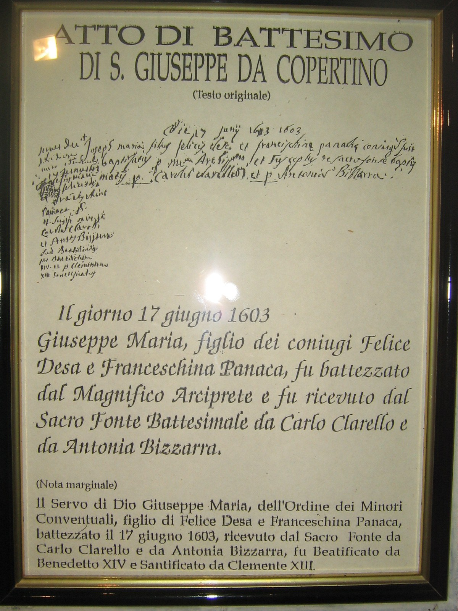</picture>
<figcaption>The record of Joseph's <b>baptism</b> at Copertino, displayed in the town. The entry for 17 June 1603 records that Giuseppe Maria, son of Felice Desa and Franceschina Panaca, was baptised by the archpriest, with Carlo Clarello and Antonia Bizzarra as godparents. Photo: <a href="https://commons.wikimedia.org/wiki/File:Atto_di_Battesimo_di_San_Giuseppe.jpg">Atto di Battesimo di San Giuseppe</a> by Lupiae, public domain, via Wikimedia Commons.</figcaption>
</figure>

<figure class=map style="max-width:560px;margin:14px auto 18px"><figcaption>St Joseph's Italy, from the stable at Copertino to his tomb at Osimo. Map by The Daily Word; coastlines, rivers and borders from Natural Earth (public domain). Tap to enlarge.</figcaption></figure>

The family's little house still stands, and so does the stable. After his beatification the people of Copertino built a church over the stable where he was born, the **Santuario di San Giuseppe**, finished in 1758. Inside, the humble room has been kept as it was, with its roof of straw, canes and tiles, its bare walls and its little hearth.

<figure class=photo>
<picture><source srcset="/static/art/joc-casa-paterna-600.webp 600w,/static/art/joc-casa-paterna.webp 1280w" sizes="(max-width:760px) 100vw,760px" type="image/webp">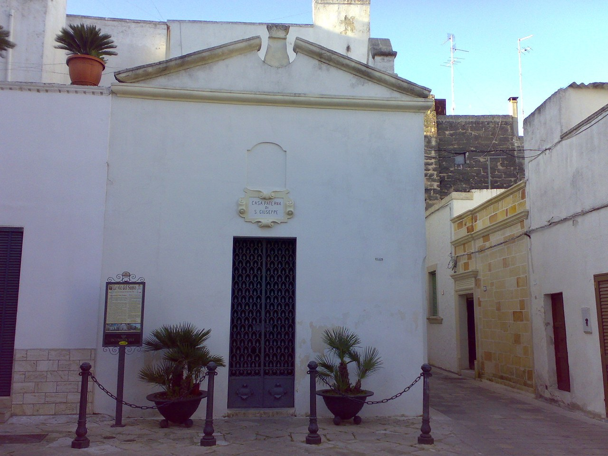</picture>
<figcaption>The <b>house of the Desa family</b> in Copertino, a single room where Felice and Francesca raised their children before the debts that drove her into the stable. Photo: <a href="https://commons.wikimedia.org/wiki/File:Casa_paterna_di_San_Giuseppe_da_Copertino.jpg">Casa paterna di San Giuseppe da Copertino</a> by Lupiae, <a href="https://creativecommons.org/licenses/by-sa/3.0">CC BY-SA 3.0</a>, via Wikimedia Commons.</figcaption>
</figure>

<figure class=photo>
<picture><source srcset="/static/art/joc-copertino-sanctuary-600.webp 600w,/static/art/joc-copertino-sanctuary.webp 1200w" sizes="(max-width:760px) 100vw,760px" type="image/webp">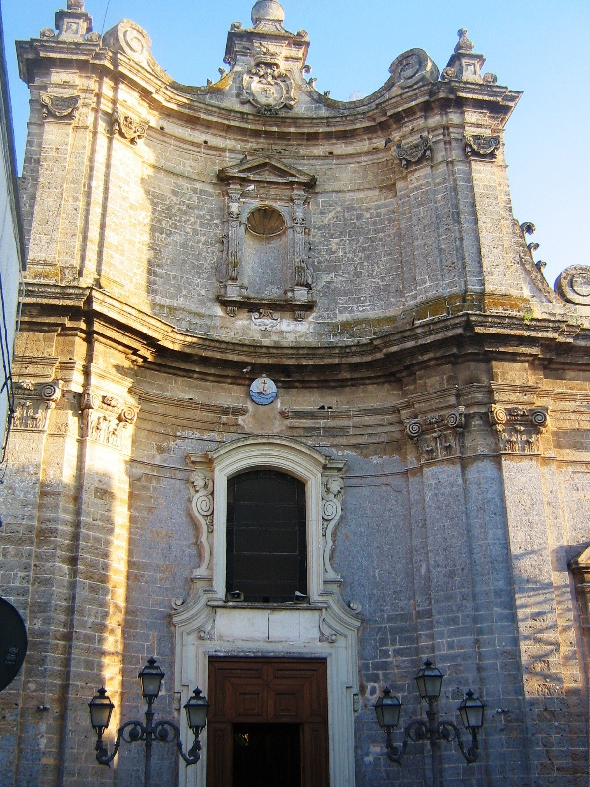</picture>
<figcaption>The <b>Santuario di San Giuseppe</b> in Copertino, built in 1754–58 over the stable where he was born. It also keeps his heart, brought from Osimo in 1953. Photo: <a href="https://commons.wikimedia.org/wiki/File:Santuario_San_Giuseppe_da_Copertino.jpg">Santuario San Giuseppe da Copertino</a> by Lupiae, public domain, via Wikimedia Commons.</figcaption>
</figure>

His mother was a devout and stern woman who brought him up strictly, for she was a widow and very poor. Joseph grew up in the shadow of the castle of Copertino, among the narrow streets of the old town.

<figure class=photo>
<picture><source srcset="/static/art/joc-copertino-castle-600.webp 600w,/static/art/joc-copertino-castle.webp 1280w" sizes="(max-width:760px) 100vw,760px" type="image/webp">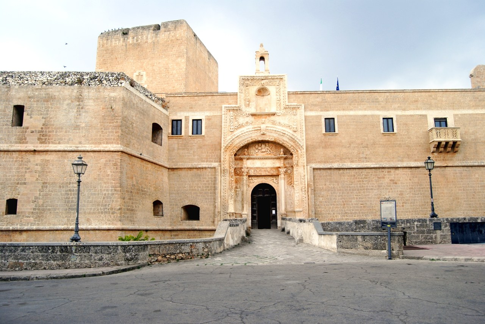</picture>
<figcaption>The great <b>castle of Copertino</b>, built in the sixteenth century, which towered over the town of Joseph's childhood. Photo: <a href="https://commons.wikimedia.org/wiki/File:Copertino_castello.jpg">Copertino castello</a> by Travel dreamer, <a href="https://creativecommons.org/licenses/by-sa/4.0">CC BY-SA 4.0</a>, via Wikimedia Commons.</figcaption>
</figure>

<h2 id=boccaperta>"Bocca aperta": the open-mouthed boy</h2>

From the age of eight Joseph began to be taken out of himself by God. At school, when he heard the organ or the singing in the church nearby, he would let his book fall, raise his eyes to heaven and stand with his lips parted, lost to everything around him. The other boys laughed at him and called him **"bocca aperta"**, "open mouth". He was so absent-minded that he would forget to eat. When asked why he had not touched his food, he answered simply, "I did not think of it."

Then for about four years he suffered from painful ulcers, and his mother had to carry him to Mass. At last a hermit near the church of **Our Lady of Grace at Galatone** anointed him with oil from the lamp that burned before her image, and he was healed. The boy who had been carried walked the nine miles home to Copertino with a cane. From then on he loved the Virgin as his mother and his healer.

<figure class=photo>
<picture><source srcset="/static/art/joc-farjat-600.webp 600w,/static/art/joc-farjat.webp 1280w" sizes="(max-width:760px) 100vw,760px" type="image/webp">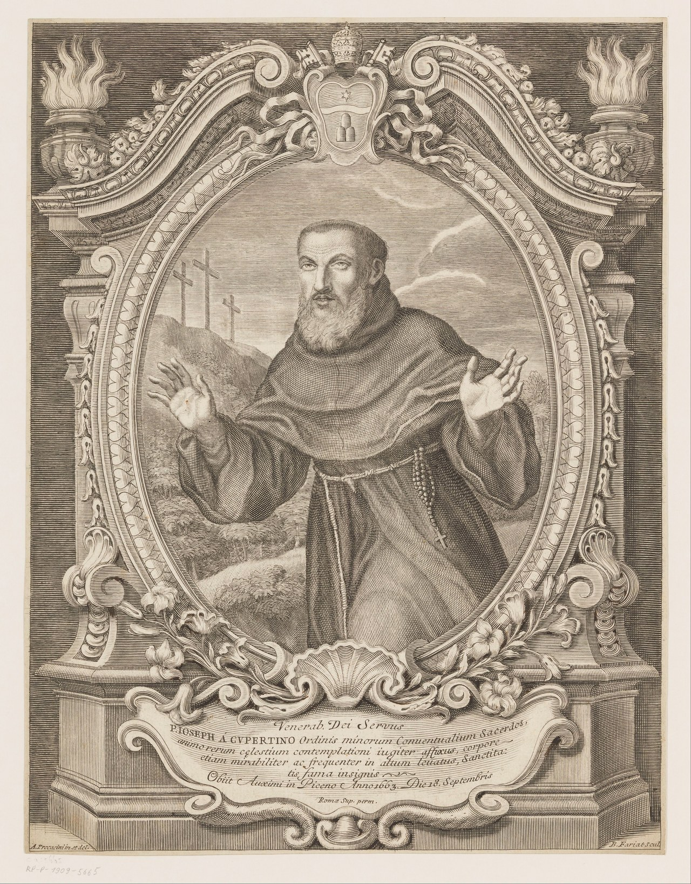</picture>
<figcaption>A portrait print of Joseph by the French engraver <b>Benoît Farjat</b>, made around 1700. His eyes raised to heaven recall the boy his schoolmates called "open mouth". Image: <a href="https://commons.wikimedia.org/wiki/File:Portret_van_Jozef_van_Cupertino_in_versierde_lijst_P._Joseph_%C3%A1_Cupertino_(titel_op_object),_RP-P-1909-5665.jpg">Portret van Jozef van Cupertino in versierde lijst P. Joseph á Cupertino (titel op object), RP-P-1909-5665</a> by Benoît Farjat, Rijksmuseum, <a href="https://creativecommons.org/publicdomain/zero/1.0/">CC0</a>, via Wikimedia Commons.</figcaption>
</figure>

He was apprenticed to a shoemaker, but his heart was elsewhere. He fasted hard, prayed long and wore a hair shirt, and he longed to give himself wholly to God as a friar.

<h2 id=rejected>"Good for nothing"</h2>

At seventeen Joseph asked to be received by the Conventual Franciscans, among whom his father's brother, Father Francis Desa, was a friar. His uncle refused to help him, judging him too ignorant. He turned instead to the **Capuchins at Martina**, who received him as a lay brother in August 1620 and gave him the name Brother Stephen.

It went badly. Lost in God, he dropped the plates, upset the pots and could not tell wheat bread from rye. After eight months the Capuchins took away his habit and sent him home as unfit. "It seemed to me," he said long afterwards, "as if my skin was torn off with the habit and my flesh rent from the bones."

<figure class=photo>
<picture><source srcset="/static/art/joc-martina-600.webp 600w,/static/art/joc-martina.webp 1280w" sizes="(max-width:760px) 100vw,760px" type="image/webp">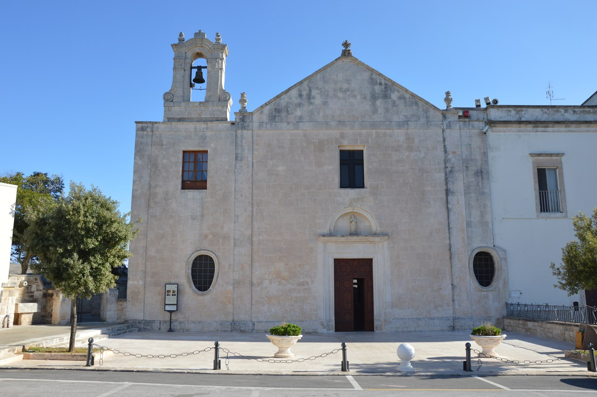</picture>
<figcaption>The Capuchin church of <b>Sant'Antonio at Martina Franca</b>, where Joseph was received as Brother Stephen in 1620 and sent away eight months later. Photo: <a href="https://commons.wikimedia.org/wiki/File:Chiesa_di_Sant%27Antonio_dei_Cappuccini.JPG">Chiesa di Sant'Antonio dei Cappuccini</a> by Caterina Castellana, <a href="https://creativecommons.org/licenses/by-sa/4.0">CC BY-SA 4.0</a>, via Wikimedia Commons.</figcaption>
</figure>

Bareheaded and barefoot, he set out to find his uncle at Vetrara. Shepherds' dogs attacked him on the way and he was taken for a spy. A terrible horseman rode at him crying "Halt, spy!" and then vanished; Joseph knew it had been the devil, trying to drive him to despair. When at last he reached his uncle and knelt before him, he was called a "good-for-nothing" and a "vagabond". He answered humbly, "The Capuchin Fathers have taken the habit from me because I am good for nothing."

<h2 id=mule>The friar who tended the mule</h2>

His mother scolded him, but she loved him dearly. She begged the authorities with tears not to imprison him for his father's debts, and with the help of her brother Father John Donatus and the friars of the **Grottella** she won him a place at their little friary outside Copertino as a tertiary, serving the house. They gave him the friary mule to look after.

Joseph was overjoyed. He went out begging alms for the friars with the mule, and he worked so humbly, prayed so fervently and was so obedient that the friars came to love him. He slept on three boards with a bearskin. On 19 June 1625 the Provincial Chapter at Altamura received him into the Order as a cleric, on the way to the priesthood. To his novice master he said: "Have patience with me, you will thus acquire merit."

<figure class=photo>
<picture><source srcset="/static/art/joc-grottella-600.webp 600w,/static/art/joc-grottella.webp 1280w" sizes="(max-width:760px) 100vw,760px" type="image/webp">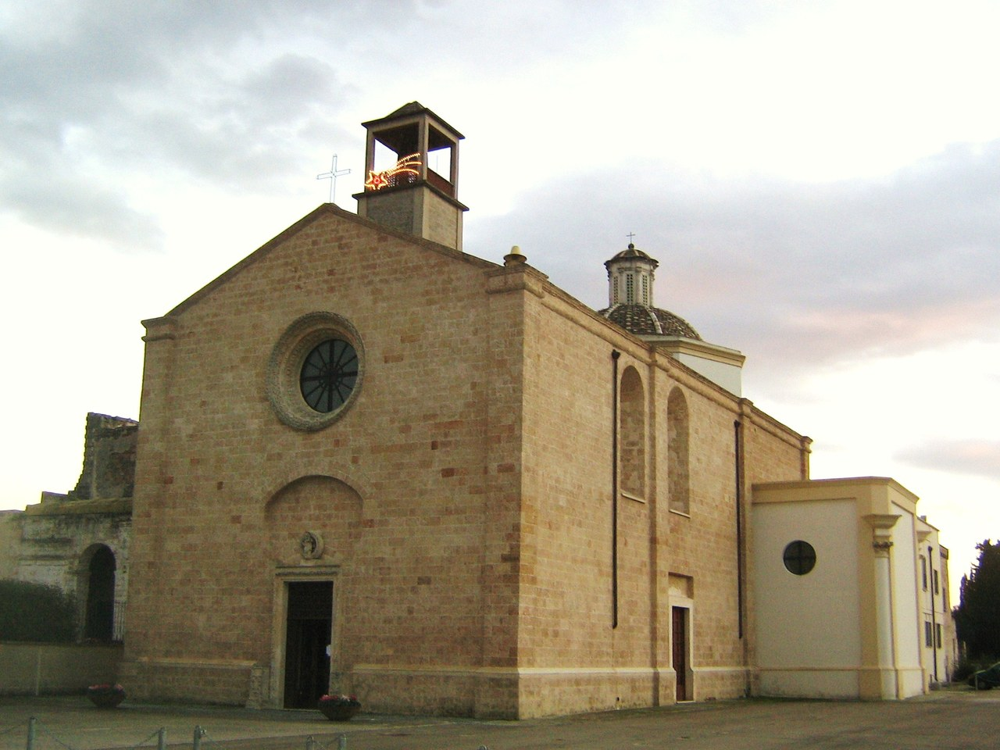</picture>
<figcaption>The <b>Santuario di Santa Maria della Grottella</b>, outside Copertino, where Joseph tended the mule, made his novitiate and lived as a priest for some sixteen years. Photo: <a href="https://commons.wikimedia.org/wiki/File:Santuario_della_Grottella_Copertino.jpg">Santuario della Grottella Copertino</a> by Lupiae, <a href="https://creativecommons.org/licenses/by-sa/3.0">CC BY-SA 3.0</a>, via Wikimedia Commons.</figcaption>
</figure>

<h2 id=exams>The exam miracle</h2>

Now came the studies, and Joseph could barely read. He received minor orders and the subdiaconate early in 1627. For the diaconate he had to be examined by the **Bishop of Nardò**. There was only one passage of the Gospels that he had been able to understand and explain: the words of the woman in the crowd to Jesus, "Blessed is the womb that bore thee" (Luke 11:27). The bishop opened the book, and that was the verse his eye fell on. Joseph spoke on it beautifully and was made a deacon on 20 March 1627.

<figure class=photo>
<picture><source srcset="/static/art/joc-nardo-600.webp 600w,/static/art/joc-nardo.webp 1280w" sizes="(max-width:760px) 100vw,760px" type="image/webp">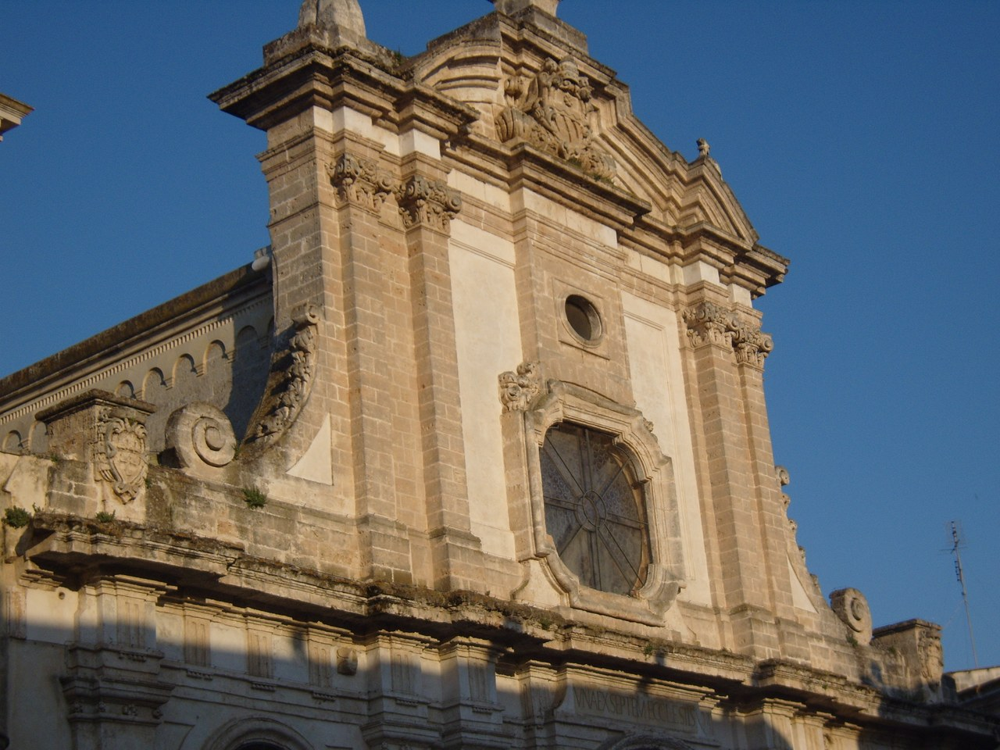</picture>
<figcaption>The cathedral of <b>Nardò</b>, seat of the bishop who examined Joseph for the diaconate and gave him the one Gospel verse he could explain. Photo: <a href="https://commons.wikimedia.org/wiki/File:Nard%C3%B2_cattedrale.JPG">Nardò cattedrale</a> by Freddyballo, <a href="https://creativecommons.org/licenses/by-sa/3.0">CC BY-SA 3.0</a>, via Wikimedia Commons.</figcaption>
</figure>

The examination for the priesthood was harder still. It was held by **Bishop John Baptist Detti of Castro**. The first candidates answered so well that the bishop took it for granted that the rest were just as well prepared, and he passed them all without questioning them. Joseph, who was among them, was ordained a priest on **28 March 1628**. Ever since, students and everyone facing an examination have turned to him for help.

<figure class=photo>
<picture><source srcset="/static/art/joc-exam-prayer-600.webp 600w,/static/art/joc-exam-prayer.webp 1113w" sizes="(max-width:760px) 100vw,760px" type="image/webp">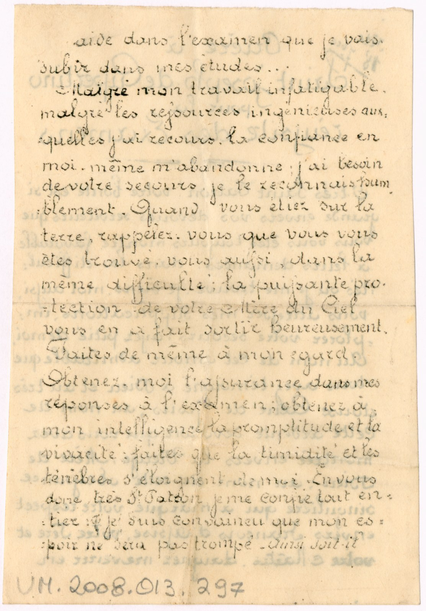</picture>
<figcaption>A handwritten <b>prayer to St Joseph of Cupertino for success in examinations</b>, kept in a collection of devotional pictures in Antwerp. Generations of students have written their own. Image: <a href="https://commons.wikimedia.org/wiki/File:Gebed_aan_de_heilige_Jozef_van_Cupertino_voor_het_slagen_van_de_examens,_asset_fDookIYUIOLeoVRZ9vwS9MW0.tif">Gebed aan de heilige Jozef van Cupertino voor het slagen van de examens, asset fDookIYUIOLeoVRZ9vwS9MW0.tif</a> by MAS Antwerp, <a href="https://creativecommons.org/publicdomain/zero/1.0/">CC0</a>, via Wikimedia Commons.</figcaption>
</figure>

<figure class=photo>
<picture><source srcset="/static/art/joc-boizot-600.webp 600w,/static/art/joc-boizot.webp 1280w" sizes="(max-width:760px) 100vw,760px" type="image/webp">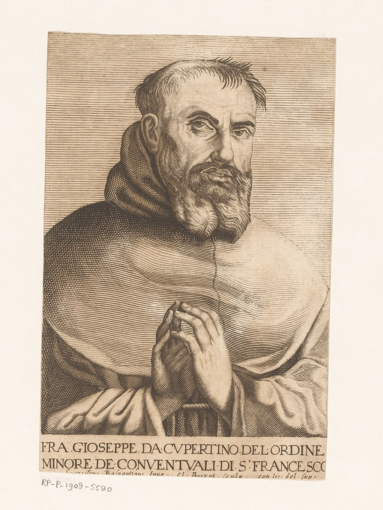</picture>
<figcaption>Joseph at prayer, an engraving by <b>Claude Boizot</b> after Francesco Raspantino, about 1700. Image: <a href="https://commons.wikimedia.org/wiki/File:Portret_van_Jozef_van_Cupertino,_RP-P-1909-5590.jpg">Portret van Jozef van Cupertino, RP-P-1909-5590</a> by Claude Boizot after Francesco Raspantino, Rijksmuseum, <a href="https://creativecommons.org/publicdomain/zero/1.0/">CC0</a>, via Wikimedia Commons.</figcaption>
</figure>

<h2 id=grottella>"My Mother" of the Grottella</h2>

The little friary of the Grottella took its name from a cave. In the sixteenth century, so the people of Copertino tell, an image of the Virgin was found painted on the wall of an underground grotto among the bushes, and in 1577 a church was built over it. To this Madonna Joseph gave his whole heart. He called her simply "my Mother", and after his ordination he went to thank her before anyone else. "I should like to return to our Lady of Grottella," he said years later, far away in Assisi, "for she is my mother."

Here he lived for about sixteen years, and here the wonders began. He fasted almost continually, keeping seven Lents of forty days each year, and in many of them he tasted no food except on Thursdays and Sundays. He passed through long years of dryness and temptation, and came out of them burning with love. At the names of Jesus and Mary, at a hymn, at the sight of a holy picture, he would give a cry and be rapt out of himself. Often he rose into the air.

<figure class=photo>
<picture><source srcset="/static/art/joc-grottella-flight-600.webp 600w,/static/art/joc-grottella-flight.webp 1280w" sizes="(max-width:760px) 100vw,760px" type="image/webp">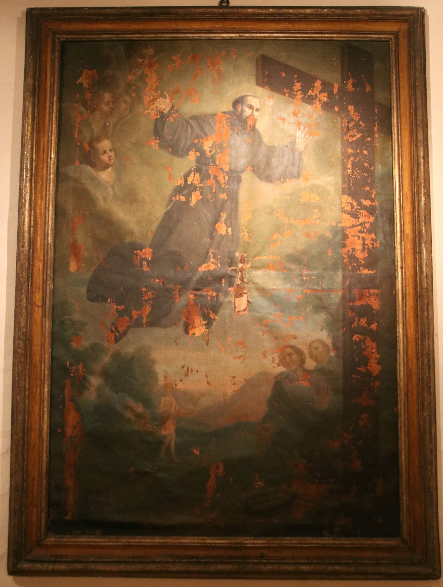</picture>
<figcaption><b>St Joseph rises in flight near the Grottella</b>, a painting by an eighteenth-century artist of the Marches, now in the church of Santa Lucia. Photo: <a href="https://commons.wikimedia.org/wiki/File:Ambito_marchigiano,_Levitazione_di_San_Giuseppe_da_Copertino_vicino_Grottella,_fine_XVIII_sec.jpg">Ambito marchigiano, Levitazione di San Giuseppe da Copertino vicino Grottella, fine XVIII sec</a> by Mongolo1984, <a href="https://creativecommons.org/licenses/by-sa/4.0">CC BY-SA 4.0</a>, via Wikimedia Commons.</figcaption>
</figure>

The ecstasies came so often that, for more than thirty-five years, his superiors kept him from the choir, the refectory and the processions, so as not to disturb the community. He said Mass alone, and his Masses could last for hours, for he was rapt again and again at the altar. People came from all over the region to see the friar who flew.

<h2 id=christmas>Christmas night: flying to the altar</h2>

One Christmas Eve Joseph invited the shepherds of the hills to come and celebrate the birth of the Child with him in the church of the Grottella. They came with their bagpipes and flutes. At the sound of the music, Joseph began to dance for joy. Then, "with a sob and a loud cry," he "flew as a bird through the air from the middle of the church to the high altar, a distance of almost forty feet." There he stayed for about a quarter of an hour "in sweet rapture", kneeling among the many lighted candles, without disturbing any of them or burning his clothes. "The shepherds marvelled exceedingly."

On the feast of St Francis, in a procession, he rose in his surplice to the pulpit, about fifteen palms above the floor, and hung there in ecstasy with his arms outstretched and his knees bent. On the night of Holy Thursday, praying before the altar of repose with its many lamps, he flew straight up to the chalice where his Lord was kept, without touching any of the decorations, and came down only when his superior called him.

<figure class=photo>
<picture><source srcset="/static/art/joc-altar-print-600.webp 600w,/static/art/joc-altar-print.webp 1280w" sizes="(max-width:760px) 100vw,760px" type="image/webp">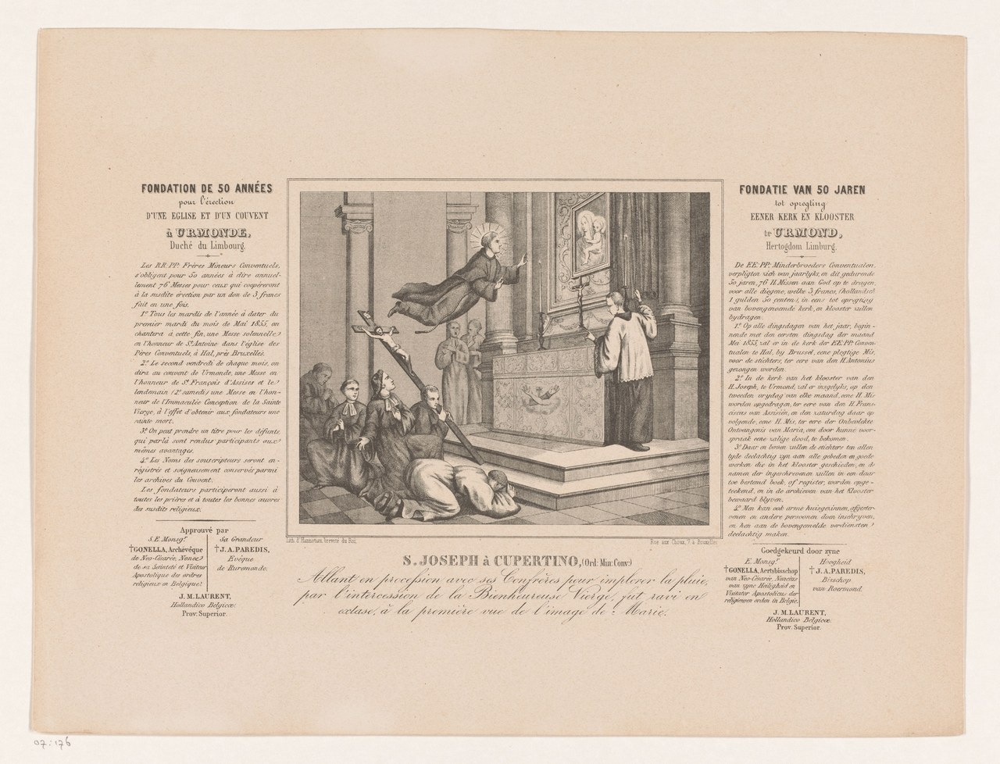</picture>
<figcaption><b>St Joseph rapt above the altar</b>, a devotional print with French and Dutch text, about 1860. Image: <a href="https://commons.wikimedia.org/wiki/File:S._Joseph_%C3%A0_Cupertino,_RP-P-1907-176.jpg">S. Joseph à Cupertino, RP-P-1907-176</a> by Rijksmuseum, <a href="https://creativecommons.org/publicdomain/zero/1.0/">CC0</a>, via Wikimedia Commons.</figcaption>
</figure>

<figure class=photo>
<picture><source srcset="/static/art/joc-gello-600.webp 600w,/static/art/joc-gello.webp 1280w" sizes="(max-width:760px) 100vw,760px" type="image/webp">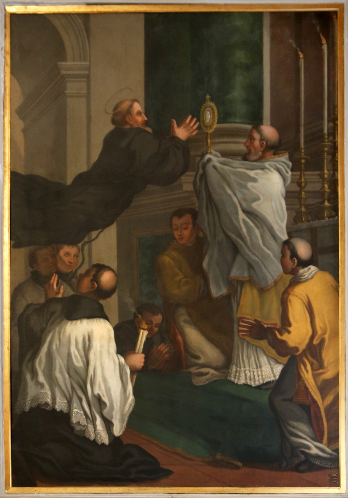</picture>
<figcaption><b>The ecstasy of St Joseph of Cupertino</b>, painted by the school of the Gimignani around 1690–1710, now at Gello near Pistoia. He flies towards Christ in the Blessed Sacrament, the great love of his life. Photo: <a href="https://commons.wikimedia.org/wiki/File:Scuola_dei_gimignani,_estasi_di_San_Giuseppe_da_Copertino,_1690-1710_ca.,_dall%27oratorio_dei_bracciolini_a_pt,_01.jpg">Scuola dei gimignani, estasi di San Giuseppe da Copertino, 1690-1710 ca., dall'oratorio dei bracciolini a pt, 01</a> by Sailko, <a href="https://creativecommons.org/licenses/by/3.0">CC BY 3.0</a>, via Wikimedia Commons.</figcaption>
</figure>

<h2 id=cross>Lifting the great cross</h2>

On a hill between Copertino and the Grottella, Joseph set up a Calvary of three crosses. Two were already in place, but the third was fifty-four palms high and so heavy that ten men working together could not raise it. Seeing them struggle, Joseph, "full of ardor, flew about eighty paces from the portal of the monastery to the cross, lifted it as easily as if it were a straw, and placed it in the hole prepared for it."

Those crosses became his special love. From ten or twelve paces away, drawn by his crucified Saviour, he would rise to one of the arms or to the top of the cross and kneel there in prayer.

<figure class=photo>
<picture><source srcset="/static/art/joc-cross-engraving-600.webp 600w,/static/art/joc-cross-engraving.webp 305w" sizes="(max-width:760px) 100vw,760px" type="image/webp">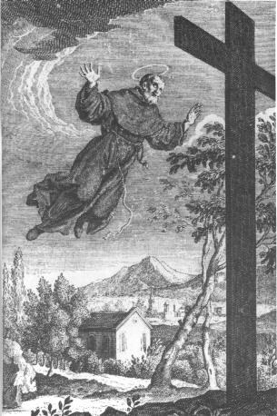</picture>
<figcaption><b>St Joseph flies to the cross</b>, an eighteenth-century engraving. Below, a friary in the open countryside. Image: <a href="https://commons.wikimedia.org/wiki/File:San_Giuseppe_di_Copertino_18th_century_engraving.jpg">San Giuseppe di Copertino 18th century engraving</a>, public domain, via Wikimedia Commons.</figcaption>
</figure>

One day, as he was setting up crosses along the road to stir up devotion, he heard a voice say: "Leave alone the dead crosses and take hold of the living ones." Soon afterwards Jesus appeared to him in prayer as a poor child carrying a large cross on his shoulder. Joseph understood that a heavy cross was coming for him too.

<h2 id=heaven>"How beautiful God has made heaven"</h2>

Everything spoke to him of God. When a friar passed by with a burning candle while they were speaking of the coming of the Holy Spirit, Joseph gave a cry and flew four paces into the air. When a priest said to him, "Father Joseph, oh, how beautiful God has made heaven," he flew up into an olive tree and knelt there for half an hour, "and it was a strange sight to see how the branch which bore him swayed as lightly as if a small bird rested on it."

At the clothing of some nuns in the church of St Clare at Copertino, when the choir sang "Come, thou bride of Christ", he ran from his corner, took the convent's confessor by the hand, lifted him from the floor and danced with him in the air. According to the acts of his beatification, more than seventy such flights were recorded at Copertino alone, not counting the daily raptures at Mass.

<figure class=photo>
<picture><source srcset="/static/art/joc-montone-600.webp 600w,/static/art/joc-montone.webp 1280w" sizes="(max-width:760px) 100vw,760px" type="image/webp">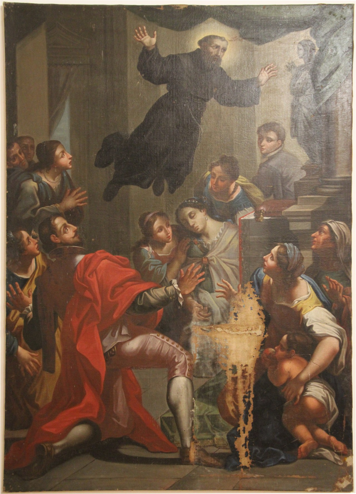</picture>
<figcaption><b>The ecstasy of St Joseph of Cupertino</b>, by an eighteenth-century Umbrian painter, in the museum of San Francesco at Montone. Photo: <a href="https://commons.wikimedia.org/wiki/File:Pittore_umbro_del_sec._XVIII,_Estasi_di_san_Giuseppe_da_Copertino_01.jpg">Pittore umbro del sec. XVIII, Estasi di san Giuseppe da Copertino 01</a> by Mongolo1984, <a href="https://creativecommons.org/licenses/by-sa/4.0">CC BY-SA 4.0</a>, via Wikimedia Commons.</figcaption>
</figure>

Even the animals obeyed him. Each Saturday he prayed the Litany of Loreto with the shepherds in a chapel near the friary. Once, when the shepherds could not come, he called out to their sheep far off in the fields: "Come hither, to revere the mother of your God and my God." The sheep ran to the chapel, and as he called out each title of Our Lady they answered him in their own way. When a flock was killed by enormous hailstones, he went out to the field and raised the sheep one by one, saying, "In the name of God, arise!"

<h2 id=naples>Before the Inquisition at Naples</h2>

Not everyone rejoiced. A vicar-general of the diocese denounced Joseph to the Inquisition at Naples, complaining that the crowds followed him "as another Messias". The Holy Office ordered him to Naples. He set out on 21 October 1638, and the people of Copertino said, "Alas, what a loss for us." He went with a peaceful heart. On the way, at **Monopoli**, the friars showed him a beautiful new statue of St Anthony of Padua, and at the sight of it he flew fifteen paces to the altar and back.

At Naples he lodged at the friary of **San Lorenzo Maggiore**. He was examined three times, over several weeks, and the judges found him blameless, "pure and free from hypocrisy". At their command he said Mass in the chapel of **San Gregorio Armeno**, the church of the nuns of St Ligorio. Afterwards, as he prayed in a corner, he rose with a loud cry and flew up to the altar, and stood there with his arms spread in the form of a cross, among the flowers and candles, so that the nuns cried out, "He will catch fire!" He came down unharmed, whirled about in the middle of the church and sang, "O most Blessed Virgin! O most Blessed Virgin!" The Viceroy of Naples and his court asked him to say Mass in their chapel, but before it could be arranged Joseph had gone.

<figure class=photo>
<picture><source srcset="/static/art/joc-naples-600.webp 600w,/static/art/joc-naples.webp 1024w" sizes="(max-width:760px) 100vw,760px" type="image/webp">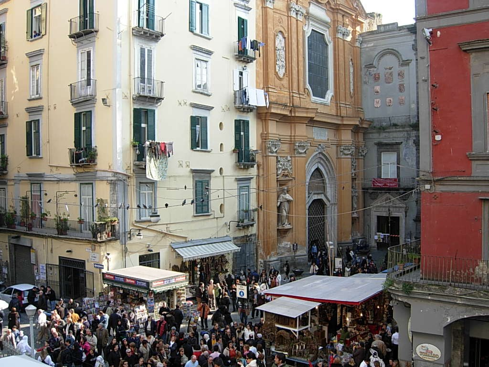</picture>
<figcaption>The church of <b>San Lorenzo Maggiore</b> in the old centre of Naples. Joseph lodged at its Franciscan friary while the Inquisition examined him in 1638. Photo: <a href="https://commons.wikimedia.org/wiki/File:San_Lorenzo_Maggiore_in_central_Naples.jpg">San Lorenzo Maggiore in central Naples</a> by Inviaggiocommons, public domain, via Wikimedia Commons.</figcaption>
</figure>

<h2 id=pope>Rising before Pope Urban VIII</h2>

From Naples the Holy Office sent him to Rome, to the Minister General of his Order. Wishing to enter the Holy City poor like St Francis, he had his companion, Brother Louis, lay their last small silver coin on a stone outside the walls for the first passer-by. At the friary of the **Twelve Holy Apostles** the Minister General, Father John Baptist Berardicelli, received him coldly and shut him in the most secluded room in the house.

<figure class=photo>
<picture><source srcset="/static/art/joc-santi-apostoli-600.webp 600w,/static/art/joc-santi-apostoli.webp 1280w" sizes="(max-width:760px) 100vw,760px" type="image/webp">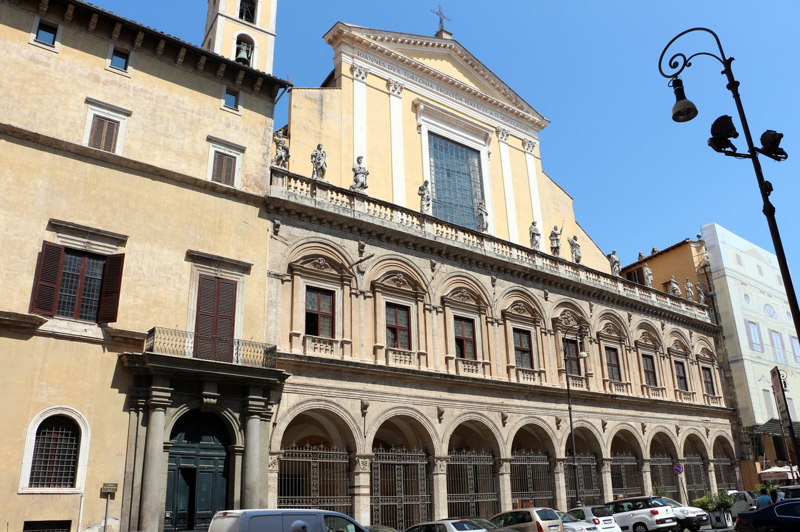</picture>
<figcaption>The Basilica of the <b>Santi Apostoli</b> in Rome, beside the Conventual friary where Joseph stayed in 1639. Photo: <a href="https://commons.wikimedia.org/wiki/File:Roma,_santi_apostoli,_facciata_01.JPG">Roma, santi apostoli, facciata 01</a> by Sailko, <a href="https://creativecommons.org/licenses/by/3.0">CC BY 3.0</a>, via Wikimedia Commons.</figcaption>
</figure>

Then God showed the holiness of his servant to the Pope himself. The Minister General brought Joseph to pay homage to **Pope Urban VIII**. As he bent to kiss the Pope's feet, Joseph, filled with reverence for Christ in the person of his Vicar, was rapt and lifted into the air, and stayed there until the Minister General called him back. The Pope marvelled, and said that if Father Joseph died during his pontificate, he himself would bear witness to what he had seen.

<figure class=photo>
<picture><source srcset="/static/art/joc-urban-viii-600.webp 600w,/static/art/joc-urban-viii.webp 1280w" sizes="(max-width:760px) 100vw,760px" type="image/webp">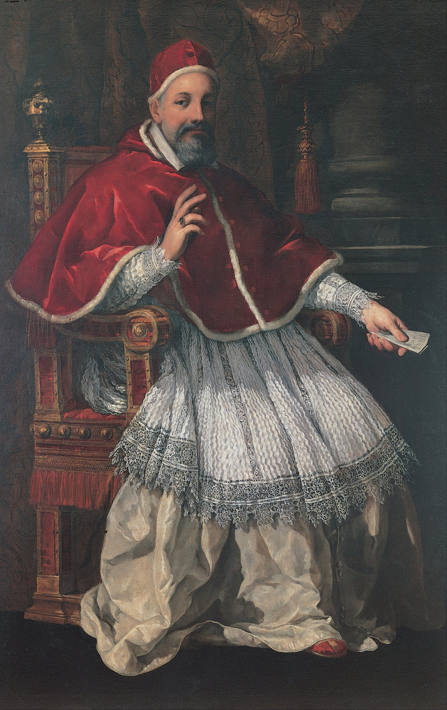</picture>
<figcaption><b>Pope Urban VIII</b>, painted by Pietro da Cortona in the 1620s. He saw Joseph rise in ecstasy before him in 1639. Image: <a href="https://commons.wikimedia.org/wiki/File:Pietro_da_Cortona_-_Portrait_of_Urban_VIII_-_Google_Art_Project.jpg">Pietro da Cortona - Portrait of Urban VIII - Google Art Project</a> by Pietro da Cortona, public domain, via Wikimedia Commons.</figcaption>
</figure>

The Pope ordered that Joseph be sent to a friary where the rule was most perfectly kept. So, instead of a tiny hermitage, the Minister General sent him to **Assisi**, to live beside the tomb of St Francis. Joseph was overjoyed.

<h2 id=assisi>Assisi: the dark night and the dawn</h2>

Joseph reached Assisi on the last day of April 1639, full of joy at living near the tomb of his father St Francis. The joy did not last. God tried him "as it were, by fire". The new Custos of the friary, Father Antony of St Maure, who had once loved him dearly, now treated him with contempt, punished him and called him publicly a "useless hypocrite". Joseph bore it in silence and served him all the more humbly. At the same time the consolations of prayer left him. For almost two years he suffered dryness of soul and fierce temptations.

<figure class=photo>
<picture><source srcset="/static/art/joc-assisi-convent-600.webp 600w,/static/art/joc-assisi-convent.webp 1280w" sizes="(max-width:760px) 100vw,760px" type="image/webp">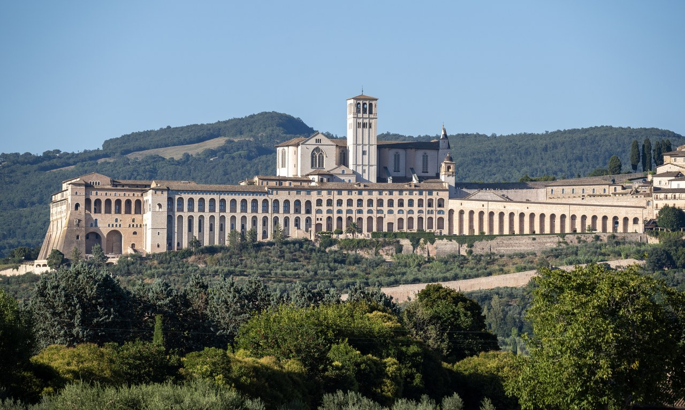</picture>
<figcaption>The <b>Sacro Convento</b> and the Basilica of St Francis at Assisi, Joseph's home from 1639 to 1653. Photo: <a href="https://commons.wikimedia.org/wiki/File:Sacro_Convento_(Assisi)_-_Remote_view.jpg">Sacro Convento (Assisi) - Remote view</a> by Stifone, <a href="https://creativecommons.org/licenses/by-sa/4.0">CC BY-SA 4.0</a>, via Wikimedia Commons.</figcaption>
</figure>

In Lent 1644 the Minister General called him to Rome. On the way, longing for his Madonna of the Grottella, Joseph thought of asking to go home. Then he heard the voice of God in his soul: "What desirest thou? What seekest thou? What demandest thou? Am I not the same here as there?" He looked up to heaven and said to his companion, "My brother, we shall soon return to Assisi."

When he came back, he was led into the church. On the ceiling he saw a picture of Our Lady like the one at the Grottella. "Ah, my dear Mother, you have followed me," he cried, and he was lifted about eighteen paces into the air as if to embrace her. The night was over. That same year the city council of Assisi voted unanimously to make him an honorary citizen, and when the delegates brought him the diploma, dated 4 August 1644, he was so delighted to be a "fellow-citizen of St Francis" that he was rapt in ecstasy almost to the ceiling of his cell.

<figure class=photo>
<picture><source srcset="/static/art/joc-assisi-cloister-600.webp 600w,/static/art/joc-assisi-cloister.webp 1280w" sizes="(max-width:760px) 100vw,760px" type="image/webp">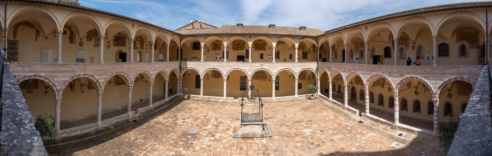</picture>
<figcaption>The great <b>cloister of the Sacro Convento</b>, built for the friars who keep the tomb of St Francis. Photo: <a href="https://commons.wikimedia.org/wiki/File:Sacro_Convento_-_Courtyard_of_the_friary,_Basilica_of_Saint_Francis,_Assisi_(panoramic).jpg">Sacro Convento - Courtyard of the friary, Basilica of Saint Francis, Assisi (panoramic)</a> by Marco Ober, <a href="https://creativecommons.org/licenses/by-sa/4.0">CC BY-SA 4.0</a>, via Wikimedia Commons.</figcaption>
</figure>

Love now possessed him like a fire. At the names of Jesus and Mary he would cry out, "O love, O love!" At Christmas he would invite everyone to sing with him: "Bambino, my Bambino, give, oh, give to me but a small share of Thy divine love." "Love God," he would say, "for he who loves is rich without knowing it." When the Custos once sang Vespers of the Immaculate Conception with him, Joseph begged him to repeat the words "Beautiful Mary", then seized him and rose with him into the air.

A nobleman of Assisi, Baltasar Rossi, had lost his reason and was brought to Joseph bound to a chair. Joseph had him untied, touched his head and said, "Chevalier Baltasar, doubt not, but commend yourself to God and His holy Mother." Then with his cry he took the man by the hair and rose with him into the air, holding him there for a time. The nobleman came down healed.

<figure class=photo>
<picture><source srcset="/static/art/joc-costanzi-600.webp 600w,/static/art/joc-costanzi.webp 1280w" sizes="(max-width:760px) 100vw,760px" type="image/webp">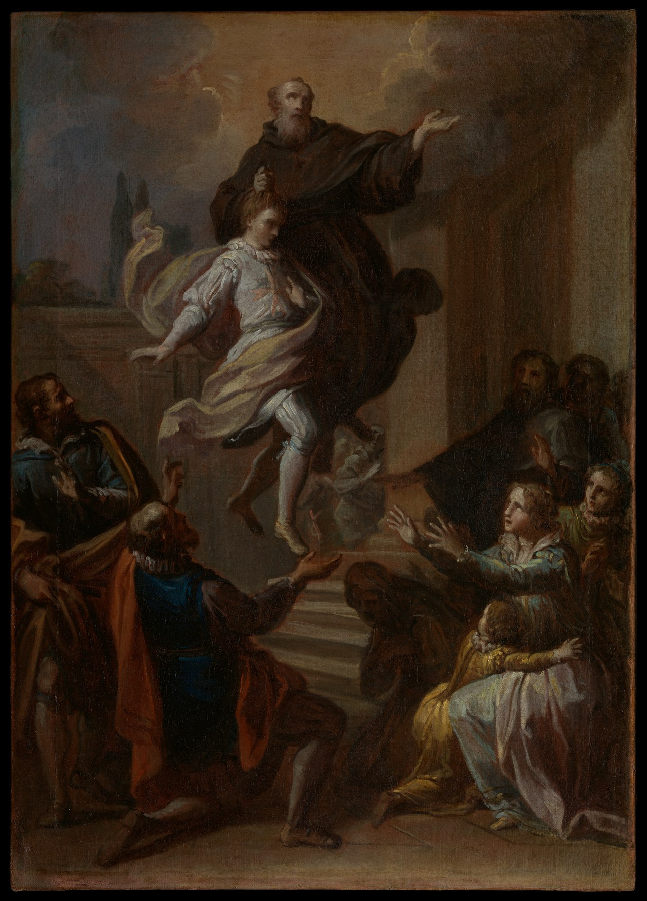</picture>
<figcaption><b>A miracle of St Joseph of Cupertino</b>, painted by Placido Costanzi in Rome around 1750, now in the Metropolitan Museum of Art, New York. The saint rises in ecstasy and carries a sufferer up with him. Image: <a href="https://commons.wikimedia.org/wiki/File:A_Miracle_of_Saint_Joseph_of_Cupertino_(1603%E2%80%931663)_MET_DP-12357-001.jpg">A Miracle of Saint Joseph of Cupertino (1603–1663) MET DP-12357-001</a> by Placido Costanzi, Metropolitan Museum of Art, <a href="https://creativecommons.org/publicdomain/zero/1.0/">CC0</a>, via Wikimedia Commons.</figcaption>
</figure>

In 1645 his mother lay dying at Copertino. She longed to see him and cried out, "Alas, my dear Joseph, I shall not see you again." At that moment, those with her later testified, a bright light filled the room and she exclaimed, "O Father Joseph! O my son!" At the same hour the Custos at Assisi met Joseph in tears on his way into the church. "My poor mother has just died," he said. A letter from Copertino soon brought the news.

<h2 id=ambassador>The Spanish ambassador</h2>

Joseph's fame spread across Europe, and the great of the world came to Assisi to see "the holy friar". In 1645 the Spanish ambassador to the Holy See, **Juan Alfonso Enríquez de Cabrera, High Admiral of Castile**, went out of his way to see him. After speaking with Joseph in his cell he went back to the church and told his wife, "I have seen and spoken with another Saint Francis."

His wife wished to meet him too, and at her request the Custos ordered Joseph down to the church. "I will obey," he said, "but know not whether I shall be able to speak." Scarcely had he entered the church when he saw a statue of the Immaculate Conception above the altar. He flew about twelve paces over the heads of the people to the foot of the statue, stayed there in prayer for some time, then flew back with his usual cry and returned to his cell. The Admiral, his wife and all their retinue were amazed.

<figure class=photo>
<picture><source srcset="/static/art/joc-admiral-600.webp 600w,/static/art/joc-admiral.webp 1071w" sizes="(max-width:760px) 100vw,760px" type="image/webp">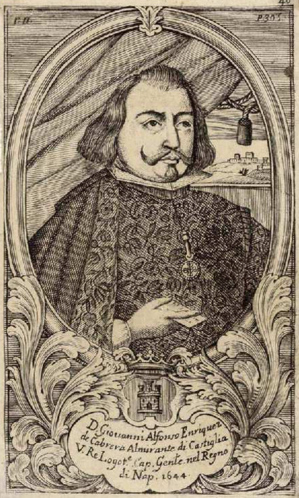</picture>
<figcaption><b>Juan Alfonso Enríquez de Cabrera</b>, High Admiral of Castile, Viceroy of Naples and Spanish ambassador to Pope Innocent X, who called Joseph "another Saint Francis" after seeing him in 1645. An engraving of 1694. Image: <a href="https://commons.wikimedia.org/wiki/File:Juan_Alfonso_Enr%C3%ADquez,_9th_Admiral_of_Castile.jpg">Juan Alfonso Enríquez, 9th Admiral of Castile</a>, public domain, via Wikimedia Commons.</figcaption>
</figure>

Cardinals came to see him, and Prince Leopold of Tuscany, and the Duke of Bouillon from France, and the Duchess of Mantua, and princes from Poland. The royal prince of Poland, **John Casimir**, visited him more than once and asked whether he should become a religious. Joseph told him that God had other plans. Years later John Casimir, now King of Poland, passed through Assisi on his way home. Joseph smiled and said, "Did I not tell you?"

<figure class=photo>
<picture><source srcset="/static/art/joc-boscaratti-600.webp 600w,/static/art/joc-boscaratti.webp 1280w" sizes="(max-width:760px) 100vw,760px" type="image/webp">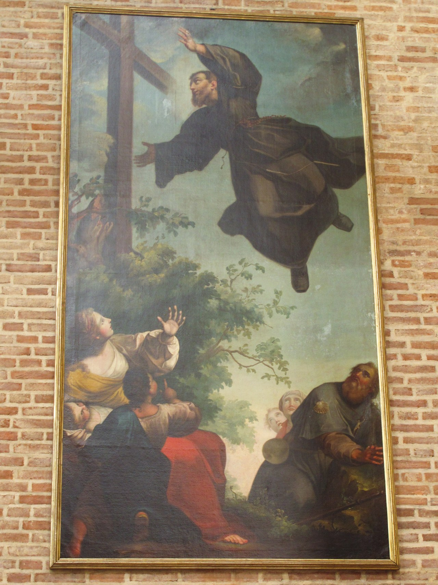</picture>
<figcaption><b>St Joseph of Cupertino in ecstasy</b>, by Felice Boscaratti, painted for the church of San Lorenzo in Vicenza in the eighteenth century. Photo: <a href="https://commons.wikimedia.org/wiki/File:Chiesa_di_San_Lorenzo_a_Vicenza_-_San_Giuseppe_da_Copertino_in_estasi,_Felice_Boscaratti-4.jpg">Chiesa di San Lorenzo a Vicenza - San Giuseppe da Copertino in estasi, Felice Boscaratti-4</a> by Claudio Gioseffi, <a href="https://creativecommons.org/licenses/by-sa/3.0">CC BY-SA 3.0</a>, via Wikimedia Commons.</figcaption>
</figure>

<h2 id=brunswick>"The deer is wounded": the Duke of Brunswick</h2>

In 1649 **John Frederick, Duke of Brunswick**, a young Lutheran prince of twenty-five making the tour of the courts of Europe, came from Rome to Assisi expressly to see the friar he had heard of in Germany. The next morning he and two of his retainers, one a Catholic and one a Protestant, were brought to the door of the chapel where Joseph was saying Mass. No one had told Joseph they were there.

When Joseph came to break the host, he found it so hard that he could not break it, and had to lay it back on the paten. Fixing his eyes on the host, he wept, and with a loud cry rose kneeling about five paces into the air. When he came down he broke the host, with great effort. Afterwards the Duke had him asked why he had wept. "The persons whom you sent to my Mass this morning have a hard heart," he answered, "for they do not believe all that Holy Mother Church teaches, and therefore the Lamb of God was hardened in my hands so that I could not break the sacred host."

The Duke put off his journey and spent the afternoon with Joseph. The next day he came to Mass again. At the elevation the cross on the host appeared black to everyone present, and Joseph, with his cry, was raised up from the floor and held the host aloft for about a quarter of an hour. The Duke wept. His Lutheran companion cried out angrily: "Cursed be the hour in which I came to this country; for at home I was much more at peace and now my conscience is tormented by the furies of doubt." Joseph told a friend: "Let us be of good cheer, the deer is wounded."

That evening Joseph girded the Duke with his own cord and said with great fervour: "For paradise I bind you; go, venerate St Francis, assist at Compline, follow with devotion in the procession, and do all as you see the friars do." The Duke obeyed, promised to become a Catholic, and wrote his name in the register of the Confraternity of the Cord of St Francis. The next year he came back to Assisi and, kneeling before the Blessed Sacrament in the presence of two cardinals, made his profession of the Catholic faith in Joseph's hands. His Lutheran companion became a Catholic a few years later.

<figure class=photo>
<picture><source srcset="/static/art/joc-brunswick-600.webp 600w,/static/art/joc-brunswick.webp 800w" sizes="(max-width:760px) 100vw,760px" type="image/webp">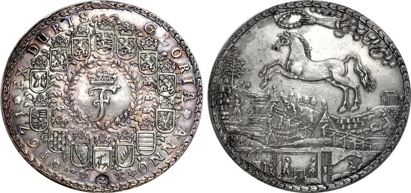</picture>
<figcaption>A silver double thaler of <b>Duke John Frederick of Brunswick-Lüneburg</b>, struck in 1671, after he had become a Catholic and a ruling duke. Photo: <a href="https://commons.wikimedia.org/wiki/File:Braunschweig-L%C3%BCneburg,_Johann_Friedrich,_Doppeltaler_1671,_Clausthal,_CNG.jpg">Braunschweig-Lüneburg, Johann Friedrich, Doppeltaler 1671, Clausthal, CNG</a> by Classical Numismatic Group, <a href="https://creativecommons.org/licenses/by-sa/3.0">CC BY-SA 3.0</a>, via Wikimedia Commons.</figcaption>
</figure>

<h2 id=humble>"Brother ass"</h2>

With all these honours Joseph stayed humble. He called himself "brother ass", a "man dead and useless to all purposes", and the most wicked of sinners. "I know not why these people come to me," he said, "for I am but an ignorant man and a poor sinner." After a visit from great people he would kneel, kiss the floor and say, "Not to us, Lord, not to us, but to Thy name give glory," and weep. He called his ecstasies "sleep" or "weakness", and when he felt them coming he would beg, "Enough, enough, cease, cease, no further."

To the novices who would one day preach he said: "Be not elated because of that; for a preacher is like unto a trumpet which produces no tone unless one blows into it. Before preaching, pray to God, 'Thou art the spirit and I am but the trumpet, which, without Thy breath, can give no sound.'"

<figure class=photo>
<picture><source srcset="/static/art/joc-pitteri-raptus-600.webp 600w,/static/art/joc-pitteri-raptus.webp 1280w" sizes="(max-width:760px) 100vw,760px" type="image/webp">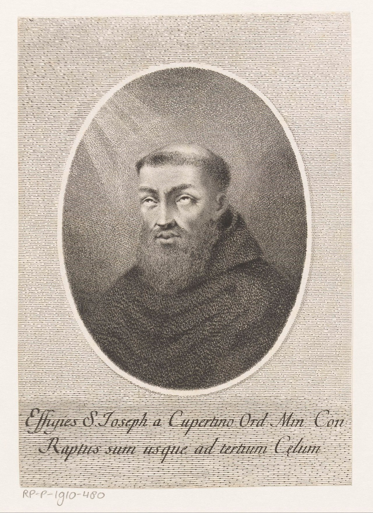</picture>
<figcaption>An eighteenth-century engraving by <b>Marco Pitteri</b>. Its Latin inscription reads "Raptus sum usque ad tertium caelum", "I was caught up to the third heaven", the words of St Paul (2 Corinthians 12:2). Image: <a href="https://commons.wikimedia.org/wiki/File:De_heilige_Jozef_van_Cupertino_Effigies_S._Joseph_a_Cupertino_Ord_Min_Con_Raptus_sum_uisque_ad_tertium_Celum_(titel_op_object),_RP-P-1910-480.jpg">De heilige Jozef van Cupertino Effigies S. Joseph a Cupertino Ord Min Con Raptus sum uisque ad tertium Celum (titel op object), RP-P-1910-480</a> by Marco Pitteri, Rijksmuseum, <a href="https://creativecommons.org/publicdomain/zero/1.0/">CC0</a>, via Wikimedia Commons.</figcaption>
</figure>

Once, at Copertino, he tried to make a little child of three repeat after him, "Brother Joseph is a great sinner and, when he dies, he will go to hell." Three times the child answered clearly, "Brother Joseph is a great saint and, when he dies, he will go to Paradise." Those present were moved to tears.

<figure class=photo>
<picture><source srcset="/static/art/joc-lorenzini-600.webp 600w,/static/art/joc-lorenzini.webp 1280w" sizes="(max-width:760px) 100vw,760px" type="image/webp">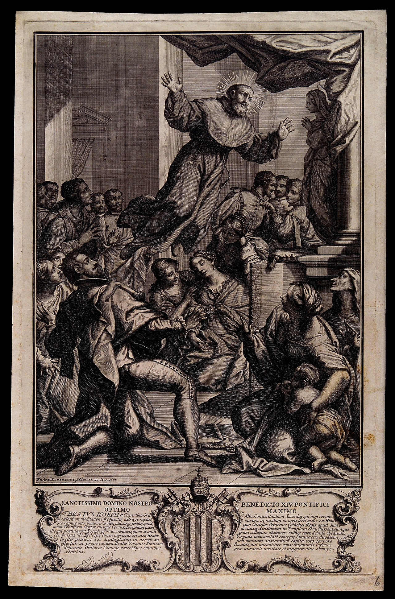</picture>
<figcaption><b>St Joseph of Cupertino rises in ecstasy</b>, an eighteenth-century engraving after a drawing by F. A. Lorenzini. Image: <a href="https://commons.wikimedia.org/wiki/File:Saint_Joseph_of_Cupertino._Engraving_after_F.A._Lorenzini._Wellcome_V0032346.jpg">Saint Joseph of Cupertino. Engraving after F.A. Lorenzini. Wellcome V0032346</a> by Wellcome Collection, <a href="https://creativecommons.org/licenses/by/4.0">CC BY 4.0</a>, via Wikimedia Commons.</figcaption>
</figure>

<h2 id=hidden>Hidden in the mountains</h2>

The crowds at Assisi grew so great that **Pope Innocent X** decided to hide Joseph away "to shield and preserve his sanctity". By order of the Inquisition he was taken, on 23 July 1653, to the Capuchin friary of **Pietrarubbia**, on the slopes of Mount Carpegna in the Duchy of Urbino. He was not told where he was going. Kissing the feet of the Father Inquisitor, he climbed into the waiting carriage so quickly that he left behind his breviary, his spectacles, his mantle and his hat. On his arrival he knelt at the feet of the Guardian, whom he recognised although he had never seen him before.

<figure class=photo>
<picture><source srcset="/static/art/joc-innocent-x-600.webp 600w,/static/art/joc-innocent-x.webp 1280w" sizes="(max-width:760px) 100vw,760px" type="image/webp">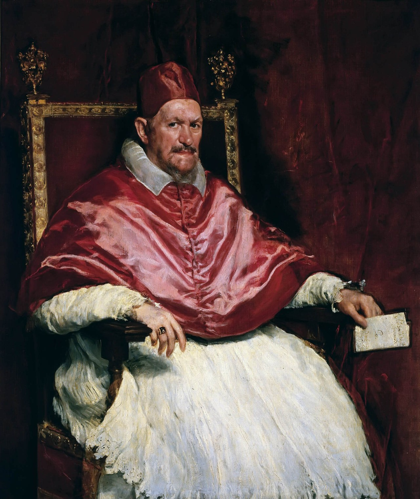</picture>
<figcaption><b>Pope Innocent X</b>, painted by Diego Velázquez in 1650. In 1653 he had Joseph taken secretly from Assisi to the mountain friaries of the Marches. Image: <a href="https://commons.wikimedia.org/wiki/File:Portrait_of_Pope_Innocent_X_(by_Diego_Vel%C3%A1zquez)_-_Doria_Pamphilj_Gallery,_Rome.jpg">Portrait of Pope Innocent X (by Diego Velázquez) - Doria Pamphilj Gallery, Rome</a> by Diego Velázquez, public domain, via Wikimedia Commons.</figcaption>
</figure>

<figure class=photo>
<picture><source srcset="/static/art/joc-carpegna-600.webp 600w,/static/art/joc-carpegna.webp 1280w" sizes="(max-width:760px) 100vw,760px" type="image/webp">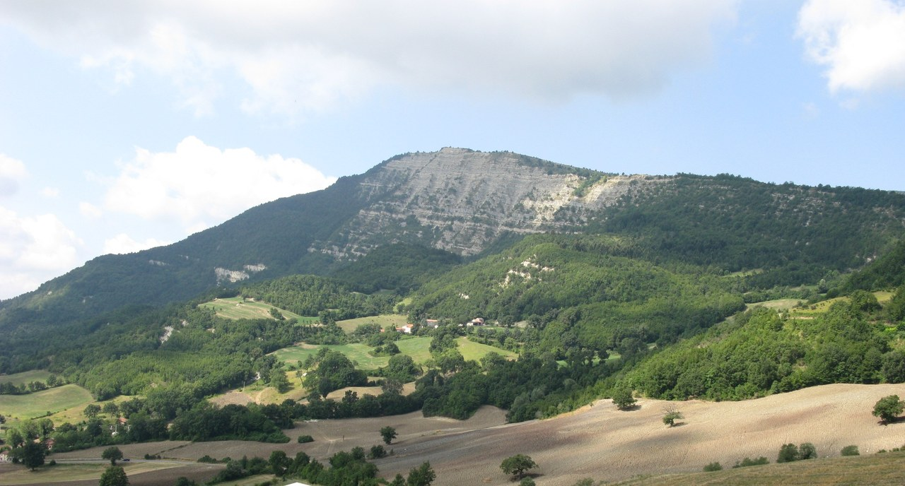</picture>
<figcaption><b>Monte Carpegna</b> in the Montefeltro hills. The Capuchin friary of Pietrarubbia stood on its slopes. Photo: <a href="https://commons.wikimedia.org/wiki/File:Monte_Carpegna_II.jpg">Monte Carpegna II</a> by Toni Pecoraro, public domain, via Wikimedia Commons.</figcaption>
</figure>

He was forbidden to speak with anyone but the friars or to write to anyone. He obeyed in everything. But God would not let him be hidden. Word spread, and the little church could not hold the people who came to his Mass. Some took the tiles off the roof and others broke holes in the walls to see him; others built huts near the friary, and inns sprang up for the pilgrims.

<figure class=photo>
<picture><source srcset="/static/art/joc-pietrarubbia-600.webp 600w,/static/art/joc-pietrarubbia.webp 1280w" sizes="(max-width:760px) 100vw,760px" type="image/webp">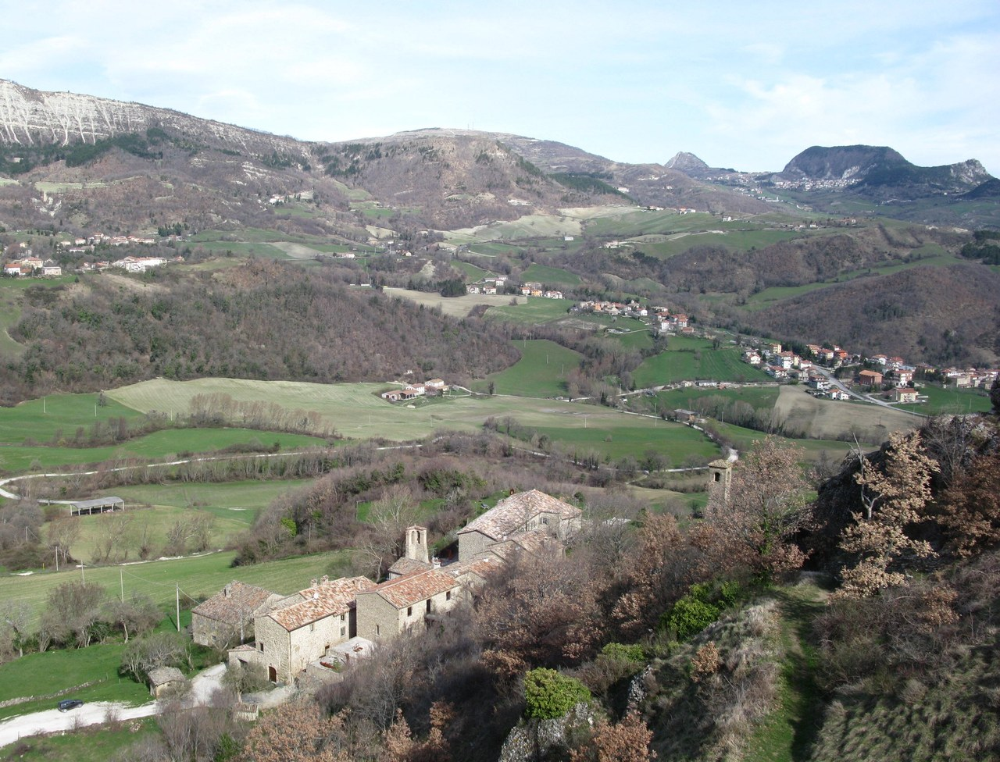</picture>
<figcaption>The hills of <b>Pietrarubbia</b>, where Joseph was hidden with the Capuchins in 1653. Photo: <a href="https://commons.wikimedia.org/wiki/File:Pietrarubbia.jpg">Pietrarubbia</a> by Toni Pecoraro, public domain, via Wikimedia Commons.</figcaption>
</figure>

<figure class=photo>
<picture><source srcset="/static/art/joc-pietrarubbia-1981-600.webp 600w,/static/art/joc-pietrarubbia-1981.webp 1280w" sizes="(max-width:760px) 100vw,760px" type="image/webp">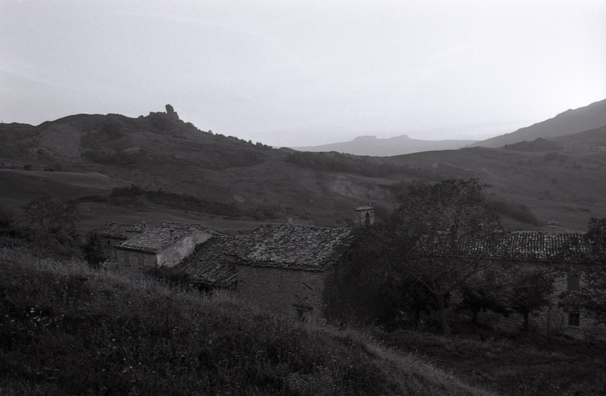</picture>
<figcaption>The rock of <b>Pietrarubbia</b>, photographed by Paolo Monti in 1981. Photo: <a href="https://commons.wikimedia.org/wiki/File:Paolo_Monti_-_Servizio_fotografico_(Pietrarubbia,_1981)_-_BEIC_6354182.jpg">Paolo Monti - Servizio fotografico (Pietrarubbia, 1981) - BEIC 6354182</a> by Paolo Monti, <a href="https://creativecommons.org/licenses/by-sa/4.0">CC BY-SA 4.0</a>, via Wikimedia Commons.</figcaption>
</figure>

After three months he was moved to the Capuchin friary of **Fossombrone**. On the journey a stubborn mule and a horse that would carry no one went as meekly as lambs, and a violent shower soaked everyone but him. At Fossombrone the crowds came again, so that the friars dared not go out, and Joseph said Mass at a private altar. One evening the Guardian asked him, "What are you doing here, Friar Joseph?" He answered joyfully, "I am burying one who is dead."

<figure class=photo>
<picture><source srcset="/static/art/joc-fossombrone-600.webp 600w,/static/art/joc-fossombrone.webp 1280w" sizes="(max-width:760px) 100vw,760px" type="image/webp">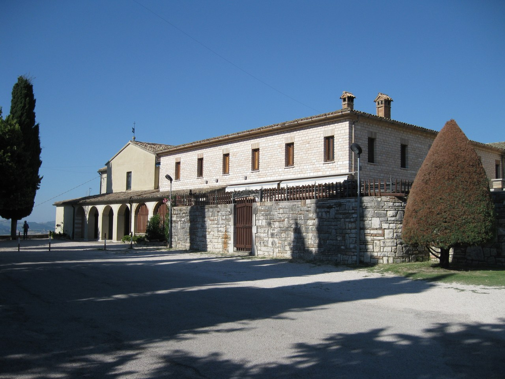</picture>
<figcaption>The <b>Capuchin friary on the Colle dei Cappuccini</b> above Fossombrone, where Joseph lived from 1653 to 1657. Photo: <a href="https://commons.wikimedia.org/wiki/File:Fossombrone_Colle_dei_Cappuccini.jpg">Fossombrone Colle dei Cappuccini</a> by Alicudi, <a href="https://creativecommons.org/licenses/by-sa/3.0">CC BY-SA 3.0</a>, via Wikimedia Commons.</figcaption>
</figure>

There, too, he flew. One Sunday, when the Gospel of the Good Shepherd had been read, he saw a lamb in the garden. "Look, a lamb!" he cried, and a friar put it in his arms. He laid it on his shoulders and ran about the garden: "Father Guardian, see here the Good Shepherd, who brings back the lost sheep." Then he threw the lamb up into the air and flew after it above the highest trees, where he knelt in rapture with his arms outstretched for more than two hours. At Pentecost, at the words "Veni, Sancte Spiritus" in his Mass, he was swept away from the altar and around the chapel "with a noise like thunder and the speed of lightning", so that the friars ran out of their cells crying, "An earthquake!"

<h2 id=osimo>Osimo and the angels of Loreto</h2>

In 1655 a new pope, **Alexander VII**, was elected, and the Provincials of the Conventual Franciscans begged him to give Joseph back to his own Order. They asked for Assisi. The Pope chose instead the friary of St Francis at **Osimo**, an old hill town in the Marches a few hours from the shrine of the Holy House of Loreto. Plague delayed the move, but on the evening of 6 July 1657 the Order's Secretary General came for Joseph at Fossombrone. Joseph knew he was coming. Against his custom he had opened his window and sat beside it, and he told the astonished lay brother that he would be leaving that night to return to his Order.

<figure class=photo>
<picture><source srcset="/static/art/joc-alexander-vii-600.webp 600w,/static/art/joc-alexander-vii.webp 1280w" sizes="(max-width:760px) 100vw,760px" type="image/webp">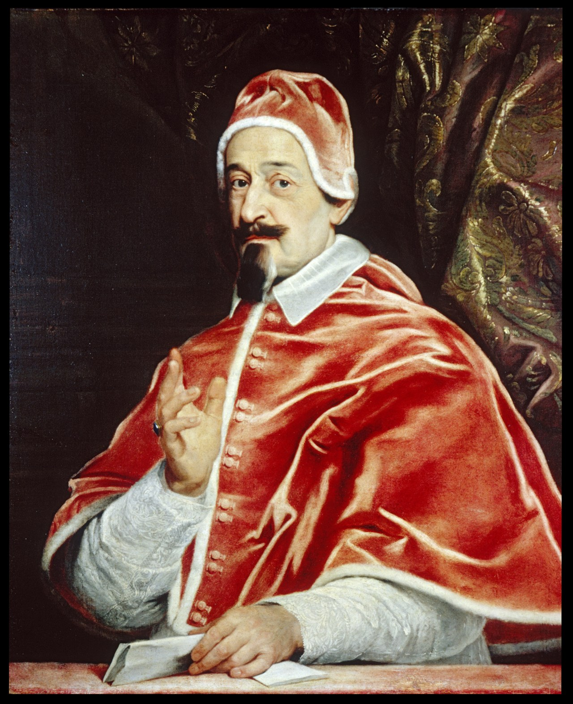</picture>
<figcaption><b>Pope Alexander VII</b>, from the workshop of Giovanni Battista Gaulli. He gave Joseph back to his Conventual brethren and sent him to Osimo in 1657. Image: <a href="https://commons.wikimedia.org/wiki/File:Giovanni_Battista_Gaulli_-_Portrait_of_Pope_Alexander_VII_(Fabio_Chigi)_-_Walters_37598.jpg">Giovanni Battista Gaulli - Portrait of Pope Alexander VII (Fabio Chigi) - Walters 37598</a> by the workshop of Giovanni Battista Gaulli, public domain, via Wikimedia Commons.</figcaption>
</figure>

They travelled by night, avoiding the towns. A servant of the Bishop of Fossombrone who led Joseph's horse along a stony path carried a candle that burned for hours in a violent wind without going out or growing shorter; he kept it ever after as a relic. A poor woman whose melons were being eaten by worms asked his blessing on her garden, and that year it gave more and larger melons than ever.

At the walls of Osimo the party had to wait until evening to enter the city. From the porch of a house a priest pointed out to Joseph the dome of the Holy House of Loreto on the horizon. "Do you not see the angels who ascend and descend from heaven to yonder Sanctuary?" Joseph cried. With his usual cry he flew from the porch, twelve palms above the ground, to the foot of an almond tree some fifteen yards away. The "almond tree of St Joseph" was long venerated at Osimo.

<figure class=photo>
<picture><source srcset="/static/art/joc-mazzanti-osimo-600.webp 600w,/static/art/joc-mazzanti-osimo.webp 1280w" sizes="(max-width:760px) 100vw,760px" type="image/webp">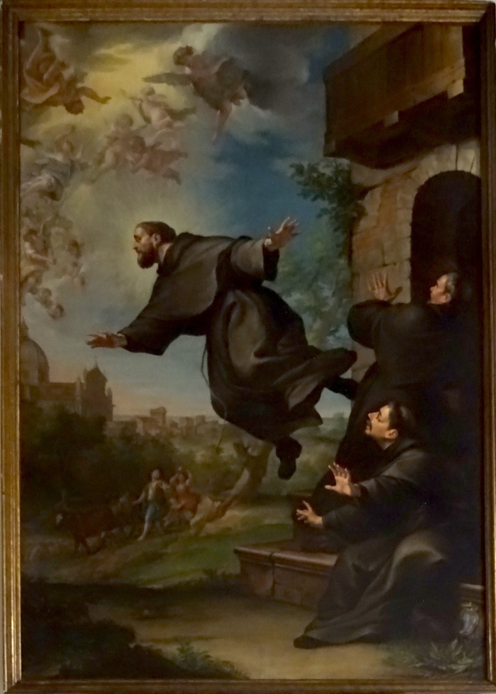</picture>
<figcaption><b>St Joseph flies at the sight of the Holy House of Loreto</b>, the painting by Ludovico Mazzanti in the Basilica of San Giuseppe da Copertino at Osimo. The dome of Loreto rises in the distance. Photo: <a href="https://commons.wikimedia.org/wiki/File:Giuseppe_da_Cupertino_-_peinture_originale_de_Ludovico_Mazzanti_-_Basilica_conventuale_de_Giuseppe_da_Cupertino_d%27Osimo.jpg">Giuseppe da Cupertino - peinture originale de Ludovico Mazzanti - Basilica conventuale de Giuseppe da Cupertino d'Osimo</a> by Helvio ricina, <a href="https://creativecommons.org/licenses/by-sa/4.0">CC BY-SA 4.0</a>, via Wikimedia Commons.</figcaption>
</figure>

<figure class=photo>
<picture><source srcset="/static/art/joc-loreto-600.webp 600w,/static/art/joc-loreto.webp 1280w" sizes="(max-width:760px) 100vw,760px" type="image/webp">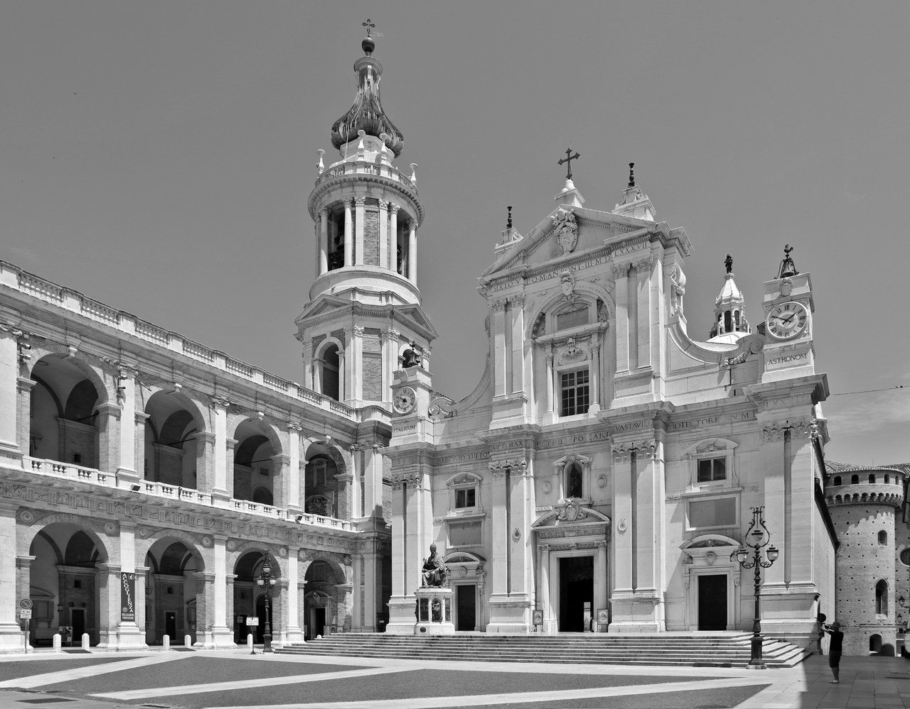</picture>
<figcaption>The <b>Basilica of the Holy House at Loreto</b>. Seeing its dome from the walls of Osimo, Joseph saw angels going up and down from heaven. Photo: <a href="https://commons.wikimedia.org/wiki/File:Loreto_-_Basilica_della_Santa_Casa_di_Loreto_-_2023-09-06_22-38-04_001.jpg">Loreto - Basilica della Santa Casa di Loreto - 2023-09-06 22-38-04 001</a> by Terragio67, <a href="https://creativecommons.org/licenses/by-sa/4.0">CC BY-SA 4.0</a>, via Wikimedia Commons.</figcaption>
</figure>

<figure class=photo>
<picture><source srcset="/static/art/joc-osimo-panorama-600.webp 600w,/static/art/joc-osimo-panorama.webp 1280w" sizes="(max-width:760px) 100vw,760px" type="image/webp">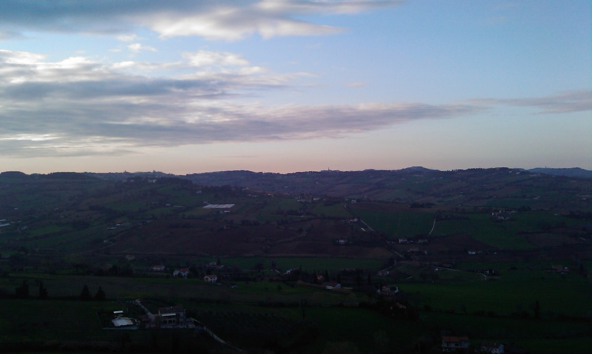</picture>
<figcaption>The view from <b>Osimo</b> over the hills of the Marches towards the sea and Loreto. Photo: <a href="https://commons.wikimedia.org/wiki/File:Panorama_da_Osimo_01.jpg">Panorama da Osimo 01</a> by WikiGian ITA, <a href="https://creativecommons.org/licenses/by-sa/3.0">CC BY-SA 3.0</a>, via Wikimedia Commons.</figcaption>
</figure>

At Osimo he was given a secluded room with a little chapel and a garden, and he saw no one but the bishop, the friars, and the doctor when needed. "I live in a city," he said, "yet it seems to me that I live in a forest, or, rather, in a paradise." The bishop, Cardinal Bichi, saw him rise in ecstasy as they talked, so still that a gnat walked across his open eye without his blinking. At Christmas he made a crib in his oratory, invited the friars and sang songs he had written for the Christ Child, and fell into ecstasy. He danced with a little wax image of the Child Jesus and pressed it to his heart.

<figure class=photo>
<picture><source srcset="/static/art/joc-osimo-cell-600.webp 600w,/static/art/joc-osimo-cell.webp 1200w" sizes="(max-width:760px) 100vw,760px" type="image/webp">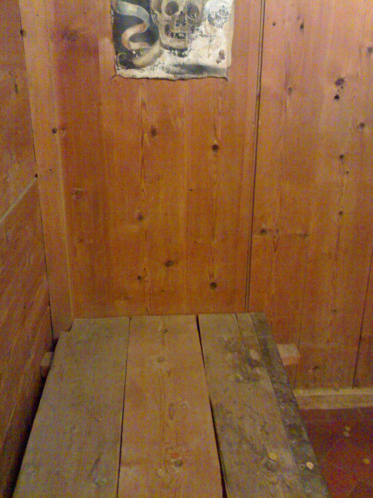</picture>
<figcaption><b>His cell at Osimo</b>, with its bed of boards. "He slept but a brief time on his bed of boards, and this unwillingly." Photo: <a href="https://commons.wikimedia.org/wiki/File:CellaSanGiuseppe2.jpg">CellaSanGiuseppe2</a> by Valentini17, <a href="https://creativecommons.org/licenses/by-sa/3.0">CC BY-SA 3.0</a>, via Wikimedia Commons.</figcaption>
</figure>

<figure class=photo>
<picture><source srcset="/static/art/joc-osimo-oratory-600.webp 600w,/static/art/joc-osimo-oratory.webp 1200w" sizes="(max-width:760px) 100vw,760px" type="image/webp">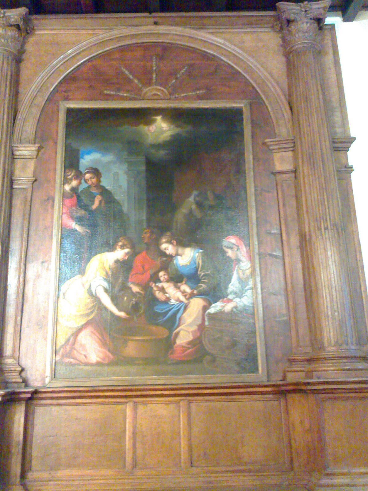</picture>
<figcaption>The little <b>oratory at Osimo</b> where Joseph said Mass every day, often rapt in ecstasy for hours. Photo: <a href="https://commons.wikimedia.org/wiki/File:CappellaSanGiuseppeOsimo.jpg">CappellaSanGiuseppeOsimo</a> by Valentini17, <a href="https://creativecommons.org/licenses/by-sa/3.0">CC BY-SA 3.0</a>, via Wikimedia Commons.</figcaption>
</figure>

<figure class=photo>
<picture><source srcset="/static/art/joc-osimo-window-600.webp 600w,/static/art/joc-osimo-window.webp 1280w" sizes="(max-width:760px) 100vw,760px" type="image/webp">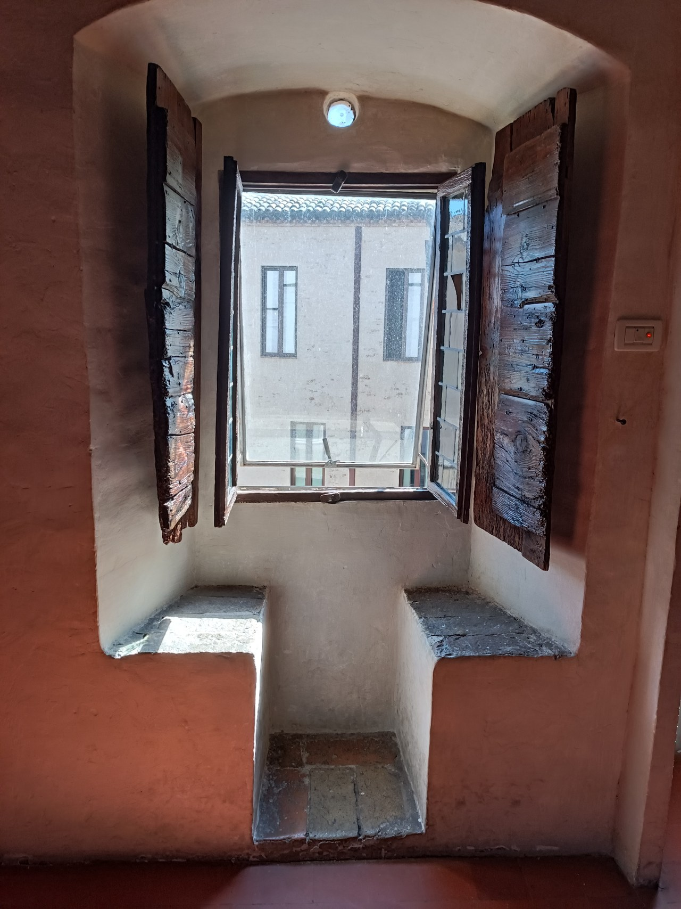</picture>
<figcaption>A window of <b>his rooms at Osimo</b>, kept as they were in his day. Photo: <a href="https://commons.wikimedia.org/wiki/File:Osimo_-_Chiesa_di_San_Giuseppe_da_Copertino_-_2023-09-27_22-11-55_016.jpg">Osimo - Chiesa di San Giuseppe da Copertino - 2023-09-27 22-11-55 016</a> by Viaggiamocela, <a href="https://creativecommons.org/licenses/by-sa/4.0">CC BY-SA 4.0</a>, via Wikimedia Commons.</figcaption>
</figure>

He never went into the city and knew none of its people, yet he spoke of their houses and affairs as if he had seen them, and the people of Osimo received many graces without knowing where they came from. He calmed a storm with the words, "Go away in God's name." When some young friars slipped out during Carnival, he asked the Guardian, "Where are thy sheep?" When they came back to his cell, he was so glad that he lifted one of them with one hand and whirled him around the room "as if he were but a straw".

<figure class=photo>
<picture><source srcset="/static/art/joc-osimo-desk-600.webp 600w,/static/art/joc-osimo-desk.webp 1280w" sizes="(max-width:760px) 100vw,760px" type="image/webp">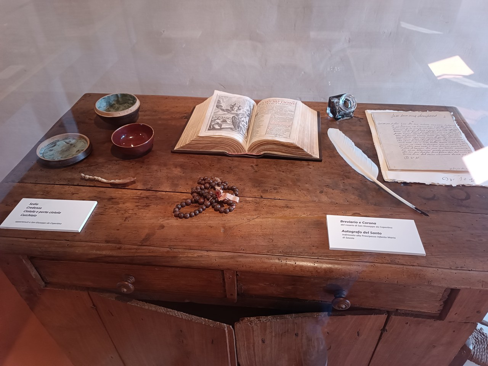</picture>
<figcaption><b>His writing desk at Osimo</b>, now part of the museum in his rooms. Photo: <a href="https://commons.wikimedia.org/wiki/File:Osimo_-_Chiesa_di_San_Giuseppe_da_Copertino_-_2023-09-27_22-11-55_018.jpg">Osimo - Chiesa di San Giuseppe da Copertino - 2023-09-27 22-11-55 018</a> by Viaggiamocela, <a href="https://creativecommons.org/licenses/by-sa/4.0">CC BY-SA 4.0</a>, via Wikimedia Commons.</figcaption>
</figure>

<h2 id=death>"Behold, my delight"</h2>

When he entered the friary at Osimo, Joseph had said, "This is my rest." He foretold that he would die there, and that he would die on a day when he could not receive Holy Communion. On 10 August 1663 he fell ill with a fever. When the friars urged him to pray for his health, he answered, "No, God forbid!"

For five days he still rose to say Mass in his oratory, and at his last Mass, on the feast of the Assumption, he had his usual ecstasies and flights. Then he could only receive Communion in bed. At each Communion he would cry, "Behold, my delight!" and swoon away. When the bell announced the Viaticum on 17 September, the day before he died, he rose from his bed and flew in rapture from the door of his room to the stair above his chapel, where he received his Lord on his knees, his face shining.

"The ass begins to ascend the mountain," he had said at the start of his illness, meaning his body. Later: "The ass has arrived half-way up the mountain." At last: "The ass has reached the summit of the mountain, he can no longer move and will leave his hide here." After the anointing he cried, "Oh, what a pleasant odor! Oh, what a fragrance! Oh, what a sweetness of paradise!" He begged pardon of everyone and asked to be buried in some hidden place. Told that the Pope had sent him his blessing, he got up, though dying, saying, "That is not a favor which one may receive in bed," and received it on his knees in his oratory.

To the crucifix he prayed, "Take this heart, burn and rive this heart, my Jesus." While the priest beside him prayed the "Ave Maris Stella", Joseph gave up his soul to God, "a sweet smile and bright light spreading over his countenance". It was just after midnight on **18 September 1663**. He was sixty years old.

<figure class=photo>
<picture><source srcset="/static/art/joc-osimo-habit-600.webp 600w,/static/art/joc-osimo-habit.webp 1200w" sizes="(max-width:760px) 100vw,760px" type="image/webp">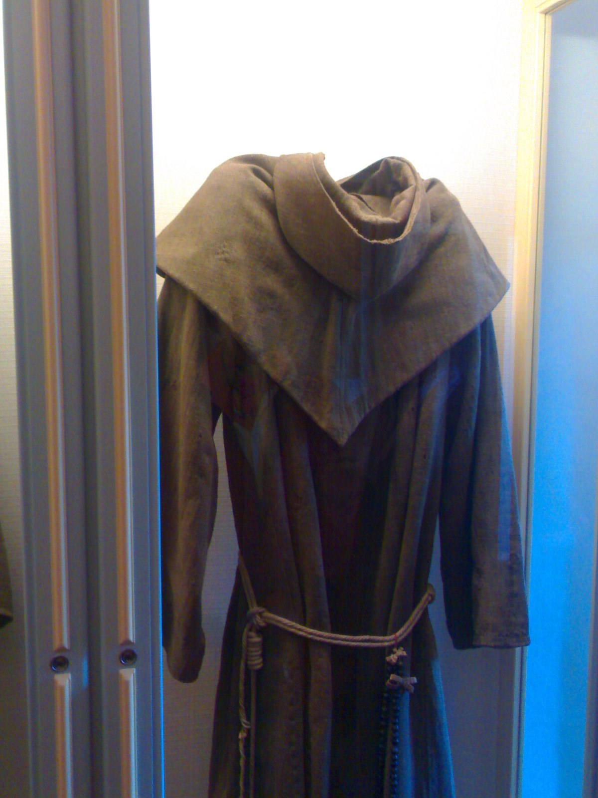</picture>
<figcaption><b>The habit of St Joseph</b>, kept among his relics at Osimo. Photo: <a href="https://commons.wikimedia.org/wiki/File:SaioSanGiuseppeCopertino.jpg">SaioSanGiuseppeCopertino</a> by Valentini17, <a href="https://creativecommons.org/licenses/by-sa/3.0">CC BY-SA 3.0</a>, via Wikimedia Commons.</figcaption>
</figure>

<figure class=photo>
<picture><source srcset="/static/art/joc-osimo-mask-600.webp 600w,/static/art/joc-osimo-mask.webp 1280w" sizes="(max-width:760px) 100vw,760px" type="image/webp">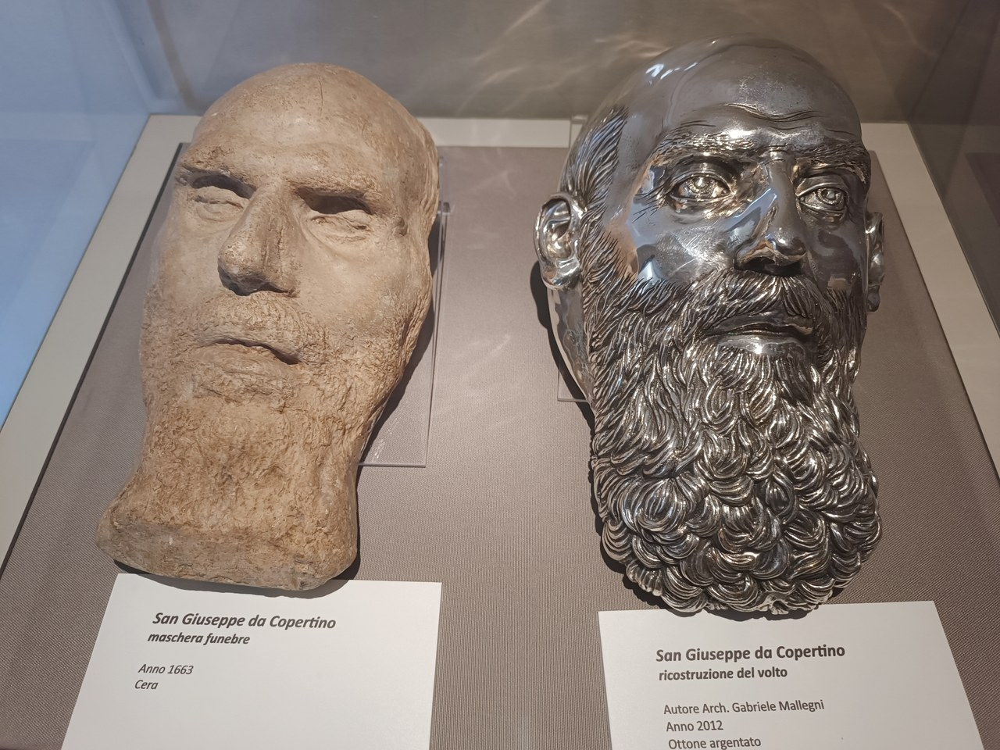</picture>
<figcaption><b>His death mask</b> and a silver reliquary bust, in the museum of his rooms at Osimo. Photo: <a href="https://commons.wikimedia.org/wiki/File:Osimo_-_Chiesa_di_San_Giuseppe_da_Copertino_-_2023-09-27_22-11-55_013.jpg">Osimo - Chiesa di San Giuseppe da Copertino - 2023-09-27 22-11-55 013</a> by Viaggiamocela, <a href="https://creativecommons.org/licenses/by-sa/4.0">CC BY-SA 4.0</a>, via Wikimedia Commons.</figcaption>
</figure>

When his body was being prepared for burial, the sheet beneath it caught fire, but neither the body nor even the beard and hair were singed. The people came in such crowds, crying, "The holy priest who lived in the monastery of St Francis is dead," that twenty-four men had to guard the bier. He was buried in the chapel of the Immaculate Conception in the church of St Francis.

<figure class=photo>
<picture><source srcset="/static/art/joc-osimo-relics-600.webp 600w,/static/art/joc-osimo-relics.webp 1280w" sizes="(max-width:760px) 100vw,760px" type="image/webp">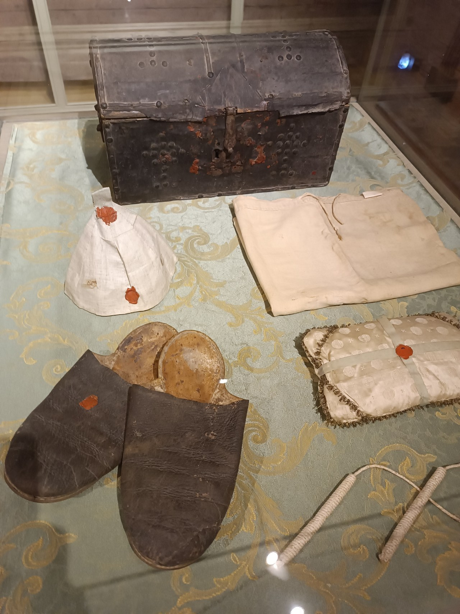</picture>
<figcaption><b>Relics of St Joseph</b> in the museum at Osimo: his shoes, his skullcap and a little chest. Photo: <a href="https://commons.wikimedia.org/wiki/File:Osimo_-_Chiesa_di_San_Giuseppe_da_Copertino_-_2023-09-27_22-11-55_004.jpg">Osimo - Chiesa di San Giuseppe da Copertino - 2023-09-27 22-11-55 004</a> by Viaggiamocela, <a href="https://creativecommons.org/licenses/by-sa/4.0">CC BY-SA 4.0</a>, via Wikimedia Commons.</figcaption>
</figure>

<h2 id=glory>Blessed, then saint</h2>

Miracles began at once. On the morning after his death, Victor Mattei of Osimo, whose knee had been swollen to the size of a loaf of bread for six years, pressed it against the step of Joseph's altar, worn down by his knees, and was instantly healed. Two months later his twelve-year-old son Stephen, whose eye had been crushed by a stone, pressed it to the stone over the saint's grave and recovered his sight. These were the two miracles approved for his beatification.

The bishops of Nardò, Assisi and Osimo began gathering testimony within two years of his death. **Clement XII** declared his heroic virtue on the feast of the Assumption, 1735. The future **Benedict XIV**, Prospero Lambertini, then promoter of the faith, the "devil's advocate" who had to raise every objection, wrote of him that "eyewitnesses, beyond all objection" attested his famous flights. As Pope, Benedict XIV beatified him in St Peter's on **24 February 1753**.

<figure class=photo>
<picture><source srcset="/static/art/joc-benedict-xiv-600.webp 600w,/static/art/joc-benedict-xiv.webp 1280w" sizes="(max-width:760px) 100vw,760px" type="image/webp">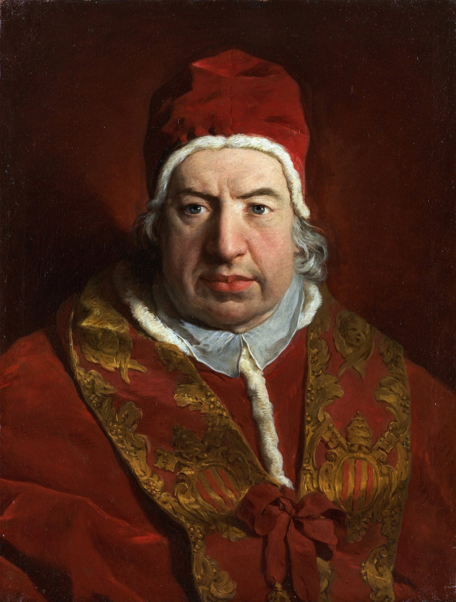</picture>
<figcaption><b>Pope Benedict XIV</b>, painted by Pierre Subleyras in 1746. As Prospero Lambertini he examined Joseph's cause; as Pope he beatified him in 1753. Image: <a href="https://commons.wikimedia.org/wiki/File:Pierre_Subleyras_Portrait_of_Benedict_XIV_1746._Metropolitan_Museum_of_Art.jpg">Pierre Subleyras Portrait of Benedict XIV 1746. Metropolitan Museum of Art</a> by Pierre Subleyras, public domain, via Wikimedia Commons.</figcaption>
</figure>

More miracles followed. A woman named Magdalen Panzironi, dying of a tumour, was healed in an instant when a relic of Blessed Joseph was put into her hand, and rose to eat supper with her family. On **16 July 1767** Pope **Clement XIII** canonised Joseph in St Peter's, and **Clement XIV** extended his feast to the whole Church, honouring in his decree "the memory of an admirable saint".

<figure class=photo>
<picture><source srcset="/static/art/joc-clement-xiii-600.webp 600w,/static/art/joc-clement-xiii.webp 1214w" sizes="(max-width:760px) 100vw,760px" type="image/webp">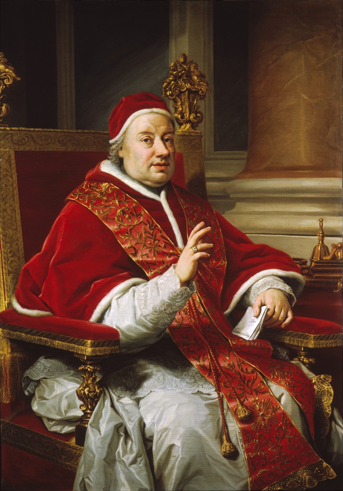</picture>
<figcaption><b>Pope Clement XIII</b>, painted by Anton Raphael Mengs and his workshop. He canonised St Joseph in 1767. Image: <a href="https://commons.wikimedia.org/wiki/File:Anton_Raphael_Mengs,_Portrait_of_Pope_Clement_XIII.jpg">Anton Raphael Mengs, Portrait of Pope Clement XIII</a> by Anton Raphael Mengs and workshop, public domain, via Wikimedia Commons.</figcaption>
</figure>

<figure class=photo>
<picture><source srcset="/static/art/joc-canonisation-600.webp 600w,/static/art/joc-canonisation.webp 1280w" sizes="(max-width:760px) 100vw,760px" type="image/webp">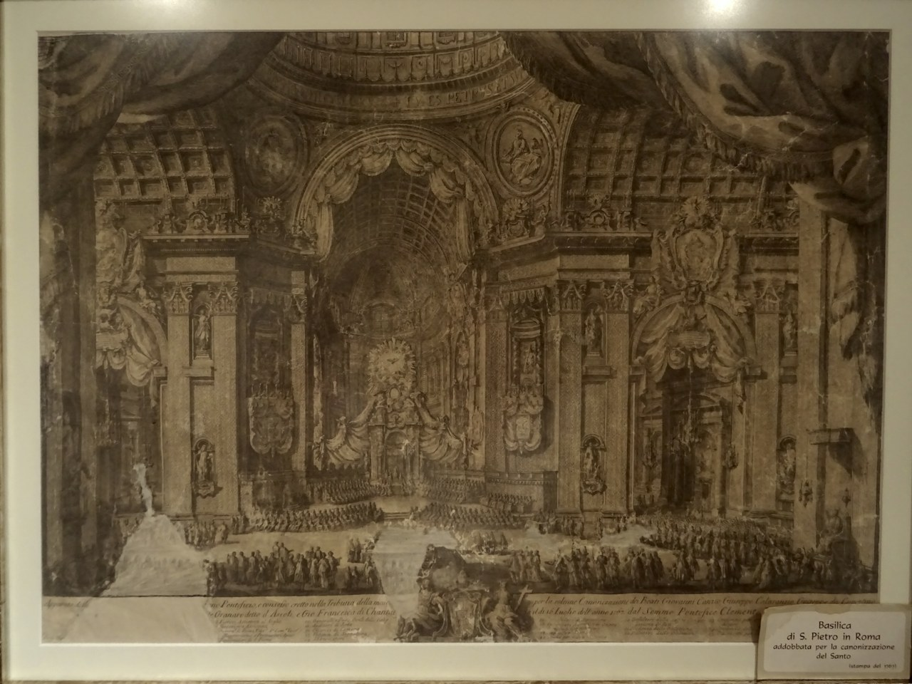</picture>
<figcaption><b>The canonisation in St Peter's</b>, an eighteenth-century print displayed at Osimo. Photo: <a href="https://commons.wikimedia.org/wiki/File:Canonisation_de_Cupertino_%C3%A0_saint_Pierre_de_Rome.jpg">Canonisation de Cupertino à saint Pierre de Rome</a> by Helvio ricina, <a href="https://creativecommons.org/licenses/by-sa/4.0">CC BY-SA 4.0</a>, via Wikimedia Commons.</figcaption>
</figure>

<figure class=photo>
<picture><source srcset="/static/art/joc-klauber-600.webp 600w,/static/art/joc-klauber.webp 1280w" sizes="(max-width:760px) 100vw,760px" type="image/webp">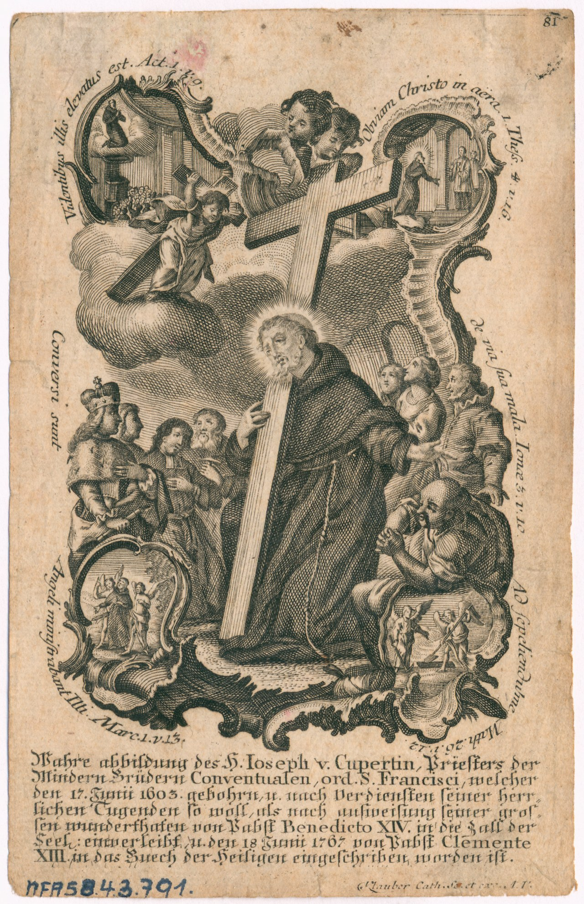</picture>
<figcaption>A devotional print by <b>Ignaz Sebastian Klauber</b> of Augsburg, eighteenth century: St Joseph embracing the cross among the angels. Image: <a href="https://commons.wikimedia.org/wiki/File:Devotieprent_van_de_heilige_Jozef_van_Cupertino,_asset_Y2BJdEjZjgZXvFfK8Wyq4adY.tif">Devotieprent van de heilige Jozef van Cupertino, asset Y2BJdEjZjgZXvFfK8Wyq4adY.tif</a> by Ignaz Sebastian Klauber, MAS Antwerp, <a href="https://creativecommons.org/publicdomain/zero/1.0/">CC0</a>, via Wikimedia Commons.</figcaption>
</figure>

<h2 id=places>His places and churches</h2>

<figure class=map><figcaption>St Joseph's places and churches, with his journeys under obedience. Map by The Daily Word; coastlines, rivers and borders from Natural Earth (public domain). Tap to enlarge.</figcaption></figure>

### Copertino: his birthplace

The **Santuario di San Giuseppe da Copertino** was begun in 1754, the year after his beatification, and finished in 1758, built over the stable where he was born. The stable is kept inside, with its little hearth and two wall cupboards. The sanctuary also keeps many relics, among them his heart, brought from Osimo on 7 April 1953. His father's one-room house stands nearby. Every September the town keeps his feast with great joy.

<figure class=photo>
<picture><source srcset="/static/art/joc-copertino-feast-600.webp 600w,/static/art/joc-copertino-feast.webp 1280w" sizes="(max-width:760px) 100vw,760px" type="image/webp">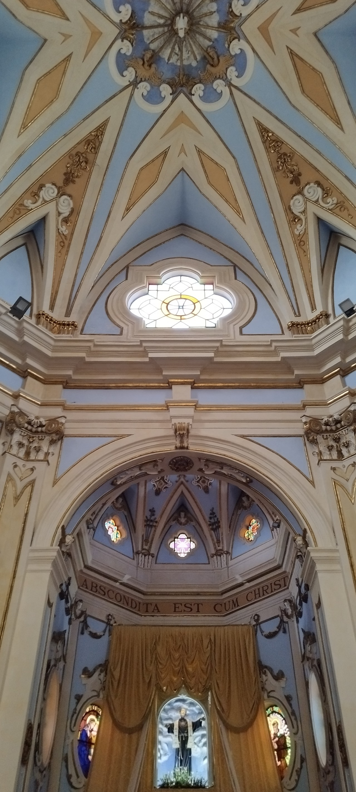</picture>
<figcaption>Inside the <b>Santuario di San Giuseppe</b> in Copertino, his statue decked for the feast. Photo: <a href="https://commons.wikimedia.org/wiki/File:Copertino_-_Santuario_di_San_Giuseppe_da_Copertino_-_2024-09-27_11-32-19_001.jpg">Copertino - Santuario di San Giuseppe da Copertino - 2024-09-27 11-32-19 001</a> by Acs67, <a href="https://creativecommons.org/licenses/by-sa/4.0">CC BY-SA 4.0</a>, via Wikimedia Commons.</figcaption>
</figure>

<figure class=photo>
<picture><source srcset="/static/art/joc-porta-san-giuseppe-600.webp 600w,/static/art/joc-porta-san-giuseppe.webp 1280w" sizes="(max-width:760px) 100vw,760px" type="image/webp">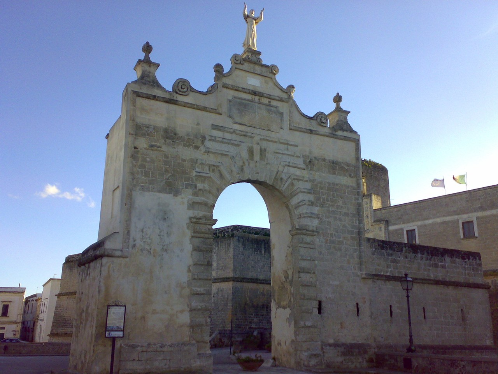</picture>
<figcaption>The <b>Porta San Giuseppe</b>, a gateway of Copertino named after its saint. Photo: <a href="https://commons.wikimedia.org/wiki/File:Porta_San_Giuseppe_Copertino.jpg">Porta San Giuseppe Copertino</a> by Lupiae, <a href="https://creativecommons.org/licenses/by-sa/3.0">CC BY-SA 3.0</a>, via Wikimedia Commons.</figcaption>
</figure>

### Copertino: Santa Maria della Grottella

The friary and sanctuary of **Santa Maria della Grottella**, on the edge of the town, keep the ancient image of the Madonna that Joseph called "my Mother". Here he tended the mule, made his novitiate, lived as a priest for some sixteen years and made many of his famous flights. The church was built in 1577 and enlarged in the eighteenth century.

### Assisi: the Basilica of St Francis and the Sacro Convento

Joseph lived for thirteen years in the great friary beside the tomb of St Francis, from 1639 to 1653, and was made a citizen of Assisi. In the lower basilica a chapel was later dedicated to him.

### Osimo: the Basilica of San Giuseppe da Copertino

The medieval church of St Francis at Osimo, built by the townspeople after St Francis had twice visited their city and consecrated in 1234, was rebuilt in baroque style after Joseph's beatification to plans by Andrea Vici. His body was placed under the altar in 1771, and the church was consecrated in his name in 1781. Pius VI made it a basilica in 1796, calling it "one of the most celebrated and venerable sanctuaries of Christendom". For the third centenary of his death in 1963 a crypt was built, where his body rests today in an urn of bronze and crystal. His three little rooms and his oratory are kept as they were and can be visited.

<figure class=photo>
<picture><source srcset="/static/art/joc-osimo-facade-600.webp 600w,/static/art/joc-osimo-facade.webp 1280w" sizes="(max-width:760px) 100vw,760px" type="image/webp">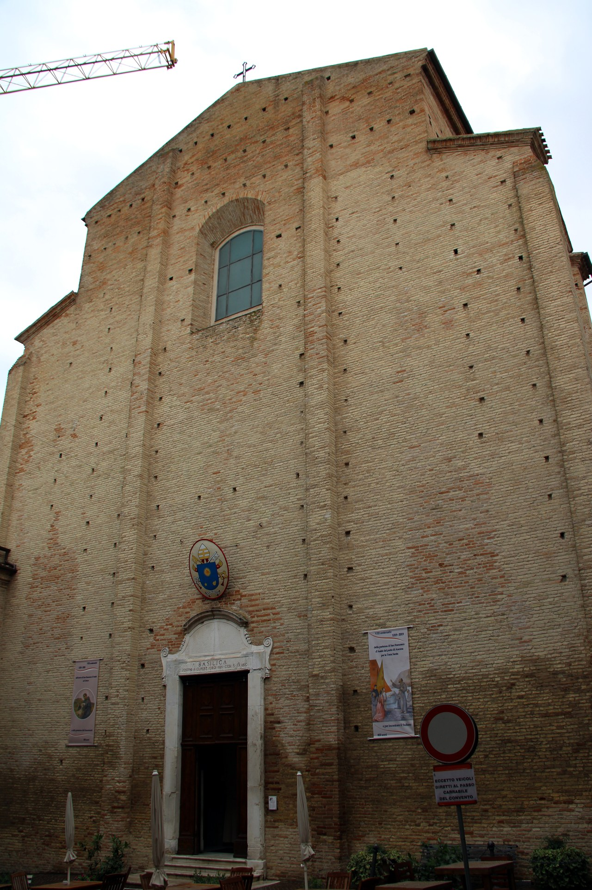</picture>
<figcaption>The <b>Basilica of San Giuseppe da Copertino</b> at Osimo. Its eighteenth-century façade was left unfinished in bare brick. Photo: <a href="https://commons.wikimedia.org/wiki/File:Santuario_-_Basilica_di_San_Giuseppe_di_Copertino_(Osimo),_facciata_01.jpg">Santuario - Basilica di San Giuseppe di Copertino (Osimo), facciata 01</a> by Mongolo1984, <a href="https://creativecommons.org/licenses/by-sa/4.0">CC BY-SA 4.0</a>, via Wikimedia Commons.</figcaption>
</figure>

<figure class=photo>
<picture><source srcset="/static/art/joc-osimo-apse-600.webp 600w,/static/art/joc-osimo-apse.webp 1280w" sizes="(max-width:760px) 100vw,760px" type="image/webp">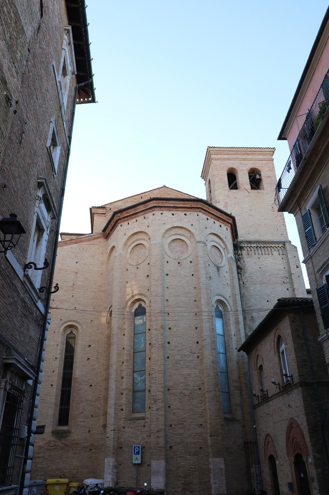</picture>
<figcaption>The <b>medieval apse and bell tower</b> of the old church of St Francis at Osimo, from the outside. Photo: <a href="https://commons.wikimedia.org/wiki/File:Osimo_-_Chiesa_di_San_Giuseppe_da_Copertino_-_008.JPG">Osimo - Chiesa di San Giuseppe da Copertino - 008</a> by Diego Baglieri, <a href="https://creativecommons.org/licenses/by-sa/4.0">CC BY-SA 4.0</a>, via Wikimedia Commons.</figcaption>
</figure>

<figure class=photo>
<picture><source srcset="/static/art/joc-osimo-crypt-600.webp 600w,/static/art/joc-osimo-crypt.webp 1280w" sizes="(max-width:760px) 100vw,760px" type="image/webp"></picture>
<figcaption>The <b>crypt</b> at Osimo, built for the third centenary of his death in 1963. Photo: <a href="https://commons.wikimedia.org/wiki/File:Cripta_Basilica_San_Giuseppe_di_Copertino_(Osimo)_01.jpg">Cripta Basilica San Giuseppe di Copertino (Osimo) 01</a> by Parsifall, <a href="https://creativecommons.org/licenses/by-sa/4.0">CC BY-SA 4.0</a>, via Wikimedia Commons.</figcaption>
</figure>

<figure class=photo>
<picture><source srcset="/static/art/joc-osimo-urn-600.webp 600w,/static/art/joc-osimo-urn.webp 1280w" sizes="(max-width:760px) 100vw,760px" type="image/webp"></picture>
<figcaption><b>The urn of St Joseph</b> in the crypt at Osimo. Photo: <a href="https://commons.wikimedia.org/wiki/File:Osimo_-_Chiesa_di_San_Giuseppe_da_Copertino_-_2023-09-27_22-08-04_010.jpg">Osimo - Chiesa di San Giuseppe da Copertino - 2023-09-27 22-08-04 010</a> by Viaggiamocela, <a href="https://creativecommons.org/licenses/by-sa/4.0">CC BY-SA 4.0</a>, via Wikimedia Commons.</figcaption>
</figure>

<figure class=photo>
<picture><source srcset="/static/art/joc-osimo-body-600.webp 600w,/static/art/joc-osimo-body.webp 1280w" sizes="(max-width:760px) 100vw,760px" type="image/webp"></picture>
<figcaption><b>St Joseph of Cupertino</b> at rest in his urn. Photo: <a href="https://commons.wikimedia.org/wiki/File:Corpo_di_Giuseppe_da_Cupertino_-_Osimo.jpg">Corpo di Giuseppe da Cupertino - Osimo</a> by Helvio ricina, <a href="https://creativecommons.org/licenses/by-sa/4.0">CC BY-SA 4.0</a>, via Wikimedia Commons.</figcaption>
</figure>

<figure class=photo>
<picture><source srcset="/static/art/joc-osimo-altar-600.webp 600w,/static/art/joc-osimo-altar.webp 1280w" sizes="(max-width:760px) 100vw,760px" type="image/webp"></picture>
<figcaption>The <b>altar of St Joseph</b> in the basilica at Osimo. Photo: <a href="https://commons.wikimedia.org/wiki/File:Altare_di_San_Giuseppe_da_Copertino.jpg">Altare di San Giuseppe da Copertino</a> by Markelio.c, <a href="https://creativecommons.org/licenses/by-sa/3.0">CC BY-SA 3.0</a>, via Wikimedia Commons.</figcaption>
</figure>

<figure class=photo>
<picture><source srcset="/static/art/joc-osimo-painting-600.webp 600w,/static/art/joc-osimo-painting.webp 1280w" sizes="(max-width:760px) 100vw,760px" type="image/webp"></picture>
<figcaption>A painting of <b>one of his miracles</b>, in the museum of his rooms at Osimo. Photo: <a href="https://commons.wikimedia.org/wiki/File:Osimo_-_Chiesa_di_San_Giuseppe_da_Copertino_-_2023-09-27_22-11-55_010.jpg">Osimo - Chiesa di San Giuseppe da Copertino - 2023-09-27 22-11-55 010</a> by Viaggiamocela, <a href="https://creativecommons.org/licenses/by-sa/4.0">CC BY-SA 4.0</a>, via Wikimedia Commons.</figcaption>
</figure>

### Rome

Joseph stayed at the Conventual friary of the **Santi Apostoli** when he came to Rome in 1639, and it was in Rome that Pope Urban VIII saw him rise. In 1753 Benedict XIV announced the miracles for his beatification after saying Mass at the altar of St Francis in the Basilica of the Twelve Holy Apostles, and he was beatified and canonised in St Peter's.

<h2 id=art>Joseph in art</h2>

The painters of the eighteenth century loved the Flying Friar. They showed him soaring in his brown habit with arms spread wide, towards an altar, a cross, an image of the Virgin or the distant dome of Loreto, while friars and townspeople look up in wonder. Holy cards and prints carried his picture all over Catholic Europe, often with a prayer for students.

<figure class=photo>
<picture><source srcset="/static/art/joc-frari-altar-600.webp 600w,/static/art/joc-frari-altar.webp 1280w" sizes="(max-width:760px) 100vw,760px" type="image/webp"></picture>
<figcaption>The <b>altar of St Joseph of Cupertino</b> in the great Franciscan church of the Frari in Venice, with Giuseppe Nogari's painting of his miracle (shown at the top of this page). Photo: <a href="https://commons.wikimedia.org/wiki/File:Frari_(Venice)_nave_right_-_Altar_of_san_Giuseppe_da_Copertino.jpg">Frari (Venice) nave right - Altar of san Giuseppe da Copertino</a> by Didier Descouens, <a href="https://creativecommons.org/licenses/by-sa/4.0">CC BY-SA 4.0</a>, via Wikimedia Commons.</figcaption>
</figure>

<figure class=photo>
<picture><source srcset="/static/art/joc-caltanissetta-600.webp 600w,/static/art/joc-caltanissetta.webp 1280w" sizes="(max-width:760px) 100vw,760px" type="image/webp"></picture>
<figcaption><b>St Joseph of Cupertino</b>, with his Calvary of three crosses behind him, a painting in the church of San Francesco at Caltanissetta, Sicily. Photo: <a href="https://commons.wikimedia.org/wiki/File:San_Giuseppe_da_Copertino.jpg">San Giuseppe da Copertino</a> by Fscarfia06, <a href="https://creativecommons.org/licenses/by-sa/4.0">CC BY-SA 4.0</a>, via Wikimedia Commons.</figcaption>
</figure>

<figure class=photo>
<picture><source srcset="/static/art/joc-mondavio-600.webp 600w,/static/art/joc-mondavio.webp 1280w" sizes="(max-width:760px) 100vw,760px" type="image/webp"></picture>
<figcaption><b>St Joseph of Cupertino in flight</b>, in the town art gallery of Mondavio in the Marches, not far from Fossombrone. Photo: <a href="https://commons.wikimedia.org/wiki/File:Pinacoteca_comunale_di_Mondavio_(84115).jpg">Pinacoteca comunale di Mondavio (84115)</a> by Accurimbono, <a href="https://creativecommons.org/licenses/by-sa/4.0">CC BY-SA 4.0</a>, via Wikimedia Commons.</figcaption>
</figure>

<figure class=photo>
<picture><source srcset="/static/art/joc-tulln-600.webp 600w,/static/art/joc-tulln.webp 1280w" sizes="(max-width:760px) 100vw,760px" type="image/webp"></picture>
<figcaption>A baroque <b>statue of St Joseph</b> in the Minorite church at Tulln, Austria. Photo: <a href="https://commons.wikimedia.org/wiki/File:Tulln_Minoritenkirche25.jpg">Tulln Minoritenkirche25</a> by BSonne, <a href="https://creativecommons.org/licenses/by-sa/3.0">CC BY-SA 3.0</a>, via Wikimedia Commons.</figcaption>
</figure>

<figure class=photo>
<picture><source srcset="/static/art/joc-gravure-600.webp 600w,/static/art/joc-gravure.webp 1280w" sizes="(max-width:760px) 100vw,760px" type="image/webp"></picture>
<figcaption><b>The levitation of St Joseph</b>, an engraving displayed at Osimo. Photo: <a href="https://commons.wikimedia.org/wiki/File:L%C3%A9vitation_de_Giuseppe_da_Cupertino_-_Gravure.jpg">Lévitation de Giuseppe da Cupertino - Gravure</a> by Helvio ricina, <a href="https://creativecommons.org/licenses/by-sa/4.0">CC BY-SA 4.0</a>, via Wikimedia Commons.</figcaption>
</figure>

<figure class=photo>
<picture><source srcset="/static/art/joc-gozos-600.webp 600w,/static/art/joc-gozos.webp 1280w" sizes="(max-width:760px) 100vw,760px" type="image/webp"></picture>
<figcaption><i>Gozos</i> in praise of "the seraphic San José de Cupertino", a Spanish broadsheet of hymn verses for his feast on 18 September, nineteenth century. Image: <a href="https://commons.wikimedia.org/wiki/File:Gozos_en_alabanza_del_serafico_San_Jose_de_Cupertino._Se_celebra_su_fiesta_a_18_de_Setiembre_-_btv1b106607198.jpg">Gozos en alabanza del serafico San Jose de Cupertino. Se celebra su fiesta a 18 de Setiembre - btv1b106607198</a> by Bibliothèque nationale de France, public domain, via Wikimedia Commons.</figcaption>
</figure>

## Path to sainthood

Testimony about Joseph's life and miracles was gathered by the bishops of Nardò, Assisi and Osimo beginning in 1665, two years after his death, and Pope Innocent XI opened his cause. Clement XII declared his heroic virtues on 15 August 1735. Benedict XIV approved two miracles on 4 October 1752 and beatified him in St Peter's on 24 February 1753. Clement XIII approved three further miracles and canonised him in St Peter's on 16 July 1767. Clement XIV extended his feast to the whole Church. His feast is kept on 18 September.

## Patronages

Students, pupils and everyone taking an examination; those who find learning hard; air travellers, pilots, aviators and astronauts; the city of Osimo, and the city of Cupertino in California.

## Trivia

- **Cupertino, California**, home of Apple, is named after him. Juan Bautista de Anza's expedition named a local creek the Arroyo de San José de Cupertino in his honour, and the town took its name from it. Copertino is now one of Cupertino's sister cities.
- He loved [St Francis of Assisi](/saints/francis-of-assisi/), lived for thirteen years beside his tomb and was made a "fellow-citizen of St Francis". At Monopoli he flew to a statue of [St Anthony of Padua](/saints/anthony-of-padua/), and at the clothing of nuns in the church of [St Clare](/saints/clare/) at Copertino he danced in the air with their confessor.
- His special patron was [St Catherine of Siena](/saints/catherine-of-siena/), and he loved to sing a hymn in her honour.
- Another son of Southern Italy and the Franciscan family, [St Padre Pio](/saints/padre-pio/), was known like Joseph for his ecstasies and his gift of reading hearts.
- He bore the name of [St Joseph](/saints/joseph/), the husband of Mary, and like the Holy Family he began his life in a stable.
- In 1962 Hollywood told his story in the film *The Reluctant Saint*, with Maximilian Schell as Joseph.

## Sources

- [Angelo Pastrovicchi: *St. Joseph of Copertino*, translated by Francis S. Laing (B. Herder, 1918), Internet Archive](https://archive.org/details/StJosephOfCopertino)
- [Catholic Encyclopedia (1910): St Joseph of Cupertino](https://www.newadvent.org/cathen/08520b.htm)
- [Wikipedia: Joseph of Cupertino](https://en.wikipedia.org/wiki/Joseph_of_Cupertino)
- [Wikipedia (Italian): Giuseppe da Copertino](https://it.wikipedia.org/wiki/Giuseppe_da_Copertino)
- [Wikipedia (French): Joseph de Cupertino](https://fr.wikipedia.org/wiki/Joseph_de_Cupertino)
- [Wikipedia (Italian): Basilica di San Giuseppe da Copertino, Osimo](https://it.wikipedia.org/wiki/Basilica_di_San_Giuseppe_da_Copertino)
- [Wikipedia (Italian): Copertino](https://it.wikipedia.org/wiki/Copertino)
- [Wikipedia (Italian): Pietrarubbia](https://it.wikipedia.org/wiki/Pietrarubbia)
- [Wikipedia: Juan Alfonso Enríquez de Cabrera, Admiral of Castile](https://en.wikipedia.org/wiki/Juan_Alfonso_Enr%C3%ADquez_de_Cabrera,_5th_Duke_of_Medina_de_Rioseco)
- [Wikipedia: Ludovico Mazzanti](https://en.wikipedia.org/wiki/Ludovico_Mazzanti)
- [Wikipedia: Cupertino, California](https://en.wikipedia.org/wiki/Cupertino,_California)
- [Wikipedia: The Reluctant Saint](https://en.wikipedia.org/wiki/The_Reluctant_Saint)
- [Ignis: The levitations of Saint Joseph of Cupertino](https://ignismission.com/en/ignispedia/les-levitations-de-saint-joseph-de-cupertino)

Quotations of St Joseph and of those who knew him, and the accounts of his flights, miracles and death, are from Pastrovicchi's Life in the 1918 English translation, which was written from the testimony gathered for his beatification. Prospero Lambertini's words on the witnesses are from his treatise on beatification, as quoted by Ignis. The healing at Galatone, the wonders of his life and the miracles after his death are told as his first biographers recorded them.

Originally written October 16, 2026 from the sources above. Expanded November 27, 2026 with his full story, two maps and pictures from Wikimedia Commons, fact-checked against Pastrovicchi's Life, the Catholic Encyclopedia and the sources listed. Feast days follow the General Roman Calendar.

