<nav class=toc aria-label="On this page">

On this page

<ol>
<li><a href="#why">Why the Church honours him</a></li>
<li><a href="#names">One apostle, three names</a></li>
<li><a href="#question">His question at the Last Supper</a></li>
<li><a href="#kinsman">"Brother of James": a kinsman of the Lord?</a></li>
<li><a href="#epistle">The Epistle of Jude</a></li>
<li><a href="#edessa">King Abgar and the Image of Edessa</a></li>
<li><a href="#persia">With Simon in Persia</a></li>
<li><a href="#armenia">Armenia's apostle</a></li>
<li><a href="#relics">His relics: St Peter's and beyond</a></li>
<li><a href="#hope">Why the patron of desperate causes?</a></li>
<li><a href="#devotion">Chicago, Memphis and Mexico City</a></li>
<li><a href="#prayer">Feasts, symbols and the novena</a></li>
<li><a href="#places">His places and shrines</a></li>
<li><a href="#art">Jude in art</a></li>
</ol>
</nav>

## His story

Every list of the Twelve ends with the name nobody wants: Judas Iscariot, "which also was the traitor." Just before it, in St Luke's Gospel, stands another Judas, an apostle who never betrayed anyone, and who spent the next two thousand years being mistaken for the one who did. The Church calls him **St Jude**, and also **Thaddaeus**, and his gentle, faithful life is one of the quiet consolations of the Gospel.

He speaks only once in the Gospels. At the Last Supper, after Judas Iscariot had gone out into the night, this other Judas asked Jesus a question, and received in answer one of the most tender promises in Scripture: that God himself would come and make his home with anyone who loves him. Tradition remembers him as a kinsman of the Lord and the author of the short **Epistle of Jude**, which ends with a doxology still sung today: "Now unto him that is able to keep you from falling."

The stories that grew up afterwards carry him far to the east: to King Abgar of Edessa with the miraculous image of Christ's face; into Persia with his fellow apostle **Simon**, to die with him as a martyr; and, in the memory of the Armenian Church, to Armenia, where a black-and-white stone monastery in the mountains of north-western Iran still keeps his name. Where a story comes from legend rather than history, we say so, kindly, and tell it anyway.

And then something remarkable happened. Because so many people shied away from the name Judas, St Jude became the saint of last resort, the one you could still turn to when every door seemed shut. A Claretian priest in a Chicago steel-mill parish, a struggling young comedian in Detroit, and the poor of Mexico City found that he did not mind being asked. Today he is one of the most loved saints in the world, the **patron of hope and of desperate causes**.

### Early 1st century · Galilee
Jude grows up in Galilee. Tradition counts him among the relatives of Jesus, the "brethren" named in Matthew 13:55.

### c. AD 28 · Called among the Twelve
He is chosen as one of the Twelve: "Judas the brother of James" (Luke 6:16), called "Lebbaeus, whose surname was Thaddaeus" in Matthew 10:3.

### The night before the Passion · His question
At the Last Supper he asks, "Lord, how is it that thou wilt manifest thyself unto us, and not unto the world?" (John 14:22).

### c. AD 30 · Pentecost
He prays in the Upper Room with Mary and the apostles (Acts 1:13–14) and receives the Holy Spirit "like as of fire."

### Later 1st century · The Epistle of Jude
A short letter from "Jude, the servant of Jesus Christ, and brother of James" urges the churches to "contend for the faith."

### Tradition · Edessa, Persia and Armenia
He is remembered as preaching in Mesopotamia and Persia with St Simon, and in the Armenian tradition as Armenia's first apostle with St Bartholomew.

### Tradition · Martyrdom
The Western tradition says he and Simon were martyred together in Persia. Their shared feast is 28 October.

### 944 · The Image of Edessa
The cloth venerated as the image of Christ sent to King Abgar is carried in triumph to Constantinople.

### 1548 · St Peter's
Pope Paul III grants an indulgence to pilgrims at St Jude's tomb in St Peter's on his feast. In the new basilica the relics of Sts Simon and Jude rest in the left transept.

### 1929 · Chicago
Fr James Tort, a Claretian, begins novenas to St Jude in a South Chicago steel-mill parish. The National Shrine of St Jude is born.

### 1962 · Memphis
Danny Thomas opens St. Jude Children's Research Hospital, the "shrine" he promised St Jude in 1940.

<figure class=photo>
<picture><source srcset="/static/art/jude-la-tour-600.webp 600w,/static/art/jude-la-tour.webp 1280w" sizes="(max-width:760px) 100vw,760px" type="image/webp">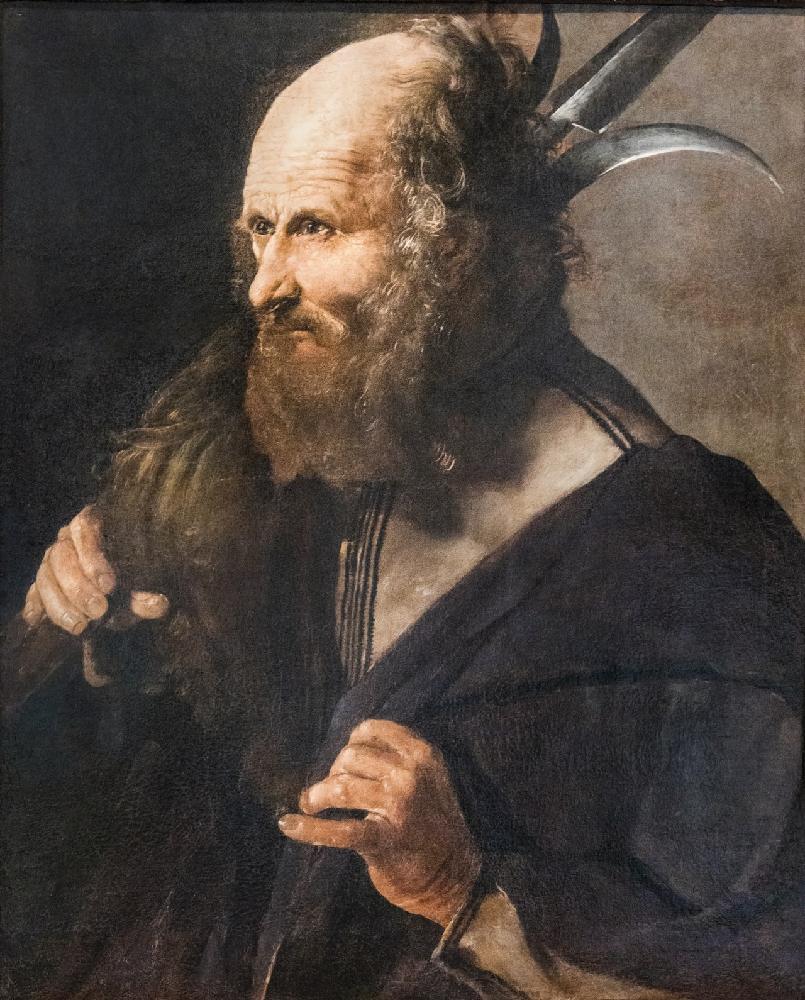</picture>
<figcaption><i>Saint Jude Thaddaeus</i>, by <b>Georges de La Tour</b>, about 1620, from his series of the apostles recorded in Albi Cathedral by 1698. Of the series now in Albi, only this St Jude and the St James the Less are by La Tour's own hand; the rest are copies. Musée Toulouse-Lautrec, Albi. Photo: <a href="https://commons.wikimedia.org/wiki/File:(Albi)_Saint_Jude_Thadd%C3%A9e_1620_-_Georges_de_La_Tour_Inv.166.jpg">(Albi) Saint Jude Thaddée 1620 - Georges de La Tour Inv.166</a> by Didier Descouens, public domain, via Wikimedia Commons.</figcaption>
</figure>

<h2 id=why>Why the Church honours him</h2>

- **He was one of the Twelve.** Jesus chose him, kept him close for three years, and sent him out to preach.
- **He asked the question many of us ask.** Why does God not show himself to the whole world? Jesus' answer, that God makes his home in the loving heart, has comforted Christians ever since.
- **He kept faith while bearing a hard name.** He shared his name with the betrayer, yet the Gospel takes care to say "not Iscariot," and the Church has never let that faithful Judas be forgotten.
- **He urged the Church to hold fast.** The Epistle of Jude calls believers to "earnestly contend for the faith which was once delivered unto the saints" and to "keep yourselves in the love of God."
- **He carried the Gospel east.** Tradition gives him a share in the first preaching in Edessa, Persia and Armenia, and remembers him as a martyr with St Simon.
- **He has become the saint of hope.** Millions turn to him when they are at the end of their strength, and the hospitals, shrines and soup kitchens that bear his name are works of real mercy.

<h2 id=names>One apostle, three names</h2>

The four lists of the apostles agree on almost everything. Peter comes first, Judas Iscariot last, and the same names fall into the same groups. But at one place in the third group the names change.

St Matthew writes: "James the son of Alphaeus, and **Lebbaeus, whose surname was Thaddaeus**" (Matthew 10:3). St Mark simply says "**Thaddaeus**" (Mark 3:18). St Luke, in his Gospel and in Acts, writes in the same place "**Judas the brother of James**" (Luke 6:16; Acts 1:13). The Greek of Luke says literally "Judas of James," which could mean the son or the brother of a James; the King James Version, like the Latin tradition, reads it as "brother," in keeping with the Epistle of Jude.

The Church has long understood these as one man with several names. Judas, or Judah, was one of the commonest Jewish names, the name of the patriarch and of Judas Maccabeus, the hero of the Maccabees. A second name helped tell its bearers apart. *Thaddaeus* is often explained from an Aramaic word for the breast, meaning something like "big-hearted," and *Lebbaeus* from the Hebrew for "heart," though scholars are not sure of either. St Bridget of Sweden would later hear in the name Thaddaeus a promise of kindness. Whether or not the etymologies are exact, the Church has always loved them: this is the apostle with a great heart.

<h2 id=question>His question at the Last Supper</h2>

St John alone records Jude's only words. It was the night before Jesus died. Judas Iscariot had already left the room. Jesus had told the apostles that he was going away, but that he would not leave them orphans: "Yet a little while, and the world seeth me no more; but ye see me ... He that hath my commandments, and keepeth them, he it is that loveth me: and he that loveth me shall be loved of my Father, and I will love him, and will manifest myself to him" (John 14:19–21).

Then the other Judas spoke up:

> Judas saith unto him, not Iscariot, Lord, how is it that thou wilt manifest thyself unto us, and not unto the world? Jesus answered and said unto him, If a man love me, he will keep my words: and my Father will love him, and we will come unto him, and make our abode with him. (John 14:22–23)

"Not Iscariot." St John is careful to say so. Jude's question is a natural one: if Jesus is the Messiah, why not appear in glory before everyone, in Jerusalem and in Rome? Jesus does not answer with a plan for the world's stage. He answers with a promise for every loving heart. The Father and the Son will come, and make their home, their "abode," in the one who loves them. It is one of the deepest sayings about prayer and the indwelling of God in all of Scripture, and it was given in answer to the quiet apostle whom history almost forgot.

<h2 id=kinsman>"Brother of James": a kinsman of the Lord?</h2>

The Epistle of Jude opens: "Jude, the servant of Jesus Christ, and brother of James." The James meant is almost certainly the well-known leader of the Church in Jerusalem, whom St Paul calls "the Lord's brother" (Galatians 1:19). And St Matthew names a Judas among Jesus' own kinsmen: "Is not this the carpenter's son? is not his mother called Mary? and his brethren, James, and Joses, and Simon, and Judas?" (Matthew 13:55).

Catholic and Orthodox tradition have always held that Mary remained a virgin, and so understand these "brethren" as close relatives: cousins, in the Western reading, or sons of Joseph by an earlier marriage, in the Eastern. On either view, Jude belonged to the family of the Lord. The early historian **Hegesippus**, quoted by Eusebius, tells a touching story of that family. Near the end of the 1st century, the grandsons of "Jude, who is said to have been the Lord's brother according to the flesh," were brought before the Emperor Domitian as descendants of King David. They showed him their hands, hard and calloused from farming a small plot of land, and told him that Christ's kingdom was "not a temporal nor an earthly kingdom, but a heavenly and angelic one." The emperor let them go.

Whether this Judas, the Lord's kinsman, was the same man as Judas the apostle is a question scholars still discuss, and the Catholic Encyclopedia calls the identification "highly probable" rather than certain. The Church's liturgy honours them as one: Jude, apostle, relative of the Lord, and author of the epistle.

<figure class=photo>
<picture><source srcset="/static/art/jude-ravenna-600.webp 600w,/static/art/jude-ravenna.webp 925w" sizes="(max-width:760px) 100vw,760px" type="image/webp">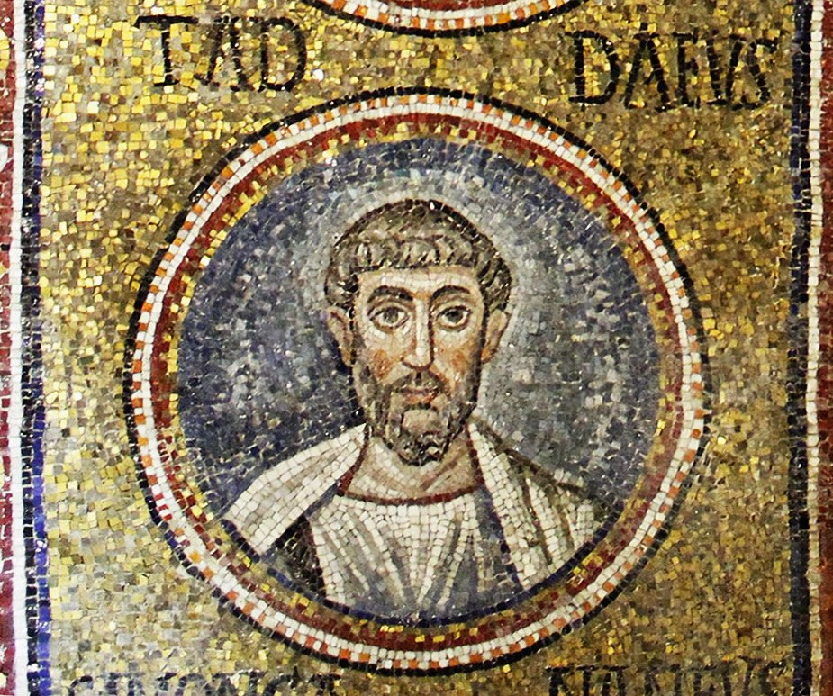</picture>
<figcaption><b>Thaddaeus</b>, in a mosaic medallion of about AD 500 in the <b>Archbishop's Chapel, Ravenna</b>, among the apostles around Christ on the arches of the chapel. Photo: <a href="https://commons.wikimedia.org/wiki/File:Thaddeus_-_Archbishop%27s_Chapel_(Ravenna).jpg">Thaddeus - Archbishop's Chapel (Ravenna)</a> by Incola (crop), <a href="https://creativecommons.org/licenses/by-sa/4.0">CC BY-SA 4.0</a>, via Wikimedia Commons.</figcaption>
</figure>

<h2 id=epistle>The Epistle of Jude</h2>

The Epistle of Jude is one of the shortest books in the Bible, just twenty-five verses, written to Christians troubled by teachers who "turn the grace of our God into lasciviousness." It is fiery and urgent, full of images from the Old Testament and from Jewish tradition: the fallen angels, Sodom and Gomorrah, Cain, Balaam, and a quotation from the prophecy of Enoch. But its heart is pastoral:

> Beloved, when I gave all diligence to write unto you of the common salvation, it was needful for me to write unto you, and exhort you that ye should earnestly contend for the faith which was once delivered unto the saints. (Jude 3)

> But ye, beloved, building up yourselves on your most holy faith, praying in the Holy Ghost, keep yourselves in the love of God, looking for the mercy of our Lord Jesus Christ unto eternal life. And of some have compassion, making a difference: and others save with fear, pulling them out of the fire. (Jude 20–23)

And it ends with one of the most beautiful blessings in the New Testament, used in countless liturgies and benedictions:

> Now unto him that is able to keep you from falling, and to present you faultless before the presence of his glory with exceeding joy, to the only wise God our Saviour, be glory and majesty, dominion and power, both now and ever. Amen. (Jude 24–25)

Who wrote it? The letter names "Jude, the brother of James," and the early Church received it, though some churches were slow to accept it because it was so short and because it quotes the Book of Enoch, which is not in the Bible. Many modern scholars think it was written later in Jude's name, as was common in the ancient world, and some note that verse 17 speaks of "the apostles" as if from outside their number. Others defend its authenticity: a letter from a relative of the Lord, well known to Jewish Christians. Catholic tradition has long identified the author with the apostle. Either way, the Church reads it as Scripture, and its closing words have kept many a soul "from falling."

<h2 id=edessa>King Abgar and the Image of Edessa</h2>

The best-known story of Thaddaeus comes from **Edessa**, today Şanlıurfa in south-eastern Turkey. In the 4th century, Eusebius of Caesarea copied from the archives of Edessa a letter said to have been sent to Jesus by **King Abgar**, who was gravely ill. Abgar had heard of the miracles in Judea, and begged Jesus to come and heal him. Jesus wrote back, says the story, that he must first fulfil his mission, but that after he had ascended he would send one of his disciples. "For after his resurrection from the dead and his ascent into heaven," Eusebius writes, "Thomas, one of the twelve apostles, under divine impulse sent Thaddeus, who was also numbered among the seventy disciples of Christ, to Edessa, as a preacher and evangelist." Thaddaeus healed the king and preached Christ to the city.

Later versions added a wonderful detail. Abgar's messenger, Ananias, had tried to paint Jesus' portrait but could not, because of the light shining from his face; so Jesus pressed a cloth to his face and left on it the image of his features, "not made by hands." This cloth, the **Mandylion** or **Image of Edessa**, became one of the great treasures of Christendom. In 944 it was carried in solemn procession to Constantinople, and it gave rise to a whole family of icons of the Holy Face, from Novgorod to Genoa.

Here the Eastern and Western traditions part, gently. Eusebius calls the missionary of Edessa "one of the seventy," the wider circle of disciples Jesus sent out in Luke 10, and the Syriac *Doctrine of Addai* calls him **Addai**. The Orthodox Church honours this **Thaddaeus of the Seventy** on 21 August, and keeps a separate feast of **Jude**, the apostle and brother of the Lord, on **19 June**. In the West, the *Golden Legend* and most later devotion simply say that "Thaddeus, that was Jude" was sent to Abgar. That is why St Jude is so often painted holding a medallion with the face of Christ: he is carrying the image of Edessa.

<figure class=photo>
<picture><source srcset="/static/art/jude-abgar-600.webp 600w,/static/art/jude-abgar.webp 321w" sizes="(max-width:760px) 100vw,760px" type="image/webp">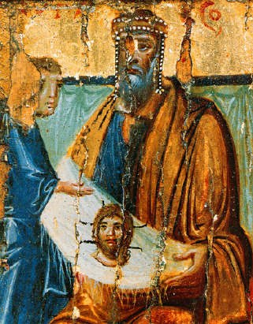</picture>
<figcaption><i>King Abgar receiving the Image of Edessa</i>, the right wing of a 10th-century triptych icon at <b>St Catherine's Monastery, Mount Sinai</b>. The king, who in this version receives the cloth from his messenger, has been thought to bear the features of the Byzantine emperor Constantine VII, in whose reign the image came to Constantinople. Image: <a href="https://commons.wikimedia.org/wiki/File:Abgarwithimageofedessa10thcentury.jpg">Abgarwithimageofedessa10thcentury</a>, public domain, via Wikimedia Commons.</figcaption>
</figure>

<figure class=photo>
<picture><source srcset="/static/art/jude-sinai-icon-600.webp 600w,/static/art/jude-sinai-icon.webp 681w" sizes="(max-width:760px) 100vw,760px" type="image/webp">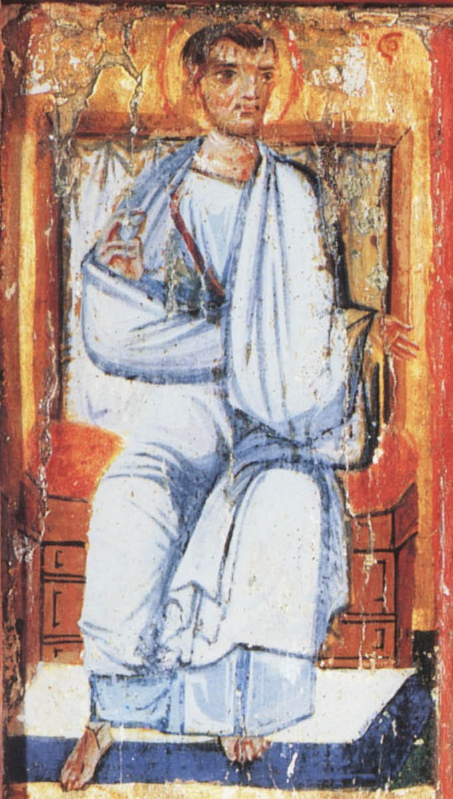</picture>
<figcaption><b>Thaddaeus</b>, enthroned, from the left wing of the same 10th-century <b>Sinai triptych</b>. The missing centre panel is thought to have shown the Mandylion itself. Image: <a href="https://commons.wikimedia.org/wiki/File:Icon_of_Apostle_Jude_Thaddeus,_Saint_Catherine%27s,_Sinai.jpg">Icon of Apostle Jude Thaddeus, Saint Catherine's, Sinai</a>, public domain, via Wikimedia Commons.</figcaption>
</figure>

<h2 id=persia>With Simon in Persia</h2>

In the West, Jude is almost never alone: he shares his feast, his relics and his story with **St Simon the Zealot**, "Simon the Canaanite," whose name stands next to his in the lists of the Twelve. An early Latin collection of apostolic legends, attributed to an "Abdias, bishop of Babylon," and retold in the 13th-century *Golden Legend*, says that after preaching separately, Jude in Mesopotamia and Simon in Egypt, the two came together into **Persia**.

There, says the legend, they met two sorcerers, Zaroes and Arphaxat, and a general of the king of Babylon, whom they converted with many wonders; the king and "more than sixty thousand men were baptized." At last they came to a city called Suamar, where the pagan priests dragged them to the temple of the sun. An angel appeared and offered them a choice: either the people who had seized them would be struck dead, or the apostles would be martyred. "We will that thou convert them here," they answered, "and lead us to the pain of martyrdom." They drove the demons out of the idols, and the priests fell upon them and killed them.

This is legend, not history, but it is a beautiful one: two apostles choosing to die rather than see their enemies destroyed. Later art gave Jude a **club**, an **axe** or a **halberd**, and Simon a **saw**, as the instruments of their martyrdom. Other traditions place Jude's death in Beirut, in Edessa, or, in the Orthodox calendar, near **Mount Ararat in Armenia**, where he is said to have been crucified and shot with arrows.

<figure class=photo>
<picture><source srcset="/static/art/jude-lochner-600.webp 600w,/static/art/jude-lochner.webp 1280w" sizes="(max-width:760px) 100vw,760px" type="image/webp">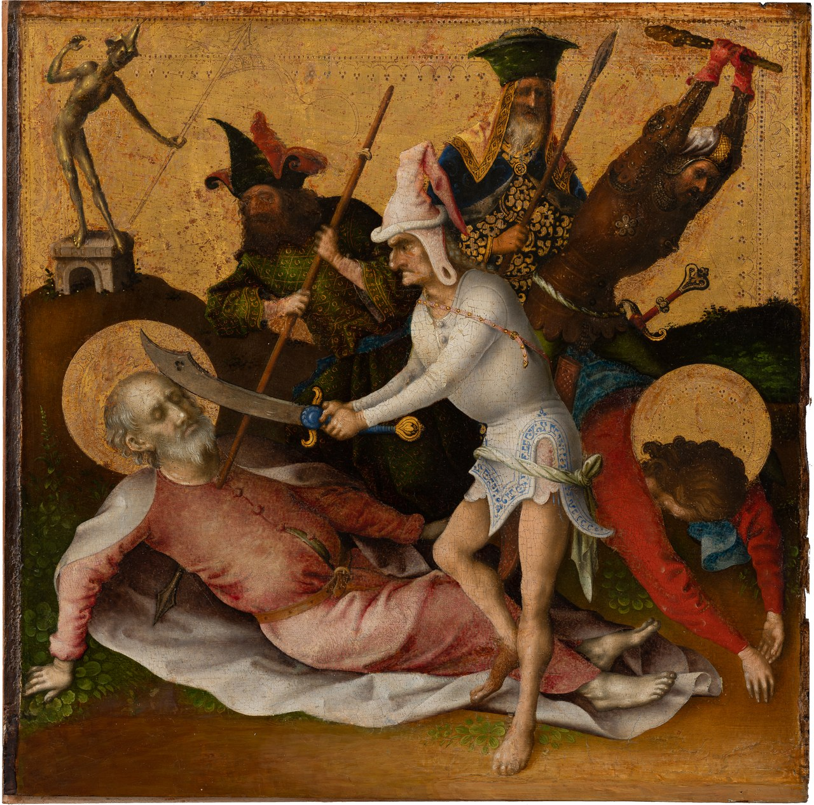</picture>
<figcaption><i>The Martyrdom of Sts Simon and Jude</i>, by <b>Stefan Lochner</b>, after 1435, one of the wings of his altarpiece of the martyrdoms of the apostles. Städel Museum, Frankfurt. Image: <a href="https://commons.wikimedia.org/wiki/File:Martyrdom_of_Ss_Simon_and_Judas_(SM_830).png">Martyrdom of Ss Simon and Judas (SM 830)</a>, public domain, via Wikimedia Commons.</figcaption>
</figure>

<figure class=photo>
<picture><source srcset="/static/art/jude-hours-600.webp 600w,/static/art/jude-hours.webp 1280w" sizes="(max-width:760px) 100vw,760px" type="image/webp">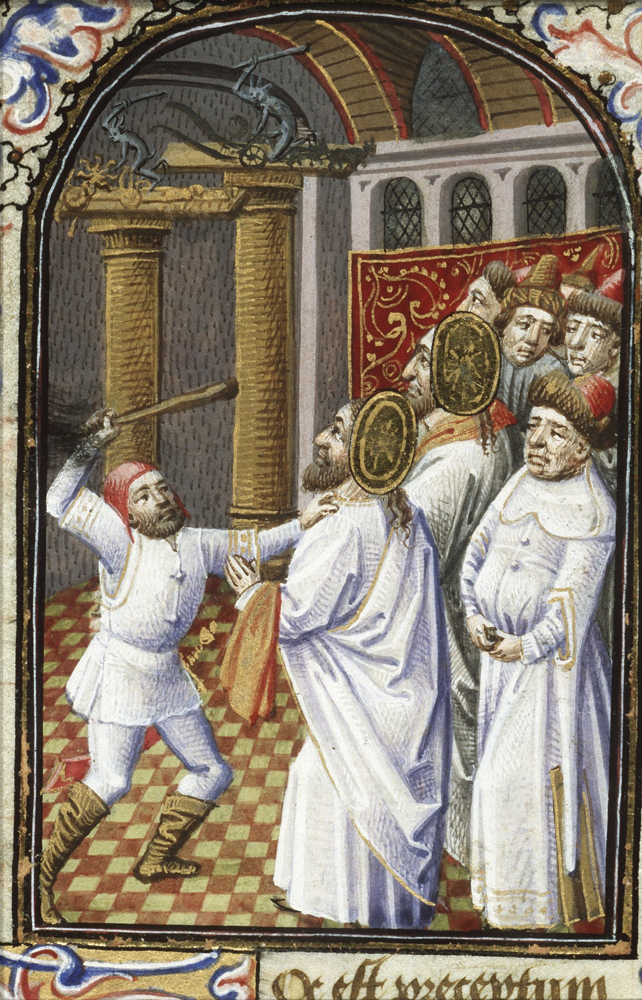</picture>
<figcaption>The martyrdom of Sts Simon and Jude, "beaten to death," in the <b>Book of Hours of Simon de Varie</b>, painted in 1455 by the Master of Jean Rolin II. Koninklijke Bibliotheek, The Hague. Image: <a href="https://commons.wikimedia.org/wiki/File:The_martyrdom_of_St._Simon_Zelotes_and_St._Jude_Thaddaeus_-_they_are_beaten_to_death_-_Book_of_hours_Simon_de_Varie_-_KB_74_G37a_-_008r_min.jpg">The martyrdom of St. Simon Zelotes and St. Jude Thaddaeus - they are beaten to death - Book of hours Simon de Varie - KB 74 G37a - 008r min</a>, public domain, via Wikimedia Commons.</figcaption>
</figure>

<h2 id=armenia>Armenia's apostle</h2>

For the **Armenian Apostolic Church**, Thaddaeus is no stranger. Armenians call him, with St [Bartholomew](/saints/bartholomew/), one of the two **First Enlighteners of Armenia**, the apostles who first brought the Gospel to their land; this is where their Church's very name, "Apostolic," comes from. The Mother See of Holy Etchmiadzin tells the story this way. After preaching at Edessa, Thaddaeus went into Armenia to King Sanatruk, Abgar's nephew, and preached in the province of **Artaz**, near today's town of Maku in north-western Iran. Many believed, among them the king's young daughter **Sandukht**, who was baptised by the apostle himself and became the first woman martyr of Armenia. Sanatruk had Thaddaeus thrown to lions, which bowed at his feet, and into a furnace, which did not burn him; at last the apostle was beheaded, and when the faithful went to bury him on a nearby height, the rock opened to receive his body.

Armenian tradition also says that Thaddaeus brought to Armenia the **Holy Lance**, the spear that pierced Christ's side, now kept at Etchmiadzin. The Armenian Church keeps the feast of Sts Thaddaeus and Bartholomew in late autumn; in 2026 it falls on **28 November**.

Over the apostle's grave rose the **Monastery of St Thaddeus**, called by the local people *Qara Kelisa*, the "Black Church," for the dark stone of its oldest part. UNESCO dates its origins to the 7th century; like the other Armenian monasteries of Iran, it has been destroyed and rebuilt several times over the centuries. Since 2008 it has been part of the World Heritage Site of the **Armenian Monastic Ensembles of Iran**, together with the Monastery of St Stepanos and the little **Chapel of Dzordzor**. "Saint-Thaddeus, the presumed location of the tomb of the apostle," UNESCO writes, "has always been a place of high spiritual value for Christians and other inhabitants in the region." Each July Armenians from Iran, Armenia and beyond gather there for a three-day pilgrimage in honour of St Thaddeus and St Sandukht, camping in tents around the walls. In 2020 that pilgrimage itself was inscribed on UNESCO's list of the Intangible Cultural Heritage of Humanity.

<figure class=photo>
<picture><source srcset="/static/art/jude-thaddeus-monastery-600.webp 600w,/static/art/jude-thaddeus-monastery.webp 1280w" sizes="(max-width:760px) 100vw,760px" type="image/webp">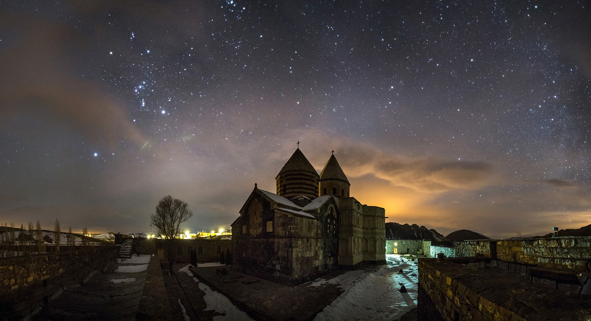</picture>
<figcaption>The <b>Monastery of St Thaddeus</b> (<i>Qara Kelisa</i>) at night, in the mountains of West Azerbaijan province, Iran. The Armenian Church venerates it as the apostle's tomb. Photo: <a href="https://commons.wikimedia.org/wiki/File:Ghare_Kelisa.jpg">Ghare Kelisa</a> by MohammadReza Domiri Ganji, <a href="https://creativecommons.org/licenses/by-sa/4.0">CC BY-SA 4.0</a>, via Wikimedia Commons.</figcaption>
</figure>

<figure class=photo>
<picture><source srcset="/static/art/jude-thaddeus-panorama-600.webp 600w,/static/art/jude-thaddeus-panorama.webp 1280w" sizes="(max-width:760px) 100vw,760px" type="image/webp">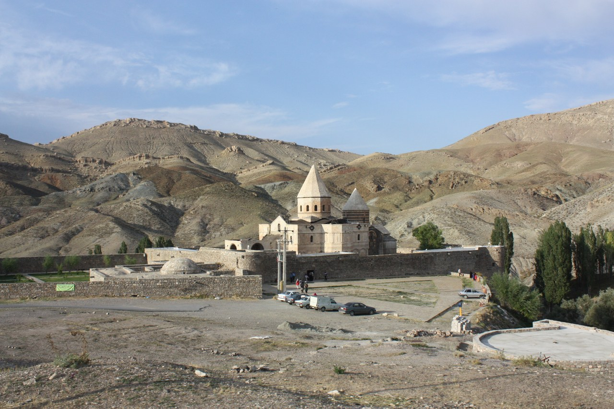</picture>
<figcaption>The St Thaddeus Monastery seen from outside its walls. It has stood on this hillside, rebuilt again and again, since at least the 7th century. Photo: <a href="https://commons.wikimedia.org/wiki/File:Panoramic_view_of_the_Saint_Thaddeus_Monastery_from_outside_the_walls.jpg">Panoramic view of the Saint Thaddeus Monastery from outside the walls</a> by Andrehmarouti, <a href="https://creativecommons.org/licenses/by-sa/4.0">CC BY-SA 4.0</a>, via Wikimedia Commons.</figcaption>
</figure>

<h2 id=relics>His relics: St Peter's and beyond</h2>

The Western Church believes that the bodies of Sts Simon and Jude were brought to Rome in early times. By the 16th century they were honoured in St Peter's: in 1548 Pope Paul III granted a plenary indulgence to all who visited the tomb of St Jude on his feast. When the new **St Peter's** was built, their relics were placed in the **left transept**, which for centuries was called the tribune of Sts Simon and Jude. They lie in an ancient sarcophagus beneath the central altar, which Pope St John XXIII dedicated to **St Joseph** on 19 March 1963. Two round mosaics of the apostles, after paintings by Vincenzo Camuccini, still flank the altar. So the apostles who were, by tradition, kinsmen of the Holy Family now rest beneath an image of St Joseph.

Other churches claim a share. The great Romanesque basilica of **Saint-Sernin in Toulouse**, famous for its treasury of relics, venerates relics of Sts Simon and Jude which, by a medieval tradition, Pope Leo III gave to Charlemagne. The National Shrine in Chicago received two first-class relics of bone from the Vatican in the 1940s, one of which pilgrims may touch.

<figure class=photo>
<picture><source srcset="/static/art/jude-st-peters-600.webp 600w,/static/art/jude-st-peters.webp 1280w" sizes="(max-width:760px) 100vw,760px" type="image/webp">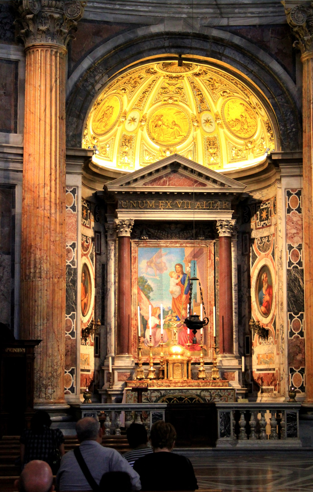</picture>
<figcaption>The <b>Altar of St Joseph</b> in the left transept of <b>St Peter's Basilica</b>, Rome. Beneath it rest the relics of Sts Simon and Jude, for whom the altar was dedicated until 1963. Photo: <a href="https://commons.wikimedia.org/wiki/File:Altar_of_Saint_Joseph_in_Saint_Peter%27s_Basilica.jpg">Altar of Saint Joseph in Saint Peter's Basilica</a> by Karelj, public domain, via Wikimedia Commons.</figcaption>
</figure>

<h2 id=hope>Why the patron of desperate causes?</h2>

No one knows exactly how St Jude became the saint of the impossible, but the story the faithful tell is a moving one. For centuries, it is said, Christians avoided praying to him, because his name sounded too much like that of the traitor. He was the "forgotten apostle." So when someone was at the very end of their hope, with nothing left to try, they turned to the saint whom no one else asked, and found that he was glad to help. A saint who had borne an unwanted name became the friend of everyone whom life had made unwanted.

The devotion has older roots too. St **Bridget of Sweden** (1303–1373), the great mystic and patron of Europe, recorded in her revelations that Christ told her to turn to St Jude with faith and confidence: "In accordance with his surname, Thaddeus, the amiable or loving, he will show himself most willing to give help." And St **Bernard of Clairvaux** (d. 1153), the Cistercian Doctor of the Church, is remembered among the medieval saints who wrote admiringly of St Jude and were devoted to him. In Europe, Catholics in desperate straits more often turned to [St Rita of Cascia](/saints/rita-of-cascia/); St Jude's great fame as the patron of hope came above all in the 20th century, and above all in the Americas.

<h2 id=devotion>Chicago, Memphis and Mexico City</h2>

**Chicago, 1929.** In the late 1920s the Claretian missionary **Fr James Tort** was pastor of **Our Lady of Guadalupe**, the first Mexican parish in Chicago, on the far South Side among the steel mills. As the mills cut back their work forces, his people stood in breadlines. Fr Tort had a private devotion to St Jude, then little known, and on 17 February 1929 he began a public novena to him. The response was overwhelming. On the feast of St Jude, 28 October 1929, the closing night of a solemn novena, the church was packed and more than a thousand people stood outside to hear the service on loudspeakers. The next day the stock market crashed. Through the Great Depression and the Second World War, thousands came to the **National Shrine of St Jude**, and the Claretians' St Jude League carried the devotion across the country by post. For decades, newspaper classified columns were full of tiny notices reading simply, "Thank you, St Jude."

**Memphis, 1962.** In the spring of 1940 a young nightclub comedian named Amos Jacobs, the son of Lebanese immigrants, was struggling in Detroit with a new baby and about $45 a week. A stagehand told him that his wife had recovered from cancer through prayers to St Jude. So the young man began to pray: "Show me my way in life, and I will build you a shrine." Soon he was a star, under the name **Danny Thomas**. He never forgot his promise. With the help of Cardinal Samuel Stritch, who steered him to Memphis, and of the Arab American community, through ALSAC, the charity he founded in 1957 to raise the funds, he built **St. Jude Children's Research Hospital**. It opened on 4 February 1962, with a ten-foot marble statue of St Jude at its door, as the first fully integrated children's hospital in the South, where no family would ever receive a bill. "If I were to die this minute," Danny Thomas said that day, "I would know why I was born." He died in 1991 and is buried with his wife, Rose Marie, beside the hospital he built.

**Mexico City.** The devotion came to Mexico with the Claretians too, who brought an image of St Jude from Barcelona in 1933. In 1955 it was enshrined in the old church of **San Hipólito y San Casiano**, cared for by the Claretians since 1892, on the corner of Avenida Hidalgo and Paseo de la Reforma. In 1982, with crowds overflowing its chapel, the image was moved to the high altar. Ever since, on the **28th of every month**, thousands of people come to San Hipólito with flowers, statues of the saint dressed in green and white, and their petitions; on **28 October** the crowds fill the streets for blocks. Many are young people and working families, and San Judas Tadeo has become one of the great popular devotions of Mexico.

<h2 id=prayer>Feasts, symbols and the novena</h2>

The Roman Catholic and Anglican calendars keep Sts **Simon and Jude** together on **28 October**. The Orthodox Church honours "the Apostle Jude, the Brother of the Lord" on **19 June**, and Thaddaeus of the Seventy on 21 August; the Armenian Church keeps Thaddaeus and Bartholomew together in the autumn.

In art and devotion St Jude has a little set of symbols, each with a story:

- **The medallion** on his breast bears the face of Christ, for the Image of Edessa that tradition says he carried to King Abgar.
- **The tongue of flame** above his head recalls Pentecost, when "there appeared unto them cloven tongues like as of fire, and it sat upon each of them" (Acts 2:3).
- **The club, axe or halberd** in his hand is the instrument of his martyrdom.
- **Green robes**, in modern images, are the colour of hope.

The best-loved way of praying to St Jude is a **novena**, nine days of prayer, often in a time of serious illness or trouble; the solemn novena is prayed in the nine days before his feast. A prayer used at the National Shrine in Chicago begins:

> Most holy Apostle, St. Jude, faithful servant and friend of Jesus, the Church honors and invokes you universally as the patron of hope. Please intercede on my behalf. Make use of that particular privilege given to you to bring hope, comfort, and help where they are needed most.

And it ends with a promise many have kept: "to always honor you as my special and powerful patron, and to gratefully encourage devotion to you."

<h2 id=places>His places and shrines</h2>

St Jude's places stretch from Galilee to the mountains of Armenia, and from Rome and Toulouse to Chicago, Memphis and Mexico City.

<figure class=map><figcaption>St Jude's world: Galilee and Jerusalem; Edessa, Persia and Armenia, where tradition sends him; and the churches of Rome, Toulouse and Genoa that keep his relics or the Holy Face. The inset shows the three great centres of his modern devotion in North America. Map by The Daily Word; borders from Natural Earth (public domain); routes and the sites of legend are approximate. Tap to enlarge.</figcaption></figure>

### The St Thaddeus Monastery and the Armenian sites of Iran

The **Monastery of St Thaddeus** stands alone on a hillside about 20 kilometres from the town of Chaldoran in West Azerbaijan province, near Iran's borders with Turkey and Armenia. Much of the present church, of pale stone with conical domes in the Armenian style, dates from a 19th-century rebuilding, joined to the darker stones of the older church. The carved façade is rich with crosses, angels and saints. A few hours away are the Monastery of St Stepanos near Jolfa, and the tiny **Chapel of Dzordzor**, which was taken down stone by stone and rebuilt on higher ground when a dam was built in the valley.

<figure class=photo>
<picture><source srcset="/static/art/jude-thaddeus-dome-600.webp 600w,/static/art/jude-thaddeus-dome.webp 1280w" sizes="(max-width:760px) 100vw,760px" type="image/webp">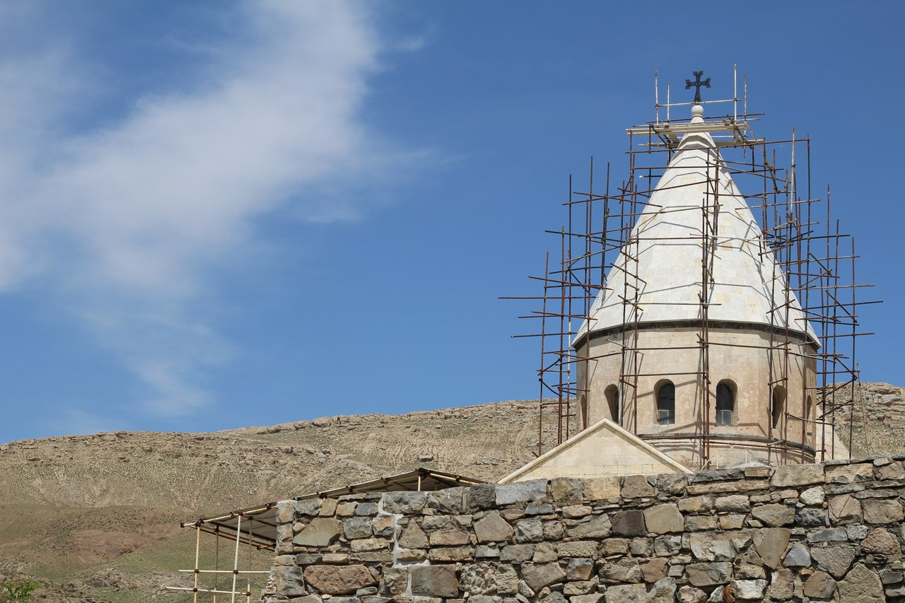</picture>
<figcaption>The conical dome of the St Thaddeus church, under restoration in 2019. Photo: <a href="https://commons.wikimedia.org/wiki/File:Monastery_of_Saint_Thaddeus_25.jpg">Monastery of Saint Thaddeus 25</a> by Valen1988, <a href="https://creativecommons.org/licenses/by-sa/4.0">CC BY-SA 4.0</a>, via Wikimedia Commons.</figcaption>
</figure>

<figure class=photo>
<picture><source srcset="/static/art/jude-thaddeus-detail-600.webp 600w,/static/art/jude-thaddeus-detail.webp 1280w" sizes="(max-width:760px) 100vw,760px" type="image/webp">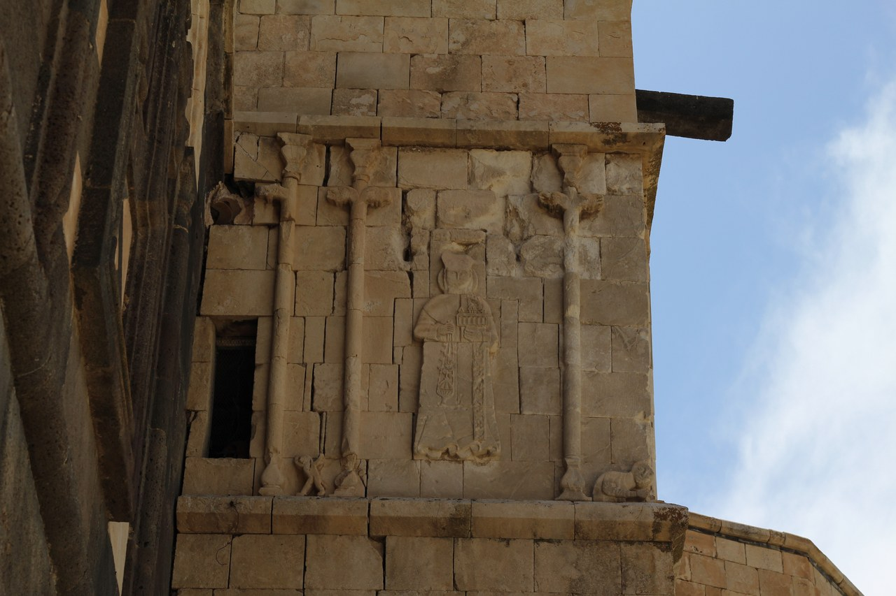</picture>
<figcaption>Carved stonework on the walls of the <b>St Thaddeus Monastery</b>, rebuilt in the early 19th century in the Armenian tradition. Photo: <a href="https://commons.wikimedia.org/wiki/File:Monastery_of_Saint_Thaddeus_10.jpg">Monastery of Saint Thaddeus 10</a> by Valen1988, <a href="https://creativecommons.org/licenses/by-sa/4.0">CC BY-SA 4.0</a>, via Wikimedia Commons.</figcaption>
</figure>

<figure class=photo>
<picture><source srcset="/static/art/jude-dzordzor-600.webp 600w,/static/art/jude-dzordzor.webp 1280w" sizes="(max-width:760px) 100vw,760px" type="image/webp">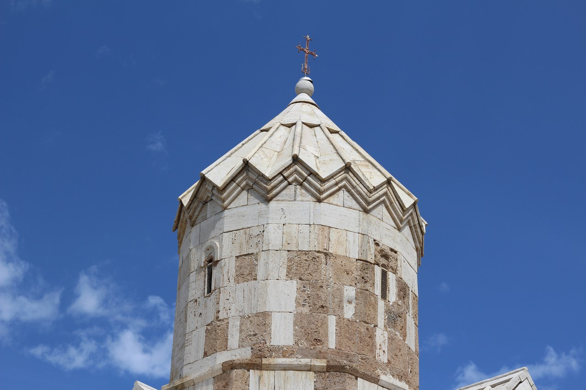</picture>
<figcaption>The <b>Chapel of Dzordzor</b>, part of the UNESCO World Heritage Site of the Armenian Monastic Ensembles of Iran, rebuilt on a new site to save it from a reservoir. Photo: <a href="https://commons.wikimedia.org/wiki/File:Chapel_of_Dzordzor_01.jpg">Chapel of Dzordzor 01</a> by Valen1988, <a href="https://creativecommons.org/licenses/by-sa/4.0">CC BY-SA 4.0</a>, via Wikimedia Commons.</figcaption>
</figure>

### The St Bartholomew Monastery, Turkey

Across the border in Turkey, near Başkale in Van province, stand the ruins of the **Monastery of St Bartholomew**, over the traditional tomb of Thaddaeus' companion in the Armenian story. Once a great place of pilgrimage, it is now largely in ruins.

<figure class=photo>
<picture><source srcset="/static/art/jude-bartholomew-monastery-600.webp 600w,/static/art/jude-bartholomew-monastery.webp 1280w" sizes="(max-width:760px) 100vw,760px" type="image/webp">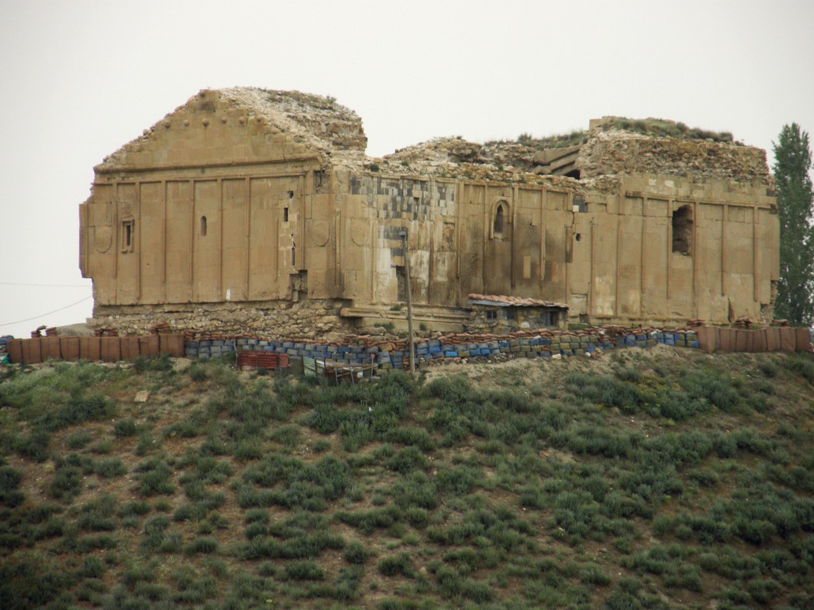</picture>
<figcaption>The ruins of the Armenian <b>Monastery of St Bartholomew</b> near Başkale, Turkey, in 2009. In Armenian tradition Bartholomew shares with Thaddaeus the title of Armenia's first apostle. Photo: <a href="https://commons.wikimedia.org/wiki/File:Saint_Bartholomew_Armenian_Monastery.JPG">Saint Bartholomew Armenian Monastery</a> by Proudbolsahye, <a href="https://creativecommons.org/licenses/by-sa/3.0">CC BY-SA 3.0</a>, via Wikimedia Commons.</figcaption>
</figure>

### St Peter's Basilica, Rome

The relics of Sts Simon and Jude rest beneath the Altar of St Joseph, in the left transept of St Peter's. The transept is reserved for prayer rather than sightseeing. Mass is celebrated at the altar daily, and the schedule is posted at the entrance to the sacristy.

### The National Shrine of St Jude, Chicago

The National Shrine is in **Our Lady of Guadalupe Church**, at 91st Street and Brandon Avenue in the South Chicago neighbourhood. The church, built in 1928, is still a parish of the Claretians, and perpetual novena services to St Jude are held every Wednesday.

<figure class=photo>
<picture><source srcset="/static/art/jude-chicago-600.webp 600w,/static/art/jude-chicago.webp 1280w" sizes="(max-width:760px) 100vw,760px" type="image/webp">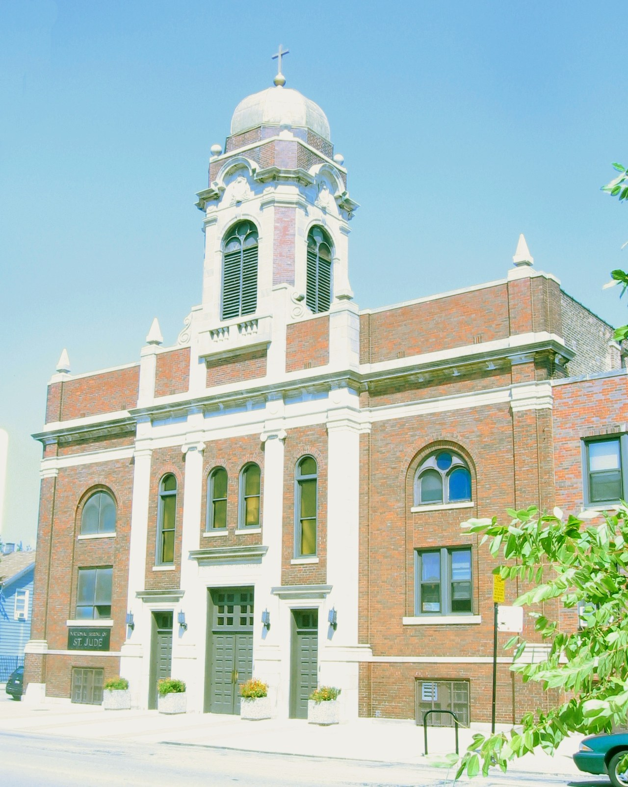</picture>
<figcaption><b>Our Lady of Guadalupe Church</b>, South Chicago, home of the <b>National Shrine of St Jude</b> since 1929. Photo: <a href="https://commons.wikimedia.org/wiki/File:Our_Lady_of_Guadelupe_church,_South_Chicago,_Chicago.JPG">Our Lady of Guadelupe church, South Chicago, Chicago</a> by MrHarman, <a href="https://creativecommons.org/licenses/by-sa/3.0">CC BY-SA 3.0</a>, via Wikimedia Commons.</figcaption>
</figure>

### St. Jude Children's Research Hospital, Memphis

St. Jude's campus lies just north of downtown Memphis. At the entrance stands the marble statue of St Jude unveiled in 1962. Nearby, the gold-domed **Danny Thomas/ALSAC Pavilion**, inspired by the architecture of the Middle East, tells the story of the hospital; in its garden is the tomb of Danny and Rose Marie Thomas.

<figure class=photo>
<picture><source srcset="/static/art/jude-memphis-campus-600.webp 600w,/static/art/jude-memphis-campus.webp 1280w" sizes="(max-width:760px) 100vw,760px" type="image/webp"></picture>
<figcaption><b>St. Jude Children's Research Hospital</b>, Memphis, Tennessee, seen from Overton Avenue. Photo: <a href="https://commons.wikimedia.org/wiki/File:St._Jude_Children%27s_Research_Hospital_campus.JPG">St. Jude Children's Research Hospital campus</a> by David Adams, <a href="https://creativecommons.org/licenses/by-sa/3.0">CC BY-SA 3.0</a>, via Wikimedia Commons.</figcaption>
</figure>

<figure class=photo>
<picture><source srcset="/static/art/jude-memphis-statue-600.webp 600w,/static/art/jude-memphis-statue.webp 1280w" sizes="(max-width:760px) 100vw,760px" type="image/webp">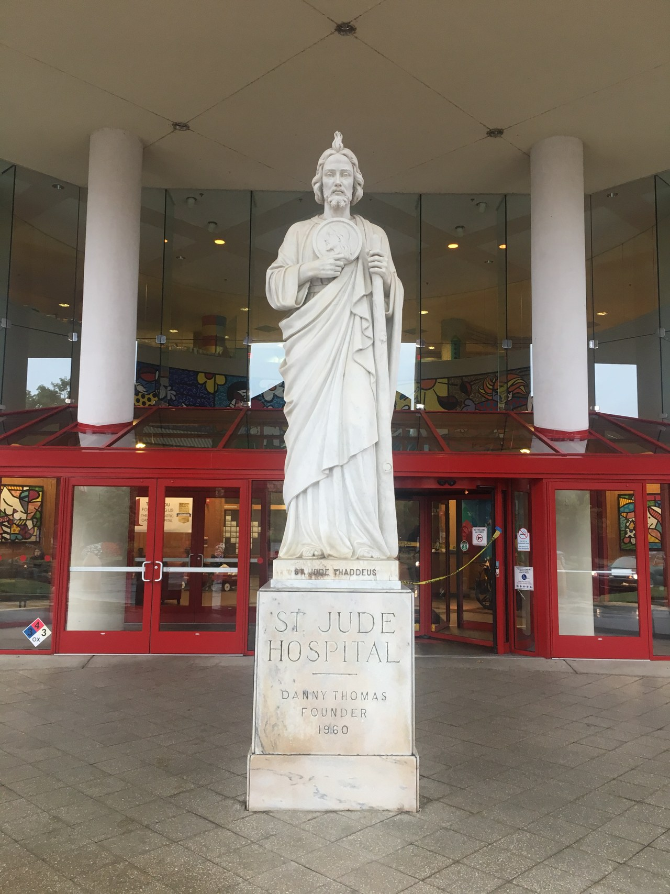</picture>
<figcaption>The statue of <b>St Jude Thaddeus</b> at St. Jude Children's Research Hospital, the saint to whom Danny Thomas vowed his "shrine." Photo: <a href="https://commons.wikimedia.org/wiki/File:St_Jude_Thaddeus_statue_Memphis.jpg">St Jude Thaddeus statue Memphis</a> by Dclemens1971, <a href="https://creativecommons.org/licenses/by-sa/4.0">CC BY-SA 4.0</a>, via Wikimedia Commons.</figcaption>
</figure>

<figure class=photo>
<picture><source srcset="/static/art/jude-alsac-pavilion-600.webp 600w,/static/art/jude-alsac-pavilion.webp 1280w" sizes="(max-width:760px) 100vw,760px" type="image/webp">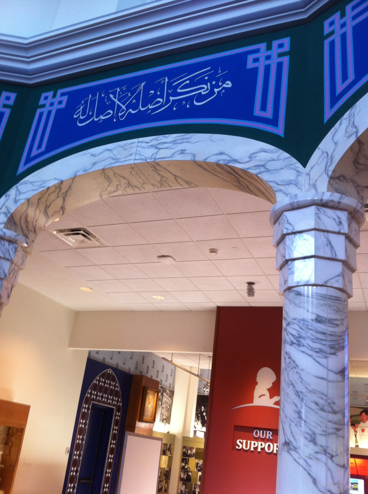</picture>
<figcaption>Inside the <b>Danny Thomas/ALSAC Pavilion</b>. The Arabic inscription in the frieze reads, "He who denies his heritage has no heritage." Photo: <a href="https://commons.wikimedia.org/wiki/File:Nima_SJCRH1.JPG">Nima SJCRH1</a> by Nightryder84, <a href="https://creativecommons.org/licenses/by-sa/3.0">CC BY-SA 3.0</a>, via Wikimedia Commons.</figcaption>
</figure>

<figure class=photo>
<picture><source srcset="/static/art/jude-thomas-tomb-600.webp 600w,/static/art/jude-thomas-tomb.webp 1280w" sizes="(max-width:760px) 100vw,760px" type="image/webp">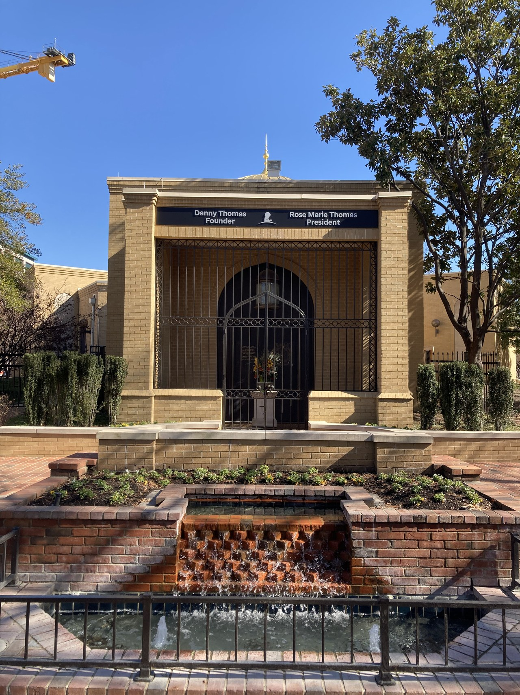</picture>
<figcaption>The tomb of <b>Danny and Rose Marie Thomas</b> at St. Jude Children's Research Hospital. Photo: <a href="https://commons.wikimedia.org/wiki/File:Final_resting_place_of_Danny_and_Rose_Marie_Thomas.jpg">Final resting place of Danny and Rose Marie Thomas</a> by Dclemens1971, <a href="https://creativecommons.org/licenses/by/4.0">CC BY 4.0</a>, via Wikimedia Commons.</figcaption>
</figure>

### San Hipólito, Mexico City

The church of **San Hipólito y San Casiano** stands where Avenida Hidalgo meets Paseo de la Reforma, on the site where, in the 16th century, the Spanish commemorated their conquest of the Aztec capital on the feast of St Hippolytus. Today it is the heart of the devotion to San Judas Tadeo in Mexico.

<figure class=photo>
<picture><source srcset="/static/art/jude-san-hipolito-600.webp 600w,/static/art/jude-san-hipolito.webp 1280w" sizes="(max-width:760px) 100vw,760px" type="image/webp">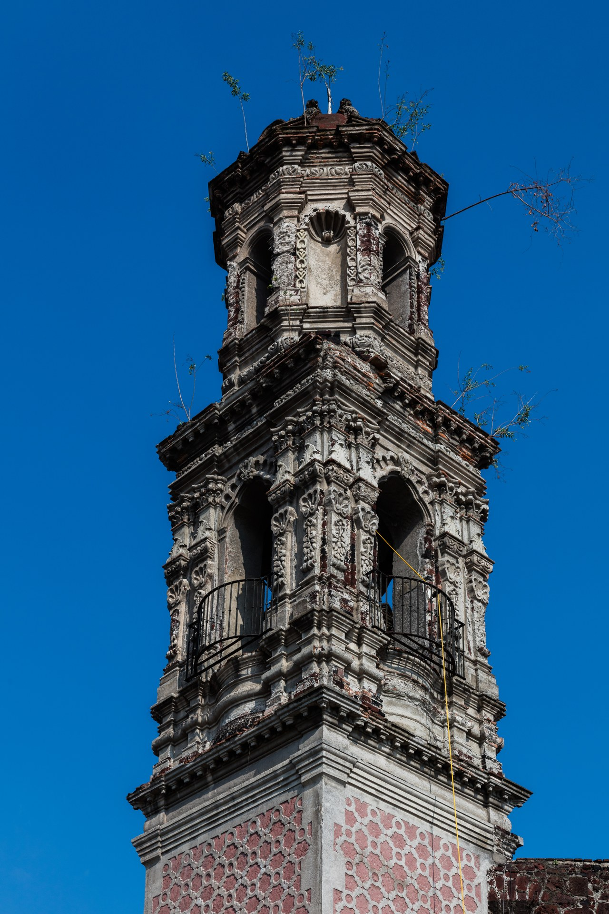</picture>
<figcaption>The bell tower of <b>San Hipólito</b>, Mexico City. Photo: <a href="https://commons.wikimedia.org/wiki/File:Iglesia_de_San_Hip%C3%B3lito,_Ciudad_de_M%C3%A9xico,_M%C3%A9xico,_2015-07-20,_DD_01.jpg">Iglesia de San Hipólito, Ciudad de México, México, 2015-07-20, DD 01</a> by Diego Delso, <a href="https://creativecommons.org/licenses/by-sa/4.0">CC BY-SA 4.0</a>, via Wikimedia Commons.</figcaption>
</figure>

<figure class=photo>
<picture><source srcset="/static/art/jude-san-hipolito-feast-600.webp 600w,/static/art/jude-san-hipolito-feast.webp 1280w" sizes="(max-width:760px) 100vw,760px" type="image/webp"></picture>
<figcaption>Crowds of the faithful around <b>San Hipólito</b> on the feast of St Jude, 28 October 2024. Photo: <a href="https://commons.wikimedia.org/wiki/File:Fieles_de_San_Judas_Tadeo_en_San_Hip%C3%B3lito,_Ciudad_de_M%C3%A9xico_8.jpg">Fieles de San Judas Tadeo en San Hipólito, Ciudad de México 8</a> by ProtoplasmaKid, <a href="https://creativecommons.org/licenses/by-sa/4.0">CC BY-SA 4.0</a>, via Wikimedia Commons.</figcaption>
</figure>

<figure class=photo>
<picture><source srcset="/static/art/jude-san-hipolito-altar-600.webp 600w,/static/art/jude-san-hipolito-altar.webp 1280w" sizes="(max-width:760px) 100vw,760px" type="image/webp">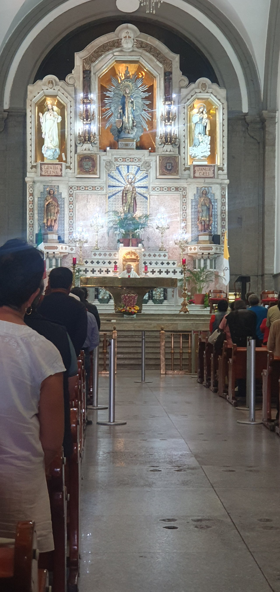</picture>
<figcaption>The high altar of San Hipólito, where the image of <b>San Judas Tadeo</b> has stood since 1982, between Sts Hippolytus and Cassian. Photo: <a href="https://commons.wikimedia.org/wiki/File:Main_altar_-_San_Hipolito_(Mexico_City)_-_Mexico_2024.jpg">Main altar - San Hipolito (Mexico City) - Mexico 2024</a> by José Luiz, <a href="https://creativecommons.org/licenses/by-sa/4.0">CC BY-SA 4.0</a>, via Wikimedia Commons.</figcaption>
</figure>

### Saint-Sernin, Toulouse

<figure class=photo>
<picture><source srcset="/static/art/jude-saint-sernin-600.webp 600w,/static/art/jude-saint-sernin.webp 1280w" sizes="(max-width:760px) 100vw,760px" type="image/webp">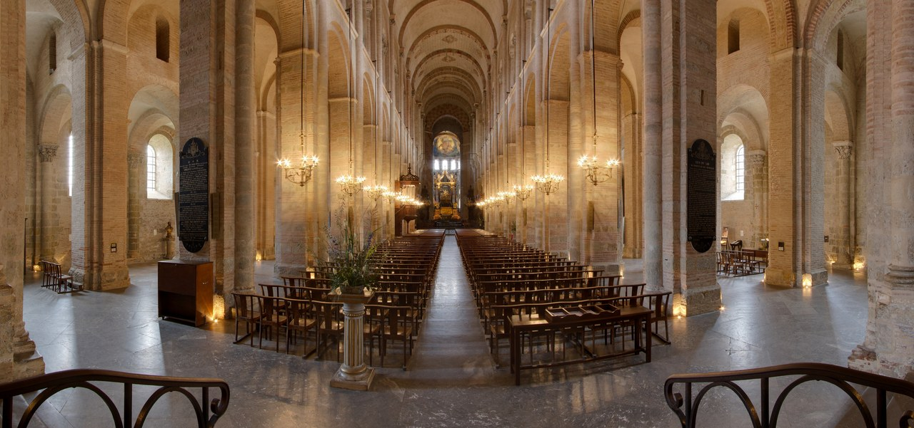</picture>
<figcaption>The nave of the <b>Basilica of Saint-Sernin</b>, Toulouse, which venerates relics of Sts Simon and Jude among its great collection of relics. Photo: <a href="https://commons.wikimedia.org/wiki/File:Nave_of_Basilica_Saint-Sernin_-_2012-08-24.jpg">Nave of Basilica Saint-Sernin - 2012-08-24</a> by PierreSelim, <a href="https://creativecommons.org/licenses/by/3.0">CC BY 3.0</a>, via Wikimedia Commons.</figcaption>
</figure>

<h2 id=art>Jude in art</h2>

### Icons of the Holy Face

St Jude's story is woven into the history of one of the most important images of Christian art: the face of Christ "not made by hands." From the Image of Edessa came the Mandylion icons of the Orthodox world, in which the face of Christ appears on a white cloth, and the Western images of the Holy Face.

<figure class=photo>
<picture><source srcset="/static/art/jude-novgorod-600.webp 600w,/static/art/jude-novgorod.webp 1280w" sizes="(max-width:760px) 100vw,760px" type="image/webp">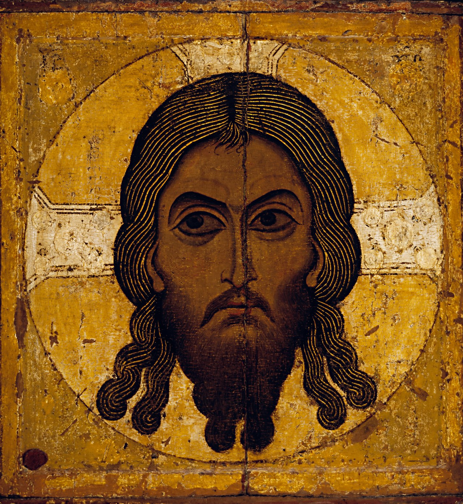</picture>
<figcaption><i>The Saviour Not Made by Hands</i>, a <b>Novgorod icon</b> of the second half of the 12th century, one of the oldest and greatest Russian images of the Holy Face. Its reverse shows the Glorification of the Cross. State Tretyakov Gallery, Moscow. Image: <a href="https://commons.wikimedia.org/wiki/File:%D0%A1%D0%BF%D0%B0%D1%81_%D0%9D%D0%B5%D1%80%D1%83%D0%BA%D0%BE%D1%82%D0%B2%D0%BE%D1%80%D0%BD%D1%8B%D0%B9_-_Google_Art_Project.jpg">Спас Нерукотворный - Google Art Project</a>, public domain, via Wikimedia Commons.</figcaption>
</figure>

<figure class=photo>
<picture><source srcset="/static/art/jude-genoa-600.webp 600w,/static/art/jude-genoa.webp 423w" sizes="(max-width:760px) 100vw,760px" type="image/webp">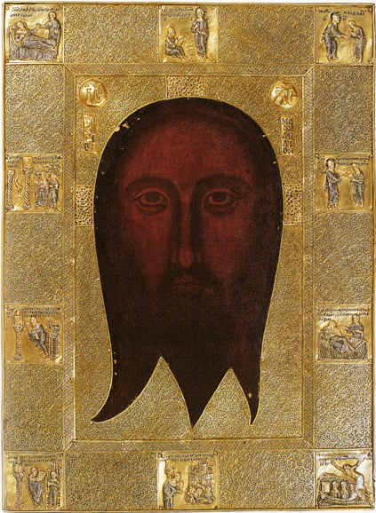</picture>
<figcaption>The <b>Holy Face of Genoa</b>, venerated in the church of San Bartolomeo degli Armeni, Genoa. It was given in the 14th century by the Byzantine Emperor John V Palaiologos to the Genoese Leonardo Montaldo, and is one of the images believed to descend from the Image of Edessa. Image: <a href="https://commons.wikimedia.org/wiki/File:Holy_Face_-_Genoa.jpg">Holy Face - Genoa</a>, public domain, via Wikimedia Commons.</figcaption>
</figure>

<figure class=photo>
<picture><source srcset="/static/art/jude-sinai-triptych-600.webp 600w,/static/art/jude-sinai-triptych.webp 1280w" sizes="(max-width:760px) 100vw,760px" type="image/webp">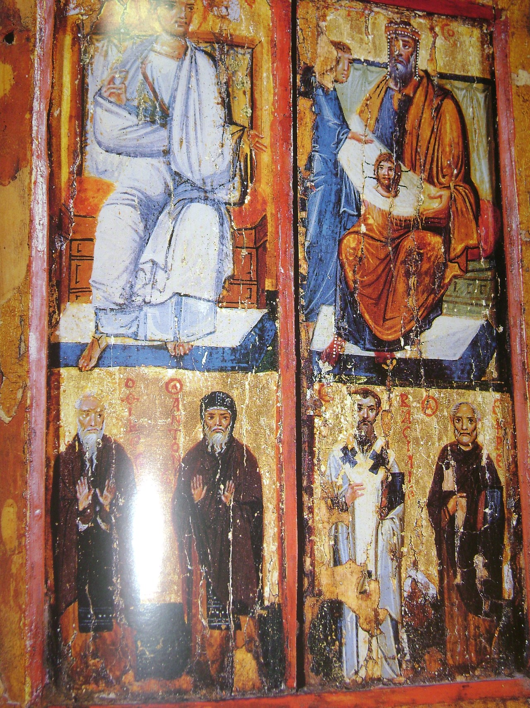</picture>
<figcaption>The two surviving wings of the <b>10th-century Sinai triptych</b> of the Image of Edessa: Thaddaeus enthroned at upper left, King Abgar receiving the Mandylion at upper right, and below, Sts Paul of Thebes, Antony, Basil and Ephrem. St Catherine's Monastery, Mount Sinai. Photo: <a href="https://commons.wikimedia.org/wiki/File:%CE%A4%CF%81%CE%AF%CF%80%CF%84%CF%85%CF%87%CE%BF-%CE%A3%CE%B9%CE%BD%CE%B1-%CE%91%CE%B3._%CE%9C%CE%B1%CE%BD%CE%B4%CE%B7%CE%BB%CE%B9%CE%BF.JPG">Τρίπτυχο-Σινα-Αγ. Μανδηλιο</a> by Giorgos ab1234, <a href="https://creativecommons.org/licenses/by-sa/4.0">CC BY-SA 4.0</a>, via Wikimedia Commons.</figcaption>
</figure>

### Byzantine and medieval images

<figure class=photo>
<picture><source srcset="/static/art/jude-cappadocia-600.webp 600w,/static/art/jude-cappadocia.webp 471w" sizes="(max-width:760px) 100vw,760px" type="image/webp">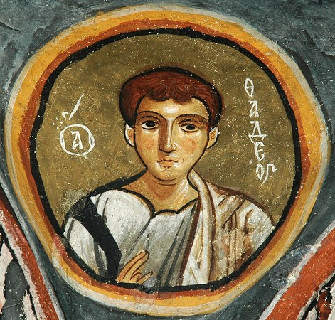</picture>
<figcaption>The apostle <b>Thaddaeus</b> (ΘΑΔΕΟΣ) in an 11th-century fresco in the <b>Dark Church</b> (Karanlık Kilise) at Göreme, Cappadocia. Image: <a href="https://commons.wikimedia.org/wiki/File:Fresco_of_Apostle_Jude_Thaddaeus_%22%CE%98%CE%B1%CE%B4%CE%B5%CE%BF%CF%82%22,_Dark_Church,_Kappadokia.jpg">Fresco of Apostle Jude Thaddaeus "Θαδεος", Dark Church, Kappadokia</a>, public domain, via Wikimedia Commons.</figcaption>
</figure>

<figure class=photo>
<picture><source srcset="/static/art/jude-callot-600.webp 600w,/static/art/jude-callot.webp 1280w" sizes="(max-width:760px) 100vw,760px" type="image/webp">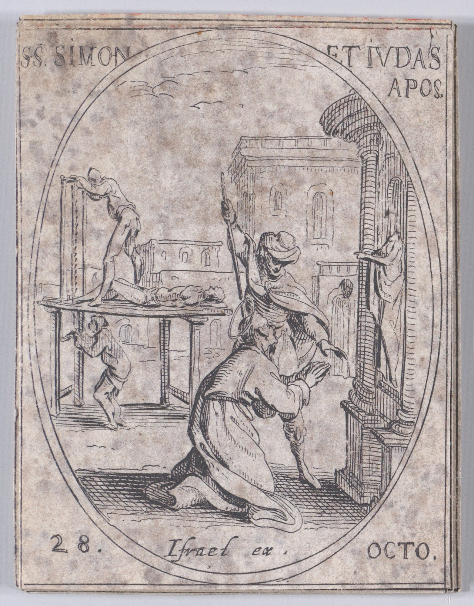</picture>
<figcaption><i>Sts Simon and Jude, Apostles</i>, an etching by <b>Jacques Callot</b>, 1636, from his calendar of the saints. The Metropolitan Museum of Art, New York. Image: <a href="https://commons.wikimedia.org/wiki/File:St._Simon_and_St._Jude,_Apostles_Met_DP891177.jpg">St. Simon and St. Jude, Apostles Met DP891177</a>, <a href="https://creativecommons.org/publicdomain/zero/1.0/">CC0</a>, via Wikimedia Commons.</figcaption>
</figure>

### El Greco, Van Dyck and Rubens

<figure class=photo>
<picture><source srcset="/static/art/jude-el-greco-600.webp 600w,/static/art/jude-el-greco.webp 1280w" sizes="(max-width:760px) 100vw,760px" type="image/webp">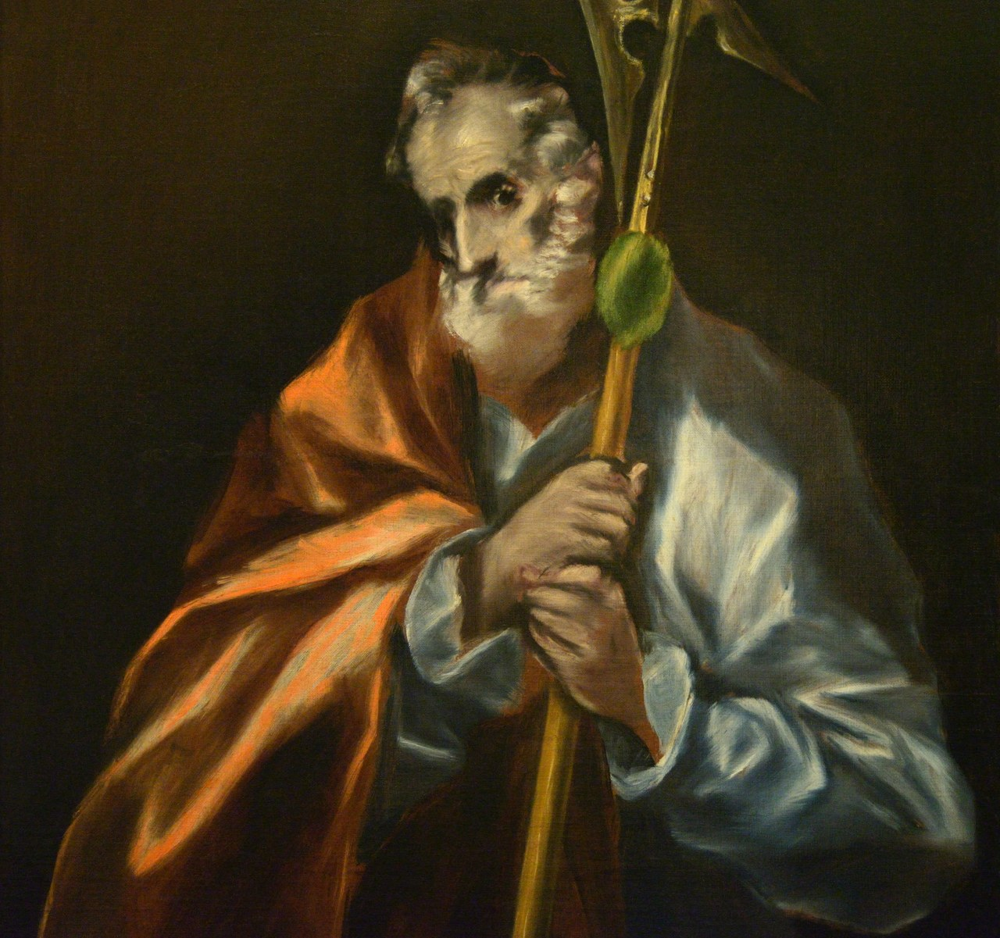</picture>
<figcaption><i>St Thaddaeus (Jude)</i>, detail, from the apostle series painted by <b>El Greco</b> about 1610–14, now in the <b>Museo del Greco, Toledo</b>. The page's opening image shows the whole painting. Photo: <a href="https://commons.wikimedia.org/wiki/File:Saint_Thaddeus_(Jude),_detail._El_Greco_Museum,_Toledo._Spain.jpg">Saint Thaddeus (Jude), detail. El Greco Museum, Toledo. Spain</a> by Ввласенко (Vvlasenko), <a href="https://creativecommons.org/licenses/by-sa/3.0">CC BY-SA 3.0</a>, via Wikimedia Commons.</figcaption>
</figure>

<figure class=photo>
<picture><source srcset="/static/art/jude-van-dyck-600.webp 600w,/static/art/jude-van-dyck.webp 1244w" sizes="(max-width:760px) 100vw,760px" type="image/webp">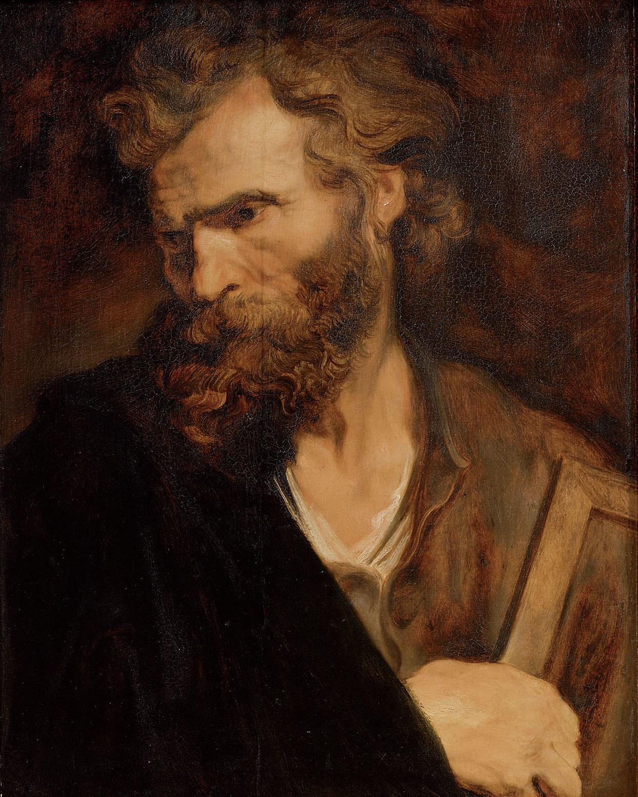</picture>
<figcaption><i>The Apostle Jude Thaddaeus</i>, by <b>Anthony van Dyck</b>, about 1619–21, from the young painter's vigorous series of apostles, painted in Antwerp when he was working alongside Rubens. Kunsthistorisches Museum, Vienna. Image: <a href="https://commons.wikimedia.org/wiki/File:Anthonis_van_Dyck,_Kunsthistorisches_Museum_Wien,_Gem%C3%A4ldegalerie_-_Apostel_Judas_Thadd%C3%A4us_-_GG_6809_-_Kunsthistorisches_Museum.jpg">Anthonis van Dyck, Kunsthistorisches Museum Wien, Gemäldegalerie - Apostel Judas Thaddäus - GG 6809 - Kunsthistorisches Museum</a>, public domain, via Wikimedia Commons.</figcaption>
</figure>

**Peter Paul Rubens** painted his famous set of apostles for the Duke of Lerma about 1610–12; it is now in the **Prado**. The set has twelve paintings, but they include St Paul and St Matthias, and there is no Jude in it today. The Prado's catalogue shows that its young, beardless apostle with a halberd, now identified as St Matthew, was listed as St Jude Thaddaeus in the museum's catalogues of 1857 and 1873–1907. Rubens's design for Jude does survive in a series of engravings of the apostles after his paintings.

<figure class=photo>
<picture><source srcset="/static/art/jude-rubens-print-600.webp 600w,/static/art/jude-rubens-print.webp 858w" sizes="(max-width:760px) 100vw,760px" type="image/webp">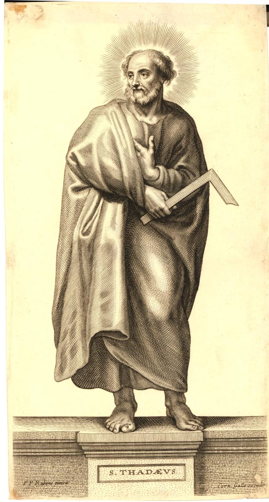</picture>
<figcaption><i>St Thaddaeus</i>, an engraving after <b>Peter Paul Rubens</b> by Pieter Clouwet, published by Cornelis Galle I about 1646–50, from a series of plates of Christ, the Virgin and the apostles. The British Museum, London. Image: <a href="https://commons.wikimedia.org/wiki/File:S._Thadaeus_(BM_1891,0414.1083).jpg">S. Thadaeus (BM 1891,0414.1083)</a>, public domain, via Wikimedia Commons.</figcaption>
</figure>

### Giaquinto and the Lateran

<figure class=photo>
<picture><source srcset="/static/art/jude-giaquinto-600.webp 600w,/static/art/jude-giaquinto.webp 1280w" sizes="(max-width:760px) 100vw,760px" type="image/webp">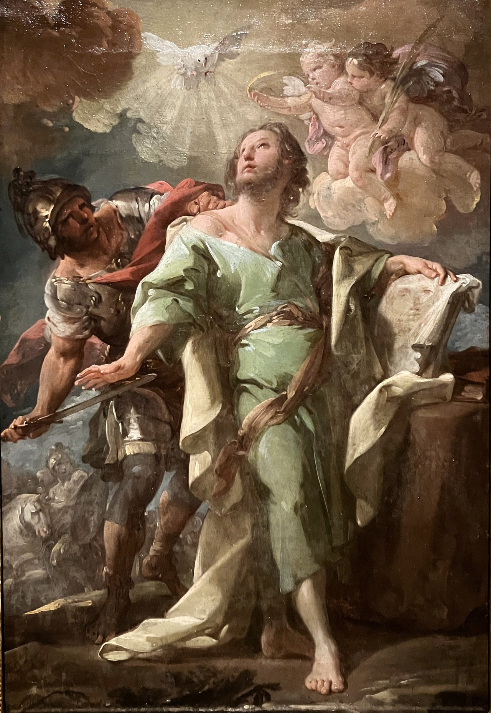</picture>
<figcaption><i>The Martyrdom of the Apostle Jude Thaddaeus</i>, by <b>Corrado Giaquinto</b>, in the 1750s. Uppsala University Art Collections, Sweden. Photo: <a href="https://commons.wikimedia.org/wiki/File:Corrado_Giaquinto,_Martyrdom_of_the_Apostle_Judas_Thaddeus_(1750s).jpg">Corrado Giaquinto, Martyrdom of the Apostle Judas Thaddeus (1750s)</a> by Gotogo, <a href="https://creativecommons.org/publicdomain/zero/1.0/">CC0</a>, via Wikimedia Commons.</figcaption>
</figure>

In the great nave of St John Lateran, the cathedral of Rome, twelve colossal marble apostles stand in Borromini's niches, carved under Pope Clement XI by the leading sculptors of the day. The figure of St Thaddaeus was carved by **Lorenzo Ottoni**, who began it in 1704 and completed it in 1709.

<figure class=photo>
<picture><source srcset="/static/art/jude-lateran-600.webp 600w,/static/art/jude-lateran.webp 1200w" sizes="(max-width:760px) 100vw,760px" type="image/webp">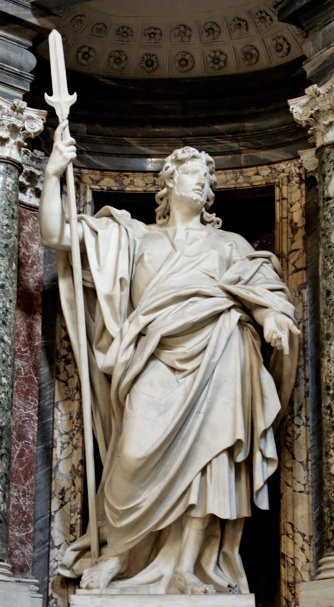</picture>
<figcaption><b>St Jude Thaddaeus</b>, by <b>Lorenzo Ottoni</b>, 1704–09, in the nave of the <b>Archbasilica of St John Lateran</b>, Rome. Photo: <a href="https://commons.wikimedia.org/wiki/File:Thaddeus_San_Giovanni_in_Laterano_2006-09-07.jpg">Thaddeus San Giovanni in Laterano 2006-09-07</a> by Jastrow, <a href="https://creativecommons.org/licenses/by/2.5">CC BY 2.5</a>, via Wikimedia Commons.</figcaption>
</figure>

Other great artists found their way to Jude as well. Leonardo da Vinci painted him at the Last Supper, second from the right, turned toward Simon and Matthew; and Georges de La Tour's rough, honest Jude, at the top of this page, belongs to the same Albi apostle series as the La Tour [St Philip](/saints/philip-apostle/) now in Norfolk, Virginia.

## Path to sainthood
An apostle, venerated from the earliest days of the Church, long before formal canonisation existed. His name is in the Roman Canon of the Mass, among the apostles. The joint feast of Sts **Simon and Jude** on **28 October** is on the General Roman Calendar. The Orthodox Church keeps his feast on **19 June**.

## Patronages
**Desperate and lost causes**, and the **hope** of those who have nowhere else to turn; **hospitals** and the seriously ill; the Claretian missions and the St Jude League; and, in the Armenian Church, with St Bartholomew, the whole people of **Armenia**. In some places he is also honoured by police officers.

## Trivia
- Twentieth-century newspapers were full of classified ads thanking "St Jude for favours granted," often with no other detail. The thank-you was part of the devotion.
- Danny Thomas, the son of Lebanese immigrants, performed first as Amos Jacobs, which he called "my true legal name," and became Danny Thomas in Chicago in the early 1940s.
- The Epistle of Jude is only twenty-five verses long. It is the only New Testament book to quote the prophecy of Enoch (verses 14–15).
- In Mexico City, the feast falls on the 28th of every month, not just in October.
- St. Jude Children's Research Hospital took in its first patients in 1962, when the most common childhood leukaemia had a survival rate of about 4 per cent; today it is above 90 per cent.
- The two La Tour apostles still in Albi are St Jude Thaddaeus and St [James the Less](/saints/james-the-less/).
- St Jude and St Simon share a feast, a tomb and an altar, and are almost never painted apart in the West.

## Sources
- Matthew 10:3; 13:55; Mark 3:18; Luke 6:16; John 14:19–23; Acts 1:13–14; 2:3; Galatians 1:19; the Epistle of Jude (King James Version)
- [Catholic Encyclopedia: Epistle of St Jude](https://www.newadvent.org/cathen/08542b.htm)
- [Catholic Encyclopedia: Brethren of the Lord](https://www.newadvent.org/cathen/02767a.htm)
- [Eusebius, *Church History*, Book I, chapter 13 (Abgar and Thaddeus), New Advent](https://www.newadvent.org/fathers/250101.htm)
- [Eusebius, *Church History*, Book III, chapter 20 (the grandsons of Jude), New Advent](https://www.newadvent.org/fathers/250103.htm)
- [Jacobus de Voragine, *The Golden Legend*, vol. 6: the Holy Apostles Simon and Jude (Fordham Medieval Sourcebook)](https://sourcebooks.web.fordham.edu/basis/goldenlegend/GoldenLegend-Volume6.asp)
- [Vatican News: saints of 28 October (Sts Simon and Jude)](https://www.vaticannews.va/en/saints/10/28.html)
- [Orthodox Church in America: Apostle Jude the Brother of the Lord (19 June)](https://www.oca.org/saints/lives/2026/06/19/101752-apostle-jude-the-brother-of-the-lord)
- [Orthodox Church in America: Apostle Thaddeus of the Seventy (21 August)](https://www.oca.org/saints/lives/2026/08/21/102355-apostle-thaddeus-of-the-seventy)
- [Mother See of Holy Etchmiadzin: Holy Apostles Thaddeus and Bartholomew](https://www.armenianchurch.org/en/Liturgical-Calendar/53)
- [UNESCO World Heritage Centre: Armenian Monastic Ensembles of Iran](https://whc.unesco.org/en/list/1262/)
- [UNESCO Intangible Cultural Heritage: Pilgrimage to the St. Thaddeus Apostle Monastery](https://ich.unesco.org/en/RL/pilgrimage-to-the-st-thaddeus-apostle-monastery-01571)
- [NASSCAL: the Sinai Mandylion icon](https://www.nasscal.com/materiae-apocryphorum/sinai-mandylion-icon/)
- [St Peter's Basilica (stpetersbasilica.info): the Altar of St Joseph](https://stpetersbasilica.info/Altars/StJoseph/StJoseph.htm)
- [St Peter's Basilica (stpetersbasilica.info): the left transept](https://stpetersbasilica.info/Interior/LeftTransept/LeftTransept.htm)
- [ZENIT (French): the relics of Sts Simon and Jude at Saint-Sernin, Toulouse (2013)](https://fr.zenit.org/2013/10/28/celui-qui-guide-les-apotres-de-jerusalem-a-toulouse/)
- [National Shrine of St Jude: History of the Shrine](https://shrineofstjude.org/the-shrine/history-of-the-shrine/)
- [National Shrine of St Jude: St Jude and Danny Thomas](https://shrineofstjude.org/the-shrine/st-jude-and-danny-thomas/)
- [National Shrine of St Jude: St Bridget of Sweden](https://shrineofstjude.org/learn/saints/st-bridget-of-sweden/)
- [National Shrine of St Jude: St Jude Thaddeus symbols](https://shrineofstjude.org/the-shrine/st-jude-thaddeus-symbols/)
- [National Shrine of St Jude: Prayers to St Jude](https://shrineofstjude.org/prayers/prayers-to-st-jude/)
- [Fr John M. Lozano, CMF, *St. Jude Thaddeus: Patron of Hope and of Difficult Causes* (Claretians' St Jude League)](https://shrineofstjude.org/wp-content/uploads/2020/11/RA918.14_Eng-St-Jude-Thaddeus_LTRsize_1R.pdf)
- [U.S. Catholic: St. Jude's journey to Chicago's South Side (2004)](https://uscatholic.org/articles/200410/st-judes-journey-to-chicagos-south-side/)
- [St. Jude Children's Research Hospital: a beacon of hope since 1962](https://www.stjude.org/about-st-jude/stories/making-a-difference/stjude-55-history.html)
- [St. Jude Children's Research Hospital: St. Jude A to Z](https://www.stjude.org/inspire/series/legacy/st-jude-a-to-z.html)
- [Misioneros Claretianos de México: Devoción a San Judas Tadeo en San Hipólito](https://www.claretianos.mx/subsidios/20250814-san-judas)
- [Desde la Fe: ¿Por qué se venera a San Judas Tadeo en San Hipólito?](https://desdelafe.mx/noticias/iglesia-en-mexico/por-que-se-venera-a-san-judas-tadeo-en-la-iglesia-de-san-hipolito/)
- [Treccani, *Dizionario Biografico degli Italiani*: Lorenzo Ottoni](https://www.treccani.it/enciclopedia/lorenzo-ottoni_(Dizionario-Biografico)/)
- [Museo del Prado: Rubens, *San Mateo* (formerly catalogued as St Jude Thaddaeus)](https://www.museodelprado.es/coleccion/obra-de-arte/san-mateo/e52ae737-7a03-4690-9709-4eb5eec3fa98)
- [Musée Toulouse-Lautrec, Albi: Georges de La Tour's apostles (St James the Less)](https://www.musee-toulouse-lautrec.com/collections/chefs-d-oeuvre/saint-jacques-le-mineur/)
- [Städel Museum: Stefan Lochner, *Martyrdom of Sts Simon and Jude*](https://sammlung.staedelmuseum.de/de/werk/martyrium-der-heiligen-simon-und-judas)
- [The British Museum: *S. Thadaeus*, after Rubens](https://www.britishmuseum.org/collection/object/P_1891-0414-1083)

Fact-checked on November 2, 2026 against Vatican News, New Advent and the New Testament. Expanded November 25, 2026 with the story of his life from the Gospels and the Epistle of Jude; the early witnesses preserved by Eusebius (the letters of Abgar and the grandsons of Jude); the legends of the <i>Golden Legend</i> and the traditions of the Orthodox and Armenian Churches, labelled as such; the history of his relics and of his devotion in Chicago, Memphis and Mexico City from the shrines' and hospital's own histories; the places connected with him; and his portrayal in art, using museum records and Wikimedia Commons. Scripture quotations follow the King James Version. The map was drawn for this page from Natural Earth data (public domain). Feast days follow the General Roman Calendar unless noted.

