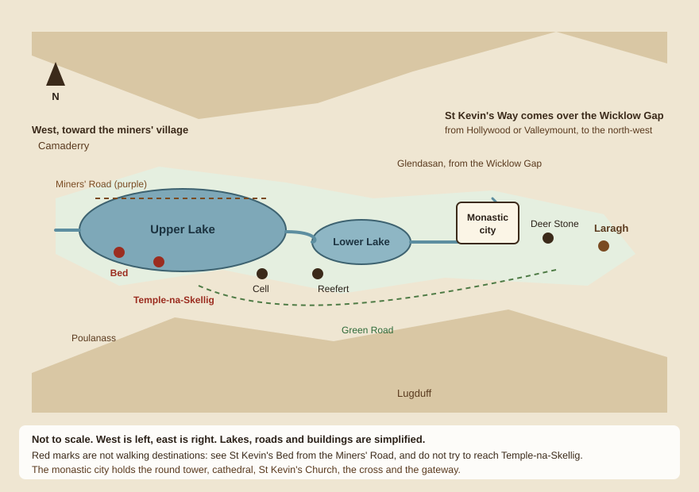
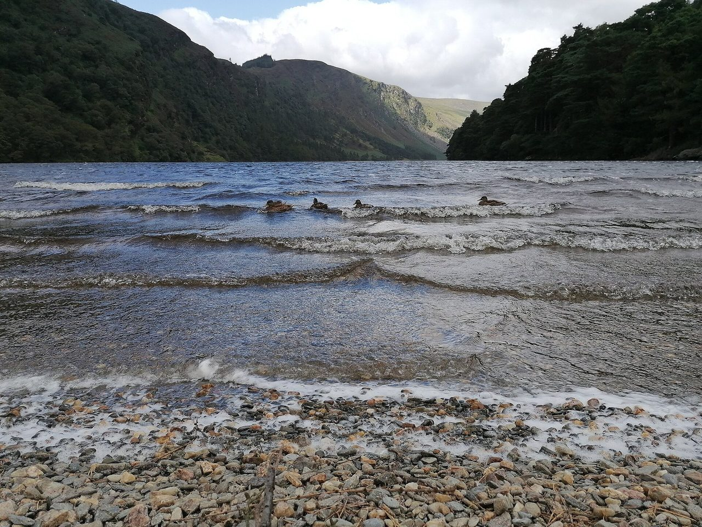
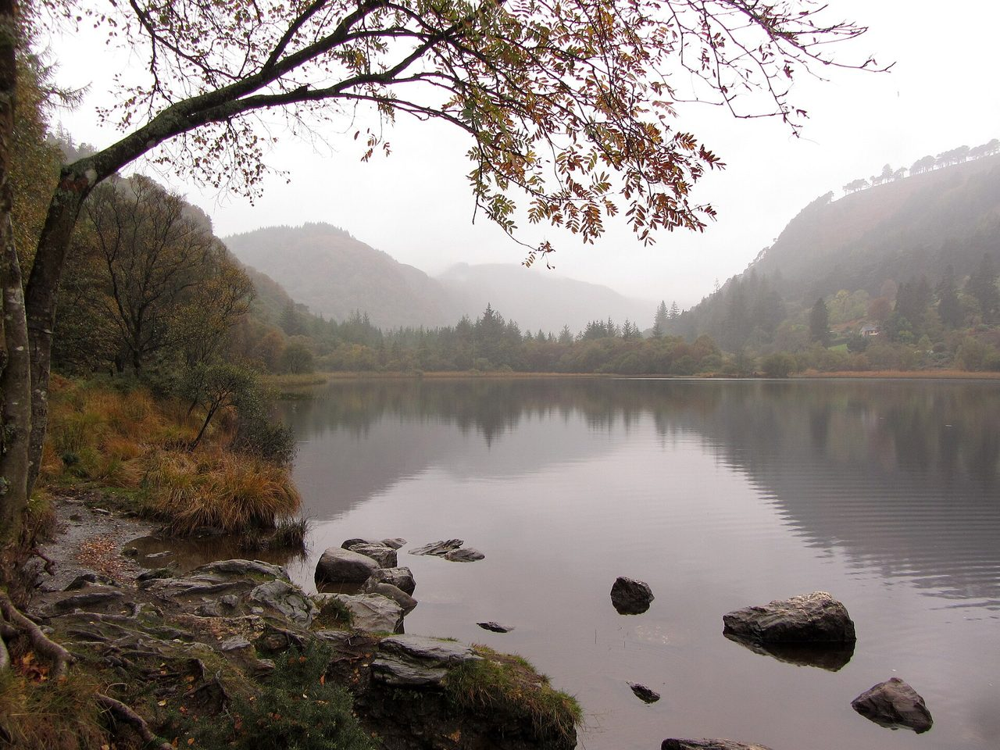
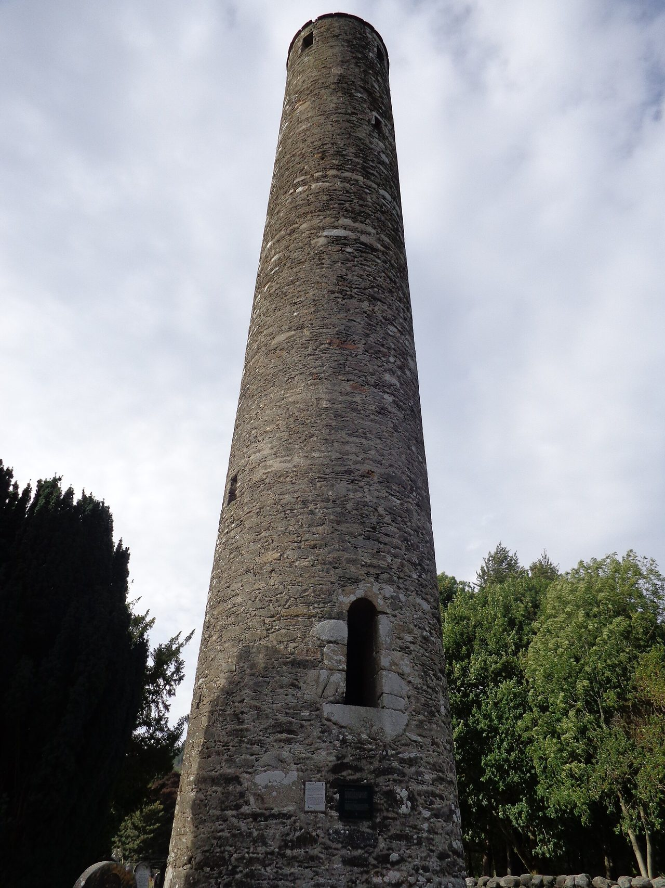
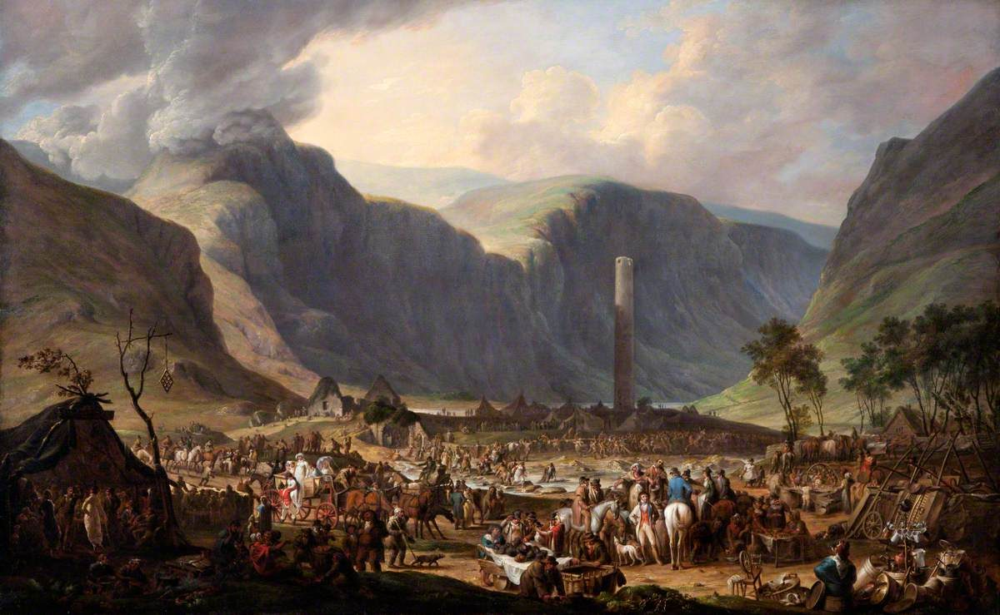
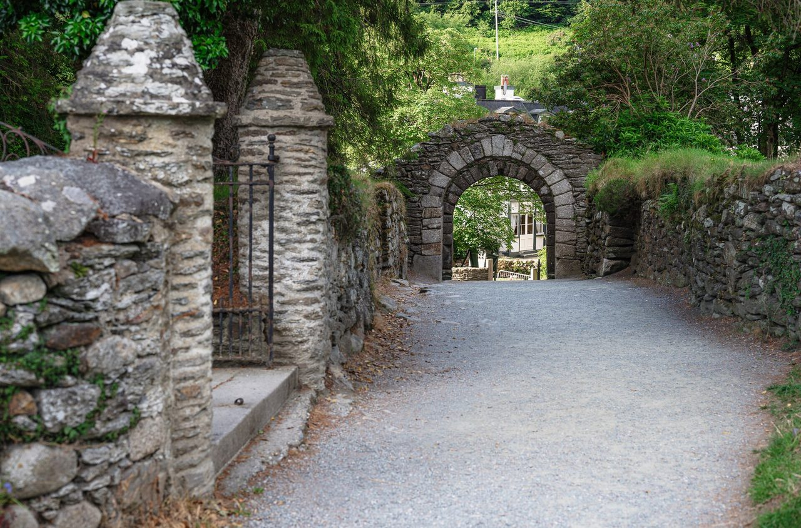
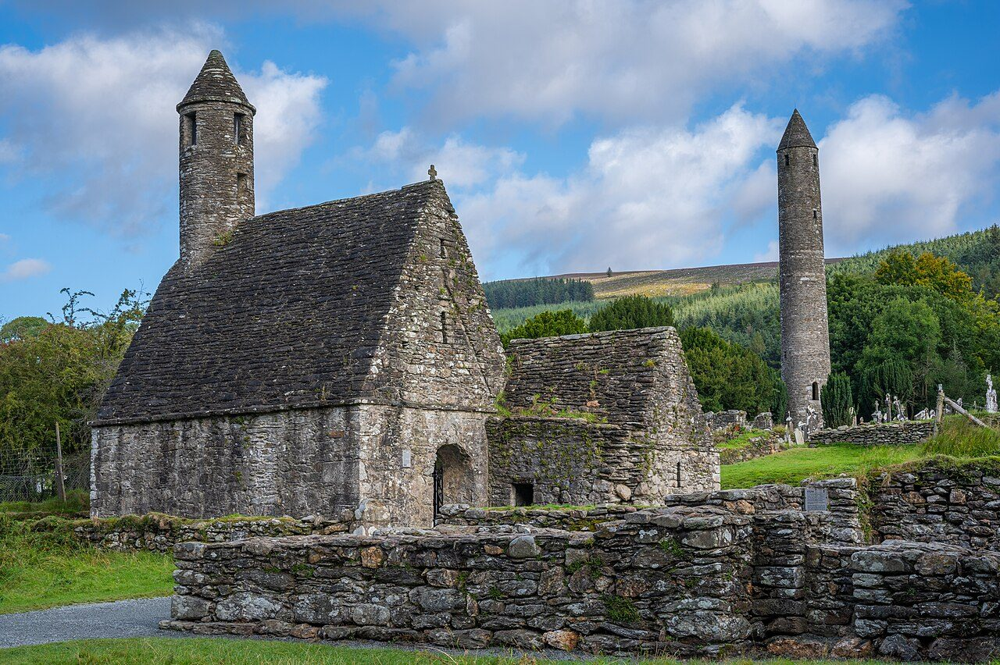
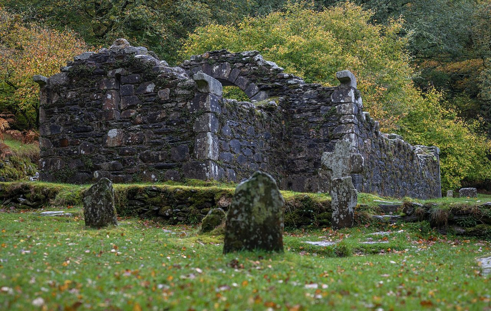
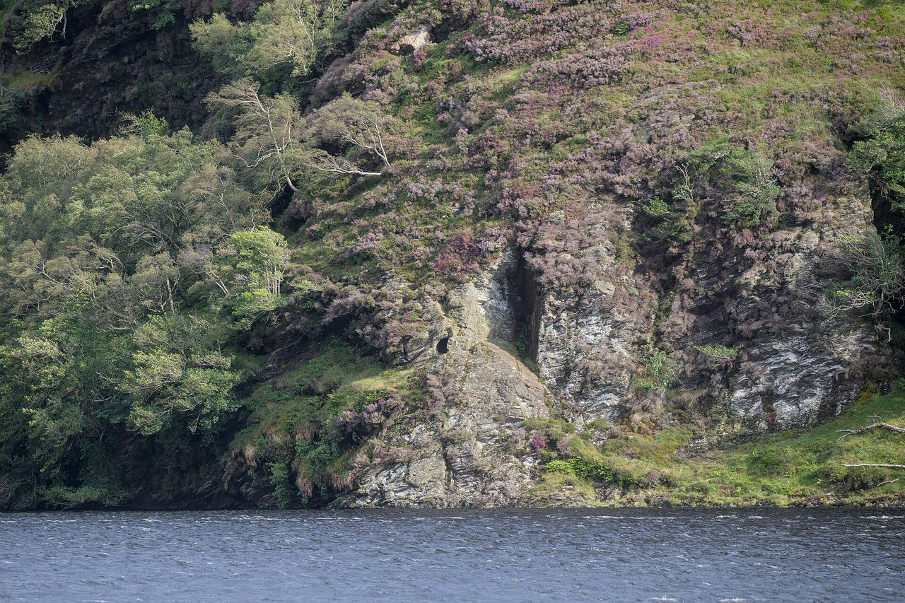
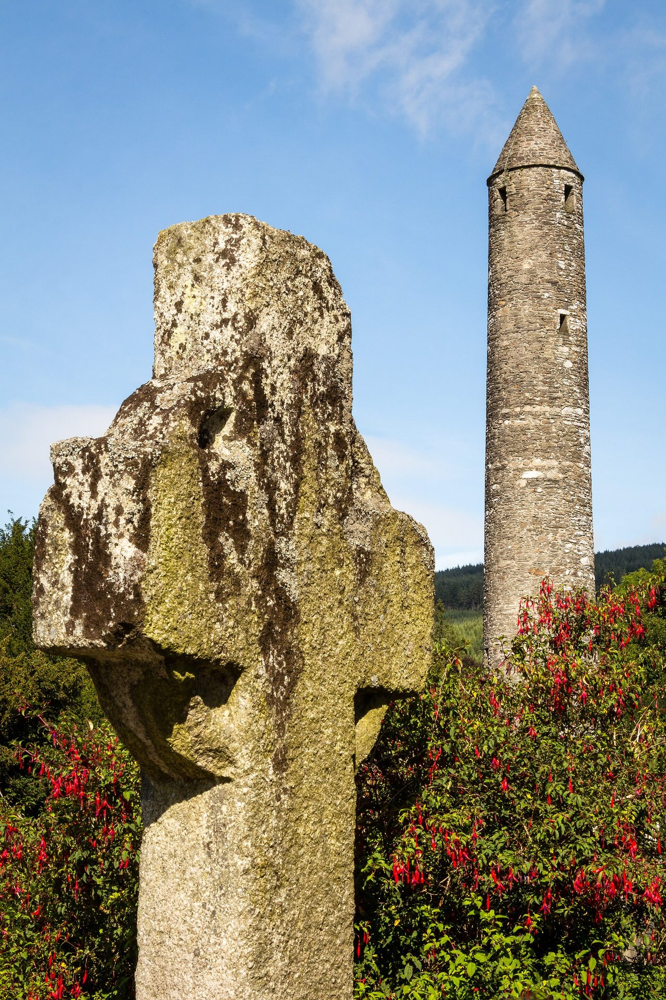

<nav class=toc aria-label="On this page">

On this page

<ol>
<li><a href="#valley">The valley of two lakes</a></li>
<li><a href="#name">His name and his feast</a></li>
<li><a href="#life">The life Ireland tells</a></li>
<li><a href="#monastery">Hermit and monastic city</a></li>
<li><a href="#beloved">Why he is loved</a></li>
<li><a href="#blackbird">The blackbird</a></li>
<li><a href="#traditions">Stories the glen still tells</a></li>
<li><a href="#after">Devotees after him</a></li>
<li><a href="#timeline">A timeline</a></li>
<li><a href="#ground">What stands in the valley</a></li>
<li><a href="#art">Stone, and the people's day</a></li>
<li><a href="#walk">Walking there today</a></li>
<li><a href="#feast">Feast, patrons, sources</a></li>
</ol>
</nav>

Kevin is the saint of a valley, and Ireland has loved him for it. His own name is **Cóemgen**, later **Caoimhín**: fair-born, fair-begotten. English made that Kevin. The valley is **Glendalough**, Gleann Dá Loch, the glen of two lakes, in the Wicklow Mountains. He is the hermit who would not move his hand while a blackbird nested in it, and the founder of a monastery that became one of the great holy cities of early Ireland. People still walk to him. The Archdiocese of Dublin still names him among its patrons. His day is **3 June**.

This is the life his Church and his glen have kept: his prayer, his charity, the wonders told of him, and the city he left in the mountains. Where Ireland has loved more than one form of a story, both are told. The old Lives, Gerald of Wales, and the people of Glendalough are the voices. The books are gathered at the end, for anyone who wants them.

<svg viewBox="0 0 120 28" width="120" height="28" focusable="false"><path d="M8 14c8-9 16-9 22 0s14 9 22 0 14-9 22 0 14 9 22 0 16-9 16 0" fill="none" stroke="currentColor" stroke-width="2.4" stroke-linecap="round"/><path d="M8 14c8 9 16 9 22 0s14-9 22 0 14 9 22 0 14-9 22 0 16 9 16 0" fill="none" stroke="currentColor" stroke-width="2.4" stroke-linecap="round"/></svg>

<h2 id=valley>The valley of two lakes</h2>

Glendalough is in **County Wicklow**, in the Wicklow Mountains, south of Dublin and inland from the east coast. The village of **Laragh** sits at the mouth of the glen. The name is exact, and the place looks like the name. Two lakes lie on the floor of a U-shaped valley the ice cut, in granite and mica-schist, with the **Glenealo** and the **Glendasan** running through it.

Picture the glen with west on your left, the way the drawing below is made. The **upper lake** is the larger water, higher in the valley, under the steep sides of the mountains. The **lower lake** is smaller, further east, and more wooded. The Glenealo comes down from the waterfall at the head of the upper lake, passes through both, and east of the lower lake meets the Glendasan, which has come down from the Wicklow Gap. On the tongue of land where the waters meet is the monastic city, Kevin's city, the churches and the round tower.

North of the lakes is the ridge of Camaderry. South are the crags of Lugduff. Between them the valley is a long green floor: oak woods, the two lakes, the ruins, and, further up, the old lead mines. It is beautiful, and it is a mountain place. Paths close after storms. The cliff above the upper lake has needed more rescues than any other spot in the national park. See St Kevin's Bed from the path on the far shore. The cave itself is not a way to walk.

<figure class=map>

<figcaption>A guide to the glen, not a measured map. West is to the left. Red names are places to know and not to climb. For the ground itself, use the sheets at the <a href="https://www.nationalparks.ie/wicklow/things-to-do/">National Park Information Office</a> or <a href="https://www.openstreetmap.org/#map=15/53.007/-6.340">OpenStreetMap</a>.</figcaption>
</figure>

<figure class=photo>
<picture><source srcset="/static/art/kevin-upper-lake-600.webp 600w,/static/art/kevin-upper-lake.webp 1280w" sizes="(max-width:760px) 100vw,760px" type="image/webp"></picture>
<figcaption>The upper lake, looking west from the eastern shore. This is the wilder water, the one the old Lives give to Kevin's hermitage. Photo: Karlunun, <a href="https://creativecommons.org/publicdomain/zero/1.0/">CC0</a>, via <a href="https://commons.wikimedia.org/wiki/File:Glendalough_UpperLake_E_260_IMG_20250805_1033.jpg">Wikimedia Commons</a>.</figcaption>
</figure>

<figure class=photo>
<picture><source srcset="/static/art/kevin-lower-lake-600.webp 600w,/static/art/kevin-lower-lake.webp 1280w" sizes="(max-width:760px) 100vw,760px" type="image/webp"></picture>
<figcaption>The lower lake, smaller and more wooded. The monastic city lies further east, near where the rivers meet. Photo: <a href="https://www.geograph.org.uk/photo/5574154">Gareth James</a>, <a href="https://creativecommons.org/licenses/by-sa/2.0/">CC BY-SA 2.0</a>, via Geograph and <a href="https://commons.wikimedia.org/wiki/File:Lower_lake_at_Glendalough_-_geograph.org.uk_-_5574154.jpg">Wikimedia Commons</a>.</figcaption>
</figure>

<h2 id=name>His name and his feast</h2>

The old writers call his parents Coemlog and Coemell, or Caomhlugh and Caoimheall: the same word of fairness that is in his own name. The Lives give him a royal line in Leinster, of the people called the Dál Messin Corb, in the east of the province. Whether that first home was toward the sea or toward the west side of the mountains, the place he chose, and the place that chose him, is this glen.

The Lives say he lived 120 years, the great age of a patriarch. From that number later writers, James Ussher among them, set his birth in **498**. Ireland has been content to remember a man who grew old in prayer. The annals remember his death, the *quies* of Cóemgen, abbot of Glenn dá Locha, in **618**, and the calendars keep the day as **3 June**. He belongs to the generation of monastic founders who came after Patrick. He was an abbot, a father of monks. The diocese came later, as the glen's long afterlife. His own work was the prayer and the city.

<h2 id=life>The life Ireland tells</h2>

Irish tradition, in the Latin Life and in the Irish ones, tells his beginning this way.

A child is carried to a priest named Cronan for baptism. An angel breathes on the boy, blesses him, and names him Cóemgen, fair-born. Cronan receives the name: this child will be beautiful, and the name will say so.

He is given to three holy elders, Eoghan, Lochan, and Enna, in a cell of monks somewhere in Cualu, the country between the mountains and the sea. The exact place is no longer known. One strand of the family story says that an Eoghan, his uncle, taught him the psalms there, and that the boy served as cellarer, looking after the house.

Then comes the story of the young woman. It belongs to those school days, not yet to the cliff at Glendalough. She would not leave him alone. He fled into the woods, stripped, and rolled in a bed of nettles. When she followed, he took a bunch of the same nettles and struck her about the face, the hands, and the feet, until she understood. She knelt, asked forgiveness, and promised to become a nun. His fellow students came upon them and were astonished. The old Life ends there, in repentance and a vocation. A later song, Thomas Moore's "By that Lake, Whose Gloomy Shore," and some local telling, moved the scene to the cave and gave it a cruel ending. That is not the story the older Life tells. The Life's Kevin sends her toward God, not into the water.

After this he longed for the hermit's life, and his teachers were slow to let him go. An older monk, also called Kevin, told him to fetch fire, and he had nothing to carry it in. The elder said he could carry it in his cloak. He did. Neither cloth nor skin was burned. He asked that the wonder be kept quiet. It was not, and the fame of it drove him out to look for a hidden place.

He found Glendalough, and for a time he lived in the hollow of a tree by the upper lake, on wild fruit and a little water. Herdsmen noticed that one cow was giving a marvellous quantity of milk. They followed her and found her licking the feet of the man in the tree. The Irish prose Life names the cow's owner Dimma, in one telling a stranger, in another the local chief. They carried Kevin out on a litter, though he did not want to leave. The trees, the tale says, lay down to let the litter pass, and he blessed the wood. His old teachers fetched him home. Soon they let him go again, this time to a bishop named Lugid, or Lugaid, who ordained him priest and sent him out with a few monks to found a church.

That first foundation the Lives call Cluain Duach. Its townland is no longer known. The little community did not stay. They came on to Glendalough, to the lower valley where two clear streams meet, the tongue of land where the monastic city stands. Kevin settled his monks there, put the place in the care of men he trusted, and went back up the valley, about a mile, to be a hermit again.

<h2 id=monastery>Hermit and monastic city</h2>

This is why Kevin is loved as both a solitary and a father. In an early Irish monastery a monk who wanted a harder rule did not have to abandon his brothers. He withdrew to a *diseart*, a little desert, near enough to belong and far enough to be alone. The Latin Life sets Kevin's desert on a narrow place between the mountain and the lake, with woods and clear streams. Pilgrims have long seen that shore in the south side of the upper lake, where **Temple-na-Skellig**, the church of the rock, later stood, and also in the round foundation called Kevin's Cell, above the south-east corner of the water. Both belong to his hermitage. The valley holds them together.

The Lives give him four years in that desert, or seven. He lived on nettles and sorrel, without fire: sometimes in a hut, sometimes in a bothy of branches on the north shore, sometimes in the cave that is still called **St Kevin's Bed**. Wild creatures came and drank from his hands. Angels came to him. One Lent an angel told him to leave the cave, because the rock above was about to fall. Kevin asked to be left to finish the fast. On Easter eve the angel came again. He consented. The angel, the tale says, led him dry-shod across the lake, and the rock came down behind him. Then the angel brought him to the place of his resurrection and told him to build a church there. The ground was too stony for graves, and the angel loosened the stones.

More than one church in the glen has been loved as that place: St Mary's, Reefert by the upper lake, the monastic city itself. The gift of the story is that Kevin's prayer consecrated a particular ground, and his people have kept faith with more than one holy spot in his valley.

He had not come to the glen as a man who refused every human face. He came with companions. He founded the community where the rivers meet. He kept the hermitage by the upper lake. Disciples gathered until the glen was a monastic town, a city in the desert, as the old phrase has it. The wattle of that first town has gone back to the earth. What remained was the life: abbots, pilgrims, a school, a name strong enough that stone churches rose here for centuries after him.

<figure class=photo>
<picture><source srcset="/static/art/kevin-round-tower-600.webp 600w,/static/art/kevin-round-tower.webp 1280w" sizes="(max-width:760px) 100vw,760px" type="image/webp"></picture>
<figcaption>The round tower of Kevin's city, raised in the medieval centuries and still the landmark of the glen. The doorway sits high above the ground, as in other Irish towers, and the conical cap was restored in the nineteenth century. Photo: Superchilum, <a href="https://creativecommons.org/licenses/by-sa/3.0/">CC BY-SA 3.0</a>, via <a href="https://commons.wikimedia.org/wiki/File:Glendalough_round_tower_Ireland.JPG">Wikimedia Commons</a>.</figcaption>
</figure>

<h2 id=beloved>Why he is loved</h2>

The love is not only the beauty of the valley, though the valley is part of the gift.

He would not stay famous if he could be hidden, and he would not stay hidden when people needed a father. The tree, the return to his teachers, the ordination, the short stay at Cluain Duach, the monastery at the rivers, the mile back upstream into the desert: it is the life of a man drawn between solitude and the flock, who keeps saying yes to both. Irish monasticism knew that rhythm. So did the pilgrims who came afterwards, to a tomb and also to a cave.

He is the saint who does not shake the bird off his hand. A cow, an otter, a doe, a blackbird, wild things drinking from his palm: the glen gave the old desert-gentleness an Irish shape. By the late twelfth century Gerald of Wales could already say that pictures of Kevin throughout Ireland showed a blackbird on the open hand. Holiness, in this telling, makes room for a nesting creature.

And the place became a *tearmann*, a sanctuary. People, goods, and cattle sheltered in the church enclosure, which is one reason raiders came, Viking and Irish alike. The annals of Glendalough record abbots and also fires. The fires did not end the love. They are what a famous holy place suffered, and what devotees rebuilt. For a thousand years the glen stayed a destination: a school, a diocese, a pattern day, a road.

Laurence O'Toole, who had been abbot here before he was archbishop of Dublin, is the great son of Kevin's house. Kevin is the founder behind him. His feast is not on the short universal list used for the feast table elsewhere on this site. In Ireland, 3 June is his day, and Dublin still claims him.

<h2 id=blackbird>The blackbird</h2>

This is the story people mean when they say his name.

Irish tradition tells it in more than one setting, and each setting is about the same prayer. Gerald of Wales, in the *Topographia Hibernica*, has Kevin keep Lent alone in a small hut that keeps off only the sun and the rain. He is reading and praying. As he lifts his hand toward heaven he puts it out through the window. A blackbird settles there, takes the hand for a nest, and lays her eggs. Kevin, moved with pity, neither closes the hand nor draws it back. He holds it out until the young are hatched. In memory of that patience, Gerald says, the images of Saint Kevin throughout Ireland show a blackbird in the outstretched hand.

The Irish Life sets the same stillness inside the Lent he kept year by year, in a wattled pen, on a grey flagstone, fed, the text says, by the music of the angels. A blackbird comes from the wood, hops onto the palm he is holding out, and he will not shift. She builds. She hatches her brood. An angel comes and tells him the penance is finished, that he should go back to people. Kevin answers that the pain of his hand under the blackbird is little beside the pain of Christ's hands, side, and feet. The prayer is the cross-vigil, *crois-fhigill*: arms out in the shape of the Cross, held next to the Passion on purpose.

At Glendalough today, children are sometimes told a third form, the one in the valley's own schools leaflet: Kevin standing in the upper lake, hands outstretched, the bird nesting while he stays in the water. Hut, flagstone, or lake, the devotion is one. A small living thing trusts him. He will not betray that trust to spare himself. He measures his discomfort against what Christ bore.

In 1996 Seamus Heaney retold this prayer in the poem "St Kevin and the Blackbird," in *The Spirit Level*. The poem is still in copyright, so it is not quoted here. Many readers outside Ireland first meet Kevin in those lines. The older meeting is Gerald's, and the Irish Life's, and the glen's.

<h2 id=traditions>Stories the glen still tells</h2>

**The otter.** The Lives give him an otter as a companion of his solitude. In the telling long loved at Glendalough, the animal brought him salmon. In another, he dropped his psalter in the lake and the otter brought it back unharmed. It is the old holy friendship of saint and creature: the water looking after the man who had given himself to the water.

**The doe and the Deer Stone.** The Irish prose Life tells of a chief named Colman. His first wife, whom he had put away, was blamed for the deaths of the sons of his second marriage. To save the newest baby he gave the child to Kevin. A monastery is a hard place to nurse an infant, until a white doe came and let herself be milked each day into a hollow stone at the gate. The child grew up Kevin's man. The wife passed into the glen's lore as the Hag of Glendalough. The hollow stone is still shown: a bullaun called the **Deer Stone**, near the river by the monastic city, and the crossing beside it was the Bridge of the Doe. The stone holds the story. The doe is how Kevin's charity was remembered.

**The boar.** Some later retellings add a hunted boar that runs into his oratory. The hunters find him at prayer, with birds on his shoulders, and they call off the chase. It belongs with the sanctuary the glen has always loved: what flees to Kevin is not turned away.

<svg viewBox="0 0 120 28" width="120" height="28" focusable="false"><path d="M8 14c8-9 16-9 22 0s14 9 22 0 14-9 22 0 14 9 22 0 16-9 16 0" fill="none" stroke="currentColor" stroke-width="2.4" stroke-linecap="round"/><path d="M8 14c8 9 16 9 22 0s14-9 22 0 14 9 22 0 14-9 22 0 16 9 16 0" fill="none" stroke="currentColor" stroke-width="2.4" stroke-linecap="round"/></svg>

<h2 id=after>Devotees after him</h2>

The monastery did not end with Kevin. From at least the later eighth century the annals record fires and plunder, some blamed on the Vikings, some on Irish rivals, some on accident. Timber roofs and wattle houses burned, and books with them. The school’s fame did not. People kept coming, and the houses were raised again.

In the twelfth century the renewal of the Irish church reached the glen, and stone churches were built and enlarged. **St Saviour's**, a mile down the valley, carries Irish Romanesque carving of that time on its chancel arch and east window, work often linked with the years of Laurence O'Toole. Laurence, Lorcán Ua Tuathail, was abbot of Glendalough and then archbishop of Dublin, the saint who joins Kevin's city to the diocese. While he was archbishop he is remembered as keeping a retreat in St Kevin's Bed. The cave did not finish its prayer when Kevin died.

At the Synod of Kells in 1152 Dublin became an archbishopric. The papal legate would have folded Glendalough into it. Irish devotion kept the two sees apart for a time. In the early thirteenth century, after the Normans came into Leinster, the diocese of Glendalough was joined to Dublin. The mountains remained the country of the O'Tooles and the O'Byrnes. Pilgrimage did not stop because a bishop's title moved.

The **pattern**, the festival of the patron, was kept on 3 June: a religious round of the churches, and a great gathering of the people. In 1715 the sheriff broke one up as a riotous assembly, as Lecky records. William Wilde and others describe the crowds who camped among the ruins, the drink, and the faction fights, until the parish clergy brought the rowdier hours of the pattern to an end in the earlier nineteenth century. One loved custom was a dawn walk up the Glendasan with sickly children, to dip them in Kevin's Keeve, a pool whose exact place is now forgotten. Women in childbirth sought the saint's help, and local talk tied that hope to his Bed. The hope belongs to the prayer. The cliff is not the way to honour it.

What the pattern looked like to a painter still hangs in a museum. In the early nineteenth century Joseph Peacock painted *The Patron, or The Festival of Saint Kevin at the Seven Churches, Glendalough*: tents, horses, carts, a crowd, the round tower in the middle of a people's day. The seven churches are the pilgrim's count of the valley's holy places.

<figure class=photo>
<picture><source srcset="/static/art/kevin-pattern-600.webp 600w,/static/art/kevin-pattern.webp 1200w" sizes="(max-width:760px) 100vw,760px" type="image/webp"></picture>
<figcaption>Joseph Peacock (c. 1783–1837), <em>The Patron, or The Festival of Saint Kevin at the Seven Churches, Glendalough</em>, Ulster Museum, Belfast. The pattern day as a painter remembered it: the people in Kevin's glen. Public domain. Reproduction via <a href="https://commons.wikimedia.org/wiki/File:Joseph_Peacock_(c.1783-1837)_-_The_Patron_(The_Festival_of_Saint_Kevin_at_the_Seven_Churches,_Glendalough)_-_BELUM.U120_-_Ulster_Museum.jpg">Wikimedia Commons</a>, from Art UK.</figcaption>
</figure>

In the later nineteenth century the ruins passed into the care of the Commissioners of Public Works, under the Irish Church Act of 1869. Walls were rebuilt, the round tower's cap was set back, and St Saviour's was gathered up from its fallen stones. That care is part of what a pilgrim sees. The saint's city was already old when the masons of the Board of Works touched it.

<h2 id=timeline>A timeline</h2>

<h3>Sixth century</h3>

Kevin's life. The Lives give him a great age, from which later writers reckoned a birth in 498. Schooling in Cualu, ordination by Bishop Lugid, a short stay at Cluain Duach, then the monastery where the rivers meet and the hermitage by the upper lake.

<h3>3 June 618</h3>

The Annals of Ulster record the death of Cóemgen, abbot of Glenn dá Locha. The day becomes his feast. The Church receives him by the long veneration of the people, a saint from before the modern process of canonisation.

<h3>Eighth century and after</h3>

Abbots, pilgrims, and also fires: Viking raids and Irish ones. Timber and wattle burn. The life of the place goes on, and in time the churches are of stone.

<h3>Tenth to twelfth centuries</h3>

The round tower, the cathedral, St Kevin's Church, Reefert, and the gateway rise in these centuries, the stone memory of his city. The Latin Life is written down in this same long age, gathering the stories Ireland already told.

<h3>Twelfth century</h3>

Laurence O'Toole is abbot, then archbishop of Dublin, and is remembered at prayer in Kevin's Bed. St Saviour's carries the Romanesque carving of this time. In 1152 the Synod of Kells makes Dublin an archbishopric and leaves Glendalough beside it for a while.

<h3>Early thirteenth century</h3>

The diocese of Glendalough is joined to Dublin. The pilgrimage in the mountains continues.

<h3>3 June, for centuries</h3>

The pattern: the round of the churches, and the people's fair. Its rowdier hours were quieted in the earlier nineteenth century. Peacock paints the crowd.

<h3>Later nineteenth century</h3>

The ruins pass to the Board of Works. Repairs, including the tower's cap and the raising of St Saviour's, become part of the glen a visitor sees.

<h3>Now</h3>

The monastic city is in the care of the Office of Public Works. The lakes and the trails are Wicklow Mountains National Park. St Kevin's Way comes over the Wicklow Gap from Hollywood. His feast is still 3 June, and Dublin still names him.

<h2 id=ground>What stands in the valley</h2>

To walk the monastic city is to walk the stone memory of Kevin's town. The churches you touch were raised by later hands, in love of him. They are his because his people built them on his ground.

**The gateway.** You come in from the road through a stone gatehouse, a rare survival of a monastic entrance, with a later iron gate beside the path. The arch is the threshold of the city.

<figure class=photo>
<picture><source srcset="/static/art/kevin-gateway-600.webp 600w,/static/art/kevin-gateway.webp 1280w" sizes="(max-width:760px) 100vw,760px" type="image/webp"></picture>
<figcaption>The gateway into the monastic city, with a later iron gate beside the path. Photo: Denzillacey, <a href="https://creativecommons.org/licenses/by-sa/4.0">CC BY-SA 4.0</a>, via <a href="https://commons.wikimedia.org/wiki/File:The_Gateway_to_the_monastic_city_of_Glendalough.jpg">Wikimedia Commons</a>.</figcaption>
</figure>

**The round tower.** About thirty metres high, doorway well above the ground, once reached by a ladder. The conical cap was set back in the nineteenth-century works from the fallen stones. Round towers were bell-towers, and also stores and refuges. This one is the mark of the glen against the sky.

**The cathedral.** The largest church: an early Irish nave, and a chancel added later, probably in the twelfth century. The east window and the chancel arch were rebuilt in the nineteenth century from stones found on the site. The antae, those projections of the side walls past the gables, are still there.

**St Kevin's Church, called the Kitchen.** The nickname comes from the small round belfry on the gable, which looks like a chimney. It is a stone-roofed church, with a vault and a little room between vault and roof, kin to St Columba's House at Kells. A chancel was added and later mostly taken down. A sacristy remains. It is the best roofed church among the ruins, and the belfry is the name that stuck.

<figure class=photo>
<picture><source srcset="/static/art/kevin-kitchen-600.webp 600w,/static/art/kevin-kitchen.webp 1280w" sizes="(max-width:760px) 100vw,760px" type="image/webp"></picture>
<figcaption>St Kevin's Church, the "Kitchen," with its stone roof and the little belfry that gave it the nickname. The round tower stands beyond the graveyard. Photo: Denzillacey, <a href="https://creativecommons.org/licenses/by-sa/4.0">CC BY-SA 4.0</a>, via <a href="https://commons.wikimedia.org/wiki/File:St._Kevin%27s_Kitchen,_Glendalough,_Co._Wicklow_(2023).jpg">Wikimedia Commons</a>.</figcaption>
</figure>

**St Kevin's Cross, the Priests' House, St Kieran's, St Mary's, Trinity.** In the graveyard stands a plain granite ringed cross, St Kevin's Cross, quiet of the crowded biblical panels you meet on some other Irish crosses. Its plainness is its own beauty. The Priests' House is a small stone building; the name comes from priests buried nearby in the eighteenth century, and a carved fragment over one opening shows part of a group of figures. St Kieran's, inside the city, is linked by tradition with Kevin's friend Ciarán of Clonmacnoise. St Mary's, or Our Lady's, a little west of the city, has an early nave and a very fine lintelled granite doorway, and local love has long placed Kevin's burial there. Trinity Church, toward Laragh, is another early church; it once carried a round tower that fell in a storm in 1818.

**Reefert.** Above the south-east of the upper lake, among trees and old grave slabs, Reefert is roofless and compact, with its chancel arch still standing. The name is understood as *rígh-feart*, the burial-place of kings. It is one of the loveliest churches in the valley, on the hermit's side of the water rather than in the city at the rivers. Pilgrims have cherished it as Kevin's ground.

<figure class=photo>
<picture><source srcset="/static/art/kevin-reefert-600.webp 600w,/static/art/kevin-reefert.webp 1280w" sizes="(max-width:760px) 100vw,760px" type="image/webp"></picture>
<figcaption>Reefert Church, close to the upper lake, with early grave markers in the enclosure. Photo: Denzillacey, <a href="https://creativecommons.org/licenses/by-sa/4.0">CC BY-SA 4.0</a>, via <a href="https://commons.wikimedia.org/wiki/File:Reefert_Church,_Glendalough,_Co._Wicklow.jpg">Wikimedia Commons</a>.</figcaption>
</figure>

**St Kevin's Cell.** A low circle of stone, the stance of a beehive hut, above the south-east corner of the upper lake, with the water below. It is the nearest the ground comes to the hermit's house. The National Park's bronze route has had its loop closed by storm damage. The park has said you can still walk out to the cell by the bronze arrows and return the same way, with Reefert as a short detour. Read the notice at the Information Office on the day. Storms change the paths.

**St Kevin's Bed, and Temple-na-Skellig.** The Bed is a small cave in the cliff on the south side of the upper lake, about ten metres above the water, too low to stand in. Pilgrims have always known it as the place of Kevin's prayer, and of Laurence O'Toole's retreat after him. Heritage Ireland notes that the rock may have been a burial place before the saint. The glen has given it to his prayer. Temple-na-Skellig, the church of the rock, is the most remote church in the valley, on that same south shore. Françoise Henry's excavations in the 1950s found people living on the ledges there in the twelfth and thirteenth centuries, and possibly in the ninth: a holy place kept by the later generations of his house.

**Do not climb to the Bed, and do not try to reach Temple-na-Skellig.** Both are unsafe. In 2000 the Minister for Arts and Heritage told the Dáil that the Bed is highly unsuitable for public access: a brittle cliff about ten metres above the lake, and a place that had needed more rescues than any other spot in Wicklow Mountains National Park. Fences and warnings had not stopped people, and no path was going to be built. See the cave from the Miners' Road on the north shore. The photograph below was taken from across the water, so you can know the cliff, not so you can aim at it.

<figure class=photo>
<picture><source srcset="/static/art/kevin-bed-600.webp 600w,/static/art/kevin-bed.webp 1280w" sizes="(max-width:760px) 100vw,760px" type="image/webp"></picture>
<figcaption>St Kevin's Bed in the cliff above the upper lake, seen from across the water. There is no safe public route to the cave. Photo: Explo, <a href="https://creativecommons.org/licenses/by-sa/4.0">CC BY-SA 4.0</a>, via <a href="https://commons.wikimedia.org/wiki/File:Glendalough_St_Kevins_bed.jpg">Wikimedia Commons</a>.</figcaption>
</figure>

**St Saviour's** stands about a mile downstream, on the south bank, and rewards the walk. Its Romanesque carving is the valley's richest sculpture, twelfth-century work, knots and beasts, the art of Kevin's later house. It is Glendalough's own decoration: with the plain cross, the gatehouse, the stone roof, and the round tower.

<h2 id=art>Stone, and the people's day</h2>

<figure class=photo>
<picture><source srcset="/static/art/kevin-cross-600.webp 600w,/static/art/kevin-cross.webp 1280w" sizes="(max-width:760px) 100vw,760px" type="image/webp"></picture>
<figcaption>St Kevin's Cross in the graveyard, plain granite with a ring, and the round tower behind it. The fuchsias are a later planting. Photo: Rafesmar, <a href="https://creativecommons.org/licenses/by-sa/4.0">CC BY-SA 4.0</a>, via <a href="https://commons.wikimedia.org/wiki/File:Condado_de_Wicklow_-_Glendalough_-_20170827114654.jpg">Wikimedia Commons</a>.</figcaption>
</figure>

Gerald of Wales already knew how Ireland pictured him: a blackbird on the open hand. That is his attribute, as a key is Peter's. Later holy cards and windows repeat it. Peacock's painting, above, is the picture of the devotees: the people in the glen, the tower as their landmark, the pattern as a festival. The small interlaced ornament between sections of this page is a new drawing for the site, a nod to Irish interlace, not a tracing of one of the valley's stones.

<h2 id=walk>Walking there today</h2>

Two public bodies share the glen. The **Office of Public Works** keeps the monastic city and the visitor centre. **Wicklow Mountains National Park** keeps the lakes, the woods, and the coloured trails. The hours and closures below were read from their pages on 6 November 2026. They change. Confirm before you go.

**The visitor centre and the monastic city.** [Heritage Ireland](https://heritageireland.ie/places-to-visit/glendalough-monastic-site-and-visitor-centre/) lists the centre as open all year, closed 23–29 December. From mid-March to 14 October the hours are 09:30–18:00, last admission 17:15. From 15 October to mid-March they are 09:30–17:00, last admission 16:15. Admission is €5 adult, €4 group or senior, €3 child or student, €13 family. Paying to park in the visitor centre car park includes one admission. The Eircode is A98 HC80. The centre is step-free. The old graveyard is very difficult for wheelchairs. Toilets close at 16:15 in the winter season. The centre and the city are commonly an hour to an hour and a half, and then the valley is still there.

**The park trails.** Nine waymarked routes start at the National Park Information Office near the upper lake, and longer roads pass through: the Wicklow Way, St Kevin's Way, and the Miners' Way. Maps are posted outside the office and at the OPW centre. The office is open 10:00–17:30 from March to October, and 09:30–16:30 from November to February, and it sometimes closes because the staff have gone to a rescue. The park itself is open day and night. Groups of more than fifty people need a permit. Ticks are a real, if uncommon, risk off the paths, and midges can be thick on a still day.

The walks most bound to Kevin:

- **Miners' Road (purple).** About 5 km and an hour, out and back, mostly a track, climbing about 20 metres, along the north side of the upper lake. Halfway along you see St Kevin's Bed across the water. The ruined miners' village is at the far end. Sport Ireland lists a shorter figure for a Miners Road Walk. Follow the purple arrows and the map at the office. This is the right place to look at the cave.
- **Green Road (green).** About 3 km and 45 minutes, easy and mostly flat, with a boardwalk and a view up the valley. Add the monastic city. It is the gentlest meeting with both lakes and the ruins.
- **Poulanass and St Kevin's Cell (bronze).** About 1 km. When the park's page was read, the loop was closed by storm damage, and the cell could still be reached by the bronze arrows, out and back, with Reefert as a detour. Read the sign on the day.
- **Poulanass waterfall (pink) and the Derrybawn trail (orange)** have also been changed by storm damage. Stay on the waymarked line. Do not make your own way around a closed section.
- The **Spinc** routes (white, red, blue) are steep mountain walks with a cliff-edge boardwalk. Boots and rain gear. They are not required for a pilgrimage to Kevin. If you go, stay on the boards.

**St Kevin's Way** is the pilgrim path. [Sport Ireland](https://www.sportireland.ie/outdoors/walking/trails/st-kevins-way-pilgrim-path) grades it strenuous: 34.3 km, about 580 metres of climbing, one day, from Hollywood to Glendalough, with another start at Valleymount. The two starts meet at Ballinagee Bridge, cross the Wicklow Gap, and follow the Glendasan down into the valley. Dogs are not allowed. The waymark is a yellow arrow on black. Stretches of the old flagged pilgrim road still show underfoot. [Pilgrim Paths of Ireland](https://www.pilgrimpath.ie/pilgrim-passport/st-kevins-way-pilgrim-passport/) describes the same road as about 30 km, and asks for boots, rain gear, and care on the public-road sections. Either description is a full mountain day. The Wicklow Gap is the high point. Do not start it late, or in ordinary shoes.

For centuries pilgrims have come by the Hollywood road to his tomb. It is their road to him.

A grid reference, from Sport Ireland, for the upper-lake information office: T 111 961. The St Kevin's Way start at Hollywood is N 940 055.

<h2 id=feast>Feast, patrons, and sources</h2>

## Path to sainthood
Kevin is honoured from of old, a **pre-Congregation** saint, received by the continuous love of the Church in Ireland rather than by the later process of Servant of God, Venerable, Blessed, and Saint. His feast is **3 June**. The [Archdiocese of Dublin](https://www.dublindiocese.ie/st-kevin-of-glendalough/) names him among its patrons. The glen, and the people who walk there, are the living of that patronage. A date sometimes copied online, a canonisation by Pius X on 9 December 1903, is not part of the Church's account of him.

## Patronages
Glendalough, and the diocese of Dublin. From at least the twelfth century his pictures carry the blackbird, which is why he is loved as a patron of blackbirds and of the gentle creatures. The devotion grew from the story and from the images.

## Where to go
The monastic city and the visitor centre, Reefert, the cell when the path is open, and the view of the Bed from the Miners' Road. St Kevin's Way from Hollywood or Valleymount, over the Wicklow Gap. The prayer is in the valley. The cliff is not the pilgrimage.

## Sources
The stories above are the ones the old Lives, Gerald of Wales, and the people of the glen have told. They are the faith and the memory of Kevin's house.

- [Catholic Encyclopedia (1913): St Kevin (Coemgen)](https://www.newadvent.org/cathen/04092c.htm)
- Charles Plummer, ed., [*Vitae Sanctorum Hiberniae*](https://archive.org/details/vitaesanctorumh02plum) (Oxford, 1910), the Latin Life; and *Bethada Náem nÉrenn* (Oxford, 1922), the Irish Lives
- James F. Kenney, *The Sources for the Early History of Ireland: Ecclesiastical* (New York, 1929), on those Lives
- Gerald of Wales, *Topographia Hibernica* (late twelfth century), the blackbird and the Irish images of Kevin. Paraphrased here; a modern Penguin translation is in copyright and is not quoted
- The Annals of Ulster, the 618 entry for Cóemgen of Glenn dá Locha, followed by the Catholic Encyclopedia and the Irish calendars
- [Heritage Ireland: Glendalough](https://heritageireland.ie/places-to-visit/glendalough-monastic-site-and-visitor-centre/), hours, prices, and the note on the Bed
- [Office of Public Works schools guide](https://heritageireland.ie/assets/uploads/2022/11/Educational-resource-Glendalough.pdf), the valley, the rivers, and the lakeside telling of the blackbird
- [Wicklow Mountains National Park: things to do](https://www.nationalparks.ie/wicklow/things-to-do/)
- [Sport Ireland: St Kevin's Way](https://www.sportireland.ie/outdoors/walking/trails/st-kevins-way-pilgrim-path) and the [Miners Road Walk](https://www.sportireland.ie/outdoors/walking/trails/miners-road-walk-glendalough)
- [Pilgrim Paths of Ireland: St Kevin's Way](https://www.pilgrimpath.ie/pilgrim-passport/st-kevins-way-pilgrim-passport/)
- [Archdiocese of Dublin: St Kevin of Glendalough](https://www.dublindiocese.ie/st-kevin-of-glendalough/)
- [Dáil Éireann, 31 May 2000](https://www.oireachtas.ie/en/debates/debate/dail/2000-05-31/13/), on access to the Bed
- Christiaan Corlett, "Glendalough: the Upper Lake," *Archaeology Ireland* Heritage Guide 92, on Temple-na-Skellig, the Bed, and Laurence O'Toole, in the [UCD research repository](https://researchrepository.ucd.ie/rest/bitstreams/48007/retrieve)
- Joseph Peacock's *The Patron*, Ulster Museum; and the older guides of John O'Donovan, George Petrie, William Wilde, and Harold Leask

Written for The Daily Word on November 6, 2026. Hours, prices, and closed paths were taken from Heritage Ireland, the National Park, Sport Ireland, and Pilgrim Paths on that date, and will change. Feast day 3 June follows the Irish calendars.

