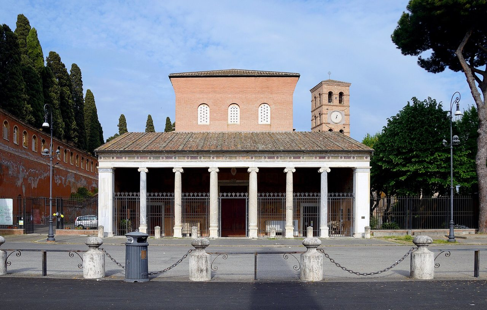

## The story
Lawrence was one of the seven deacons of Rome under Pope **Sixtus II**, in charge of the Church's goods and its care for the poor. In August 258 the Emperor Valerian ordered the execution of bishops, priests and deacons. Sixtus was beheaded on 6 August; Lawrence died four days later. His feast has been kept on 10 August since the 4th century, and he is named in the Roman Canon of the Mass.

## The full story

### The treasures of the Church
St Ambrose tells the best-known story. The prefect of Rome demanded the Church's treasures. Lawrence asked for three days, gave everything away to the poor, then brought the city's sick, blind, lame and destitute before the prefect: "These are the treasures of the Church."

### The gridiron
Ambrose and the poet Prudentius say he was roasted alive on a gridiron, and that halfway through he told his executioners, "I'm done on this side. Turn me over." His humour under torture made him patron of cooks and, half-jokingly, of comedians. His martyrdom in 258 and his burial on the Via Tiburtina are sure. Ambrose, about a hundred years later, already tells the gridiron. Some historians think he was beheaded, like Sixtus, and that the gridiron grew from reading *passus est* ("he suffered") as *assus est* ("he was roasted").

<figure class=photo>
<picture><source srcset="/static/art/lawrence-rome-600.webp 600w,/static/art/lawrence-rome.webp 1280w" sizes="(max-width:760px) 100vw,760px" type="image/webp"></picture>
<figcaption>San Lorenzo fuori le Mura, the basilica over his tomb on the Via Tiburtina. The porch is later than the fourth century. Photo: <a href="https://commons.wikimedia.org/wiki/File:Basilica_of_Saint_Lawrence_outside_the_Walls.jpg">Livioandronico2013</a>, <a href="https://creativecommons.org/licenses/by-sa/4.0">CC BY-SA 4.0</a>, via Wikimedia Commons.</figcaption>
</figure>

## Path to sainthood
Pre-Congregation saint.

## Patronages
Cooks, the poor, firefighters, librarians, comedians (popular), Rome.

## Trivia
- The **Perseid meteor shower**, which peaks around 10–12 August, is called the "Tears of St Lawrence" in Italy and Spain.
- Philip II of Spain built the **Escorial** on a gridiron plan to honour him, after the victory of St Quentin on his feast in 1557.
- The Basilica of San Lorenzo fuori le Mura in Rome stands over his tomb.

## Sources
- [Vatican News: St Lawrence, deacon and martyr](https://www.vaticannews.va/en/saints/08/10/st--lawrence-deacon--and-martyr.html)

Written October 16, 2026 from the sources above. The Rome photograph was added November 6, 2026. Feast days follow the General Roman Calendar unless noted.

