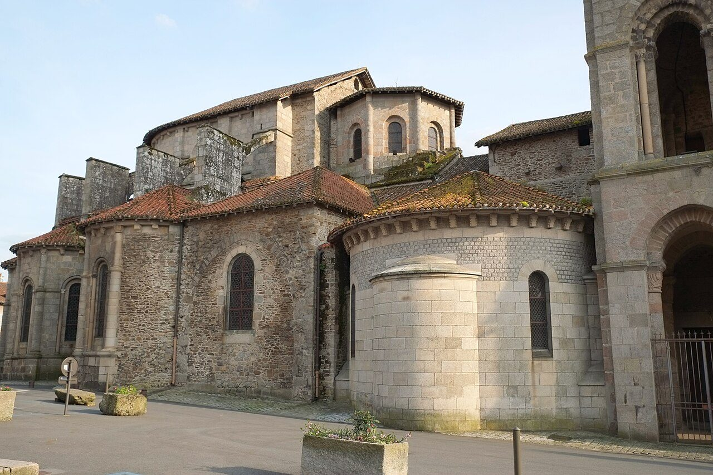

## The story
Leonard, in his 11th-century *Vita* (the first written life, centuries after him), was a Frankish courtier converted by St Remigius, who refused a bishopric for a cell in the forest of Pauvain near Limoges. Hermitage became abbey; abbey became the town of Saint-Léonard-de-Noblat.

## The full story

### The saint prisoners invoked
His special charism in the *Vita*: prisoners who called on his name saw their chains fall and came to hang them in his church — a forest of iron offerings. Crusaders carried the cult home; Bohemond of Antioch credited Leonard for release from Muslim captivity (1103) and left gifts, turbo-charging a pilgrimage that drew the chained, the pregnant (for safe delivery) and cattle-owners across France, England and Germany.

### Hundreds of churches
The scale is the story: hundreds of dedications in England alone, hospitals and leper houses under his name (he shares their patronage in places), and a Limousin shrine on a Santiago side-road. The life we have was written around 1030. The chains hung in his churches, and the dedications across Europe, are the mercy his name kept.

<figure class=photo>
<picture><source srcset="/static/art/leonard-noblat-600.webp 600w,/static/art/leonard-noblat.webp 1280w" sizes="(max-width:760px) 100vw,760px" type="image/webp"></picture>
<figcaption>The collegiate church at Saint-Léonard-de-Noblat, the town that grew from his hermitage near Limoges. Photo: <a href="https://commons.wikimedia.org/wiki/File:Saint-L%C3%A9onard-de-Noblat_Coll%C3%A9giale_3953.jpg">Reinhardhauke</a>, <a href="https://creativecommons.org/licenses/by-sa/3.0">CC BY-SA 3.0</a>, via Wikimedia Commons.</figcaption>
</figure>

## Path to sainthood
Pre-Congregation; one of the most widely diffused cults of the medieval West.

## Patronages
Prisoners and captives, pregnant women, grooms and cattle (regional).

## Trivia
- Saint-Léonard-de-Noblat is now also famous for porcelain and for cyclist Raymond Poulidor, buried there — chains to bicycles.
- In England his name survives in dozens of St Leonard's hospitals and churches, many once serving lepers.

## Sources
- [Catholic Encyclopedia: St Leonard of Limousin, New Advent](https://www.newadvent.org/cathen/09178b.htm)

Written October 19, 2026 from the sources above. The Noblat photograph was added November 6, 2026. Feast days follow the General Roman Calendar unless noted.

