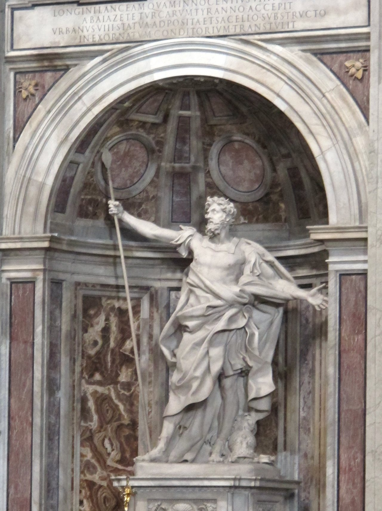

## His story
John's Gospel is precise and unnamed. After Jesus had died, the soldiers came to break the legs of the men crucified with him. Finding him already dead, "one of the soldiers pierced his side with a spear, and at once there came out blood and water" (John 19:33–34). John says he saw it, and that he tells it so that the reader may believe. The soldier has no name.

The name **Longinus** comes later, from the apocryphal *Acts of Pilate* (the Gospel of Nicodemus), a fourth- or fifth-century text. Tradition then told his story. Blood from the wound ran down the spear onto his eyes, which had been failing, and he saw. He confessed Christ. He left the army, and in time he too was martyred, sometimes said in Cappadocia. Medieval passion plays and the *Golden Legend* fixed the picture: the centurion under the cross, the lance, the confession "Truly this was the Son of God" (that sentence, in Mark 15:39, belongs to the centurion who saw Jesus die, whom tradition identified with the soldier of the lance).

The piercing of the side is in the Gospel. The name, the healing of his eyes, the conversion, and the martyrdom are the story the Church took up afterwards. So are the relics of the **Holy Lance**. One lance-point is claimed by St Peter's, another by the old imperial treasury in Vienna, and Armenian tradition has its own. The Church has never ruled that any of them is the spear of the Gospel.

Under the dome of **St Peter's**, Bernini's marble Longinus (about 1639) stands as one of the four giant statues over the relics of the basilica, the lance held up in his hand. It is the image most pilgrims meet.

<figure class=photo>
<picture><source srcset="/static/art/bernini-longinus-stpeters-600.webp 600w,/static/art/bernini-longinus-stpeters.webp 1280w" sizes="(max-width:760px) 100vw,760px" type="image/webp"></picture>
<figcaption>Gian Lorenzo Bernini, <em>Saint Longinus</em>, marble, carved about 1629–1638 and in place under the dome of St Peter's Basilica, Vatican, by about 1639. One of the four colossal statues in the crossing; the lance is raised in his right hand. The inscription above the niche records the lance kept in the basilica. Photo: <a href="https://commons.wikimedia.org/wiki/File:Gian_Lorenzo_Bernini,_san_longino_(1639)_01.JPG">Sailko</a>, <a href="https://creativecommons.org/licenses/by-sa/3.0/">CC BY-SA 3.0</a>, via Wikimedia Commons.</figcaption>
</figure>

## Path to sainthood
Pre-Congregation. The Roman Martyrology remembers him on **16 October**. He is not on the General Roman Calendar.

## Patronages
Soldiers, and people who come to faith late. Mantua long claimed his body and kept a devotion to the Holy Blood connected with him.

## Trivia
- His name is probably a Latin back-formation from the Greek *lonche*, a lance.
- The Vienna lance, the one of the Habsburg treasury, was later called the Spear of Destiny. That modern tale is not John's account.
- Fyodor Zubov's icon shows him as the East remembers him: a martyr-saint in armour, holding a cross, not only a Roman extra in a Crucifixion.

## Sources
- John 19:31–37; Mark 15:39
- [Wikipedia: Saint Longinus](https://en.wikipedia.org/wiki/Saint_Longinus) (with the ancient and medieval sources)
- [Wikipedia: Holy Lance](https://en.wikipedia.org/wiki/Holy_Lance)

Fact-checked on November 2, 2026 against the Gospel of John and the later tradition summarised in standard references. The Bernini photograph was checked on November 6, 2026 against the statue in St Peter's. Feast days follow the General Roman Calendar unless noted.

