<nav class=toc aria-label="On this page">

On this page

<ol>
<li><a href="#icons">The icons attributed to him</a></li>
<li><a href="#ox">The ox, his symbol</a></li>
<li><a href="#annunciation">The Annunciation</a></li>
<li><a href="#canticles">The daily canticles</a></li>
<li><a href="#art">Luke in art</a></li>
</ol>
</nav>

## His story
Luke wrote the third Gospel and the Acts of the Apostles, together about a quarter of the New Testament. St Paul calls him "Luke, the beloved physician" (Colossians 4:14) and his loyal companion ("Only Luke is with me", 2 Timothy 4:11). The "we" passages of Acts (16:10 onward) suggest he travelled with Paul. He was probably a Gentile; he opens his Gospel like a Greek historian, having "traced the course of all things accurately from the first" (Luke 1:3).

Early writers say he came from **Antioch** and died at 84 in Boeotia, Greece. A medieval telling says he painted the first icon of the Virgin Mary; several famous icons, such as the *Salus Populi Romani* in Santa Maria Maggiore, were attributed to him.

<h2 id=icons>The icons attributed to him</h2>

That telling is a beloved tradition, not a fact of history. No first-century portrait of Mary survives, and Luke never mentions painting in his Gospel or in Acts. From the early Middle Ages, though, the Church loved to imagine the beloved physician taking up a brush, and many of the East and West's most cherished icons of the Mother of God have been called his work. The pictures below are those icons, or close sisters of them. They are holy because the Church has prayed before them, not because Luke's hand can be proved.

<figure class=photo><picture><source srcset="/static/art/luke-salus-populi-romani-600.webp 600w,/static/art/luke-salus-populi-romani.webp 1280w" sizes="(max-width:760px) 100vw,760px" type="image/webp">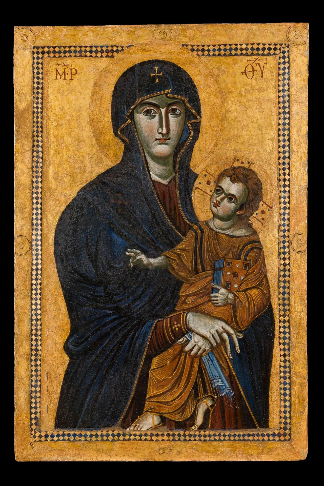</picture>
<figcaption>The <em>Salus Populi Romani</em> ("Salvation of the Roman People"), in the Borghese Chapel of Santa Maria Maggiore, Rome, after the restoration of 2018. Tradition has long called it Luke's; the panel itself is a medieval icon, and scholars debate its date. Public domain, via <a href="https://commons.wikimedia.org/wiki/File:Salus_Populi_Romani_after_restoration.jpg">Wikimedia Commons</a>.</figcaption>
</figure>

**The *Salus Populi Romani*.** This is the icon named on this page from the first. It stands in **Santa Maria Maggiore** in Rome, the great basilica of Mary, and has been carried through the streets in times of plague and war, hence its title, "Salvation of the Roman People." Popes have a particular love for it. The 2018 restoration by the Vatican Museums showed the gold, the Greek letters ΜΡ ΘΥ, "Mother of God," and the Child's blessing hand more clearly than they had been seen for a long time. Whatever its date, Rome has honoured it as a Luke icon for centuries.

<figure class=photo><picture><source srcset="/static/art/luke-czestochowa-600.webp 600w,/static/art/luke-czestochowa.webp 1280w" sizes="(max-width:760px) 100vw,760px" type="image/webp">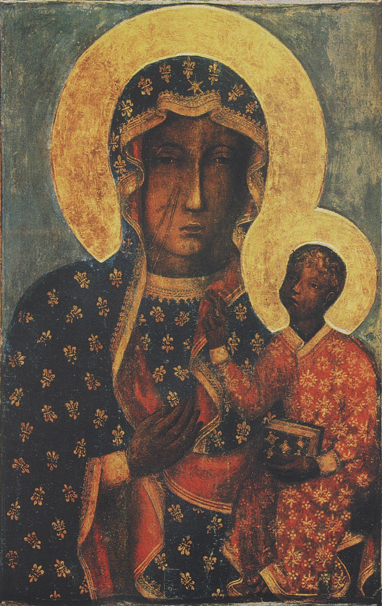</picture>
<figcaption>The Black Madonna of Częstochowa, the icon itself, without the jeweled cover pilgrims usually see. Jasna Góra, Poland. Public domain, via <a href="https://commons.wikimedia.org/wiki/File:Obraz_Matki_Bo%C5%BCej_Cz%C4%99stochowskiej_bez_ram.jpg">Wikimedia Commons</a>.</figcaption>
</figure>

**The Black Madonna of Częstochowa.** At **Jasna Góra** in Poland the same tradition is told: that Luke painted the image on a table-top from the house of the Holy Family, and that it came west by way of Constantinople. The present icon is a medieval *Hodegetria*, "She who shows the Way": Mary's right hand points to the Child, who is the Way. The scars on her cheek are remembered from an attack on the monastery in 1430. Again, the attribution to Luke is tradition. The devotion is not. She is the Queen and Protectress of Poland, and millions come to her.

The *Hodegetria* type itself is part of the Luke legend. The original icon of that name was kept in the Hodegon monastery in Constantinople, and was said to have been painted by the evangelist. It was lost when the city fell in 1453. What survives are its children: Częstochowa, and countless other icons in which Mary points to her Son.

<figure class=photo><picture><source srcset="/static/art/luke-kykkotissa-600.webp 600w,/static/art/luke-kykkotissa.webp 1280w" sizes="(max-width:760px) 100vw,760px" type="image/webp">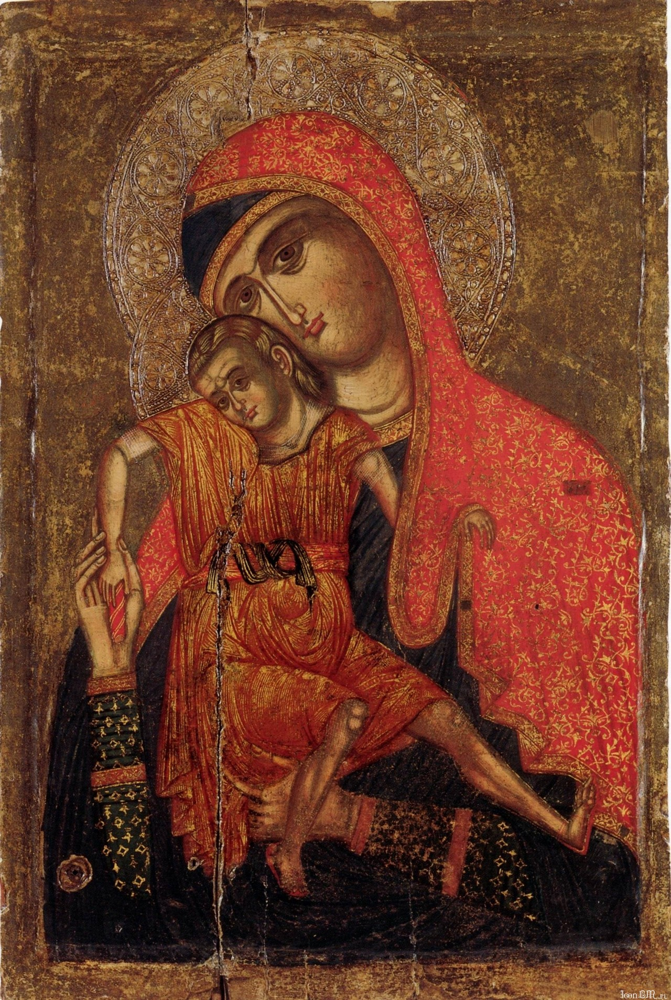</picture>
<figcaption>An icon of the <em>Kykkotissa</em> type, late 13th or early 14th century, from the Monastery of Saint John Lampadistis, Kalopanagiotis, Cyprus. The famous Luke icon of Kykkos Monastery, of this same type, is usually kept covered. Public domain, via <a href="https://commons.wikimedia.org/wiki/File:Icon_with_the_Virgin_Kykkotissa.jpg">Wikimedia Commons</a>.</figcaption>
</figure>

**The *Kykkotissa*, and Panagia Soumela.** In the East two other great icons are given to Luke. The icon of **Kykkos Monastery** on Cyprus, the *Kykkotissa*, is of a tender type: the Child presses against his Mother's cheek, his legs crossed. It is almost always hidden under a cover; the picture above is a sister-icon of the same type, painted in Cyprus in the late thirteenth or early fourteenth century. **Panagia Soumela**, the icon of the monastery of Soumela in the Pontus, was also called Luke's. After 1923 it was brought to Greece, and is now kept at the new monastery of Panagia Soumela on Mount Vermion. In both places the tradition is the same, and so is the caution: the stories are old and dear, and they are stories.

<figure class=photo><picture><source srcset="/static/art/luke-san-luca-600.webp 600w,/static/art/luke-san-luca.webp 1280w" sizes="(max-width:760px) 100vw,760px" type="image/webp">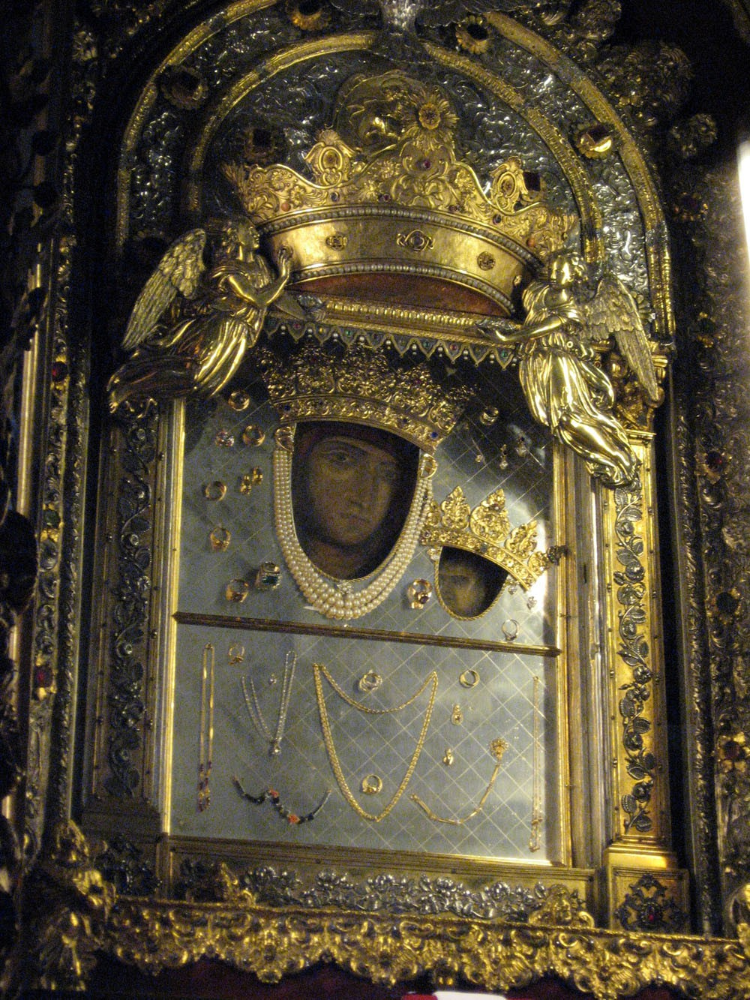</picture>
<figcaption>The Madonna of San Luca, in her sanctuary on the hill above Bologna, wearing the crowns and jeweled cover of a pilgrimage icon. Photo: <a href="https://commons.wikimedia.org/wiki/File:Madonna_di_San_Luca.jpg">Hay Kranen</a>, public domain, via Wikimedia Commons.</figcaption>
</figure>

**The Madonna of San Luca, Bologna.** On the hill of the Guardia, above the city, stands a sanctuary whose dark little icon is, again, attributed to Luke, and said to have been brought from the East. A medieval painting stands at the heart of it, under crowns and votive jewels, and each year it is carried down into Bologna in a great procession. The name of the shrine is itself a confession of the legend: this is the Madonna *of St Luke*.

<h2 id=ox>The ox, his symbol</h2>

Luke's sign in Christian art is the **ox**, or calf, almost always with wings. The four living creatures of **Ezekiel** and of the **Apocalypse** were given, one by one, to the four evangelists.

KJV · Ezekiel 1:10
As for the likeness of their faces, they four had the face of a man, and the face of a lion, on the right side: and they four had the face of an ox on the left side; they four also had the face of an eagle.

KJV · Revelation 4:7
And the first beast was like a lion, and the second beast like a calf, and the third beast had a face as a man, and the fourth beast was like a flying eagle.

**Irenaeus**, writing in the late second century, already gave Luke the calf, because his Gospel has a priestly beginning: it opens in the Temple, with Zechariah offering incense. **Jerome** settled the scheme that Western art has kept ever since: the man for Matthew, the lion for Mark, the ox for Luke, the eagle for John. The ox is the animal of **sacrifice**. Luke's Gospel begins with a priest at the altar, and it never loses sight of Christ's own offering and his priesthood.

KJV · Luke 1:8–9
And it came to pass, that while he executed the priest's office before God in the order of his course, according to the custom of the priest's office, his lot was to burn incense when he went into the temple of the Lord.

<figure class=photo><picture><source srcset="/static/art/luke-durrow-ox-600.webp 600w,/static/art/luke-durrow-ox.webp 1280w" sizes="(max-width:760px) 100vw,760px" type="image/webp">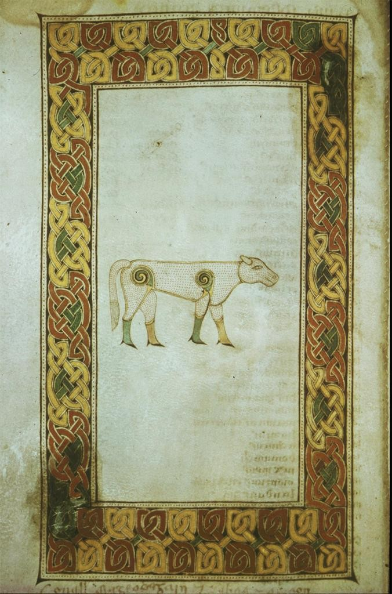</picture>
<figcaption>The ox, symbol of Luke, in the Book of Durrow, late seventh century. Trinity College Dublin, MS 57. Public domain, via <a href="https://commons.wikimedia.org/wiki/File:Book_of_Durrow_-_TCL_Ms57_(Ox).jpg">Wikimedia Commons</a>.</figcaption>
</figure>

The painters of the great Insular gospel books made that ox unforgettable. In the **Book of Durrow**, one of the oldest of them, the calf of Luke stands alone in a frame of knotwork, quiet and complete. In the **Book of Kells**, at folio 27v, the four living creatures appear together, the man, the lion, the ox and the eagle, the whole vision of Ezekiel and of John on a single page. In the **Codex Aureus of Echternach**, Christ sits in majesty in a mandorla, and the four creatures surround him; the winged ox at his left is labelled *Lucas*.

<figure class=photo><picture><source srcset="/static/art/luke-kells-evangelists-600.webp 600w,/static/art/luke-kells-evangelists.webp 1280w" sizes="(max-width:760px) 100vw,760px" type="image/webp">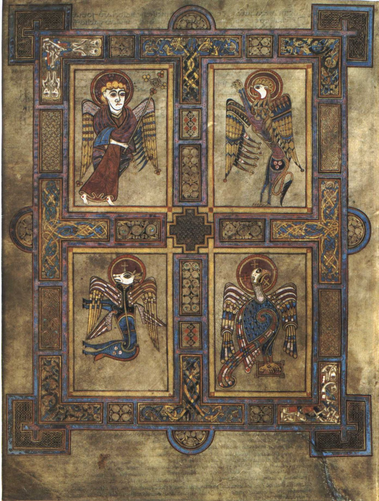</picture>
<figcaption>The four evangelist symbols, folio 27v of the Book of Kells, about the year 800. Trinity College Dublin. Luke's ox is at the lower left. Public domain, via <a href="https://commons.wikimedia.org/wiki/File:KellsFol027v4Evang.jpg">Wikimedia Commons</a>.</figcaption>
</figure>

<figure class=photo><picture><source srcset="/static/art/luke-codex-aureus-majesty-600.webp 600w,/static/art/luke-codex-aureus-majesty.webp 1280w" sizes="(max-width:760px) 100vw,760px" type="image/webp">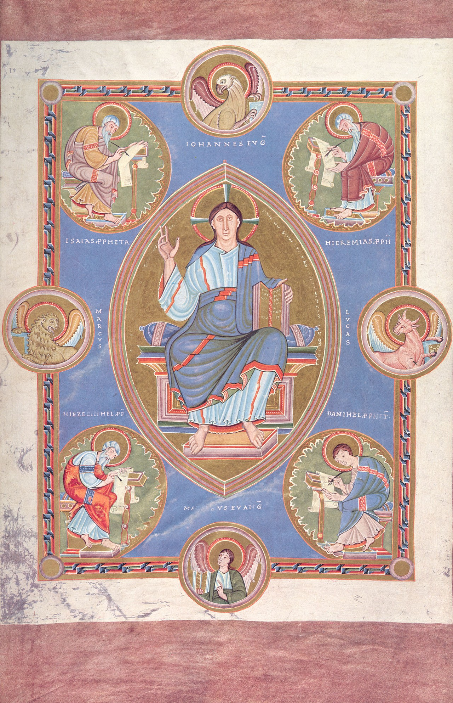</picture>
<figcaption>Christ in Majesty with the tetramorph, folio 2v of the Codex Aureus of Echternach, about 1030. Germanisches Nationalmuseum, Nuremberg. The winged ox at the right is labelled <em>Lucas</em>. Public domain, via <a href="https://commons.wikimedia.org/wiki/File:Codex_aureus_Epternacensis_folio_2_verso.jpg">Wikimedia Commons</a>.</figcaption>
</figure>

<h2 id=annunciation>The Annunciation</h2>

Without Luke we would not have the Annunciation as the Church tells it. In the sixth month the angel Gabriel was sent to Nazareth, "to a virgin espoused to a man whose name was Joseph, of the house of David; and the virgin's name was Mary" (Luke 1:26–27).

KJV · Luke 1:28
And the angel came in unto her, and said, Hail, thou that art highly favoured, the Lord is with thee: blessed art thou among women.

Greek · SBLGNT · Luke 1:28

Χαῖρε, κεχαριτωμένη, ὁ κύριος μετὰ σοῦ.

Chaire, kecharitōmenē, ho kyrios meta sou.

Latin · Vulgate · Luke 1:28
Ave, gratia plena: Dominus tecum: benedicta tu in mulieribus.

The Latin greeting, *Ave, gratia plena*, "Hail, full of grace," is the opening of the Hail Mary, and the Church has said it ever since.

KJV · Luke 1:30–33
And the angel said unto her, Fear not, Mary: for thou hast found favour with God. And, behold, thou shalt conceive in thy womb, and bring forth a son, and shalt call his name JESUS. He shall be great, and shall be called the Son of the Highest: and the Lord God shall give unto him the throne of his father David: and he shall reign over the house of Jacob for ever; and of his kingdom there shall be no end.

Mary asked, "How shall this be, seeing I know not a man?" (Luke 1:34). The angel answered her:

KJV · Luke 1:35
And the angel answered and said unto her, The Holy Ghost shall come upon thee, and the power of the Highest shall overshadow thee: therefore also that holy thing which shall be born of thee shall be called the Son of God.

Then came the word on which the whole of Luke, and the whole of the Gospel, seems to turn.

KJV · Luke 1:38
And Mary said, Behold the handmaid of the Lord; be it unto me according to thy word. And the angel departed from her.

<h2 id=canticles>The daily canticles</h2>

Luke's first two chapters gave the Church the three canticles of her daily prayer. They are still sung every day, in the same hours, in the Divine Office and in many other liturgies of East and West.

**The *Benedictus***, the song of Zechariah at the birth of John the Baptist, is the canticle of **Morning Prayer**, or Lauds. It begins, in Latin, *Benedictus Dominus Deus Israel*, "Blessed be the Lord God of Israel."

KJV · Luke 1:68–69, 78–79
Blessed be the Lord God of Israel; for he hath visited and redeemed his people, and hath raised up an horn of salvation for us in the house of his servant David… Through the tender mercy of our God; whereby the dayspring from on high hath visited us, to give light to them that sit in darkness and in the shadow of death, to guide our feet into the way of peace.

**The *Magnificat***, the song of Mary at the Visitation, is the canticle of **Evening Prayer**, or Vespers. It begins *Magnificat anima mea Dominum*, "My soul doth magnify the Lord."

KJV · Luke 1:46–47, 52–53
And Mary said, My soul doth magnify the Lord, and my spirit hath rejoiced in God my Saviour… He hath put down the mighty from their seats, and exalted them of low degree. He hath filled the hungry with good things; and the rich he hath sent empty away.

**The *Nunc dimittis***, the song of Simeon in the Temple when he took the child Jesus in his arms, is the canticle of **Night Prayer**, or Compline. It begins *Nunc dimittis servum tuum, Domine*, "Lord, now lettest thou thy servant depart in peace."

KJV · Luke 2:29–32
Lord, now lettest thou thy servant depart in peace, according to thy word: for mine eyes have seen thy salvation, which thou hast prepared before the face of all people; a light to lighten the Gentiles, and the glory of thy people Israel.

<h2 id=art>Luke in art</h2>

Because tradition made him the first painter of the Virgin, Luke became the patron of artists, and the Guild of St Luke was the painters' guild in city after city. The pictures below show him at work, and the opening of his Gospel in one of the great books of the early Church.

<figure class=photo><picture><source srcset="/static/art/luke-weyden-600.webp 600w,/static/art/luke-weyden.webp 1280w" sizes="(max-width:760px) 100vw,760px" type="image/webp">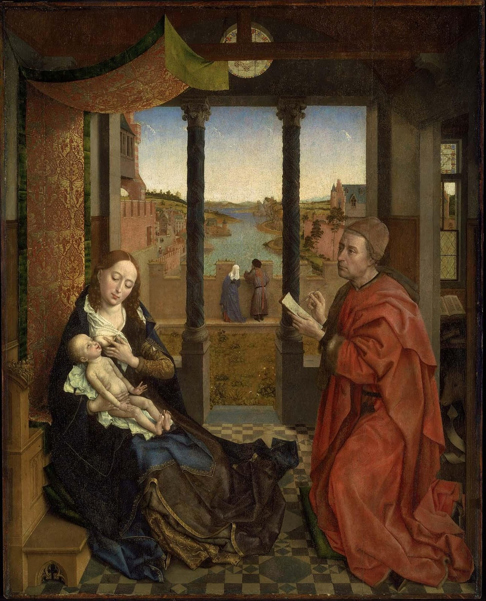</picture>
<figcaption>Rogier van der Weyden, <em>Saint Luke Drawing the Virgin</em>, about 1435–40. Museum of Fine Arts, Boston. Public domain, via <a href="https://commons.wikimedia.org/wiki/File:Saint_Luke_Drawing_the_Virgin_MFA_Boston.jpg">Wikimedia Commons</a>.</figcaption>
</figure>

**Rogier van der Weyden, *Saint Luke Drawing the Virgin*, about 1435–40.** This is the painting most people picture when they hear of Luke the artist. It hangs in the **Museum of Fine Arts, Boston**. Luke kneels in a red robe and draws Mary with a silverpoint, quietly, as she nurses the Child. Through the columns a river landscape opens, as if the whole world were being born with the picture. Versions of the composition exist in Munich, Bruges and the Hermitage; the Boston panel is the one usually taken as Rogier's own. Some have thought the face of Luke is the painter's.

<figure class=photo><picture><source srcset="/static/art/luke-heemskerck-600.webp 600w,/static/art/luke-heemskerck.webp 1280w" sizes="(max-width:760px) 100vw,760px" type="image/webp">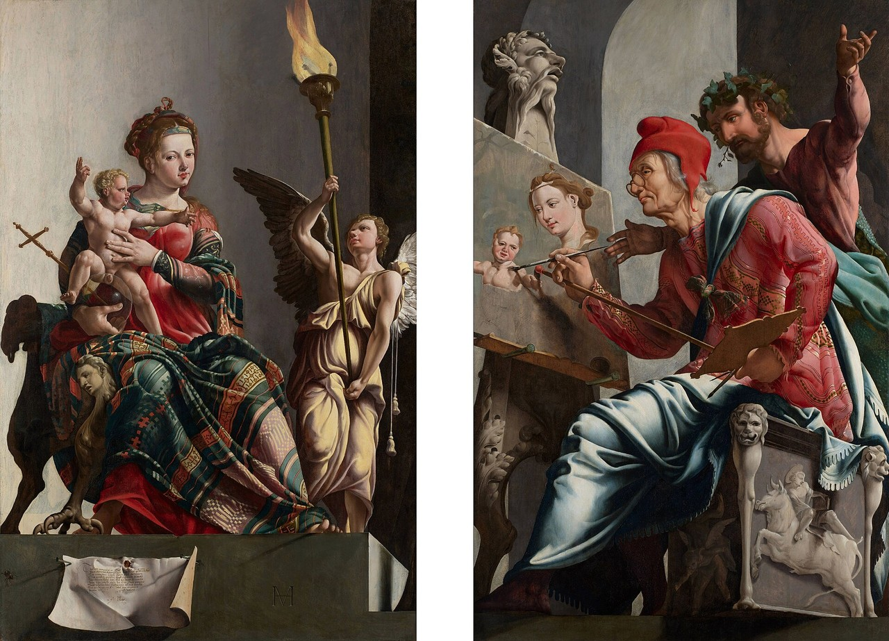</picture>
<figcaption>Maarten van Heemskerck, <em>Saint Luke Painting the Virgin</em>, 1532. Frans Hals Museum, Haarlem. The painting, made for the Haarlem Guild of St Luke, was later divided; both panels are shown together. Public domain, via <a href="https://commons.wikimedia.org/wiki/File:Maarten_van_Heemskerck_-_St_Luke_Painting_the_Virgin_(1532_Haarlem).jpg">Wikimedia Commons</a>.</figcaption>
</figure>

**Maarten van Heemskerck, *Saint Luke Painting the Virgin*, 1532.** Heemskerck painted this for the **Guild of St Luke** in Haarlem, his own city's painters. Luke sits at the easel, a laurel-crowned figure at his shoulder, and on the seat a carved ox reminds us whose patron this is. The Virgin and Child appear on the other panel, as the vision he is painting. The work was later cut in two; both halves are in the **Frans Hals Museum**, and are shown together again.

<figure class=photo><picture><source srcset="/static/art/luke-elgreco-600.webp 600w,/static/art/luke-elgreco.webp 1280w" sizes="(max-width:760px) 100vw,760px" type="image/webp">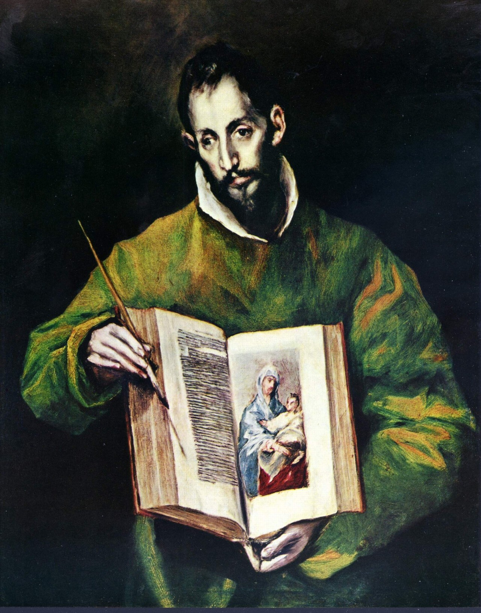</picture>
<figcaption>El Greco, <em>Saint Luke</em>, about 1605–10, from the apostolate of Toledo Cathedral. Public domain, via <a href="https://commons.wikimedia.org/wiki/File:El_Greco_035.jpg">Wikimedia Commons</a> (Yorck Project).</figcaption>
</figure>

**El Greco, *Saint Luke*, about 1605–10.** This Luke belongs to the apostolate of **Toledo Cathedral**, the series of the apostles El Greco painted for his own city. He is both writer and painter. In one hand he holds a brush, in the other the open Gospel; and on the page, like a window, is a little icon of the Mother and Child. The two callings that tradition gave him, evangelist and first iconographer, are held in a single look.

<figure class=photo><picture><source srcset="/static/art/luke-guercino-600.webp 600w,/static/art/luke-guercino.webp 1280w" sizes="(max-width:760px) 100vw,760px" type="image/webp">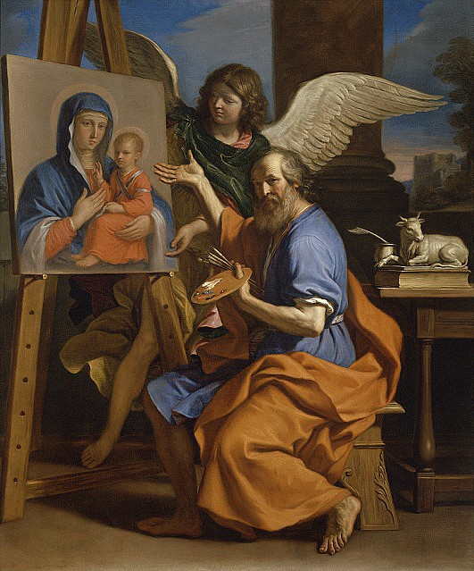</picture>
<figcaption>Guercino, <em>Saint Luke Displaying a Painting of the Virgin</em>, 1652–53. Nelson-Atkins Museum of Art, Kansas City. Public domain, via <a href="https://commons.wikimedia.org/wiki/File:Guercino_-_Saint_Luke_Displaying_a_Painting_of_the_Virgin,_1652-1653,_F83-55.png">Wikimedia Commons</a>.</figcaption>
</figure>

**Guercino, *Saint Luke Displaying a Painting of the Virgin*, 1652–53.** Now in the **Nelson-Atkins Museum of Art** in Kansas City, this is Luke the painter at the end of his work. He turns from the easel to show us the finished picture of Mary and the Child, an angel at his side, a palette in his hand, and, at the right, the little ox that tells you who he is. The painting within the painting is meant to stand for a Luke icon; the museum notes the tradition of the Madonna of San Luca in Bologna, the same icon that appears earlier on this page.

<figure class=photo><picture><source srcset="/static/art/luke-lindisfarne-incipit-600.webp 600w,/static/art/luke-lindisfarne-incipit.webp 1280w" sizes="(max-width:760px) 100vw,760px" type="image/webp">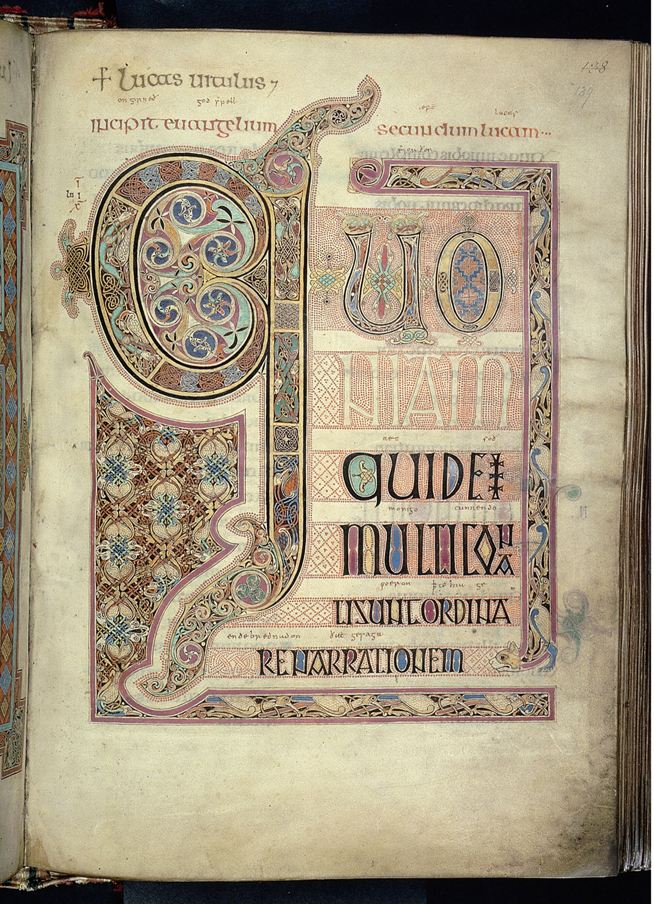</picture>
<figcaption>The opening of St Luke's Gospel, folio 139r of the Lindisfarne Gospels, about 700, attributed to Eadfrith of Lindisfarne. British Library, Cotton MS Nero D IV. The great <em>Q</em> begins Luke 1:1, <em>Quoniam quidem multi…</em> Public domain, via <a href="https://commons.wikimedia.org/wiki/File:Lindisfarne_Gospels_folio_139r.jpg">Wikimedia Commons</a>.</figcaption>
</figure>

**The Lindisfarne Gospels, the opening of Luke, about 700.** The Lindisfarne Gospels, made on the Holy Island and associated with Bishop **Eadfrith**, give each evangelist a portrait and a great incipit page. The surviving Wikimedia image of Luke's book is this one, folio 139r, the beginning of the Gospel itself: a vast decorated *Q* for *Quoniam quidem multi conati sunt*, "Forasmuch as many have taken in hand," the first words of Luke 1:1. It is a fitting last picture: before Luke the painter, Luke the writer, opening his history "in order."

## His Gospel in the Church year
Without Luke there would be no Christmas story as we tell it: the Annunciation, the Visitation, the Magnificat, the Benedictus, the shepherds, the *Gloria in excelsis* ([Luke 2:14](/verses/2026-10-20-luke-2-14/)), Simeon's *Nunc dimittis*. All three canticles of the Church's daily prayer come from his first two chapters. Luke is the Gospel of **Lectionary Year C**, and his Acts is read throughout Easter. His symbol is the **ox**, the sacrificial animal, because his Gospel begins in the Temple.

## Patronages
Physicians, surgeons, artists and painters (the Guild of St Luke), students.

## Where to visit
Basilica of Santa Giustina, Padua (his tomb); Santa Maria Maggiore, Rome.

<figure class=photo>
<picture><source srcset="/static/art/luke-padua-600.webp 600w,/static/art/luke-padua.webp 1280w" sizes="(max-width:760px) 100vw,760px" type="image/webp">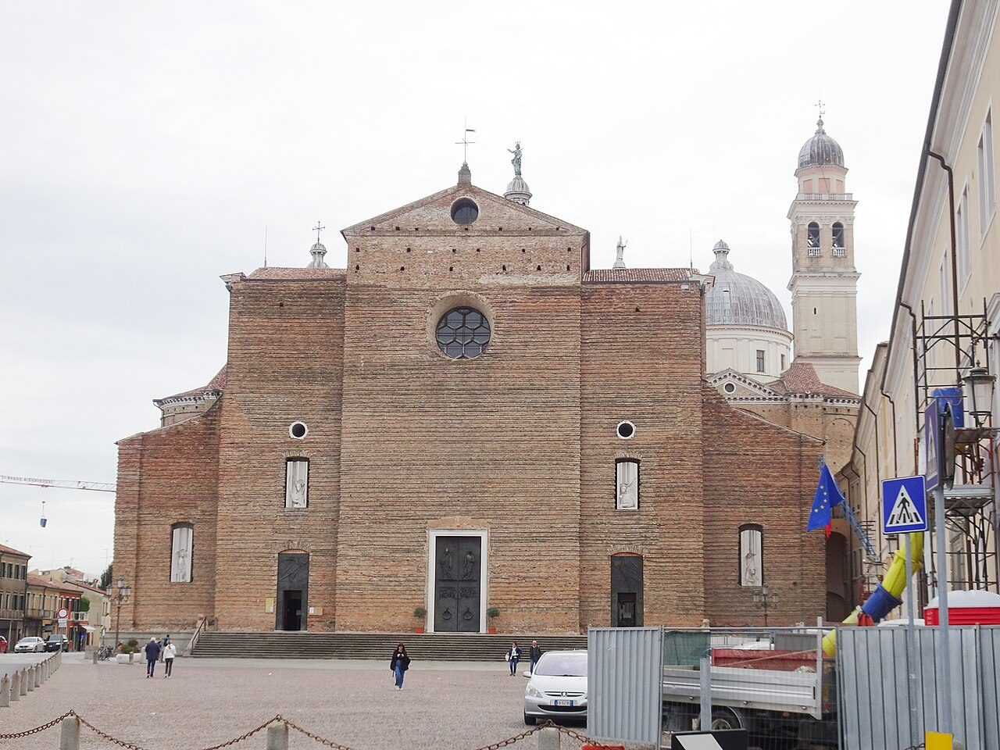</picture>
<figcaption>The basilica of Santa Giustina in Padua, which keeps the tomb long venerated as Luke's. Photo: <a href="https://commons.wikimedia.org/wiki/File:Padova,_Abbazia_di_Santa_Giustina,_facciata.jpg">Palickap</a>, <a href="https://creativecommons.org/licenses/by-sa/4.0">CC BY-SA 4.0</a>, via Wikimedia Commons.</figcaption>
</figure>

## Sources
- [Catholic Encyclopedia: Gospel of St Luke](https://www.newadvent.org/cathen/09420a.htm)
- Luke 1:1-4; Acts 16:10-17; Colossians 4:14; 2 Timothy 4:11; Philemon 24
- Luke 1:8–9, 1:26–38, 1:46–55, 1:68–79; Luke 2:29–32; Ezekiel 1:10; Revelation 4:7
- [Wikipedia: Salus Populi Romani](https://en.wikipedia.org/wiki/Salus_Populi_Romani)
- [Wikipedia: Black Madonna of Częstochowa](https://en.wikipedia.org/wiki/Black_Madonna_of_Cz%C4%99stochowa)
- [Wikipedia: Hodegetria](https://en.wikipedia.org/wiki/Hodegetria)
- [Wikipedia: Kykkos Monastery](https://en.wikipedia.org/wiki/Kykkos_Monastery), [Sumela Monastery](https://en.wikipedia.org/wiki/Sumela_Monastery) and [Panagia Soumela](https://en.wikipedia.org/wiki/Panagia_Soumela)
- [Wikipedia: Sanctuary of the Madonna di San Luca](https://en.wikipedia.org/wiki/Sanctuary_of_the_Madonna_di_San_Luca)
- [Wikipedia: Book of Durrow](https://en.wikipedia.org/wiki/Book_of_Durrow), [Book of Kells](https://en.wikipedia.org/wiki/Book_of_Kells), [Codex Aureus of Echternach](https://en.wikipedia.org/wiki/Codex_Aureus_of_Echternach) and [Lindisfarne Gospels](https://en.wikipedia.org/wiki/Lindisfarne_Gospels)
- [Wikipedia: Saint Luke Drawing the Virgin](https://en.wikipedia.org/wiki/Saint_Luke_Drawing_the_Virgin) and the [Museum of Fine Arts, Boston](https://collections.mfa.org/objects/31035/saint-luke-drawing-the-virgin)
- [Frans Hals Museum: De heilige Lucas schildert de Madonna (Heemskerck)](https://franshalsmuseum.nl/nl/collectie/de-heilige-lucas-schildert-de-madonna)
- [Nelson-Atkins Museum: Saint Luke Displaying a Painting of the Virgin (Guercino)](https://art.nelson-atkins.org/objects/29835/saint-luke-displaying-a-painting-of-the-virgin)

Fact-checked on October 22, 2026 against Scripture and New Advent. The Padua photograph was added November 6, 2026. Expanded November 12, 2026: the attribution of icons to Luke is told as tradition, not as historical fact. Scripture is quoted briefly from the public-domain King James Version, with the Greek of Luke 1:28 from the SBLGNT and the Latin from the Vulgate.

