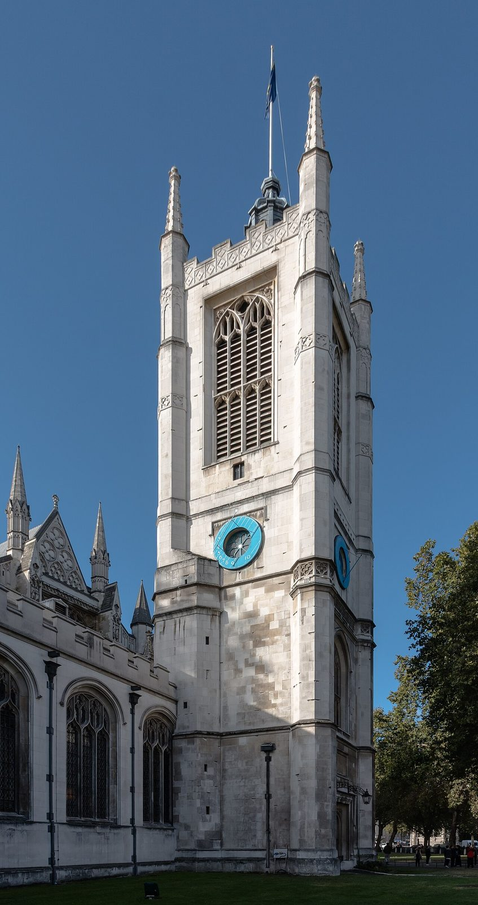

## The story
Margaret (Marina in the East) was, according to legend, the daughter of a pagan priest at Antioch in Pisidia (today Turkey). Driven out for being a Christian, she kept sheep with her nurse. The Roman prefect **Olybrius** wanted to marry her; when she refused and declared herself a Christian, he had her tortured and imprisoned.

## The full story

### The dragon
In prison the devil came to her as a huge **dragon** and swallowed her. But the cross she was holding irritated the dragon's insides (or grew larger), and it burst open, and Margaret stepped out unharmed. Because she came out of the dragon safe and sound, she became the patron of **childbirth**. She was later beheaded. The *Golden Legend*, which tells her, already treated the dragon with caution. Women in labour asked her help all the same.

### A voice for Joan
Margaret was one of the most popular saints of the Middle Ages and one of the Fourteen Holy Helpers. She was one of the three saints whose voices [St Joan of Arc](/saints/joan-of-arc/) said she heard. Her feast was taken off the General Roman Calendar in 1969. She remains in the Roman Martyrology.

## Path to sainthood
Pre-Congregation saint; feast removed from the universal calendar in 1969, still in the Martyrology.

## Patronages
Pregnant women, childbirth, nurses, peasants.

## Trivia
- Over 250 English churches were dedicated to her, including St Margaret's, Westminster, beside the Abbey.
- Raphael painted her stepping calmly past the dragon (Vienna, Louvre). The picture at the head of this page is the one in Vienna.

<figure class=photo>
<picture><source srcset="/static/art/margaret-westminster-600.webp 600w,/static/art/margaret-westminster.webp 1280w" sizes="(max-width:760px) 100vw,760px" type="image/webp"></picture>
<figcaption>St Margaret's, Westminster, beside the Abbey. The blue rings are a temporary artwork from the year of the photograph, not part of the medieval church. Photo: <a href="https://commons.wikimedia.org/wiki/File:London,_St_Margaret%27s_--_2016_--_4806.jpg">Dietmar Rabich</a>, <a href="https://creativecommons.org/licenses/by-sa/4.0">CC BY-SA 4.0</a>, via Wikimedia Commons.</figcaption>
</figure>

## Sources
- [Catholic Encyclopedia: St Margaret](https://www.newadvent.org/cathen/09652b.htm)

Written October 16, 2026 from the sources above, with the Westminster photograph added November 6, 2026. Feast days follow the General Roman Calendar unless noted.

