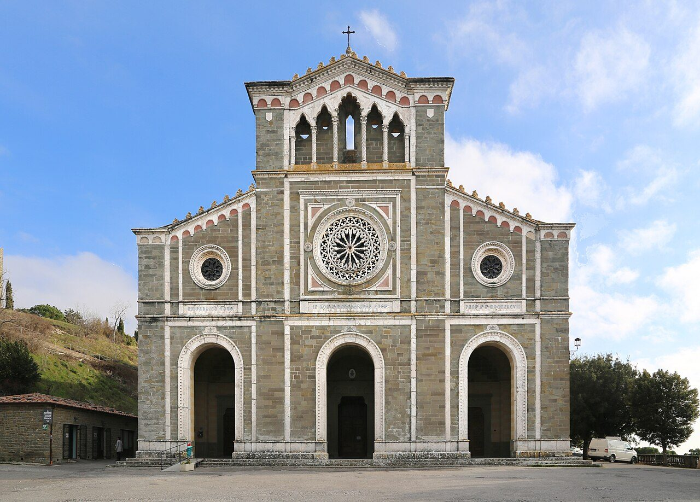

## The story
Margaret ran away at seventeen with a young nobleman of Montepulciano, lived nine years as his mistress and bore his son. When he was murdered, legend says his dog led her to the body under leaves. Rejected by her lover's family and her stepmother, she arrived destitute in Cortona with her child — and turned penance into a public vocation.

## The full story

### Cortona's Magdalene
The Franciscans took her in; after a probation she became a Franciscan tertiary, founded a hospital (Santa Maria della Misericordia) and a congregation of sisters, nursed the sick, and intervened to make peace in a violent commune. Her confessor Fra Giunta's *Legenda* records locutions in which Christ calls her 'my daughter' and spars with her like a second Magdalene — frank, intimate, sometimes scolding dialogues.

### Body in Cortona
She died in 1297; Cortona petitioned for her canonisation almost at once, though it waited until 1728. Her body rests in the basilica named for her above the town; her son became a Franciscan friar. Fra Giunta's *Legenda*, written near her lifetime, and the town's records, carry the conversion, the hospital, and the cult. The dog that found the body is the early telling. The dialogues with Christ are the devotion Fra Giunta wrote down.

<figure class=photo>
<picture><source srcset="/static/art/margaret-cortona-600.webp 600w,/static/art/margaret-cortona.webp 1280w" sizes="(max-width:760px) 100vw,760px" type="image/webp"></picture>
<figcaption>The basilica of Santa Margherita above Cortona, where her body rests. Photo: <a href="https://commons.wikimedia.org/wiki/File:Cortona,_basilica_di_santa_margherita,_esterno_01.jpg">Sailko</a>, <a href="https://creativecommons.org/licenses/by-sa/4.0">CC BY-SA 4.0</a>, via Wikimedia Commons.</figcaption>
</figure>

## Path to sainthood
Cult confirmed over centuries; canonised by Benedict XIII in 1728.

## Patronages
Penitents, single mothers, the falsely accused, Cortona.

## Trivia
- She is called the 'Magdalene of the Seraphic Order' — Francis's order claiming its own great penitent.
- Her hospital foundation predates many civic hospitals in Tuscany.

## Sources
- [Catholic Encyclopedia: St Margaret of Cortona, New Advent](https://www.newadvent.org/cathen/09653b.htm)

Written October 19, 2026 from the sources above. The Cortona photograph was added November 6, 2026. Feast days follow the General Roman Calendar unless noted.

