<nav class=toc aria-label="On this page">

On this page

<ol>
<li><a href="#gospel">When the Gospel was written</a></li>
<li><a href="#peter">With Peter</a></li>
<li><a href="#voice">The voice of his Gospel</a></li>
<li><a href="#alexandria">Alexandria</a></li>
<li><a href="#martyrdom">His martyrdom</a></li>
<li><a href="#lion">The winged lion</a></li>
<li><a href="#art">Mark in art</a></li>
<li><a href="#visit">His churches</a></li>
</ol>
</nav>

## His story
Mark is traditionally identified with **John Mark** of the Acts of the Apostles: his mother's house in Jerusalem was a meeting place of the first Christians (Acts 12:12). He travelled with Paul and his cousin Barnabas, left them partway, and was later reconciled with Paul (Colossians 4:10). Peter calls him "my son Mark" (1 Peter 5:13).

Around AD 120, **Papias** wrote that Mark had been **Peter's interpreter** and wrote down what Peter remembered of Jesus. His Gospel is the shortest and probably the earliest of the four. Tradition says he founded the Church of **Alexandria** in Egypt and was martyred there.

**The theft of the body (828):** Two Venetian merchants, Buono of Malamocco and Rustico of Torcello, are said to have smuggled his body out of Alexandria by hiding it under **pork**, which the Muslim customs officials would not touch, and brought it to Venice. The story is told in the mosaics of St Mark's Basilica. Earlier, according to another legend, an angel had greeted Mark in the Venetian lagoon: ***Pax tibi, Marce, evangelista meus*** ("Peace to you, Mark, my evangelist"), the words on the book held by the Venetian lion.

<h2 id=gospel>When the Gospel was written</h2>

Most scholars date Mark's Gospel to about **AD 65–73**, in or near the years of the Jewish War and the fall of the Temple in AD 70. Many place it in **Rome**. It is generally held to be the **earliest** of the four Gospels, and a source that Matthew and Luke both used.

That dating sits close to the old tradition, though the two arrive there by different roads. Papias, writing early in the second century, said that Mark wrote down Peter's preaching. The Church has long associated that work with Rome, often after Peter's martyrdom under Nero (about AD 64). Modern scholarship looks instead to the Gospel itself: to its urgency, and to the discourse in Mark 13, which speaks of a temple thrown down and of suffering soon to come. A few scholars prefer a slightly earlier or later year. The exact date cannot be fixed. What can be said, with care, is that the shortest Gospel was written first, in the lifetime of people who had known the apostles, and that Rome is the place tradition and a good deal of scholarship still meet.

<h2 id=peter>With Peter</h2>

The New Testament lets us see Mark at Peter's side more than once. When Peter was released from prison in Jerusalem, he went straight to a house he knew:

KJV · Acts 12:12
And when he had considered the thing, he came to the house of Mary the mother of John, whose surname was Mark; where many were gathered together praying.

That house was a meeting place of the first Church, and Mark was of that family. Years later, in a letter traditionally associated with Rome (Babylon, in the old Christian way of naming the city), Peter sends a greeting in Mark's name, and calls him his son:

KJV · 1 Peter 5:13
The church that is at Babylon, elected together with you, saluteth you; and so doth Marcus my son.

Papias, whose words are kept for us by **Eusebius**, said that this closeness was how the Gospel came to be. Mark, "having become the interpreter of Peter, wrote down accurately, though not in order, whatsoever he remembered of the things said or done by the Lord." He wrote not as a man making a finished history, Papias said, but as one careful not to leave out or to falsify anything he had heard.

Mark also belonged to the circle of Paul. He was **Barnabas's cousin** (Colossians 4:10), and he went with Paul and Barnabas on the first missionary journey. At Perga in Pamphylia he left them and returned to Jerusalem (Acts 13:13). When they prepared to go out again, "Barnabas determined to take with them John, whose surname was Mark. But Paul thought not good to take him with them, who departed from them from Pamphylia, and went not with them to the work. And the contention was so sharp between them, that they departed asunder one from the other: and so Barnabas took Mark, and sailed unto Cyprus" (Acts 15:37–39).

The breach was not the end of the story. Late in Paul's life, from prison, he wrote to Timothy:

KJV · 2 Timothy 4:11
Only Luke is with me. Take Mark, and bring him with thee: for he is profitable to me for the ministry.

The young man who had once turned back was wanted again, and named with love.

<h2 id=voice>The voice of his Gospel</h2>

Mark opens with a title, and it is almost a creed in a single line.

KJV · Mark 1:1
The beginning of the gospel of Jesus Christ, the Son of God;

Greek · SBLGNT · Mark 1:1

Ἀρχὴ τοῦ εὐαγγελίου Ἰησοῦ Χριστοῦ.

Archē tou euangeliou Iēsou Christou.

Latin · Vulgate · Mark 1:1
Initium evangelii Iesu Christi Filii Dei.

The first word is *beginning*, the word Genesis uses for the start of all things. What follows will show who this Jesus is. Many manuscripts, the Vulgate and the KJV continue the title with "the Son of God"; some early Greek witnesses end at "Jesus Christ." The whole Gospel moves toward the same confession. At the cross a Roman centurion will say it aloud: "Truly this man was the Son of God" (Mark 15:39).

Mark's hallmark is haste. Again and again he writes *euthys*, "straightway" or "immediately": Jesus is baptized, and immediately the Spirit drives him into the wilderness; he calls, and immediately the fishermen leave their nets. The word comes some forty times, far more than in the other Gospels. The shortest Gospel is also the most urgent. It does not linger. It carries you, almost at a run, from the Jordan to the cross.

At the heart of that journey is a saying of Jesus that Mark alone among the first three Gospels gives in this full form, and that has sounded ever since like the Gospel's own key:

KJV · Mark 10:45
For even the Son of man came not to be ministered unto, but to minister, and to give his life a ransom for many.

Two other moments are Mark's own, and both have been loved and puzzled over. In the garden, when Jesus is arrested, "there followed him a certain young man, having a linen cloth cast about his naked body; and the young men laid hold on him: and he left the linen cloth, and fled from them naked" (Mark 14:51–52). No other Gospel has this. An old tradition says the young man was Mark himself, a quiet signature left in the story. It is a tradition, not a fact the text proves, but it has helped many readers feel how close the writer stood to that night.

And then the ending, as the oldest complete manuscripts have it. The women come to the tomb, find it empty, and hear that he is risen:

KJV · Mark 16:8
And they went out quickly, and fled from the sepulchre; for they trembled and were amazed: neither said they any thing to any man; for they were afraid.

Some of the earliest Greek Bibles end there. The longer ending, Mark 16:9–20, in which the risen Christ appears and sends the eleven into all the world, is in most later manuscripts and in the KJV, and the Church has long read it. A brief additional ending also survives in some copies. The question is an old one for scholars. For the faithful reader the two notes belong together: the fear at the empty tomb, and the word that goes out from it.

<h2 id=alexandria>Alexandria</h2>

Eusebius, in the early fourth century, records the tradition that Mark was sent to Egypt and was the first to preach the Gospel in **Alexandria**, founding churches there. The Coptic Church has always honoured him as its founder and first patriarch, and the **Coptic Orthodox**, **Coptic Catholic** and **Greek Orthodox** Patriarchates of Alexandria all trace their succession to him.

A later, beloved story tells how the work began. Mark's sandal strap broke, and he took it to a cobbler named **Anianus** (Anian). The awl pierced the cobbler's hand, and Mark healed him in the name of Jesus. Anianus and his household were baptized, and the first church in the city grew from that house. When Mark died, Anianus succeeded him as bishop. Eusebius records Annianus as Mark's successor in the eighth year of Nero, about AD 62. The cobbler himself belongs to later tradition; the succession is much older.

<h2 id=martyrdom>His martyrdom</h2>

How Mark died is told in the *Acts of Mark*, a later work, not a first-century history. The Church has kept the story, and tells it as tradition.

It was Easter, and in Alexandria the same days were a festival of the god **Serapis**. The pagans of the city, angry that Mark had turned so many from their cult, seized him, put a rope around his neck, and dragged him through the streets of the district called Bucolia. He was thrown into prison for a night, and the next day they dragged him again, until he died. The year is traditionally given as about **AD 68**, and the day is the feast still kept on **25 April**.

His body, the same tradition says, was buried in Alexandria, and there it remained until the Venetians took it in 828, as already told above. The head is still honoured in Alexandria by the Coptic Church. In **June 1968**, as the new St Mark's Coptic Orthodox Cathedral in Abbassia, Cairo, was about to be opened, Pope Cyril VI sent a delegation to Rome. **Pope Paul VI** placed in their hands a relic of Mark, a portion of the remains that had long been in Venice, and said that the rest would remain there. The relic was brought to Cairo and laid in the new cathedral, a homecoming after eleven centuries.

<h2 id=lion>The winged lion</h2>

Mark's sign in Christian art is the **winged lion**. The four living creatures of Ezekiel and of the Apocalypse were given, one by one, to the four evangelists.

KJV · Ezekiel 1:10
As for the likeness of their faces, they four had the face of a man, and the face of a lion, on the right side: and they four had the face of an ox on the left side; they four also had the face of an eagle.

KJV · Revelation 4:7
And the first beast was like a lion, and the second beast like a calf, and the third beast had a face as a man, and the fourth beast was like a flying eagle.

**Jerome** settled the scheme that Western art has kept ever since: the man for Matthew, the lion for Mark, the ox for Luke, the eagle for John. Mark is the lion, Jerome said, because his Gospel opens with the voice of one crying in the wilderness, like a lion's roar: "Prepare ye the way of the Lord, make his paths straight" (Mark 1:3).

<figure class=photo><picture><source srcset="/static/art/mark-kells-symbols-600.webp 600w,/static/art/mark-kells-symbols.webp 1280w" sizes="(max-width:760px) 100vw,760px" type="image/webp">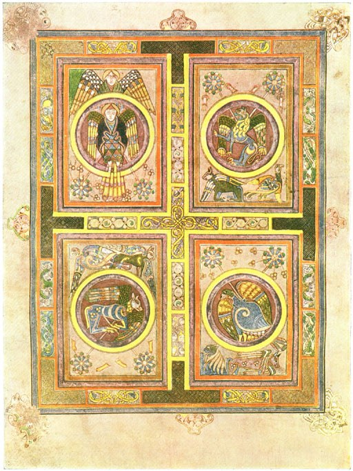</picture>
<figcaption>The four evangelist symbols, folio 129v of the Book of Kells, about 800, the page that opens St Mark's Gospel. Trinity College Dublin. The lion, Mark's sign, is in the upper right. Public domain, via <a href="https://commons.wikimedia.org/wiki/File:KellsFol129v4EvangelistSymbols.jpg">Wikimedia Commons</a>.</figcaption>
</figure>

That lion became the emblem of Venice. On the book under its paw are the words already told in the story above: ***Pax tibi, Marce, evangelista meus***. The great bronze lion on its granite column in the **Piazzetta** of St Mark, raised in the twelfth century, has watched the lagoon for eight hundred years. In the **Doge's Palace**, Vittore Carpaccio painted the same lion in 1516, walking on the water and the land of the Venetian state, the book open in its forepaw, the city and the sea behind it.

<figure class=photo><picture><source srcset="/static/art/mark-piazzetta-lion-600.webp 600w,/static/art/mark-piazzetta-lion.webp 1280w" sizes="(max-width:760px) 100vw,760px" type="image/webp">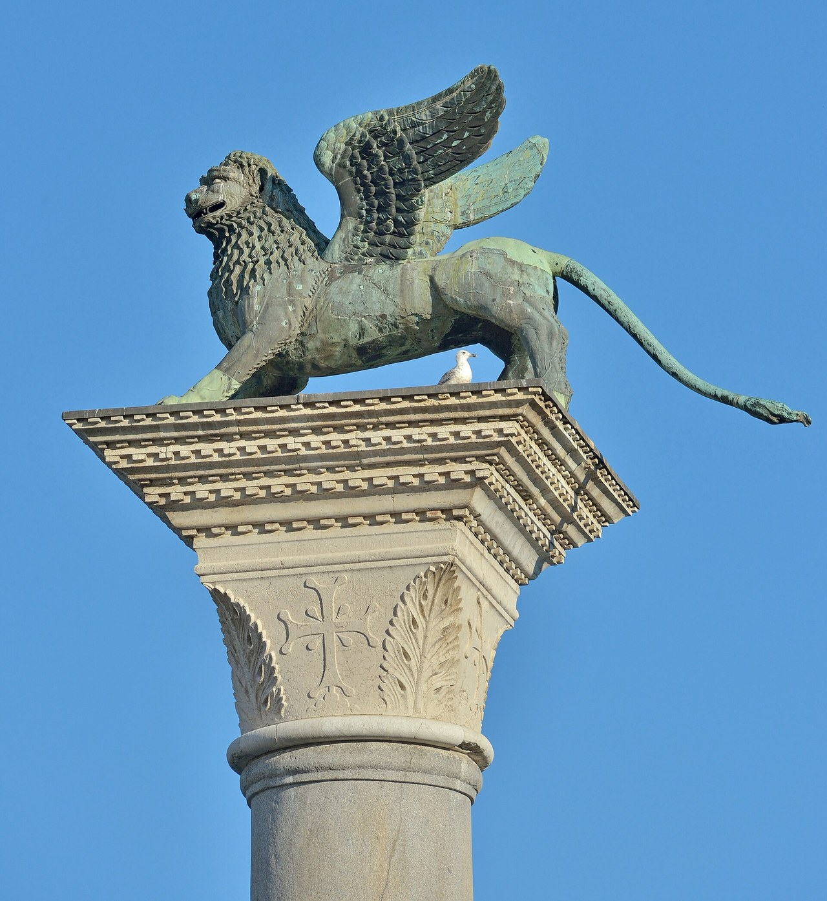</picture>
<figcaption>The bronze lion of St Mark on its column in the Piazzetta, Venice. The column was raised in the twelfth century by Nicolò Barattieri. Photo: <a href="https://commons.wikimedia.org/wiki/File:The_lion_of_San_Mark_on_Piazzetta_San_Marco_Venice.jpg">Wolfgang Moroder</a>, <a href="https://creativecommons.org/licenses/by-sa/3.0">CC BY-SA 3.0</a>, via Wikimedia Commons.</figcaption>
</figure>

<figure class=photo><picture><source srcset="/static/art/mark-carpaccio-lion-600.webp 600w,/static/art/mark-carpaccio-lion.webp 1280w" sizes="(max-width:760px) 100vw,760px" type="image/webp">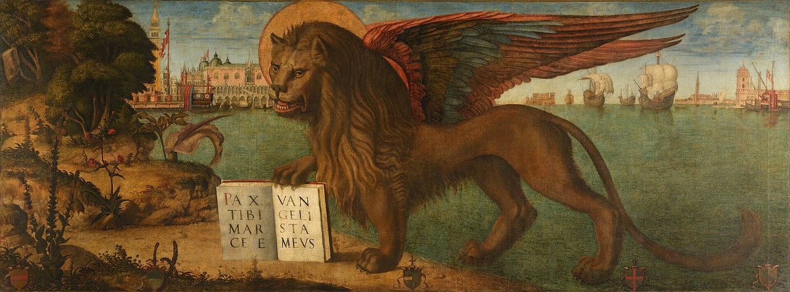</picture>
<figcaption>Vittore Carpaccio, <em>The Lion of St Mark</em>, 1516. Doge's Palace, Venice. The book reads <em>Pax tibi Marce evangelista meus</em>. Public domain, via <a href="https://commons.wikimedia.org/wiki/File:Leone_marciano_andante_-_Vittore_Carpaccio_-_Google_Cultural_Institute.jpg">Wikimedia Commons</a>.</figcaption>
</figure>

<h2 id=art>Mark in art</h2>

Venice loved to paint the saint whose body it believed it kept. The most famous cycle was made by **Tintoretto** in the 1540s and 1560s for the Scuola Grande di San Marco, and the Bellini family painted his preaching in Alexandria, the picture at the head of this page. Older still are the portraits in which Mark stands as evangelist, with book and lion, from the Lindisfarne Gospels to Donatello's marble in Florence.

<figure class=photo><picture><source srcset="/static/art/mark-tintoretto-slave-600.webp 600w,/static/art/mark-tintoretto-slave.webp 1280w" sizes="(max-width:760px) 100vw,760px" type="image/webp">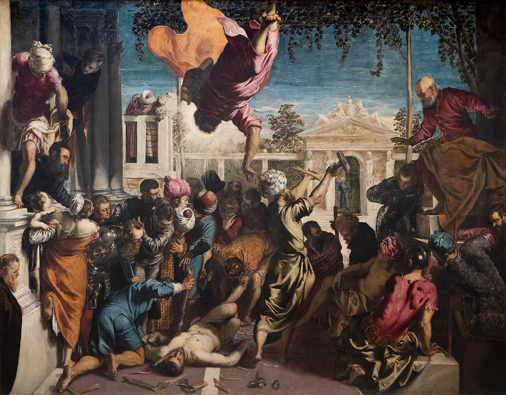</picture>
<figcaption>Jacopo Tintoretto, <em>The Miracle of the Slave</em> (also called <em>St Mark Freeing the Slave</em>), 1548. Gallerie dell'Accademia, Venice. Public domain, via <a href="https://commons.wikimedia.org/wiki/File:Tintoretto_-_Miracle_of_the_Slave.jpg">Wikimedia Commons</a>.</figcaption>
</figure>

**Tintoretto, *The Miracle of the Slave*, 1548.** This is the painting that made Tintoretto famous. It hangs in the **Gallerie dell'Accademia** in Venice. A Christian slave, condemned by his master for venerating the relics of St Mark, lies on the ground among broken hammers and hooks; the saint plunges headfirst from the sky, in a rush of rose-coloured drapery, and the instruments of torture have already failed. The square is packed with onlookers. Mark arrives not as a quiet patron but as a storm of rescue.

<figure class=photo><picture><source srcset="/static/art/mark-tintoretto-finding-600.webp 600w,/static/art/mark-tintoretto-finding.webp 1280w" sizes="(max-width:760px) 100vw,760px" type="image/webp">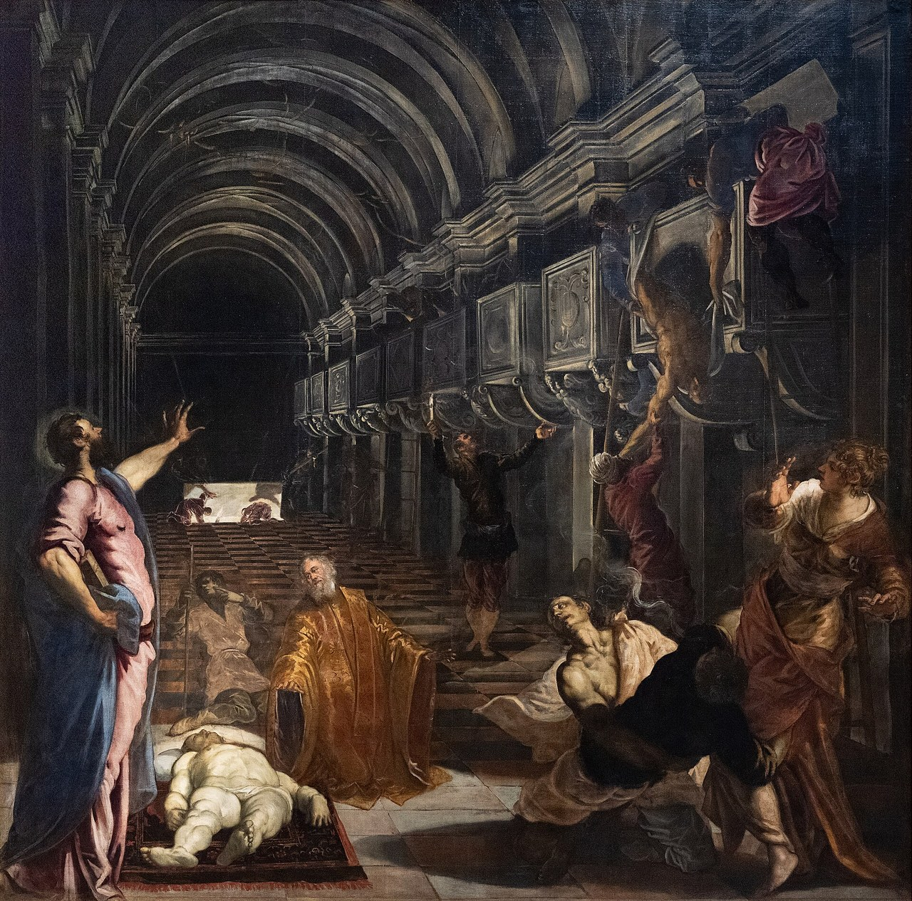</picture>
<figcaption>Jacopo Tintoretto, <em>The Finding of the Body of St Mark</em>, about 1562–66. Pinacoteca di Brera, Milan. Public domain, via <a href="https://commons.wikimedia.org/wiki/File:Jacopo_Tintoretto_-_Finding_of_the_body_of_St_Mark.jpg">Wikimedia Commons</a>.</figcaption>
</figure>

**Tintoretto, *The Finding of the Body of St Mark*, about 1562–66.** Now in the **Pinacoteca di Brera** in Milan, this is the search for Mark's remains in Alexandria, imagined as a vast vaulted hall rushing away in perspective. The saint himself appears and shows the Venetians his own body. At the right a possessed man is healed; figures recoil, and a corpse lies in the foreground. Tintoretto paints the finding as a miracle of recognition: Mark is not only the relic they seek, but the one who leads them to it.

<figure class=photo><picture><source srcset="/static/art/mark-tintoretto-transport-600.webp 600w,/static/art/mark-tintoretto-transport.webp 1280w" sizes="(max-width:760px) 100vw,760px" type="image/webp">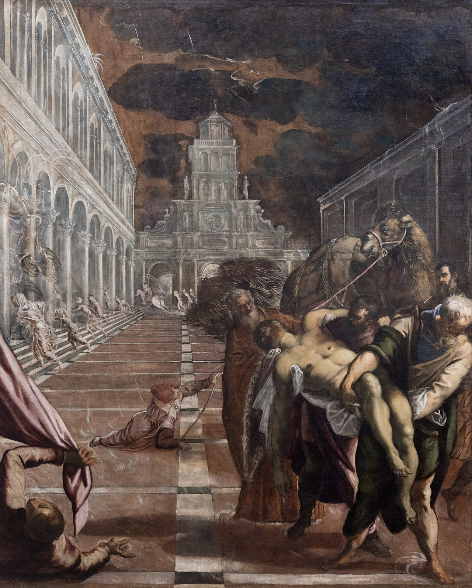</picture>
<figcaption>Jacopo Tintoretto, <em>St Mark's Body Brought to Venice</em> (the theft, or translation, of the relics), about 1562–66. Gallerie dell'Accademia, Venice. Public domain, via <a href="https://commons.wikimedia.org/wiki/File:Jacopo_Tintoretto_-_St_Mark%27s_Body_Brought_to_Venice.jpg">Wikimedia Commons</a>.</figcaption>
</figure>

**Tintoretto, *St Mark's Body Brought to Venice*, about 1562–66.** Also in the **Accademia**, this is the secret taking of the body from Alexandria in 828, the story already told above. A sudden storm breaks over the scene; men bear the pale body in a white shroud, others cover their faces, and a camel and the buildings of the city stand against a dark sky. What the mosaics of the basilica tell in gold, Tintoretto tells as weather and haste.

<figure class=photo><picture><source srcset="/static/art/mark-bellini-600.webp 600w,/static/art/mark-bellini.webp 1280w" sizes="(max-width:760px) 100vw,760px" type="image/webp">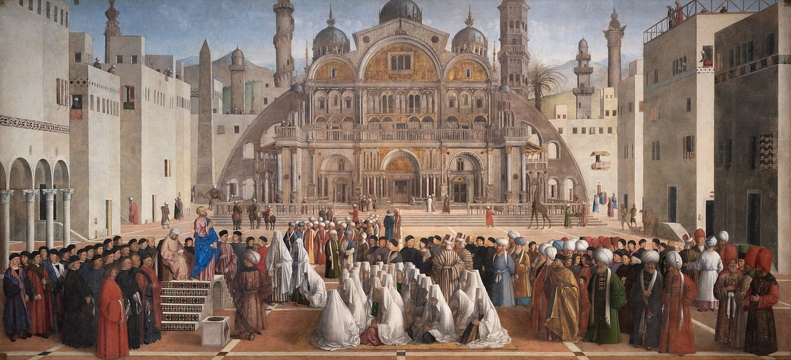</picture>
<figcaption>Gentile and Giovanni Bellini, <em>Saint Mark Preaching in Alexandria</em>, 1504–07. Pinacoteca di Brera, Milan. The painting also stands at the head of this page. Public domain, via <a href="https://commons.wikimedia.org/wiki/File:Gentile_and_Giovanni_Bellini_%E2%80%94_Saint_Mark_Preaching_in_Alexandria.jpg">Wikimedia Commons</a>.</figcaption>
</figure>

**Gentile and Giovanni Bellini, *Saint Mark Preaching in Alexandria*, 1504–07.** This is the painting in the hero of the page, now in the **Brera**. Gentile began it for the Scuola Grande di San Marco and left it unfinished at his death; his brother Giovanni completed it. Mark, in red, preaches from a pulpit in a great square. The church behind him is an imagined Alexandria that looks very like St Mark's in Venice, and the crowd is mixed: women of the city in white veils, men in turbans, and Venetian gentlemen who have, as it were, already arrived. It is a sermon, and also a claim: this city and that one belong to the same saint.

<figure class=photo><picture><source srcset="/static/art/mark-mantegna-600.webp 600w,/static/art/mark-mantegna.webp 1280w" sizes="(max-width:760px) 100vw,760px" type="image/webp">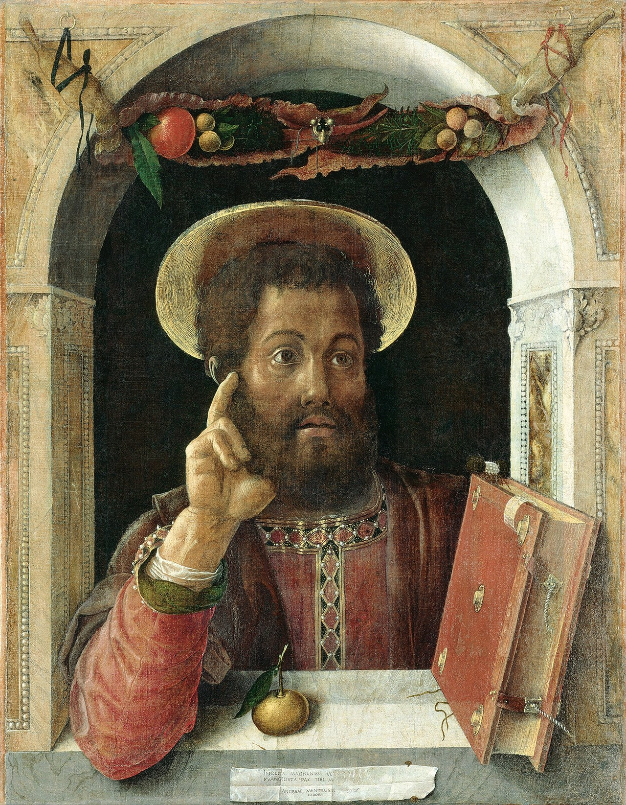</picture>
<figcaption>Andrea Mantegna, <em>St Mark the Evangelist</em>, about 1448–51. Städel Museum, Frankfurt. Public domain, via <a href="https://commons.wikimedia.org/wiki/File:Andrea_Mantegna_-_St._Mark_the_Evangelist_-_Google_Art_Project.jpg">Wikimedia Commons</a>.</figcaption>
</figure>

**Andrea Mantegna, *St Mark the Evangelist*, about 1448–51.** One of Mantegna's early works, now in the **Städel Museum** in Frankfurt. Mark stands at a stone parapet, almost in the room with us, a book and a pen in his hands, the halo set against the sky. The face is grave and very close. There is no crowd and no miracle: only the evangelist, looking out as if he had just lifted his eyes from the page.

<figure class=photo><picture><source srcset="/static/art/mark-bartolomeo-600.webp 600w,/static/art/mark-bartolomeo.webp 1280w" sizes="(max-width:760px) 100vw,760px" type="image/webp">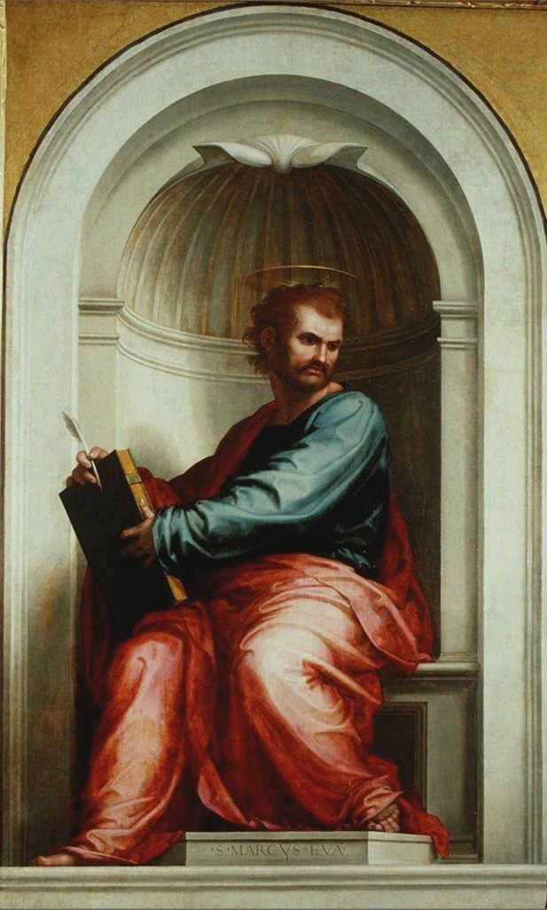</picture>
<figcaption>Fra Bartolomeo, <em>St Mark</em>, 1514–15. Palatine Gallery, Palazzo Pitti, Florence. Public domain, via <a href="https://commons.wikimedia.org/wiki/File:San_marco,_fra_bartolomeo.jpg">Wikimedia Commons</a>.</figcaption>
</figure>

**Fra Bartolomeo, *St Mark*, 1514–15.** Painted for the church of San Marco in Florence, and now in the **Palatine Gallery** of the **Palazzo Pitti**. Mark is almost a prophet-statue: a great figure in a glowing red mantle, the Gospel open in his hand, the lion at his feet. Fra Bartolomeo, a Dominican of that same convent of San Marco, gives the evangelist the weight of a pillar of the Church.

<figure class=photo><picture><source srcset="/static/art/mark-donatello-600.webp 600w,/static/art/mark-donatello.webp 1280w" sizes="(max-width:760px) 100vw,760px" type="image/webp">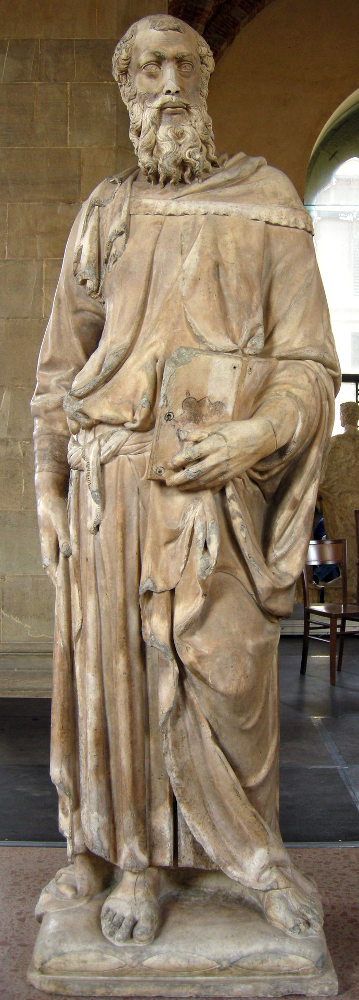</picture>
<figcaption>Donatello, <em>St Mark</em>, 1411–13, marble. The original, now in the Museo di Orsanmichele, Florence; a copy stands in the niche on the church. Photo: <a href="https://commons.wikimedia.org/wiki/File:Donatello,_san_marco,_1411-13,_01.JPG">Sailko</a>, <a href="https://creativecommons.org/licenses/by-sa/3.0">CC BY-SA 3.0</a>, via Wikimedia Commons.</figcaption>
</figure>

**Donatello, *St Mark*, 1411–13.** Commissioned by the linen-weavers' guild for a niche on **Orsanmichele** in Florence, this is one of the first great standing figures of the Renaissance. The original is now inside the **Museo di Orsanmichele**; a copy stands in the niche. Mark's weight is on one foot, the drapery falls in deep, living folds, and the head is grave, as if he were about to speak. Vasari later told the story that the guild at first thought the statue unfinished, until Donatello had it set in its place, and then they saw what he had made.

<figure class=photo><picture><source srcset="/static/art/mark-lindisfarne-600.webp 600w,/static/art/mark-lindisfarne.webp 1280w" sizes="(max-width:760px) 100vw,760px" type="image/webp">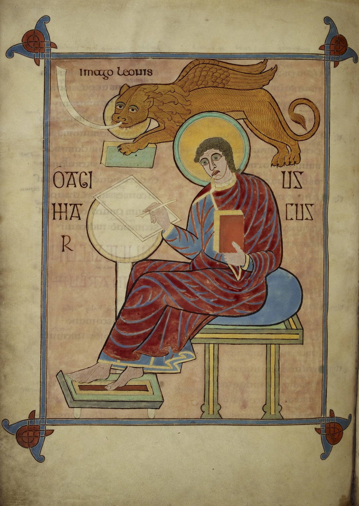</picture>
<figcaption>St Mark with his symbol, the winged lion (<em>imago leonis</em>), folio 93v of the Lindisfarne Gospels, about 700, attributed to Eadfrith of Lindisfarne. British Library, Cotton MS Nero D IV. <a href="https://creativecommons.org/publicdomain/zero/1.0/deed.en">CC0</a>, via <a href="https://commons.wikimedia.org/wiki/File:St._Mark_-_Lindisfarne_Gospels_(710-721),_f.93v_-_BL_Cotton_MS_Nero_D_IV.jpg">Wikimedia Commons</a> (British Library).</figcaption>
</figure>

**The Lindisfarne Gospels, the portrait of Mark, about 700.** Made on the Holy Island and associated with Bishop **Eadfrith**, the book gives each evangelist a portrait and his symbol. Here, on folio 93v, Mark sits writing, and above him the winged lion, labelled *imago leonis*, blows a trumpet and holds a book. It is among the earliest surviving pictures of Mark with his lion, and a fitting last image: the writer, and the voice that opens his Gospel, on the same page.

## Path to sainthood
An evangelist, venerated from the beginning. No formal canonisation (pre-Congregation).

## Patronages
Venice, Egypt, lawyers, notaries.

<h2 id=visit>Where to visit</h2>
St Mark's Basilica, Venice (his tomb under the high altar)

The present basilica rose over the relics brought from Alexandria in 828. Work on the church we see now began in **1063** under Doge Domenico Contarini, and it was consecrated in **1094** under Doge Vitale Falier; a legend of that year says the relics, which had been hidden, were miraculously found again. The building is Italo-Byzantine, with five domes, and its interior is covered with golden mosaics that tell the story of Mark, of the Virgin, and of the Gospel. Behind the high altar is the **Pala d'Oro**, a golden altarpiece of Byzantine enamels, jewels and gold, enlarged from the tenth century to the fourteenth, and opened to view on feast days. The **Horses of St Mark**, a late antique bronze quadriga taken from Constantinople in the Fourth Crusade of 1204, stand inside the basilica; copies have stood on the façade since the twentieth century. The tomb of the evangelist is under the high altar.

<figure class=photo><picture><source srcset="/static/art/mark-basilica-facade-600.webp 600w,/static/art/mark-basilica-facade.webp 1280w" sizes="(max-width:760px) 100vw,760px" type="image/webp">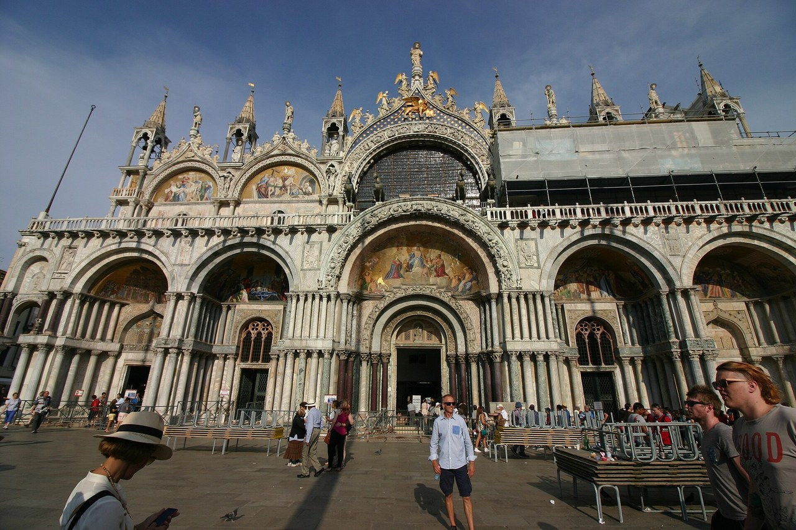</picture>
<figcaption>The west façade of St Mark's Basilica, Venice. Photo: <a href="https://commons.wikimedia.org/wiki/File:Saint_Mark_Basilica_-_West_facade_-_Venice_2016.jpg">José Luiz Bernardes Ribeiro</a>, <a href="https://creativecommons.org/licenses/by-sa/4.0">CC BY-SA 4.0</a>, via Wikimedia Commons.</figcaption>
</figure>

<figure class=photo><picture><source srcset="/static/art/mark-basilica-domes-600.webp 600w,/static/art/mark-basilica-domes.webp 1280w" sizes="(max-width:760px) 100vw,760px" type="image/webp">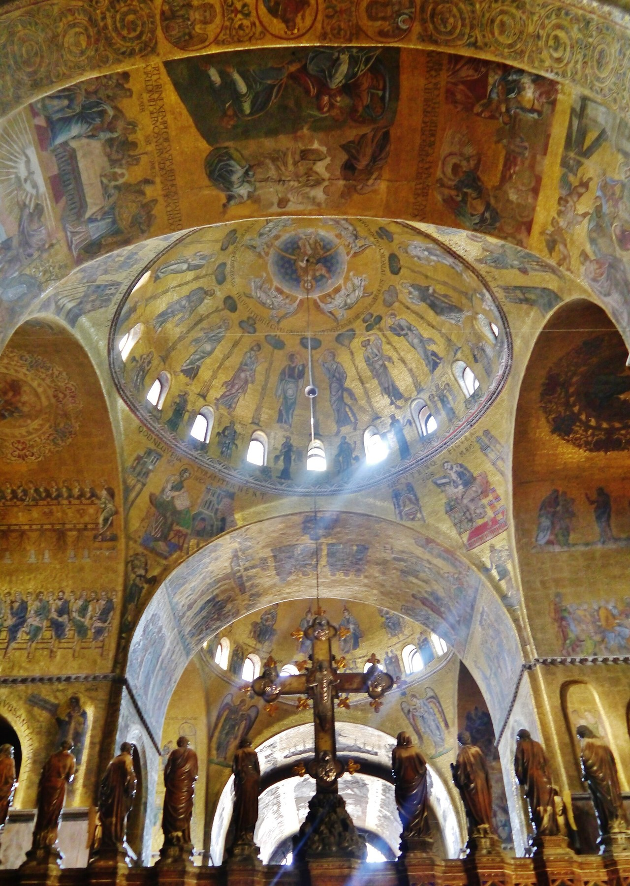</picture>
<figcaption>The mosaic domes of St Mark's, looking up into the golden vaults. Photo: <a href="https://commons.wikimedia.org/wiki/File:Venezia_Basilica_di_San_Marco_Innen_Kuppeln_1.jpg">Zairon</a>, <a href="https://creativecommons.org/licenses/by-sa/4.0">CC BY-SA 4.0</a>, via Wikimedia Commons.</figcaption>
</figure>

<figure class=photo><picture><source srcset="/static/art/mark-basilica-horses-600.webp 600w,/static/art/mark-basilica-horses.webp 1280w" sizes="(max-width:760px) 100vw,760px" type="image/webp">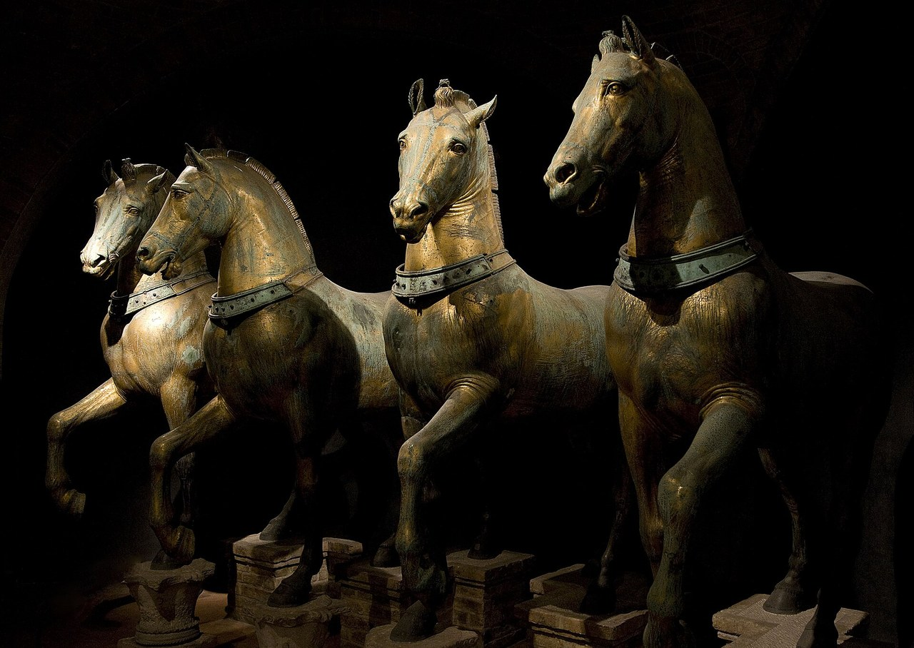</picture>
<figcaption>The original Horses of St Mark, kept inside the basilica. Photo: <a href="https://commons.wikimedia.org/wiki/File:Horses_of_Basilica_San_Marco.jpg">Tteske</a>, <a href="https://creativecommons.org/licenses/by/3.0">CC BY 3.0</a>, via Wikimedia Commons.</figcaption>
</figure>

**Saint Mark's Coptic Orthodox Cathedral**, in Abbassia, Cairo, is the present seat of the Coptic Pope and the church that received the relic returned in 1968. It was consecrated that year, and is one of the largest churches in Africa.

<figure class=photo><picture><source srcset="/static/art/mark-cairo-600.webp 600w,/static/art/mark-cairo.webp 1280w" sizes="(max-width:760px) 100vw,760px" type="image/webp">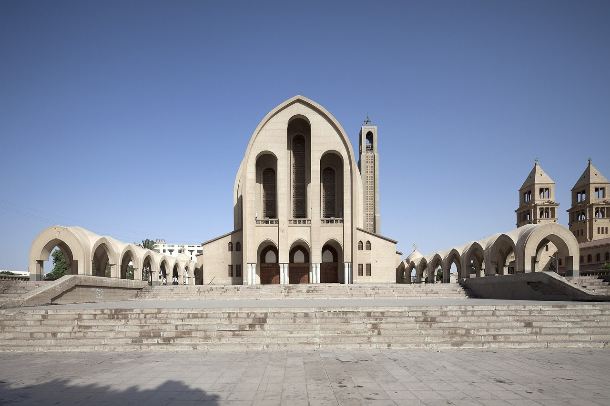</picture>
<figcaption>The entrance of St Mark's Coptic Orthodox Cathedral, Abbassia, Cairo, consecrated in 1968. Photo: <a href="https://commons.wikimedia.org/wiki/File:CairoAbbasiyaMarkEntrance.jpg">Roland Unger</a>, <a href="https://creativecommons.org/licenses/by-sa/3.0">CC BY-SA 3.0</a>, via Wikimedia Commons.</figcaption>
</figure>

In **Alexandria**, **St Mark's Coptic Orthodox Cathedral** stands on or near the traditional site of his martyrdom and first church, in the old district of Bucolia. The Coptic Church also honours the head of the saint there.

<figure class=photo><picture><source srcset="/static/art/mark-alexandria-600.webp 600w,/static/art/mark-alexandria.webp 1280w" sizes="(max-width:760px) 100vw,760px" type="image/webp">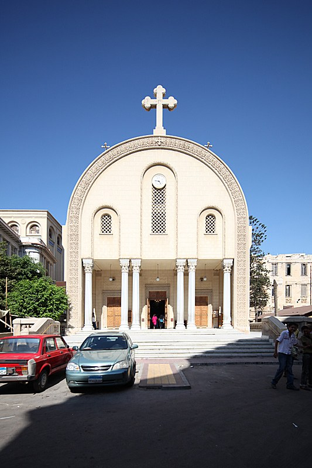</picture>
<figcaption>St Mark's Coptic Orthodox Cathedral, Alexandria, on the traditional ground of his martyrdom. Photo: <a href="https://commons.wikimedia.org/wiki/File:AlexMarkCathedralFront.jpg">Roland Unger</a>, <a href="https://creativecommons.org/licenses/by-sa/3.0">CC BY-SA 3.0</a>, via Wikimedia Commons.</figcaption>
</figure>

In Rome, the basilica of **San Marco Evangelista al Campidoglio**, on Piazza Venezia, is one of the city's old titular churches. It was founded in 336 by Pope Mark, and keeps a relic of the evangelist.

<figure class=photo><picture><source srcset="/static/art/mark-rome-san-marco-600.webp 600w,/static/art/mark-rome-san-marco.webp 1280w" sizes="(max-width:760px) 100vw,760px" type="image/webp">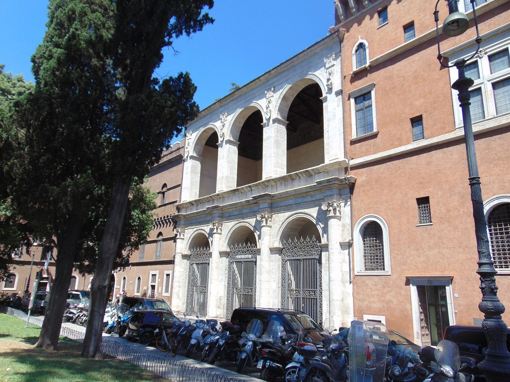</picture>
<figcaption>San Marco Evangelista al Campidoglio, on Piazza Venezia, Rome. Photo: <a href="https://commons.wikimedia.org/wiki/File:Basilica_di_San_Marco_Evangelista_al_Campidoglio_02.jpg">Nicholas Gemini</a>, <a href="https://creativecommons.org/licenses/by-sa/4.0">CC BY-SA 4.0</a>, via Wikimedia Commons.</figcaption>
</figure>

## Trivia
- His symbol is the **winged lion**, which became the emblem of the Venetian Republic.
- On 25 April Venetian men give the women they love a red rosebud, the ***bócolo***.
- The Coptic Church of Egypt regards him as its founder and first patriarch; in 1968 Pope Paul VI returned a relic of Mark from Venice to Cairo.

## Sources
- [Vatican News (Italian): San Marco evangelista](https://www.vaticannews.va/it/santo-del-giorno/04/25/san-marco-evangelista.html)
- [Catholic Encyclopedia: Gospel of Saint Mark (on Mark and Papias)](https://www.newadvent.org/cathen/09674b.htm)
- [New Advent: Eusebius, Church History, Book II (Mark in Alexandria, 2.16; Annianus, 2.24)](https://www.newadvent.org/fathers/250102.htm) and [Book III (Papias on Mark, 3.39)](https://www.newadvent.org/fathers/250103.htm)
- Mark 1:1, 1:3, 10:45, 14:51–52, 15:39, 16:8; Acts 12:12, 13:13, 15:37–39; Colossians 4:10; 1 Peter 5:13; 2 Timothy 4:11; Ezekiel 1:10; Revelation 4:7
- [Wikipedia: Gospel of Mark](https://en.wikipedia.org/wiki/Gospel_of_Mark)
- [Wikipedia: St Mark's Basilica](https://en.wikipedia.org/wiki/St_Mark%27s_Basilica), [Pala d'Oro](https://en.wikipedia.org/wiki/Pala_d%27Oro) and [Horses of Saint Mark](https://en.wikipedia.org/wiki/Horses_of_Saint_Mark)
- [Basilica di San Marco (official site)](https://www.basilicasanmarco.it/en/)
- [Wikipedia: Saint Mark's Coptic Orthodox Cathedral (Cairo)](https://en.wikipedia.org/wiki/Saint_Mark%27s_Coptic_Orthodox_Cathedral) and [Saint Mark's Coptic Orthodox Cathedral (Alexandria)](https://en.wikipedia.org/wiki/Saint_Mark%27s_Coptic_Orthodox_Cathedral_(Alexandria))
- [Wikipedia: San Marco Evangelista al Campidoglio, Rome](https://en.wikipedia.org/wiki/San_Marco_Evangelista_al_Campidoglio,_Rome)
- [Wikipedia: Lion of Venice](https://en.wikipedia.org/wiki/Lion_of_Venice), [Book of Kells](https://en.wikipedia.org/wiki/Book_of_Kells) and [Lindisfarne Gospels](https://en.wikipedia.org/wiki/Lindisfarne_Gospels)
- [Wikipedia: Miracle of the Slave (Tintoretto)](https://en.wikipedia.org/wiki/Miracle_of_the_Slave_(Tintoretto)) and the [Gallerie dell'Accademia](https://www.gallerieaccademia.it/en)
- [Pinacoteca di Brera: St Mark Preaching in Alexandria (Bellini)](https://pinacotecabrera.org/en/collezioni/collezione-on-line/st-mark-preaching-in-alexandria/) and [The Finding of the Body of St Mark (Tintoretto)](https://pinacotecabrera.org/en/collezioni/collezione-on-line/discovery-of-the-body-of-saint-mark/)
- [Städel Museum: St Mark the Evangelist (Mantegna)](https://sammlung.staedelmuseum.de/en/work/st-mark-the-evangelist)
- [British Library: The Lindisfarne Gospels](https://www.bl.uk/manuscripts/FullDisplay.aspx?ref=Cotton_MS_Nero_D_IV)

Fact-checked on October 16, 2026 against Vatican documents, Vatican News and New Advent (Catholic Encyclopedia), plus local sources where noted. Where a story is legend rather than history, the text says so. Feast days follow the General Roman Calendar unless noted. Expanded November 12, 2026: Scripture is quoted briefly from the public-domain King James Version, with the Greek of Mark 1:1 from the SBLGNT and the Latin from the Vulgate.

