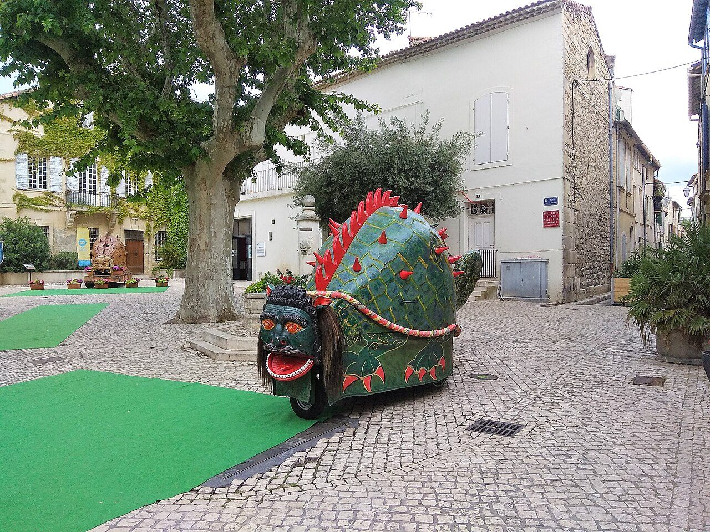

## The story
In the Gospels Martha is gloriously practical: serving at table while Mary listens (Luke 10), running to meet Jesus after Lazarus' death with one of the New Testament's great confessions — 'Yes, Lord, I believe you are the Christ' (John 11) — and serving again at the supper where Mary anoints his feet (John 12). Scripture leaves her in Bethany. Provence later gave her a further life.

## The full story

### The Tarasque
The *Golden Legend* sails Martha, Mary Magdalene and Lazarus to Provence. At Tarascon a dragon-beast, the Tarasque, was devouring people from the Rhône. Martha faced it with holy water and a cross, sprinkled it, bound it with her belt and led it tame into town — where the townsfolk, rather ungratefully, killed it. She preached, founded a community of virgins, and died at Tarascon.

### Sisters in the calendar
Rome kept her biblical: Martha's memorial (29 July) now honours Martha, Mary and Lazarus of Bethany together after Pope Francis' 2021 decree — the hospitable house as a school of friendship with Christ. The voyage to Provence and the Tarasque are the medieval French telling. Tarascon still parades the beast, a festival now on UNESCO's list of folklore. In that story a preaching woman tames what the town feared.

<figure class=photo>
<picture><source srcset="/static/art/martha-tarasque-600.webp 600w,/static/art/martha-tarasque.webp 1280w" sizes="(max-width:760px) 100vw,760px" type="image/webp"></picture>
<figcaption>The Tarasque of Tarascon, the beast the town still carries in Martha's festival. Photo: <a href="https://commons.wikimedia.org/wiki/File:Tarasque_in_Tarascon_01.jpg">Olivier</a>, <a href="https://creativecommons.org/licenses/by-sa/4.0">CC BY-SA 4.0</a>, via Wikimedia Commons.</figcaption>
</figure>

## Path to sainthood
Biblical saint; feast from early calendars; 2021 decree of the Congregation for Divine Worship joined Mary and Lazarus to her 29 July memorial.

## Patronages
Cooks, housekeepers, waiters, travellers and innkeepers; Tarascon.

## Trivia
- Tarascon still processes a huge Tarasque effigy — the dragon she tamed is now a party.
- She is patron of everyone who has ever been told to stop fussing in the kitchen — Luke 10:41 quoted at cooks for 2,000 years.

## Sources
- [Catholic Encyclopedia: St Martha, New Advent](https://www.newadvent.org/cathen/09721b.htm)
- [John 11 (ESV), BibleGateway](https://www.biblegateway.com/passage/?search=John%2011&version=ESV)

Written October 19, 2026 from the sources above. The Tarascon photograph was added November 6, 2026. Feast days follow the General Roman Calendar unless noted.

