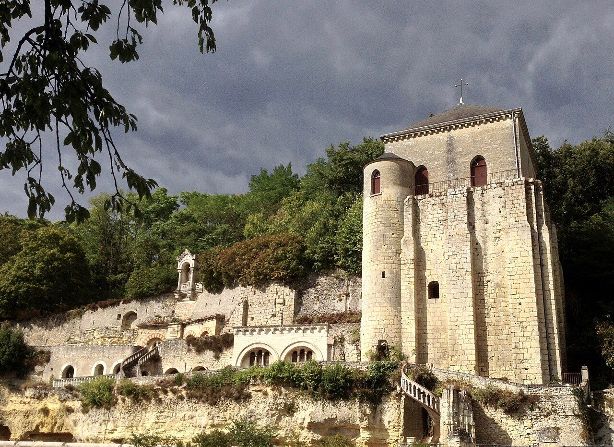
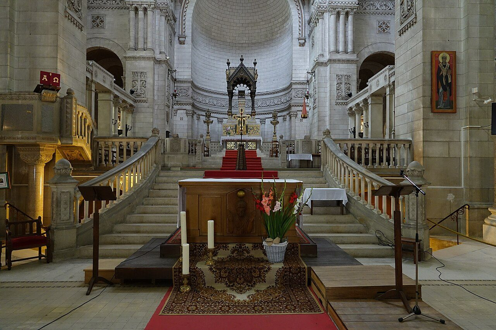

## His story
Almost everything personal we know about Martin comes from one man who knew him. Sulpicius Severus wrote the *Life of Martin* around 396, while Martin was still alive or just at his death, and followed it with dialogues. It is not a neutral chronicle. It is the account of an admirer. It is also the earliest life of a Western monk-bishop, and it is why Martin is not a blur.

He was born at Sabaria in Pannonia, today's Szombathely in Hungary. His father was a military tribune. The year is disputed, because Sulpicius's numbers do not all fit: about 316, or the mid-330s. Martin was drawn into the army as a soldier's son. At Amiens, in a hard winter, he met a beggar at the gate. He had already given away the rest of his pay. He cut his military cloak in two and gave half away. That night, Sulpicius says, he dreamed of Christ wearing the half he had given, and heard, "Martin, who is still a catechumen, clothed me." He was baptized. El Greco's painting at the National Gallery of Art is that moment: a young rider, a naked beggar, a white horse, as the painter saw it in the 1590s.

He left the army. The sentence Sulpicius gives him is the one people remember: he was Christ's soldier, and it was not lawful for him to fight. He attached himself to Hilary of Poitiers, was exiled when Hilary was, and around 361 settled at Ligugé, near Poitiers, in a cell that became a monastery. It is often called the first monastery in Gaul. In 371 the people of Tours wanted him as bishop. Sulpicius says they lured him into the city by a ruse, because he would not have come to be elected. He was consecrated, and he refused to live like a grand bishop. He founded Marmoutier, a monk's settlement in the cliff across the Loire, and he treated the diocese as a mission.

<figure class=photo>
<picture><source srcset="/static/art/martin-marmoutier-600.webp 600w,/static/art/martin-marmoutier.webp 1280w" sizes="(max-width:760px) 100vw,760px" type="image/webp"></picture>
<figcaption>The cliff of Marmoutier, across the Loire from Tours, where Martin settled his monks. Later centuries cut chapels into the rock of that hermitage. Photo: <a href="https://commons.wikimedia.org/wiki/File:Abbaye_de_marmoutier.jpg">Akarikurosaki</a>, <a href="https://creativecommons.org/licenses/by-sa/4.0">CC BY-SA 4.0</a>, via Wikimedia Commons.</figcaption>
</figure> In the countryside he tore down temples and sacred trees. He also walked into the court of the usurper Magnus Maximus to plead against the execution of Priscillian and his companions, the first Christians put to death by a Christian government for heresy. Martin failed. The men were killed. Sulpicius says Martin afterwards believed he had compromised himself by still sharing communion with the bishops who had pressed for the deaths. The *Life* does not hide that grief.

He died at Candes on **8 November 397**. His body was taken down the river to Tours and buried on **11 November**, which is why the feast is not the day of his death but the day of the burial. Tours became one of the great pilgrim churches of Europe. The medieval basilica is gone, wrecked in the Revolution. A nineteenth-century basilica stands on the place, and some relics were brought back. The half of the cloak, the *cappa*, was kept as a relic. Its sanctuary was called a *capella*. From that word, as the old explanation has it, comes "chapel".

<figure class=photo>
<picture><source srcset="/static/art/martin-tours-choir-600.webp 600w,/static/art/martin-tours-choir.webp 1280w" sizes="(max-width:760px) 100vw,760px" type="image/webp"></picture>
<figcaption>The choir of the basilica of Saint-Martin at Tours, raised in the nineteenth century on the ground of the medieval shrine. Photo: <a href="https://commons.wikimedia.org/wiki/File:Basilique_Saint-Martin_-_int%C3%A9rieur_-_ch%C5%93ur_(Tours).jpg">Gzen92</a>, <a href="https://creativecommons.org/licenses/by-sa/4.0">CC BY-SA 4.0</a>, via Wikimedia Commons.</figcaption>
</figure>

## Path to sainthood
Pre-Congregation. One of the first non-martyrs to be honoured across the Latin church as a confessor. Feast **11 November**, Martinmas.

## Patronages
Soldiers, beggars, tailors, and France. Tours claims him. So does Szombathely, his birthplace. Innkeepers and vintners have local claims tied to Martinmas.

## Trivia
- Martinmas, 11 November, was a day for slaughtering the goose and tasting the new wine, long before it was Armistice Day. The 1918 armistice fell on his feast. He did not cause the date. The coincidence is why some war memorials sit under his name.
- A spell of warm weather in November is still called St Martin's summer in several languages.
- Sulpicius says Martin would not let his visitors sit him in a bishop's chair if he could help it. He sat on a stool.

## Sources
- Sulpicius Severus, *Life of St Martin* and the *Dialogues* (c. 396–404)
- [Catholic Encyclopedia: St Martin of Tours](https://www.newadvent.org/cathen/09732b.htm)
- [Vatican News: St Martin of Tours](https://www.vaticannews.va/en/saints/11/11/st-martin-of-tours.html)

Fact-checked on November 6, 2026 against Sulpicius Severus, New Advent, and Vatican News. The birth year is left as Sulpicius's numbers leave it.

