<nav class=toc aria-label="On this page">

On this page

<ol>
<li><a href="#scripture">In Scripture</a></li>
<li><a href="#places">Holy places</a></li>
<li><a href="#art">Mary in art</a></li>
<li><a href="#songs">Songs about Mary</a></li>
<li><a href="#teaches">What the Church teaches</a></li>
<li><a href="#feasts">Feasts through the Church year</a></li>
</ol>
</nav>

## Her story
Mary of Nazareth was a young Jewish woman betrothed to Joseph, a carpenter of David's line, when the angel Gabriel came to her with the greeting the Church has never tired of repeating. It is the verse The Daily Word studied on 2 November 2026, [Luke 1:28](/verses/2026-11-02-luke-1-28/):

KJV · Luke 1:28
And the angel came in unto her, and said, Hail, thou that art highly favoured, the Lord is with thee: blessed art thou among women.

Latin · Vulgate · Luke 1:28
Et ingressus angelus ad eam dixit: Ave gratia plena: Dominus tecum: benedicta tu in mulieribus.

Jerome's *Ave gratia plena*, "Hail, full of grace," is the wording of the *Hail Mary*. The Greek behind it, *kecharitōmenē*, is a perfect tense: she has been graced, and remains so. She was "greatly troubled at the saying," and asked how she, a virgin, should conceive. Gabriel told her that the Holy Ghost would come upon her, and that the child would be called the Son of God. Her answer has been remembered in every Angelus: "Behold the handmaid of the Lord; be it unto me according to thy word" (Luke 1:38).

She went in haste to her cousin Elizabeth in the hill country, and sang the **Magnificat**. She gave birth in Bethlehem, presented Jesus in the Temple, searched for him when he was twelve, prompted his first sign at **Cana** ("Whatsoever he saith unto you, do it", John 2:5), stood at the **Cross**, and prayed with the apostles before Pentecost (Acts 1:14).

The 2nd-century *Protoevangelium of James* names her parents [Joachim and Anne](/saints/joachim-and-anne/). Ancient tradition places her last years either in Jerusalem or at **Ephesus** with [St John](/saints/john-the-apostle/), to whom Jesus entrusted her from the Cross.

<h2 id=scripture>In Scripture</h2>

Almost everything we know of Mary is in the Gospels and in the opening of Acts. Luke loves her especially: the Annunciation, the Visitation, the Magnificat, the Nativity, the Presentation and the finding in the Temple are told in his first two chapters. John gives us Cana and the foot of the Cross. The verses below follow her story in that order. Where The Daily Word has already studied a verse, the reference is linked.

**The Annunciation (Luke 1:26-38).** Gabriel was sent "unto a city of Galilee, named Nazareth, to a virgin espoused to a man whose name was Joseph, of the house of David; and the virgin's name was Mary." After the greeting of [Luke 1:28](/verses/2026-11-02-luke-1-28/), he announced the child:

KJV · Luke 1:31
And, behold, thou shalt conceive in thy womb, and bring forth a son, and shalt call his name JESUS.

KJV · Luke 1:38
And Mary said, Behold the handmaid of the Lord; be it unto me according to thy word. And the angel departed from her.

**The Visitation and the Magnificat (Luke 1:39-56).** Mary went into the hill country, to the house of Zechariah and Elizabeth. When Elizabeth heard her greeting, the child in her womb leaped, and she cried, "Blessed art thou among women, and blessed is the fruit of thy womb" (Luke 1:42). Those words, joined to Gabriel's greeting, became the first half of the *Hail Mary*. Then Mary sang:

KJV · Luke 1:46–49
And Mary said, My soul doth magnify the Lord, And my spirit hath rejoiced in God my Saviour. For he hath regarded the low estate of his handmaiden: for, behold, from henceforth all generations shall call me blessed. For he that is mighty hath done to me great things; and holy is his name.

**The Nativity (Luke 2:1-20).** Joseph and Mary went up from Nazareth to Bethlehem, to be taxed, and there she "brought forth her firstborn son, and wrapped him in swaddling clothes, and laid him in a manger; because there was no room for them in the inn" (Luke 2:7). Shepherds came, having heard the song of the angels, "[Glory to God in the highest](/verses/2026-10-20-luke-2-14/)." "Mary kept all these things, and pondered them in her heart" (Luke 2:19).

**The Presentation, and Simeon's prophecy (Luke 2:22-35).** They brought the child to Jerusalem, to present him to the Lord. The aged Simeon took him in his arms and blessed God, then turned to Mary:

KJV · Luke 2:34–35
And Simeon blessed them, and said unto Mary his mother, Behold, this child is set for the fall and rising again of many in Israel; and for a sign which shall be spoken against; (Yea, a sword shall pierce through thy own soul also,) that the thoughts of many hearts may be revealed.

**The finding in the Temple (Luke 2:41-51).** When Jesus was twelve they went up to Jerusalem for the Passover, and on the way home he was missing. After three days they found him in the Temple, sitting among the teachers. "Son, why hast thou thus dealt with us? behold, thy father and I have sought thee sorrowing," Mary said. He answered that he must be about his Father's business. "And he went down with them, and came to Nazareth, and was subject unto them: but his mother kept all these sayings in her heart" (Luke 2:48, 51).

**Cana (John 2:1-11).** At a wedding in Cana of Galilee the wine failed. His mother said to him, "They have no wine," and then to the servants, "Whatsoever he saith unto you, do it" (John 2:3, 5). It was his first sign, and it was done at her word, which still points the Church to him.

**At the foot of the Cross (John 19:25-27).** When the sword Simeon had foretold reached her, she was there.

KJV · John 19:25–27
Now there stood by the cross of Jesus his mother, and his mother's sister, Mary the wife of Cleophas, and Mary Magdalene. When Jesus therefore saw his mother, and the disciple standing by, whom he loved, he saith unto his mother, Woman, behold thy son! Then saith he to the disciple, Behold thy mother! And from that hour that disciple took her unto his own home.

**The Upper Room (Acts 1:14).** After the Ascension the apostles returned to the upper room in Jerusalem. "These all continued with one accord in prayer and supplication, with the women, and Mary the mother of Jesus, and with his brethren." The last time Scripture names her, she is at prayer with the Church, waiting for the Spirit.

**The promise, and the woman clothed with the sun.** Long before Bethlehem, Isaiah was given a sign: "Behold, a virgin shall conceive, and bear a son, and shall call his name Immanuel" (Isaiah 7:14). Matthew hears that promise fulfilled in Mary, as The Daily Word studied in [Matthew 1:23](/verses/2026-10-19-matthew-1-23/). And at the other end of the canon, John sees "a woman clothed with the sun, and the moon under her feet, and upon her head a crown of twelve stars" (Revelation 12:1). The Church has long loved to see Mary, and the people of God, in that vision: the mother and the Church, both under the care of heaven.

<h2 id=places>Holy places</h2>

The places below are among the dearest Marian shrines in the world. Several already have their own pages in our [pilgrimage](/pilgrimage/) section; those are linked both ways, so you can go from her story to the road, and from the road back to her.

### Basilica of the Annunciation, Nazareth

<figure class=photo><picture><source srcset="/static/art/hl-nz-hero-600.webp 600w,/static/art/hl-nz-hero.webp 1280w" sizes="(max-width:760px) 100vw,760px" type="image/webp">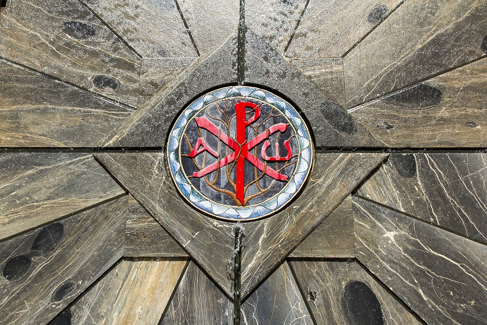</picture>
<figcaption>The Basilica of the Annunciation, Nazareth. Photo: <a href="https://commons.wikimedia.org/wiki/File:Basilica_of_the_Annunciation_Nazareth_290314_06.jpg">Oren Rozen</a>, <a href="https://creativecommons.org/licenses/by-sa/3.0">CC BY-SA 3.0</a>, via Wikimedia Commons.</figcaption>
</figure>

In this hill town of Galilee the angel came to Mary. The present basilica, designed by Giovanni Muzio and consecrated in 1969, is the largest church in the Middle East. It stands on two levels: the lower church frames the grotto venerated as Mary's home, and the upper church is the parish church. Excavations by the Franciscan archaeologist Bellarmino Bagatti found a small first-century village of cave-houses, Jewish-Christian graffiti (including *XE MAPIA*, "Hail Mary"), and the remains of earlier churches on the same spot. The courtyard and walls are lined with images of Our Lady sent from Catholic countries around the world. Read more on the pilgrimage page for [Nazareth](/pilgrimage/holy-land/nazareth/).

### Church of the Visitation, Ein Kerem

<figure class=photo><picture><source srcset="/static/art/mary-visitation-ein-kerem-600.webp 600w,/static/art/mary-visitation-ein-kerem.webp 1280w" sizes="(max-width:760px) 100vw,760px" type="image/webp">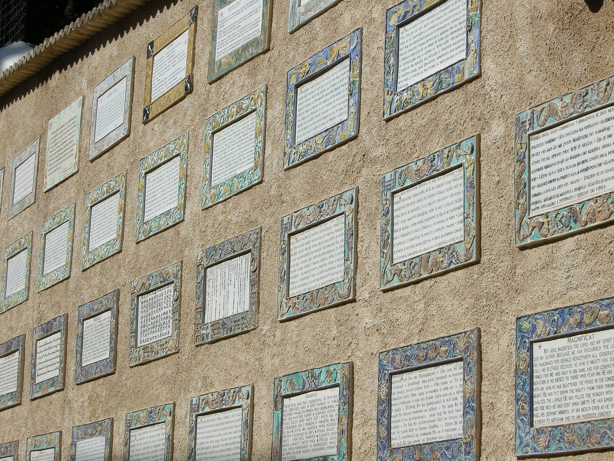</picture>
<figcaption>The Church of the Visitation, Ein Kerem. Photo: <a href="https://commons.wikimedia.org/wiki/File:Church_of_the_Visitationy8.JPG">Yoavd</a>, public domain, via Wikimedia Commons.</figcaption>
</figure>

Tradition places the home of Zechariah and Elizabeth in **Ein Kerem** (also spelled Ein Karem), a village in the hills west of Jerusalem, and honours it as the place of the Visitation and of the birth of [John the Baptist](/saints/john-the-baptist/). The present Church of the Visitation, a Franciscan sanctuary finished in 1955 to plans by Antonio Barluzzi, stands on the hillside above the village. In the lower crypt, older masonry and a well are shown as remains of the house; the upper church is bright with mosaics, and in the courtyard the Magnificat is set on the wall in many languages, a reminder that "all generations shall call me blessed." The village also keeps the Church of St John the Baptist, over the traditional place of his birth. (Ein Kerem is marked on our [Jerusalem](/pilgrimage/holy-land/jerusalem/) map, but does not yet have its own pilgrimage page.)

### House of the Virgin Mary, near Ephesus

<figure class=photo><picture><source srcset="/static/art/paul-ephesus-mary-600.webp 600w,/static/art/paul-ephesus-mary.webp 1280w" sizes="(max-width:760px) 100vw,760px" type="image/webp">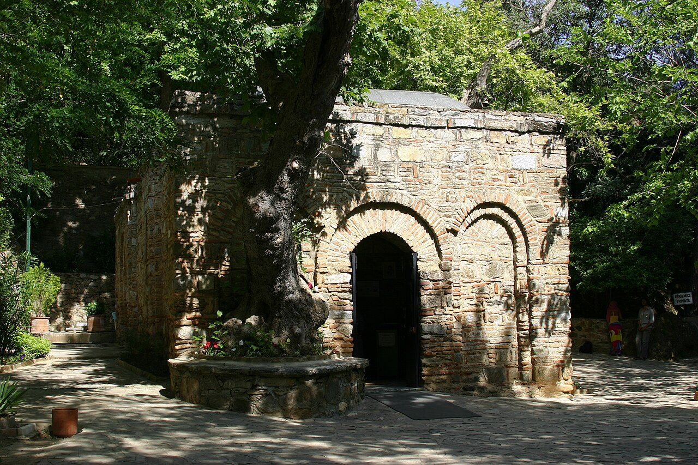</picture>
<figcaption>The House of the Virgin Mary (Meryem Ana Evi) above Ephesus. Photo: <a href="https://commons.wikimedia.org/wiki/File:House_of_the_Virgin_Mary.jpg">Mfryc</a>, <a href="https://creativecommons.org/licenses/by-sa/2.5">CC BY-SA 2.5</a>, via Wikimedia Commons.</figcaption>
</figure>

On Bülbüldağı (Nightingale Mountain), above ancient **Ephesus**, a small stone house is venerated as the home where Mary spent her last years in the care of St John. It was found in 1891 by Lazarist priests guided by the visions of the German mystic Anne Catherine Emmerich. Its foundations may go back to the first century, but the identification rests on tradition and private revelation; the Church has never ruled on it, though Paul VI (1967), John Paul II (1979) and Benedict XVI (2006) prayed there. There is also an old rival tradition that Mary died in Jerusalem. Nearby, in the ruins of Ephesus itself, stands the Church of Mary, where the Council of 431 proclaimed her *Theotokos*. The house is described on the pilgrimage page for [Ephesus](/pilgrimage/st-paul/ephesus/).

### Santa Maria Maggiore, Rome

<figure class=photo><picture><source srcset="/static/art/rome-maggiore-hero-600.webp 600w,/static/art/rome-maggiore-hero.webp 1280w" sizes="(max-width:760px) 100vw,760px" type="image/webp">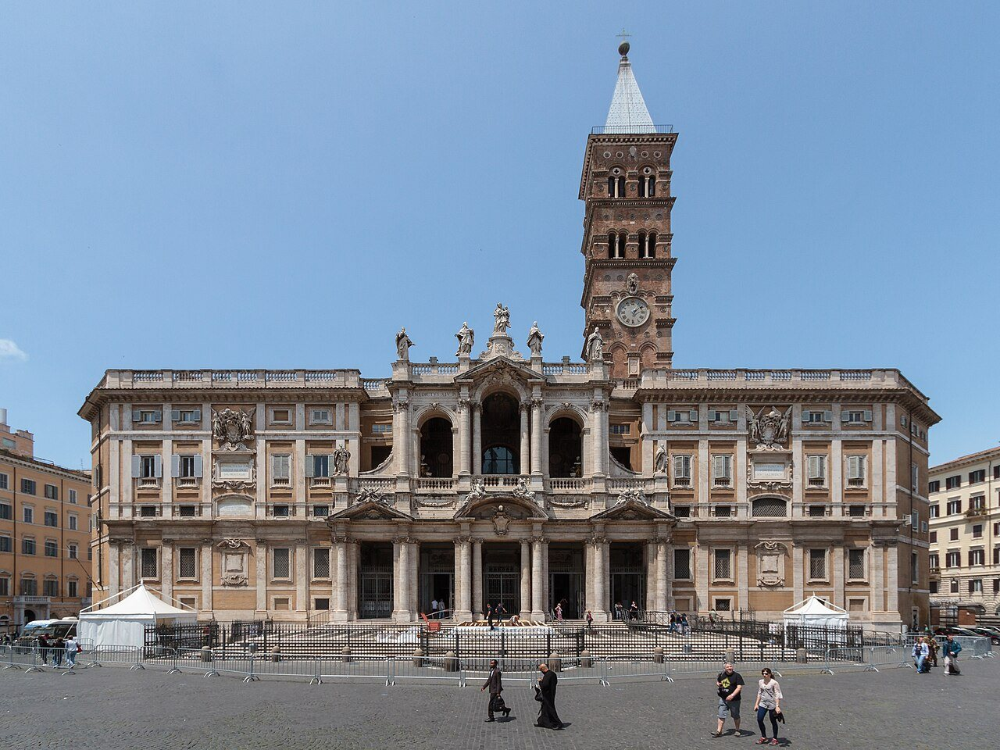</picture>
<figcaption>Santa Maria Maggiore, Rome. Photo: <a href="https://commons.wikimedia.org/wiki/File:Roma_-_2016-05-23_-_Basilica_di_Santa_Maria_Maggiore_-_2957.jpg">Pierre-Selim Huard</a>, <a href="https://creativecommons.org/licenses/by/4.0">CC BY 4.0</a>, via Wikimedia Commons.</figcaption>
</figure>

Santa Maria Maggiore, on the Esquiline Hill, is the largest and oldest of Rome's churches dedicated to the Mother of God, and the only one of the four papal basilicas whose fifth-century structure still stands. Pope Sixtus III built it just after the Council of Ephesus, and its mosaics are the great monument of that council. It keeps the beloved icon of the *Salus Populi Romani*, "Protectress of the Roman People," long attributed to [St Luke](/saints/luke/), and a reliquary of the Holy Crib under the high altar. A later story, dear to the city, says that in August 352 snow fell on the Esquiline in the shape of the church to be built, which is why the feast of 5 August is still called Our Lady of the Snows, and white petals are released at Mass. Since April 2025 the basilica is also the burial place of Pope Francis. Walk it with the pilgrimage page for [Santa Maria Maggiore](/pilgrimage/rome/santa-maria-maggiore/).

### Lourdes, Fátima and Guadalupe

These three shrines, and Częstochowa with them, are gathered on our page of [Marian shrines](/pilgrimage/marian-shrines/). Each also has a page of its own.

<figure class=photo><picture><source srcset="/static/art/ms-lou-grotto-600.webp 600w,/static/art/ms-lou-grotto.webp 1280w" sizes="(max-width:760px) 100vw,760px" type="image/webp">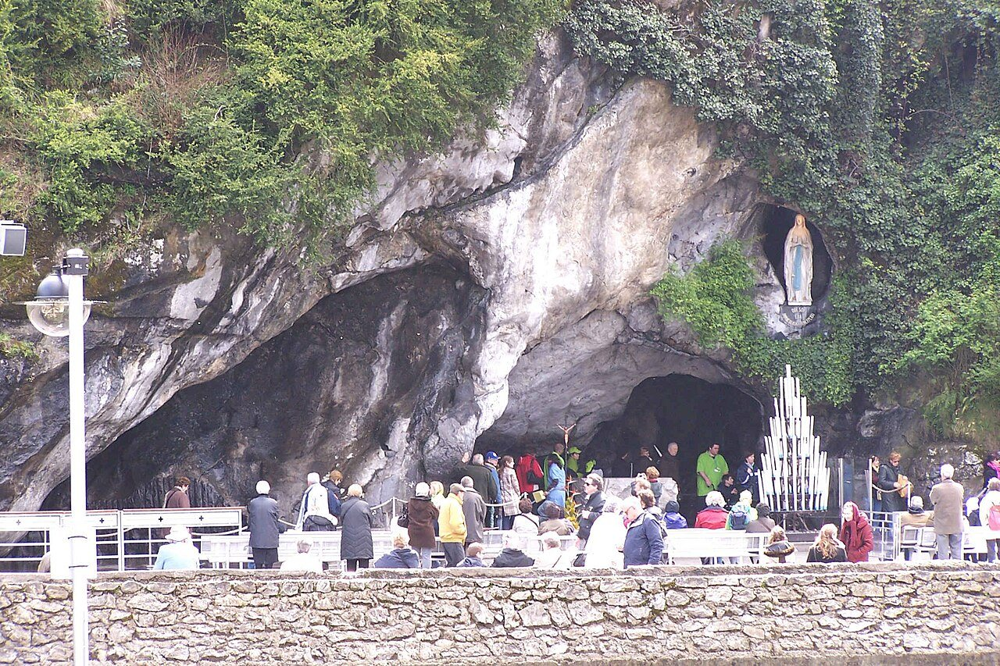</picture>
<figcaption>The Grotto of Massabielle, Lourdes. Photo: <a href="https://commons.wikimedia.org/wiki/File:Grotto_of_Massabielle_Lourdes.jpg">Preacherdoc</a>, <a href="https://creativecommons.org/licenses/by-sa/4.0">CC BY-SA 4.0</a>, via Wikimedia Commons.</figcaption>
</figure>

**[Lourdes](/pilgrimage/marian-shrines/lourdes/).** In 1858 a poor girl of fourteen, [Bernadette Soubirous](/saints/bernadette/), saw the Lady eighteen times in the grotto of Massabielle, in the foothills of the Pyrenees. On 25 March the Lady gave her name in the dialect of the mountains: "Que soy era Immaculada Councepciou" — "I am the Immaculate Conception." A spring rose there, and Lourdes became the great shrine of the sick. Pilgrims still drink from the fountains, enter the baths, and walk the torchlight procession at night, singing the Lourdes *Ave Maria*. Bernadette was canonized in 1933; her body is kept at Nevers.

<figure class=photo><picture><source srcset="/static/art/st2-ma-fatima-basilica-of-our-lady-of-the-ro-600.webp 600w,/static/art/st2-ma-fatima-basilica-of-our-lady-of-the-ro.webp 1280w" sizes="(max-width:760px) 100vw,760px" type="image/webp">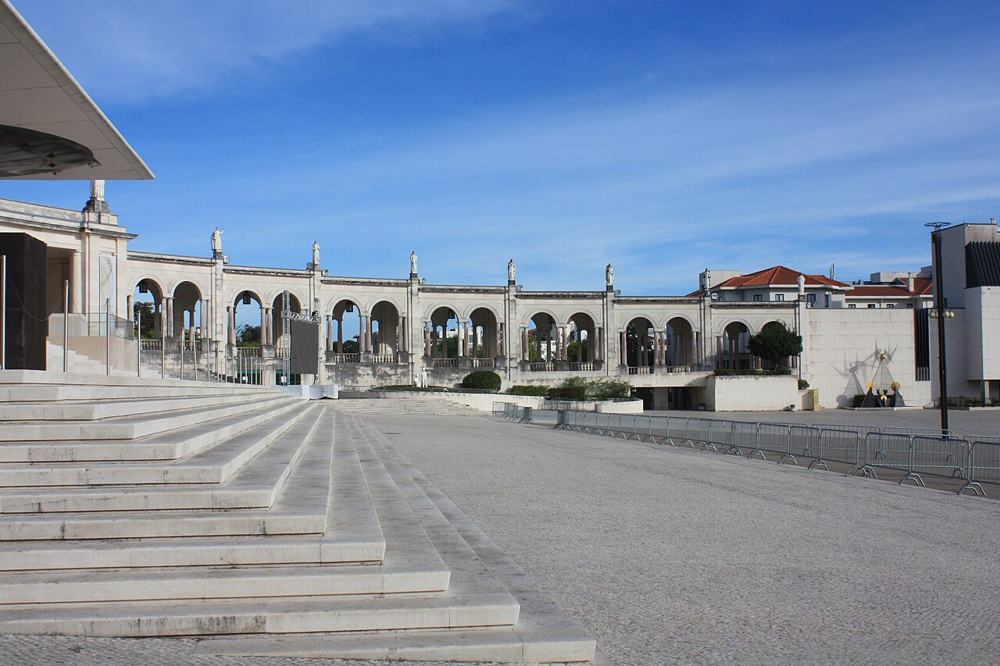</picture>
<figcaption>The Basilica of Our Lady of the Rosary, Fátima. Photo: <a href="https://commons.wikimedia.org/wiki/File:Bas%C3%ADlica_de_Nossa_Senhora_do_Ros%C3%A1rio_de_F%C3%A1tima_-_30.jpg">Reis Quarteu</a>, <a href="https://creativecommons.org/licenses/by-sa/4.0">CC BY-SA 4.0</a>, via Wikimedia Commons.</figcaption>
</figure>

**[Fátima](/pilgrimage/marian-shrines/fatima/).** In 1917, while the First World War still raged, Our Lady appeared six times to three shepherd children — Lúcia and [Francisco and Jacinta Marto](/saints/francisco-and-jacinta-marto/) — in the Cova da Iria, a hollow of pasture in central Portugal. She asked them to pray the Rosary for peace. On 13 October a great crowd saw what has been called the Miracle of the Sun. The little Chapel of the Apparitions stands on the spot; the Basilica of Our Lady of the Rosary holds the tombs of the three seers. Francisco and Jacinta are saints, the youngest non-martyrs ever canonized.

<figure class=photo><picture><source srcset="/static/art/ms-gua-old-600.webp 600w,/static/art/ms-gua-old.webp 1280w" sizes="(max-width:760px) 100vw,760px" type="image/webp">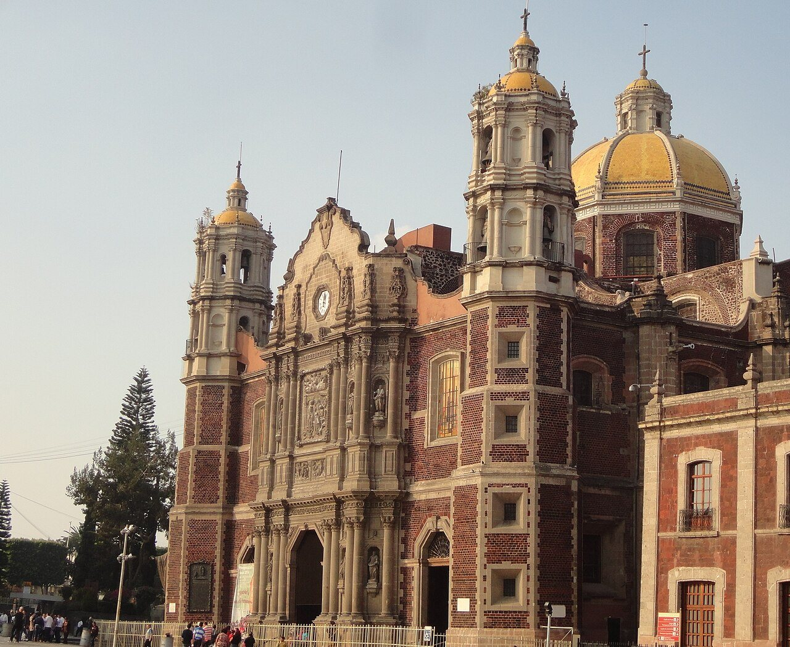</picture>
<figcaption>The old Basilica of Guadalupe (now the Expiatory Temple of Christ the King), Mexico City. Photo: <a href="https://commons.wikimedia.org/wiki/File:Templo_Expiatorio_a_Cristo_Rey_(Antigua_Bas%C3%ADlica_de_Guadalupe)_-_Ciudad_de_M%C3%A9xico.jpg">Juan Carlos Fonseca Mata</a>, <a href="https://creativecommons.org/licenses/by-sa/4.0">CC BY-SA 4.0</a>, via Wikimedia Commons.</figcaption>
</figure>

**[Guadalupe](/pilgrimage/marian-shrines/guadalupe/).** In December 1531, on the hill of Tepeyac in what is now Mexico City, Our Lady appeared to [St Juan Diego](/saints/juan-diego/), an Indigenous convert, and left her image on his tilma, his cactus-fibre cloak. "Am I not here, I who am your mother?" she said. The tilma still hangs above the altar of the Basilica of Our Lady of Guadalupe, the most visited Marian shrine in the world. Around the feast of 12 December alone, millions come. The image itself is in the art section below.

<h2 id=art>Mary in art</h2>

No other face in Christian art has been painted so often, or so tenderly. The works below are only a few of the most loved. Several of the great icons attributed, by tradition, to St Luke — the *Salus Populi Romani*, the Black Madonna of Częstochowa — are already gathered on [his page](/saints/luke/#icons).

<figure class=photo><picture><source srcset="/static/art/mary-fra-angelico-annunciation-600.webp 600w,/static/art/mary-fra-angelico-annunciation.webp 1280w" sizes="(max-width:760px) 100vw,760px" type="image/webp">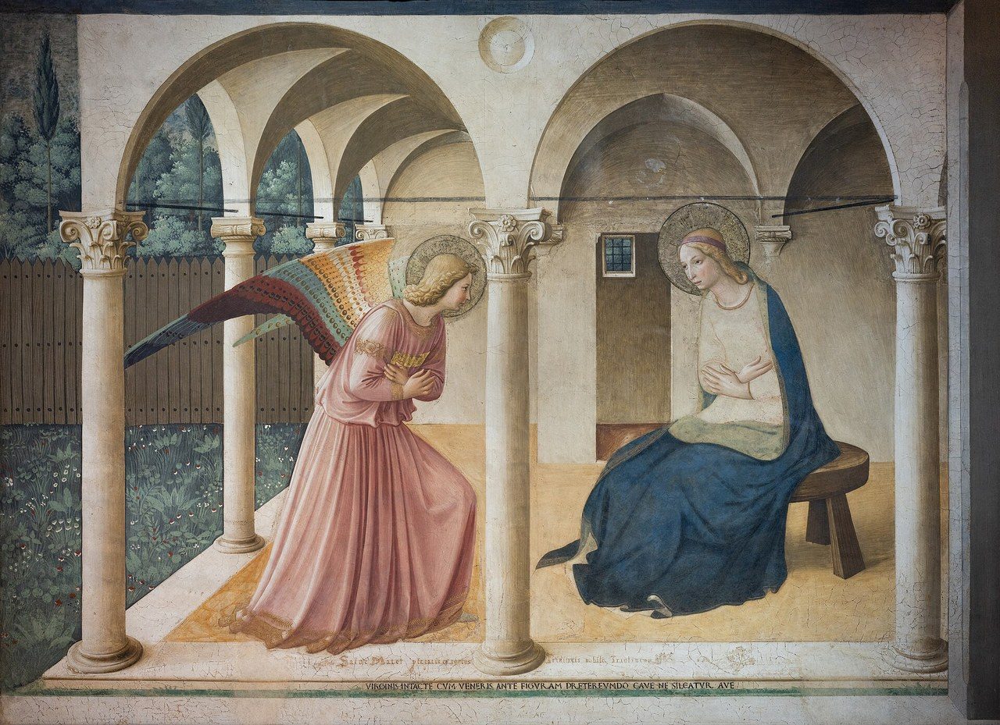</picture>
<figcaption>Fra Angelico, <em>The Annunciation</em>, fresco in the north corridor of the convent of San Marco, Florence, about 1440–45. Public domain, photograph by Gleb Simonov, via <a href="https://commons.wikimedia.org/wiki/File:Fra_Angelico_-_Annunciation.jpg">Wikimedia Commons</a>.</figcaption>
</figure>

**Fra Angelico's *Annunciation*.** In the Dominican convent of San Marco in Florence, at the top of the stairs, the brothers met this fresco every time they came from their cells. Gabriel bows, a lily in the garden behind him; Mary sits in a quiet loggia, her hands crossed, receiving the word. Fra Angelico — the "angelic brother" — painted several Annunciations. This is the one most people remember: gentle, still, and full of light.

<figure class=photo><picture><source srcset="/static/art/rome-peter-pieta-600.webp 600w,/static/art/rome-peter-pieta.webp 1280w" sizes="(max-width:760px) 100vw,760px" type="image/webp">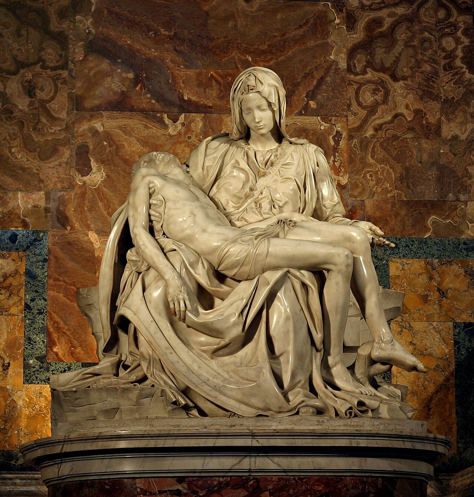</picture>
<figcaption>Michelangelo, <em>Pietà</em> (1498–99), in the first chapel on the right in St Peter's Basilica, Rome. Photo: <a href="https://commons.wikimedia.org/wiki/File:Michelangelo%27s_Pieta_5450_cropncleaned_edit.jpg">Stanislav Traykov</a>, <a href="https://creativecommons.org/licenses/by/2.5">CC BY 2.5</a>, via Wikimedia Commons.</figcaption>
</figure>

**Michelangelo's *Pietà*.** In 1498 a young Michelangelo was asked to carve, for a chapel in St Peter's, the mother holding her dead Son. He was not yet twenty-five when he finished it. Mary's face is young and calm; the folds of her mantle are a cascade of marble; Christ's body lies across her lap as if sleep had taken him. It is the only work he signed. Pilgrims still find it in the first chapel on the right as they enter the basilica; it is also on the pilgrimage page for [St Peter's](/pilgrimage/rome/st-peters/).

<figure class=photo><picture><source srcset="/static/art/mary-raphael-sistine-madonna-600.webp 600w,/static/art/mary-raphael-sistine-madonna.webp 1280w" sizes="(max-width:760px) 100vw,760px" type="image/webp">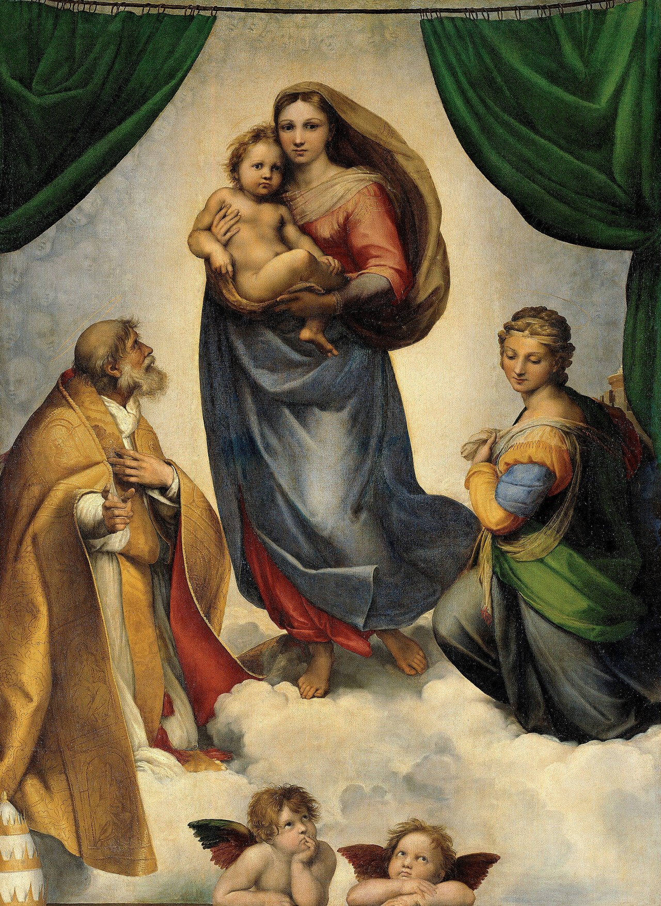</picture>
<figcaption>Raphael, <em>The Sistine Madonna</em>, about 1512–13. Gemäldegalerie Alte Meister, Dresden. Public domain, via <a href="https://commons.wikimedia.org/wiki/File:RAFAEL_-_Madonna_Sixtina_(Gem%C3%A4ldegalerie_Alter_Meister,_Dresden,_1513-14._%C3%93leo_sobre_lienzo,_265_x_196_cm).jpg">Wikimedia Commons</a> (Google Art Project photograph).</figcaption>
</figure>

**Raphael's *Sistine Madonna*.** Painted for the church of San Sisto in Piacenza, the canvas now hangs in Dresden. Mary comes forward on the clouds, the Child in her arms, Pope Sixtus II and St Barbara at her sides. At the foot of the picture two small angels lean on a wooden ledge and look up: perhaps the most copied cherubs in the world. The curtain has been drawn back, as if we were being shown a mystery.

<figure class=photo><picture><source srcset="/static/art/mary-botticelli-magnificat-600.webp 600w,/static/art/mary-botticelli-magnificat.webp 1280w" sizes="(max-width:760px) 100vw,760px" type="image/webp">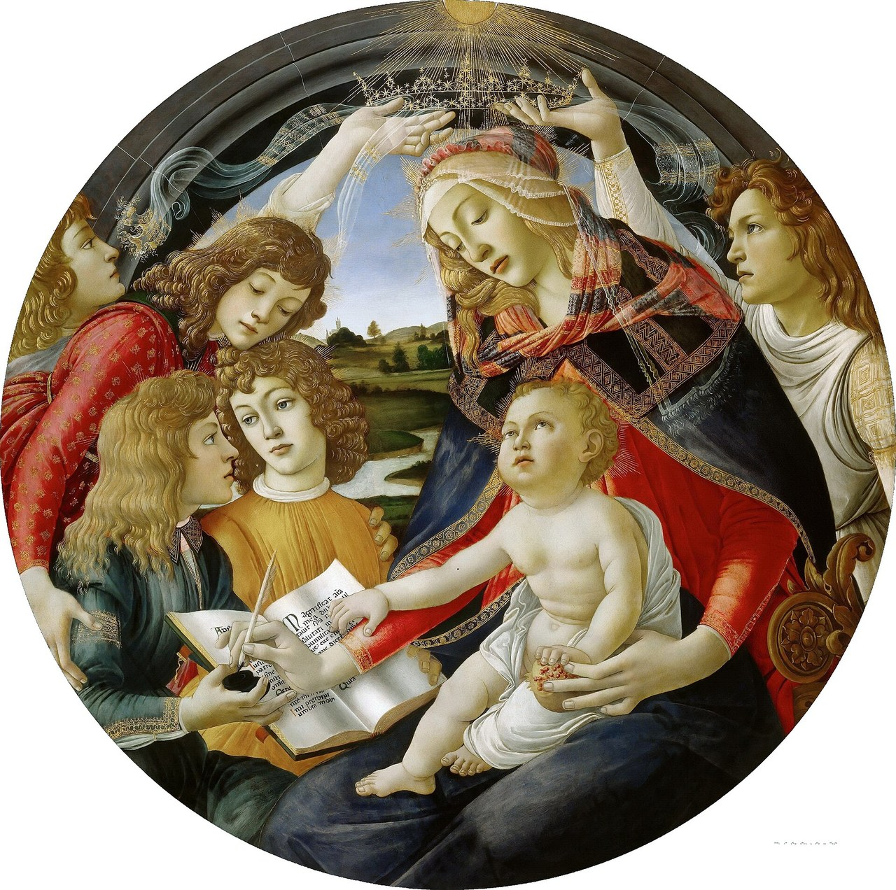</picture>
<figcaption>Sandro Botticelli, <em>Madonna of the Magnificat</em>, about 1481. Uffizi Gallery, Florence. Public domain, via <a href="https://commons.wikimedia.org/wiki/File:Magnificat_Madonna_-_Botticelli_(uffici)_b.jpg">Wikimedia Commons</a>.</figcaption>
</figure>

**Botticelli's *Madonna of the Magnificat*.** In this circular panel in the Uffizi, Mary is writing her own song. Angels crown her; the Child on her lap guides the pen as she sets down the opening of the Magnificat, *Magnificat anima mea Dominum*. A landscape opens behind them. It is one of Botticelli's most tender Madonnas, and one of the few that lets us watch her at the words Luke gave her.

<figure class=photo><picture><source srcset="/static/art/mary-murillo-immaculate-600.webp 600w,/static/art/mary-murillo-immaculate.webp 1280w" sizes="(max-width:760px) 100vw,760px" type="image/webp">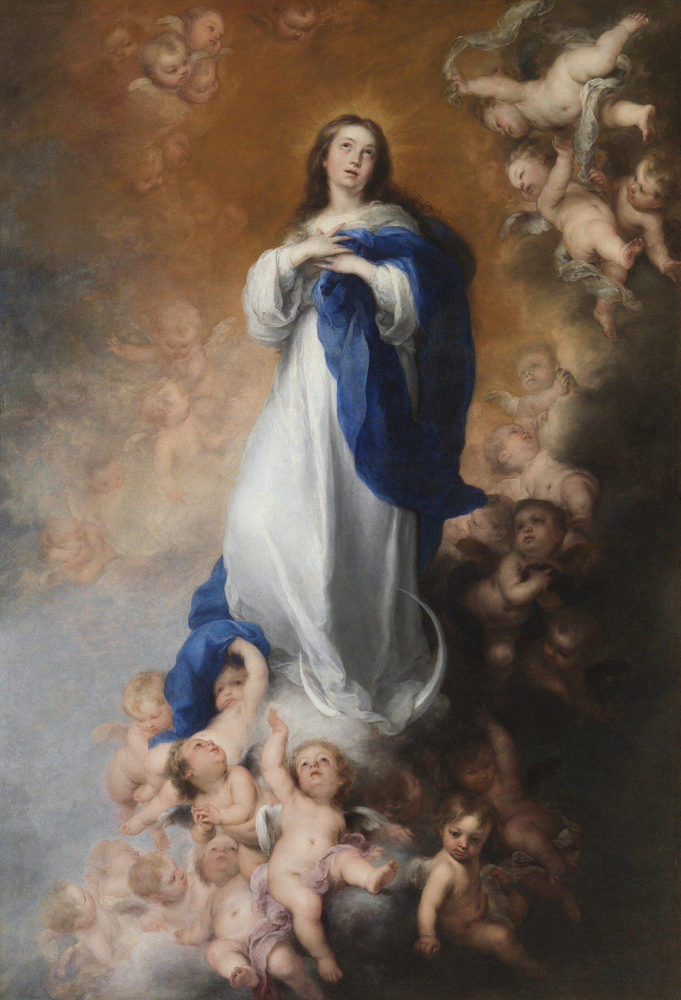</picture>
<figcaption>Bartolomé Esteban Murillo, <em>The Immaculate Conception of Los Venerables</em> (also called the Immaculate Conception of Soult), 1678. Museo del Prado, Madrid. Public domain, via <a href="https://commons.wikimedia.org/wiki/File:Murillo_immaculate_conception.jpg">Wikimedia Commons</a>.</figcaption>
</figure>

**Murillo's *Immaculate Conception*.** Seville's great painter returned to this subject again and again. The most famous of them, painted in 1678 for the Hospital of the Venerable Priests, shows Mary as a young woman in white and blue, standing on the crescent moon among clouds and cherubs, her eyes lifted, her hands folded. It is the picture many people have in mind when they pray the Immaculate Conception: not an argument, but a girl full of grace, already held in the light.

<figure class=photo><picture><source srcset="/static/art/ms-gua-image-600.webp 600w,/static/art/ms-gua-image.webp 1280w" sizes="(max-width:760px) 100vw,760px" type="image/webp">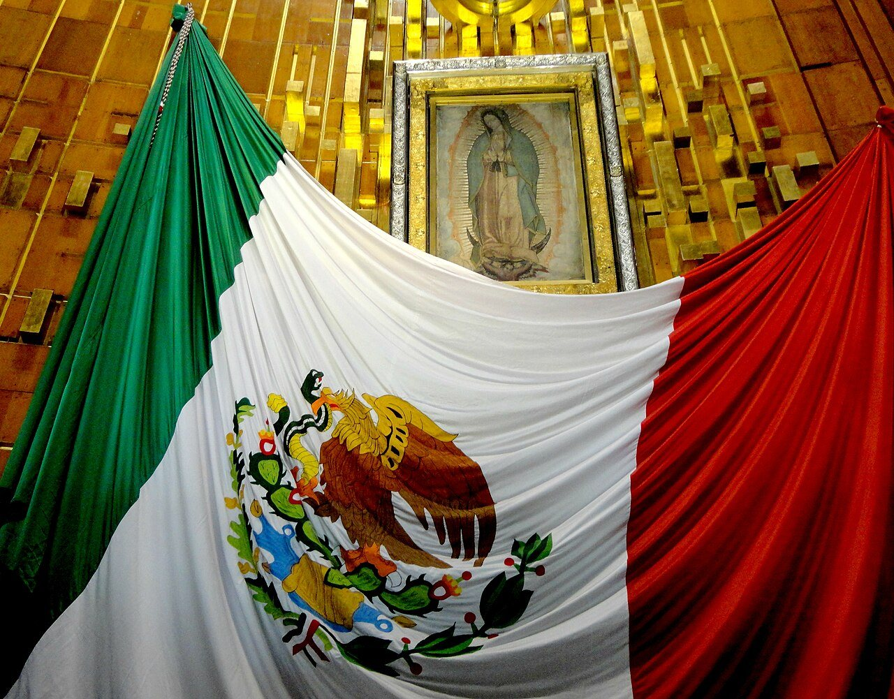</picture>
<figcaption>The image of Our Lady of Guadalupe, on the tilma of St Juan Diego, in the Basilica of Guadalupe, Mexico City. Photo: <a href="https://commons.wikimedia.org/wiki/File:Virgen_de_Guadalupe_en_el_Tepeyac.jpg">Juan Carlos Fonseca Mata</a>, <a href="https://creativecommons.org/licenses/by-sa/4.0">CC BY-SA 4.0</a>, via Wikimedia Commons.</figcaption>
</figure>

**The tilma of Guadalupe.** This is not a painting in a gallery but a cloak, a poor cactus-fibre *tilma*, that has been venerated since 1531. Mary stands in a rose tunic and a mantle of stars, on a crescent held by an angel, the sun's rays around her — an image in which the people of Mexico have long recognised both the woman of Revelation 12 and a mother who spoke to Juan Diego in his own tongue. Nearly five centuries later the colours remain, and pilgrims still pass beneath it on the walkways behind the altar.

<h2 id=songs>Songs about Mary</h2>

The Church has sung of her from the beginning. The Magnificat is the canticle of Evening Prayer, East and West, and is also the Lutheran canticle for Evening Prayer. The Marian antiphons — *Salve Regina*, *Ave Regina Caelorum*, *Alma Redemptoris Mater*, *Regina Caeli* — close Compline through the year. Later came Schubert's *Ave Maria*, the Lourdes hymn *Immaculate Mary*, Pergolesi's *Stabat Mater*, and spirituals such as *Mary Had a Baby*.

A listening list, with free links, is gathered on the Music page: **[Songs about Mary](/music/#mary)**.

<h2 id=teaches>What the Church teaches</h2>

- **Mother of God (*Theotokos*)**, defined at the Council of Ephesus (431): because Jesus is one divine Person, his mother is truly the Mother of God. Luther kept this title and preached on the Magnificat (1521).
- **Perpetual virginity**, taught from the early centuries.
- **Immaculate Conception** (Pius IX, 1854): preserved from original sin from the first moment of her conception. Feast 8 December.
- **Assumption** (Pius XII, 1950): taken body and soul into heavenly glory. Feast 15 August.

Lutherans honour Mary as the mother of the Lord and the model of faith, keeping the Annunciation, the Visitation and 15 August (as "Mary, Mother of Our Lord"), while not holding the 1854 and 1950 definitions.

<h2 id=feasts>Feasts through the Church year</h2>

1 January (Mary, Mother of God) · 2 February (Presentation) · 25 March (Annunciation; in 2027 moved to 5 April) · 31 May (Visitation) · 15 August (Assumption) · 8 September (Nativity of Mary) · 8 December (Immaculate Conception) · 12 December (Our Lady of Guadalupe; see [St Juan Diego](/saints/juan-diego/)). See the [Feast days](/church-year/feasts/) page.

## Trivia
- The *Hail Mary* joins Gabriel's greeting and Elizabeth's words (Luke 1:28, 42); the second half was fixed in the 16th century.
- Mary speaks only seven times in the Gospels.
- The Magnificat is sung every evening at Vespers and is the Lutheran canticle for Evening Prayer.

## Sources
- [Catholic Encyclopedia: The Blessed Virgin Mary](https://www.newadvent.org/cathen/15464b.htm)
- [Catholic Encyclopedia: The Feast of the Annunciation](https://www.newadvent.org/cathen/01542a.htm)
- [Catechism of the Catholic Church §§484–511, 963–975](https://www.vatican.va/archive/ENG0015/_INDEX.HTM)
- [Luke 1:28, The Daily Word](/verses/2026-11-02-luke-1-28/) · [Matthew 1:23](/verses/2026-10-19-matthew-1-23/) · [Luke 2:14](/verses/2026-10-20-luke-2-14/)
- Luke 1–2; John 2, 19; Acts 1:14; Isaiah 7:14; Revelation 12:1
- [Nazareth](/pilgrimage/holy-land/nazareth/) · [Ephesus (House of the Virgin Mary)](/pilgrimage/st-paul/ephesus/) · [Santa Maria Maggiore](/pilgrimage/rome/santa-maria-maggiore/) · [Marian shrines](/pilgrimage/marian-shrines/): [Lourdes](/pilgrimage/marian-shrines/lourdes/), [Fátima](/pilgrimage/marian-shrines/fatima/), [Guadalupe](/pilgrimage/marian-shrines/guadalupe/)
- [Songs about Mary, on the Music page](/music/#mary)
- [Custody of the Holy Land: Nazareth](https://www.custodia.org/en/sanctuaries/nazareth) · [Church of the Visitation, Ein Kerem](https://www.custodia.org/en/sanctuaries/ain-karem-visitation/)
- [Vatican: Basilica di Santa Maria Maggiore](https://www.vatican.va/various/basiliche/sm_maggiore/index_it.html)
- [Sanctuary of Our Lady of Lourdes](https://www.lourdes-france.org/en/) · [Shrine of Fátima](https://www.fatima.pt/en) · [Basilica of Our Lady of Guadalupe](https://virgendeguadalupe.org.mx/)

Fact-checked on November 17, 2026 against the Catechism, New Advent (Catholic Encyclopedia), Scripture (KJV, Vulgate) and the sanctuary and pilgrimage sources named above. The Annunciation verse is the Daily Word study of 2 November 2026, Luke 1:28.

