<nav class=toc aria-label="On this page">

On this page

<ol>
<li><a href="#voice">The voice of his Gospel</a></li>
<li><a href="#travels">His travels</a></li>
<li><a href="#angel">The winged man, his symbol</a></li>
<li><a href="#art">Matthew in art</a></li>
<li><a href="#visit">Where to visit</a></li>
</ol>
</nav>

## His story
Matthew (also called **Levi**) was a tax collector at Capernaum, working for Herod Antipas: a man most of his neighbours would have regarded as a collaborator. Jesus saw him at the tax booth and said "Follow me", "and he arose, and followed him" (Matthew 9:9). He then threw a dinner for Jesus with other tax collectors and sinners, prompting the line "I came not to call the righteous, but sinners to repentance."

Papias of Hierapolis, in the early 2nd century, says Matthew "compiled the sayings in the Hebrew language", and the Church has always attached his name to the first Gospel. Later tellings send him to preach in Ethiopia or Persia and speak of his martyrdom; they differ.

## His Gospel in the Church year
Matthew is the Gospel of **Lectionary Year A**, the most quoted in the liturgy: the Sermon on the Mount, the Lord's Prayer as Christians pray it, the Magi, and the Great Commission. Several Daily Word verses so far ([Matthew 6:9–13](/verses/), [16:18](/verses/2026-10-21-matthew-16-18/), [4:17](/verses/)) come from it. His symbol is a **winged man or angel**, because his Gospel begins with Jesus' human genealogy.

<h2 id=voice>The voice of his Gospel</h2>

Matthew's Gospel ends as it means us to live: not with an ending, but with a sending, and with a promise that has not been withdrawn.

KJV · Matthew 28:19–20
Go ye therefore, and teach all nations, baptizing them in the name of the Father, and of the Son, and of the Holy Ghost: Teaching them to observe all things whatsoever I have commanded you: and, lo, I am with you alway, even unto the end of the world. Amen.

Greek · SBLGNT · Matthew 28:19–20

Πορευθέντες οὖν μαθητεύσατε πάντα τὰ ἔθνη, βαπτίζοντες αὐτοὺς εἰς τὸ ὄνομα τοῦ πατρὸς καὶ τοῦ υἱοῦ καὶ τοῦ ἁγίου πνεύματος, διδάσκοντες αὐτοὺς τηρεῖν πάντα ὅσα ἐνετειλάμην ὑμῖν· καὶ ἰδοὺ ἐγὼ μεθ’ ὑμῶν εἰμι πάσας τὰς ἡμέρας ἕως τῆς συντελείας τοῦ αἰῶνος.

Poreuthentes oun mathēteusate panta ta ethnē, baptizontes autous eis to onoma tou patros kai tou huiou kai tou hagiou pneumatos, didaskontes autous tērein panta hosa eneteilamēn hymin; kai idou egō meth’ hymōn eimi pasas tas hēmeras heōs tēs synteleias tou aiōnos.

Latin · Vulgate · Matthew 28:19–20
Euntes ergo docete omnes gentes: baptizantes eos in nomine Patris, et Filii, et Spiritus Sancti: docentes eos servare omnia quaecumque mandavi vobis: et ecce ego vobiscum sum omnibus diebus, usque ad consummationem saeculi.

The Greek says "make disciples of all nations"; the older English and the Vulgate say "teach." The meaning is one. The risen Lord sends the Church out, and he does not send her alone.

The heart of what he commanded is heard on the mountain. The **Sermon on the Mount** (Matthew 5–7) is Matthew's great gift to the prayer of the Church: the Beatitudes, the call to be salt and light, the Lord's Prayer as Christians have learned to say it, the golden rule, and the house built on the rock.

KJV · Matthew 5:3–6
Blessed are the poor in spirit: for theirs is the kingdom of heaven. Blessed are they that mourn: for they shall be comforted. Blessed are the meek: for they shall inherit the earth. Blessed are they which do hunger and thirst after righteousness: for they shall be filled.

KJV · Matthew 11:28
Come unto me, all ye that labour and are heavy laden, and I will give you rest.

The book has a shape of its own, and it has helped the Church to see Jesus as the Messiah of Israel who is also the Saviour of the world. It opens with a **genealogy** from Abraham and David, so that the Son of God is seen at once as a son of the promise. Again and again Matthew writes that a thing was done "that it might be fulfilled which was spoken by the prophet": the Gospel is stitched to the Scriptures Israel already had. Five great **discourses** of Jesus give the book its architecture — the Sermon on the Mount, the missionary discourse, the parables of the kingdom, the discourse on the Church, and the discourse on the last things — as if Matthew had heard, in the Lord's teaching, a new Torah. It is the only Gospel to use the word *church* (*ekklēsia*), both in the promise to [Peter](/saints/peter/) (16:18) and in the teaching on forgiveness and gathering (18:17). The Magi come from the nations; the risen Lord sends the apostles back to the nations. Written, the Church has long believed, with a Jewish-Christian community especially in mind, it has become the Church's own first teacher.

<h2 id=travels>His travels</h2>

Scripture places Matthew first at the tax booth in **Capernaum**. "And as Jesus passed forth from thence, he saw a man, named Matthew, sitting at the receipt of custom: and he saith unto him, Follow me. And he arose, and followed him" (Matthew 9:9). The same story is told of **Levi** in Mark and Luke; the Church has received them as one man. From that hour he is numbered with the Twelve, and he walks the roads of Galilee and Judea with the Lord, to the cross and to the mountain of the Commission.

What comes after the New Testament is tradition, and the traditions do not agree. Eusebius, following Papias, says that Matthew first preached to the Hebrews and left them the "sayings" in their own language. Later writers send him farther east, to **Ethiopia**, or to **Parthia and Persia**. Some tell of a peaceful death; more often, especially in the West, he is said to have been martyred, sometimes by the sword or the halberd, in Ethiopia. The Roman Martyrology keeps his feast on 21 September, but it does not pretend to settle the map. What can be said with confidence is that the Church has honoured him as apostle and evangelist from the beginning, and that his Gospel has itself been his longest journey, carrying the voice of the tax collector who stood up and followed, to the ends of the earth.

<h2 id=angel>The winged man, his symbol</h2>

The Church has long given each of the four evangelists a living creature from the visions of Ezekiel and of John:

KJV · Ezekiel 1:10
As for the likeness of their faces, they four had the face of a man, and the face of a lion, on the right side: and they four had the face of an ox on the left side; they four also had the face of an eagle.

KJV · Revelation 4:7
And the first beast was like a lion, and the second beast like a calf, and the third beast had a face as a man, and the fourth beast was like a flying eagle.

**Jerome** gave Matthew the man — or the winged man, the angel — because his Gospel begins not in the wilderness, nor with the ox of sacrifice, nor in the height of heaven, but with a human genealogy: "The book of the generation of Jesus Christ, the son of David, the son of Abraham." The Gospel comes down to our flesh and our family, and so the creature with the face of a man is his sign. The same assignment is kept by Augustine, and it is the one the West has followed. (Unlike [Mark's lion](/saints/mark/) and [John's eagle](/saints/john-the-apostle/), Matthew's man is also the sign given him in the Book of Durrow, whose other creatures follow an older scheme. [Luke's ox](/saints/luke/) completes the four.)

In the **Lindisfarne Gospels** Matthew sits writing, and above him the creature is labelled *imago hominis*, "the image of the man," a winged figure leaning in with the word. In the **Book of Kells** he is enthroned in a frame of knotwork, a book in his hand. In the **Book of Durrow** the man stands alone, wrapped in a cloak of chequered colour, quiet and complete.

Two other signs appear in later art, and they belong to his story rather than to the four creatures. The **money bag** or the coins on a table remember the tax booth he left. The **axe** or **halberd** belongs to the tradition of his martyrdom. Neither is as constant as the angel; both tell the same conversion: the man who once counted coins now counts, with the Church, the cost of following.

<figure class=photo><picture><source srcset="/static/art/matthew-lindisfarne-600.webp 600w,/static/art/matthew-lindisfarne.webp 1280w" sizes="(max-width:760px) 100vw,760px" type="image/webp">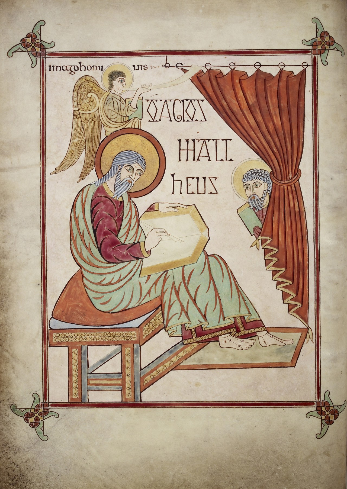</picture>
<figcaption>St Matthew with his symbol, the man (<em>imago hominis</em>), folio 25v of the Lindisfarne Gospels, about 700, attributed to Eadfrith of Lindisfarne. British Library, Cotton MS Nero D IV. <a href="https://creativecommons.org/publicdomain/zero/1.0/">CC0</a>, via <a href="https://commons.wikimedia.org/wiki/File:St._Matthew_-_Lindisfarne_Gospels_(710-721),_f.25v_-_BL_Cotton_MS_Nero_D_IV.jpg">Wikimedia Commons</a> (British Library).</figcaption>
</figure>

<figure class=photo><picture><source srcset="/static/art/matthew-kells-portrait-600.webp 600w,/static/art/matthew-kells-portrait.webp 1280w" sizes="(max-width:760px) 100vw,760px" type="image/webp">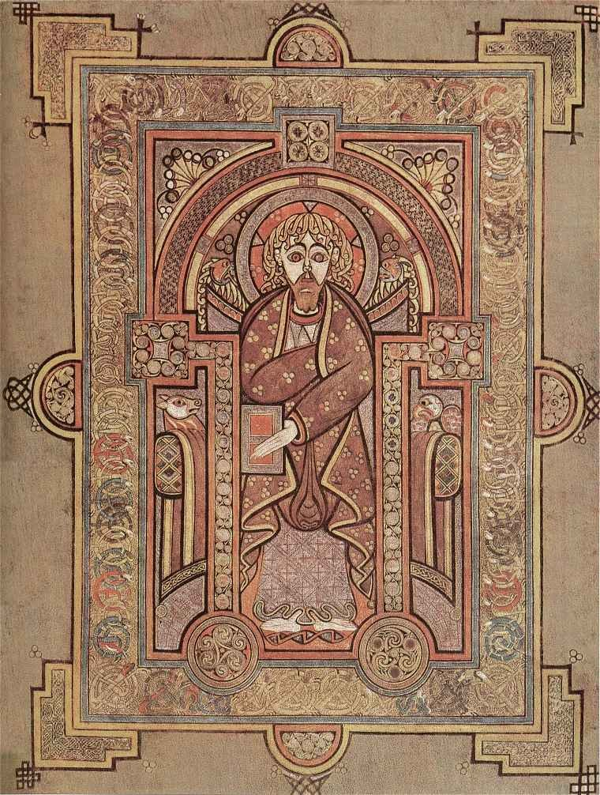</picture>
<figcaption>St Matthew the Evangelist, folio 28v of the Book of Kells, about the year 800. Trinity College Dublin. Public domain, via <a href="https://commons.wikimedia.org/wiki/File:KellsFol028vPortMatt.jpg">Wikimedia Commons</a>.</figcaption>
</figure>

<figure class=photo><picture><source srcset="/static/art/matthew-durrow-man-600.webp 600w,/static/art/matthew-durrow-man.webp 1280w" sizes="(max-width:760px) 100vw,760px" type="image/webp">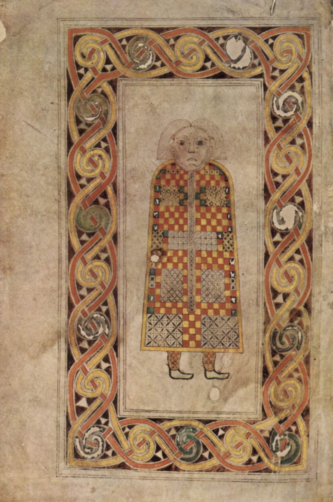</picture>
<figcaption>The man, symbol of St Matthew, in the Book of Durrow, about 650–700. Trinity College Dublin. Public domain, via <a href="https://commons.wikimedia.org/wiki/File:Meister_des_Book_of_Durrow_001.jpg">Wikimedia Commons</a>.</figcaption>
</figure>

<h2 id=art>Matthew in art</h2>

No painter has seen the tax collector's calling more clearly than **Caravaggio**. In the Contarelli Chapel of San Luigi dei Francesi in Rome, three canvases (about 1599–1602) tell Matthew's story as if it were happening in a room off a Roman street.

In **The Calling of St Matthew**, a shaft of light cuts across a dark table where men are counting money. Christ, almost hidden at the right, points; Matthew, still at the coins, points to himself as if to ask, "Is it I?" The gesture is the whole Gospel of the tax collector: mercy coming into a room that had not asked for it, and a man getting up to follow.

In **The Inspiration of St Matthew**, an angel in white descends in a swirl of cloth, counting the points of a teaching on his fingers; the aged evangelist, in a red cloak, looks up from his bench and his book, barefoot, startled into understanding. (An earlier version of this subject, in which the angel guided Matthew's hand more closely, was painted for the same chapel, rejected, and later destroyed in Berlin in 1945. The picture that remains is the one the church kept.)

In **The Martyrdom of St Matthew**, the scene breaks open: an executioner, nearly naked, seizes the vested apostle at the altar; an angel leans down with the palm of victory; Matthew's hand reaches up to receive it. The tradition of his death is painted as a liturgy interrupted, and completed, by heaven.

**Rembrandt**, in 1661, returns to the quieter hour of inspiration. In the Louvre picture, an angel stands close at the evangelist's shoulder and speaks, almost in a whisper, into his ear. Matthew's hand is at his breast; his eyes are not on the page but on something he is being given. It is the same subject as Caravaggio's, and a different tenderness.

<figure class=photo><picture><source srcset="/static/art/matthew-calling-600.webp 600w,/static/art/matthew-calling.webp 1280w" sizes="(max-width:760px) 100vw,760px" type="image/webp">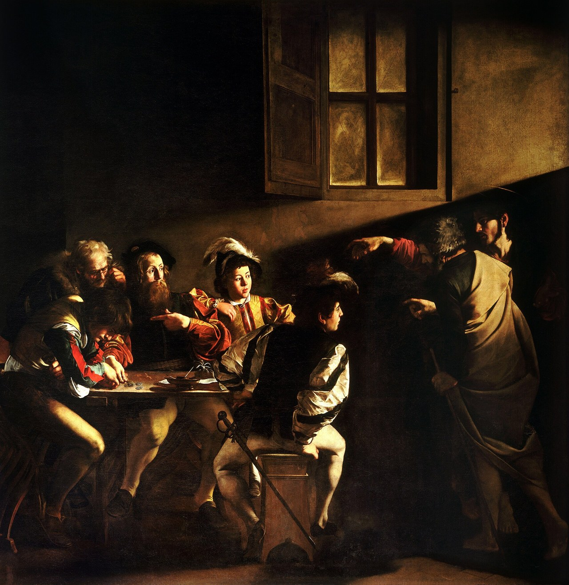</picture>
<figcaption>Caravaggio, <em>The Calling of Saint Matthew</em>, about 1599–1600. Contarelli Chapel, San Luigi dei Francesi, Rome. Public domain, via <a href="https://commons.wikimedia.org/wiki/File:The_Calling_of_Saint_Matthew-Caravaggo_(1599-1600).jpg">Wikimedia Commons</a>.</figcaption>
</figure>

<figure class=photo><picture><source srcset="/static/art/matthew-inspiration-600.webp 600w,/static/art/matthew-inspiration.webp 1280w" sizes="(max-width:760px) 100vw,760px" type="image/webp">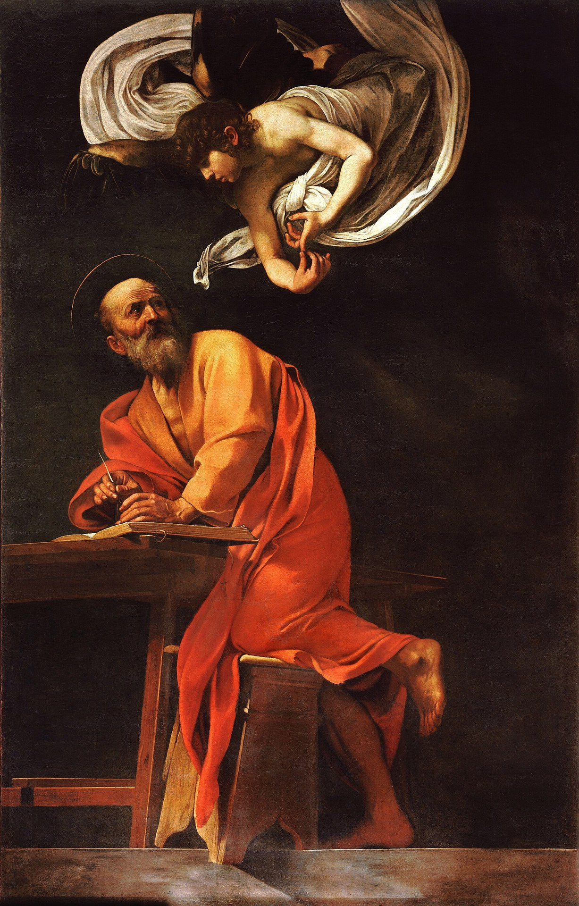</picture>
<figcaption>Caravaggio, <em>The Inspiration of Saint Matthew</em>, 1602. Contarelli Chapel, San Luigi dei Francesi, Rome. Public domain, via <a href="https://commons.wikimedia.org/wiki/File:The_Inspiration_of_Saint_Matthew-Caravaggio_(1602).jpg">Wikimedia Commons</a>.</figcaption>
</figure>

<figure class=photo><picture><source srcset="/static/art/matthew-martyrdom-600.webp 600w,/static/art/matthew-martyrdom.webp 1280w" sizes="(max-width:760px) 100vw,760px" type="image/webp">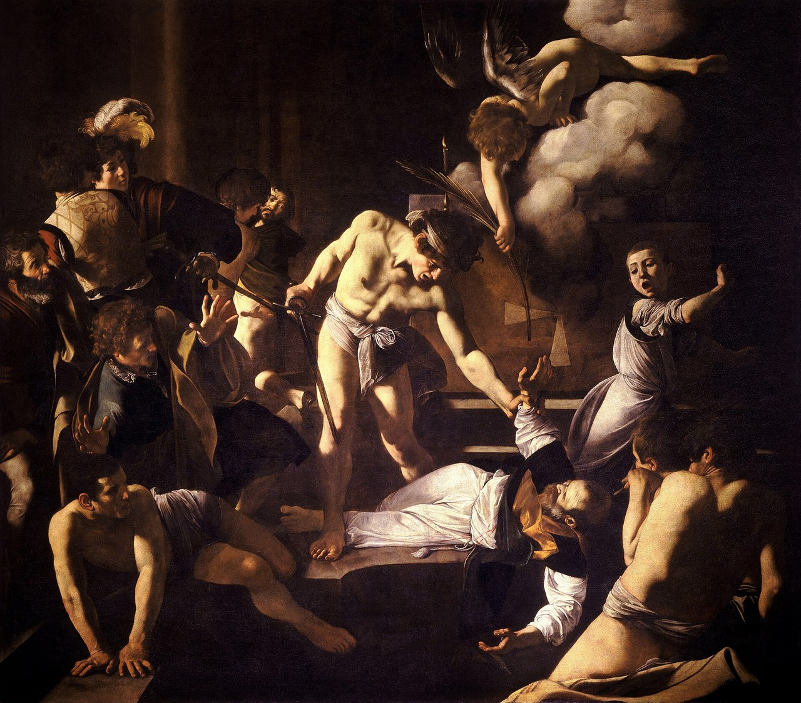</picture>
<figcaption>Caravaggio, <em>The Martyrdom of Saint Matthew</em>, about 1599–1600. Contarelli Chapel, San Luigi dei Francesi, Rome. Public domain, via <a href="https://commons.wikimedia.org/wiki/File:The_Martyrdom_of_Saint_Matthew-Caravaggio_(c._1599-1600).jpg">Wikimedia Commons</a>.</figcaption>
</figure>

<figure class=photo><picture><source srcset="/static/art/matthew-rembrandt-angel-600.webp 600w,/static/art/matthew-rembrandt-angel.webp 1280w" sizes="(max-width:760px) 100vw,760px" type="image/webp">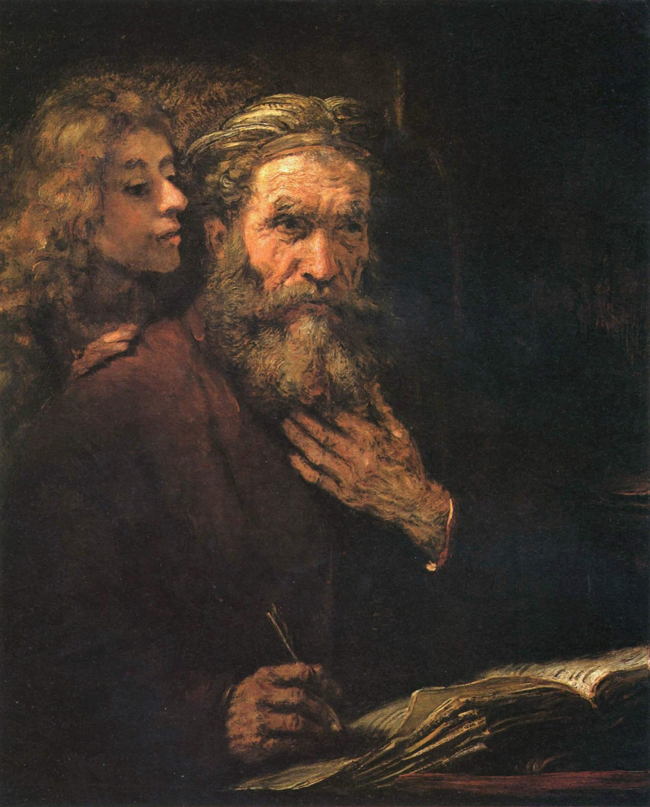</picture>
<figcaption>Rembrandt, <em>Saint Matthew and the Angel</em>, 1661. Musée du Louvre, Paris. Public domain, via <a href="https://commons.wikimedia.org/wiki/File:Rembrandt_Harmensz._van_Rijn_049.jpg">Wikimedia Commons</a>.</figcaption>
</figure>

## Patronages
Accountants, bankers, tax collectors, customs officers; Salerno.

## Where to visit
Capernaum on the Sea of Galilee; Salerno Cathedral, Italy, where his relics have been kept since 954; Caravaggio's *Calling of St Matthew* in San Luigi dei Francesi, Rome.

<figure class=photo>
<picture><source srcset="/static/art/matthew-capernaum-600.webp 600w,/static/art/matthew-capernaum.webp 1280w" sizes="(max-width:760px) 100vw,760px" type="image/webp">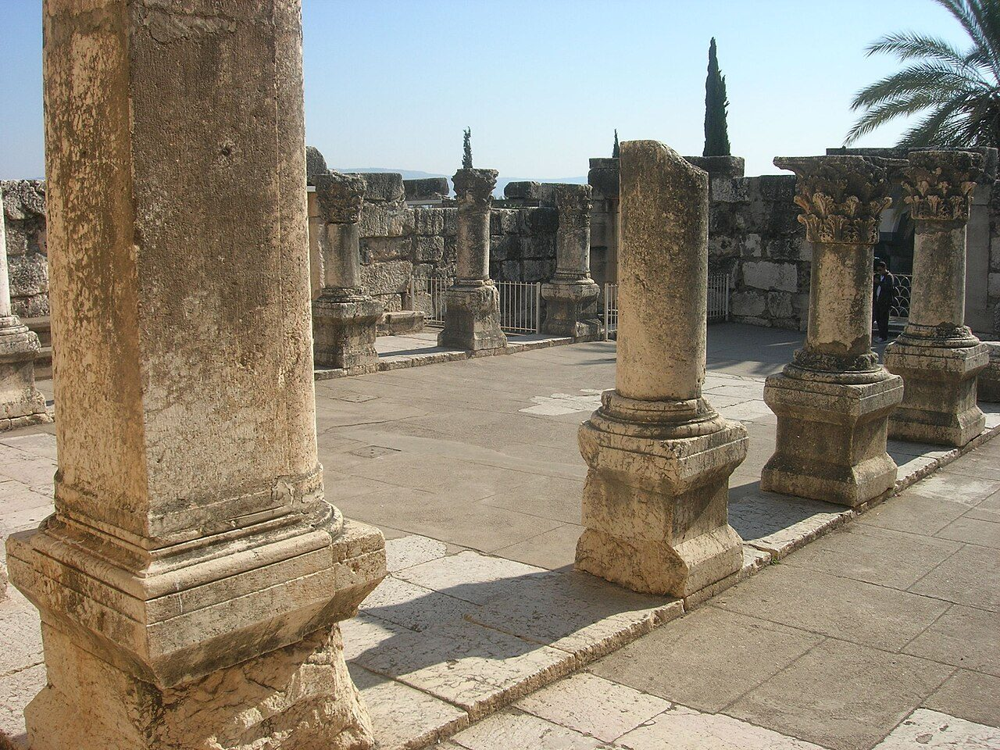</picture>
<figcaption>The synagogue at Capernaum, on the Sea of Galilee, the town where the Gospels place Matthew's tax booth. These stones are later than the first century. Photo: <a href="https://commons.wikimedia.org/wiki/File:CAPHARNAUM_ANCIENT_SYNAGOGUE._SEA_OF_GALILEE_2011_(8).JPG">Proa 500</a>, <a href="https://creativecommons.org/licenses/by-sa/4.0">CC BY-SA 4.0</a>, via Wikimedia Commons.</figcaption>
</figure>

The **Cathedral of Salerno**, dedicated to St Matthew, has kept his relics since the year 954, when they were brought to the city. The church, begun under the Normans, is entered through a beautiful atrium; below, in a richly decorated crypt, the apostle is honoured at the altar that holds his remains. Pilgrims still come to Salerno for his feast.

In Rome, the French national church of **San Luigi dei Francesi**, a short walk from the Piazza Navona, holds the three Caravaggio canvases of the Contarelli Chapel, already shown above. It is one of the few places in the world where the calling, the writing and the death of Matthew can be seen together, in the order of a life.

<figure class=photo><picture><source srcset="/static/art/matthew-salerno-600.webp 600w,/static/art/matthew-salerno.webp 1280w" sizes="(max-width:760px) 100vw,760px" type="image/webp">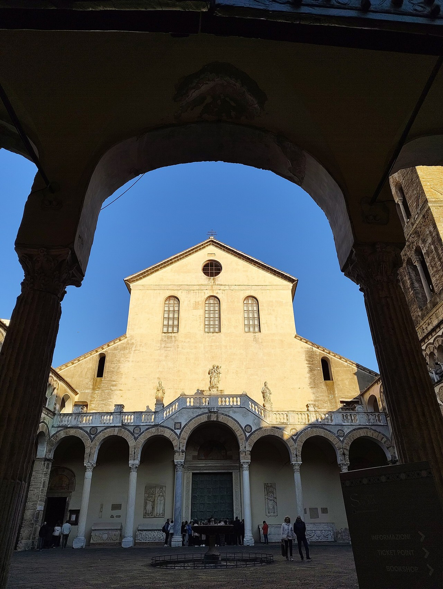</picture>
<figcaption>The façade of Salerno Cathedral, dedicated to St Matthew, seen from the atrium. Photo: <a href="https://commons.wikimedia.org/wiki/File:Facciata_Cattedrale_di_Salerno.jpg">IlPres</a>, <a href="https://creativecommons.org/licenses/by/4.0/">CC BY 4.0</a>, via Wikimedia Commons.</figcaption>
</figure>

<figure class=photo><picture><source srcset="/static/art/matthew-salerno-crypt-600.webp 600w,/static/art/matthew-salerno-crypt.webp 1280w" sizes="(max-width:760px) 100vw,760px" type="image/webp">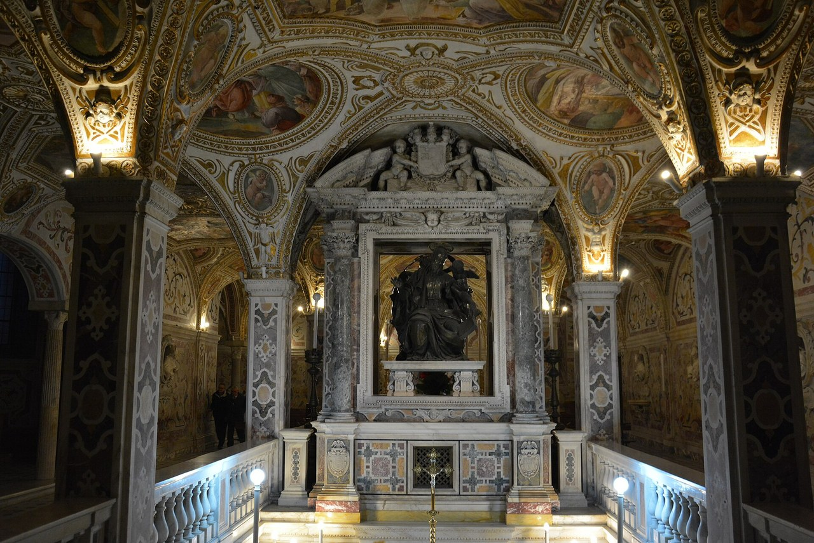</picture>
<figcaption>The crypt of Salerno Cathedral, where the relics of St Matthew have been kept since 954. Photo: <a href="https://commons.wikimedia.org/wiki/File:Cattedrale_di_Salerno_-_Cripta_005.JPG">Mentnafunangann</a>, <a href="https://creativecommons.org/licenses/by-sa/4.0/">CC BY-SA 4.0</a>, via Wikimedia Commons.</figcaption>
</figure>

<figure class=photo><picture><source srcset="/static/art/matthew-san-luigi-600.webp 600w,/static/art/matthew-san-luigi.webp 1280w" sizes="(max-width:760px) 100vw,760px" type="image/webp">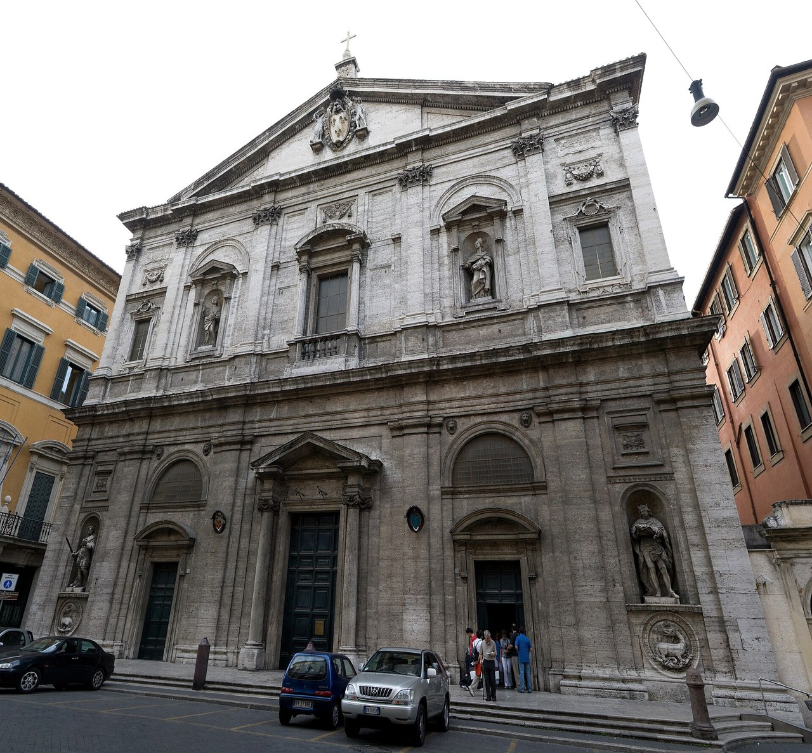</picture>
<figcaption>San Luigi dei Francesi, Rome, home of Caravaggio's St Matthew cycle. Photo: <a href="https://commons.wikimedia.org/wiki/File:San_Luigi_dei_Francesi_-_Facade.jpg">Maros Mraz</a>, <a href="https://creativecommons.org/licenses/by/2.5/">CC BY 2.5</a>, via Wikimedia Commons.</figcaption>
</figure>

## Sources
- [Catholic Encyclopedia: Gospel of St Matthew](https://www.newadvent.org/cathen/10057a.htm)
- Matthew 9:9-13; Mark 2:14; Luke 5:27-32; Eusebius, *Church History* 3.39 (Papias)
- [Wikipedia: Matthew the Apostle](https://en.wikipedia.org/wiki/Matthew_the_Apostle), [Gospel of Matthew](https://en.wikipedia.org/wiki/Gospel_of_Matthew), [Salerno Cathedral](https://en.wikipedia.org/wiki/Salerno_Cathedral) and [San Luigi dei Francesi](https://en.wikipedia.org/wiki/San_Luigi_dei_Francesi)
- [Wikipedia: The Calling of St Matthew](https://en.wikipedia.org/wiki/The_Calling_of_St_Matthew), [The Inspiration of Saint Matthew](https://en.wikipedia.org/wiki/The_Inspiration_of_Saint_Matthew), [The Martyrdom of Saint Matthew (Caravaggio)](https://en.wikipedia.org/wiki/The_Martyrdom_of_Saint_Matthew_(Caravaggio)), [Book of Kells](https://en.wikipedia.org/wiki/Book_of_Kells), [Lindisfarne Gospels](https://en.wikipedia.org/wiki/Lindisfarne_Gospels) and [Book of Durrow](https://en.wikipedia.org/wiki/Book_of_Durrow)
- [Musée du Louvre: Rembrandt, Saint Matthew and the Angel](https://collections.louvre.fr/ark:/53355/cl010062364)
- Greek of Matthew 28:19–20 from the [SBL Greek New Testament](https://sblgnt.com/). Latin from the Vulgate.

Fact-checked on October 22, 2026 against Scripture, Eusebius and New Advent. The Capernaum photograph was added November 6, 2026. Expanded November 13, 2026 with additional Scripture, art and places of pilgrimage, using Wikimedia Commons, museum catalogues and standard references. Scripture is quoted briefly from the public-domain King James Version, with the Greek of Matthew 28:19–20 from the SBLGNT and the Latin from the Vulgate. Where a story is legend rather than history, the text says so.

