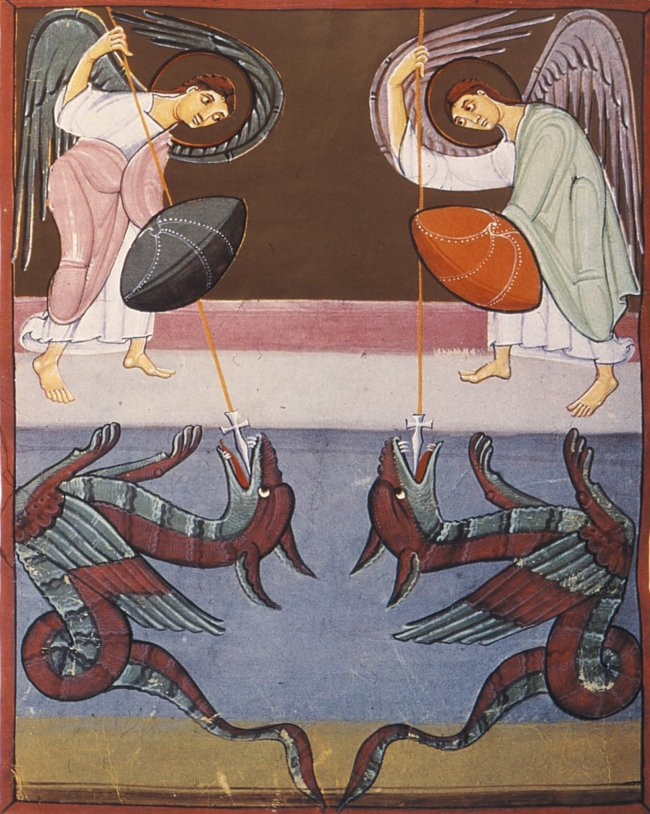
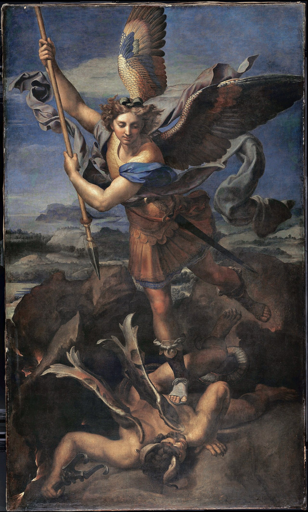
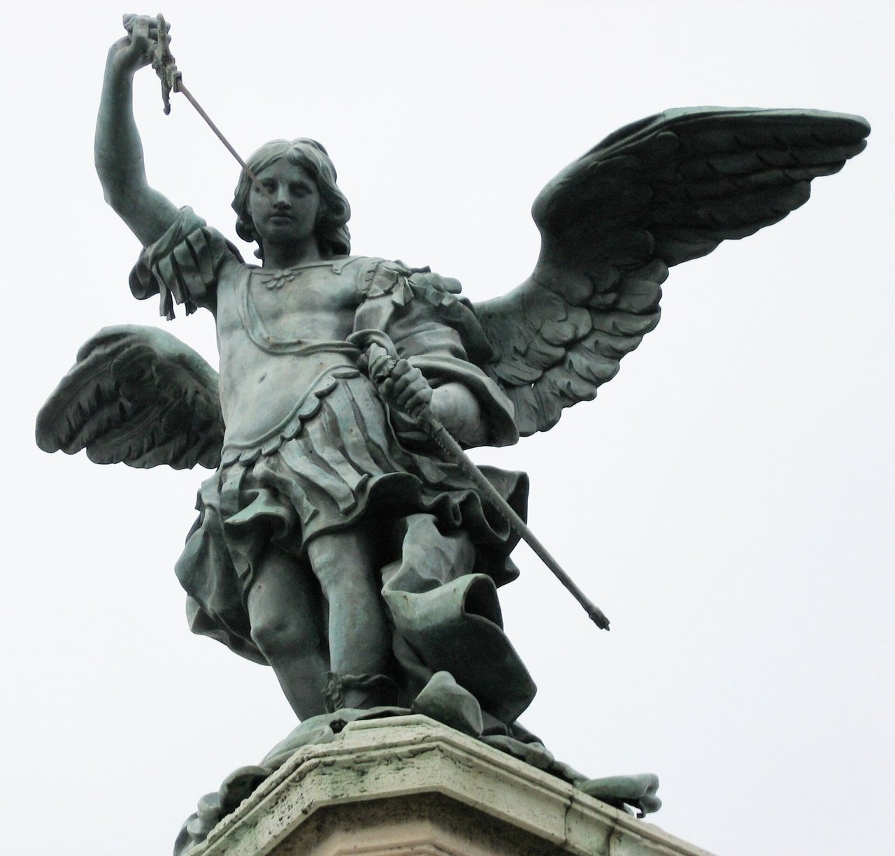

<nav class=toc aria-label="On this page">

On this page

<ol>
<li><a href="#name">Who is like God?</a></li>
<li><a href="#daniel">Daniel's prince</a></li>
<li><a href="#jude">Jude and the body of Moses</a></li>
<li><a href="#revelation">The war in heaven</a></li>
<li><a href="#not-named">Angels the Bible does not call Michael</a></li>
<li><a href="#feasts">Feasts, East and West</a></li>
<li><a href="#shrines">The sanctuaries</a></li>
<li><a href="#art">How artists have seen him</a></li>
<li><a href="#prayer">The prayer, and Michaelmas</a></li>
</ol>
</nav>

Michael is the angel the Church calls prince of the heavenly host. His name is a question, and the question is his praise. Hebrew *Mi-ka-El* asks, "Who is like God?" The answer the name expects is: no one. He is not a man who lived and died. He is the protector Daniel saw standing for God's people, the archangel Jude heard refuse to curse the devil, and the captain Revelation sets at the head of the angels when war breaks out in heaven.

Christians have loved him from the beginning. Jews already knew him in Daniel. Muslims honour an angel of this name beside Gabriel. The portraits are not the same, and this page tells the Christian one: Scripture first, then the feasts and the sanctuaries, then the art.

<svg viewBox="0 0 120 28" width="120" height="28" focusable="false"><path d="M8 14c8-9 16-9 22 0s14 9 22 0 14-9 22 0 14 9 22 0 16-9 16 0" fill="none" stroke="currentColor" stroke-width="2.4" stroke-linecap="round"/><path d="M8 14c8 9 16 9 22 0s14-9 22 0 14 9 22 0 14-9 22 0 16 9 16 0" fill="none" stroke="currentColor" stroke-width="2.4" stroke-linecap="round"/></svg>

<h2 id=name>Who is like God?</h2>

The Bible uses the name Michael for the archangel, and also for men. In the genealogies of Chronicles and in Ezra, Michael is a man's name: a head of a family, a captain, a son in a royal list (2 Chronicles 21:2 names a Michael among the sons of Jehoshaphat; Ezra 8:8 names another). Those are people. The Michael of this page is the one Daniel calls a prince, and the one Jude calls the archangel.

He is one of three angels the Catholic canon names. **Gabriel** is named in Daniel 8:16 and 9:21, and again in Luke 1, when he comes to Zechariah and to Mary. **Raphael** is named in Tobit, which the Catholic and Orthodox churches keep among the Scriptures: "I am Raphael, one of the seven holy angels" (Tobit 12:15). Michael is the third. Since 1969 the Roman calendar keeps all three together on **29 September**. He was never a candidate for canonisation. The Church does not make angels saints by a process. She recognises the one Scripture and the old liturgies already honoured.

<h2 id=daniel>Daniel's prince</h2>

The book of Daniel is where Michael enters the Bible by name.

In chapter 10 a glorious messenger has been delayed. He tells Daniel that the prince of the kingdom of Persia withstood him twenty-one days, until **Michael, one of the chief princes**, came to help (Daniel 10:13). A little later the same messenger says he must return to that struggle, and that he has no ally against the princes of Persia and Greece except **Michael your prince** (Daniel 10:20–21). The vision is of nations with unseen patrons. Israel's patron has a name.

Chapter 12 opens on the last distress: "And at that time shall Michael stand up, the great prince which standeth for the children of thy people" (Daniel 12:1). He stands when the people are in their greatest trouble, and the book goes on to the resurrection, some to everlasting life. Michael's work, in Daniel, is not a private wonder. It is the defence of a people.

<h2 id=jude>Jude and the body of Moses</h2>

The letter of Jude is one short chapter, and it spends a verse on him. "Michael the archangel, when contending with the devil he disputed about the body of Moses, durst not bring against him a railing accusation, but said, The Lord rebuke thee" (Jude 9).

The books of Moses do not tell that dispute. Deuteronomy says Moses died in the land of Moab and that God buried him, and that no one knows the grave (Deuteronomy 34:5–6). Jude is using a story Jews already told, often connected with a writing called the Assumption, or the Testament, of Moses, which we no longer have whole. What Jude himself insists on is the manner. Even the archangel does not answer the devil with insults. He hands the rebuke to God. The letter's point is humility: if Michael would not rail, neither should the Church.

<h2 id=revelation>The war in heaven</h2>

Revelation 12 is the picture almost every later image remembers. "Now war arose in heaven, Michael and his angels fighting against the dragon" (Revelation 12:7). The dragon is named in the same chapter: the ancient serpent, the devil, Satan. He is thrown down, and his angels with him. Michael does not fight alone. The text says "Michael and his angels."

The chapter also shows a woman clothed with the sun, and a child caught up to God. It does not give them the names Mary and Jesus. The Church has long read the woman as Mary, and also as the people of God, and the child as Christ. That reading is the Church's, loved in the liturgy and in art. It is not a name printed in the verse. What the verse does name is Michael, and the dragon.

<figure class=photo>
<picture><source srcset="/static/art/michael-bamberg-600.webp 600w,/static/art/michael-bamberg.webp 984w" sizes="(max-width:760px) 100vw,760px" type="image/webp"></picture>
<figcaption>The Bamberg Apocalypse, about 1000–1020, made for the emperor Otto III or Henry II. Staatsbibliothek Bamberg, Msc.Bibl.140. The page paints the war in heaven: angels against the dragon. Public domain, via <a href="https://commons.wikimedia.org/wiki/File:BambergApocalypseFolio030vStMichaelFightsDragon.JPG">Wikimedia Commons</a>.</figcaption>
</figure>

<h2 id=not-named>Angels the Bible does not call Michael</h2>

Devotion has sometimes wondered whether other angels were Michael in disguise. The texts do not say so, and it is a kindness to the Bible to leave them unnamed where they are unnamed.

The angel of the Lord at the burning bush (Exodus 3) is not called Michael. The one who wrestles Jacob at the Jabbok and will not give his name (Genesis 32) is not called Michael. In the furnace with the three young men, Nebuchadnezzar sees "one like a son of the gods" (Daniel 3). The book does not name him. The angels at the empty tomb are not named (Matthew 28; Mark 16; Luke 24; John 20, where there are two). The angel who opens Peter's prison (Acts 12) is not named. The angel who tells the shepherds about the child in Bethlehem is not named (Luke 2). Where a later writer guessed that one of these was Michael, that guess is the writer's, not the verse.

Gabriel and Raphael are the caution in the other direction. They have their own names and their own errands. Gabriel's errand is the message. Raphael's, in Tobit, is healing and companionship on the road. Michael's, in the places he is named, is the people, the dispute he will not finish by insult, and the war against the dragon.

<h2 id=feasts>Feasts, East and West</h2>

The Western day, **29 September**, Michaelmas, comes from Rome. A basilica of St Michael on the Via Salaria was dedicated on that date, and the old Roman books kept the dedication. Medieval England made Michaelmas one of the four quarter days, when rents fell due, and Oxford and Cambridge still call their autumn term the Michaelmas term. An English saying told people not to pick blackberries after Michaelmas: the devil, cast out of heaven, had landed in the bramble and spoiled them. That is folklore, and it is how a feast lived in a hedge.

The older Roman calendar also kept **8 May** for the Apparition of St Michael, the memory of [Monte Sant'Angelo](/pilgrimage/st-michael/monte-sant-angelo/) on the Gargano. In 1969 those separate days were gathered, and Michael, Gabriel and Raphael share 29 September.

The Christian East keeps him on other days, and with a wider company. **8 November** is the Synaxis of the Archangel Michael and all the bodiless powers: not Michael alone, but the whole heavenly host under its captain. **6 September** remembers the wonder at **Chonae**, near ancient Colossae. The Synaxarion tells it this way. A church of the Archangel stood by a healing spring. Enemies tried to drown the church by turning two rivers onto it. Michael was asked for, and he struck the rock and opened a cleft that swallowed the flood. The place took the name Chonae, the funnels. It is the East's great story of him as guardian of a holy place. Greek devotion calls him the **Taxiarch**, the commander. Sailors of the Dodecanese still sound their horns for him as they pass [Panormitis](/pilgrimage/st-michael/panormitis-symi/).

The Quran names him once, beside Gabriel: whoever is an enemy to God, his angels, his messengers, Gabriel and Michael, God is an enemy to them (Quran 2:98). Islam's portrait of the angel is its own. The shared name is worth knowing, and it is not the same as the Christian feast.

<h2 id=shrines>The sanctuaries</h2>

Christians built for him on rocks, islands and peaks, the kind of place a captain of angels would be asked to hold. Seven of the famous ones are walked on this site as [St Michael's Line](/pilgrimage/st-michael/), from Ireland to Mount Carmel. A modern story says they stand on one straight stroke of his sword, aligned with the solstice. The sanctuaries are ancient. The perfect line is a recent tale, and on a globe it does not hold. What does hold is the devotion that carried relics, monks and pilgrims from one house of Michael to another. Each house has its own page.

- **[Skellig Michael](/pilgrimage/st-michael/skellig-michael/)**, the sea rock off County Kerry. Monks built beehive huts on it in the early Middle Ages. One strand of Irish telling says Michael stood with Patrick when the demons were driven from the island. UNESCO inscribed the Skelligs in 1996.
- **[St Michael's Mount](/pilgrimage/st-michael/st-michaels-mount/)**, the tidal island in Mount's Bay, Cornwall. Cornish tradition says fishermen saw him on the rock. In the Middle Ages the Mount was a priory of Mont-Saint-Michel, until England dissolved the alien priories in 1414.
- **[Mont-Saint-Michel](/pilgrimage/st-michael/mont-saint-michel/)**, the abbey in the bay of Normandy. The *Revelatio*, written in the early ninth century, tells that in 708 Michael asked Aubert, bishop of Avranches, three times for a church on the rock then called Mont Tombe. Aubert sent to Gargano for a relic of the red cloak and a fragment of the altar. Benedictine monks came in 966. Louis XI founded the Order of St Michael in 1469 and took the Archangel as patron of France. The gilded St Michael on the spire is Emmanuel Frémiet's statue of 1897.
- **[Sacra di San Michele](/pilgrimage/st-michael/sacra-di-san-michele/)**, the abbey on Monte Pirchiriano above the Val di Susa. A chronicle of the house dates the foundation to about 983–987, the gift of Hugh of Montboissier. The tale of the hermit whose stones the angels carried across the valley is the legend the mountain still tells. The Rosminians have kept it since 1836. It is the symbol of Piedmont.
- **[Monte Sant'Angelo](/pilgrimage/st-michael/monte-sant-angelo/)**, the cave on the Gargano, one of the oldest Michael shrines in the West. The *Liber de apparitione* tells three showings to the bishop of Siponto in the 490s, and Michael's word that he himself had consecrated the cave, so that no bishop need. Lombard kings loved it. Crusaders stopped there on the way to the Apulian ports. In the cave stands the marble Michael of 1507, commonly attributed to Andrea Sansovino.
- **[Panormitis, on Symi](/pilgrimage/st-michael/panormitis-symi/)**, the Orthodox monastery of the Taxiarch in the Dodecanese. The house tells that an icon of Michael was found under a bush and returned there whenever it was moved, so the monastery was built where the icon chose to stay. The great icon, covered in silver in 1724, shows him holding a sword and a soul.
- **[Stella Maris on Mount Carmel](/pilgrimage/st-michael/stella-maris-carmel/)** is the eastern end of that modern line, and it should be named honestly. The monastery is the Carmelites' mother house, dedicated to Our Lady and to Elijah, not to Michael. It is on the line because the line's story needed an eastern end, not because an ancient Michael shrine stands there.

One more place belongs with his feast, though it is not one of the seven. At [La Verna](/pilgrimage/assisi/la-verna/) Francis kept the Lent of St Michael, from 15 August to 29 September. In 1224, inside that Lent, the early biographers say he received the stigmata.

[Joan of Arc](/saints/joan-of-arc/) named Michael among the voices that sent her to Orléans. Mont-Saint-Michel, in her years, did not fall to the English.

<h2 id=art>How artists have seen him</h2>

The picture at the head of this page is **Guido Reni**. He painted *The Archangel Michael Defeating Satan* for the Capuchin church of **Santa Maria della Concezione** in Rome, and it is still there. Stephen Pepper dates the painting to 1635; the Roman press of the de' Rossi engraved it in 1636, so the work is kept as about 1635–36. Michael stands in rose and blue, one foot on the enemy, the sword lifted. Rome has looked at that calm face for nearly four centuries.

Three other works carry the same story into other centuries.

<figure class=photo>
<picture><source srcset="/static/art/michael-raphael-600.webp 600w,/static/art/michael-raphael.webp 1280w" sizes="(max-width:760px) 100vw,760px" type="image/webp"></picture>
<figcaption>Raphael, <em>Saint Michael Vanquishing Satan</em> (the Grand Saint Michel), 1518. Pope Leo X commissioned it as a gift for Francis I of France. It hangs in the Musée du Louvre, Paris. Public domain, via <a href="https://commons.wikimedia.org/wiki/File:Le_Grand_Saint_Michel%2C_by_Raffaello_Sanzio%2C_from_C2RMFFXD.jpg">Wikimedia Commons</a> (C2RMF photograph).</figcaption>
</figure>

Raphael had painted a smaller Michael and the dragon about 1504 or 1505, also now in the Louvre. The large canvas of 1518 is the one kings were given. Michael is calm. The demon is crushed under a landscape that opens onto water and hills. The wings are a peacock's splendour. The commission is papal, and the destination was the French court: the same realm that would take Michael as patron under Louis XI.

<figure class=photo>
<picture><source srcset="/static/art/michael-santangelo-600.webp 600w,/static/art/michael-santangelo.webp 1280w" sizes="(max-width:760px) 100vw,760px" type="image/webp"></picture>
<figcaption>Peter Anton von Verschaffelt's angel, cast in bronze by Francesco Giardoni in 1751 and set on Castel Sant'Angelo on 28 June 1752, after Benedict XIV had blessed it. The castle took Michael's name from the story of the plague of 590. Photo: <a href="https://commons.wikimedia.org/wiki/File:Castel_Sant%27Angelo_-_angel.jpg">Flanker</a>, <a href="https://creativecommons.org/licenses/by/3.0">CC BY 3.0</a>, via Wikimedia Commons.</figcaption>
</figure>

During the plague of 590, [Gregory the Great](/saints/gregory-the-great/) ordered processions through Rome. A telling famous by the thirteenth century says that as the procession passed Hadrian's mausoleum, Michael appeared on the summit and sheathed a bloody sword, and the plague ceased. The building has been the Castle of the Angel ever since. The angel pilgrims see there now is Verschaffelt's. Benedict XIV had wanted a new figure for the Jubilee of 1750. Francesco Giardoni cast the bronze on Verschaffelt's model in 1751. On 28 June 1752 the pope blessed it, and that day it was set on the castle, in place of the earlier statue. The year 1753, sometimes printed instead, is a later report that the sculptor, already away from Rome, first saw the finished statue then. The foundry's dates are the casting in 1751 and the installation on 28 June 1752. The sheathing of the sword is the story the castle keeps, the same story told on Gregory's page.

<h2 id=prayer>The prayer, and Michaelmas</h2>

**Pope Leo XIII** added the short Prayer to St Michael in **1886** to the prayers he had ordered after Low Mass in 1884. Many Catholics still know it by heart: "St Michael the Archangel, defend us in battle." A story later grew that he wrote it after seeing Satan during Mass. That story is first heard in the 1930s, and the details do not agree with one another. The prayer is his. The vision is a later telling. The text of the prayer, and the history of the tale, are set out in the sources below.

He is asked for by soldiers, by police, by paramedics, by the sick, and by the dying. A good death has been one of his oldest patronages: the angel who stands for the people in Daniel is asked to stand by a soul at the last. In art he often holds the scales. Scripture does not describe the scales. The Church painted them because she already trusted him with the hour of judgment.

## Path to sainthood
Michael is not a canonised human but one of the three archangels named in the Catholic canon, with Gabriel and Raphael, venerated since the earliest centuries. Since the 1969 calendar the three share **29 September**. The East keeps the Synaxis of Michael and all the bodiless powers on **8 November**.

## Patronages
Soldiers, police officers, paramedics, the sick, grocers in some old lists, and a good death. France took him as patron in the Order of St Michael (1469). Sailors of Symi still claim the Taxiarch.

## Sources
- Daniel 10:13, 10:21, 12:1; Jude 9; Revelation 12:7–9; Deuteronomy 34:5–6; Tobit 12:15; Luke 1:19, 26; Quran 2:98
- [Vatican News: St Michael the Archangel](https://www.vaticannews.va/en/saints/09/29/st--michael--archangel.html)
- [Catholic Encyclopedia: St Michael the Archangel](https://www.newadvent.org/cathen/10275b.htm)
- [Britannica: Michael](https://www.britannica.com/topic/Michael-archangel)
- [Wikipedia: Prayer to Saint Michael (history & sources)](https://en.wikipedia.org/wiki/Prayer_to_Saint_Michael)
- Staatsbibliothek Bamberg, Msc.Bibl.140 (the Bamberg Apocalypse). Raphael's *Saint Michael Vanquishing Satan* of 1518 is the painting in the Louvre known as the Grand Saint Michel; the photograph here is the C2RMF record of that work.
- [Treccani, Dizionario Biografico degli Italiani: Francesco Giardoni](https://www.treccani.it/enciclopedia/francesco-giardoni_(Dizionario-Biografico)/) (the bronze cast in 1751; set on the castle on 28 June 1752, after the papal blessing)
- [Treccani, Dizionario Biografico degli Italiani: Nicola Forti](https://www.treccani.it/enciclopedia/nicola-forti_(Dizionario-Biografico)/) (the blessing of 28 June 1752, prepared at Giardoni's foundry; cites the *Diario ordinario*, 1752, n. 5439)
- [Vatican News, 8 March 2023](https://www.vaticannews.va/it/chiesa/news/2023-03/il-ponte-sant-angelo-dove-gli-angeli-cantano-radente-la-terra.html) (the statue inaugurated in 1752, two years after the Jubilee competition of 1750)
- [Italian Ministry of the Interior, on Reni's St Michael](https://www1.interno.gov.it/mininterno/export/sites/default/it/sezioni/sala_stampa/speciali/100_anni_Viminale/San_Michele.html) (Pepper's date of 1635; engraved at the de' Rossi press in 1636)
- [St Michael's Line](/pilgrimage/st-michael/), with a page for each sanctuary

Expanded November 6, 2026. Scripture is quoted briefly from the public-domain King James Version, except the sentence of Revelation 12:7, which the pilgrimage pages already give from the ESV. The Leo XIII prayer is dated from the sources above. The vision sometimes attached to that prayer is a later telling, and the page says so. Feast days follow the General Roman Calendar unless an Eastern date is named.

