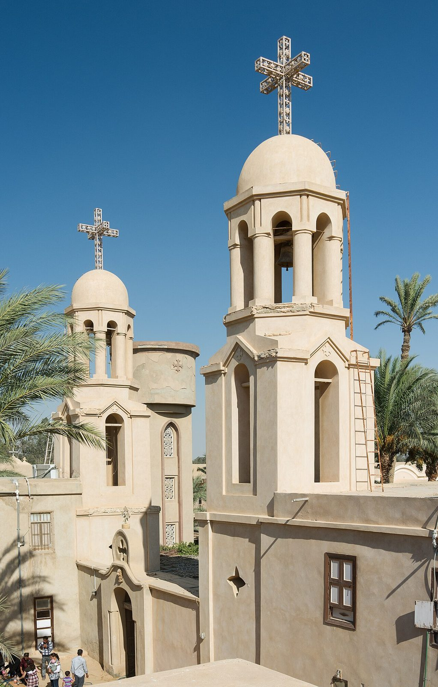

## The story
Moses was an Ethiopian (or Nubian) slave in Egypt who was dismissed by his master for theft and became the leader of a gang of robbers in the Nile valley, feared for his size and violence. Hiding from the law, he took refuge with the monks of **Scetis** (Wadi Natrun) in the desert. Their peace and kindness changed him. He became a monk, then a priest, and one of the best-loved of the **Desert Fathers**.

## The full story

### The leaking basket
The *Sayings of the Desert Fathers* preserve stories about him. Once a council was called to judge a monk who had sinned. Moses refused to come, then arrived carrying a leaking basket full of sand. "What is this?" they asked. "My sins run out behind me, and I do not see them, and today I come to judge the sins of another." The monks forgave their brother.

### The robbers
One night four robbers broke into his cell. Moses overpowered them, tied them up, and carried them to the other monks, asking what to do, since he was not allowed to hurt anyone. When they learned who he was, the robbers became monks too. Moses died around 405, killed with seven other monks by raiders; he refused to defend himself, saying: "All who take the sword will perish by the sword" (Matthew 26:52). The *Sayings of the Desert Fathers* and the *Lausiac History* of Palladius, written within a generation of his death, are how the desert remembered him.

<figure class=photo>
<picture><source srcset="/static/art/moses-paromeos-600.webp 575w,/static/art/moses-paromeos.webp 1022w" sizes="(max-width:760px) 100vw,760px" type="image/webp"></picture>
<figcaption>The Monastery of Paromeos in Wadi Natrun, which keeps his relics. Photo: <a href="https://commons.wikimedia.org/wiki/File:Paromeos_Monastery.jpg">Frank Schulenburg</a>, <a href="https://creativecommons.org/licenses/by-sa/3.0">CC BY-SA 3.0</a>, via Wikimedia Commons.</figcaption>
</figure>

## Path to sainthood
Pre-Congregation saint; venerated in the Coptic, Orthodox and Catholic Churches.

## Patronages
Africans, non-violence, prisoners (popular).

## Trivia
- The Coptic monastery of **Paromeos** in Wadi Natrun keeps his relics.
- He is a patron of programmes for overcoming addiction.

## Sources
- *Apophthegmata Patrum* (Sayings of the Desert Fathers), "Moses"; Palladius, *Lausiac History*, ch. 19.
- [Wikipedia: Moses the Black (overview with scholarly references)](https://en.wikipedia.org/wiki/Moses_the_Black)

Written October 16, 2026 from the sources above. The Wadi Natrun photograph was added November 6, 2026. Feast days follow the General Roman Calendar unless noted.

